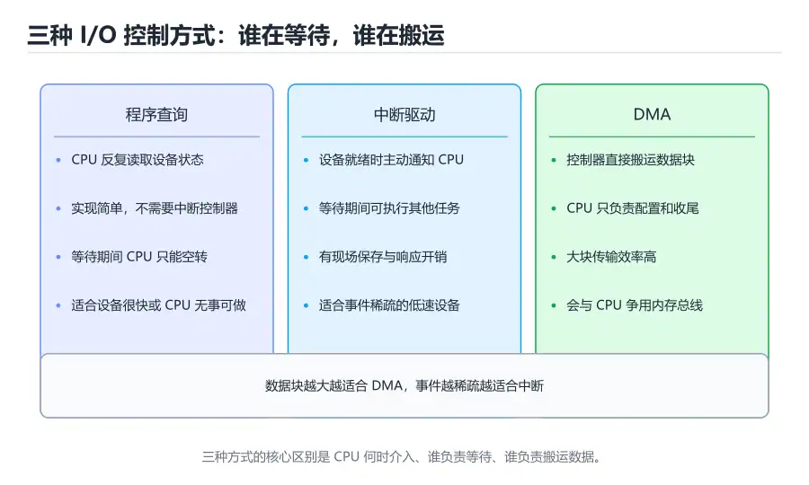

# 总线、中断与 I/O 系统

> 内容更新时间：2026-10-06 · 学习阶段：进阶 · 预计用时：30 分钟



## 本节知识框架

**课程定位**：分类「computer_organization」· 学习阶段 进阶 · 建议用时 30 分钟。

本课主线：把 CPU、内存和外部设备连成一台能工作的机器。先理解总线如何传地址、数据和握手信号，再比较程序查询、中断和 DMA 三种 I/O 控制方式，最后落到中断响应、优先级和驱动程序的真实写法。

**复习清单**

- [ ] 能说出地址总线、数据总线和控制总线各自传什么
- [ ] 能区分同步总线与异步总线的握手方式
- [ ] 能比较程序查询、中断驱动和 DMA 的 CPU 开销
- [ ] 能描述一次中断从设备请求到处理返回的完整流程
- [ ] 能解释内存映射 I/O 与端口映射 I/O 的差异
- [ ] 能运行本课的轮询与中断模拟，比较两者的响应延迟

## 核心概念定义

| 术语 | 一句话说明 |
| --- | --- |
| 总线 | 多个部件共享的一组传输线，承载地址、数据和控制信号 |
| 同步总线 | 用统一时钟约定传输时刻，速度快但受最慢设备限制 |
| 异步总线 | 用请求与应答握手协调传输，适应不同速度的设备 |
| 总线仲裁 | 多个主设备竞争总线使用权时决定谁先发送 |
| 程序查询 | CPU 反复读取设备状态寄存器，直到设备就绪 |
| 中断 | 设备或异常主动打断 CPU，使其转去执行处理程序 |
| 中断向量 | 中断类型对应的处理程序入口地址或入口表项 |
| DMA | 直接存储器访问，由控制器在设备与内存之间搬运数据块 |
| 内存映射 I/O | 把设备寄存器映射到地址空间，用普通访存指令访问 |
| 端口映射 I/O | 设备寄存器位于独立端口空间，用专门指令访问 |
| 中断屏蔽 | 通过屏蔽字暂时禁止某些中断被 CPU 响应 |
| 驱动程序 | 操作系统里管理具体设备、处理中断和发起 I/O 的代码 |

## 原理与运行机制

### 三组总线：地址、数据、控制

CPU 要读内存，先要把地址放到地址总线上，再通过控制总线发出读信号，最后从数据总线取回内容。写操作方向相反。地址总线决定可寻址空间的大小，n 根地址线最多寻址 2^n 个单元；数据总线决定一次能并行传多少位，32 位数据总线一次传 4 字节。

现代处理器很少使用单一共享总线，而是采用分层互连：CPU 与 Cache 之间用高速片上总线，内存控制器与 DRAM 之间用专用通道，外设通过 PCIe 等点对点链路连接。理解传统总线的概念仍然重要，因为地址、数据、控制这三类信息的分离与复用，在所有互连结构中都存在。

### 同步与异步：两种握手方式

同步总线靠时钟节拍工作。主设备在某个时钟沿发出地址，在下一个时钟沿采样数据，所有设备必须在这个时间窗口内完成响应。它的控制逻辑简单、吞吐量高，但时钟频率必须迁就最慢的设备，长距离传输还会遇到时钟偏斜。

异步总线不依赖统一时钟，而用请求（Request）和应答（Acknowledge）握手。主设备发出请求后等待从设备应答，确认后再撤销请求。握手可以全互锁，也可以半互锁或非互锁，用不同的时序换取速度与可靠性。异步总线适合连接速度差异大的设备，但每次传输的协议开销更高。

```text
同步写事务：
时钟沿 1：主设备发出地址 + 写命令 + 数据
时钟沿 2：从设备采样并写入
时钟沿 3：事务结束，可开始下一次

异步写事务：
主设备：地址有效 → 发出 Request
从设备：采样地址与数据 → 发出 Acknowledge
主设备：撤销 Request
从设备：撤销 Acknowledge
```

### 总线仲裁与带宽

当多个设备都能发起传输时，需要仲裁决定谁先使用总线。集中式仲裁用一个仲裁器收集请求，按固定优先级、轮询或公平算法授予总线；分布式仲裁让各设备通过共享线路自行协商。优先级方案实现简单，但低优先级设备可能长期得不到总线，形成饥饿。

总线带宽等于每次传输的字节数除以传输周期。提高带宽可以加宽数据总线、提高时钟频率、减少协议开销，或者改用点对点链路让多个设备并行传输。但带宽提升不等于延迟降低：一次小传输仍然要经历仲裁、地址译码和握手，固定开销很难消除。

### 程序查询：最简单也最浪费

程序查询由 CPU 主动轮询设备状态寄存器。CPU 反复读取状态位，看到「就绪」后再读写数据寄存器。这种方式不需要中断控制器，逻辑简单，适合状态变化很快、CPU 本来就在等待的场景；缺点是 CPU 在轮询期间什么正事也做不了。

如果设备很慢，轮询会浪费大量周期。假设设备每 1 毫秒才就绪一次，而 CPU 每 100 个周期查询一次，那么绝大多数查询都返回「未就绪」。在嵌入式系统里，如果 CPU 没有其他任务，轮询反而比中断更可预测；但在通用操作系统里，CPU 的时间应该拿去做别的事。

### 中断：让设备主动找 CPU

中断的基本流程是：设备完成一次传输或发生错误后，向中断控制器发出请求；中断控制器根据优先级和屏蔽状态，向 CPU 发出中断信号；CPU 在当前指令执行完毕后保存现场，根据中断向量跳到处理程序；处理程序读取设备状态、完成必要操作、清除中断标志，最后返回并恢复现场。

中断按来源可分为外部中断和内部异常。外部中断来自 I/O 设备、定时器等；内部异常来自指令执行，例如除零、缺页、非法指令。按是否可屏蔽可分为可屏蔽中断和不可屏蔽中断，后者通常用于电源故障、硬件错误等必须立即处理的事件。

中断优先级决定同时有多个请求时先响应谁。高优先级中断可以打断低优先级中断的处理程序，形成嵌套中断；嵌套太深会消耗大量栈空间，也会让最坏情况响应时间难以分析。操作系统通常把中断处理分成上半部和下半部：上半部只做最紧急的硬件操作并尽快返回，下半部推迟到稍后执行，减少关中断时间。

### DMA：把搬运工作交给控制器

DMA 控制器可以在外设和内存之间直接搬运数据，不需要 CPU 逐字节参与。CPU 只需配置源地址、目标地址、传输长度和方向，然后启动 DMA；传输完成后，DMA 控制器发出中断通知 CPU。这样 CPU 只在开始和结束时介入，中间的搬运由硬件完成。

DMA 会与 CPU 争用内存总线。周期窃取（cycle stealing）让 DMA 每次只占用一个总线周期，CPU 的访存被短暂推迟；突发传输则让 DMA 连续占用总线一段时间，吞吐量高但会影响 CPU 的实时性。现代系统用 IOMMU 做地址转换和隔离，防止设备通过 DMA 访问不该访问的内存。

### 内存映射 I/O 与端口映射 I/O

内存映射 I/O 把设备寄存器放进统一的地址空间，CPU 用普通的 load/store 指令读写这些地址。优点是编程模型统一，寻址方式丰富，可以用指针直接操作；缺点是会占用地址空间，且需要防止编译器把设备访问优化掉，因此寄存器通常声明为 `volatile`。

端口映射 I/O 使用独立的端口地址空间，需要专门的输入输出指令，例如 x86 的 `in` 和 `out`。它不占用内存地址空间，但指令集和编程模型更特殊，移植性较差。两种方式没有绝对优劣，取决于体系结构的历史和设计取舍。

## 典型应用场景

### 键盘与鼠标

键盘每次按键产生一个扫描码，控制器把它放进数据寄存器并发出中断。驱动程序在中断处理程序里读取扫描码，转换成键值后放入输入队列，再把大部分处理推迟到下半部。如果采用轮询，CPU 必须不断检查键盘状态，笔记本电池会很快耗尽。

### 磁盘与固态硬盘

块设备通常使用 DMA 搬运数据。驱动程序构造请求、配置 DMA 描述符、启动传输，然后让出发起 I/O 的进程睡眠；传输完成后磁盘发出中断，驱动程序唤醒等待的进程。现代 NVMe 固态硬盘使用多队列和轮询模式，减少中断开销，在高并发场景下能显著提高 IOPS。

### 网络数据包接收

网卡收到数据包后，通过 DMA 把数据写入内存环形缓冲区，再发出中断。驱动程序在处理程序里把缓冲区交给协议栈，并重新填充空闲缓冲区。高流量下如果每个包都触发一次中断，CPU 会被中断淹没，因此网卡支持中断合并：积累多个包或等待一小段时间再发一次中断。

### 嵌入式实时控制

电机控制、传感器采样等场景要求确定性响应。工程师可能选择轮询，因为轮询的延迟可预测；也可能使用带优先级的中断，并仔细计算最坏情况响应时间。DMA 用于搬运采样数据，让 CPU 专注于控制算法。选型时要看抖动容忍度，而不只是平均延迟。

## 代码/协议/SQL 示例

### 用 Python 模拟轮询与中断

下面的模拟器把 CPU 的每个周期分成「执行任务」和「检查设备」两部分。轮询版本在设备就绪前一直占着 CPU 查询状态，中断版本只在设备就绪时打断 CPU。统计有效工作周期，就能看出两种方式的差异。

```python
def run_polling(total_cycles, ready_cycle):
    worked = 0
    for cycle in range(total_cycles):
        if cycle <= ready_cycle:
            continue  # 就绪前一直轮询，就绪当拍还要搬运数据
        worked += 1
    return worked


def run_interrupt(total_cycles, ready_cycle, handler_cycles=2):
    worked = 0
    cycle = 0
    while cycle < total_cycles:
        if cycle == ready_cycle:
            cycle += handler_cycles
            continue
        worked += 1
        cycle += 1
    return worked


TOTAL = 100
for ready in (60, 90):
    print(f"READY={ready} 轮询有效周期", run_polling(TOTAL, ready))
    print(f"READY={ready} 中断有效周期", run_interrupt(TOTAL, ready))
```

这个模型让轮询版本在就绪前一直空转，只统计就绪之后能执行其他任务的周期，因此设备越晚就绪，有效工作越少；中断版本只在就绪时花 2 个周期处理，两种就绪时间下都是 98。真实系统还要计入中断延迟、总线争用和设备搬运数据本身的开销，但「轮询靠空等、中断把等待还给 CPU」的差别已经很清楚。

### 用 C 访问内存映射寄存器

```c
#include <stdint.h>
#include <stdio.h>

#define UART_BASE 0x40001000UL
#define UART_DATA (*(volatile uint32_t *)(UART_BASE + 0x00))
#define UART_STATUS (*(volatile uint32_t *)(UART_BASE + 0x04))
#define UART_READY (1U << 5)

static int uart_send(const char *text) {
    for (const char *p = text; *p != '\0'; p++) {
        // 等待发送缓冲区有空位；真实驱动应带超时，避免死等
        while ((UART_STATUS & UART_READY) == 0) {
        }
        UART_DATA = (uint8_t)*p;
    }
    return 0;
}

int main(void) {
    uart_send("hello\n");
    return 0;
}
```

`volatile` 告诉编译器每次都要真正访问这个地址，不能把循环里的读取提到循环外，也不能把写操作删掉。没有它，优化器可能认为状态寄存器永远不会变化，从而生成一个死循环或完全跳过写入。嵌入式开发中，寄存器地址、位定义和访问宽度都必须严格按芯片手册来写。

### 中断处理程序的骨架

```c
#include <stdint.h>

static volatile uint32_t tick_count = 0;

// 定时器中断服务程序：只做最少的工作
void timer_isr(void) {
    tick_count++;
    // 清除中断标志，否则退出后会立即再次进入
    volatile uint32_t *timer_clear = (volatile uint32_t *)0x40002008UL;
    *timer_clear = 1;
}

uint32_t uptime_ticks(void) {
    return tick_count;
}
```

中断服务程序应尽量短小，避免调用可能阻塞的函数。计数变量要加 `volatile`，主循环读取时才能看到中断里的修改；在 32 位以上的变量上，主循环读取还可能被中断打断，需要关中断或使用原子操作保护。

## 时间/空间复杂度或性能分析

### 三种 I/O 方式的 CPU 开销

程序查询的 CPU 开销与等待时间成正比。设备越慢，轮询浪费的周期越多；在等待期间，CPU 无法执行其他任务。中断方式把等待时间还给 CPU，但每次传输都有中断响应、现场保存和恢复的固定开销，适合「事件稀疏、每次数据量不大」的场景。

DMA 把数据搬运从 CPU 卸载到控制器，CPU 只负责配置和收尾。传输块越大，DMA 的固定开销被摊得越薄，优势越明显；传输块很小时，配置 DMA 描述符和中断处理的成本可能超过直接拷贝。实际驱动会根据数据大小选择 PIO 或 DMA 路径。

| 方式 | CPU 参与程度 | 适合场景 | 主要缺点 |
| --- | --- | --- | --- |
| 程序查询 | 全程参与，反复读状态 | 设备很快、CPU 无事可做 | 浪费 CPU，响应不及时 |
| 中断驱动 | 只在事件发生时参与 | 低速设备、事件稀疏 | 中断开销，高负载下可能被淹没 |
| DMA | 配置和收尾时参与 | 大块数据传输 | 总线争用，配置复杂 |

### 中断延迟与最坏情况

中断延迟从设备发出请求开始，到处理程序的第一条指令开始执行。它包括硬件识别中断、完成当前指令、保存现场、读取向量、跳转等环节。关中断区间会进一步拉长延迟，因此内核会尽量缩短临界区。

实时系统关心最坏情况延迟，而不是平均值。嵌套中断、DMA 占用总线、Cache 缺失都可能让某一次响应变慢。分析时要列出所有可能的阻塞源，并用 worst-case execution time 工具或硬件追踪验证，不能只跑几组平均数据就下结论。

### 总线带宽与利用率

总线带宽等于位宽乘以频率，再扣除协议开销。例如 64 位数据总线、200 MHz 时钟，理论带宽是 64/8 × 200M = 1.6 GB/s；如果每次传输需要两个地址周期和一个等待周期，有效带宽会明显低于理论值。

提高利用率的方法包括：增大突发传输长度，减少地址和仲裁开销；把读写批量合并，避免频繁方向切换；使用分离事务，让主设备在等待数据时释放总线。设计者要在峰值带宽、平均延迟和硬件成本之间取舍。

### 测量方法

用逻辑分析仪或处理器追踪单元抓取总线事务和中断时间戳，能看清一次 I/O 从请求到完成的完整路径。软件侧可以用 `perf` 观察中断次数、软中断耗时和上下文切换。测量高并发网络时，要区分中断开销、协议栈开销和内存拷贝开销，否则容易把瓶颈归错地方。

## 常见误区与易错点

| 错误认识 | 实际发生的情况 | 更稳妥的做法 |
| --- | --- | --- |
| 中断一定比轮询快 | 中断有响应和现场保存开销，高频事件下反而更慢 | 按事件频率和延迟要求选择 |
| DMA 完全不需要 CPU | CPU 仍要配置控制器、处理完成中断和错误 | 把 CPU 开销算进总成本 |
| 中断处理程序可以随便写长 | 长时间关中断会拖慢其他设备响应 | 上半部短小，重活放到下半部 |
| 内存映射 I/O 可以像普通内存一样缓存 | 设备寄存器会自行变化，缓存会读到旧值 | 使用 volatile 并遵循内存屏障 |
| 总线频率越高带宽一定越大 | 位宽、协议开销和等待周期同样影响带宽 | 用有效带宽而不是时钟频率评估 |
| 中断优先级越高越好 | 所有设备都抢高优先级会让系统失去层次 | 按紧急程度合理分配 |
| DMA 传输不会出错 | 地址错误、越界和设备故障都可能发生 | 使用 IOMMU 并校验完成状态 |
| 轮询是过时技术 | 高吞吐网络和低延迟设备仍在使用轮询 | 按场景评估，不盲目追新 |

## 与其他知识点的关系

### 先修课程

本课需要《数字逻辑与电路基础》中的时序逻辑和握手概念，也需要《指令系统与汇编基础》中的内存访问指令和异常入口。理解《存储层次与 Cache》里的地址与访存流程，有助于区分 Cache 访问和设备寄存器访问。

### 相关概念对比

- **中断 vs 异常**：中断通常来自外部设备，异步发生；异常由当前指令触发，与指令执行同步。
- **DMA vs 中断驱动**：两者都用中断通知完成，但 DMA 把数据搬运交给控制器，中断驱动由 CPU 逐字读写。
- **内存映射 I/O vs 端口映射 I/O**：前者用普通访存指令，后者用专门 I/O 指令和独立地址空间。
- **同步总线 vs 异步总线**：前者靠时钟，后者靠握手；前者快而受最慢设备限制，后者灵活但协议开销大。

### 后续衔接

学完本课后，《虚拟内存与地址转换》会解释设备 DMA 为什么要经过 IOMMU 做地址转换；实战项目会让模拟器接上内存映射的串口设备，用轮询和中断两种方式输出字符，观察周期数差异。

## 自测题与参考答案

### 自测 1

为什么中断处理程序通常要做的第一件事之一是保存现场？

**参考答案**：中断发生时，CPU 正在执行某段程序，寄存器和程序状态字里保存着这段程序的中间结果。处理程序如果不保存就直接使用这些寄存器，返回后原程序的数据会被破坏。保存现场后，处理程序可以自由使用寄存器，返回前再恢复，原程序才能像什么都没发生一样继续执行。

### 自测 2

DMA 传输完成后，为什么通常还要发一次中断？

**参考答案**：DMA 控制器只负责搬运数据，CPU 需要知道传输何时完成、是否出错，才能唤醒等待的进程或继续后续处理。完成中断就是通知机制。若采用轮询完成状态，CPU 仍要反复检查，失去了 DMA 减少 CPU 参与的部分意义，因此大多数驱动使用完成中断。

### 自测 3

内存映射 I/O 的寄存器为什么必须声明为 volatile？

**参考答案**：设备寄存器的值可能由硬件在任何时刻改变，编译器看不到这种变化。如果按普通变量处理，优化器可能把循环中的重复读取合并成一次，或者认为写入没有读者而删除。`volatile` 强制每次访问都真正读写内存，保证程序能看到设备的最新状态。

### 自测 4

同步总线和异步总线各适合什么场景？

**参考答案**：同步总线用统一时钟协调，控制简单、吞吐量高，适合设备速度相近、传输距离短的片内或板内互连。异步总线用请求应答握手，能适应速度差异大的设备，适合跨插槽、长距离或热插拔场景。选择时要权衡速度、兼容性和协议复杂度。

### 自测 5

运行本课的轮询模拟，把设备就绪时间从第 60 周期推迟到第 90 周期，有效工作周期会怎样变化？

**参考答案**：轮询版本的有效工作周期从 39 降到 9，因为就绪前的 60 或 90 个周期都耗在反复查询状态上；中断版本两种情况下都是 98，等待期间 CPU 一直在执行任务。这个对比说明中断的优势来自「不必空等」，而不是处理本身更快。

## 考点精讲

### 考点 1

程序查询方式与中断方式最本质的区别是什么？

A. 程序查询由 CPU 反复读取设备状态，中断由设备主动通知 CPU

B. 程序查询只能用于输入设备，中断只能用于输出设备

C. 程序查询不需要驱动程序，中断必须运行在用户态

D. 程序查询的数据不经过内存，中断的数据必须经过内存

**正确答案：A**

**详细解释**：程序查询让 CPU 主动轮询状态寄存器，设备没有就绪时 CPU 只能空转；中断则由设备或控制器发出请求，CPU 在事件发生后才介入。两者都可以用于输入和输出，都需要驱动逻辑，数据也都要经过内存或寄存器。正确项「程序查询由 CPU 反复读取设备状态，中断由设备主动通知 CPU」点出了控制方向的根本差异。

---

### 考点 2

DMA 控制器的主要作用是什么？

A. 把虚拟地址翻译成物理地址

B. 提高 CPU 的时钟频率

C. 在外设与内存之间直接搬运数据块，减少 CPU 逐字参与

D. 替代中断控制器管理所有中断优先级

**正确答案：C**

**详细解释**：DMA 控制器接收 CPU 配置的源地址、目标地址和长度，自行完成数据块搬运，完成后用中断通知 CPU。地址翻译通常由 MMU 或 IOMMU 负责，时钟频率由时钟树决定，中断优先级由中断控制器管理。正确项「在外设与内存之间直接搬运数据块，减少 CPU 逐字参与」准确概括了 DMA 的职责。

---

### 考点 3

中断向量表中通常存放什么？

A. 设备的电源管理配置

B. 各中断类型对应的处理程序入口地址

C. 当前进程的页表基址

D. 总线仲裁的优先级编码

**正确答案：B**

**详细解释**：CPU 响应中断后，需要知道该跳到哪段代码执行。中断向量表按中断类型号索引，表项保存处理程序入口地址或跳转指令，硬件据此更新程序计数器。页表基址属于地址转换，仲裁编码属于总线管理。正确项「各中断类型对应的处理程序入口地址」说明了向量表的核心内容。

---

### 考点 4

同步总线传输相比异步总线，最主要的限制是什么？

A. 不能传输地址信息

B. 每次只能连接一个设备

C. 必须使用 DMA 才能工作

D. 所有设备都要在统一时钟节拍内完成响应，受最慢设备制约

**正确答案：D**

**详细解释**：同步总线靠统一时钟约定传输时刻，速度快、控制简单，但设备必须在规定节拍内响应，时钟周期要迁就最慢的设备，长距离传输还会出现时钟偏斜。异步总线用请求应答握手适应不同速度，代价是协议开销更大。正确项「所有设备都要在统一时钟节拍内完成响应，受最慢设备制约」指出了同步总线的关键约束。

---

### 考点 5

内存映射 I/O 的主要特点是什么？

A. 设备寄存器占用内存地址空间，可用普通访存指令访问

B. 设备寄存器位于独立端口空间，必须使用专门 I/O 指令

C. 设备数据只能通过 DMA 访问，CPU 不能直接读写

D. 设备寄存器会自动缓存，不需要考虑一致性

**正确答案：A**

**详细解释**：内存映射 I/O 把设备寄存器映射到统一地址空间，CPU 用 load/store 访问，编程模型与普通内存一致，但要用 `volatile` 防止优化。独立端口空间并用专门指令访问的是端口映射 I/O；DMA 是另一种数据传输方式，不排斥 CPU 直接读写寄存器。正确项「设备寄存器占用内存地址空间，可用普通访存指令访问」描述了内存映射 I/O 的本质。

## 术语速查

| 术语 | 一句话说明 |
| --- | --- |
| 地址总线 | 传输 CPU 或主设备发出的地址信息 |
| 数据总线 | 在部件之间并行传输数据 |
| 控制总线 | 传输读、写、中断、应答等控制信号 |
| 总线仲裁 | 多个主设备竞争总线时决定使用顺序 |
| 同步总线 | 用统一时钟协调传输的总线 |
| 异步总线 | 用请求与应答握手协调传输的总线 |
| 中断向量 | 中断类型对应的处理程序入口信息 |
| 中断屏蔽 | 暂时禁止 CPU 响应某些中断 |
| DMA | 由控制器在设备与内存之间直接搬运数据块 |
| IOMMU | 为设备 DMA 提供地址转换与访问隔离的硬件 |
| 内存映射 I/O | 用内存地址访问设备寄存器的方式 |
| 中断合并 | 积累多个事件后统一发一次中断以减少开销 |

## 参考资料与复核

- 复核范围：总线分类与握手、中断响应流程、DMA 机制、I/O 控制方式对比

| 参考资料 | 本课用途 |
| --- | --- |
| [PCI-SIG Specifications](https://pcisig.com/specifications) | PCIe 等现代 I/O 互连规范的官方入口 |
| [Linux Kernel DMA-API](https://docs.kernel.org/core-api/dma-api.html) | Linux 驱动如何使用 DMA 映射与同步 |
| [Intel 64 and IA-32 Architectures Software Developer Manuals](https://www.intel.com/content/www/us/en/developer/articles/technical/intel-sdm.html) | 中断、异常和 I/O 访问的体系结构细节 |
| [Operating Systems: Three Easy Pieces - I/O Devices](https://pages.cs.wisc.edu/~remzi/OSTEP/file-devices.pdf) | 操作系统视角的设备、中断与驱动讲解 |

- 最后复核：2026-10-04
- 下次复核：2027-10-25

## 内容元数据

- 内容版本：v2.0
- 最后更新：2026-10-06
- 学习阶段：进阶
- 适用环境：通用开发环境
- 内容来源：内置结构化课程与工程实践整理
- 相关主题：computer organization bus interrupt dma io
- 质量版本：P0 测验标准 + P1 覆盖扩展 + P2 体验补全
