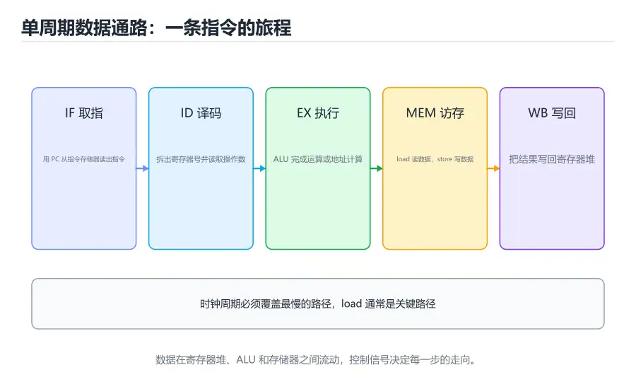

# CPU 数据通路与控制

> 内容更新时间：2026-10-06 · 学习阶段：进阶 · 预计用时：25 分钟



## 本节知识框架

**课程定位**：分类「computer_organization」· 学习阶段 进阶 · 建议用时 25 分钟。

本课主线：把指令系统中的每条指令拆成「数据走哪条路、控制信号怎么给」，从寄存器堆、ALU、存储器、多路选择器出发，理解单周期 CPU 怎样完成取指、运算、访存和写回。

**复习清单**

- [ ] 能画出一条 R 型指令在数据通路中的完整路径
- [ ] 能说出 load、store、分支指令分别需要哪些控制信号
- [ ] 能解释寄存器堆的读写端口和写使能作用
- [ ] 能判断单周期 CPU 的关键路径通常出现在哪类指令
- [ ] 能区分硬布线控制与微程序控制
- [ ] 能运行本课的单周期模拟器并跟踪信号变化

## 核心概念定义

| 术语 | 一句话说明 |
| --- | --- |
| 数据通路 | 指令执行过程中数据流经的寄存器、ALU、存储器和连线集合 |
| 控制单元 | 根据操作码产生读写使能、ALU 操作和多路选择信号的逻辑 |
| 寄存器堆 | 按编号读写多个寄存器的部件，通常有两个读端口和一个写端口 |
| ALU | 算术逻辑单元，完成加减、与或、比较和移位等运算 |
| 立即数生成器 | 把指令中的立即数字段扩展并拼接成完整操作数的组合逻辑 |
| 多路选择器 | 根据选择信号从多路输入中选一路输出的组合部件 |
| 写回 | 把执行或访存结果写回寄存器堆的阶段 |
| 关键路径 | 组合逻辑中延迟最长的一条路径，决定最小时钟周期 |
| 单周期 CPU | 每条指令在一个时钟周期内完成的处理器组织方式 |
| 多周期 CPU | 把一条指令拆成多个时钟周期执行的处理器组织方式 |

## 原理与运行机制

### 数据通路：给数据修一条路

如果把 CPU 想象成一座工厂，数据通路就是车间里的传送带和工位：寄存器堆是原料架，ALU 是加工台，数据存储器是成品仓库，多路选择器是岔道口，控制单元则是调度员。指令不同，数据走的路线也不同；控制信号的任务，就是在正确的时刻把岔道口扳到正确方向。

单周期 CPU 的目标很直接：让每条指令在一个时钟周期内走完自己的路线。取指阶段从指令存储器读出指令，译码阶段并行读取寄存器并生成立即数，执行阶段由 ALU 计算，访存阶段读写数据存储器，最后在时钟边沿把结果写回寄存器。所有阶段在同一个周期内完成，控制逻辑相对直观。

### 一条 R 型指令的路径

以 `add x5, x6, x7` 为例：PC 指向指令地址，指令存储器输出 32 位指令；译码器从指令中取出 rs1=6、rs2=7、rd=5；寄存器堆读出 x6 和 x7；ALU 根据功能码执行加法；结果通过写回多路选择器送回寄存器堆，在时钟边沿写入 x5。

这条路径不需要访问数据存储器，也不需要立即数。控制信号会关闭 MemRead 和 MemWrite，让 ALUSrc 选择寄存器操作数，让 MemToReg 选择 ALU 结果，并在写回阶段拉高 RegWrite。任何一个信号给错，结果就会写到错误的寄存器或走错数据源。

### load 与 store 的路径差异

`lw x5, 8(x6)` 需要先算地址：寄存器 x6 的值加上立即数 8。因此 ALUSrc 要选择立即数，ALU 执行加法，结果送入数据存储器地址端口；MemRead 有效后，存储器读出数据，再通过写回多路选择器写入 x5。这条路径比 R 型指令多了一次存储器访问，通常也是单周期 CPU 中最慢的路径。

`sw x5, 8(x6)` 同样先算地址，但它要把寄存器 x5 的值写入存储器，因此 MemWrite 有效、RegWrite 无效。注意 store 不需要写回寄存器，控制信号必须确保寄存器堆不被误写。很多初学者在实现 store 时忘记关闭 RegWrite，导致目标寄存器被地址或数据污染。

### 分支指令与 PC 更新

条件分支需要比较两个寄存器。一种常见做法是用 ALU 做减法，根据零标志判断是否相等；另一种是单独的比较器。若条件成立，下一条 PC 取分支目标地址，否则取 PC+4。分支目标通常由当前 PC（或 PC+4）加上符号扩展、并按指令长度对齐后的立即数得到。

把 PC 的下一条值做成多路选择器，是控制逻辑的经典设计：普通指令选 PC+4，分支成立选目标地址，跳转指令选寄存器或拼接后的地址。选择信号来自控制单元和 ALU 的零标志，二者组合决定最终走向。只要这个多路选择器出错，程序就会「跑飞」，而且往往很难通过单条指令的测试发现。

### 控制信号表

把常见指令所需的信号列成表，是从「看懂数据通路」到「能实现 CPU」的关键一步：

| 指令类型 | RegWrite | ALUSrc | MemRead | MemWrite | MemToReg | Branch |
| --- | --- | --- | --- | --- | --- | --- |
| R 型运算 | 1 | 0 | 0 | 0 | 0 | 0 |
| load | 1 | 1 | 1 | 0 | 1 | 0 |
| store | 0 | 1 | 0 | 1 | 无关 | 0 |
| 条件分支 | 0 | 0 | 0 | 0 | 无关 | 1 |
| 立即数运算 | 1 | 1 | 0 | 0 | 0 | 0 |

「无关」不是随便填，而是实现时可以取任意值，因为对应数据不会被使用。但在硬件描述语言中，最好显式给出确定值，避免仿真和综合结果不一致。控制单元通常由操作码和功能码共同驱动，R 型指令还要看 funct 字段才能区分加、减、与、或。

### 硬布线控制与微程序控制

硬布线控制用组合逻辑直接生成控制信号，速度快，适合 RISC 这类指令规整、控制简单的架构。它的缺点是修改困难：增加一条指令可能要重新设计一片逻辑，验证成本也高。

微程序控制把控制信号存成微指令，放在控制存储器中。执行一条机器指令时，按微地址依次取出微指令，产生相应的控制信号。它灵活、易于扩展，适合指令复杂的 CISC；代价是多了一次控制存储访问，速度略慢。现代处理器常把两者结合：常用指令用硬布线快速路径，复杂指令用微码或固件处理。

## 典型应用场景

### CPU 模拟器与教学实验

用软件模拟数据通路，可以在不接触硬件的情况下观察每条指令的信号变化。教学实验常要求学生实现一个支持十几条指令的单周期 CPU，再用测试程序验证。模拟器还能记录每条指令的周期数，为后续流水线课程提供对照基线。

### 硬件描述语言设计

用 Verilog 或 VHDL 实现 CPU 时，数据通路对应一组模块和连线，控制单元对应状态机或组合逻辑。综合工具会把代码映射到查找表、触发器和布线资源。写代码时要明确区分组合逻辑和时序逻辑，避免在同一个 always 块里混用阻塞与非阻塞赋值。

### 调试与故障定位

当程序在硬件上表现异常时，工程师会用逻辑分析仪抓取 PC、指令、写使能和 ALU 结果。知道每条指令应该产生哪些信号，就能快速判断是取指错误、译码错误还是写回错误。软件模拟器和波形查看器也能提供类似信息。

### 理解现代处理器的起点

真实 CPU 比单周期模型复杂得多，但基本部件并没有变：寄存器堆、ALU、多路选择器、存储器和控制逻辑仍然存在。理解单周期数据通路后，再看多周期、流水线和乱序执行，就更容易抓住「多了哪些寄存器、哪些路径被并行化」这条主线。

## 代码/协议/SQL 示例

### 用 Python 模拟单周期 CPU

```python
# 16 位指令格式：op[15:12] rd[11:9] rs[8:6] imm[5:0]
# add 指令把 imm 的低 3 位当作第二个源寄存器
class CPU:
    def __init__(self, memory):
        self.mem = memory
        self.regs = [0] * 8
        self.pc = 0
        self.cycles = 0
        self.halted = False

    def step(self):
        instr = self.mem[self.pc]
        op = (instr >> 12) & 0xF
        rd = (instr >> 9) & 0x7
        rs = (instr >> 6) & 0x7
        imm = instr & 0x3F
        self.cycles += 1
        if op == 0x1:          # addi
            self.regs[rd] = (self.regs[rs] + imm) & 0xFF
            self.pc += 1
        elif op == 0x2:        # add
            self.regs[rd] = (self.regs[rs] + self.regs[imm & 0x7]) & 0xFF
            self.pc += 1
        elif op == 0x3:        # load
            self.regs[rd] = self.mem[self.regs[rs] + imm]
            self.pc += 1
        elif op == 0x4:        # store
            self.mem[self.regs[rs] + imm] = self.regs[rd]
            self.pc += 1
        elif op == 0x5:        # beq
            if self.regs[rd] == self.regs[rs]:
                self.pc += imm
            else:
                self.pc += 1
        elif op == 0xF:        # halt
            self.halted = True
        else:
            raise ValueError(f"unknown opcode {op}")

    def run(self, limit=100):
        while not self.halted and self.pc < len(self.mem) and self.cycles < limit:
            self.step()
        return self.regs, self.cycles

memory = [0] * 64
memory[0] = 0x1005   # addi r0, r0, 5
memory[1] = 0x1003   # addi r0, r0, 3
memory[2] = 0x2208   # add r1, r0, r0
memory[3] = 0xF000   # halt
cpu = CPU(memory)
print(cpu.run())     # ([8, 16, 0, 0, 0, 0, 0, 0], 4)
```

这个模拟器把取指、译码、执行和写回压在一个 `step` 里，正好对应单周期模型。运行后可以打印 `regs` 和 `cycles`，再对照每条指令的控制信号，验证结果是否符合预期。

### 用位字段表示控制信号

```c
#include <stdio.h>

typedef struct {
    unsigned reg_write : 1;
    unsigned alu_src   : 1;
    unsigned mem_read  : 1;
    unsigned mem_write : 1;
    unsigned mem_to_reg: 1;
    unsigned branch    : 1;
} Control;

int main(void) {
    Control add = {1, 0, 0, 0, 0, 0};
    Control load = {1, 1, 1, 0, 1, 0};
    Control store = {0, 1, 0, 1, 0, 0};
    printf("add:   %u%u%u%u%u%u\n", add.reg_write, add.alu_src,
           add.mem_read, add.mem_write, add.mem_to_reg, add.branch);
    printf("load:  %u%u%u%u%u%u\n", load.reg_write, load.alu_src,
           load.mem_read, load.mem_write, load.mem_to_reg, load.branch);
    printf("store: %u%u%u%u%u%u\n", store.reg_write, store.alu_src,
           store.mem_read, store.mem_write, store.mem_to_reg, store.branch);
    return 0;
}
```

用位字段把控制信号打包，便于在仿真和日志中整体观察。位字段的具体布局依赖编译器，跨平台传输时不要直接按字节复制，应该显式编码成协议字段。

## 时间/空间复杂度或性能分析

### 单周期的关键路径

单周期 CPU 的时钟周期必须覆盖最长指令的完整路径。通常 load 最慢：取指 → 译码 → 读寄存器 → ALU 算地址 → 读数据存储器 → 写回多路选择 → 寄存器堆建立时间。假设取指 200 ps、译码和读寄存器 150 ps、ALU 150 ps、数据存储器 250 ps、写回 50 ps，再加上触发器开销，周期可能接近 800 ps，主频只有 1.25 GHz 左右。

问题在于，简单的 R 型指令也要占用同样的周期，尽管它根本不需要访问数据存储器。快指令被慢指令拖住，硬件利用率低。这就是单周期 CPU 的主要性能缺陷，也是多周期和流水线诞生的原因。

### 多周期与流水线的改进思路

多周期 CPU 把一条指令拆成取指、译码、执行、访存、写回等多个周期，每个周期只做一件事，时钟周期可以按最慢阶段设定，而不是整条指令。不同指令占用的周期数不同，简单指令可以更快完成，复杂指令多花几拍。

流水线则让多条指令的不同阶段重叠执行，进一步提高吞吐量。它需要额外的流水线寄存器保存中间结果，还要处理数据冒险、控制冒险和结构冒险。后续课程会详细展开。先记住一个判断：单周期优化的是「一条指令的延迟」，流水线优化的是「单位时间完成的指令数」。

### 控制逻辑的复杂度

硬布线控制的延迟通常较低，但随着指令增多，逻辑会变得庞大且难以验证。微程序控制把复杂度转移到控制存储器，修改和扩展更容易，但每条微指令都要占用存储空间，取微指令也会增加延迟。设计时要根据指令集规模和变更频率选择，而不是盲目追求某一种方案。

## 常见误区与易错点

| 错误认识 | 实际发生的情况 | 更稳妥的做法 |
| --- | --- | --- |
| 单周期 CPU 每条指令都很快 | 周期按最慢指令设定，简单指令被拖慢 | 用多周期或流水线提高利用率 |
| store 也需要写回寄存器 | store 只写内存，RegWrite 应为 0 | 检查控制信号表，避免误写 |
| 寄存器堆可以在任意时刻写入 | 写入通常发生在时钟边沿，且受写使能控制 | 明确时序，避免组合写回 |
| 立即数可以直接使用 | 需要进行符号扩展和位移拼接 | 在立即数生成器中统一处理 |
| 分支目标就是 PC+4 | 分支目标是 PC 加偏移，PC+4 是顺序地址 | 区分两种情况并用多路选择器 |
| 控制信号可以随意取无关值 | 仿真可能通过，综合后可能产生意外写操作 | 显式赋确定值 |
| 数据通路越宽一定越快 | 位宽增加会带来面积、布线和功耗代价 | 按需求选择位宽 |
| 微程序控制一定比硬布线慢 | 常用指令可走硬布线快速路径 | 结合两者，按指令分层 |

## 与其他知识点的关系

### 先修课程

本课需要《指令系统与汇编基础》中的指令格式、寄存器和寻址方式，也需要《数字逻辑与电路基础》中的组合逻辑、触发器和多路选择器。写过 Verilog 或做过 CPU 模拟器实验会更容易理解信号时序。

### 相关概念对比

- **单周期 vs 多周期**：前者每条指令一个周期，控制简单但时钟被迫拉长；后者按阶段拆分，周期更短但控制更复杂。
- **硬布线 vs 微程序**：前者速度快、修改难；后者灵活、需要控制存储。
- **数据通路 vs 控制单元**：前者负责「数据怎么走」，后者负责「什么时候走哪条路」。
- **寄存器堆 vs 存储器**：前者容量小、端口多、速度快；后者容量大、访问慢。

### 后续衔接

学完本课后，流水线课程会在数据通路中插入流水线寄存器，把五个阶段重叠起来；存储层次课程会解释为什么 load/store 的延迟远高于寄存器运算；虚拟内存课程会补充地址翻译对访存路径的影响。实战项目会把本课的数据通路简化成可运行的模拟器。

## 自测题与参考答案

### 自测 1

画出一条 load 指令的数据通路，并标出每个阶段用到的控制信号。

**参考答案**：取指从指令存储器读出指令；译码读出基址寄存器并生成立即数；ALU 选择立即数做加法得到地址；MemRead 有效，数据存储器读出数据；MemToReg 选择存储器输出，RegWrite 有效，在时钟边沿写入目标寄存器。

### 自测 2

为什么单周期 CPU 的时钟周期要按最慢指令设定？

**参考答案**：单周期要求所有指令在一个周期内完成，时钟周期必须不短于任何指令的关键路径。load 通常经过取指、译码、ALU、数据存储器和写回，路径最长，因此周期被它拉长，简单指令也要等同样长的时间。

### 自测 3

store 指令为什么不能拉高 RegWrite？

**参考答案**：store 的任务是把寄存器值写入内存，不需要把结果写回寄存器。如果 RegWrite 有效，寄存器堆可能在时钟边沿把地址或数据写进目标寄存器，破坏原有值。控制信号表必须明确 store 的 RegWrite 为 0。

### 自测 4

硬布线控制和微程序控制各适合什么场景？

**参考答案**：硬布线控制适合指令规整、追求速度的 RISC；微程序控制适合指令复杂、需要灵活扩展的 CISC。现代处理器常混合使用，常用指令走硬布线快速路径，复杂指令用微码处理。

### 自测 5

运行本课的单周期模拟器，把 `add` 指令改成减去寄存器值，观察结果和周期数。

**参考答案**：需要把操作码对应的逻辑从加法改为减法，并保持其他控制信号不变。由于仍是单周期模型，周期数不会因为运算变复杂而改变，但实际硬件中减法可能复用加法器，延迟与加法接近。

## 考点精讲

### 考点 1

单周期 CPU 中，时钟周期必须满足什么条件？

A. 等于最短指令的执行时间

B. 由寄存器数量决定

C. 不短于最长指令的关键路径延迟

D. 由缓存容量决定

**正确答案：C**

**详细解释**：单周期要求一条指令在一个周期内完成，因此周期必须覆盖所有指令中最长的组合逻辑路径，通常出现在 load 指令上。按最短指令设定会导致慢指令无法完成，寄存器数量和缓存容量也不是周期的直接决定因素。正确项「不短于最长指令的关键路径延迟」是单周期设计的核心约束。

---

### 考点 2

控制信号 RegWrite 的作用是什么？

A. 允许在时钟边沿写回寄存器堆

B. 选择 ALU 的运算类型

C. 控制数据存储器的读操作

D. 决定下一条 PC 的值

**正确答案：A**

**详细解释**：RegWrite 是寄存器堆的写使能，只有在它有效且时钟边沿到来时，写回数据才会被写入目标寄存器。ALU 操作由 ALUOp 或功能码控制，内存读由 MemRead 控制，PC 选择由分支逻辑和多路选择器决定。正确项「允许在时钟边沿写回寄存器堆」准确描述了该信号的作用。

---

### 考点 3

在 load 指令的数据通路中，写回寄存器的数据通常来自哪里？

A. ALU 的计算结果

B. PC+4

C. 指令中的立即数

D. 数据存储器的读出值

**正确答案：D**

**详细解释**：load 指令先用 ALU 计算地址，再从数据存储器读出数据，最后把读出的值写回目标寄存器；写回多路选择器此时选择存储器输出。R 型指令才选择 ALU 结果，PC+4 用于跳转链接，立即数不是最终写回值。正确项「数据存储器的读出值」符合 load 的数据流。

---

### 考点 4

硬布线控制与微程序控制的主要区别是什么？

A. 微程序控制不需要时钟

B. 硬布线用组合逻辑直接产生控制信号，微程序用控制存储器中的微指令

C. 硬布线不能用于 CPU

D. 两者完全相同

**正确答案：B**

**详细解释**：硬布线控制把操作码直接译成控制信号，速度快但修改困难；微程序控制把信号存成微指令，按微地址依次取出，灵活但多一次控制存储访问。两种方式都需要时钟，也都可用于 CPU。正确项「硬布线用组合逻辑直接产生控制信号，微程序用控制存储器中的微指令」概括了差异。

---

### 考点 5

单周期 CPU 的主要性能缺点是什么？

A. 不能执行 load 指令

B. 需要多条外部总线

C. 时钟周期被迫按最慢指令设定，快指令被拖慢

D. 无法使用寄存器堆

**正确答案：C**

**详细解释**：单周期 CPU 的周期必须覆盖最长路径，load 这类需要访存的指令会把周期拉长，而 R 型运算本来可以更快完成，却要等待同样长的时间。它能执行 load，也不要求多条外部总线，寄存器堆更是核心部件。正确项「时钟周期被迫按最慢指令设定，快指令被拖慢」点出了利用率低的问题。

## 术语速查

| 术语 | 一句话说明 |
| --- | --- |
| 数据通路 | 数据在 CPU 内部流经的部件与连线 |
| 控制单元 | 产生读写使能和选择信号的逻辑 |
| 寄存器堆 | 多端口的高速寄存器集合 |
| ALU | 完成算术与逻辑运算的部件 |
| 立即数生成器 | 扩展并拼接指令立即数的电路 |
| 多路选择器 | 按选择信号从多路输入中选一路 |
| 写回 | 把结果写回寄存器堆的阶段 |
| 关键路径 | 决定最小时钟周期的组合逻辑路径 |
| 单周期 CPU | 每条指令在一个周期完成的组织方式 |
| 微程序控制 | 用控制存储器中的微指令产生控制信号 |

## 参考资料与复核

- 复核范围：单周期数据通路、控制信号表、关键路径、硬布线与微程序控制

| 参考资料 | 本课用途 |
| --- | --- |
| [Datapath](https://en.wikipedia.org/wiki/Datapath) | 数据通路的组成与设计概念 |
| [Control unit](https://en.wikipedia.org/wiki/Control_unit) | 控制单元的产生方式与硬布线、微程序对比 |
| [Central processing unit](https://en.wikipedia.org/wiki/Central_processing_unit) | CPU 整体结构与主要部件 |
| [Multiplexer](https://en.wikipedia.org/wiki/Multiplexer) | 多路选择器的原理与在数据通路中的作用 |

- 最后复核：2026-10-04
- 下次复核：2027-10-25

## 内容元数据

- 内容版本：v2.0
- 最后更新：2026-10-06
- 学习阶段：进阶
- 适用环境：通用开发环境
- 内容来源：内置结构化课程与工程实践整理
- 相关主题：cpu datapath and control
- 质量版本：P0 测验标准 + P1 覆盖扩展 + P2 体验补全
