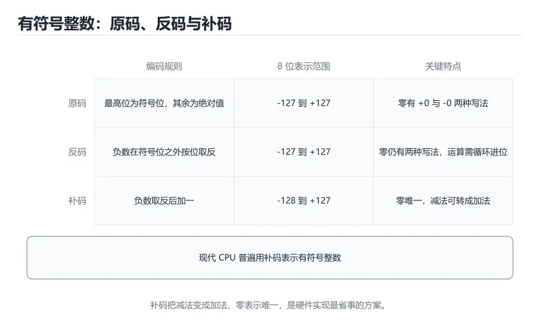

# 数据表示与编码

> 内容更新时间：2026-10-06 · 学习阶段：基础 · 预计用时：25 分钟



## 本节知识框架

**课程定位**：分类「computer_organization」· 学习阶段 基础 · 建议用时 25 分钟。

本课主线：从最基本的二进制位出发，理解无符号数与补码、溢出与符号扩展、IEEE 754 浮点数的结构、字符编码与字节序，最终能解释「为什么 0.1 + 0.2 不等于 0.3」这类日常现象。

**复习清单**

- [ ] 能写出 n 位补码的表示范围并解释为什么负数多一个
- [ ] 能手算十进制与补码之间的转换，并判断溢出
- [ ] 能拆解一个 32 位浮点数的符号、阶码和尾数
- [ ] 能解释浮点加法的舍入误差来源
- [ ] 能区分 Unicode 码点与 UTF-8 字节序列
- [ ] 能判断一台机器是大端还是小端

## 核心概念定义

| 术语 | 一句话说明 |
| --- | --- |
| 位（bit） | 最小的二进制信息单位，只能取 0 或 1 |
| 字节（byte） | 8 个位组成的存储单位，也是大多数寻址与编码的基本粒度 |
| 无符号整数 | 所有位都表示数值大小，n 位范围是 0 到 2^n−1 |
| 补码 | 用「取反加一」表示负数的编码方式，使加减法共用同一套电路 |
| 溢出 | 运算结果超出当前位宽可表示的范围，导致高位被截断 |
| 符号扩展 | 把较窄的补码扩展到更宽位宽时，用符号位填充高位 |
| IEEE 754 | 浮点数的国际标准，规定符号位、阶码、尾数及舍入规则 |
| 阶码偏移 | 把带符号的指数加上固定偏移量后存储，便于比较大小 |
| Unicode | 为世界上大多数字符分配唯一码点的字符集标准 |
| 字节序 | 多字节数据在内存中的排列顺序，分为大端和小端 |

## 原理与运行机制

### 从开关到数字：位置记数法

一个二进制位就像一盏只能开或关的灯。单独一盏灯信息量很小，但把八盏灯排成一排，就能表示 256 种组合。二进制使用位置记数法：从右往左，每一位的权重依次是 1、2、4、8、16……这与十进制中个位、十位、百位的道理相同，只是底数从 10 变成了 2。

例如二进制 `10110100` 的值为 128 + 32 + 16 + 4 = 180。记住几个常用权重（128、64、32、16、8、4、2、1）比死记公式更实用。做快速估算时，先找不超过目标数的最大权重，再依次往下减，就能在几秒内完成转换。

### 补码：让减法变成加法

如果只把最高位当符号位，会出现 `+0` 和 `-0` 两种零，而且加法电路要分别处理正负数，非常麻烦。补码换了一个思路：负数用「对应正数取反再加一」表示。以 8 位为例，`+6` 是 `00000110`，取反得到 `11111001`，加一得到 `11111010`，所以 `-6` 的补码是 `11111010`。

补码的妙处在于，`6 + (-6)` 直接相加：`00000110 + 11111010 = 1 00000000`。最高位的进位被丢弃，结果正好是 0。于是同一套加法器既能算加法也能算减法，硬件成本大幅降低。n 位补码的范围是 −2^(n−1) 到 2^(n−1)−1，负数比正数多一个，因为 `1000...000` 被用来表示最小的负数，而不是负零。

### 溢出与符号扩展

8 位补码的最大值是 127。计算 `127 + 1` 时，二进制是 `01111111 + 00000001 = 10000000`，这个结果被解释为 −128，而不是 128。这就是有符号溢出：结果的符号位与真实符号不一致。CPU 通常会在状态寄存器里设置溢出标志，供程序判断是否需要扩大位宽或改用大整数库。

当把 8 位补码存入 16 位寄存器时，不能简单地在高位补 0。`-6` 的 8 位补码是 `11111010`，扩展到 16 位应为 `1111111111111010`，高 8 位全部补 1，才能保持值仍是 −6。这个操作叫符号扩展。无符号数扩展时高位才补 0。很多底层 bug 都来自把有符号数当成无符号数扩展，或在移位时混淆了逻辑右移与算术右移。

### IEEE 754：用科学记数法表示实数

浮点数把实数写成「符号 × 尾数 × 2^指数」的形式。以 32 位单精度为例，最高 1 位是符号位，接着 8 位是阶码，最后 23 位是尾数。阶码采用偏移表示，实际指数等于存储值减去 127。尾数默认隐藏了一个前导 1，因此实际精度是 24 位有效二进制位。

以十进制 12.5 为例：12.5 = 1100.1₂ = 1.1001₂ × 2^3。符号位为 0，指数 3 加上偏移 127 得到 130，即 `10000010`；尾数去掉前导 1 后是 `1001000...`。把这些位拼起来，就得到 12.5 的浮点表示。因为尾数只有 23 位，很多十进制小数无法精确表示，只能存最接近的近似值。

### 为什么 0.1 + 0.2 不等于 0.3

0.1 在二进制中是无限循环小数 `0.0001100110011...`，就像十进制里的 1/3 一样无法用有限位写完。单精度只能保留约 7 位十进制有效数字，双精度约 15 到 17 位，因此 0.1 和 0.2 在存储时就已经带上了微小误差。两个近似值相加后，误差可能落在 0.3 的最近可表示值之外，于是程序看到 `0.30000000000000004`。

这不是计算机「算错了」，而是有限精度表示的必然结果。正确做法是：比较浮点数时使用误差范围，例如判断 `abs(a - b) < 1e-9`；涉及金额时使用整数分或十进制类型；需要高精度科学计算时使用任意精度库。理解误差来源，比记住某个具体数字更重要。

### 字符编码：从码点到字节

计算机只存字节，文字必须先映射成数字。ASCII 用 7 位表示 128 个字符，其中英文字母、数字和标点的编码今天仍被广泛兼容。Unicode 为每个字符分配一个码点，例如「中」是 U+4E2D；但码点只是编号，真正写入文件时还要选择编码方式。

UTF-8 是一种变长编码：ASCII 字符占 1 字节，常用汉字通常占 3 字节，部分生僻字占 4 字节。它的首字节高位会标出后续还有几个字节，因此解码器可以逐字节判断边界。UTF-16 则常用 2 字节或 4 字节表示一个字符。UTF-8 对英文友好、兼容 ASCII，在网络上更常见；UTF-16 在部分语言运行时内部使用，处理不当会出现「一个字符占两个 char」的问题。

### 字节序：同一串字节的两种读法

假设 32 位整数 `0x12345678` 存放在从地址 0 开始的四个字节里。大端机器把最高有效字节放在低地址，内存中是 `12 34 56 78`；小端机器把最低有效字节放在低地址，内存中是 `78 56 34 12`。两种方式都正确，只是约定不同。x86 和多数 ARM 设备默认小端，网络协议通常规定使用大端，因此网络编程中要用 `htonl`、`ntohl` 之类的函数做转换。

字节序问题在跨平台文件格式、二进制协议和驱动开发中尤其常见。判断本机字节序最简单的办法，是把一个多字节整数按字节打印出来，看最低有效字节排在前面还是后面。

### 掩码、移位与状态压缩

实际工程里，位不仅仅是数学表示，还常被当作一组并列的开关。权限系统用每一位表示读、写、执行权限，网络协议用几个位表示版本号和首部长度，图像格式用通道位段表示透明度。取出其中某一段的标准做法是先右移到目标位置，再与掩码相与：`(value >> 8) & 0xFF` 表示取出第 8 到 15 位。

把多个小范围字段压进一个整数可以节省内存，也便于原子更新，但会带来可读性和可移植性问题。字段宽度、位序和符号约定必须在协议文档中写清楚，否则不同实现之间很容易出现「同样的字节解出不同结果」的故障。调试时把整数值打印成二进制，并按位段逐项核对，通常比盯着十进制数更快定位问题。

## 典型应用场景

### 颜色与图像

一个像素常用 32 位表示：红、绿、蓝、透明度各 8 位，范围都是 0 到 255。把颜色写成 `0xAARRGGBB` 只是约定，具体字节顺序仍受字节序影响。图像格式、显卡寄存器和网络传输对通道顺序的要求可能不同，做图像处理时要先确认数据布局。

### 网络协议

IP 地址、端口号、长度字段都有固定的字节序。协议解析器如果按主机字节序直接读取，得到的值可能完全错误。抓包工具能把原始字节和解析后的字段同时展示出来，是排查这类问题的最好帮手。

### 金额与计数

浮点数不适合表示精确金额，因为 0.1 元无法用二进制精确存储。常见做法是以「分」为单位存整数，或使用数据库的 DECIMAL 类型。计数器、编号、哈希值也常使用无符号整数，避免出现负值并扩大正数范围。

### 文本处理

读取文件时必须知道编码。把 UTF-8 文件按 GBK 解码会出现乱码，把 UTF-16 当成单字节编码会多出空字符。现代开发通常统一使用 UTF-8，并在文件头或协议字段中明确声明编码。处理用户输入时还要注意 Unicode 规范化，避免看起来相同的字符串比较结果不同。

## 代码/协议/SQL 示例

### 用 Python 观察补码与位运算

```python
def to_twos_complement(value, bits=8):
    mask = (1 << bits) - 1
    return value & mask

for value in [6, -6, 127, -128]:
    raw = to_twos_complement(value)
    print(f"{value:4d} -> {raw:08b}")

print("127 + 1 =", to_twos_complement(127 + 1))
print("-6 >> 1 =", -6 >> 1)
print("-6 & 0xFF =", -6 & 0xFF)
```

Python 的整数默认是任意精度，不会自动溢出，因此要手动用掩码模拟固定位宽。`-6 & 0xFF` 得到 250，正好对应 8 位补码 `11111010`。右移运算对负数是算术右移，高位补 1，这与 C 语言中有符号右移的常见实现一致。

### 用 struct 拆解浮点数

```python
import struct

def float_bits(value):
    packed = struct.pack(">f", value)
    integer = struct.unpack(">I", packed)[0]
    sign = (integer >> 31) & 1
    exponent = (integer >> 23) & 0xFF
    fraction = integer & 0x7FFFFF
    return sign, exponent, fraction

for value in [12.5, 0.1, -3.75]:
    sign, exponent, fraction = float_bits(value)
    print(f"{value:6} sign={sign} exp={exponent:3d} frac=0x{fraction:06X}")
```

这段代码把浮点数按网络字节序打包成 4 个字节，再还原成整数并逐段取出。运行后可以验证：12.5 的阶码是 130，0.1 的尾数并不是一个「整齐」的数，这正是误差的来源。

### 用 C 检查本机字节序

```c
#include <stdio.h>

int main(void) {
    unsigned int value = 0x12345678;
    unsigned char *bytes = (unsigned char *)&value;
    if (bytes[0] == 0x78) {
        printf("little-endian\n");
    } else if (bytes[0] == 0x12) {
        printf("big-endian\n");
    } else {
        printf("unknown\n");
    }
    return 0;
}
```

通过取地址并逐字节读取，可以直接看到最低有效字节的位置。注意这里使用 `unsigned char *` 是必要的，因为用有符号 char 查看大于 127 的字节可能得到负值。

## 时间/空间复杂度或性能分析

### 不同数据类型的代价

| 操作 | 典型代价 | 说明 |
| --- | --- | --- |
| 整数加减 | 1 个时钟周期或更少 | 现代 ALU 可直接完成，是最常用的运算 |
| 整数乘法 | 数个时钟周期 | 比加法慢，但通常有专用乘法器 |
| 整数除法 | 数十个时钟周期 | 速度较慢，常量除法常被编译器优化成乘法与移位 |
| 浮点加减 | 数个时钟周期 | 需要对齐阶码和舍入，延迟高于整数加法 |
| 浮点除法 | 数十个时钟周期 | 延迟高，流水线吞吐也受限 |
| 类型转换 | 1 到数个周期 | 整数与浮点互转需要额外指令，可能引入精度损失 |

做性能敏感的计算时，能用整数就不用浮点，能用移位代替乘以 2 的幂就用移位。但不要为了省几个周期牺牲可读性，现代编译器在很多情况下会自动完成这些优化。

### 精度与范围的取舍

32 位整数范围约 ±21 亿，64 位整数范围约 ±9.2×10^18。单精度浮点数虽然能表示到约 3.4×10^38，但只有约 7 位十进制有效数字；双精度有约 15 到 17 位有效数字。需要在范围、精度、内存占用和速度之间做选择。例如图形计算常用单精度，金融计算常用定点整数或高精度十进制。

### 特殊值的影响

IEEE 754 定义了正负无穷、NaN 和次正规数。NaN 与任何值比较都返回假，包括与自身比较，因此判断 NaN 要用 `isnan` 而不是 `x == NaN`。次正规数用于表示非常接近零的值，计算速度可能比正规数慢。理解这些边界行为，能避免在数值计算中写出「永远不成立」的条件。

## 常见误区与易错点

| 错误认识 | 实际发生的情况 | 更稳妥的做法 |
| --- | --- | --- |
| 补码只是把符号位改成 1 | 补码是取反加一，符号位只是结果的一部分 | 用取反加一或模运算验证转换 |
| 8 位无符号数能表示 255，所以补码也能 | 补码要留一半范围给负数，最大只有 127 | 分清有符号与无符号范围 |
| 负数的右移就是除以 2 | 算术右移向负无穷取整，与截断除法不完全相同 | 需要截断时使用显式除法或修正 |
| 浮点数可以精确表示所有小数 | 二进制只能精确表示分母为 2 的幂的分数 | 金额用整数或十进制类型 |
| 0.1 + 0.2 报错是语言 bug | 这是有限精度表示的舍入结果 | 用误差范围比较浮点数 |
| Unicode 就是 UTF-8 | Unicode 是字符集，UTF-8 是一种编码方式 | 区分码点、编码和字节序列 |
| UTF-8 中一个汉字固定占 3 字节 | 常用汉字多为 3 字节，生僻字可能占 4 字节 | 按编码规则解析，不按固定长度截断 |
| 所有机器都是小端 | 不同架构和协议可能采用大端 | 跨平台数据显式转换字节序 |

## 与其他知识点的关系

### 先修课程

本课需要你了解二进制的基本概念和至少一门语言的变量类型。如果学过《计算机组成原理导论》，会更容易把数据表示和存储器、总线联系起来；如果写过 C 或 Go，会对定长整数和指针有直观感受。

### 相关概念对比

- **原码 vs 补码**：原码直观但存在正负零和减法电路复杂的问题；补码让加减法统一，是现代处理器的通用选择。
- **定点数 vs 浮点数**：定点数小数点的位置固定，精度稳定但范围有限；浮点数范围大但精度随数值变化。
- **UTF-8 vs UTF-16**：UTF-8 对 ASCII 友好、变长、网络常用；UTF-16 在部分运行时内部使用，处理增补字符时要使用代理对。
- **大端 vs 小端**：大端符合人类阅读顺序，小端便于从低地址开始处理低位字节。网络协议通常规定大端。

### 后续衔接

学完本课后，数字逻辑课程会把这些编码变成加法器、移位器和比较器；指令系统课程会解释立即数怎样参与运算；虚拟内存课程会用到地址的位段划分。最后的实战项目会把整数、字节和内存组织成一个可运行的小机器。

## 自测题与参考答案

### 自测 1

写出 8 位补码能表示的最小和最大整数，并说明为什么负数多一个。

**参考答案**：范围是 −128 到 127。负数多一个是因为 `10000000` 被分配给 −128，而正数最大到 `01111111` 即 127；零只有一种表示，因此负数比正数多一个。

### 自测 2

把 8 位补码 `11110110` 转成十进制。

**参考答案**：最高位是 1，说明是负数。取反得到 `00001001`，加一得到 `00001010`，即 10，所以原数是 −10。也可以用权重法：−128 + 64 + 32 + 16 + 4 + 2 = −10。

### 自测 3

为什么 32 位单精度浮点数不能精确表示 0.1？

**参考答案**：0.1 的二进制展开是无限循环小数，尾数只有 23 位，必须在某一位截断并舍入，因此存储的是最接近 0.1 的近似值。后续运算会把这个微小误差累积起来。

### 自测 4

UTF-8 和 Unicode 有什么区别？

**参考答案**：Unicode 是字符集，给每个字符分配唯一码点；UTF-8 是把码点编码成字节序列的一种方式，具有变长和兼容 ASCII 的特点。同一个 Unicode 字符可以用不同编码存储。

### 自测 5

编写程序判断本机字节序，并说明网络传输时为什么通常规定大端。

**参考答案**：把一个多字节整数按字节打印，最低有效字节在前就是小端，最高有效字节在前就是大端。网络协议规定大端是为了让不同架构的设备对同一串字节有统一的解释，避免发送方和接收方各按自己的习惯读取。

## 考点精讲

### 考点 1

8 位补码能表示的整数范围是？

A. 0 到 255

B. −128 到 127

C. −127 到 127

D. −255 到 255

**正确答案：B**

**详细解释**：8 位共有 256 种组合，补码把一半分给负数、一半分给非负数，范围是 −2^7 到 2^7−1，也就是 −128 到 127。最高位为 1 的 `10000000` 表示 −128，不是负零；`11111111` 表示 −1。正确项「−128 到 127」符合补码定义。

---

### 考点 2

十进制 −6 的 8 位补码是？

A. 10000110

B. 11111001

C. 00000110

D. 11111010

**正确答案：D**

**详细解释**：先写 +6 的 8 位二进制 `00000110`，按位取反得到 `11111001`，再加一得到 `11111010`。验算时把它与 `00000110` 相加，结果为 `1 00000000`，丢弃最高进位正好是 0。正确项「11111010」就是 −6 的补码。

---

### 考点 3

单精度浮点数无法精确表示 0.1，主要原因是？

A. 0.1 的二进制展开是无限循环小数

B. 单精度浮点数只能表示整数

C. 0.1 超出了浮点数的指数范围

D. 浮点数没有符号位

**正确答案：A**

**详细解释**：0.1 在二进制中是 `0.0001100110011...`，无法用有限位尾数写完，存储时必须舍入到最近的可表示值。单精度当然能表示非整数，0.1 也远在指数范围之内，浮点数也有符号位。正确项「0.1 的二进制展开是无限循环小数」指出了误差的根源。

---

### 考点 4

UTF-8 编码的主要特点是什么？

A. 每个字符固定占 2 字节

B. 只能表示 ASCII 字符

C. 对 ASCII 字符用 1 字节，兼容性好

D. 不能表示中文

**正确答案：C**

**详细解释**：UTF-8 是变长编码，ASCII 范围用一个字节，常用汉字多用三个字节，生僻字可能用四个字节；它既能表示 Unicode 的全部码点，又向后兼容 ASCII。固定两字节是 UTF-16 的常见形态。正确项「对 ASCII 字符用 1 字节，兼容性好」概括了它的优势。

---

### 考点 5

关于补码的符号扩展，下列哪项正确？

A. 扩展到更宽位宽时，高位用符号位填充

B. 扩展时高位总是补 0

C. 符号扩展会改变原来的数值大小

D. 只有无符号数需要符号扩展

**正确答案：A**

**详细解释**：把 `11111010`（−6）扩展到 16 位时，高 8 位全部补 1，得到 `1111111111111010`，值仍然是 −6；如果补 0 就变成了正数 250。无符号数扩展才补 0，而符号扩展的目的正是保持数值不变。正确项「扩展到更宽位宽时，高位用符号位填充」描述了这一规则。

## 术语速查

| 术语 | 一句话说明 |
| --- | --- |
| 位 | 取值为 0 或 1 的最小信息单位 |
| 字节 | 8 个位组成的存储与编码单位 |
| 补码 | 取反加一表示负数，使加减法共用电路 |
| 溢出 | 结果超出固定位宽范围而被截断 |
| 符号扩展 | 扩宽补码时用符号位填充高位 |
| IEEE 754 | 规定浮点格式与舍入方式的标准 |
| 阶码 | 浮点数中经过偏移编码的指数部分 |
| 尾数 | 浮点数中表示有效数字的位段 |
| Unicode | 为字符分配唯一码点的字符集 |
| 字节序 | 多字节数据在内存中的排列顺序 |

## 参考资料与复核

- 复核范围：补码范围与转换、IEEE 754 位段、UTF-8 变长规则、字节序定义

| 参考资料 | 本课用途 |
| --- | --- |
| [Two's complement](https://en.wikipedia.org/wiki/Two%27s_complement) | 补码定义、范围与运算规则的系统说明 |
| [IEEE 754](https://en.wikipedia.org/wiki/IEEE_754) | 浮点数格式、特殊值与舍入模式的标准概览 |
| [UTF-8](https://en.wikipedia.org/wiki/UTF-8) | UTF-8 变长编码与字节边界的详细说明 |
| [Endianness](https://en.wikipedia.org/wiki/Endianness) | 大端与小端的内存布局对比 |

- 最后复核：2026-10-04
- 下次复核：2027-10-25

## 内容元数据

- 内容版本：v2.0
- 最后更新：2026-10-06
- 学习阶段：基础
- 适用环境：通用开发环境
- 内容来源：内置结构化课程与工程实践整理
- 相关主题：data representation and encoding
- 质量版本：P0 测验标准 + P1 覆盖扩展 + P2 体验补全
