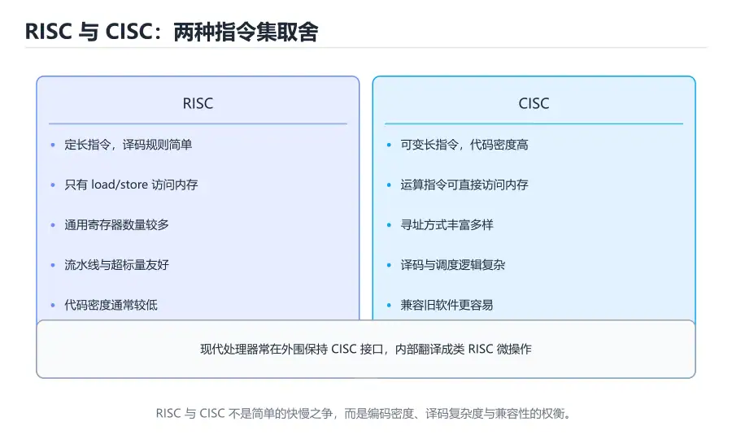

# 指令系统与汇编基础

> 内容更新时间：2026-10-06 · 学习阶段：基础 · 预计用时：25 分钟



## 本节知识框架

**课程定位**：分类「computer_organization」· 学习阶段 基础 · 建议用时 25 分钟。

本课主线：从「CPU 能听懂什么」出发，理解 ISA、指令格式、寄存器、寻址方式和调用约定，并亲手把一个汇编小程序翻译成机器码，建立软件与硬件之间的翻译视角。

**复习清单**

- [ ] 能说明 ISA 规定了哪些内容、不规定哪些内容
- [ ] 能区分 RISC 与 CISC 的设计取舍
- [ ] 能读懂 R 型、I 型、J 型指令的字段划分
- [ ] 能解释 load/store、立即数和基址偏移寻址的用途
- [ ] 能说明函数调用时参数、返回地址和栈帧如何组织
- [ ] 能运行本课的迷你汇编器并核对机器码

## 核心概念定义

| 术语 | 一句话说明 |
| --- | --- |
| 指令集体系结构 | 软件与硬件之间关于指令、寄存器、寻址和异常的契约 |
| 操作码 | 指令中表示「要做什么操作」的字段 |
| 寄存器 | CPU 内部的高速小容量存储，按编号直接访问 |
| 程序计数器 | 保存下一条待执行指令地址的专用寄存器 |
| 寻址方式 | 指令确定操作数地址的规则，如立即数、寄存器、基址偏移 |
| RISC | 精简指令集，指令定长、访存受限、寄存器数量较多 |
| CISC | 复杂指令集，指令可变长、寻址方式丰富、单条指令可做较多工作 |
| 汇编语言 | 用助记符表示机器指令的低级语言，与指令集一一对应 |
| 调用约定 | 规定参数、返回值、返回地址和寄存器保存责任的规则 |
| 栈帧 | 函数调用期间在栈上分配的一块区域，保存局部变量与返回信息 |

## 原理与运行机制

### ISA 是一份双向合同

指令集体系结构可以理解为一份合同：硬件承诺「你给我这些位模式，我就按约定完成操作」，软件承诺「我只使用合同里列出的指令和寄存器」。合同规定指令格式、寄存器数量与宽度、寻址方式、数据类型、异常和特权级；它不规定流水线深度、缓存大小、电路怎样实现，这些属于微架构。

合同的价值在于解耦。同一份 RISC-V 程序可以跑在不同厂商、不同性能的芯片上；编译器只需要面向 ISA 生成代码，不必为每颗芯片重写。反过来，硬件工程师可以在不破坏合同的前提下改进微架构，例如加深流水线、增加缓存或调整分支预测器。

### RISC 与 CISC：两种设计哲学

CISC 的思路是「让一条指令多做一点事」，例如一条指令完成「从内存读两个数、相加、写回内存」。这样程序短、代码密度高，但指令译码复杂、长度不一，流水线难以高效调度。x86 是 CISC 的代表，现代实现会把复杂指令拆成内部微操作，兼顾兼容性与执行效率。

RISC 的思路是「只保留常用、规整的指令」，典型特征是定长指令、只有 load/store 能访问内存、运算只在寄存器之间进行、寄存器数量较多。定长指令让取指和译码更简单，也便于流水线并行。ARM、RISC-V 都属于 RISC 家族。两种哲学并没有绝对优劣，真正的差异体现在代码密度、功耗、峰值性能和兼容性等具体指标上。

### 指令格式：把操作编码成位

以常见的 32 位 RISC 指令为例，R 型指令用于寄存器之间的运算，字段包括操作码、目标寄存器 rd、两个源寄存器 rs1/rs2、功能码 funct。I 型指令带一个 12 位立即数，常用于 `addi`、`lw`、`sw` 和条件分支。J 型指令用较大的立即数表示跳转目标。

字段划分不是随意的。把寄存器编号放在固定位置，可以让译码器在指令到达的同一拍就并行读出寄存器；把操作码放在低位，便于硬件快速分类。设计 ISA 时，工程师要在编码空间、译码复杂度、立即数范围和扩展性之间做取舍。

### 寻址方式：操作数到底在哪里

指令需要告诉 CPU「操作数在哪里」。常见方式包括：

- **立即数寻址**：操作数直接写在指令里，适合常量和小范围偏移。
- **寄存器寻址**：操作数在寄存器中，速度最快。
- **基址加偏移**：地址 = 基址寄存器 + 立即数偏移，适合数组、结构体和栈帧。
- **寄存器间接**：地址存放在寄存器中，适合指针访问。
- **PC 相对寻址**：目标地址相对于当前指令，便于位置无关代码。

CISC 往往提供更多寻址方式，一条指令可以直接对内存做算术；RISC 则把访存压缩到 load/store 两类指令，其他运算只处理寄存器。后者的好处是每条指令的执行阶段更规整，流水线控制更简单。

### 汇编程序长什么样

下面是一段风格接近 RISC-V 的汇编，完成「把内存地址 100 的值加 5，再存回地址 104」：

```asm
    lw   x5, 0(x10)      # x5 = memory[x10 + 0]
    addi x5, x5, 5       # x5 = x5 + 5
    sw   x5, 4(x10)      # memory[x10 + 4] = x5
```

`x10` 通常存放基址，`0(x10)` 和 `4(x10)` 是基址加偏移。`lw` 和 `sw` 是仅有的访存指令，`addi` 在寄存器上完成加法。若把这段代码放进循环，每次让 `x10` 增加 8，就能遍历一个结构体数组。理解这个模式，比死记指令表更有用。

### 机器码与汇编器的角色

汇编器负责把助记符翻译成二进制，并解析标签和伪指令。以一条假想的 32 位指令为例，高 7 位是操作码，接着 5 位是 rd，再接着 5 位是 rs1，低 12 位是立即数。汇编器会把 `addi x5, x5, 5` 编码成对应的位模式，链接器再决定最终地址。

真实工具链还包括预处理、编译、汇编、链接和加载。编译器把高级语言降到中间表示，再选择指令、分配寄存器；汇编器负责编码；链接器合并目标文件、重定位符号；加载器把程序放进内存并设置入口地址。每一层都可能影响最终性能，因此排查「为什么生成了这条指令」时，要沿着这条链往上找。

### 调用约定与栈帧

函数调用需要解决四个问题：参数怎么传、返回值怎么给、返回后从哪里继续、哪些寄存器需要保存。调用约定把这些问题固定下来，例如前几个整数参数放在指定寄存器，其余参数放栈上；返回值放在另一个寄存器；`jal` 把返回地址写入链接寄存器。

当函数需要保存寄存器或分配局部变量时，会在栈上建立栈帧。典型步骤是：先调整栈指针，保存需要保留的寄存器，执行函数体，恢复寄存器，最后跳回返回地址。递归函数会形成多层栈帧，每层都有自己的局部变量和返回地址。栈溢出、返回地址被覆盖和栈对齐错误，都是底层调试中的高频问题。

### 位置无关代码与重定位

共享库和现代可执行文件常使用位置无关代码，使同一份机器码可以被加载到任意地址。实现方式之一是 PC 相对寻址：指令中的偏移是相对于当前 PC 的，而不是绝对地址，因此整个模块被搬到别处后仍然有效。另一部分地址由动态链接器在加载时通过重定位表修正。

位置无关代码会影响指令选择。某些架构的跳转范围有限，编译器可能需要插入跳板或使用间接跳转；某些立即数加载需要多条指令拼接。理解这些约束，才能解释为什么同一段 C 代码在不同编译选项下生成的汇编长度不同。

## 典型应用场景

### 编译器后端

编译器生成机器码时，要在指令选择、寄存器分配和指令调度之间权衡。RISC 的定长指令让调度更简单，CISC 的复杂指令可以减少指令数。理解 ISA 的约束，才能解释为什么同一段代码在不同平台上生成的汇编差异很大。

### 逆向与安全分析

分析恶意软件、排查崩溃或做漏洞研究时，经常需要读反汇编。知道调用约定，就能从寄存器中认出参数；知道栈帧布局，就能定位局部变量和返回地址；知道指令格式，就能判断某段字节是否可能是合法指令。反汇编工具还会标出符号、重定位和节区信息，帮助还原程序结构。

需要提醒的是，反汇编结果不一定等于原始源码。编译器优化会重排指令、合并变量、删除死代码，内联函数也会让调用关系变得模糊。读汇编时要结合控制流图和实际输入输出，不能仅凭几条指令就推断作者意图。

### 嵌入式与驱动

嵌入式开发经常直接操作寄存器。数据手册会给出寄存器的地址、位段和读写属性，C 代码通过指针或内存映射访问它们。若不了解 ISA 和内存模型，很容易写出被编译器优化掉、或因为对齐问题崩溃的代码。

### JIT 与解释器

Java 虚拟机、JavaScript 引擎和模拟器会在运行时生成或解释指令。JIT 需要选择指令、分配寄存器并处理调用约定；解释器则需要一个循环来取指、译码和执行。理解 ISA 能让这些系统的行为更容易预测。

## 代码/协议/SQL 示例

### 用 Python 写一个迷你汇编器

```python
OPCODES = {
    "LOAD": 0x1,
    "ADD":  0x2,
    "STORE": 0x3,
    "JMP":  0x4,
    "HALT": 0xF,
}

def assemble(lines):
    labels = {}
    instructions = []
    for line in lines:
        line = line.split("#", 1)[0].strip()
        if not line:
            continue
        if line.endswith(":"):
            labels[line[:-1]] = len(instructions)
            continue
        parts = line.replace(",", " ").split()
        instructions.append(parts)
    machine = []
    for parts in instructions:
        op = OPCODES[parts[0]]
        arg = parts[1] if len(parts) > 1 else "0"
        value = labels[arg] if arg in labels else int(arg, 0)
        if not 0 <= value <= 0x0F:
            raise ValueError(f"operand out of range: {value}")
        machine.append((op << 4) | value)
    return machine

program = [
    "start:",
    "LOAD 12",
    "ADD 13",
    "STORE 14",
    "JMP end",
    "end:",
    "HALT",
]
print([f"0x{code:02X}" for code in assemble(program)])
```

这个汇编器只支持 4 位操作数和 4 位地址，地址必须落在 0~15；示例把数据放在 12~14 号地址，避开程序占用的 0~4 号地址。运行后应得到 `['0x1C', '0x2D', '0x3E', '0x44', '0xF0']`；若写成 `LOAD 16`，新增的范围检查会直接报错，而不是悄悄截断成地址 0。它完整展示了标签解析、指令编码和机器码生成；运行后可以尝试增加一条 `SUB` 指令，观察编码表和解码逻辑需要同步修改哪些地方。

### 用 C 观察函数调用的参数传递

```c
#include <stdio.h>

int add(int a, int b) {
    return a + b;
}

int main(void) {
    int result = add(3, 4);
    printf("%d\n", result);
    return 0;
}
```

在常见平台上，`a` 和 `b` 会通过寄存器传递，返回值也放在寄存器中，而不是通过内存逐个搬运。用编译器生成汇编（例如 `gcc -S`）可以看到具体的寄存器编号和栈帧调整。不同调用约定会改变这些细节，但「参数、返回值、返回地址、保存责任」这四件事始终存在。

### 一段带分支的汇编

```asm
    addi x6, x0, 10      # x6 = 10，循环计数
    addi x7, x0, 0       # x7 = 0，累加器
loop:
    add  x7, x7, x6      # x7 += x6
    addi x6, x6, -1      # x6 -= 1
    bne  x6, x0, loop    # x6 != 0 时跳回 loop
```

这段代码计算 10+9+...+1。`bne` 根据比较结果改写 PC，形成循环。注意循环体中的两条指令没有访存，全部在寄存器上完成；若把 `x7` 放进内存，每次迭代都要多出 load/store，速度会明显下降。

## 时间/空间复杂度或性能分析

### 指令数、代码密度与 CPI

RISC 的指令通常更简单，完成同样任务可能需要更多条指令；CISC 单条指令能做更多事，指令数少但每条指令的周期数可能更高。比较两种 ISA 时，不能只看指令条数，也不能只看 CPI，而要把「指令数 × CPI × 周期时间」一起算。

代码密度也很重要。嵌入式设备 flash 容量有限，定长指令可能比可变长指令占用更多空间；但在高性能场景中，定长指令带来的译码和流水线优势往往更值钱。选型时要先明确约束，再谈优劣。

### 寄存器压力与溢出

寄存器数量越多，编译器越容易把变量留在寄存器中，减少访存；但寄存器多了会占用芯片面积，也会增加指令编码位宽。寄存器不够时，编译器会把变量「溢出」到栈上，产生额外的 load/store。优化热点函数时，减少同时活跃的变量数量，往往比手动改写汇编更有效。

### 分支与流水线

条件分支会改变 PC，打断顺序取指。现代处理器用分支预测和推测执行来隐藏这部分开销；预测失败时要清空流水线，代价可能达到十几个周期。编译器也会通过循环展开、条件选择等方式减少分支。理解这些机制，才能解释为什么「同样逻辑，换种写法」性能会差很多。

指令调度同样重要。编译器会把访存指令提前发出，让 CPU 在等待数据的同时执行其他计算；也会调整指令顺序，避免相邻指令争用同一个执行单元。对汇编程序员来说，手工调度能榨出最后一点性能，但可维护性差，通常只用于极热点的代码。

### 代码大小与指令编码

估算一段程序的代码大小，可以用「指令条数 × 指令宽度」。定长 32 位指令集中，每条指令固定占 4 字节，循环展开十倍，代码段就会膨胀十倍；这对 I-cache 容量有限的设备是实打实的代价。可变长指令集里，常用指令用短编码，不常用的才用长编码，平均宽度更小，但译码器要逐段判断指令边界，分支目标也可能落在非对齐位置。看反汇编时不妨数一数热点循环占了多少字节，再对照 I-cache 行大小，就能判断瓶颈是容量还是带宽。

## 常见误区与易错点

| 错误认识 | 实际发生的情况 | 更稳妥的做法 |
| --- | --- | --- |
| ISA 就是 CPU 的电路图 | ISA 只规定指令契约，微架构才是电路实现 | 区分规范与实现 |
| RISC 指令少所以一定更快 | 指令数可能更多，性能取决于整体权衡 | 用实际负载测量 |
| 汇编指令和机器码一一对应 | 伪指令和宏会被展开成多条机器指令 | 查看反汇编确认最终编码 |
| 立即数可以任意大 | 指令位宽有限，立即数范围受限 | 超出范围时用寄存器或常量池 |
| 函数参数一定通过栈传递 | 调用约定通常优先使用寄存器 | 查看目标平台的 ABI 文档 |
| 返回地址就是 PC 的当前值 | 返回地址是调用指令的下一条地址 | 区分取指地址与返回地址 |
| 栈向下增长是唯一约定 | 不同架构的栈增长方向可能不同 | 按目标 ABI 编写代码 |
| 汇编不可移植所以没有价值 | 汇编适合定位底层问题和理解编译器输出 | 用汇编做分析，用高级语言做主体 |

## 与其他知识点的关系

### 先修课程

本课需要《数据表示与编码》中的补码、位段和字节序知识，也需要《数字逻辑与电路基础》中的寄存器和组合逻辑概念。写过 C 或任何编译型语言会帮助你理解变量、指针和函数调用。

### 相关概念对比

- **RISC vs CISC**：前者定长、load/store 受限、流水线友好；后者可变长、寻址丰富、代码密度高。
- **汇编 vs 机器码**：汇编是助记符形式，机器码是最终二进制编码；伪指令会被汇编器展开。
- **调用约定 vs 栈帧**：调用约定是规则，栈帧是规则在栈上的具体布局。
- **编译 vs 汇编**：编译把高级语言降到汇编或中间表示，汇编把助记符编码成机器码。

### 后续衔接

学完本课后，CPU 数据通路课程会把指令字段连接到寄存器堆、ALU 和存储器；流水线课程会分析分支和 load-use 冒险；虚拟内存课程会解释地址翻译如何影响访存指令。实战项目会实现一个小型指令集和汇编器。

## 自测题与参考答案

### 自测 1

为什么 RISC 通常只允许 load/store 指令访问内存？

**参考答案**：把访存限制在两类指令中，可以让其他运算指令的执行阶段更规整，简化流水线控制和时序分析；同时减少指令长度和译码复杂度。代价是完成同样任务可能需要更多条指令。

### 自测 2

程序计数器 PC 与函数返回地址有什么区别？

**参考答案**：PC 保存下一条待取指令的地址，每个周期都会更新；返回地址是调用指令的下一条地址，由调用指令写入链接寄存器或栈，函数返回时恢复到 PC。两者都是地址，但生命周期和用途不同。

### 自测 3

基址加偏移寻址为什么适合访问数组？

**参考答案**：数组元素在内存中连续存放，元素地址等于基址加上「下标 × 元素大小」。把基址放在寄存器中，偏移写在指令里，就能用同一条指令访问不同元素，循环时只需更新基址或下标。

### 自测 4

函数调用时，为什么需要保存某些寄存器？

**参考答案**：调用者和被调用者可能使用同一组寄存器。调用约定规定哪些寄存器由被调用者保存、哪些可以自由使用，避免返回后调用者的数据被覆盖。需要跨调用保留的值也可以由调用者自己保存到栈上。

### 自测 5

运行本课的迷你汇编器，把 `JMP end` 改成 `JMP start`，观察生成的机器码；再说明如果这段机器码交给执行器运行，程序会怎样走。

**参考答案**：标签 `start` 的地址是 0，因此这条指令编码为 `0x40`，原来指向 `end` 的 `0x44` 变成了 0。若把这段机器码交给执行器，JMP 会跳回地址 0，形成无限循环，永远执行不到后面的 HALT。这个实验说明标签解析本质上是在填地址，跳转目标写错时程序可能看起来「正常运行」却永远不结束。

## 考点精讲

### 考点 1

程序计数器 PC 的主要作用是什么？

A. 保存当前指令的操作数

B. 保存栈顶地址

C. 保存函数返回地址

D. 保存下一条要执行指令的地址

**正确答案：D**

**详细解释**：PC 始终指向下一条待取指令的地址，取指后按指令长度自增，分支或跳转指令则直接改写它。操作数通常在寄存器或内存中，栈顶由 SP 指向，函数返回地址可能放在链接寄存器或栈上。PC 的值在程序执行过程中不断变化，不能把它当成固定的返回地址。正确项「保存下一条要执行指令的地址」是 PC 的定义。

---

### 考点 2

下列哪项是 RISC 架构的典型特征？

A. 指令长度可变且寻址方式丰富

B. 指令长度固定且只有 load/store 访存

C. 所有指令都能直接对内存做算术

D. 处理器不需要寄存器

**正确答案：B**

**详细解释**：RISC 通过定长指令、受限访存和较多寄存器来简化译码与流水线；运算只在寄存器之间进行，内存访问由 load/store 完成。可变长、寻址丰富、内存直接运算更接近 CISC 的特征。正确项「指令长度固定且只有 load/store 访存」概括了 RISC 的核心约束。

---

### 考点 3

指令 `lw x1, 8(x2)` 中的 8 表示什么？

A. 目标寄存器编号

B. 源寄存器编号

C. 相对 x2 的字节偏移

D. 指令的机器码

**正确答案：C**

**详细解释**：这条指令的地址由基址寄存器 x2 加上立即数 8 得到，表示从 `x2 + 8` 处读取一个字到 x1。x1 是目标寄存器，x2 是基址寄存器，8 不是寄存器编号也不是机器码。偏移量的单位通常是字节，因此访问相邻字时偏移要按字长递增。正确项「相对 x2 的字节偏移」解释了基址加偏移寻址的含义。

---

### 考点 4

函数调用时，返回地址通常保存在哪里？

A. 链接寄存器或调用栈

B. 程序计数器

C. 状态寄存器

D. 数据段

**正确答案：A**

**详细解释**：调用指令会把下一条指令的地址写入链接寄存器；如果被调用函数还要继续调用其他函数，通常会把链接寄存器保存到栈上，返回时再恢复。PC 在函数执行期间会不断变化，状态寄存器保存条件码，数据段存放全局数据。正确项「链接寄存器或调用栈」符合常见调用约定。

---

### 考点 5

下列哪种寻址方式最适合访问数组元素？

A. 立即数寻址

B. 直接寻址

C. 栈寻址

D. 基址加偏移寻址

**正确答案：D**

**详细解释**：数组元素地址等于基址加上「下标 × 元素大小」，把基址放在寄存器中、偏移写在指令里，就能用同一条指令访问不同元素，循环时只需更新基址或下标。立即数适合常量，直接寻址适合固定地址，栈寻址主要服务函数调用。正确项「基址加偏移寻址」最贴合数组访问模式。

## 术语速查

| 术语 | 一句话说明 |
| --- | --- |
| ISA | 软件与硬件之间的指令与寄存器契约 |
| 操作码 | 指令中表示操作类型的字段 |
| 寄存器 | CPU 内部按编号访问的高速存储 |
| PC | 保存下一条指令地址的专用寄存器 |
| 寻址方式 | 确定操作数地址的规则 |
| RISC | 定长指令、访存受限的精简指令集 |
| CISC | 可变长、寻址丰富的复杂指令集 |
| 汇编语言 | 用助记符表示机器指令的低级语言 |
| 调用约定 | 规定参数、返回值和寄存器保存责任 |
| 栈帧 | 函数调用期间在栈上分配的局部区域 |

## 参考资料与复核

- 复核范围：ISA 定义、RISC/CISC 特征、指令字段、调用约定与栈帧

| 参考资料 | 本课用途 |
| --- | --- |
| [Instruction set architecture](https://en.wikipedia.org/wiki/Instruction_set_architecture) | ISA 的组成、分类与设计取舍 |
| [Reduced instruction set computer](https://en.wikipedia.org/wiki/Reduced_instruction_set_computer) | RISC 的历史与典型特征 |
| [Assembly language](https://en.wikipedia.org/wiki/Assembly_language) | 汇编语言、汇编器与机器码的关系 |
| [Calling convention](https://en.wikipedia.org/wiki/Calling_convention) | 参数传递、寄存器保存与栈帧规则 |

- 最后复核：2026-10-04
- 下次复核：2027-10-25

## 内容元数据

- 内容版本：v2.0
- 最后更新：2026-10-06
- 学习阶段：基础
- 适用环境：通用开发环境
- 内容来源：内置结构化课程与工程实践整理
- 相关主题：instruction set and assembly
- 质量版本：P0 测验标准 + P1 覆盖扩展 + P2 体验补全
