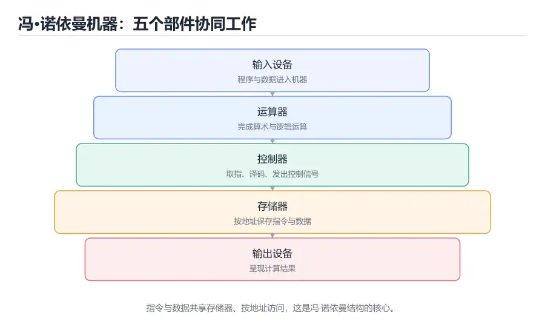

# 计算机组成原理导论

> 内容更新时间：2026-10-06 · 学习阶段：入门 · 预计用时：25 分钟



## 本节知识框架

**课程定位**：分类「computer_organization」· 学习阶段 入门 · 建议用时 25 分钟。

本课主线：先建立「程序如何变成电信号」的全局地图，再认识冯·诺依曼结构、指令执行流程、性能公式和存储层次，为后续的数据表示、逻辑电路、指令系统、流水线与存储课程打地基。

**复习清单**

- [ ] 能画出冯·诺依曼结构的五大部件并说明它们的分工
- [ ] 能复述取指、译码、执行、访存、写回的基本流程
- [ ] 能用「指令数 × CPI × 时钟周期」估算程序执行时间
- [ ] 能解释 ISA、微架构和编译器的边界
- [ ] 能说出存储层次为什么能同时兼顾速度和容量
- [ ] 能运行本课的迷你机器示例，改动一条指令后观察结果变化

## 核心概念定义

| 术语 | 一句话说明 |
| --- | --- |
| 冯·诺依曼结构 | 把程序和数据放在同一存储器中，由 CPU 按地址顺序取指执行的计算机模型 |
| 中央处理器（CPU） | 负责取指、译码、运算和控制外设的芯片，是计算机的运算与控制核心 |
| 主存储器 | 存放正在运行的程序和数据的高速可读写存储，通常由 DRAM 构成 |
| 总线 | 连接 CPU、内存和外设的一组共享信号线，负责传送地址、数据与控制信息 |
| 输入输出设备 | 与外界交换信息的部件，如键盘、显示器、磁盘和网卡 |
| 指令 | 处理器能识别并执行的最小操作单位，包含操作码和操作数信息 |
| 时钟频率 | 处理器节拍发生器的振荡速度，决定每个时钟周期有多长 |
| 指令集体系结构（ISA） | 软件与硬件之间的契约，规定指令格式、寄存器、寻址方式和异常行为 |
| 微架构 | ISA 在芯片上的具体实现方式，包括数据通路、流水线和缓存组织 |
| 存储层次 | 由寄存器、缓存、主存和磁盘组成的金字塔结构，用局部性换性能 |

## 原理与运行机制

### 把计算机想象成一家餐厅

理解计算机组成，最怕一上来就背术语。可以先把计算机想成一家餐厅：CPU 是厨师，负责真正动手做菜；主存是案板，放着当前正在处理的食材；硬盘是仓库，容量大但取货慢；总线是传菜员，把食材和指令在几个区域之间搬运；输入输出设备则是点餐台和出餐口。

厨师做菜有一套固定节奏：看下一张订单（取指）、读懂订单内容（译码）、动手加工（执行）、必要时去案板取料（访存）、把成品装盘（写回）。这套节奏不断循环，就是计算机最核心的运行方式。后面要学的流水线、缓存和总线，都是为了让这家餐厅出餐更快、更稳、更省成本。

### 冯·诺依曼结构的五个部件

冯·诺依曼结构把计算机划分为运算器、控制器、存储器、输入设备和输出设备五大部分。现代芯片通常把运算器和控制器合称为 CPU，把输入输出设备统称为 I/O。这个模型最重要的突破是「存储程序」：程序不再像早期计算机那样靠插线板或开关来配置，而是像数据一样存进存储器。

这个改变带来两个直接结果。第一，计算机可以自动连续地执行指令，不需要人手工干预每一步。第二，程序可以被当作数据进行加载、复制和修改，这为编译器、操作系统和动态链接奠定了基础。代价是指令和数据共享同一套存储与总线，某些情况下会形成瓶颈，这也是后续要学哈佛结构、缓存和预取的原因。

### 一条指令的五步旅程

绝大多数处理器都可以用下面五步来概括一条指令的生命周期：

1. **取指（Fetch）**：根据程序计数器 PC 的地址，从存储器读出指令。
2. **译码（Decode）**：解析操作码，判断要做什么，并读出寄存器操作数。
3. **执行（Execute）**：由算术逻辑单元完成加减、比较或地址计算。
4. **访存（Memory）**：按需读取或写入数据存储器。
5. **写回（Write Back）**：把结果写回寄存器，并更新 PC。

下面的 Python 代码用几十行模拟了这套流程。它故意把存储器和寄存器分开表示，方便观察每一步的状态变化。

```python
MEMORY = [0] * 256
ACC = 0
PC = 0
RUNNING = True

def run(program):
    global ACC, PC, RUNNING
    MEMORY[:len(program)] = program
    while RUNNING and PC < len(program):
        ir = MEMORY[PC]
        opcode, operand = ir >> 4, ir & 0x0F
        PC += 1
        if opcode == 0x1:      # LOAD
            ACC = MEMORY[operand]
        elif opcode == 0x2:    # ADD
            ACC = (ACC + MEMORY[operand]) & 0xFF
        elif opcode == 0x3:    # STORE
            MEMORY[operand] = ACC
        elif opcode == 0x4:    # JMP
            PC = operand
        elif opcode == 0xF:    # HALT
            RUNNING = False
        print(f"PC={PC:02d} ACC={ACC:3d}")
    return ACC

# 程序放在 0~3 号地址，数据放在 13~15 号，避免互相覆盖
MEMORY[13] = 0
MEMORY[14] = 7
MEMORY[15] = 5
program = [
    0x1E,  # LOAD  14：ACC = 7
    0x2F,  # ADD   15：ACC = 12
    0x3D,  # STORE 13：memory[13] = 12
    0xF0,  # HALT
]
run(program)
print("memory[13] =", MEMORY[13], "ACC =", ACC)
```

这段代码刻意省略了总线、时序和异常，只保留最关键的「取指—译码—执行」骨架。读完后请重点确认一件事：PC 指向的是存储器的地址，而不是指令本身；指令和数据都住在同一片存储器里。示例把程序放在 0~3 号地址、数据放在 13~15 号地址，是因为操作数只有 4 位，地址不能超过 15；如果数据放在 16 号，就会被截断成 0 并覆盖程序。

### ISA、微架构与编译器：三层不同的地图

初学者最容易把 ISA 和微架构混为一谈。ISA 是「机器能听懂哪些指令」的约定，例如 x86-64、ARMv8、RISC-V 都定义了各自的指令格式、寄存器数量和寻址方式。微架构则是「这颗芯片怎样把这些指令做出来」，同一套 ARM ISA 可以被不同厂商实现成不同宽度、不同流水线深度的核心。编译器则站在 ISA 之上，把 C、Java 或 Python 程序翻译成目标平台能执行的指令序列。

可以用寄快递来类比：ISA 是快递单的填写规范，微架构是快递公司的分拣中心和运输线路，编译器是把你的需求写成标准快递单的寄件人。三者任何一个变化，都会影响最终的速度和成本，但它们的职责边界不能混。排查性能问题时，先判断是「指令太多」（编译器或算法层）、「每条指令太慢」（微架构层）还是「无法使用某个指令」（ISA 层），方向才不会跑偏。

### 性能公式：不要只盯着主频

衡量程序快慢，最常用的是下面这个公式：

**执行时间 = 指令数 × 每条指令的平均时钟周期数（CPI）× 时钟周期**

其中时钟周期等于时钟频率的倒数。举例来说，某程序执行 10 亿条指令，平均 CPI 为 1.5，处理器主频为 2 GHz，那么执行时间为 10^9 × 1.5 ÷ (2×10^9) = 0.75 秒。把主频从 2 GHz 提到 3 GHz，理论时间会降到 0.5 秒；但如果新处理器为了追求高频而让 CPI 从 1.5 涨到 2.0，实际时间反而变成约 0.67 秒。

这也解释了为什么不能只看「几核几 GHz」的广告词。指令数由算法和编译器决定，CPI 由微架构、缓存命中率和冒险决定，时钟周期由工艺和电路关键路径决定。三者互相牵制，任何单点优化都可能被另外两项抵消。

### 存储层次：用局部性换取速度

处理器和内存的速度差距越拉越大。一次寄存器访问可能只要不到一个时钟周期，而一次 DRAM 访问可能要几十到上百个时钟周期。如果每条指令都直接访问内存，CPU 大部分时间都在等待。

存储层次用「越靠近 CPU 越小越快、越远越大越慢」的方式缓解这个矛盾：寄存器 → L1 缓存 → L2 缓存 → L3 缓存 → 主存 → SSD/硬盘。它能奏效，靠的是程序访问的局部性：刚用过的数据很可能马上再用（时间局部性），相邻地址的数据很可能接着被用（空间局部性）。后续的缓存课程会详细讲怎样把这两条规律变成命中率。

需要强调的是，存储层次不是单纯堆硬件，而是一套由硬件自动管理的预测机制。命中时按快路径返回，未命中时才逐级向更慢的存储请求数据，并把结果按块搬回上层。理解这一点后，看到「同样的算法换一种遍历顺序就快好几倍」就不会感到意外。

## 典型应用场景

### 性能瓶颈定位

线上服务变慢时，工程师会先判断瓶颈在 CPU、内存带宽、磁盘 I/O 还是网络。理解组成原理后，看到「CPU 使用率不高但延迟很高」，就会想到可能是缓存未命中或 I/O 等待，而不是盲目加机器。看到「主频很高但吞吐上不去」，会去检查 CPI 是否被分支预测失败或缓存缺失拉高。

### 选型与采购

同样标称 8 核的处理器，可能因为缓存容量、内存通道数、指令集扩展不同而表现差异很大。做视频编码要关注 SIMD 指令集，做数据库要关注内存带宽和缓存，做嵌入式要关注功耗和实时性。把这些指标和本课的组成概念对应起来，选型才不会被单一参数带偏。

### 学习其他课程的地基

操作系统中的进程切换要保存寄存器现场，编译原理中的代码生成要面向 ISA，计算机网络中的网卡收包要经过总线和 DMA，数据库中的 B+ 树要利用缓存行。组成原理不是孤立的硬件课，而是这些课程共同的地基。

### 排查「看起来不可能」的问题

程序在开发机上很快、换到服务器就变慢，可能是缓存容量不同；两个线程各自修改相邻变量却互相拖慢，可能是伪共享；浮点结果在不同机器上不一致，可能和指令集或编译器优化有关。掌握组成原理后，这些现象会从「玄学」变成可验证的假设。

## 代码/协议/SQL 示例

### 用 C 观察变量在内存中的样子

下面的程序打印整数和浮点数的字节表示，帮助建立「数据也是二进制」的直觉。不同平台的字节序可能不同，但每个字节的内容可以由十六进制直接观察。

```c
#include <stdio.h>
#include <string.h>

int main(void) {
    int value = 0x12345678;
    unsigned char bytes[sizeof(value)];
    memcpy(bytes, &value, sizeof(value));
    for (size_t i = 0; i < sizeof(value); i++) {
        printf("%02X ", bytes[i]);
    }
    printf("\n");
    return 0;
}
```

在小端机器上，这段程序通常输出 `78 56 34 12`。这不是程序写错了，而是多字节数据在内存中的排列顺序。理解字节序对网络协议、文件格式和跨平台数据交换都非常重要，后续的数据表示课程会继续展开。

### 用 Python 估算性能上界

```python
def execution_time(instructions, cpi, frequency_ghz):
    cycles = instructions * cpi
    seconds = cycles / (frequency_ghz * 1_000_000_000)
    return seconds

base = execution_time(1_000_000_000, 1.5, 2.0)
faster_clock = execution_time(1_000_000_000, 2.0, 3.0)
print(f"2 GHz / CPI 1.5: {base:.3f} s")
print(f"3 GHz / CPI 2.0: {faster_clock:.3f} s")
```

运行后会发现，主频提高 50% 并不一定带来 50% 的提速。把 CPI 的变化一起纳入计算，才是完整的性能视角。

## 时间/空间复杂度或性能分析

### 三个乘数各自意味着什么

| 乘数 | 主要由谁决定 | 变大时说明什么 |
| --- | --- | --- |
| 指令数 | 算法、编译器、ISA | 算法做了多余工作，或编译器没能优化掉循环 |
| CPI | 微架构、缓存、分支预测 | 流水线停顿多，或访存等待长 |
| 时钟周期 | 工艺、电路关键路径、电压 | 组合逻辑太深，或为了省电主动降频 |

优化性能时，先测量再动手。可以用性能计数器观察指令数、缓存缺失率和分支预测失败率，再决定是换算法、改数据布局还是调编译选项。只凭「感觉」加缓存或换语言，往往会引入新的复杂度。

### 一个容易忽略的事实：等待也占时间

如果程序有 30% 的时间在等内存，那么把 CPU 计算部分优化一倍，总时间也只能从 1 秒降到约 0.85 秒。这就是 Amdahl 定律的直观含义：优化要针对占比最大的部分，否则收益会被未优化的部分稀释。组成原理中的缓存、预取和 DMA，本质上都在减少等待。

## 常见误区与易错点

| 错误认识 | 实际发生的情况 | 更稳妥的做法 |
| --- | --- | --- |
| 主频越高一定越快 | 不同微架构的 CPI 不同，高频可能伴随更深的流水线和更多停顿 | 用实际负载跑基准测试，不只看频率 |
| CPU 直接执行 C 语言 | CPU 只认机器指令，C 代码要先经过编译和链接 | 用 `-S` 或反汇编观察生成的指令 |
| 内存越大程序越快 | 容量影响能否装下数据，速度还取决于访问模式和缓存 | 关注工作集大小与局部性 |
| 缓存是操作系统虚拟出来的 | 缓存由硬件自动管理，操作系统主要管理虚拟内存 | 区分硬件缓存与虚拟内存 |
| 指令和数据完全无关 | 二者共享存储和总线，指令也可能被当作数据读取 | 理解存储程序模型的双刃剑 |
| 多核一定比单核快 | 任务能否并行、同步开销多大才决定收益 | 先分析并行度和数据依赖 |
| 64 位一定比 32 位快 | 位宽影响地址空间和寄存器宽度，性能取决于具体负载 | 看数据规模与内存访问 |
| 浮点数计算没有误差 | IEEE 754 用有限位表示实数，很多小数无法精确存储 | 金额等场景使用定点数或十进制类型 |

## 与其他知识点的关系

### 先修课程

本课不要求电路基础，但需要你写过至少一门编程语言，知道变量、循环和函数调用大概是怎么回事。如果你学过《操作系统》中的进程与内存管理，会更容易理解后续的虚拟内存章节；如果学过《计算机网络》，会对总线与 I/O 的排队现象更有感觉。

### 相关概念对比

- **冯·诺依曼结构 vs 哈佛结构**：前者指令和数据共享存储与总线，后者分开存放。现代处理器常在缓存层采用哈佛结构（指令缓存与数据缓存分离），在主存层仍保持统一编址。
- **ISA vs 微架构**：ISA 是契约，微架构是实现。同一份 ARM 程序可以跑在不同厂商的芯片上，但性能可能差异很大。
- **CPU vs GPU**：CPU 擅长复杂控制与低延迟，GPU 擅长大量同构数据的并行吞吐。组成原理中的流水线、SIMD 和存储层次思想在两者身上都能看到。
- **缓存 vs 虚拟内存**：缓存由硬件自动管理，目标是缩小 CPU 与主存的速度差；虚拟内存由操作系统和 MMU 协作，目标是隔离地址空间并按需分配。

### 后续衔接

学完本课后，建议按「数据表示 → 数字逻辑 → 指令系统 → CPU 数据通路 → 流水线 → 存储层次 → 总线与 I/O → 虚拟内存」的顺序继续。最后的实战项目会把指令系统、数据通路和存储模型串成一台可以运行的迷你计算机，帮助你检查自己是否真的理解了每条指令的旅程。

## 自测题与参考答案

### 自测 1

不看正文，画出冯·诺依曼结构的五大部件，并标出指令和数据的流向。

**参考答案**：五大部件是运算器、控制器、存储器、输入设备和输出设备。指令从存储器流向控制器，数据在运算器、存储器与输入输出设备之间流动，控制器通过控制信号协调各部件。现代实现中运算器与控制器合称 CPU。

### 自测 2

为什么说「存储程序」是计算机能够自动连续运行的前提？

**参考答案**：因为指令以数据形式存放在可寻址的存储器中，CPU 只要按 PC 取指、译码、执行并更新 PC，就能自动进入下一条指令，不需要人工重新接线或拨开关。程序也可以被加载、复制和修改，从而支持编译器和操作系统。

### 自测 3

某程序执行 8×10^8 条指令，CPI 为 2.5，主频为 2 GHz，执行时间是多少？

**参考答案**：周期数 = 8×10^8 × 2.5 = 2×10^9，时间 = 2×10^9 ÷ (2×10^9) = 1 秒。计算时先统一单位，再把频率取倒数得到每个周期的时间。

### 自测 4

运行本课的迷你机器示例，把第一条 LOAD 指令改成 `0x1D`（读取地址 13），观察输出与最终 ACC 的变化。

**参考答案**：地址 13 初始为 0，因此 LOAD 后 ACC 变为 0，随后 ADD 把地址 15 的 5 加上，STORE 再把结果写回地址 13，最终结果是 5 而不是 12。这个实验说明指令中的操作数是地址，改变地址就改变了数据来源。

### 自测 5

如果一颗新 CPU 的主频提升了 20%，但 CPI 也上升了 20%，执行时间会怎样变化？

**参考答案**：执行时间 = 指令数 × CPI ÷ 频率。CPI 和频率都乘以 1.2，二者相抵，执行时间基本不变。这说明单看主频无法判断性能，必须结合 CPI 和实际指令数。

## 考点精讲

### 考点 1

冯·诺依曼结构的核心思想是什么？

A. 使用多个独立处理器并行执行

B. 指令和数据分别存放在两个不能互访的空间

C. 把程序和数据以相同形式存放在存储器中

D. 所有运算都由操作系统完成

**正确答案：C**

**详细解释**：把程序和数据统一放在可寻址的存储器里，是存储程序思想的关键：指令像数据一样被读取、修改和搬运，CPU 才能按 PC 顺序自动执行。多处理器并行、指令与数据完全隔离、由操作系统完成运算，都不是冯·诺依曼结构的定义。正确项「把程序和数据以相同形式存放在存储器中」把这一核心说完整了。

---

### 考点 2

在“存储程序”计算机中，CPU 取指令时主要依据哪个寄存器？

A. 程序计数器 PC

B. 通用寄存器

C. 栈指针 SP

D. 状态寄存器 FLAGS

**正确答案：A**

**详细解释**：PC 保存下一条待取指令的地址，取指阶段把它送到存储器，随后 PC 自动加上指令长度。分支或跳转指令会直接改写 PC，从而改变后续执行路径。通用寄存器存放运算数据，SP 指向栈顶，FLAGS 记录条件码，它们都不负责指出下一条指令在哪里。正确项「程序计数器 PC」是取指流程的起点。

---

### 考点 3

若某程序执行 10^9 条指令，平均 CPI 为 1.5，时钟频率 2 GHz，执行时间约为？

A. 0.25 秒

B. 0.75 秒

C. 1.50 秒

D. 2.25 秒

**正确答案：B**

**详细解释**：执行时间 = 指令数 × CPI × 时钟周期。10^9 × 1.5 = 1.5×10^9 个时钟周期，再除以 2×10^9 Hz，得到 0.75 秒。把频率当成每条指令时间、或把 CPI 漏乘，都会得到其他三个干扰数值。正确项「0.75 秒」与公式推算一致。

---

### 考点 4

下列关于“指令集体系结构（ISA）”的说法，哪项最准确？

A. 规定晶体管尺寸与布线方式

B. 等同于操作系统的系统调用接口

C. 决定显示器的分辨率与刷新率

D. 是程序员与编译器可见的机器指令约定

**正确答案：D**

**详细解释**：ISA 是软件和硬件之间的契约，编译器按它生成机器指令，处理器按它解释执行；晶体管尺寸、显示器分辨率属于实现与外部设备，不是 ISA 的内容。操作系统系统调用是另一层接口。同一份 ISA 可以由不同团队做成不同的微架构，程序无需关心具体电路。正确项「是程序员与编译器可见的机器指令约定」准确描述了这层边界。

---

### 考点 5

下列哪项最能体现计算机组成中的“抽象层”思想？

A. 直接手工绘制每个晶体管

B. 只使用机器码编写所有程序

C. 用 C 语言编写程序再由编译器翻译成指令

D. 关闭缓存以提升可预测性

**正确答案：C**

**详细解释**：抽象层让设计者不必每次都从晶体管想起：C 代码经编译器落到 ISA，微架构再用电路实现这些指令。手工画晶体管、只用机器码、关闭缓存都不是抽象带来的好处。抽象不等于隐藏细节，排查性能时仍要回到指令、周期和访存行为。正确项「用 C 语言编写程序再由编译器翻译成指令」体现了逐层转换的思路。

---

### 考点 6

题目：填空：本课术语表里有一条解释被挖掉了术语名称，请补全。解释：程序与数据共享存储器，CPU 按地址自动取指执行的结构。空缺处应填哪个术语？
正确答案：「冯·诺依曼结构」

**解析**：正确项：「冯·诺依曼结构」。本课术语表对它的解释是：程序与数据共享存储器，CPU 按地址自动取指执行的结构。题干只挖掉了术语名称，填写「冯·诺依曼结构」即可。容易和它混淆的是「存储程序」：两者在「计算机组成原理导论」里分别对应不同的使用场景，答题时先看定义里描述的对象和边界，再决定填哪一个。

---

## 术语速查

| 术语 | 一句话说明 |
| --- | --- |
| 冯·诺依曼结构 | 程序与数据共享存储器，CPU 按地址自动取指执行的结构 |
| 存储程序 | 把指令当作数据存入存储器，使计算机能自动连续运行 |
| CPU | 执行指令、完成运算并控制外设的核心部件 |
| 主存 | 存放当前运行程序与数据的可读写存储器 |
| 总线 | 在部件之间传送地址、数据和控制信号的共享通道 |
| 指令 | 处理器可执行的最小操作单位，由操作码和操作数组成 |
| 程序计数器 | 保存下一条待取指令地址的寄存器 |
| ISA | 软件与硬件之间的机器指令契约 |
| 微架构 | ISA 在芯片上的具体电路实现 |
| 局部性 | 程序倾向于重复访问近期或相邻数据的规律 |

## 参考资料与复核

- 复核范围：冯·诺依曼结构定义、性能公式口径、存储层次术语

| 参考资料 | 本课用途 |
| --- | --- |
| [CS:APP 课程主页](https://www.cs.cmu.edu/~213/) | 深入理解计算机系统的课程资源，覆盖数据表示、汇编与存储层次 |
| [Intel 软件开发手册](https://www.intel.com/content/www/us/en/developer/articles/technical/intel-sdm.html) | 查看真实处理器的指令集与体系结构定义 |
| [ARM 架构文档](https://developer.arm.com/documentation) | 对照另一套主流 ISA 的寄存器与指令约定 |
| [操作系统导论 OSTEP](https://pages.cs.wisc.edu/~remzi/OSTEP/) | 理解操作系统如何与硬件组成协作 |

- 最后复核：2026-10-04
- 下次复核：2027-10-25

## 内容元数据

- 内容版本：v2.0
- 最后更新：2026-10-06
- 学习阶段：入门
- 适用环境：通用开发环境；本课聚焦 冯·诺依曼结构。
- 内容来源：内置结构化课程与工程实践整理
- 相关主题：computer organization introduction
- 质量版本：P0 测验标准 + P1 覆盖扩展 + P2 体验补全
