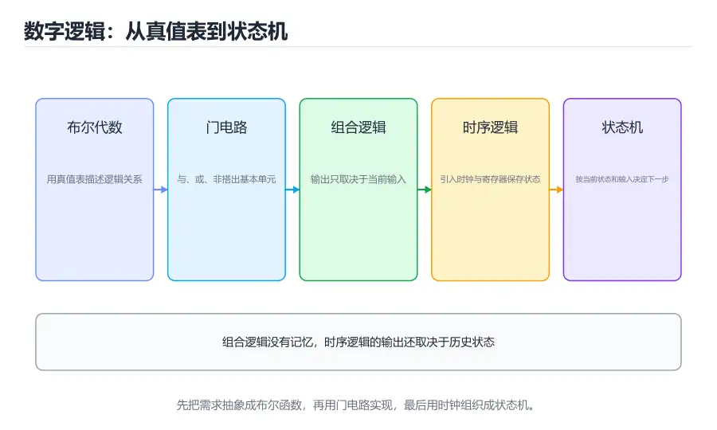

# 数字逻辑与电路基础

> 内容更新时间：2026-10-06 · 学习阶段：基础 · 预计用时：25 分钟



## 本节知识框架

**课程定位**：分类「computer_organization」· 学习阶段 基础 · 建议用时 25 分钟。

本课主线：把布尔代数、门电路、组合逻辑、触发器和时钟串成一条线，理解 CPU 内部的加减法、选择器和寄存器是怎样由最基础的 0/1 电路搭出来的。

**复习清单**

- [ ] 能写出与、或、非、异或的真值表
- [ ] 能用德摩根定律化简一个简单表达式
- [ ] 能说明半加器与全加器的区别
- [ ] 能解释组合逻辑和时序逻辑的本质差异
- [ ] 能说明 D 触发器的采样时刻与建立、保持时间
- [ ] 能用代码模拟一个门电路并验证真值表

## 核心概念定义

| 术语 | 一句话说明 |
| --- | --- |
| 布尔代数 | 用 0 和 1 表示真假，并对逻辑运算进行代数化简的数学体系 |
| 逻辑门 | 实现基本布尔运算的电路元件，如与门、或门、非门、异或门 |
| 组合逻辑 | 输出只取决于当前输入的电路，没有内部状态记忆 |
| 时序逻辑 | 输出由当前输入和过去状态共同决定的电路，通常带时钟 |
| 半加器 | 对两个一位二进制数求和，产生和位与进位的组合电路 |
| 全加器 | 在半加器基础上考虑低位进位，可级联成多位加法器 |
| 触发器 | 能保存一位状态的时序元件，是寄存器和存储器的基本单元 |
| 建立时间 | 时钟边沿到来前数据必须保持稳定的最短时间 |
| 保持时间 | 时钟边沿到来后数据仍需保持稳定的最短时间 |
| 有限状态机 | 用有限个状态描述控制流程，并根据输入决定状态转移的模型 |

## 原理与运行机制

### 从开关到门：逻辑的物理实现

可以把一个逻辑门想成一间只有规则、没有记忆的小房间：输入几个电平，房间立刻按规则给出一个电平。与门要求所有输入都为 1 才输出 1，像一串必须全部闭合的开关；或门只要有一个输入为 1 就输出 1，像并联的开关；非门把 0 变 1、1 变 0；异或门则在两个输入不同时输出 1，常被用来做「不相等检测」。

现代芯片用 CMOS 晶体管实现这些门。一个反相器通常由一对互补的晶体管组成：上拉网络把输出接到电源，下拉网络把输出接到地。由于同一时刻只有一个网络导通，静态功耗很低，这也是 CMOS 成为主流工艺的重要原因。

### 真值表与布尔化简

描述组合逻辑最直接的工具是真值表。两个输入有 4 种组合，三个输入有 8 种，n 个输入有 2^n 种。真值表枚举了所有情况，适合验证和教学，但输入一多就会爆炸，因此实际设计常使用布尔代数或卡诺图化简。

德摩根定律是最常用的化简工具：`NOT(A AND B) = (NOT A) OR (NOT B)`，`NOT(A OR B) = (NOT A) AND (NOT B)`。它告诉我们，与非门可以转换成带反相的或门，反之亦然。工程上常把设计统一成 NAND 或 NOR 形式，因为这两种门在芯片里更容易实现、面积更小。

举个具体例子：三人表决器要求至少两人同意才通过，输入为 A、B、C。真值表中有四种情况输出 1：011、101、110、111。写成最小项之和是 `A'BC + AB'C + ABC' + ABC`，利用 `ABC + ABC' = AB` 等合并规则，可以化简为 `AB + AC + BC`。从四个三输入与门加一个或门，变成三个二输入与门加一个或门，门数和连线都明显减少。这个例子说明，化简不是为了好看，而是直接减少面积、延迟和功耗。

### 加法器：从半加到全加

半加器处理两个一位输入 A、B，输出和位 `S = A XOR B`，进位 `C = A AND B`。但多位加法中，每一位还要接收低位传来的进位，于是需要全加器：输入 A、B、Cin，输出 `S = A XOR B XOR Cin`，`Cout = (A AND B) OR (Cin AND (A XOR B))`。

把 n 个全加器串联起来，就得到行波进位加法器。它结构简单，但高位的进位必须等低位算完，延迟随位数线性增长。32 位加法器的关键路径可能包含几十个门延迟，直接限制了主频。超前进位加法器通过并行计算进位产生与传播信号，把延迟压到对数级，代价是更多电路和布线。

### 组合逻辑 vs 时序逻辑

组合逻辑没有记忆：输入一变，输出经过一段门延迟后跟着变。时序逻辑则带有状态，最典型的是触发器和寄存器。它们由时钟控制，只在特定边沿更新状态，因此可以把「计算」和「保存」分开：组合逻辑负责算下一拍的值，寄存器负责在时钟边沿把值锁存。

这个分工是现代同步数字系统的基础。CPU 的流水线寄存器、寄存器堆、程序计数器都是时序元件；ALU、译码器、多路选择器则是组合元件。设计者要保证在一个时钟周期内，组合逻辑的稳定结果能在下一个边沿到来前送到寄存器输入端。

### 锁存器、触发器与时钟

锁存器是电平敏感的：使能信号有效时，输出跟随输入；使能无效时，输出保持。触发器通常是边沿敏感的：只在时钟上升沿或下降沿采样输入。边沿触发更容易做时序分析，也更适合构建同步电路，因此 CPU 中的寄存器基本都使用触发器。

时钟不是「越快的方波越好」。它必须给组合逻辑留出足够的传播时间，同时满足触发器的建立和保持要求。如果数据在时钟边沿附近变化，触发器可能进入亚稳态，输出在一段时间内既不是 0 也不是 1。跨时钟域传输时，通常要用两级触发器同步或异步 FIFO 来降低亚稳态风险。

### 有限状态机：控制逻辑的骨架

很多控制逻辑可以用有限状态机描述：系统处在某个状态，收到输入后决定下一个状态和输出。例如一个简单的交通灯控制器，有红灯、绿灯、黄灯三个状态，定时器到期就按固定顺序切换。CPU 的控制单元也可以看成状态机：取指、译码、执行、访存、写回就是不同的状态。

状态机分为 Moore 型和 Mealy 型。Moore 型的输出只与当前状态有关，时序更稳定；Mealy 型的输出还依赖输入，响应更快但更容易产生毛刺。选择哪种形式，要看对延迟和稳定性的要求。

### 从门到寄存器：8 位寄存器怎么搭

一个 8 位寄存器并不是一个神秘的黑盒，它就是 8 个 D 触发器并排放在一起，共享同一个时钟信号和写使能信号。每个触发器的 D 输入端接一位数据，Q 输出就是寄存器的某一位。写使能为 1 时，时钟边沿把 8 位输入一起锁存；写使能为 0 时，所有触发器保持原值。

如果希望寄存器支持「保持」和「装载」两种行为，可以在 D 输入端加一个二选一多路选择器：保持时选自己的 Q 输出，装载时选外部数据。复位信号则把触发器清零或置为初始值。真实 CPU 的寄存器堆还要处理多端口读写、旁路和写冲突，但基本单元仍然是触发器加选择逻辑。

时钟信号在芯片上会经过很长的连线，到达不同触发器的时间并不完全一致，这种偏差叫时钟偏斜。偏斜过大会压缩有效的时序余量，因此高性能芯片会设计时钟树或时钟网格，尽量让同一时钟域内的边沿同时到达。复位也有同步复位与异步复位之分，前者便于时序分析，后者能在没有时钟时立即生效。

## 典型应用场景

### ALU 与运算器

算术逻辑单元需要完成加减、与或非、比较和移位。加法器是核心，减法可以通过「加补码」复用加法器；比较器可以由减法结果和标志位组合而成；移位器通常用多级多路选择器实现。理解门级结构，有助于解释为什么某些运算更慢、为什么位宽会影响频率。

### 寄存器与存储器

一个 32 位寄存器由 32 个触发器并排组成，共享同一个时钟和写使能。寄存器堆则是多个寄存器的集合，通过地址选择读写端口。缓存中的 SRAM 单元也由类似的双稳态结构构成，只是密度更高、读写更复杂。

### 控制单元

指令译码后要产生一系列控制信号：是否写寄存器、ALU 做什么运算、是否读写内存、下一条 PC 从哪里来。硬布线控制用组合逻辑直接生成信号，速度快但修改困难；微程序控制把控制信号存成微指令，灵活但多了一层访存。

### FPGA 与硬件原型

FPGA 用可编程的逻辑块和连线实现数字电路，适合快速验证 CPU、外设和协议。写 Verilog 时，组合逻辑用 `assign` 或 `always @(*)`，时序逻辑用带时钟边沿的 `always @(posedge clk)`。综合工具会把代码映射成查找表和触发器，因此代码风格会直接影响面积和时序。

### 三态门与共享连线

多个部件要共用一组导线时，不能把它们的输出直接接在一起，否则一个输出 1、另一个输出 0 就会形成短路。三态门提供了第三种状态：高阻态。当使能信号无效时，三态门像断开一样从导线上「消失」；同一时刻只允许一个部件驱动总线，其他部件保持高阻，从而避免冲突。

三态门曾经是共享总线的标准做法，但现代芯片片内更常用多路选择器或点对点连线，因为三态总线在深亚微米工艺下时序和功耗都不理想。理解三态门仍然有价值，它能解释老式总线的电气行为，也能帮助你读懂外设数据手册中「输出使能」引脚的作用。无论采用哪种实现，核心约束都一样：共享介质上同一时刻只能有一个驱动者。

## 代码/协议/SQL 示例

### 用 Python 模拟基本门电路

```python
def AND(a, b):
    return int(bool(a) and bool(b))

def OR(a, b):
    return int(bool(a) or bool(b))

def NOT(a):
    return int(not a)

def XOR(a, b):
    return int(bool(a) != bool(b))

def full_adder(a, b, cin):
    s = XOR(XOR(a, b), cin)
    cout = OR(AND(a, b), AND(cin, XOR(a, b)))
    return s, cout

print("A B Cin | S Cout")
for a in (0, 1):
    for b in (0, 1):
        for cin in (0, 1):
            s, cout = full_adder(a, b, cin)
            print(f"{a} {b}  {cin}  | {s}  {cout}")
```

运行后逐行核对真值表，可以确认 `1+1+1` 得到和位 1、进位 1。把全加器按位串联，就得到多位加法器；在加法器的输入端加上可控取反和进位输入，就能扩展出加减共用的 ALU。

### 用 Verilog 描述一个全加器

```verilog
module full_adder(
    input  a,
    input  b,
    input  cin,
    output sum,
    output cout
);
    assign sum  = a ^ b ^ cin;
    assign cout = (a & b) | (cin & (a ^ b));
endmodule
```

这段代码是纯组合逻辑，没有时钟，也没有状态。综合工具会把它映射成异或门、与门和或门。若把多个全加器实例化并串联，就得到行波进位加法器；若改为超前进位结构，则需要额外的产生与传播逻辑。

### 用 C 观察位运算与逻辑运算的区别

```c
#include <stdio.h>

int main(void) {
    unsigned int a = 0x0F;
    unsigned int b = 0x33;
    printf("bitwise AND = 0x%02X\n", a & b);
    printf("logical AND = %d\n", a && b);
    printf("bitwise XOR = 0x%02X\n", a ^ b);
    printf("shift left  = 0x%02X\n", a << 2);
    return 0;
}
```

`&` 是按位与，会对每一对二进制位分别运算；`&&` 是逻辑与，只判断整体真假，结果非 0 即 1。把两者混用是 C 语言初学者的常见错误，尤其在判断「某一位是否为 1」时，必须使用按位与并配合掩码。

## 时间/空间复杂度或性能分析

### 门延迟与关键路径

每个门都有传播延迟，信号从输入变化到输出稳定需要时间。组合逻辑的总延迟等于从输入到输出最长路径上的门延迟之和，这条最长路径叫关键路径。同步电路的时钟周期必须大于关键路径延迟加上触发器的建立时间，因此关键路径直接决定最高主频。

行波进位加法器的关键路径随位数线性增长，32 位加法可能成为频率瓶颈。超前进位、选择进位和进位保存等结构通过并行化缩短关键路径，但会增加面积和功耗。设计 CPU 时，工程师常在「更快」和「更小更省电」之间反复权衡。

### 面积、功耗与频率的三角关系

提高频率通常要增加电压或加深流水线，前者会让功耗按电压平方增长，后者会增加寄存器和布线开销。芯片的功耗预算有限，散热也有上限，因此不能无限追求高频。移动设备更看重能效比，常通过动态调频、关断空闲模块和近阈值电压来省电。

面积同样不是免费的。更多的门意味着更大的芯片面积、更长的连线和更高的制造成本，布线延迟甚至可能超过门延迟。先进工艺能缩小晶体管，但连线电阻电容的占比反而上升，这也是现代设计强调「靠近使用、减少长距离通信」的原因。

### 毛刺与同步设计

组合逻辑在输入变化时可能产生短暂的错误输出，称为毛刺。如果毛刺被时钟采样，就会变成真正的错误状态。同步设计的原则是：组合逻辑的输出只在时钟边沿被寄存器采样，且采样前已经稳定。异步输入要先经过同步器，跨时钟域的数据要使用握手或 FIFO，不能直接接到触发器输入端。

工程上还会关注亚稳态的平均无故障时间（MTBF）。同步器级数越多，亚稳态传播到后级的概率越低，但会多出几拍延迟。设计者要在可靠性和响应速度之间取平衡，并严格遵循器件手册给出的时序参数，而不是凭经验随意缩短或延长同步链。

调试数字电路时，逻辑分析仪和示波器是常用工具。逻辑分析仪可以同时抓取多路信号，按时间轴观察时钟、使能和数据的变化；示波器则更适合看电平细节和信号完整性。排查「偶尔出错」的问题时，先确认时钟是否稳定、复位是否干净，再检查建立保持时间和跨时钟域路径，通常比逐行改代码更快找到根因。

## 常见误区与易错点

| 错误认识 | 实际发生的情况 | 更稳妥的做法 |
| --- | --- | --- |
| 组合逻辑也能保存状态 | 组合逻辑没有记忆，输入消失输出就消失 | 需要保存时加入触发器或寄存器 |
| 时钟频率只由工艺决定 | 关键路径、电压和温度都会限制频率 | 做时序分析，找出最长路径 |
| 触发器在时钟高电平期间一直采样 | 边沿触发器只在上升沿或下降沿采样 | 区分电平敏感锁存器与边沿触发器 |
| 建立时间可以忽略 | 数据太晚到达会导致亚稳态或采样错误 | 预留时序余量，做静态时序分析 |
| 异或门只能做加法 | 异或还用于比较、奇偶校验和加密 | 根据真值表理解其通用性 |
| 与非门不是通用门 | 与非门可以组合出非、与、或等所有基本门 | 需要时统一用 NAND 实现 |
| 毛刺一定会被采样 | 同步设计只在稳定时刻采样，通常能避开 | 避免纯组合逻辑直接驱动异步控制 |
| 位运算和逻辑运算可以混用 | `&` 与 `&&` 的语义和结果完全不同 | 判断位用掩码，判断真假用逻辑运算 |

## 与其他知识点的关系

### 先修课程

本课需要二进制和布尔运算的基础，建议先完成《数据表示与编码》。如果你写过 C 或 Verilog，会对位运算和模块化描述更熟悉；如果学过离散数学中的命题逻辑，真值表和化简会更容易上手。

### 相关概念对比

- **组合逻辑 vs 时序逻辑**：前者无状态、输出随输入立即变化；后者有状态、由时钟驱动更新。
- **锁存器 vs 触发器**：锁存器电平敏感，触发器边沿敏感；后者更适合同步设计。
- **行波进位 vs 超前进位**：前者结构简单但延迟线性增长，后者延迟更低但面积更大。
- **硬布线控制 vs 微程序控制**：前者速度快、修改难；后者灵活、需要额外的控制存储。

### 后续衔接

学完本课后，指令系统课程会把门级加法器扩展到完整 ALU；CPU 数据通路课程会用多路选择器和寄存器堆把各个部件连接起来；流水线课程会分析寄存器之间的关键路径如何决定时钟周期。实战项目则会用软件模拟这些逻辑部件。

## 自测题与参考答案

### 自测 1

写出异或门的真值表，并说明它为什么可以用来判断两个输入是否不同。

**参考答案**：输入 00 输出 0，01 输出 1，10 输出 1，11 输出 0。只有当两个输入取值不同时输出才为 1，因此可以作为「不相等」检测器，也常用于奇偶校验和加法器的和位计算。

### 自测 2

半加器和全加器的区别是什么？

**参考答案**：半加器只处理两个一位输入，产生和位与进位；全加器还接收低位传来的进位，因此可以级联成多位加法器。半加器可以看作全加器在 Cin 固定为 0 时的特例。

### 自测 3

为什么边沿触发的触发器比电平敏感的锁存器更适合构建 CPU 寄存器？

**参考答案**：边沿触发器只在时钟边沿更新，一个周期内只采样一次，时序分析简单，能避免输入在电平有效期间反复变化导致状态抖动。锁存器在使能期间透明，容易产生竞争和毛刺。

### 自测 4

建立时间和保持时间分别约束什么？

**参考答案**：建立时间要求数据在时钟边沿到来前提前稳定一段时间，保持时间要求数据在边沿后继续稳定一段时间。两者共同保证触发器采样到可靠的电平，违反约束可能导致亚稳态。

### 自测 5

用 Python 修改全加器示例，输出 `A=1, B=1, Cin=1` 时的和位与进位，并解释结果。

**参考答案**：和位为 1，进位为 1。因为 1+1+1 等于十进制的 3，二进制是 11，最低位是 1，向高位的进位也是 1。全加器的两个输出正好对应这两个二进制位。把多个全加器级联时，低位的进位输出接到高位的进位输入，就能扩展到任意位宽。

## 考点精讲

### 考点 1

下列哪个门被称为「通用门」，可以只用它实现任意组合逻辑？

A. 与非门 NAND

B. 与门 AND

C. 或门 OR

D. 非门 NOT

**正确答案：A**

**详细解释**：与非门可以通过不同接法实现非门、与门和或门，因此单独一种门就能搭出所有组合逻辑，工程上常把设计统一成 NAND 结构以简化工艺。与门、或门和非门单独使用都无法表达全部布尔函数。通用门的价值在于减少工艺种类和布线复杂度。正确项「与非门 NAND」符合通用门的定义。

---

### 考点 2

组合逻辑电路与时序逻辑电路的主要区别是？

A. 组合逻辑必须带时钟

B. 时序逻辑只能实现加法

C. 组合逻辑的输出只由当前输入决定

D. 时序逻辑不能保存状态

**正确答案：C**

**详细解释**：组合逻辑没有内部状态，输入确定后输出经过门延迟就会稳定；时序逻辑则包含触发器或寄存器，输出与历史状态有关，通常由时钟驱动。组合逻辑不需要时钟，时序逻辑也不只做加法。判断一个电路属于哪一类，可以问自己「把输入断开后，输出还能保持吗」。正确项「组合逻辑的输出只由当前输入决定」点出了两者的本质差异。

---

### 考点 3

D 触发器通常在什么时刻采样输入？

A. 任意时刻持续采样

B. 时钟高电平期间持续采样

C. 时钟低电平期间持续采样

D. 时钟的上升沿或下降沿

**正确答案：D**

**详细解释**：边沿触发的 D 触发器只在时钟跳变的瞬间采样输入，其余时间保持输出不变，这让同步电路的行为更容易预测。电平敏感的是锁存器，不是边沿触发器。上升沿与下降沿只是采样时刻不同，设计时必须和时序约束保持一致。正确项「时钟的上升沿或下降沿」准确描述了采样时刻。

---

### 考点 4

建立时间（setup time）的含义是？

A. 时钟边沿后数据需要保持稳定的时间

B. 时钟边沿前数据必须保持稳定的最短时间

C. 门电路从输入到输出的传播延迟

D. 触发器从复位到输出的时间

**正确答案：B**

**详细解释**：建立时间约束数据必须在时钟边沿到来之前提前稳定，否则触发器可能采到正在跳变的值；边沿之后的要求叫保持时间。传播延迟描述门电路，复位时间是另一项参数。建立时间与保持时间一起构成触发器对输入窗口的约束，任何一项被违反都可能引发亚稳态。正确项「时钟边沿前数据必须保持稳定的最短时间」是建立时间的标准定义。

---

### 考点 5

关于异或门（XOR），下列哪项正确？

A. 两个输入相同时输出 1

B. 两个输入不同时输出 0

C. 两个输入不同时输出 1

D. 它只能用于加法器

**正确答案：C**

**详细解释**：异或门的真值表是 00→0、01→1、10→1、11→0，因此输入不同时输出 1，相同时输出 0。它不仅能做加法器的和位，还能做比较、奇偶校验和可控取反。把异或门的一个输入当作控制位，就能实现「控制位为 1 时翻转、为 0 时保持」。正确项「两个输入不同时输出 1」与其真值表一致。

---

### 考点 6

题目：在「数字逻辑与电路基础」的术语表里，下列术语与解释的配对哪些是正确的？（多选）
A. 「建立时间」：时钟边沿前数据需稳定的最短时间  
B. 「逻辑门」：实现基本布尔函数的电路元件  
C. 「半加器」：考虑低位进位的加法电路  
D. 「全加器」：两个一位输入的加法电路  
正确答案：AB

**解析**：本题正确项是「建立时间」：时钟边沿前数据需稳定的最短时间，以及「逻辑门」：实现基本布尔函数的电路元件，这两组配对与术语表一致。另外两组把术语和解释张冠李戴：「半加器」被安上了考虑低位进位的加法电路的解释，「全加器」反而拿到了两个一位输入的加法电路的定义，所以两组都不能选。复习时回到「数字逻辑与电路基础」的术语速查表逐条核对，配对题考的是定义里描述的对象和边界，而不是术语的字面长相。

---

## 术语速查

| 术语 | 一句话说明 |
| --- | --- |
| 布尔代数 | 对 0/1 逻辑运算进行建模与化简的代数体系 |
| 逻辑门 | 实现基本布尔函数的电路元件 |
| 组合逻辑 | 无状态、输出只由当前输入决定的电路 |
| 时序逻辑 | 带状态、由时钟驱动的电路 |
| 半加器 | 两个一位输入的加法电路 |
| 全加器 | 考虑低位进位的加法电路 |
| 触发器 | 保存一位状态的边沿敏感元件 |
| 建立时间 | 时钟边沿前数据需稳定的最短时间 |
| 保持时间 | 时钟边沿后数据需稳定的最短时间 |
| 有限状态机 | 用有限状态描述控制流程的模型 |

## 参考资料与复核

- 复核范围：基本门真值表、全加器公式、触发器时序参数、状态机定义

| 参考资料 | 本课用途 |
| --- | --- |
| [Boolean algebra](https://en.wikipedia.org/wiki/Boolean_algebra) | 布尔运算与化简规则的系统说明 |
| [Logic gate](https://en.wikipedia.org/wiki/Logic_gate) | 各类逻辑门的符号、真值表与实现 |
| [Flip-flop (electronics)](https://en.wikipedia.org/wiki/Flip-flop_%28electronics%29) | 锁存器与触发器的时序行为对比 |
| [Adder (electronics)](https://en.wikipedia.org/wiki/Adder_%28electronics%29) | 半加器、全加器与超前进位的结构 |

- 最后复核：2026-10-04
- 下次复核：2027-10-25

## 内容元数据

- 内容版本：v2.0
- 最后更新：2026-10-06
- 学习阶段：基础
- 适用环境：通用开发环境；本课聚焦 布尔代数。
- 内容来源：内置结构化课程与工程实践整理
- 相关主题：digital logic and circuits
- 质量版本：P0 测验标准 + P1 覆盖扩展 + P2 体验补全
