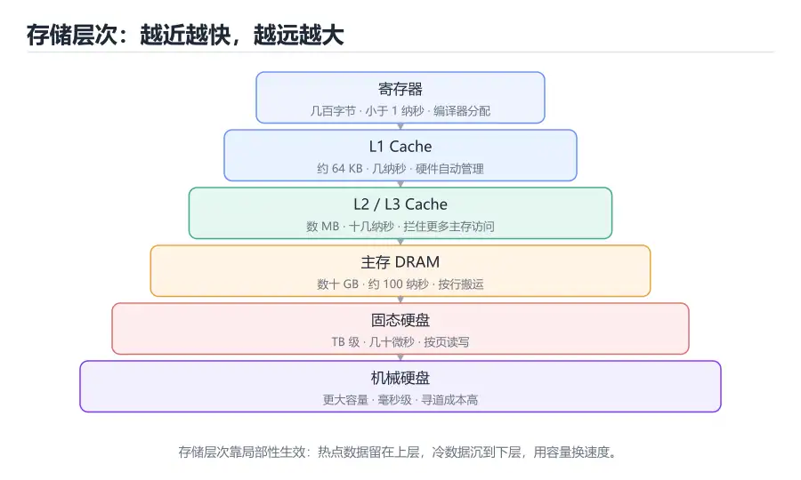

# 存储层次与 Cache

> 内容更新时间：2026-10-06 · 学习阶段：进阶 · 预计用时：30 分钟



## 本节知识框架

**课程定位**：分类「computer_organization」· 学习阶段 进阶 · 建议用时 30 分钟。

本课主线：从「容量、速度、成本」三者的矛盾出发，理解寄存器、Cache、主存、外存为什么要分层，掌握局部性原理、Cache 的地址划分与映射方式、替换和写回策略，最后用 AMAT 把命中率翻译成真实的性能数字。

**复习清单**

- [ ] 能说出存储层次每一层的典型容量与访问延迟量级
- [ ] 能用时间局部性和空间局部性解释一段循环为什么快
- [ ] 能画出直接映射 Cache 的地址划分并计算 tag、index、offset
- [ ] 能区分 compulsory、capacity、conflict 三类缺失
- [ ] 能用 AMAT 公式估算加入 Cache 后的平均访存时间
- [ ] 能运行本课的 Cache 模拟器，改变访问步长和行数观察命中率变化

## 核心概念定义

| 术语 | 一句话说明 |
| --- | --- |
| 存储层次 | 把不同容量和速度的存储器按层级组织，用上层缓存下层的热点数据 |
| 局部性原理 | 程序倾向于重复访问最近用过的数据（时间）和相邻地址（空间） |
| Cache 行 | Cache 与主存之间搬运数据的最小单位，通常为 64 字节 |
| 命中率 | 访问能在 Cache 中找到所需数据的比例 |
| AMAT | 平均访存时间，等于命中时间加上缺失率乘以缺失代价 |
| 直接映射 | 每个主存块只能放进唯一一个 Cache 行的映射方式 |
| 组相联 | 每个主存块可以放进某一组内的任意一行，兼顾灵活性与成本 |
| 全相联 | 主存块可以放进任意一行，灵活但比较逻辑昂贵 |
| 替换策略 | Cache 满时选择哪一行淘汰，常见有 LRU、伪 LRU 和随机 |
| 写回 | 修改只写入 Cache，等该行被替换时才写回下一级 |
| 写直达 | 每次写操作同时更新 Cache 和下一级存储器 |
| 预取 | 在真正访问之前把可能用到的数据提前搬进 Cache |

## 原理与运行机制

### 为什么必须有存储层次

CPU 执行一条加法可能只需要零点几个纳秒，而从 DRAM 取一个数要几十纳秒，从固态硬盘读一个页要几十微秒，从机械硬盘寻道则要几毫秒。如果每次访存都直接找最慢的那一层，再快的运算单元也只能干等。存储层次的核心思路，是把常用数据放在小而快的存储器里，把不常用的数据留在下面的大容量存储器里。

这个思路能成立，靠的是程序行为不是随机的。寄存器数量极少但速度最快，L1 Cache 通常几十 KB，L2 几百 KB 到几 MB，L3 几 MB 到几十 MB，主存几个 GB 到上百 GB，固态硬盘则以 TB 计。越往下容量越大、单位成本越低、延迟越高。设计者的任务，是让绝大多数访问停在上层，只让少数访问穿到底层。

| 层级 | 典型容量 | 典型延迟 | 管理方式 |
| --- | --- | --- | --- |
| 寄存器 | 几十到几百字节 | 小于 1 纳秒 | 编译器分配 |
| L1 Cache | 32–64 KB | 约 1–4 纳秒 | 硬件自动 |
| L2 Cache | 256 KB–2 MB | 约 4–12 纳秒 | 硬件自动 |
| L3 Cache | 4–64 MB | 约 10–50 纳秒 | 硬件自动 |
| 主存 DRAM | 8–256 GB | 约 60–120 纳秒 | 虚拟内存 + 硬件 |
| 固态硬盘 | 数百 GB–数 TB | 约 50–200 微秒 | 操作系统文件系统 |

表中的数字只是量级，不同处理器差异很大，但层级之间的数量级差距长期稳定。理解这一点，比记住某个具体型号的参数更重要。

### 局部性原理：缓存能生效的根本原因

时间局部性指刚访问过的数据很可能马上再次被访问。循环里的计数器、反复调用的函数、热度很高的配置项，都是时间局部性的典型对象。空间局部性指访问某个地址后，附近的地址也很可能被访问。遍历数组、顺序执行指令、读取结构体字段，都会产生空间局部性。

```python
# 时间局部性：total 和 i 在循环中被反复访问
total = 0
for i in range(1000):
    total += i

# 空间局部性：items 中相邻元素会被连续访问
items = list(range(1000))
s = sum(items)
```

第一段代码里，变量 `total` 和 `i` 会长期留在寄存器中，根本不产生访存；第二段代码里，`items` 的相邻元素位于连续内存，Cache 一次搬入一整行，后续元素大概率直接命中。反过来，如果代码随机跳着访问一个大数组，空间局部性被破坏，Cache 行搬进来只用到一个元素，命中率就会明显下降。

### Cache 的基本结构与地址划分

Cache 与主存之间按「行」搬运数据，一行通常 64 字节。CPU 给出一个物理地址后，硬件把它切成三段：块内偏移（offset）决定要行内哪个字节，索引（index）决定去哪个 Cache 组找，标签（tag）用来确认找到的行是不是自己想要的那一块。

直接映射是最简单的方案：主存块号对 Cache 行数取模，结果就是它唯一能去的那一行。假设 Cache 有 64 行、每行 64 字节，那么地址低 6 位是偏移，中间 6 位是索引，剩余高位是标签。给定地址 `0x1234`，偏移是 `0x34`，索引是 `0x08`，标签是 `0x1`。硬件先按索引找到第 8 行，再比较标签是否等于 `0x1`，相等且有效位为 1 才算命中。

组相联把若干行组成一组，主存块按组号映射，但可以放进组内任意一行。两路组相联意味着每组两行，硬件要并行比较两个标签，命中任意一个即可。全相联则没有索引，所有行一起比较，灵活度最高，但比较器和选择逻辑也最贵，通常只用于容量很小的结构，例如 TLB。

### 三类缺失： compulsory、capacity、conflict

第一次访问某个数据一定不在 Cache 中，这叫 compulsory miss，也叫冷启动缺失。它无法靠增大 Cache 消除，只能通过预取或改变访问模式缓解。

如果 Cache 容量不够，程序的工作集大于 Cache，数据会被反复挤出，这叫 capacity miss。矩阵太大、图像分辨率太高、数据集超过 LLC 容量，都会造成容量缺失。解决办法是分块、压缩数据或减少同时活跃的数据量。

冲突缺失来自映射规则的限制。即使 Cache 还有空行，两个主存块也可能因为映射到同一组而互相驱逐。直接映射最容易发生冲突缺失，提高关联度可以缓解；但关联度越高，硬件成本和访问延迟也越高。

### 替换策略与写策略

组相联和全相联需要决定淘汰哪一行。LRU 淘汰最久未被访问的行，符合时间局部性，但需要为每行维护访问信息，way 数多时成本很高。伪 LRU 用少量位近似 LRU，以较低开销获得接近的效果。随机替换实现最简单，在高度关联的 Cache 中表现也不差。

写操作有两种基本策略。写直达每次写都同时更新 Cache 和下一级存储器，逻辑简单，一致性容易维护，但写流量大。写回只在 Cache 中修改，并用 dirty bit 标记，等这一行被替换时才写回下一级。写回减少了写流量，但替换时可能产生额外延迟，也需要更复杂的协议保证一致性。

写缺失时还要决定是否把被写的块调入 Cache。写分配（write allocate）先调入再写，适合后续还会访问该块的场景；非写分配（no write allocate）直接把写操作发到下一级，适合只写一次的数据。常见组合是「写回 + 写分配」和「写直达 + 非写分配」。

### 多级 Cache 与预取

现代 CPU 通常有分离的 L1 指令 Cache 和 L1 数据 Cache，共享的 L2 或 L3。L1 追求低延迟，容量小、关联度适中；L3 追求容量，延迟高但能拦住更多主存访问。一次访问会先查 L1，未命中再查 L2、L3，最后才访问 DRAM。

预取器会根据访问模式提前把数据搬进 Cache。顺序预取适合数组遍历，步长预取适合按固定间隔访问的结构。预取过于激进会挤占有效数据、浪费带宽；过于保守则掩盖不了延迟。好的预取策略需要在准确率和及时性之间平衡。

## 典型应用场景

### 数组遍历与矩阵计算

同样的矩阵乘法，按行访问和按列访问的 Cache 命中率可能相差数倍。行优先存储的语言里，内层循环应该沿着行方向走，让每次访问都落在已经搬入的 Cache 行上。矩阵分块把大矩阵切成能装进 L1 或 L2 的小块，使每个块在被换出前被充分复用，这是数值计算库最常见的优化之一。

### 数据结构布局

链表每个节点单独分配，节点之间地址不连续，遍历时空间局部性差；数组把元素连续存放，硬件预取器容易识别顺序访问。即使算法复杂度相同，数组往往比链表快得多。游戏引擎里的实体组件系统（ECS）把同类数据放在连续内存，也是为了把 Cache 用满。

### 数据库与索引

数据库的 B+ 树把大量键和指针放在一个页里，一次磁盘 I/O 能读入成百上千个键，减少寻道次数。查询优化器会尽量使用覆盖索引，让查询只读索引页而不回表，本质上也是在提高每次 I/O 的有效数据比例。

### 图像与多媒体处理

图像按行存储，逐行处理比逐列处理更容易命中 Cache。对大图做卷积时，分块处理可以让一个图像块在 L1 中停留更久，避免每计算一个像素就把整行数据重新读一遍。视频解码器也会把参考帧切成宏块，按块访问而不是按整帧扫描。

## 代码/协议/SQL 示例

### 用 Python 模拟直接映射 Cache

下面的模拟器把地址拆成标签、索引和偏移，统计命中与缺失。它省略了真实硬件的并行比较和替换细节，但足以观察访问模式对命中率的影响。

```python
class DirectMappedCache:
    def __init__(self, lines=64, line_size=64):
        self.lines = lines
        self.line_size = line_size
        self.tags = [None] * lines
        self.hits = 0
        self.misses = 0

    def access(self, address):
        offset_bits = self.line_size.bit_length() - 1
        index_bits = self.lines.bit_length() - 1
        index = (address >> offset_bits) & (self.lines - 1)
        tag = address >> (offset_bits + index_bits)
        if self.tags[index] == tag:
            self.hits += 1
            return True
        self.tags[index] = tag
        self.misses += 1
        return False


cache = DirectMappedCache()
# 顺序访问：一行 64 字节，连续 8 个整数共享一行
for address in range(0, 64 * 8, 4):
    cache.access(address)
print("顺序访问命中率", cache.hits / (cache.hits + cache.misses))

cache = DirectMappedCache()
# 跨步访问：步长 4096 字节，四个地址在 64 行 Cache 中索引相同；再重复遍历一次
strided = list(range(0, 64 * 64 * 4, 64 * 64))
for address in strided + strided:
    cache.access(address)
print("跨步访问命中率", cache.hits / (cache.hits + cache.misses))
```

顺序访问时，同一行的后续字节全部命中；跨步访问时，地址 0、4096、8192、12288 在 64 行 Cache 中的索引都是 0，第一遍四次访问都是冷启动缺失，第二遍本来可以复用，却因为四个块争用同一行而继续全部缺失，命中率为 0。改成 128 行后，四个地址分散到索引 0 和 64，但每个索引仍被两个标签不同的块轮流占用，第二遍依旧全部冲突。真正有效的是把关联度提高到能同时容纳这些块，或者改变步长和数据布局，让访问分散到不同组。

### 用 C 比较行优先与列优先

```c
#include <stdio.h>
#include <time.h>

#define N 1024
static int matrix[N][N];

int main(void) {
    clock_t start = clock();
    long sum = 0;
    for (int i = 0; i < N; i++)
        for (int j = 0; j < N; j++)
            sum += matrix[i][j];
    double row_time = (double)(clock() - start) / CLOCKS_PER_SEC;

    start = clock();
    long sum2 = 0;
    for (int j = 0; j < N; j++)
        for (int i = 0; i < N; i++)
            sum2 += matrix[i][j];
    double col_time = (double)(clock() - start) / CLOCKS_PER_SEC;

    printf("row=%.3fs col=%.3fs sum=%ld/%ld\n",
           row_time, col_time, sum, sum2);
    return 0;
}
```

行优先遍历时，内层循环沿连续地址前进，每次 Cache 行搬入后能被连续使用；列优先遍历时，每次访问都跨越一整行，Cache 里只用到其中一个元素。实际差距取决于矩阵大小、Cache 容量和编译器优化，但方向通常一致。测量时要防止编译器把循环优化掉，可以把结果打印出来或使用 `volatile`。

### 用 perf 观察缓存缺失

在 Linux 上可以用 `perf stat` 查看缓存事件。不同 CPU 支持的事件名不同，先列出可用事件，再挑选与 LLC 相关的那几个。

```text
$ perf stat -e cache-references,cache-misses ./matmul
 Performance counter stats for './matmul':
         1,234,567      cache-references
           123,456      cache-misses              #   10.00% of all cache refs
```

这组输出说明每十次缓存访问就有一次缺失。若把矩阵分块后缺失率明显下降，说明原来的访问顺序确实没有利用好 Cache。性能计数器只能告诉你「发生了什么」，还需要结合代码和数据布局解释「为什么」。

## 时间/空间复杂度或性能分析

### AMAT：把命中率换算成时间

平均访存时间（AMAT）的公式是：AMAT = 命中时间 + 缺失率 × 缺失代价。假设 L1 命中时间是 1 纳秒，缺失率 5%，缺失代价 100 纳秒，那么 AMAT = 1 + 0.05 × 100 = 6 纳秒。命中率从 95% 提高到 99%，AMAT 会降到约 2 纳秒，性能提升非常明显。

多级 Cache 可以逐级套用这个公式。L1 未命中的代价不是直接访问 DRAM，而是「L2 的 AMAT」。如果 L1 缺失率 5%，L2 命中时间 10 纳秒、缺失率 20%、缺失代价 100 纳秒，那么 L2 的 AMAT 是 10 + 0.2 × 100 = 30 纳秒，L1 的 AMAT 是 1 + 0.05 × 30 = 2.5 纳秒。多一层 Cache 把 100 纳秒的缺失代价挡掉了大半。

### 缺失代价与 CPI

Cache 缺失会占用流水线，影响 CPI。若每条指令平均有 0.05 次数据访问缺失，每次缺失让处理器停顿 50 个周期，那么每条指令平均多出 2.5 个周期。原本 CPI 为 1 的处理器，实际 CPI 会变成 3.5。这个估算说明，访存瓶颈可以轻易压过指令级优化带来的收益。

减少 CPI 的方向有三个：降低缺失率（改善局部性、分块、预取）、降低缺失代价（多级 Cache、非阻塞访问、更快的 DRAM）、减少访存次数（寄存器分配、数据复用）。三者要一起看，不能只盯着命中率。

### 分块矩阵乘法的收益

朴素矩阵乘法对 N×N 矩阵要访问 O(N³) 个元素对，但每个元素被重复使用 N 次。如果工作集大于 Cache，每次复用都要重新从主存搬运。分块把矩阵切成 B×B 的小块，使三个小块同时装进 Cache，块内的乘法可以在 Cache 中完成，主存流量从 O(N³) 降到约 O(N³/B)。

分块大小不能盲目取大。块太大装不进 Cache，会退化成朴素算法；块太小则循环开销和边界处理占比上升。实践中会用性能模型或自动调优搜索合适的块大小，再针对具体机器验证。

### 测量方法与陷阱

测 Cache 性能时，要先固定数据规模、编译选项和运行环境。同一个程序在不同机器上可能因为 Cache 容量、关联度和预取策略不同而表现完全不同。用 `perf`、VTune 或操作系统的性能计数器采集缺失率，再改变一个变量复测，才能把因果关系和噪声分开。单次运行的时间波动很大，至少重复多次取中位数。

## 常见误区与易错点

| 错误认识 | 实际发生的情况 | 更稳妥的做法 |
| --- | --- | --- |
| Cache 越大一定越快 | 大 Cache 延迟更高，还可能降低频率 | 结合工作集和访问延迟评估 |
| 命中率 99% 就没有问题 | 1% 缺失若代价极高，仍可能主导耗时 | 用 AMAT 和 CPI 一起看 |
| 数组访问一定比链表快 | 小规模或访问模式不同时结论可能反转 | 用实际负载测量 |
| 直接映射没有价值 | 它成本低、比较简单，适合小容量场景 | 按容量和关联度权衡 |
| 写直达一定比写回慢 | 写流量小或一致性要求高时写直达更合适 | 看写模式和一致性协议 |
| 预取越多越好 | 过度预取会污染 Cache、浪费带宽 | 控制预取距离和准确率 |
| 缓存行越小越省空间 | 行太小会增加标签开销和访存次数 | 按硬件实际行大小对齐数据 |
| 多核共享 Cache 不影响程序 | 其他核心会挤占容量并引发一致性流量 | 关注伪共享和 NUMA 布局 |

## 与其他知识点的关系

### 先修课程

本课需要《数据表示与编码》中的字节、地址和二进制拆分知识，也需要《数字逻辑与电路基础》中的寄存器与组合逻辑概念。理解《计算机组成原理导论》里的访存过程，会更容易把 Cache 放进整条指令执行链。

### 相关概念对比

- **Cache vs 寄存器**：寄存器由编译器和硬件显式管理，Cache 由硬件自动管理，程序员只能通过访问模式间接影响它。
- **直接映射 vs 组相联**：前者硬件简单、冲突多；后者灵活、命中率高，但比较逻辑更复杂。
- **写回 vs 写直达**：写回减少写流量但有一致性负担；写直达简单但写流量大。
- **Cache vs 虚拟内存**：两者都利用局部性，但 Cache 按行搬运、由硬件管理；虚拟内存按页搬运、由操作系统和 MMU 共同管理。

### 后续衔接

学完本课后，《指令流水线》会解释 Cache 缺失如何让流水线停顿；《虚拟内存与地址转换》会把「层次」推广到页表和 TLB；实战项目会让模拟器带上一级数据 Cache，观察不同访问模式的周期数变化。

## 自测题与参考答案

### 自测 1

一个直接映射 Cache 有 32 行、每行 64 字节，主存地址 `0x0A5C` 的索引和偏移分别是多少？

**参考答案**：64 字节对应 6 位偏移，取地址低 6 位，`0x5C & 0x3F = 0x1C`。32 行对应 5 位索引，把地址右移 6 位后取低 5 位，`0x0A5C >> 6 = 0x29`，`0x29 & 0x1F = 0x09`。因此偏移是 `0x1C`，索引是 `0x09`。

### 自测 2

为什么顺序遍历数组通常比随机访问快？

**参考答案**：顺序访问具有空间局部性，Cache 按行搬入数据后，后续相邻元素大概率已经在 Cache 中，命中率高。随机访问每次落到不同行，搬入的整行只用到一个元素，有效带宽低；同时硬件预取器也难以识别随机模式，无法提前掩盖延迟。

### 自测 3

两路组相联相比直接映射，为什么能减少冲突缺失？

**参考答案**：直接映射中每个主存块只能进唯一一行，两个块映射到同一行时会互相驱逐，即使其他行空着也没用。两路组相联允许每个块进入组内两行中的任意一行，映射到同一组的两个块可以共存，从而减少因位置受限产生的冲突缺失。

### 自测 4

写回策略中的 dirty bit 什么时候会被置位，什么时候被清除？

**参考答案**：当一条写操作命中并修改了 Cache 行的内容时，该行的 dirty bit 被置为 1，表示 Cache 中的数据比下一级新。该行被替换时，硬件检查 dirty bit，为 1 就把整行写回下一级；写回完成后新行被调入，dirty bit 清零。若写直达则通常不需要 dirty bit。

### 自测 5

运行本课的模拟器，跨步访问的命中率是多少？把 `lines` 从 64 改成 128 后命中率会变化吗？为什么？

**参考答案**：两种配置的命中率都是 0。步长 4096 字节时，四个地址在 64 行 Cache 中全部映射到索引 0，第一遍都是冷启动缺失，第二遍四个块继续争用同一行。改成 128 行后，它们分散到索引 0 和 64，但每个索引仍有两个不同标签的块轮流驱逐，第二遍依然全部缺失。增大行数只是改变了冲突的位置，没有增加可同时容纳的块数；要缓解冲突，需要提高关联度、改变步长或重新布局数据。

## 考点精讲

### 考点 1

直接映射 Cache 中，主存地址通常被划分成哪三部分？

A. 标签、索引、块内偏移

B. 数据、校验位、时钟

C. 页号、页内偏移、权限位

D. 操作码、寄存器号、立即数

**正确答案：A**

**详细解释**：直接映射用索引选择唯一的 Cache 行，用标签确认该行是否属于目标块，用块内偏移定位行内的具体字节。页号和页内偏移属于虚拟内存的地址划分，操作码和寄存器号属于指令格式，都不是 Cache 地址的组成部分。正确项「标签、索引、块内偏移」对应硬件比较和选择的三段信息。

---

### 考点 2

程序按行优先遍历二维数组明显快于按列优先，主要体现了哪种局部性？

A. 指令级并行

B. 空间局部性

C. 时间局部性

D. 分支预测

**正确答案：B**

**详细解释**：行优先遍历时，内层循环访问的是连续地址，Cache 一次搬入的一整行能被后续元素反复使用，这正是空间局部性。时间局部性强调同一数据被重复访问，指令级并行和分支预测属于处理器执行机制，不解释数组布局带来的差异。正确项「空间局部性」抓住了连续地址复用这一关键。

---

### 考点 3

平均访存时间 AMAT 的正确计算方式是？

A. 命中时间 + 缺失率 × 缺失代价

B. 命中时间 × 缺失率

C. 缺失代价 ÷ 命中率

D. 命中时间 + 缺失代价

**正确答案：A**

**详细解释**：AMAT 把命中时的固定开销和缺失时的额外代价按概率加权：大多数访问只花命中时间，少数缺失的访问还要再加上缺失代价，因此写成命中时间加缺失率乘以缺失代价。直接加缺失代价会高估平均时间，乘除组合也没有物理意义。正确项「命中时间 + 缺失率 × 缺失代价」是标准公式。

---

### 考点 4

写回策略中 dirty bit 的主要作用是什么？

A. 记录该行被访问的次数，供替换算法使用

B. 标记该行是否由硬件预取器填入

C. 标记该行被修改过，替换时需要写回下一级

D. 指示该行属于指令 Cache 还是数据 Cache

**正确答案：C**

**详细解释**：写回策略允许修改只停留在 Cache 中，dirty bit 记录这一行是否已经与下一级不一致。替换时若 dirty bit 为 1，硬件必须先把整行写回下一级，否则会丢失修改；为 0 则可以直接丢弃。访问次数属于 LRU 信息，预取标记和 Cache 类型都不是 dirty bit 的职责。正确项「标记该行被修改过，替换时需要写回下一级」准确说明了它的用途。

---

### 考点 5

冲突缺失（conflict miss）的典型成因是什么？

A. 第一次访问某块数据时它必然不在 Cache 中

B. Cache 总容量小于程序工作集，数据被整体挤出

C. 多核之间缓存一致性协议发生冲突

D. 映射位置受限，多个主存块争用同一 Cache 行或组

**正确答案：D**

**详细解释**：冲突缺失发生在 Cache 仍有空余容量时，由于多个主存块映射到同一行或同一组而互相驱逐。第一次访问造成的缺失是 compulsory miss，工作集超过容量造成的是 capacity miss，一致性协议处理的是多核数据同步，不是这里讨论的冲突。正确项「映射位置受限，多个主存块争用同一 Cache 行或组」概括了冲突缺失的本质。

---

### 考点 6

题目：在「存储层次与 Cache」的术语表里，下列术语与解释的配对哪些是正确的？（多选）
A. 「局部性」：提前把预测会访问的数据搬入 Cache  
B. 「索引」：地址中用于选择 Cache 组或行的中间位  
C. 「命中率」：访问能在 Cache 中找到数据的比例  
D. 「预取」：程序倾向重复访问近期数据和相邻地址的规律  
正确答案：BC

**解析**：本题正确项是「索引」：地址中用于选择 Cache 组或行的中间位，以及「命中率」：访问能在 Cache 中找到数据的比例，这两组配对与术语表一致。另外两组把术语和解释张冠李戴：「局部性」被安上了提前把预测会访问的数据搬入 Cache的解释，「预取」反而拿到了程序倾向重复访问近期数据和相邻地址的规律的定义，所以两组都不能选。复习时回到「存储层次与 Cache」的术语速查表逐条核对，配对题考的是定义里描述的对象和边界，而不是术语的字面长相。

---

## 术语速查

| 术语 | 一句话说明 |
| --- | --- |
| 存储层次 | 按容量、速度和成本分层组织存储器，让热点数据靠近 CPU |
| 局部性 | 程序倾向重复访问近期数据和相邻地址的规律 |
| Cache 行 | Cache 与主存之间搬运数据的最小单位 |
| 标签 | 地址中用于与 Cache 行比较、确认块身份的高位部分 |
| 索引 | 地址中用于选择 Cache 组或行的中间位 |
| 块内偏移 | 地址中用于定位 Cache 行内字节的低位部分 |
| 命中率 | 访问能在 Cache 中找到数据的比例 |
| AMAT | 平均访存时间，命中时间加缺失率乘缺失代价 |
| 冲突缺失 | 因映射位置受限而互相驱逐造成的缺失 |
| 写回 | 修改留在 Cache，替换时才写回下一级 |
| 伪共享 | 多核修改同一 Cache 行中的不同变量，引发不必要的同步 |
| 预取 | 提前把预测会访问的数据搬入 Cache |

## 参考资料与复核

- 复核范围：存储层次结构、Cache 地址划分、替换与写策略、AMAT 计算

| 参考资料 | 本课用途 |
| --- | --- |
| [CMU 15-213: Introduction to Computer Systems](https://www.cs.cmu.edu/~213/) | 课程主页，包含 Cache 与存储层次的讲义和实验 |
| [CPU Cache - Wikipedia](https://en.wikipedia.org/wiki/CPU_cache) | Cache 组织、映射方式和替换策略的概览 |
| [What Every Programmer Should Know About Memory](https://people.freebsd.org/~lstewart/articles/cpumemory.pdf) | 深入讲解存储层次、Cache 行为和程序优化 |
| [Agner Fog Optimization Manuals](https://www.agner.org/optimize/) | 针对具体微架构的指令与内存优化指南 |

- 最后复核：2026-10-04
- 下次复核：2027-10-25

## 内容元数据

- 内容版本：v2.0
- 最后更新：2026-10-06
- 学习阶段：进阶
- 适用环境：通用开发环境；本课聚焦 存储层次。
- 内容来源：内置结构化课程与工程实践整理
- 相关主题：computer organization memory hierarchy cache
- 质量版本：P0 测验标准 + P1 覆盖扩展 + P2 体验补全
