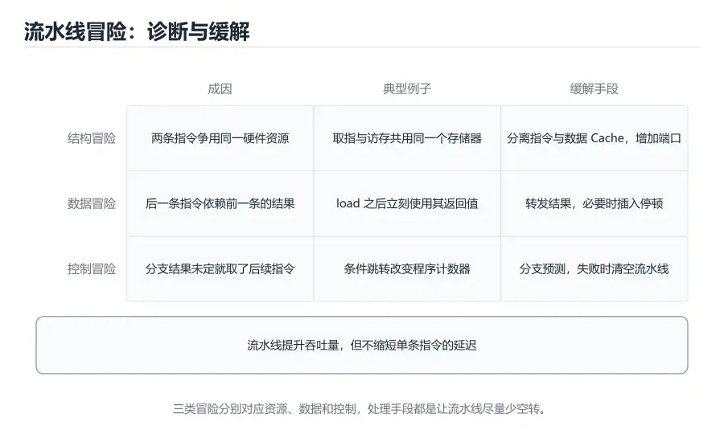

# 指令流水线

> 内容更新时间：2026-10-06 · 学习阶段：进阶 · 预计用时：25 分钟



## 本节知识框架

**课程定位**：分类「computer_organization」· 学习阶段 进阶 · 建议用时 25 分钟。

本课主线：把单周期 CPU 的五个阶段拆成流水线，理解吞吐量与延迟的区别、结构冒险、数据冒险、控制冒险，以及转发、停顿和分支预测怎样让流水线尽可能满负荷运转。

**复习清单**

- [ ] 能画出五级流水线并标出每级使用的硬件
- [ ] 能解释流水线为什么提高吞吐量而不缩短单条指令延迟
- [ ] 能识别 RAW、WAR、WAW 三类数据冒险
- [ ] 能说明转发与停顿分别在什么情况下使用
- [ ] 能计算给定指令序列的流水线周期数
- [ ] 能运行本课的流水线模拟器并观察停顿

## 核心概念定义

| 术语 | 一句话说明 |
| --- | --- |
| 流水线 | 把指令执行拆成多个阶段，让多条指令的不同阶段重叠进行 |
| 吞吐量 | 单位时间内完成的指令数，流水线主要提升的指标 |
| 延迟 | 一条指令从开始到完成所需的时间 |
| 流水线寄存器 | 在相邻阶段之间保存中间结果的寄存器 |
| 结构冒险 | 两条指令在同一周期争用同一个硬件资源 |
| 数据冒险 | 指令之间存在数据依赖，导致读到旧值或写冲突 |
| RAW | 后一条指令要读前一条指令尚未写回的结果，最常见的数据冒险 |
| 转发 | 把尚未写回的结果直接从流水线内部送给需要的指令 |
| 停顿 | 插入气泡，让相关指令等待结果就绪 |
| 分支预测 | 在分支结果确定前猜测走向，以减少控制冒险损失 |

## 原理与运行机制

### 流水线就像一条装配线

单周期 CPU 像一位厨师，从洗菜到装盘全部自己完成，做完一道才开始下一道。流水线则像餐厅的装配线：洗菜、切菜、烹饪、装盘、出餐各有专人，五道菜可以同时在五个工位上进行。虽然单道菜从开始到上桌的时间没有变短，但单位时间能出更多菜。

经典的五级流水线把指令执行拆成 IF（取指）、ID（译码/读寄存器）、EX（执行）、MEM（访存）、WB（写回）。每个阶段在一个时钟周期内完成，阶段之间用流水线寄存器保存中间结果。理想情况下，每个周期都有一条新指令进入 IF，同时有一条指令从 WB 离开，吞吐量接近单周期的五倍。

### 吞吐量与延迟不是一回事

流水线提升的是吞吐量，不是单条指令的延迟。实际上，由于增加了流水线寄存器的开销，单条指令从进入到完成可能比单周期还慢一点。理解这个区别非常重要：评估 CPU 时，服务器看吞吐量，实时控制系统看延迟，两者优化方向可能完全不同。

理想加速比约等于流水线级数，但现实中会被冒险、流水线填充和排空、时钟偏斜等因素打折。五级流水线在稳定状态下也很难达到精确的五倍，通常能到三到四倍就已经不错。级数越深，单级逻辑越短，频率可能越高，但冒险和开销也越多。

### 流水线寄存器里存了什么

流水线寄存器不是抽象概念，而是每级之间真实存在的一组触发器。IF/ID 保存取到的指令和 PC+4；ID/EX 保存读出的两个操作数、立即数和目标寄存器号；EX/MEM 保存 ALU 结果、写回目标和分支结果；MEM/WB 保存访存数据和最终写回信息。任何一项漏存，后面的阶段就拿不到需要的数据。也正因为每一级都要把上一级的结果完整锁存，流水线寄存器的位宽会随设计增加，面积和功耗也随之上升。理解这些字段，才能读懂冒险检测单元为什么要比较 ID/EX 的目标寄存器和 IF/ID 的源寄存器。

### 结构冒险：硬件不够用

结构冒险发生在两条指令同时需要同一个硬件资源时。例如指令存储器和数据存储器如果不分开，IF 和 MEM 阶段可能在同一周期争用同一个存储器；寄存器堆如果只有一个写端口，两条指令同时写回就会冲突。

解决办法有三种：增加资源（如指令缓存与数据缓存分离）、分时使用（让某个阶段暂停一拍）、或者把资源设计成多端口。真实处理器通常把指令和数据缓存分开，寄存器堆也提供足够的读写端口，从源头减少结构冒险。

### 数据冒险：RAW、WAR、WAW

数据冒险来自指令之间的依赖关系。RAW（Read After Write）是后一条指令要读前一条指令尚未写回的结果，例如 `add x1, x2, x3` 后紧跟 `sub x4, x1, x5`。WAR（Write After Read）是后一条指令要写前一条指令还在读的寄存器；WAW（Write After Write）是两条指令写同一个寄存器。按序五级流水线主要关注 RAW，乱序执行还要处理 WAR 和 WAW。

RAW 不一定都要停顿。如果结果在 EX 阶段就算出来，可以通过转发网络直接送给下一条指令的 EX 输入，而不必等它写回寄存器堆。转发路径通常从 EX/MEM 和 MEM/WB 流水线寄存器引出，配合多路选择器选择最新值。

### load-use 冒险与停顿

转发并不能解决所有 RAW。load 指令的数据要到 MEM 阶段结束才可用，而紧随其后的指令在 EX 阶段就需要它，时间上差了一拍。此时必须插入一个停顿（气泡），让后续指令晚一拍进入 EX，等 load 的数据从存储器返回后再转发。

这就是经典的 load-use 冒险。编译器可以通过指令调度，把一条与 load 结果无关的指令填到空隙里；硬件则通过冒险检测单元自动插入停顿。两者结合，可以在不改变程序语义的前提下减少性能损失。

### 控制冒险与分支预测

分支指令要等到 EX 或更晚阶段才知道是否跳转，但流水线在此之前已经取入了后续指令。如果分支实际跳转，这些指令就白取了，必须清空流水线，造成控制冒险。分支预测器的作用，是在结果确定前猜测走向，让流水线继续取指。

静态预测规则简单，例如「向后跳转预测 Taken，向前跳转预测 Not Taken」，适合循环。动态预测器用历史表记录每个分支的走向，甚至用两位饱和计数器提高稳定性；现代处理器还会结合分支目标缓冲、返回地址栈和全局历史，做到很高的准确率。预测失败时，清空流水线的代价与流水线深度相关，通常为几个到十几个周期。

### 从标量到超标量

五级标量流水线每个周期最多完成一条指令。超标量处理器每周期取多条指令，并配备多个执行单元，进一步提高吞吐量；乱序执行则允许指令在操作数就绪时先执行，减少等待。它们都需要更复杂的寄存器重命名、重排序缓冲和提交逻辑，但基本思想仍然来自本课的流水线与冒险处理。

超标量并不是简单地把五级流水线复制一份。每周期取多条指令，需要一个能判断指令间依赖的发射逻辑；多条指令同时写回，需要多个写端口或排队机制；乱序执行还要用重命名表消除假依赖，并用重排序缓冲保证异常和提交顺序与程序顺序一致。发射宽度越宽，前端取指和译码就越容易成为瓶颈，所以现代处理器往往同时加宽取指带宽、增加指令缓存，并配上更复杂的分支预测。

## 典型应用场景

### CPU 设计与验证

设计流水线时，工程师要用波形和性能模型验证每条指令的时序。冒险检测、转发路径和分支逻辑是最容易出错的部分，需要覆盖 load-use、连续写同一寄存器、分支嵌套等边界情况。形式化验证和随机测试常用于发现极端组合。

### 编译器指令调度

编译器知道目标流水线的特性后，可以调整指令顺序，把无关指令填到 load 之后的空隙，减少停顿。它还可以做循环展开、软件流水和分支优化。调度必须在保持程序语义的前提下进行，不能跨越可能产生副作用的访存或函数调用。

### 性能分析

看到程序 CPI 高于 1，就要判断停顿来自哪里：缓存缺失导致的访存等待、分支预测失败、还是数据依赖。性能计数器通常提供分支失败数、停顿周期数和缓存缺失数，结合代码热点的反汇编，可以定位到具体的指令序列。

### 实时系统

实时系统更关心最坏情况执行时间，而不是平均吞吐量。流水线的分支预测和缓存会让最坏情况难以精确分析，因此安全关键系统可能禁用某些优化，或使用可预测性更强的处理器。理解流水线行为，有助于评估时间分析的保守程度。

## 代码/协议/SQL 示例

### 用 Python 模拟五级流水线

```python
def pipeline_cycles(instructions, forwarding=True):
    # 记录每个寄存器最近一次由哪条指令产生、产生者是不是 load
    producers = {}
    stalls = 0
    for index, (dst, srcs, is_load) in enumerate(instructions):
        for src in srcs:
            if src not in producers:
                continue
            produced_at, produced_by_load = producers[src]
            distance = index - produced_at
            if not forwarding:
                # 要等生产者写回：距离 1 停 2 拍，距离 2 停 1 拍
                stalls += max(0, 3 - distance)
            elif produced_by_load and distance == 1:
                # 转发也救不了紧邻的 load-use，仍需 1 拍
                stalls += 1
        if dst is not None:
            producers[dst] = (index, is_load)
    return len(instructions) + 4 + stalls

program = [
    ("x1", ["x2", "x3"], False),  # add
    ("x4", ["x1", "x5"], False),  # 依赖 x1
    ("x6", [], True),             # load
    ("x7", ["x6"], False),        # 紧跟 load，需要停顿
]
print("无转发:", pipeline_cycles(program, forwarding=False))
print("有转发:", pipeline_cycles(program, forwarding=True))
```

这个模型刻意简化了流水线寄存器数量和分支行为，只保留「生产—消费距离」这一核心。运行后会看到：没有转发时两处距离为 1 的依赖各停 2 拍，总周期 12；开启转发后只剩 load-use 的 1 拍停顿，总周期 9，而理想值是 8。这正是 load-use 冒险无法被转发完全消除的典型表现。

### 用表格计算流水线时序

```text
指令    IF  ID  停顿  EX  MEM WB
add     1   2   -     3   4   5
sub     2   3   -     4   5   6
load    3   4   -     5   6   7
use     4   5   1 拍  7   8   9
```

`use` 在 EX 阶段需要 load 的结果，但 load 要到第 6 周期结束才有数据，所以在第 6 周期插入一个气泡，让 `use` 的 EX 推迟到第 7 周期，再从 MEM/WB 转发数据。表格法适合手算小段指令，能直观看出每个阶段是否空闲。真实处理器的流水线更深，但分析方法相同。

### 用 C 观察分支对性能的影响

```c
#include <stdio.h>

int sum_even(int *data, int n) {
    int total = 0;
    for (int i = 0; i < n; i++) {
        if ((data[i] & 1) == 0) {
            total += data[i];
        }
    }
    return total;
}

int main(void) {
    int data[8] = {1, 2, 3, 4, 5, 6, 7, 8};
    printf("%d\n", sum_even(data, 8));
    return 0;
}
```

这段代码中的分支取决于数据，若输入随机，分支预测器难以稳定命中；若数据有明显规律，预测准确率会高很多。把条件改成无分支的条件传送或查表，有时能减少预测失败，但也会增加其他开销，需要实测。

## 时间/空间复杂度或性能分析

### 流水线周期数估算

理想情况下，n 条指令在 k 级流水线中需要 n + k − 1 个周期。五级流水线执行 100 条指令，理想周期数是 104；如果有 10 个停顿周期，就是 114。平均 CPI 等于总周期数除以指令数，停顿时 CPI 会大于 1。

估算时还要区分稳定状态和启动阶段。执行 5 条指令，五级流水线需要 9 个周期，平均 CPI 是 1.8，看起来远不如理想值；但指令数增加到 1000 条，填充的 4 个周期几乎可以忽略。所以短小程序难以从流水线获得明显收益，跑分和基准测试必须使用足够长的负载，否则测到的主要是填充开销。

更完整的公式是：执行时间 = 指令数 × CPI × 时钟周期。流水线通过降低 CPI（接近 1）提高性能，但流水线寄存器会增加时钟周期，冒险会增加 CPI。设计者要在级数、频率和冒险开销之间寻找平衡点。

### 深流水线的代价

级数越深，每级逻辑越少，理论上频率越高；但流水线寄存器更多、填充和排空时间更长，分支预测失败的惩罚也更大。一个 20 级流水线的处理器，如果分支失败率是 5%，仅控制冒险就可能让 CPI 增加 1 个周期以上。深流水线适合高频率、可预测的负载，浅流水线更适合低延迟和实时场景。

### 转发与停顿的收益

转发能把大部分 RAW 冒险的停顿消除，但会增加数据通路的多路选择器和连线延迟，可能反过来限制时钟频率。停顿则直接浪费周期。工程师会用性能模型比较不同方案的收益，而不是简单地认为「转发越多越好」。

### 一次停顿的完整代价

插入一个气泡并不是「少执行一条指令」那么简单。气泡会让 IF、ID 阶段暂停，取指单元空转一个周期；如果停顿反复出现，后面的指令也会被推迟，形成连锁。更麻烦的是，停顿期间时钟仍在翻转，功耗并没有减少。测量时可以把总周期拆成基础周期、数据冒险停顿、控制冒险清空和缓存等待四部分，哪一部分占比高，优化就往哪里走。例如 load-use 停顿占主导时，优先做指令调度或改进转发路径；分支清空占主导时，优先提高预测准确率。

## 常见误区与易错点

| 错误认识 | 实际发生的情况 | 更稳妥的做法 |
| --- | --- | --- |
| 流水线缩短了单条指令的延迟 | 流水线主要提高吞吐量，延迟可能略有增加 | 区分吞吐量与延迟 |
| 流水线级数越多越快 | 深流水线会增加冒险惩罚和寄存器开销 | 结合负载与频率综合评估 |
| 有转发就不需要任何停顿 | load-use 冒险仍需至少一个停顿 | 识别 load 后紧跟使用的情况 |
| 按序五级流水线也要重点处理 WAR 和 WAW | 按序流水线按程序顺序读写，WAR/WAW 不会造成错误，主要处理 RAW | 乱序执行时才需要用重命名等手段消除 WAR/WAW |
| 分支预测失败没有代价 | 需要清空流水线，浪费已取指令 | 统计失败率与惩罚周期 |
| CPI 永远等于 1 | 缓存缺失、冒险和停顿都会让 CPI 大于 1 | 用性能计数器测量实际 CPI |
| 结构冒险只发生在存储器 | 寄存器端口、执行单元和总线都可能冲突 | 检查所有共享资源 |
| 编译器调度可以随意重排指令 | 不能跨越有副作用或依赖的指令 | 保持数据依赖和控制依赖 |

## 与其他知识点的关系

### 先修课程

本课需要《CPU 数据通路与控制》中的五阶段数据通路和控制信号，也需要《指令系统与汇编基础》中的指令格式和寄存器依赖。了解缓存和分支的基本概念，会更容易理解冒险对性能的影响。

### 相关概念对比

- **流水线 vs 多周期**：多周期让一条指令分多拍完成，流水线让多条指令重叠；前者降低单指令周期，后者提高吞吐量。
- **转发 vs 停顿**：转发用额外数据通路消除等待，停顿用空闲周期保证正确性；前者快但有硬件成本。
- **静态预测 vs 动态预测**：静态规则固定，实现简单；动态预测依赖历史，准确率更高但更复杂。
- **标量 vs 超标量**：标量每周期取一条指令，超标量每周期取多条并并行执行。

### 后续衔接

学完本课后，存储层次课程会解释缓存缺失如何造成 MEM 阶段停顿；乱序执行和分支预测的进阶内容会在计算机体系结构课程中展开；实战项目会给模拟器加入流水线和冒险检测，观察周期数的变化。

## 自测题与参考答案

### 自测 1

五级流水线执行 20 条指令，理想情况下需要多少周期？

**参考答案**：n + k − 1 = 20 + 5 − 1 = 24 个周期。前四条指令用于填满流水线，之后每个周期完成一条，最后一条指令还需要走完剩余阶段。

### 自测 2

为什么 load 后紧跟使用其结果的指令需要停顿？

**参考答案**：load 的数据要到 MEM 阶段结束才从存储器返回，而后续指令在 EX 阶段就需要该数据。即使有转发，也无法在数据尚未产生时提前送达，因此必须插入一个气泡，等数据可用后再继续。

### 自测 3

分支预测失败时，处理器通常采取什么措施？

**参考答案**：清空流水线中已经取入的错误路径指令，从正确的分支目标重新取指。清空的深度取决于流水线级数和分支结果确定的阶段，代价通常为几个到十几个周期。

### 自测 4

转发网络解决了哪类冒险？不能解决哪类？

**参考答案**：转发主要解决 RAW 冒险，把尚未写回的结果直接送给需要的指令。它不能解决 load-use 的时间差，也不能解决结构冒险和控制冒险；WAR 和 WAW 在乱序执行中还需要寄存器重命名。

### 自测 5

在模拟器里给程序增加一条独立指令 `("x8", ["x2"], False)`，分别把它放在 `use` 之后和 `load` 与 `use` 之间，两种顺序的周期数各是多少？

**参考答案**：放在 `use` 之后时，load 与 use 距离为 1，有转发 10 个周期、无转发 13 个周期；放到 load 与 use 之间后，距离变成 2，load-use 停顿消失（无转发时也从 2 拍降到 1 拍），有转发 9 个周期、无转发 12 个周期。指令总数没变，只是调整了顺序，就省下 1 个周期，这正是指令调度的价值。

## 考点精讲

### 考点 1

五级流水线在理想情况下的加速比接近多少？

A. 2

B. 5

C. 10

D. 1

**正确答案：B**

**详细解释**：理想流水线每个周期完成一条指令，相比单周期每条指令占用五个阶段，吞吐量理论上接近五倍。实际加速比会被流水线寄存器开销、冒险停顿和填充排空拉低，通常达不到精确的五倍；级数越深理论加速比越高，但冒险代价和时钟开销会让收益递减。正确项「5」对应五级流水线的理想上限。

---

### 考点 2

在典型五级流水线中，紧跟在 load 指令后立即使用其结果的指令，最稳妥的处理是？

A. 直接执行，不需要任何处理

B. 删除该指令

C. 把它改成 store 指令

D. 插入一个停顿并配合转发

**正确答案：D**

**详细解释**：load 的数据要到 MEM 阶段结束才可用，后续指令在 EX 阶段就需要它，时间上差一拍，必须插入气泡等待结果，然后再通过转发送到执行单元。删除或改写指令会改变程序语义，直接执行会读到旧值。正确项「插入一个停顿并配合转发」是标准的 load-use 处理方式。

---

### 考点 3

数据冒险中的 RAW 指的是什么？

A. 后一条指令要读前一条指令尚未写回的结果

B. 两条指令同时写同一个寄存器

C. 指令长度不一致

D. 分支预测失败

**正确答案：A**

**详细解释**：RAW 是 Read After Write，即读后写：后一条指令读取的寄存器正是前一条指令要写的结果，若不加处理就会读到旧值。两条指令同时写同一寄存器属于 WAW，指令长度和分支预测属于其他类别的问题。正确项「后一条指令要读前一条指令尚未写回的结果」准确描述了 RAW。

---

### 考点 4

分支预测失败的主要代价是什么？

A. 增加程序指令数

B. 降低时钟频率

C. 清空流水线，浪费已取入的指令

D. 增加缓存容量

**正确答案：C**

**详细解释**：预测失败时，流水线中已经取入的错误路径指令必须被丢弃，再从正确目标重新取指，这段时间没有有效指令完成，等效于增加 CPI。损失与流水线深度和预测准确率直接相关：级数越深、失败越频繁，浪费的周期越多。它不会改变程序指令数，也不直接降低频率或增加缓存。正确项「清空流水线，浪费已取入的指令」概括了控制冒险的损失。

---

### 考点 5

结构冒险的典型原因是什么？

A. 程序中的指令太多

B. 寄存器数量太少

C. 程序体积太大

D. 两条指令在同一周期争用同一硬件资源

**正确答案：D**

**详细解释**：结构冒险源于硬件资源冲突，例如取指和访存同时访问同一个存储器，或两条指令同时使用同一个执行单元。指令数量、寄存器数量和程序体积本身不会直接导致某一周期的资源争用，真正的判据是同一时刻是否有多条指令抢同一份硬件。正确项「两条指令在同一周期争用同一硬件资源」是结构冒险的定义。

## 术语速查

| 术语 | 一句话说明 |
| --- | --- |
| 流水线 | 多条指令的不同阶段重叠执行的组织方式 |
| 吞吐量 | 单位时间内完成的指令数量 |
| 延迟 | 单条指令从开始到完成的时间 |
| 流水线寄存器 | 保存阶段之间中间结果的寄存器 |
| 结构冒险 | 多条指令争用同一硬件资源 |
| 数据冒险 | 指令间数据依赖导致的冲突 |
| RAW | 后一条指令读取前一条尚未写回的结果 |
| 转发 | 把内部结果直接送给需要它的指令 |
| 停顿 | 插入气泡等待结果就绪 |
| 分支预测 | 在分支结果确定前猜测走向 |

## 参考资料与复核

- 复核范围：五级流水线阶段、冒险分类、转发与停顿、分支预测代价

| 参考资料 | 本课用途 |
| --- | --- |
| [Instruction pipelining](https://en.wikipedia.org/wiki/Instruction_pipelining) | 流水线的基本原理与阶段划分 |
| [Hazard (computer architecture)](https://en.wikipedia.org/wiki/Hazard_%28computer_architecture%29) | 结构、数据与控制冒险的分类与处理 |
| [Branch predictor](https://en.wikipedia.org/wiki/Branch_predictor) | 静态与动态分支预测器的设计 |
| [Forwarding (computing)](https://en.wikipedia.org/wiki/Forwarding_%28computing%29) | 转发机制与数据通路旁路 |

- 最后复核：2026-10-04
- 下次复核：2027-10-25

## 内容元数据

- 内容版本：v2.0
- 最后更新：2026-10-06
- 学习阶段：进阶
- 适用环境：通用开发环境
- 内容来源：内置结构化课程与工程实践整理
- 相关主题：instruction pipeline and hazards
- 质量版本：P0 测验标准 + P1 覆盖扩展 + P2 体验补全
