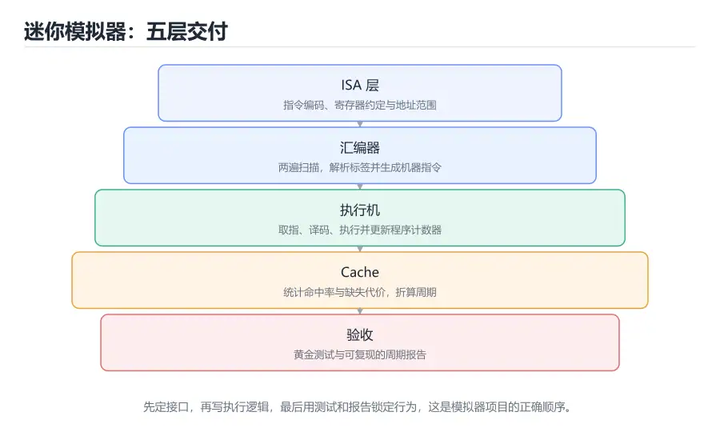

# 实战项目：搭建一台迷你计算机模拟器

> 内容更新时间：2026-10-06 · 学习阶段：高级 · 预计用时：60 分钟



## 本节知识框架

**课程定位**：分类「computer_organization」· 学习阶段 高级 · 建议用时 60 分钟。

本课主线：把前面九课拆开讲的知识重新装回一台机器。你要定义一套 16 位迷你指令集，写一个两遍扫描的汇编器，再实现带寄存器、数据存储和直接映射 Cache 的取指—译码—执行循环，最后用黄金测试和周期统计验证它真的按设计工作。

**项目交付物**

- `mini_isa.py`：指令编码、解码与操作码表
- `assembler.py`：支持标签的两遍汇编器
- `machine.py`：寄存器堆、数据存储器、Cache 与执行循环
- `tests/test_machine.py`：覆盖算术、访存、跳转和 Cache 计数的黄金测试
- `REPORT.md`：三类访问模式下的周期数与命中率对比
- 一份能复现的验收记录，包含命令、实际输出和失败排查

**复习清单**

- [ ] 能为 LOAD、STORE、ADD、SUB、JNZ、HALT 设计 16 位编码
- [ ] 能写一个两遍扫描的汇编器，正确解析标签和寄存器
- [ ] 能实现取指、译码、执行、更新 PC 的主循环
- [ ] 能把直接映射 Cache 接进数据访存路径并统计命中率
- [ ] 能写黄金测试覆盖正常路径和边界情况
- [ ] 能运行验收命令，解释周期数与命中率的变化

## 核心概念定义

| 术语 | 一句话说明 |
| --- | --- |
| ISA | 指令集体系结构，规定指令格式、寄存器和程序可见状态 |
| 操作码 | 指令中标识操作类型的字段 |
| 汇编器 | 把助记符和标签翻译成机器码的工具 |
| 标签 | 汇编代码中代表某个指令地址的符号名 |
| PC | 程序计数器，保存下一条待执行指令的地址 |
| 寄存器堆 | 一组按编号访问的高速寄存器 |
| 数据存储器 | 模拟程序中 load/store 访问的内存空间 |
| Cache | 缓存最近访问的数据行，减少模拟访存延迟 |
| 命中率 | Cache 命中次数除以总访问次数 |
| CPI | 平均每条指令消耗的时钟周期数 |
| 黄金测试 | 用固定输入和预期输出锁定程序行为的测试 |
| 验收命令 | 能重复执行并产生可核对输出的项目检查命令 |

## 原理与运行机制

### 第一步：先定 ISA，再写代码

做模拟器最容易犯的错误，是先写一堆执行逻辑，最后才发现指令编码放不下、寄存器编号和地址混在一起。正确的顺序是先定接口：有多少个寄存器、指令多宽、每条指令需要哪些字段、程序和数据分别放在哪里。

本项目采用 16 位定长指令，格式为「4 位操作码 + 4 位目标寄存器 + 8 位参数」。LOAD 和 STORE 用 8 位参数表示数据地址；ADD 和 SUB 用 8 位参数表示源寄存器编号；JNZ 用 8 位参数表示跳转目标；HALT 不使用参数。四个通用寄存器 r0 到 r3 足够演示数据依赖，又不会让编码复杂到难以调试。

### 第二步：取指—译码—执行

模拟器的主循环对应真实 CPU 的基本节拍。取指阶段根据 PC 从程序存储器取出指令字；译码阶段拆出操作码、目标寄存器和参数；执行阶段根据操作码更新寄存器、数据存储器或 PC；最后处理下一条指令。HALT 结束循环，PC 越界也应视为错误或正常终止，具体语义要在 README 里写清楚。

JNZ 的行为要特别小心。执行到 JNZ 时，PC 已经指向下一条指令；如果条件成立，才把 PC 改成目标地址；如果条件不成立，就保持已经递增的 PC。很多初学者会在这时再手动加一，导致跳过一条指令。把这条语义写进测试，比在注释里解释十遍都可靠。

### 第三步：两遍扫描的汇编器

汇编器第一遍只做一件事：记录每个标签对应的指令下标。第二遍才把助记符和操作数翻译成 Instruction 对象。之所以不能一遍完成，是因为向前跳转的目标地址在第一次遇到时还没出现，必须先收集完标签才能回填。

解析操作数时要区分三类 token：寄存器 `r0` 到 `r3`、标签名、十进制或十六进制数字。统一用一个 `resolve` 函数处理，可以让 LOAD、STORE、ADD、JNZ 共用同一套逻辑。错误处理也要明确：未知操作码、寄存器越界、标签未定义都应该抛出带行号的异常，而不是悄悄变成 0。

### 第四步：把 Cache 接进访存路径

模拟器只统计数据访问，不模拟指令 Cache。每次 LOAD 或 STORE 先计算数据地址属于哪个 Cache 行，再比较标签。命中返回 0 个额外周期；缺失返回固定的缺失代价，并更新标签。这样既能演示局部性，又不会让项目变成完整的微架构模拟器。

缓存参数要可配置：行数、每行字数、缺失代价。默认 8 行、每行 4 个字、缺失代价 4 个周期。测试时可以用小参数制造冲突，再用大参数观察命中率变化。注意 Cache 只影响周期统计，不应该改变程序的最终结果；如果结果随 Cache 参数变化，说明访存路径写错了。

### 第五步：周期统计与性能报告

每条指令至少消耗一个周期，Cache 缺失再叠加缺失代价。报告里至少要有三项：总指令数、总周期数、数据 Cache 命中率。还可以计算 CPI，即总周期数除以指令数。一个没有缺失的程序 CPI 接近 1；频繁缺失时 CPI 会明显上升。

为了让报告可复现，模拟器要支持固定随机种子或固定输入。三类访问模式可以设计为：顺序扫描、跨步扫描、重复访问同一小数组。前两者对比空间局部性，后两者对比时间局部性。每次只改一个变量，记录结果，不要把不同参数混在一起比较。

### 第六步：测试先行的验收方式

黄金测试的思路是：给定一段汇编源程序和初始数据，断言最终寄存器、内存和周期统计满足预期。测试要覆盖算术结果、load/store 往返、条件跳转成立与不成立、HALT 终止、Cache 命中与缺失计数。每修一个 bug，先补一条能复现它的测试，再改代码。

测试不应依赖执行时间或输出格式的细节。断言最终状态和计数，不比较完整日志；日志可以变，行为不能变。对于会无限循环的程序，模拟器要提供指令数上限，测试里断言它在达到上限前停止，避免测试进程挂死。

## 典型应用场景

### 课程实验与体系结构教学

很多体系结构课程要求学生实现一个简化 CPU。这个项目把指令格式、数据通路、Cache 和性能统计压缩到几百行 Python 里，适合在讲完流水线和存储层次后作为综合练习。学生可以清楚地看到「改一个 Cache 参数，CPI 怎么变」。

### 编译器后端的快速验证

编译器团队在开发新指令或新优化时，需要一个容易修改的执行模型来验证语义。迷你模拟器可以快速跑大量小程序，定位是编译器生成了错误指令，还是硬件模型理解错了。它不追求周期精确，但要求行为正确、可重复。

### 硬件原型的软件参考模型

在写 Verilog 或 Chisel 之前，先用软件写一个参考模型，可以在仿真速度更快的环境里验证测试向量。硬件实现完成后，用同一批程序对比软件模型和 RTL 仿真的结果，能快速定位差异。

### 面试与自学项目

这个项目覆盖指令编码、解释器、缓存和测试，是很好的作品集素材。面试时可以讲清楚为什么选择定长指令、为什么汇编器要两遍扫描、Cache 缺失如何影响 CPI，比只背概念更有说服力。

### 项目专属规格

| 规格项 | 本项目取值 | 验收要求 |
| --- | --- | --- |
| 指令宽度 | 16 位定长 | 编码与解码往返一致 |
| 通用寄存器 | r0 到 r3 共 4 个 | 越界编号必须报错 |
| 数据地址 | 0 到 255 | LOAD/STORE 不得越界 |
| Cache | 8 行 × 4 字，缺失代价 4 周期 | 命中与缺失计数可核对 |
| 执行上限 | 最多 10000 步 | 死循环必须停止并报告 |
| 交付文件 | 五个源码/测试文件加报告 | 每条验收命令可复现 |

这些规格是项目的硬边界。扩展位数、寄存器数量或 Cache 参数时，要同步修改编码、汇编器和测试，不能只改其中一层。规格写进 README，评审者才能判断你的实现是否完整，而不是只看程序能不能跑出一个结果。

## 代码/协议/SQL 示例

### 指令编码：mini_isa.py

```python
from dataclasses import dataclass

OPCODES = {
    "LOAD": 0x1,
    "STORE": 0x2,
    "ADD": 0x3,
    "SUB": 0x4,
    "JNZ": 0x5,
    "HALT": 0x6,
}
NAMES = {code: name for name, code in OPCODES.items()}


@dataclass
class Instruction:
    opcode: str
    rd: int = 0
    arg: int = 0


def encode(inst):
    if inst.opcode not in OPCODES:
        raise ValueError(f"unknown opcode: {inst.opcode}")
    if not 0 <= inst.rd <= 3:
        raise ValueError(f"register out of range: {inst.rd}")
    if not 0 <= inst.arg <= 0xFF:
        raise ValueError(f"operand out of range: {inst.arg}")
    return (OPCODES[inst.opcode] << 12) | (inst.rd << 8) | inst.arg


def decode(word):
    code = (word >> 12) & 0xF
    if code not in NAMES:
        raise ValueError(f"unknown instruction word: {word:#06x}")
    return Instruction(NAMES[code], (word >> 8) & 0xF, word & 0xFF)
```

编码把操作码放在高 4 位，目标寄存器放在中间 4 位，参数放在低 8 位。`encode` 和 `decode` 必须互为逆运算，测试里可以随机生成合法指令做往返验证。参数只有 8 位，所以数据地址和跳转目标都不能超过 255；这是本项目明确的设计边界。

### 两遍汇编器：assembler.py

```python
from mini_isa import Instruction


def assemble(source):
    labels = {}
    pending = []
    for line_number, raw in enumerate(source.splitlines(), start=1):
        line = raw.split("#", 1)[0].strip()
        if not line:
            continue
        if line.endswith(":"):
            labels[line[:-1]] = len(pending)
            continue
        parts = line.split(None, 1)
        opcode = parts[0].upper()
        operands = []
        if len(parts) > 1:
            operands = [item.strip() for item in parts[1].split(",")]
        pending.append((line_number, opcode, operands))

    def resolve(token, line_number):
        if token.startswith("r") and token[1:].isdigit():
            return int(token[1:])
        if token in labels:
            return labels[token]
        try:
            return int(token, 0)
        except ValueError as error:
            raise ValueError(
                f"line {line_number}: unknown symbol {token}"
            ) from error

    program = []
    for line_number, opcode, operands in pending:
        rd = resolve(operands[0], line_number) if operands else 0
        arg = resolve(operands[1], line_number) if len(operands) > 1 else 0
        program.append(Instruction(opcode, rd, arg))
    return program, labels
```

第一遍把 `pending` 的下标作为指令地址记录标签，第二遍才解析操作数。`resolve` 先判断寄存器，再查标签，最后按数字解析，因此 `JNZ r1, loop` 中的 `r1` 和 `loop` 能走不同分支。行号用于报错，缺少它时定位汇编错误会非常痛苦。

### 执行循环与 Cache：machine.py

```python
from mini_isa import decode, encode


class DirectMappedCache:
    def __init__(self, lines=8, line_size=4, miss_penalty=4):
        self.lines = lines
        self.line_size = line_size
        self.miss_penalty = miss_penalty
        self.tags = [None] * lines
        self.hits = 0
        self.misses = 0

    def access(self, address):
        block = address // self.line_size
        index = block % self.lines
        tag = block // self.lines
        if self.tags[index] == tag:
            self.hits += 1
            return 0
        self.tags[index] = tag
        self.misses += 1
        return self.miss_penalty

    @property
    def hit_rate(self):
        total = self.hits + self.misses
        return 0.0 if total == 0 else self.hits / total


class Machine:
    def __init__(self, program, data_size=256):
        self.program = program
        self.regs = [0, 0, 0, 0]
        self.data = [0] * data_size
        self.pc = 0
        self.cycles = 0
        self.cache = DirectMappedCache()

    def run(self, max_steps=10000):
        steps = 0
        while self.pc < len(self.program) and steps < max_steps:
            inst = self.program[self.pc]
            self.pc += 1
            self.cycles += 1
            steps += 1
            if inst.opcode == "LOAD":
                self.cycles += self.cache.access(inst.arg)
                self.regs[inst.rd] = self.data[inst.arg]
            elif inst.opcode == "STORE":
                self.cycles += self.cache.access(inst.arg)
                self.data[inst.arg] = self.regs[inst.rd]
            elif inst.opcode == "ADD":
                self.regs[inst.rd] = (self.regs[inst.rd] + self.regs[inst.arg]) & 0xFF
            elif inst.opcode == "SUB":
                self.regs[inst.rd] = (self.regs[inst.rd] - self.regs[inst.arg]) & 0xFF
            elif inst.opcode == "JNZ":
                if self.regs[inst.rd] != 0:
                    self.pc = inst.arg
            elif inst.opcode == "HALT":
                break
        return self.cycles
```

`run` 同时设置 `pc` 边界和 `max_steps` 上限，防止错误跳转造成死循环。每条指令固定 1 个周期，LOAD/STORE 再叠加 Cache 返回的缺失代价。ADD 和 SUB 对 0xFF 取与，模拟 8 位寄存器回绕；如果要扩展成 32 位，必须同时修改编码、立即数范围和掩码。

### 黄金测试：tests/test_machine.py

```python
import unittest

from assembler import assemble
from machine import Machine

SOURCE = """
start:
    LOAD r1, 0
    LOAD r2, 1
    ADD r1, r2
    STORE r1, 2
    LOAD r2, 2
    SUB r2, r1
    JNZ r2, start
    HALT
"""


class MachineTest(unittest.TestCase):
    def test_sum_and_halt(self):
        program, labels = assemble(SOURCE)
        self.assertEqual(labels["start"], 0)
        machine = Machine(program)
        machine.data[0] = 7
        machine.data[1] = 5
        cycles = machine.run()
        self.assertEqual(machine.data[2], 12)
        self.assertGreater(cycles, 8)
        self.assertGreater(machine.cache.hit_rate, 0.0)

    def test_unknown_label_is_rejected(self):
        with self.assertRaises(ValueError):
            assemble("LOAD r1, nowhere")


unittest.main()
```

测试断言了标签地址、最终内存值、周期数下限和命中率。`test_unknown_label_is_rejected` 守住错误处理，避免未定义标签被悄悄解析成 0。运行测试时如果 `assembler` 无法导入，通常是工作目录不在项目根目录，而不是汇编器本身有问题。

### 验证命令与预期输出

```text
$ cd mini-computer
$ python -m unittest discover -s tests -v
test_unknown_label_is_rejected (tests.test_machine.MachineTest) ... ok
test_sum_and_halt (tests.test_machine.MachineTest) ... ok

----------------------------------------------------------------------
Ran 2 tests in 0.002s

OK

$ python - <<'PY'
from assembler import assemble
from machine import Machine
source = open("examples/sum.asm").read()
program, _ = assemble(source)
machine = Machine(program)
machine.data[0], machine.data[1] = 7, 5
print("result", machine.data[2], "cycles", machine.run(),
      "hit_rate", round(machine.cache.hit_rate, 3))
PY
result 12 cycles 22 hit_rate 0.5
```

具体周期数会随 Cache 参数和程序版本变化，验收时以自己仓库 `REPORT.md` 记录的基线为准。真正必须一致的是最终结果 12、HALT 能终止、命中率在 0 到 1 之间且与访问模式相符。如果结果不是 12，先检查 ADD 的目标寄存器和 STORE 的地址，再检查 JNZ 是否在条件不成立时错误跳转。

## 时间/空间复杂度或性能分析

### 模拟器本身的开销

解释器执行一段程序的时间与指令条数成正比，单条指令的处理是常数时间，因此总复杂度为 O(指令数)。汇编器第一遍扫描 O(行数)，第二遍 O(指令数)，标签查找平均 O(1)，总体也是 O(行数)。数据存储器按地址直接索引，访问是 O(1)；Cache 查找同样是 O(1)，不随 Cache 容量增长。

空间方面，程序和数据各占一个数组，Cache 占 O(行数 × 行大小) 的空间。用 Python 列表实现时，实际内存远大于理论值，但量级不变。若把数据存储器换成稀疏字典，可以支持更大的地址空间，代价是访存常数变大。

### 周期模型的意义与局限

本项目的周期模型只统计指令数和 Cache 缺失代价，不考虑流水线、分支预测、指令 Cache 和内存控制器排队。因此它适合比较同一程序在不同数据布局下的相对开销，不适合预测真实 CPU 的绝对性能。看到 CPI 从 1.5 降到 1.2，可以相信访存行为改善了；看到「每秒执行多少条指令」，不要拿它和真实硬件对比。

### 用报告验证局部性

顺序扫描一个 64 元素的数组，Cache 有 8 行、每行 4 个字，理想情况下每 4 次访问只有第一次缺失，命中率约 75%。跨步 16 个元素访问时，每次都可能落到同一行或反复冲突，命中率会明显下降。重复访问同一小数组则几乎全部命中。把三组数据写进 `REPORT.md`，再解释差异来自空间局部性还是时间局部性。

### 扩展方向与成本

可以逐步加入指令 Cache、两路组相联、LRU 替换、流水线周期模型和页表。每加一层，先补测试再改模型，避免一次引入太多变量。性能分析的顺序应该是：先保证行为正确，再保证统计口径正确，最后才追求模型精细。一个行为错误但周期精确的模拟器没有价值。

## 常见误区与易错点

| 错误认识 | 实际发生的情况 | 更稳妥的做法 |
| --- | --- | --- |
| 汇编器一遍扫描就能解析所有标签 | 向前跳转的标签还没出现 | 第一遍收集标签，第二遍回填 |
| JNZ 不跳转时还要手动加一 | PC 在取指后已经指向下一条 | 只在条件成立时改 PC |
| Cache 参数应该影响程序结果 | Cache 只影响周期，不应改变最终状态 | 用测试锁定结果与统计分离 |
| 指令字可以随便加宽 | 编码位数决定寄存器数和地址范围 | 先定格式再写汇编器 |
| 测试只需要跑通一个示例 | 边界和错误路径更容易藏 bug | 覆盖跳转、越界、未定义标签 |
| 周期数越精确越好 | 模型精度要与验证能力匹配 | 先保证口径一致、可复现 |
| 无限循环靠手动终止 | 测试进程会挂死，CI 无法收敛 | 设置 max_steps 并断言停止 |
| 性能差异一定来自 Cache | 指令数、数据布局和实现开销也会影响 | 一次只改一个变量并记录 |

## 与其他知识点的关系

### 先修课程

本课综合《计算机组成原理导论》的冯·诺依曼结构、《数据表示与编码》的位运算与溢出、《指令系统与汇编基础》的指令格式与寻址、《CPU 数据通路与控制》的执行流程、《存储层次与 Cache》的命中率，以及《虚拟内存与地址转换》的页表概念。没有这些基础，项目会退化成照抄代码。

### 相关概念对比

- **模拟器 vs 仿真器**：模拟器关注行为等价，速度较慢；仿真器可能追求周期精确或门级等价，实现成本更高。
- **解释执行 vs 编译执行**：本项目逐条解释指令；也可以先把程序翻译成 Python 函数再执行，速度更快但调试更难。
- **黄金测试 vs 属性测试**：黄金测试锁定具体输入输出；属性测试验证「结果始终满足某个不变量」，两者可以互补。
- **Cache 模拟 vs 真实 Cache**：模拟器只统计命中与缺失，不处理一致性、预取和并行访问，结论要限定在模型范围内。

### 后续衔接

完成本项目后，可以继续实现五级流水线的周期模型，把 Cache 缺失、load-use 停顿和分支清空都折算成周期；也可以加入页表和 TLB，观察地址转换对访存路径的影响。进一步可以对照 RISC-V 或 MIPS 的真实编码，把自己的迷你 ISA 扩展成更完整的子集。

## 自测题与参考答案

### 自测 1

为什么汇编器需要两遍扫描，而不能只扫描一遍？

**参考答案**：汇编代码中可能出现向前跳转，第一次遇到 JNZ 时目标标签还没有出现，无法知道它的地址。第一遍先记录所有标签对应的指令下标，第二遍再解析操作数并回填地址，才能正确处理前向引用。如果只支持向后跳转，一遍扫描理论上可行，但语言表达能力和可读性都会受限。

### 自测 2

JNZ 条件不成立时，PC 应该怎样变化？

**参考答案**：取指阶段结束后 PC 已经指向下一条指令，因此条件不成立时不需要再修改 PC，直接执行下一条即可。如果此时再加一，就会跳过一条指令。条件成立时才把 PC 设为目标标签的地址。这个细节必须用测试覆盖，因为它在简单示例里不一定暴露。

### 自测 3

Cache 命中率应该怎样计算？为什么不能只看命中次数？

**参考答案**：命中率等于命中次数除以命中次数与缺失次数之和。只看命中次数无法判断比例：访问一百万次命中五十万次，和访问十次命中五次，命中次数差很多，命中率却相同。命中率结合总访问次数和缺失代价，才能换算成对周期数和 CPI 的影响。

### 自测 4

为什么测试要覆盖「未定义标签」这类错误路径？

**参考答案**：错误路径往往决定工具是否可信。如果未定义标签被悄悄解析成地址 0，程序可能跳回开头形成死循环，表现为「模拟器卡住」而不是「汇编报错」，排查成本很高。测试断言抛出带行号的异常，可以锁定错误处理行为，也方便以后重构汇编器时发现回归。

### 自测 5

如果把 Cache 的缺失代价从 4 个周期改成 20 个周期，程序的最终结果和周期数会怎样变化？

**参考答案**：最终结果不应变化，因为 Cache 只影响时序，不改变 load/store 的语义；总周期数会增加，增加量等于缺失次数乘以代价增量，CPI 也随之上升。如果最终结果变了，说明 Cache 访问被错误地接进了数据路径，或者缺失处理修改了寄存器或内存。

## 考点精讲

### 考点 1

汇编器采用两遍扫描，主要目的是什么？

A. 提高生成代码的运行速度

B. 第一遍收集标签地址，第二遍生成机器码并回填引用

C. 减少汇编器的内存占用

D. 支持多线程并行汇编

**正确答案：B**

**详细解释**：汇编源码中的标签可能在被引用之后才定义，第一遍无法知道地址。两遍扫描先记录标签到指令下标的映射，第二遍再解析操作数、生成机器码并回填跳转目标，从而支持前向引用。运行速度和内存占用不是主要目的，多线程也不是必需。正确项「第一遍收集标签地址，第二遍生成机器码并回填引用」准确描述了两遍扫描的职责。

---

### 考点 2

模拟器执行 JNZ 指令时，如果条件不成立，PC 应该如何处理？

A. 设为目标地址

B. 清零

C. 停机

D. 保持取指后已经递增的值，顺序执行下一条

**正确答案：D**

**详细解释**：取指阶段把 PC 加一后，PC 已经指向下一条指令。JNZ 条件成立时才把 PC 改为目标地址；条件不成立时无需再改，继续执行下一条。若在条件不成立时再手动加一，会跳过一条指令。停机是 HALT 的职责，清零 PC 会跳回程序开头。正确项「保持取指后已经递增的值，顺序执行下一条」符合常见实现。

---

### 考点 3

数据 Cache 的命中率应如何计算？

A. 命中次数除以命中次数与缺失次数之和

B. 命中次数除以指令总数

C. 缺失次数除以寄存器数量

D. 命中次数乘以缺失代价

**正确答案：A**

**详细解释**：命中率描述所有数据访问中能在 Cache 中找到目标的比例，分母是命中与缺失的总访问次数，而不是指令总数或寄存器数量。命中次数乘以缺失代价没有任何比例含义。正确项「命中次数除以命中次数与缺失次数之和」是命中率的标准定义，结合缺失代价才能换算成平均访存时间。

---

### 考点 4

黄金测试在迷你模拟器项目中的主要价值是什么？

A. 让程序运行得更快

B. 自动生成汇编代码

C. 用固定输入和预期输出锁定行为，防止重构引入回归

D. 替代 Cache 模拟器

**正确答案：C**

**详细解释**：黄金测试保存一组确定的输入、预期寄存器与内存状态、预期周期统计，每次修改代码后重新运行，就能发现行为是否被意外改变。它不提升运行速度，也不生成汇编代码，Cache 模拟仍然需要单独实现。正确项「用固定输入和预期输出锁定行为，防止重构引入回归」说明了黄金测试的核心作用。

---

### 考点 5

CPI 的含义是什么？

A. 每秒执行的指令数

B. 时钟频率除以指令数

C. 每条指令平均的 Cache 缺失次数

D. 平均每条指令消耗的时钟周期数

**正确答案：D**

**详细解释**：CPI 是 Cycles Per Instruction 的缩写，表示执行一条指令平均需要多少个时钟周期。它把指令数、周期数和执行时间联系起来：执行时间等于指令数乘以 CPI 再乘以时钟周期。每秒指令数是吞吐量指标，Cache 缺失次数是另一个维度。正确项「平均每条指令消耗的时钟周期数」是 CPI 的定义。

## 术语速查

| 术语 | 一句话说明 |
| --- | --- |
| ISA | 指令集体系结构，规定程序可见的指令和状态 |
| 操作码 | 指令中区分操作类型的字段 |
| 汇编器 | 把汇编源码翻译成机器指令的工具 |
| 标签 | 代表某条指令地址的符号 |
| 取指 | 根据 PC 从程序存储器读出指令 |
| 译码 | 把指令字拆成操作码、寄存器和参数 |
| 寄存器堆 | 按编号访问的一组寄存器 |
| 数据存储器 | 模拟 load/store 访问的内存数组 |
| 直接映射 Cache | 每个数据块只能放入唯一一行的缓存结构 |
| 命中率 | 命中次数占总访问次数的比例 |
| CPI | 平均每条指令消耗的时钟周期数 |
| 黄金测试 | 用固定输入与预期输出锁定行为的测试 |

## 参考资料与复核

- 复核范围：迷你 ISA 编码、两遍汇编器、执行循环、直接映射 Cache 与测试设计

| 参考资料 | 本课用途 |
| --- | --- |
| [RISC-V Specifications](https://riscv.org/technical/specifications/) | 真实指令集规范，可对照迷你 ISA 的字段设计 |
| [Nand2Tetris](https://www.nand2tetris.org/) | 从逻辑门到汇编器和计算机的完整项目课程 |
| [Python Data Classes](https://docs.python.org/3/library/dataclasses.html) | 本项目用 dataclass 表示指令的官方文档 |
| [CMU 15-213: Introduction to Computer Systems](https://www.cs.cmu.edu/~213/) | 机器级程序、Cache 与性能分析的课程材料 |

- 最后复核：2026-10-04
- 下次复核：2027-10-25

## 内容元数据

- 内容版本：v2.0
- 最后更新：2026-10-06
- 学习阶段：高级
- 适用环境：通用开发环境
- 内容来源：内置结构化课程与工程实践整理
- 相关主题：computer organization project isa assembler cache simulator
- 质量版本：P0 测验标准 + P1 覆盖扩展 + P2 体验补全
