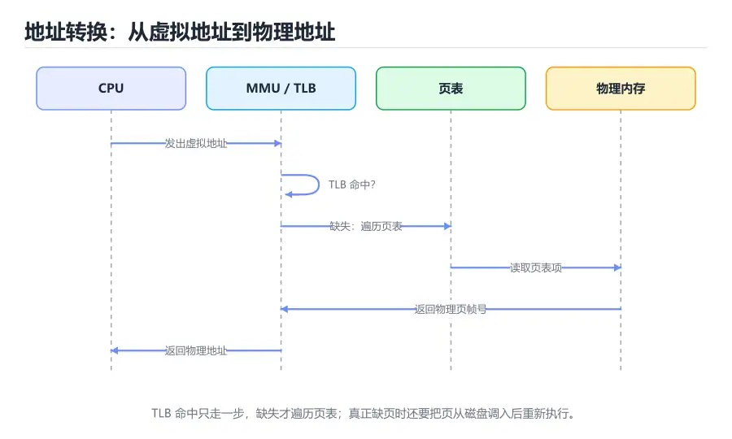

# 虚拟内存与地址转换

> 内容更新时间：2026-10-06 · 学习阶段：高级 · 预计用时：30 分钟



## 本节知识框架

**课程定位**：分类「computer_organization」· 学习阶段 高级 · 建议用时 30 分钟。

本课主线：解释程序看到的地址为什么不是内存的真实地址。从虚拟地址与物理地址的分工讲起，逐层展开页表、TLB、缺页处理和换页策略，最后把地址转换放回缓存与流水线的真实时序中，理解一次访存到底经历了什么。

**复习清单**

- [ ] 能区分虚拟地址、物理地址和页内偏移
- [ ] 能画出两级页表的地址拆分并完成一次手工翻译
- [ ] 能说明 TLB 的作用以及 TLB 命中与缺失的差别
- [ ] 能描述一次缺页异常从触发到恢复的完整流程
- [ ] 能解释按需分页、写时复制和大页各自的收益
- [ ] 能运行本课的页表模拟器，观察不同页大小下的页表级数

## 核心概念定义

| 术语 | 一句话说明 |
| --- | --- |
| 虚拟地址 | 程序指令中使用的地址，由 CPU 在访存前翻译成物理地址 |
| 物理地址 | 真正送到内存控制器的地址，对应 DRAM 中的具体位置 |
| 页 | 虚拟地址空间与物理内存之间搬运和映射的固定大小单位 |
| 页表 | 记录虚拟页到物理页帧映射关系的数据结构 |
| 页表项 | 页表中的一个条目，包含物理页帧号、有效位、权限位等 |
| TLB | 页表项的高速缓存，加速虚拟地址到物理地址的转换 |
| 缺页异常 | 访问的页不在物理内存中时由硬件触发、操作系统处理的异常 |
| 按需分页 | 只在真正访问某页时才把它从磁盘调入内存 |
| 写时复制 | 父子进程共享只读页，任一方写入时才复制出私有副本 |
| 大页 | 比常规页更大的映射单位，减少页表级数和 TLB 压力 |
| 页表漫游 | 硬件依次访问多级页表，最终得到物理页帧号的过程 |
| IOMMU | 为设备 DMA 提供虚拟地址转换和访问隔离的硬件 |

## 原理与运行机制

### 为什么需要虚拟内存

如果每个程序都直接使用物理地址，会带来三个难题。第一，多个程序同时运行时，必须事先协商好各自占用哪段内存，否则会互相覆盖。第二，程序一旦编译完成，地址就固定了，无法在运行时灵活加载。第三，一个越界指针可以轻易读写其他程序的数据，安全无从谈起。

虚拟内存给每个进程一套独立的虚拟地址空间。程序里的地址都是虚拟地址，由 CPU 的 MMU 在每次访存时翻译成物理地址。进程 A 和进程 B 可以使用相同的虚拟地址，却映射到完全不同的物理页。操作系统负责维护映射关系，硬件负责加速翻译。这样既实现了隔离，也让程序的链接、加载和内存分配变得灵活。

### 分页：把地址切成页号和偏移

虚拟地址被切成两部分：高位是虚拟页号（VPN），低位是页内偏移。物理地址同样切成物理页帧号（PFN）和页内偏移。页大小通常是 4 KiB，因此偏移占 12 位；如果虚拟地址是 48 位，虚拟页号就是 36 位。

翻译的核心工作是「把 VPN 换成 PFN」，偏移保持不变。页表就是一个以 VPN 为索引的数组，表项保存 PFN 和若干标志位。有效位表示该页是否在内存中，读写执行权限位控制访问，脏位记录页是否被修改，访问位供替换算法参考。

单级页表的问题是指数级膨胀。48 位虚拟地址、4 KiB 页，每个进程需要 2^36 个页表项；即使每项 8 字节，也要 512 GiB。没人会为每个进程分配这么大的连续数组，因此真实系统使用多级页表。

### 多级页表：按需分配的分层结构

多级页表把 VPN 再切成若干段，每一段索引一级页表。以常见的四级页表为例，48 位虚拟地址的 36 位 VPN 被切成四段 9 位，每段索引 512 个表项。顶级页表只有 4 KiB，包含 512 个指针；某个指针为空，对应的整个子树就不存在，不需要分配。

这种结构节省的是「未使用地址空间」的页表内存，而不是翻译时间。一次翻译最坏要访问四级页表，也就是四次内存访问，再加上最后真正的数据访问，总共五次。为了让这个开销可接受，硬件用 TLB 缓存最近用过的页表项，并用页表缓存（page walk cache）缓存中间级表项。

### TLB：地址转换的 Cache

TLB 是一个容量很小的全相联或组相联缓存，存放最近使用的 VPN 到 PFN 的映射。CPU 发出虚拟地址后，先并行查 TLB；命中就直接得到物理页帧号，不访问页表；缺失时才启动页表漫游，把结果填回 TLB。

TLB 命中时，地址转换几乎不增加访存延迟；TLB 缺失时，多级页表漫游可能带来几十到上百个周期的开销，还要访问 Cache 或内存。程序的局部性不仅影响数据 Cache，也影响 TLB：连续访问同一页内的数据只占一个 TLB 项，跨页跳跃则会快速消耗 TLB 容量。

### 缺页异常：把页从磁盘搬到内存

当页表项的有效位为 0，说明该页不在物理内存中。CPU 触发缺页异常，操作系统接管：先检查访问是否合法，非法就向进程发送段错误信号；合法则找到一个空闲页帧，若没有空闲页帧就按替换算法选一个牺牲页，脏页要先写回磁盘；然后从磁盘读入所需页，更新页表，最后返回并重新执行触发异常的指令。

缺页处理涉及磁盘 I/O，代价可能是几毫秒，比一次 Cache 命中高六个数量级。因此操作系统会尽量让热点页留在内存，并通过预读、页面置换和工作集管理减少缺页。缺页率哪怕只有千分之一，也可能显著拖慢程序。

### 换页策略与写时复制

页替换算法要在有限的物理内存里选择牺牲页。LRU 理论上最优，但精确实现需要记录每次访问的时间戳，开销太大。实际系统常用 Clock 算法，用访问位和环形指针近似 LRU：指针扫过时，访问位为 1 就清零并跳过，为 0 就选中淘汰。

写时复制（Copy-on-Write）让 `fork` 之后的父子进程共享同一批只读页。只有当某一方写入时，才触发保护异常，操作系统复制出私有副本并修改页表。这样创建进程不必立刻复制整个地址空间，既省内存又省时间。共享库、容器镜像的分层存储也利用了类似思想。

### 大页与地址空间隔离

大页把多个相邻的 4 KiB 页合并成一个 2 MiB 或 1 GiB 的映射。好处是页表级数减少、TLB 一项覆盖更大范围、页表内存占用下降；代价是内部碎片增加，分配需要连续物理内存，换页粒度也更大。数据库、虚拟机和大型科学计算常用大页提升 TLB 命中率。

虚拟内存还承担安全职责。地址空间布局随机化（ASLR）让栈、堆和库的基址随机变化，增加攻击者预测地址的难度；不可执行位（NX）阻止在数据页上执行代码；页表权限位区分用户态和内核态访问。隔离不是附属功能，而是虚拟内存设计的核心目标之一。

## 典型应用场景

### 进程隔离与容器

每个进程拥有独立的页表，虚拟地址相同也不代表访问同一块物理内存。容器通过命名空间和 cgroups 共享内核，但进程之间仍然依靠页表隔离。虚拟机则多一层嵌套页表，由 hypervisor 管理客户机物理地址到宿主机物理地址的映射。

### 内存映射文件

`mmap` 把文件的一段映射到进程地址空间，读写内存就像读写文件，缺页时由操作系统按需从磁盘调入。数据库、加载器和动态链接器都大量使用这种机制。多个进程映射同一个只读文件时，物理页可以共享，节省内存。

### 数据库缓冲池

数据库需要在内存中缓存大量数据页，同时保证事务的持久性。它通常自己管理缓冲池和替换策略，不完全依赖操作系统的页替换，因为数据库更了解查询模式。但底层仍然受益于虚拟内存的按需分页和大页支持。

### 垃圾回收与堆管理

托管语言的堆分配器向操作系统申请大块虚拟地址，再切成对象。物理页只在对象真正被写入时才分配，这就是按需分页带来的「预留地址不占内存」效果。垃圾回收器移动对象时，也可能利用虚拟内存的写保护来跟踪跨代引用。

## 代码/协议/SQL 示例

### 用 Python 模拟两级页表翻译

下面的模拟器把 32 位虚拟地址拆成两个 10 位页表索引和一个 12 位偏移，演示两级页表的查找过程。页表用字典表示，未映射的项视为缺页。

```python
PAGE_BITS = 12
LEVEL_BITS = 10
OFFSET_MASK = (1 << PAGE_BITS) - 1
LEVEL_MASK = (1 << LEVEL_BITS) - 1


class TwoLevelPageTable:
    def __init__(self):
        self.root = {}

    def map(self, virtual_address, frame):
        vpn1 = (virtual_address >> (PAGE_BITS + LEVEL_BITS)) & LEVEL_MASK
        vpn2 = (virtual_address >> PAGE_BITS) & LEVEL_MASK
        self.root.setdefault(vpn1, {})[vpn2] = frame

    def translate(self, virtual_address):
        vpn1 = (virtual_address >> (PAGE_BITS + LEVEL_BITS)) & LEVEL_MASK
        vpn2 = (virtual_address >> PAGE_BITS) & LEVEL_MASK
        offset = virtual_address & OFFSET_MASK
        level2 = self.root.get(vpn1)
        if level2 is None or vpn2 not in level2:
            raise LookupError("page fault")
        return (level2[vpn2] << PAGE_BITS) | offset


table = TwoLevelPageTable()
table.map(0x00403ABC, 0x1A2)
print(hex(table.translate(0x00403ABC)))
try:
    table.translate(0x00800000)
except LookupError as error:
    print("未映射：", error)
```

模拟器只保留最终页帧号，省略了有效位、权限和脏位。真实硬件会并行读取页表项，并在 TLB 中缓存结果；但「先查一级、再查二级、最后拼偏移」的顺序与这里一致。改一个页表项再翻译同一个地址，就能观察映射变化对结果的影响。

### 用 C 观察缺页与内存映射

```c
#include <stdio.h>
#include <stdlib.h>
#include <sys/mman.h>
#include <unistd.h>

int main(void) {
    long page_size = sysconf(_SC_PAGESIZE);
    size_t length = (size_t)page_size * 4;
    char *memory = mmap(NULL, length, PROT_READ | PROT_WRITE,
                        MAP_PRIVATE | MAP_ANONYMOUS, -1, 0);
    if (memory == MAP_FAILED) {
        perror("mmap");
        return 1;
    }

    // 只触碰第一页和第三页，其余页保持未分配
    memory[0] = 'A';
    memory[page_size * 2] = 'B';
    printf("page_size=%ld first=%c third=%c\n",
           page_size, memory[0], memory[page_size * 2]);

    if (munmap(memory, length) != 0) {
        perror("munmap");
        return 1;
    }
    return 0;
}
```

这段程序申请了四页虚拟地址，但只写了两页。操作系统通常在写入时才分配物理页，因此实际占用的物理内存小于申请量。用 `/proc/<pid>/status` 里的 VmRSS 可以观察常驻集大小，用 `mincore` 可以查询哪些页已经在内存中。

### 一次缺页的处理时序

```text
1. CPU 访问虚拟地址，TLB 未命中
2. MMU 遍历页表，发现有效位为 0
3. 触发缺页异常，保存现场，进入内核
4. 内核检查地址合法性：
   - 非法访问 → 向进程发送 SIGSEGV
   - 合法但未调入 → 继续
5. 选择空闲页帧；没有则选牺牲页，脏页写回
6. 从磁盘或交换区读入目标页
7. 更新页表项，设置有效位，刷新 TLB
8. 返回用户态，重新执行触发异常的指令
```

注意最后一步是「重新执行」而不是「继续下一条」。触发异常的指令必须再执行一次，才能完成原本的访存。硬件会保存足够的现场，让这条指令可以安全重试；如果指令有副作用，体系结构必须保证重试不会重复产生副作用。

## 时间/空间复杂度或性能分析

### 一次访存的完整延迟

一次数据访问的延迟取决于命中层级。TLB 命中且数据在 L1，可能只需几个周期；TLB 缺失但页表在 Cache 中，要加上页表漫游的十几个周期；数据 Cache 缺失则再加几十个周期；真正缺页则要等磁盘 I/O，可能几毫秒。

可以把平均访存时间写成：TLB 命中时间 + TLB 缺失率 × 页表漫游代价 + 数据缺失率 × 数据缺失代价。这个公式和 Cache 的 AMAT 结构相同，只是多了一层地址转换。优化程序时，既要关注数据局部性，也要关注页级局部性。

### 页表空间与级数

单级页表的空间与虚拟地址空间成正比，多级页表只与实际使用的地址范围成正比。以 48 位地址、4 KiB 页、每项 8 字节为例，一级页表需要 2^36 × 8 字节，显然不可行；四级页表每级 512 项，顶级表只有 4 KiB，未使用的子树根本不分配。

大页能减少级数。2 MiB 大页把最后一级的 9 位页表索引并入偏移，使页内偏移从 12 位扩展到 21 位，页表项直接映射更大的区域；1 GiB 大页再减少一级。代价是分配需要连续物理内存，内部碎片最大可达页大小减一。数据库常把大页用于缓冲池，把随机小对象留在常规页。

### TLB 覆盖范围

TLB 能覆盖的地址范围等于表项数乘以页大小。假设 64 个表项、每页 4 KiB，只能覆盖 256 KiB；换成 2 MiB 大页，同样 64 项可以覆盖 128 MiB。这就是大页在高性能场景中受欢迎的原因。程序工作集超过 TLB 覆盖范围时，会频繁发生 TLB 缺失，即使数据都在 Cache 中也可能变慢。

### 测量方法与调优

Linux 上可以用 `perf stat -e dTLB-loads,dTLB-load-misses` 观察 TLB 行为，用 `/proc/<pid>/smaps` 查看页表大小和常驻内存，用 `getrusage` 的缺页计数做粗粒度统计。调优手段包括：让热点数据页对齐、减少跨页访问、使用大页、避免频繁 `mmap` 和 `munmap`、控制线程数以减少 TLB 争用。

## 常见误区与易错点

| 错误认识 | 实际发生的情况 | 更稳妥的做法 |
| --- | --- | --- |
| 虚拟地址就是物理地址减去一个固定偏移 | 映射由页表逐页决定，地址不连续 | 通过页表或系统接口查询映射 |
| 多级页表一定比单级页表慢 | 级数多会增加漫游次数，但 TLB 命中时级数不影响延迟，未命中时中间级还能被页表缓存吸收 | 用 TLB 命中率与漫游次数评估，而不是只看级数 |
| 缺页只发生在程序刚启动时 | 运行中访问新页、换出页也会缺页 | 监控运行期缺页计数 |
| 内存足够就不会缺页 | 首次访问仍会触发按需分配，映射也可能未建立 | 区分冷缺页和换页缺页 |
| 大页总是更快 | 大页可能增加内部碎片和分配延迟 | 按工作集和分配模式选择 |
| TLB 命中说明数据一定在 Cache | TLB 只缓存地址映射，数据仍可能缺失 | 分别统计 TLB 与数据 Cache |
| fork 会立刻复制整个地址空间 | 写时复制让父子进程先共享物理页 | 关注写入后的复制开销 |
| 虚拟内存只负责扩容 | 它还提供隔离、权限和文件映射 | 从安全和抽象两层理解 |

## 与其他知识点的关系

### 先修课程

本课需要《存储层次与 Cache》中的局部性、命中率和 AMAT 概念，也需要《总线、中断与 I/O 系统》中的异常与 DMA 知识。理解《指令系统与汇编基础》里的访存指令，有助于把地址转换放回指令执行流程。

### 相关概念对比

- **分页 vs 分段**：分页按固定大小切分，减少外部碎片；分段按逻辑单元切分，便于共享和保护，但会产生外部碎片。
- **TLB vs 数据 Cache**：前者缓存地址映射，后者缓存数据；两者都利用局部性，但缓存的内容不同。
- **缺页 vs 段错误**：缺页是页不在内存但访问合法，可由操作系统修复；段错误通常是地址或权限非法，无法修复。
- **虚拟内存 vs 交换空间**：虚拟内存是地址抽象机制，交换空间是存放被换出页的磁盘区域。

### 后续衔接

学完本课后，实战项目会让模拟器实现一个简化的页表和 TLB，统计不同访问模式下的命中率；进一步学习操作系统课程时，会看到页表在进程切换、内存映射和容器隔离中的具体用法。

## 自测题与参考答案

### 自测 1

一个 32 位虚拟地址、4 KiB 页的系统，页内偏移占多少位？虚拟页号占多少位？

**参考答案**：4 KiB 等于 2^12 字节，因此页内偏移占 12 位，地址低 12 位用于选择页内字节。32 位地址减去 12 位偏移，虚拟页号占 20 位。若采用两级页表，可以把这 20 位再切成两段各 10 位，每级页表有 1024 个表项。

### 自测 2

TLB 命中时，地址转换还需要访问页表吗？

**参考答案**：不需要。TLB 中已经缓存了虚拟页号到物理页帧号的映射，硬件直接取出 PFN 并与页内偏移拼接，生成物理地址。只有 TLB 缺失时才启动页表漫游，把结果填回 TLB。TLB 命中可以显著减少地址转换的延迟和内存访问次数。

### 自测 3

缺页异常处理完成后，为什么 CPU 要重新执行触发异常的那条指令？

**参考答案**：触发异常时，那条指令的访存还没有完成，寄存器或内存可能处于未提交状态。操作系统把缺失的页调入并更新页表后，只有重新执行这条指令，才能完成原本的读取或写入。硬件保存的现场必须保证重试是安全的，不会重复产生可见副作用。

### 自测 4

写时复制为什么能加快 fork 的执行？

**参考答案**：`fork` 创建子进程时，父子进程先共享同一批只读物理页，页表项都指向相同页帧并标记写保护，不需要立刻复制整个地址空间。只有当某一方写入时，才触发保护异常，操作系统再复制出私有副本。这样省去了大量即时拷贝，创建进程的开销大幅下降。

### 自测 5

运行本课的页表模拟器，把 `LEVEL_BITS` 从 10 改成 9，地址拆分和页表结构会怎样变化？

**参考答案**：每个索引段变成 9 位，只能索引 512 个表项。此时两级结构只覆盖 9 + 9 + 12 = 30 位地址，最高 2 位被直接忽略：`0x00403ABC` 与 `0x40403ABC` 会得到相同的页表索引和页帧号，形成地址别名（alias），而不是触发缺页。要正确覆盖 32 位地址，必须增加第三级，或把最高一级扩到 11 位。这个实验说明页表级数、每级位宽和地址空间大小必须一起设计，不能只改一个参数。

## 考点精讲

### 考点 1

TLB 的主要作用是什么？

A. 缓存最近访问的内存数据

B. 缓存虚拟页号到物理页帧号的映射，加速地址转换

C. 保存中断处理程序的入口地址

D. 在设备与内存之间搬运数据块

**正确答案：B**

**详细解释**：TLB 是页表项的高速缓存，保存最近使用的虚拟页号与物理页帧号的对应关系。命中时硬件直接完成地址转换，不必遍历页表；缺失时才启动页表漫游。缓存数据是数据 Cache 的职责，中断入口属于中断向量表，数据块搬运是 DMA 的工作。正确项「缓存虚拟页号到物理页帧号的映射，加速地址转换」准确说明了 TLB 的用途。

---

### 考点 2

缺页异常发生后，操作系统的典型处理顺序是什么？

A. 直接终止当前进程，不再返回

B. 把整个虚拟地址空间重新加载一遍

C. 只刷新 TLB，不检查页表

D. 检查访问合法性，选择页帧并调入缺失页，更新页表后重新执行指令

**正确答案：D**

**详细解释**：缺页处理先判断地址是否合法，非法访问会向进程发送信号；合法则寻找空闲页帧或按替换算法腾出页帧，把目标页从磁盘读入，更新页表项和 TLB，最后返回用户态重新执行触发异常的指令。直接终止进程只适用于非法访问，刷新 TLB 并不能把页调入内存。正确项「检查访问合法性，选择页帧并调入缺失页，更新页表后重新执行指令」概括了完整流程。

---

### 考点 3

多级页表相比单级页表，最核心的优势是什么？

A. 只为实际使用的地址范围分配页表，节省页表内存

B. 完全不需要 TLB 也能保持高速

C. 页表项不再需要权限位

D. 可以把虚拟地址直接当作物理地址使用

**正确答案：A**

**详细解释**：单级页表的空间与整个虚拟地址空间成正比，进程稍大就会占用巨量内存。多级页表把地址空间切成树状结构，未使用的子树不分配，实际占用与已映射区域相关。它并不能取代 TLB，权限位仍然必需，虚拟地址也仍要经过翻译。正确项「只为实际使用的地址范围分配页表，节省页表内存」点出了多级页表的设计动机。

---

### 考点 4

写时复制（Copy-on-Write）在什么时候真正复制物理页？

A. 每次 `fork` 调用时立刻复制全部页

B. 进程退出时统一复制

C. 父子进程中的任意一方尝试写入共享页时

D. 只要发生缺页就复制

**正确答案：C**

**详细解释**：写时复制让父子进程先共享只读页，页表项标记为写保护。当某一方写入时触发保护异常，操作系统才复制出私有副本并修改页表，让写入方继续执行。`fork` 时并不复制全部页，进程退出时也不做这种复制，普通缺页可能只是按需调入。正确项「父子进程中的任意一方尝试写入共享页时」说明了复制的触发条件。

---

### 考点 5

使用大页（如 2 MiB 页）的主要性能收益是什么？

A. 让每个进程拥有完全独立的地址空间

B. 减少页表级数和 TLB 覆盖压力，提高转换效率

C. 彻底消除缺页异常

D. 让磁盘 I/O 速度超过内存

**正确答案：B**

**详细解释**：大页增大单个映射覆盖的范围，同样数量的 TLB 表项可以覆盖更多地址，页表级数也可能减少，从而降低 TLB 缺失和页表漫游开销。它不能消除缺页，不能改变磁盘与内存的速度差距，进程隔离也不依赖页大小。正确项「减少页表级数和 TLB 覆盖压力，提高转换效率」概括了大页的核心收益。

## 术语速查

| 术语 | 一句话说明 |
| --- | --- |
| 虚拟地址 | 程序使用的地址，访存前由 MMU 翻译 |
| 物理地址 | 送到内存控制器的真实地址 |
| 页 | 虚拟内存映射和搬运的固定大小单位 |
| 页帧 | 物理内存中用于承载一个页的槽位 |
| 页表 | 保存虚拟页到物理页帧映射的数据结构 |
| 页表项 | 页表中的条目，含页帧号、有效位和权限位 |
| TLB | 缓存页表项、加速地址转换的硬件结构 |
| 缺页异常 | 访问的页不在内存时触发的异常 |
| 页表漫游 | 硬件逐级访问页表得到物理页帧号的过程 |
| 写时复制 | 写入共享页时才复制私有副本的优化 |
| 大页 | 2 MiB 或 1 GiB 等大于常规页的映射单位 |
| 常驻集 | 进程当前实际占用物理内存的页集合 |

## 参考资料与复核

- 复核范围：分页与多级页表、TLB、缺页处理、写时复制与大页

| 参考资料 | 本课用途 |
| --- | --- |
| [Operating Systems: Three Easy Pieces - Virtual Memory](https://pages.cs.wisc.edu/~remzi/OSTEP/vm-intro.pdf) | 虚拟内存、分页和地址转换的教材章节 |
| [Intel 64 and IA-32 Architectures Software Developer Manuals](https://www.intel.com/content/www/us/en/developer/articles/technical/intel-sdm.html) | 分页模式、页表格式和 TLB 的体系结构细节 |
| [Linux Page Table Management](https://www.kernel.org/doc/html/latest/mm/page_tables.html) | Linux 内核页表管理的实现说明 |
| [A Survey of Techniques for Architecting TLBs](https://dl.acm.org/doi/10.1145/2856125) | TLB 结构与优化技术的综述 |

- 最后复核：2026-10-04
- 下次复核：2027-10-25

## 内容元数据

- 内容版本：v2.0
- 最后更新：2026-10-06
- 学习阶段：高级
- 适用环境：通用开发环境
- 内容来源：内置结构化课程与工程实践整理
- 相关主题：computer organization virtual memory paging tlb
- 质量版本：P0 测验标准 + P1 覆盖扩展 + P2 体验补全
