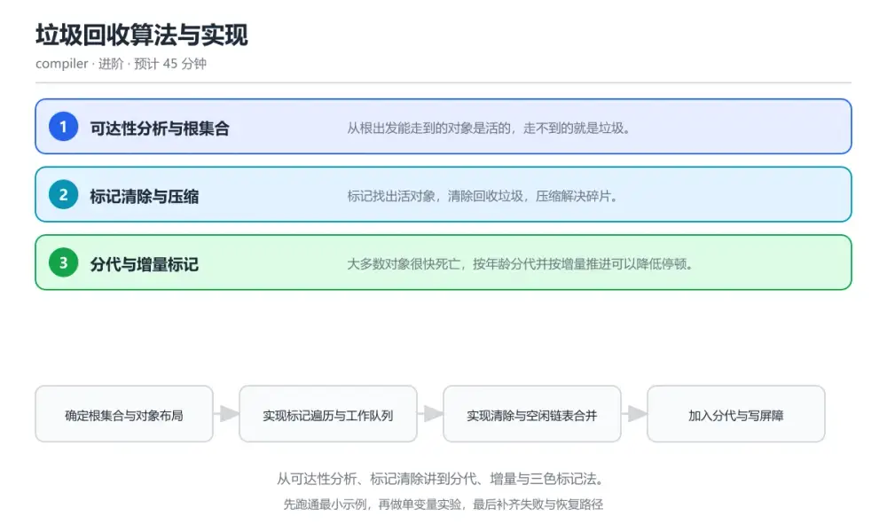
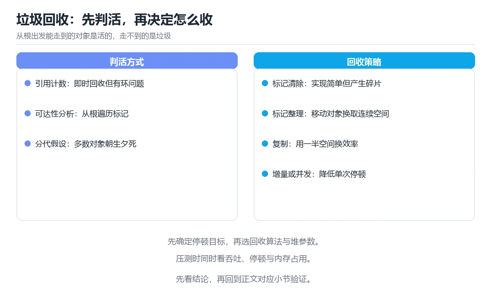

# 垃圾回收算法与实现

> 内容更新时间：2026-10-06 · 学习阶段：进阶 · 预计用时：30 分钟

分类：compiler。关键词：垃圾回收、可达性、标记清除、分代、三色标记。从可达性分析、标记清除讲到分代、增量与三色标记法。



## 本节知识框架

**课程定位**：所属分类 `compiler`（编译原理与语言实现），课程主题 `垃圾回收算法与实现`，学习阶段 进阶，建议用时 40 分钟。

本课主线：从可达性分析、标记清除讲到分代、增量与三色标记法。

**学完本课应当能够**
- 说清 `可达性分析` 与 `根集合` 的含义与区别，并各举一个正例和一个反例。
- 用本课示例验证 `写屏障` 的行为，记录输入、输出与失败条件。
- 遇到「活对象被误回收」这类问题时，能说出触发条件与修复顺序。

### 复习清单

- [ ] 能不看正文复述本课核心术语，并指出一个边界或反例。
- [ ] 能运行或推演本课示例，记录输入、输出与失败现象。
- [ ] 能完成一次自测，并把错题对照错误表定位原因。

**本课配图**



## 核心概念定义

| 术语 | 操作性定义 | 常见边界与风险 |
| --- | --- | --- |
| 可达性分析 | 从根集合出发判断对象是否仍被引用。 | 越界、悬垂引用与释放顺序会破坏结论，必须在边界输入下复验。 |
| 根集合 | 遍历起点，包括栈、寄存器与全局变量。 | 易错：根集合扫描不完整，遗漏寄存器或栈上引用；正确做法是按运行时约定扫描全部根来源，加入不变量断言并在压力测试中验证标记结果。 |
| 写屏障 | 在引用写入时执行的记录逻辑。 | 易错：写屏障漏记老年代到年轻代的引用；正确做法是补全写屏障覆盖所有引用写入路径，并用并发压力测试验证不变量。 |
| 分代回收 | 按对象年龄分区域回收的策略。 | 只在「按对象年龄分区域回收的策略」这一前提下成立，换输入或换环境要重新验证。 |
| 压缩 | 移动对象以消除堆内碎片的过程。 | 易错：只做标记清除不做压缩，堆内碎片化严重；正确做法是加入压缩或按大小分类管理，定期整理空闲块并合并相邻空闲区域。 |

## 原理与运行机制

### 机制总览

**教材衔接：核心知识**

### 1. 可达性分析与根集合

从根出发能走到的对象是活的，走不到的就是垃圾。

根集合包含栈上引用、寄存器与全局变量，遍历过程使用工作栈或显式队列沿引用边推进并标记对象。

在垃圾回收算法与实现里可以这样验证：在本课示例里制造一个循环引用，观察它因为不可达仍被正确回收。

边界：根集合扫描不完整会把活对象当成垃圾回收，表现为随机崩溃且极难复现。

工程视角：根集合的扫描点与栈布局必须与运行时约定一致，并加断言检查标记结果。

### 2. 标记清除与压缩

标记找出活对象，清除回收垃圾，压缩解决碎片。

标记阶段遍历引用图，清除阶段扫描堆把未标记块放回空闲链表，压缩阶段移动活对象并修正所有引用。

在垃圾回收算法与实现里可以这样验证：在本课示例里反复分配释放不同大小的对象，观察空闲链表碎片与压缩后的变化。

边界：不压缩的回收器在长时间运行后会出现有空间却分配不出的情况。

工程视角：按对象大小分类使用不同策略，小对象用复制式整理、大对象单独管理，减少压缩成本。

### 3. 分代与增量标记

大多数对象很快死亡，按年龄分代并按增量推进可以降低停顿。

新对象分配在年轻代，存活一次后晋升到老年代；老年代引用年轻代时通过写屏障记录，增量标记把标记工作拆成多次小步以缩短单次暂停。

在垃圾回收算法与实现里可以这样验证：在本课示例里统计对象存活年龄分布，观察大多数对象在第一次回收就被清理。

边界：写屏障漏记会让老年代指向的对象被误回收，是并发回收器最危险的缺陷类型。

工程视角：写屏障与并发标记的正确性用压力测试与不变量断言共同验证，恢复过程记录回收日志便于定位。

**教材衔接：关键流程**

```text
确定根集合与对象布局 → 实现标记遍历与工作队列 → 实现清除与空闲链表合并 → 加入分代与写屏障 → 用压力与暂停时间测试验证
```

1. 确定根集合与对象布局
2. 实现标记遍历与工作队列
3. 实现清除与空闲链表合并
4. 加入分代与写屏障
5. 用压力与暂停时间测试验证

## 典型应用场景

**教材衔接：深度拓展与实战**

### 机制对照表

| 概念 | 解决什么问题 | 关键前提 | 失败信号 |
| --- | --- | --- | --- |
| 可达性分析与根集合 | 从根出发能走到的对象是活的，走不到的就是垃圾。 | 根集合扫描不完整会把活对象当成垃圾回收，表现为随机崩溃且极难复现。 | 根集合的扫描点与栈布局必须与运行时约定一致，并加断言检查标记结果。 |
| 标记清除与压缩 | 标记找出活对象，清除回收垃圾，压缩解决碎片。 | 不压缩的回收器在长时间运行后会出现有空间却分配不出的情况。 | 按对象大小分类使用不同策略，小对象用复制式整理、大对象单独管理，减少压缩 |
| 分代与增量标记 | 大多数对象很快死亡，按年龄分代并按增量推进可以降低停顿。 | 写屏障漏记会让老年代指向的对象被误回收，是并发回收器最危险的缺陷类型。 | 写屏障与并发标记的正确性用压力测试与不变量断言共同验证，恢复过程记录回收 |

### 自测问答

**问 1**：一对互相引用但外部已不可达的对象会怎样？

**答**：被正确回收，因为可达性分析从根出发。可达性关注「从根能不能走到」，循环引用若整体不可达就会被判为垃圾，这与引用计数方案不同。 正确选项「被正确回收，因为可达性分析从根出发」对应《垃圾回收算法与实现》的要点「可达性分析与根集合」：从根出发能走到的对象是活的，走不到的就是垃圾。判断「可达性分析与根集合」时先确认前提是否成立，再回到《垃圾回收算法与实现》的示例核对一次；把别的语言或框架的默认做法直接搬到可达性分析与根集合上，往往会在本课的边界条件里失效。

**问 2**：分代垃圾回收里，写屏障（write barrier）主要解决什么问题？

**答**：在引用写入时记录跨代关系，避免误回收。分代与并发回收依赖写屏障维护跨代引用记录，漏记会让存活对象被当成垃圾回收。 正确选项「在引用写入时记录跨代关系，避免误回收」对应《垃圾回收算法与实现》的要点「标记清除与压缩」：标记找出活对象，清除回收垃圾，压缩解决碎片。判断「标记清除与压缩」时先确认前提是否成立，再回到《垃圾回收算法与实现》的示例核对一次；借鉴相邻主题的经验之前，先核对标记清除与压缩的前提是否成立。

**问 3**：以下哪些因素会显著影响回收暂停时间？（多选）

**答**：存活对象数量；是否采用增量或并发标记；压缩时需要移动的对象规模。暂停时间与需要处理的对象规模、标记方式与移动量直接相关，源代码行数与运行时暂停无关。 正确选项「存活对象数量；是否采用增量或并发标记；压缩时需要移动的对象规模」对应《垃圾回收算法与实现》的要点「分代与增量标记」：大多数对象很快死亡，按年龄分代并按增量推进可以降低停顿。判断「分代与增量标记」时先确认前提是否成立，再回到《垃圾回收算法与实现》的示例核对一次；记住分代与增量标记的结论之外还要记住适用条件，换一个输入往往就不成立了。

**问 4**：请按一次标记清除回收的顺序排列。

**答**：扫描根集合并标记可达对象。先标记再清除，回收后按需压缩，最后复位标记位，使下一轮回收可以重新开始。 正确选项「扫描根集合并标记可达对象；遍历对象链找出未标记对象；回收空间并合并空闲块；必要时移动对象完成压缩；清除标记位准备下一轮」对应《垃圾回收算法与实现》的要点「可达性分析与根集合」：从根出发能走到的对象是活的，走不到的就是垃圾。判断「可达性分析与根集合」时先确认前提是否成立，再回到《垃圾回收算法与实现》的示例核对一次；干扰项常常是相邻主题里成立的结论，只有按可达性分析与根集合的输入与约束判断才能排除。

**问 5**：阅读这段标记代码，主要风险是什么？

**答**：递归标记在深引用链上会耗尽调用栈。长链表或深层嵌套结构会让递归深度与对象链长度同阶，最终栈溢出；应改为显式工作栈或指针反转等迭代算法。 正确选项「递归标记在深引用链上会耗尽调用栈」对应《垃圾回收算法与实现》的要点「标记清除与压缩」：标记找出活对象，清除回收垃圾，压缩解决碎片。判断「标记清除与压缩」时先确认前提是否成立，再回到《垃圾回收算法与实现》的示例核对一次；把标记清除与压缩的做法换到别的约束下未必成立，先确认边界再决定答案。

### 工程检查表

- [ ] 确定根集合与对象布局
- [ ] 实现标记遍历与工作队列
- [ ] 实现清除与空闲链表合并
- [ ] 加入分代与写屏障
- [ ] 用压力与暂停时间测试验证
- [ ] 【可达性分析与根集合】根集合的扫描点与栈布局必须与运行时约定一致，并加断言检查标记结果。
- [ ] 【标记清除与压缩】按对象大小分类使用不同策略，小对象用复制式整理、大对象单独管理，减少压缩成本。
- [ ] 【分代与增量标记】写屏障与并发标记的正确性用压力测试与不变量断言共同验证，恢复过程记录回收日志便于定位。

### 结论与下一步

- **活对象被误回收**：典型现象是根集合扫描不完整，遗漏寄存器或栈上引用；正确做法是按运行时约定扫描全部根来源，加入不变量断言并在压力测试中验证标记结果。
- **运行久了分配失败但显示有空闲内存**：典型现象是只做标记清除不做压缩，堆内碎片化严重；正确做法是加入压缩或按大小分类管理，定期整理空闲块并合并相邻空闲区域。
- **并发回收后偶发崩溃**：典型现象是写屏障漏记老年代到年轻代的引用；正确做法是补全写屏障覆盖所有引用写入路径，并用并发压力测试验证不变量。

### 最小验证场景

- 准备：保留 `text` 示例的原始输入，先记录 `垃圾回收算法与实现` 的基线输出和完整运行命令。
- 判定：新结果与 `垃圾回收算法与实现` 的基线不同不等于错误；只有当差异破坏了 `可达性分析` 的定义或错误表中的约束，才判定为失败。

### 选择与边界

- 使用 `可达性分析` 时，先满足它的定义：从根集合出发判断对象是否仍被引用；越界、悬垂引用与释放顺序会破坏结论，必须在边界输入下复验。
- 使用 `根集合` 时，先满足它的定义：遍历起点，包括栈、寄存器与全局变量；易错：根集合扫描不完整，遗漏寄存器或栈上引用；正确做法是按运行时约定扫描全部根来源，加入不变量断言并在压力测试中验证标记结果。
- 使用 `写屏障` 时，先满足它的定义：在引用写入时执行的记录逻辑；易错：写屏障漏记老年代到年轻代的引用；正确做法是补全写屏障覆盖所有引用写入路径，并用并发压力测试验证不变量。
- 使用 `分代回收` 时，先满足它的定义：按对象年龄分区域回收的策略。
- 使用 `压缩` 时，先满足它的定义：移动对象以消除堆内碎片的过程；易错：只做标记清除不做压缩，堆内碎片化严重；正确做法是加入压缩或按大小分类管理，定期整理空闲块并合并相邻空闲区域。

## 代码/协议/SQL 示例

### 最小可验证示例

```text
确定根集合与对象布局 → 实现标记遍历与工作队列 → 实现清除与空闲链表合并 → 加入分代与写屏障 → 用压力与暂停时间测试验证
```

**教材衔接：原文最小示例**

```text
确定根集合与对象布局 → 实现标记遍历与工作队列 → 实现清除与空闲链表合并 → 加入分代与写屏障 → 用压力与暂停时间测试验证
```

```c
typedef struct object {
    struct object *next;       // 空闲链表或对象链
    size_t size;
    unsigned char marked;
    unsigned char slots;       // 引用槽数量
    struct object *refs[];     // 柔性数组：指向其它对象的引用
} object_t;

// 标记阶段：从根出发沿引用边推进
static void mark(object_t *obj) {
    if (!obj || obj->marked) return;
    obj->marked = 1;
    for (unsigned char i = 0; i < obj->slots; i++) {
        mark(obj->refs[i]);        // 简化写法，工程实现应使用显式工作栈避免爆栈
    }
}

// 清除阶段：未标记的回收，标记的清除标记位等待下一轮
static void sweep(void) {
    for (object_t **link = &heap_head; *link;) {
        object_t *obj = *link;
        if (!obj->marked) {
            *link = obj->next;      // 从对象链摘除
            free_block(obj);        // 归还到空闲链表并尝试合并相邻块
        } else {
            obj->marked = 0;
            link = &obj->next;
        }
    }
}
```

## 时间/空间复杂度或性能分析

**性能关注点（垃圾回收算法与实现）**：编译阶段与优化通道影响开销：记录各阶段耗时与生成代码规模。

**测量方法**：以 `垃圾回收算法与实现` 的 `垃圾回收` 场景为对象，固定输入跑一遍记录基线，再把规模或并发度提高一个数量级复测；两次结果的差值与波动范围才是结论依据。

## 常见误区与易错点

| 容易写错的做法 | 实际现象 | 原因与正确做法 |
| --- | --- | --- |
| 活对象被误回收 | 根集合扫描不完整，遗漏寄存器或栈上引用。 | 按运行时约定扫描全部根来源，加入不变量断言并在压力测试中验证标记结果。 |
| 运行久了分配失败但显示有空闲内存 | 只做标记清除不做压缩，堆内碎片化严重。 | 加入压缩或按大小分类管理，定期整理空闲块并合并相邻空闲区域。 |
| 并发回收后偶发崩溃 | 写屏障漏记老年代到年轻代的引用。 | 补全写屏障覆盖所有引用写入路径，并用并发压力测试验证不变量。 |

### 现场 1：活对象被误回收

**症状**：根集合扫描不完整，遗漏寄存器或栈上引用。

**根因与修复**：按运行时约定扫描全部根来源，加入不变量断言并在压力测试中验证标记结果。

**自检**：在本课示例里复现「活对象被误回收」，改成按运行时约定扫描全部根来源，加入不变量断言并在压力测试中验证标记结果后重跑；如果症状消失且失败路径按预期变化，说明定位正确。

### 现场 2：运行久了分配失败但显示有空闲内存

**症状**：只做标记清除不做压缩，堆内碎片化严重。

**根因与修复**：加入压缩或按大小分类管理，定期整理空闲块并合并相邻空闲区域。

**自检**：在本课示例里复现「运行久了分配失败但显示有空闲内存」，改成加入压缩或按大小分类管理，定期整理空闲块并合并相邻空闲区域后重跑；如果症状消失且失败路径按预期变化，说明定位正确。

### 现场 3：并发回收后偶发崩溃

**症状**：写屏障漏记老年代到年轻代的引用。

**根因与修复**：补全写屏障覆盖所有引用写入路径，并用并发压力测试验证不变量。

**自检**：在本课示例里复现「并发回收后偶发崩溃」，改成补全写屏障覆盖所有引用写入路径，并用并发压力测试验证不变量后重跑；如果症状消失且失败路径按预期变化，说明定位正确。

## 与其他知识点的关系

**教材衔接：复习与迁移**

## 自测题与参考答案

> 先独立作答，再对照参考答案；答案都能在本课正文、术语表或错误表里找到依据。

### 自测 1（概念复述）

不看正文，写出 `可达性分析` 的操作性定义，并说明它与 `根集合` 的区别。

**参考答案**：从根集合出发判断对象是否仍被引用。

`根集合` 的定位是：遍历起点，包括栈、寄存器与全局变量；两者的差别要从适用对象与失败模式上说明。

### 自测 2（排错）

本课错误表记录了「活对象被误回收」这类做法。请写出它会出现的现象、根因，以及修复顺序。

**参考答案**：现象是根集合扫描不完整，遗漏寄存器或栈上引用；正确做法是按运行时约定扫描全部根来源，加入不变量断言并在压力测试中验证标记结果。修复时先复现现象并保留证据，再改动一处假设重跑，确认现象消失。

### 自测 3（动手验证）

运行本课的 `text` 示例，改动其中一个输入后重新运行，记录输出与错误信息。

**参考答案**：正常输入下 `text` 示例应当复现正文给出的结果；改动输入后，如果结果改变或报错，先核对它是否满足 `垃圾回收算法与实现` 中`可达性分析` 的适用范围，再检查错误表里是否有同类现象。

### 自测 4（代码阅读）

阅读本课开头的 `text` 示例，说明它体现了`可达性分析` 的哪一条性质，并指出改动哪个输入会让这条性质不再成立。

**参考答案**：`可达性分析` 的定义是 从根集合出发判断对象是否仍被引用，示例正是在实现这条定义。改动与 `可达性分析` 有关的一个输入后，如果结果不再符合 `垃圾回收算法与实现` 的正文描述，就说明该性质只在当前前提成立。

### 自测 5（迁移）

把 `垃圾回收算法与实现` 的方法迁移到自己的项目：围绕 `可达性分析` 写出一个与错误表同类的风险点，并说明触发条件和检验方式。

**参考答案**：例如「并发回收后偶发崩溃」，它会导致写屏障漏记老年代到年轻代的引用；检验方式是按补全写屏障覆盖所有引用写入路径，并用并发压力测试验证不变量改一处再复现，确认现象消失且没有引入新的失败分支。

### 自测 6（对比）

用一个表格对比 `可达性分析` 与 `根集合`：各写一行适用场景、一行失败表现。

**参考答案**：`可达性分析` 的定义是从根集合出发判断对象是否仍被引用；`根集合` 的定义是遍历起点，包括栈、寄存器与全局变量。两者的失败表现分别对应本课错误表里与本术语相关的行。

### 自测 7（排错顺序）

面对「活对象被误回收」引发的问题，请把“复现 根集合扫描不完整，遗漏寄存器或栈上引用 → 保留证据 → 按运行时约定扫描全部根来源，加入不变量断言并在压力测试中验证标记结果 → 回归验证”四步写成可执行的检查清单。

**参考答案**：第一步按根集合扫描不完整，遗漏寄存器或栈上引用复现；第二步记录输入、版本与完整报错；第三步按运行时约定扫描全部根来源，加入不变量断言并在压力测试中验证标记结果只改一处；第四步重跑并确认失败路径也按预期变化。

### 自测 8（边界判断）

针对 `压缩`，分别写出“可以使用”的条件和“结论不再成立”的条件。

**参考答案**：易错：只做标记清除不做压缩，堆内碎片化严重；正确做法是加入压缩或按大小分类管理，定期整理空闲块并合并相邻空闲区域。 同时要把 `压缩` 的定义 移动对象以消除堆内碎片的过程 与实际输入逐项对照。

### 自测 9（机制重建）

不看正文，按输入、转换、输出、验证四段重建 `可达性分析` → `根集合` → `写屏障` → `分代回收` 的作用链。

**参考答案**：起点是 `可达性分析` 的定义 从根集合出发判断对象是否仍被引用；中间每一步都保留可观察状态；终点由 `压缩` 检查，失败时回到错误表定位第一个偏离定义的步骤。

### 自测 10（综合排错）

在 `垃圾回收算法与实现` 中，现象是 写屏障漏记老年代到年轻代的引用。请围绕 并发回收后偶发崩溃 写出最小复现、关键证据、修复动作和回归验证，并说明为什么不能只凭一次运行下结论。

**参考答案**：先复现 并发回收后偶发崩溃，记录输入与完整错误；再按 补全写屏障覆盖所有引用写入路径，并用并发压力测试验证不变量 只改一处。回归时同时跑正常路径和边界路径，只有两次结果都可解释，才把修复视为完成。

### 自测 11（一分钟复述）

用每分钟约 200 字的速度复述 `垃圾回收算法与实现`：先给主问题，再按顺序说出 `可达性分析`、`根集合`、`写屏障`、`分代回收`，最后给一个失败案例。

**自评标准**：主问题必须对应 从可达性分析、标记清除讲到分代、增量与三色标记法；每个术语都要能接上一句定义或边界；失败案例必须写成可观察现象，不能用“可能有风险”代替证据。

## 延伸阅读

想更直观地理解本课概念？推荐参阅以下图解专题：

- [图解内存布局：栈、堆与引用](visual_memory_layout.md)
- [图解 JVM 内存模型与垃圾回收](visual_jvm_memory.md)

## 术语速查

| 术语 | 一句话说明 |
| --- | --- |
| `可达性分析` | 从根集合出发判断对象是否仍被引用。 |
| `根集合` | 遍历起点，包括栈、寄存器与全局变量。 |
| `写屏障` | 在引用写入时执行的记录逻辑。 |
| `分代回收` | 按对象年龄分区域回收的策略。 |
| `压缩` | 移动对象以消除堆内碎片的过程。 |

**术语关系**：`可达性分析`（从根集合出发判断对象是否仍被引用） → `根集合`（遍历起点） → `写屏障`（在引用写入时执行的记录逻辑） → `分代回收`（按对象年龄分区域回收的策略）。

## 考点精讲

`垃圾回收算法与实现` 的题库有 5 道题，下面逐题给出题干、正确项与判断依据：先自己作答，再核对正确项，最后回到正文对应小节复核。

### 考点 1：第 1 题

- **题目**：一对互相引用但外部已不可达的对象会怎样？
- **正确项**：被正确回收，因为可达性分析从根出发
- **判断依据**：本题正确项是「被正确回收，因为可达性分析从根出发」。术语 可达性分析（垃圾回收算法与实现）：从根集合出发判断对象是否仍被引用，本题取「被正确回收，因为可达性分析从根出发」这条。易错点是活对象被误回收，会造成根集合扫描不完整，遗漏寄存器或栈上引用，改法是按运行时约定扫描全部根来源，加入不变量断言并在压力测试中验证标记结果。

### 考点 2：第 2 题

- **题目**：分代垃圾回收里，写屏障（write barrier）主要解决什么问题？
- **正确项**：在引用写入时记录跨代关系，避免误回收
- **判断依据**：本题正确项是「在引用写入时记录跨代关系，避免误回收」。术语 写屏障（垃圾回收算法与实现）：在引用写入时执行的记录逻辑，本题取「在引用写入时记录跨代关系，避免误回收」这条。易错点是运行久了分配失败但显示有空闲内存，会造成只做标记清除不做压缩，堆内碎片化严重，改法是加入压缩或按大小分类管理，定期整理空闲块并合并相邻空闲区域。

### 考点 3：第 3 题

- **题目**：以下哪些因素会显著影响回收暂停时间？（多选）
- **正确项**：存活对象数量；是否采用增量或并发标记；压缩时需要移动的对象规模
- **判断依据**：按《垃圾回收算法与实现》的正文口径，本题要同时选中「存活对象数量」、「是否采用增量或并发标记」、「压缩时需要移动的对象规模」，漏掉任一项都算没答全。术语 压缩（垃圾回收算法与实现）：移动对象以消除堆内碎片的过程。易错点是并发回收后偶发崩溃，会造成写屏障漏记老年代到年轻代的引用，改法是补全写屏障覆盖所有引用写入路径，并用并发压力测试验证不变量。

### 考点 4：第 4 题

- **题目**：请按一次标记清除回收的顺序排列。
- **正确项**：扫描根集合并标记可达对象 → 遍历对象链找出未标记对象 → 回收空间并合并空闲块 → 必要时移动对象完成压缩 → 清除标记位准备下一轮
- **判断依据**：按《垃圾回收算法与实现》正文的先后，本题顺序是「扫描根集合并标记可达对象」 → 「遍历对象链找出未标记对象」 → 「回收空间并合并空闲块」 → 「必要时移动对象完成压缩」 → 「清除标记位准备下一轮」。术语 根集合（垃圾回收算法与实现）：遍历起点，包括栈、寄存器与全局变量。易错点是活对象被误回收会造成根集合扫描不完整，遗漏寄存器或栈上引用，改法是按运行时约定扫描全部根来源，加入不变量断言并在压力测试中验证标记结果。

### 考点 5：第 5 题

- **题目**：阅读这段标记代码，主要风险是什么？
- **正确项**：递归标记在深引用链上会耗尽调用栈
- **判断依据**：本题正确项是「递归标记在深引用链上会耗尽调用栈」。术语 可达性分析（垃圾回收算法与实现）：从根集合出发判断对象是否仍被引用，本题取「递归标记在深引用链上会耗尽调用栈」这条。易错点是运行久了分配失败但显示有空闲内存，会造成只做标记清除不做压缩，堆内碎片化严重，改法是加入压缩或按大小分类管理，定期整理空闲块并合并相邻空闲区域。

### 考点 6：`可达性分析`

- **要点**：从根集合出发判断对象是否仍被引用。
- **可达性分析 的边界**：越界、悬垂引用与释放顺序会破坏结论，必须在边界输入下复验。

### 考点 7：`根集合`

- **要点**：遍历起点，包括栈、寄存器与全局变量。
- **根集合 的边界**：易错：根集合扫描不完整，遗漏寄存器或栈上引用；正确做法是按运行时约定扫描全部根来源，加入不变量断言并在压力测试中验证标记结果。

### 考点 8：`写屏障`

- **要点**：在引用写入时执行的记录逻辑。
- **写屏障 的边界**：易错：写屏障漏记老年代到年轻代的引用；正确做法是补全写屏障覆盖所有引用写入路径，并用并发压力测试验证不变量。

### 考点 9：`分代回收`

- **要点**：按对象年龄分区域回收的策略。

### 考点 10：`压缩`

- **要点**：移动对象以消除堆内碎片的过程。
- **压缩 的边界**：易错：只做标记清除不做压缩，堆内碎片化严重；正确做法是加入压缩或按大小分类管理，定期整理空闲块并合并相邻空闲区域。

### 考点 11：排错——活对象被误回收

- **现象**：根集合扫描不完整，遗漏寄存器或栈上引用。
- **处理**：按运行时约定扫描全部根来源，加入不变量断言并在压力测试中验证标记结果。

### 考点 12：排错——运行久了分配失败但显示有空闲内存

- **现象**：只做标记清除不做压缩，堆内碎片化严重。
- **处理**：加入压缩或按大小分类管理，定期整理空闲块并合并相邻空闲区域。

### 考点 13：综合辨析——`可达性分析` 与 `压缩`

- **辨析点**：`可达性分析` 的定义是 从根集合出发判断对象是否仍被引用；`压缩` 的定义是 移动对象以消除堆内碎片的过程。
- **答题要求**：面对 `垃圾回收算法与实现` 的题目，先判断描述的是 `可达性分析` 还是 `压缩`，再归到对应定义，最后写出一个会让该定义失效的边界输入。

### 考点 14：排错评分点

- **现象分**：能写出 根集合扫描不完整，遗漏寄存器或栈上引用，而不是只写“程序有错”。
- **证据分**：保留触发 活对象被误回收 的输入、版本和错误原文。
- **修复分**：按 按运行时约定扫描全部根来源，加入不变量断言并在压力测试中验证标记结果 只改一处，并同时回归正常路径与边界路径。

## 内容元数据

- 内容版本：v2.0
- 最后更新：2026-10-06
- 学习阶段：进阶

| 字段 | 值 |
| --- | --- |
| 课程 ID | `compiler_gc` |
| 所属分类 | `compiler` |
| 难度 | 进阶 |
| 预计用时 | 45 分钟 |
| 关键词 | 垃圾回收、可达性、标记清除、分代、三色标记 |
| 配图 | `images/lesson_compiler_gc.webp` |
| 参考资料 | 2 条 |
| 内容更新时间 | 2026-10-06 |

## 参考资料与复核

- 来源性质：官方文档、标准或权威教材；本课核对关键词：垃圾回收、可达性、标记清除、分代、三色标记。
- 最后复核：2026-10-04
- 下次复核：2027-01-24
- 复核范围：版本兼容、API 行为与工程实践

下面列出的资料用于核对本课结论，复习时可以对照阅读：
- [Oracle 官方文档：HotSpot 垃圾回收调优](https://docs.oracle.com/en/java/javase/21/gctuning/)
- [Go 官方文档：垃圾回收器设计](https://go.dev/doc/gc-guide)

| [本课术语索引：垃圾回收算法与实现](#核心概念定义) | 按本课输入、术语边界和错误表现逐项核对 |
> 复核提示：《垃圾回收算法与实现》的结论如与资料冲突，以资料中的规范文本为准，并在笔记里记录差异与日期。