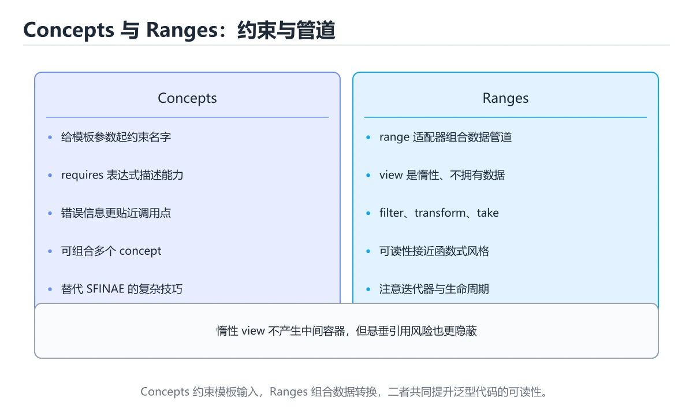
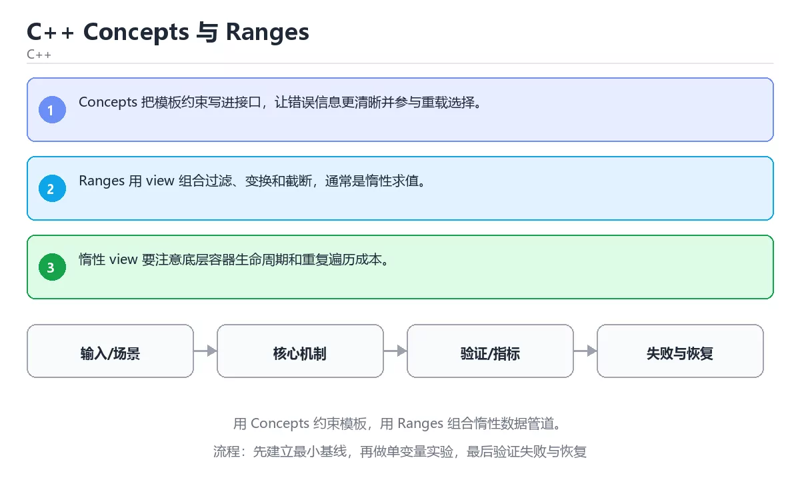

# C++ Concepts 与 Ranges

> 内容更新时间：2026-10-06 · 学习阶段：高级 · 预计用时：40 分钟





## 本节知识框架

模板是 C++ 最强大的特性之一，但也是最让人头疼的。你写了一个模板函数，传给它的类型不对时，编译器会吐出一大堆看不懂的错误信息——有时候错误指向模板内部很深的地方，而不是你调用的那一行。

C++20 带来了两个重磅特性来解决这个问题：**Concepts**（概念）让你用自然语言描述「这个模板接受什么样的类型」，**Ranges**（范围）让你像搭积木一样组合数据处理管道。

想象你是一个厨师。以前写模板就像写菜谱不说食材要求——「把东西切好炒一炒」，结果有人放了石头进来。Concepts 就像在菜谱开头写清楚「需要：蔬菜（可切丝）、肉类（可切块）」——如果放了石头，错误信息直接说「石头不满足可切丝要求」。Ranges 就像流水线：洗菜 → 切菜 → 炒菜 → 装盘，每一步都是惰性的（用到才做），不浪费中间容器。

**学完本课你会掌握：**
- 用 `concept` 约束模板参数，让错误信息指向调用点
- 用 `requires` 表达式定义类型的行为要求
- 用 Ranges 的 view 组合过滤、变换和截断操作
- 理解惰性求值的优势与陷阱

**先修知识：** 《C++ 移动语义与右值引用》里的模板和类型系统是本课的前提。后续课程《C++ 并发、原子操作与内存序》会用到 Concepts 约束并发类型。

### 复习清单

- [ ] 能写出一个 concept 约束模板参数，并解释错误信息为什么更清晰
- [ ] 能用 Ranges 的 view 组合 filter、transform 和 take 操作
- [ ] 能解释惰性求值的含义，并说出忽视底层容器生命周期的风险

## 核心概念定义

| 术语 | 一句话说明 |
| --- | --- |
| `Concepts` | C++20 的编译期约束：用命名要求限定模板参数，让报错指向真正不满足的条件。 |
| `模板` | C++ 中把类型或值作为参数的代码蓝图，实例化后生成具体函数或类。 |
| `约束` | 模板或类型系统对可用类型、值或操作施加的限制条件。 |
| `惰性求值` | Ranges 视图只在遍历到元素时才计算，省掉中间容器，但要留意底层数据的生命周期。 |

## 原理与运行机制

### 1. Concepts：让模板报错不再晦涩

在 C++20 之前，模板的错误信息是出了名的难读。你传了一个不支持 `+` 运算的类型，错误可能指向模板内部第 47 行的 `operator+`，而不是你调用的那一行。

Concepts 解决了这个问题：

```cpp
#include <concepts>
#include <iostream>

// 定义一个 concept：要求类型支持加法
template <typename T>
concept Addable = requires(T a, T b) {
    { a + b } -> std::convertible_to<T>;
};

// 用 concept 约束模板参数
template <Addable T>
T add(T a, T b) {
    return a + b;
}

int main() {
    std::cout << add(3, 4) << "\n";      // OK: int 支持加法
    // std::cout << add(std::string("a"), std::string("b")); // 也 OK
    // add(std::vector<int>{}, std::vector<int>{});  // 编译错误，指向调用点
}
```

Concepts 把模板约束写进接口，让错误信息更清晰并参与重载选择。如果你传了一个不满足 `Addable` 的类型，编译器会直接说「类型 X 不满足 Addable 约束」，而不是在模板内部绕来绕去。

### 2. 用 concept 约束参数，让错误在调用点暴露

把类型约束写在注释里会导致什么？模板报错依旧晦涩，错误发生在很深的位置。

```cpp
// 旧做法：约束写在注释里（编译器看不到）
// 要求 T 必须有 .size() 方法
template <typename T>
auto get_size(const T& container) {
    return container.size();  // 如果 T 没有 size()，错误指向这一行
}

// 新做法：用 concept 显式约束
template <typename T>
concept HasSize = requires(const T& c) {
    { c.size() } -> std::convertible_to<std::size_t>;
};

template <HasSize T>
auto get_size(const T& container) {
    return container.size();  // 错误会指向调用点，而不是这一行
}
```

### 3. Ranges：组合数据管道

Ranges 用 view 组合过滤、变换和截断，通常是惰性求值。

```cpp
#include <ranges>
#include <vector>
#include <iostream>

int main() {
    std::vector<int> numbers = {1, 2, 3, 4, 5, 6, 7, 8, 9, 10};

    // 过滤偶数 → 乘以 2 → 取前 3 个
    auto result = numbers
        | std::views::filter([](int n) { return n % 2 == 0; })
        | std::views::transform([](int n) { return n * 2; })
        | std::views::take(3);

    for (int n : result) {
        std::cout << n << " ";  // 输出: 4 8 12
    }
    std::cout << "\n";
}
```

这段代码做了什么？从 1-10 中过滤出偶数（2, 4, 6, 8, 10），每个乘以 2（4, 8, 12, 16, 20），取前 3 个（4, 8, 12）。关键是：这些操作是惰性的——不会创建中间容器，只在遍历时逐个计算。

### 4. 惰性求值的优势与陷阱

惰性 view 要注意底层容器生命周期和重复遍历成本。

```cpp
auto make_pipeline() {
    std::vector<int> data = {1, 2, 3, 4, 5};
    // 错误！data 在函数返回后销毁，但 view 还引用着它
    return data | std::views::filter([](int n) { return n > 2; });
}
```

忽视惰性视图的生命周期会导致什么？引用已销毁的容器导致未定义行为。正确做法是明确视图的生命周期，跨作用域前先物化成容器：

```cpp
auto make_pipeline() {
    std::vector<int> data = {1, 2, 3, 4, 5};
    // 物化为容器，拷贝数据，安全返回
    auto result = data | std::views::filter([](int n) { return n > 2; })
                       | std::ranges::to<std::vector>();
    return result;
}
```

### 5. 约束不要写得太严

约束写得过严会导致什么？本来可用的类型无法实例化。

```cpp
// 过严：要求类型同时支持 + 和 * 和 /
template <typename T>
concept Number = requires(T a, T b) {
    { a + b } -> std::same_as<T>;
    { a * b } -> std::same_as<T>;
    { a / b } -> std::same_as<T>;
};

// 更合理：只约束真正需要的操作
template <typename T>
concept Addable = requires(T a, T b) {
    { a + b };
};
```

用 requires 表达式只约束真正需要的操作。如果你的函数只需要加法，就不要要求类型同时支持乘法和除法。

## 典型应用场景

### 场景一：数值计算模板

```cpp
template <std::integral T>
T twice(T value) { return value + value; }

int main() {
    std::cout << twice(21) << "\n";  // 输出: 42
    // twice(3.14);  // 编译错误：double 不满足 std::integral
}
```

这段代码调用了 `twice()` 函数，用 `std::integral` concept 约束参数必须是整数类型。如果传入 `double`，编译器会直接说「double 不满足 std::integral」。

### 场景二：数据处理管道

```cpp
#include <ranges>
#include <string>
#include <vector>

struct User {
    std::string name;
    int age;
};

// 过滤成年用户，提取名字，取前 5 个
auto get_adult_names(const std::vector<User>& users) {
    return users
        | std::views::filter([](const User& u) { return u.age >= 18; })
        | std::views::transform([](const User& u) { return u.name; })
        | std::views::take(5);
}
```

### 场景三：自定义 Concept

```cpp
template <typename T>
concept Printable = requires(std::ostream& os, const T& value) {
    { os << value } -> std::same_as<std::ostream&>;
};

template <Printable T>
void log(const T& value) {
    std::cout << "[LOG] " << value << "\n";
}
```

## 代码/协议/SQL 示例

### 最小可运行示例

```cpp
#include <concepts>
#include <iostream>

template <std::integral T>
T twice(T value) { return value + value; }

int main() {
    std::cout << twice(21) << "\n";
    return 0;
}
```

```text
42
```

### Ranges 管道示例

```cpp
#include <ranges>
#include <vector>
#include <iostream>

int main() {
    std::vector<int> data = {1, 2, 3, 4, 5, 6, 7, 8, 9, 10};

    // 惰性管道：不创建中间容器
    auto pipeline = data
        | std::views::filter([](int n) { return n % 2 == 0; })
        | std::views::transform([](int n) { return n * n; })
        | std::views::take(3);

    // 遍历时才逐个计算
    for (int n : pipeline) {
        std::cout << n << " ";  // 输出: 4 16 36
    }
}
```

## 时间/空间复杂度或性能分析

**惰性求值的优势**：Ranges 的 view 不创建中间容器。`filter | transform | take(3)` 不会先过滤出所有偶数再变换再截取——它只在遍历时逐个处理，遇到第 3 个结果就停止。

**空间复杂度**：O(1) 额外空间（view 只保存引用和状态），而不是 O(n)（如果用中间 vector）。

**时间复杂度**：和手写循环一样快，因为编译器能内联所有 lambda。

**陷阱**：重复遍历一个惰性 view 会重复计算。如果需要多次遍历，先物化成容器。

## 常见误区与易错点

| 容易写错的做法 | 实际现象 | 正确做法 |
| --- | --- | --- |
| 把类型约束写在注释里 | 模板报错依旧晦涩，错误发生在很深的位置 | 用 concept 显式约束参数，让错误在调用点暴露 |
| 忽视惰性视图的生命周期 | 引用已销毁的容器导致未定义行为 | 明确视图的生命周期，跨作用域前先物化成容器 |
| 约束写得过严 | 本来可用的类型无法实例化 | 用 requires 表达式只约束真正需要的操作 |

### 现场排错：模板报错晦涩

**症状**：传了一个不支持的类型给模板函数，错误信息指向模板内部第 50 行，而不是你的调用点。

**根因**：没有用 concept 约束模板参数，编译器在实例化时才发现类型不满足要求。

**修复**：用 concept 显式约束参数。错误信息会变成「类型 X 不满足 concept Y」，直接指向调用点。

### 现场排错：悬垂引用

**症状**：函数返回一个 view，调用后崩溃或输出乱码。

**根因**：view 引用了函数内的局部容器，函数返回后容器被销毁，view 变成悬垂引用。

**修复**：跨作用域传递时，用 `std::ranges::to<vector>()` 物化为容器。

## 与其他知识点的关系

- **先修**：《C++ 移动语义与右值引用》。模板和类型系统是理解 Concepts 的前提。
- **后续**：《C++ 并发、原子操作与内存序》。Concepts 可以为并发类型添加约束。
- **术语衔接**：《模板与泛型编程》里的模板实例化机制在本课继续使用，但本课用 Concepts 让模板更安全。

### 知识脉络

```text
C++ 移动语义与右值引用（模板、类型系统）
    ↓
C++ Concepts 与 Ranges（编译期约束、惰性管道）  ← 你在这里
    ↓
C++ 并发、原子操作与内存序（线程安全、原子操作）
```

## 自测题与参考答案

> 先独立作答，再对照参考答案。

### 自测 1：Concepts 解决了什么问题？

**参考答案**：让模板的错误信息更清晰。没有 Concepts 时，类型不满足要求的错误指向模板内部深处；有了 Concepts，错误直接指向调用点，告诉你「类型 X 不满足 concept Y」。

### 自测 2：惰性求值是什么意思？

**参考答案**：Ranges 的 view 不立即计算结果，只在遍历时逐个处理元素。好处是不创建中间容器，省内存；坏处是要注意底层容器的生命周期——如果容器先销毁，view 就变成悬垂引用。

### 自测 3：为什么约束不要写得太严？

**参考答案**：约束过严会让本来可用的类型无法实例化。比如你的函数只需要加法，却要求类型同时支持加、减、乘、除，那只有少数类型能满足。正确做法是用 requires 表达式只约束真正需要的操作。

## 考点精讲

本课题库有 6 道题，下面逐题讲解。

### 考点 1

- **题目**：围绕“C++ Concepts 与 Ranges”中的 Concepts、Ranges、模板，下列哪两项是本课强调的实践判断？

**答案**：学习 Concepts 时要同时说明输入、输出和失败路径，不能只看正常流程；验证 Ranges 时要固定版本并覆盖边界输入，结论才可复现

**讲解**：Concepts 不只是「怎么写」，还要知道什么时候约束会拒绝一个类型、错误信息会怎么呈现。Ranges 的行为可能随标准库版本变化，验证时要固定版本。

### 考点 2

**题目**：在 `C++ Concepts 与 Ranges` 里，与 `Concepts` 有关的说法中，哪一项最符合用 Concepts 约束模板，用 Ranges 组合惰性数据管道。？

**答案**：Ranges 用 view 组合过滤、变换和截断，通常是惰性求值。

**讲解**：Ranges 的核心是 view——一种轻量级的、惰性的数据管道。每个 view 做一件事（过滤、变换、截断），用 `|` 串起来，只在遍历时逐个计算。

### 考点 3

**题目**：在 `C++ Concepts 与 Ranges` 里，与 `Concepts` 有关的说法中，哪一项最符合用 Concepts 约束模板，用 Ranges 组合惰性数据管道。？（C++ Concepts 与 Ranges·C++ 第 3 题）

**答案**：惰性 view 要注意底层容器生命周期和重复遍历成本。

**讲解**：惰性 view 不持有数据，只持有对底层容器的引用。如果容器先销毁，view 就变成悬垂引用。另外，重复遍历一个惰性 view 会重复计算——如果需要多次遍历，先物化成容器。

### 考点 4

**题目**：这段 `cpp` 代码对应 `C++ Concepts 与 Ranges` 的 `Concepts`。课程要解决的是用 Concepts 约束模板，用 Ranges 组合惰性数据管道。关于代码内容，哪一项说法准确？

**答案**：调用了 `twice()`

**讲解**：本课的最小示例是 `template <std::integral T> T twice(T value) { return value + value; }`，其中 `twice(21)` 返回 42。`std::integral` concept 约束参数必须是整数类型。

### 考点 5

**题目**：填空：补齐下面这段术语说明中的空缺。课程 `用 Concepts 约束模板，用 Ranges 组合惰性数据管道。`，这段说明是：`____`：模板或类型系统对可用类型、值或操作施加的限制条件。空缺处应填哪个术语？

**答案**：约束

**讲解**：约束（constraint）是 Concepts 机制的底层概念。一个 concept 定义一组约束，模板参数必须满足这些约束才能实例化。约束可以是类型要求（如 `std::integral`）、表达式要求（如 `requires(T a) { a + a; }`）或嵌套 concept。

### 考点 6

**题目**：下面几项都与 `Concepts` 有关，请按 `C++ Concepts 与 Ranges` 的正文顺序排列；该课主线是用 Concepts 约束模板，用 Ranges 组合惰性数据管道。

**答案**：核心知识 → 关键流程 → 实践路径 → 常见误区

**讲解**：本课的组织顺序是：先讲核心知识（Concepts 定义、requires 表达式），然后是关键流程（Ranges view 管道、惰性求值），接着是实践路径（数值计算、数据处理、自定义 Concept），最后是常见误区（约束过严、悬垂引用、忽视生命周期）。

## 术语速查

| 术语 | 一句话说明 |
| --- | --- |
| `concept` | C++20 关键字，定义一组类型要求，用于约束模板参数。 |
| `requires` | 关键字，定义表达式要求或组合多个 concept。 |
| `view` | Ranges 中的惰性数据适配器，不持有数据，只保存引用和状态。 |
| `std::ranges::to` | C++23 特性，把 range 物化为指定容器类型。 |
| `管道操作符` | `|` 运算符，把 Ranges 的 view 串联成数据管道。 |

## 内容元数据

- 内容版本：v2.0
- 最后更新：2026-10-06
- 学习阶段：高级
- 适用环境：C++20 / GCC 13+ 或 Clang 17+
- 内容来源：内置结构化课程与工程实践整理
- 相关主题：Concepts、Ranges、模板、约束

## 参考资料与复核

- [本课资料锚点 cpp_concepts_ranges](https://zh.wikipedia.org/w/index.php?search=cpp_concepts_ranges)

- 最后复核：2026-10-04
- 下次复核：2027-05-10
- 复核范围：Concepts 语法、Ranges 行为、惰性求值语义与标准库实现差异
- 来源性质：官方文档、标准或权威教材

| 参考资料 | 本课用途 |
| --- | --- |
| [C++ Concepts 教程](https://en.cppreference.com/w/cpp/language/constraints) | concept 定义、约束组合与重载选择的权威参考 |
| [Ranges 库参考](https://en.cppreference.com/w/cpp/ranges) | view 适配器、算法与管道操作符的完整文档 |
| [C++20 标准草案](https://www.open-std.org/jtc1/sc22/wg21/docs/papers/2020/n4860.pdf) | Concepts 和 Ranges 的规范定义与设计动机 |
