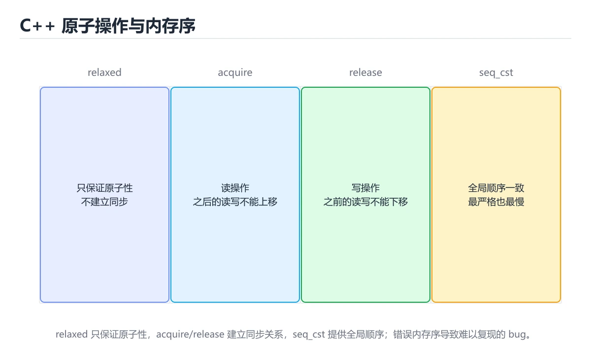
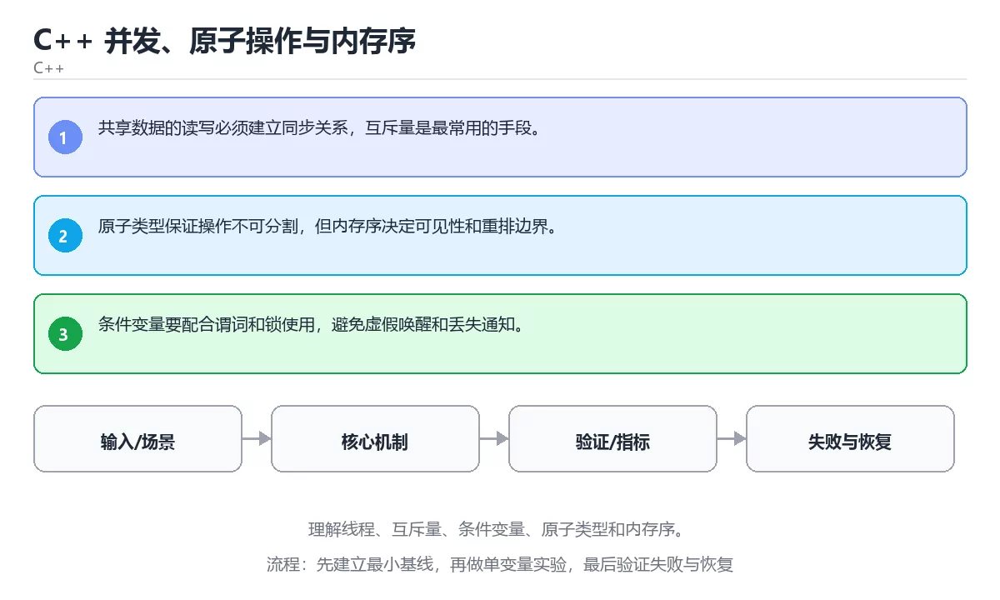

# C++ 并发、原子操作与内存序

> 内容更新时间：2026-10-06 · 学习阶段：高级 · 预计用时：40 分钟





## 本节知识框架

你写了一个程序，两个线程同时给一个计数器加 1。你期望结果是 2，但有时候得到 1。为什么？

欢迎来到并发编程的世界。在这里，「同时」意味着「可能出错」。两个线程同时读写同一块内存，就像两个人同时编辑同一个 Word 文档——如果没有协调机制，后保存的会覆盖先保存的，或者两人的修改互相丢失。

本课是 C++ 并发编程的基础。你会学到：线程怎么创建和同步、互斥量怎么保护共享数据、原子操作怎么保证「不可分割」，以及内存序怎么控制编译器和 CPU 的指令重排。

**学完本课你会掌握：**
- 用 `std::thread` 创建线程，用 `join()` 等待完成
- 用 `std::mutex` 和 `std::lock_guard` 保护共享数据
- 用 `std::atomic` 做不可分割的读写操作
- 理解内存序（`memory_order`）如何影响可见性和重排
- 用 `std::condition_variable` 实现线程间通知

**先修知识：** 《C++ Concepts 与 Ranges》里的模板和类型系统是本课的前提。后续课程《C++ 第一个程序》会回到基础主题。

### 复习清单

- [ ] 能解释数据竞争是什么，并说出互斥量和原子操作各自适用什么场景
- [ ] 能写出一个线程安全的计数器，并解释为什么 `volatile` 不能代替 `atomic`
- [ ] 能解释条件变量为什么要配合谓词循环使用

## 核心概念定义

| 术语 | 一句话说明 |
| --- | --- |
| `线程` | 操作系统调度的执行单元，同一进程内的线程共享地址空间和大部分资源。 |
| `atomic` | C++ 原子类型与其操作保证并发读写不可分割，并可指定内存序。 |
| `内存序` | 控制原子操作的可见性和指令重排边界的枚举值，影响多线程间的同步语义。 |
| `条件变量` | 让线程在条件不满足时挂起、满足时被唤醒的同步原语，必须与互斥量和谓词循环配合。 |

## 原理与运行机制

### 1. 共享数据的读写必须建立同步关系

共享数据的读写必须建立同步关系，互斥量是最常用的手段。

```cpp
#include <iostream>
#include <mutex>
#include <thread>
#include <vector>

int counter = 0;
std::mutex mtx;

void increment() {
    for (int i = 0; i < 1000; ++i) {
        std::lock_guard<std::mutex> lock(mtx);
        ++counter;
    }
}

int main() {
    std::thread t1(increment);
    std::thread t2(increment);
    t1.join();
    t2.join();
    std::cout << "counter=" << counter << "\n";  // 总是 2000
    return 0;
}
```

`std::lock_guard` 是 RAII 的又一个应用——构造时加锁，析构时自动解锁。无论函数正常返回还是抛异常，锁都会被释放。

### 2. 原子类型保证操作不可分割

原子类型保证操作不可分割，但内存序决定可见性和重排边界。

```cpp
#include <atomic>
#include <iostream>
#include <thread>

int main() {
    std::atomic<int> counter{0};
    std::thread worker([&counter] {
        for (int i = 0; i < 1000; ++i) counter.fetch_add(1);
    });
    worker.join();
    std::cout << "counter=" << counter.load() << "\n";
    return 0;
}
```

```text
counter=1000
```

这段代码调用了 `main()`、`worker()`、`fetch_add()`、`join()` 和 `load()`。`fetch_add(1)` 是一个原子操作——它「读取-加1-写回」三步合为一步，不会被其他线程打断。所以即使只有一个线程，结果也总是 1000。

### 3. 内存序：控制可见性与重排

内存序是并发编程中最难理解的部分。简单来说，它回答两个问题：
- **可见性**：线程 A 写入的值，线程 B 什么时候能看到？
- **重排**：编译器和 CPU 可以重新排列指令吗？

```cpp
// 默认内存序：memory_order_seq_cst（最严格，最安全）
counter.fetch_add(1);  // 等价于 counter.fetch_add(1, std::memory_order_seq_cst);

// 更宽松的内存序
counter.fetch_add(1, std::memory_order_relaxed);  // 只保证原子性，不保证顺序
counter.store(42, std::memory_order_release);     // 释放：之前的写操作对获取方可见
counter.load(std::memory_order_acquire);          // 获取：之后的读操作能看到释放方的写
```

内存序随手选会导致什么？要么性能受损，要么出现重排问题。正确做法是先写清需要的同步语义，再选 acquire/release 等内存序。

**建议**：除非你在做高性能无锁编程，否则用默认的 `seq_cst`。它最安全，性能在大多数场景下也够用。

### 4. 条件变量：线程间通知

条件变量要配合谓词和锁使用，避免虚假唤醒和丢失通知。

```cpp
#include <condition_variable>
#include <mutex>
#include <queue>
#include <thread>

std::queue<int> data;
std::mutex mtx;
std::condition_variable cv;

void producer() {
    for (int i = 0; i < 10; ++i) {
        std::lock_guard<std::mutex> lock(mtx);
        data.push(i);
        cv.notify_one();  // 通知消费者
    }
}

void consumer() {
    while (true) {
        std::unique_lock<std::mutex> lock(mtx);
        cv.wait(lock, [] { return !data.empty(); });  // 谓词循环
        int value = data.front();
        data.pop();
        lock.unlock();
        std::cout << "consumed: " << value << "\n";
    }
}
```

`cv.wait(lock, predicate)` 的谓词循环至关重要。为什么？因为条件变量可能被「虚假唤醒」——即使没有人通知，`wait` 也可能返回。谓词循环确保即使虚假唤醒，也会重新检查条件并继续等待。

### 5. volatile 不是原子

用 volatile 代替原子会导致什么？指令重排与缓存一致性问题仍然存在。

```cpp
// 错误：volatile 不保证原子性和可见性
volatile int counter = 0;
// 两个线程同时 counter++ 仍然会数据竞争

// 正确：用 std::atomic
std::atomic<int> counter{0};
// 线程间共享状态用 std::atomic，volatile 只用于特殊硬件访问
```

`volatile` 告诉编译器「这个变量可能被外部修改（比如硬件寄存器），不要优化掉对它的读写」。但它不保证原子性，也不保证多核间的缓存一致性。多线程共享状态必须用 `std::atomic`。

## 典型应用场景

### 场景一：线程安全计数器

```cpp
class Counter {
    std::atomic<int> value_{0};
public:
    void increment() { value_.fetch_add(1, std::memory_order_relaxed); }
    int get() const { return value_.load(std::memory_order_relaxed); }
};
```

对于简单的计数器，`memory_order_relaxed` 就够了——我们只关心最终值，不关心中间状态的可见顺序。

### 场景二：生产者-消费者队列

上面的条件变量示例就是一个经典的生产者-消费者模式。生产者往队列里放数据，消费者从队列里取数据。条件变量让消费者在队列为空时休眠，有数据时被唤醒。

### 场景三：双重检查锁定（DCL）

```cpp
std::atomic<bool> initialized{false};
std::mutex mtx;
Resource* resource = nullptr;

void init() {
    if (!initialized.load(std::memory_order_acquire)) {
        std::lock_guard<std::mutex> lock(mtx);
        if (!initialized.load(std::memory_order_relaxed)) {
            resource = new Resource();
            initialized.store(true, std::memory_order_release);
        }
    }
}
```

这里用 acquire/release 内存序实现高效的延迟初始化：第一次检查用 acquire（看到 release 之后的写入），初始化完成后用 release（确保 resource 的构造在 initialized 设为 true 之前完成）。

### 场景四：分片计数器与伪共享

多线程各写各的槽位时，瓶颈常常不在原子指令，而在相邻槽位挤进同一条 64 字节缓存行被反复夺走，这就是伪共享（false sharing）。

```cpp
#include <atomic>

struct alignas(64) Slot {   // 每槽独占一条缓存行
    long local{0};          // 只有本线程会写它
    std::atomic<long> handoff{0};
};

static_assert(std::atomic<long>::is_always_lock_free);  // 编译期自检

// 线程收尾前：s.handoff.store(s.local, std::memory_order_release);
// join() 之后：total += s.handoff.load(std::memory_order_acquire);
```

计数用 relaxed 足够，汇总的正确性来自 release 与 acquire 配对：只有配上才建立 happens-before，槽里排在旁边的普通写入才可见。`compare_exchange_weak` 允许伪失败、适合塞进重试循环，`strong` 不伪失败、适合只试一次的场合。x86 上 `fetch_add` 各档内存序常编成 `lock xaddl` 并自带全屏障；差别在读写两端：`load` 在 x86 上不论哪档内存序通常就是一条 `mov`，因为硬件读本身带 acquire 语义，而 seq_cst 的 `store` 要么编成 `xchg`、要么在 `mov` 之后补一条 `mfence`，用它把全屏障补回来。

## 代码/协议/SQL 示例

### 最小可运行示例

```cpp
#include <atomic>
#include <iostream>
#include <thread>

int main() {
    std::atomic<int> counter{0};
    std::thread worker([&counter] {
        for (int i = 0; i < 1000; ++i) counter.fetch_add(1);
    });
    worker.join();
    std::cout << "counter=" << counter.load() << "\n";
    return 0;
}
```

```text
counter=1000
```

### 数据竞争演示

```cpp
#include <iostream>
#include <thread>

int counter = 0;  // 非原子！

void increment() {
    for (int i = 0; i < 100000; ++i) {
        ++counter;  // 数据竞争：读-改-写不是原子的
    }
}

int main() {
    std::thread t1(increment);
    std::thread t2(increment);
    t1.join();
    t2.join();
    std::cout << "counter=" << counter << "\n";  // 可能小于 200000
    return 0;
}
```

每次运行结果可能不同——这就是数据竞争的危险。

## 时间/空间复杂度或性能分析

**互斥量开销**：`std::mutex` 加锁/解锁大约 20-50 纳秒。如果临界区很小（几个赋值操作），锁的开销可能比实际操作还大。

**原子操作开销**：`std::atomic` 的 `seq_cst` 操作大约 10-30 纳秒，`relaxed` 操作接近普通读写（1-5 纳秒）。

**条件变量开销**：`notify_one` 大约 100 纳秒，`wait` 在没有竞争时接近零开销。

**性能建议**：
- 临界区小 → 用原子操作
- 临界区大或涉及多个变量 → 用互斥量
- 需要等待条件 → 用条件变量
- 需要整体原子性时用互斥量或 CAS 循环——以为原子变量能保护复合操作是一个常见误区，先读后写的逻辑仍然竞争

## 常见误区与易错点

| 容易写错的做法 | 实际现象 | 正确做法 |
| --- | --- | --- |
| 以为原子变量能保护复合操作 | 先读后写的逻辑仍然竞争 | 需要整体原子性时用互斥量或 CAS 循环 |
| 内存序随手选 | 要么性能受损，要么出现重排问题 | 先写清需要的同步语义，再选 acquire/release 等内存序 |
| 用 volatile 代替原子 | 指令重排与缓存一致性问题仍然存在 | 线程间共享状态用 std::atomic，volatile 只用于特殊硬件访问 |

### 现场排错：原子变量保护复合操作

**症状**：用 `atomic<int>` 做了一个「如果小于就更新」的操作，但高并发下结果不对。

```cpp
std::atomic<int> max_val{0};
// 错误：这不是原子操作！
if (new_val > max_val.load()) {
    max_val.store(new_val);
}
```

**根因**：`load` 和 `store` 各自是原子的，但「先读后写」整体不是原子的。两个线程可能同时读到旧值，然后都写入自己的值。

**修复**：用 CAS（compare-and-swap）循环或互斥量。

```cpp
// CAS 循环
int expected = max_val.load();
while (new_val > expected && !max_val.compare_exchange_weak(expected, new_val));
```

### 现场排错：条件变量虚假唤醒

**症状**：消费者偶尔处理了空数据或崩溃。

**根因**：条件变量可能被虚假唤醒（spurious wakeup），即使没有人 `notify`。

**修复**：总是用谓词循环：`cv.wait(lock, [] { return condition; })`。

## 与其他知识点的关系

- **先修**：《C++ Concepts 与 Ranges》。模板和类型系统是本课的前提。
- **后续**：《C++ 第一个程序》。后续课程会回到基础主题。
- **术语衔接**：《现代 C++ 特性》里的 `RAII` 和 `lock_guard` 在本课继续使用。

### 知识脉络

```text
C++ Concepts 与 Ranges（模板约束、类型系统）
    ↓
C++ 并发、原子操作与内存序（线程、互斥量、原子、内存序）  ← 你在这里
    ↓
C++ 第一个程序（回顾基础、综合运用）
```

## 自测题与参考答案

> 先独立作答，再对照参考答案。

### 自测 1：互斥量和原子操作各自适用什么场景？

**参考答案**：互斥量适合保护临界区较大或涉及多个变量的操作；原子操作适合简单的单变量读写（如计数器、标志位）。互斥量更灵活但开销更大，原子操作更轻量但只能保护单个操作。

### 自测 2：为什么 `volatile` 不能代替 `atomic`？

**参考答案**：`volatile` 只防止编译器优化掉对变量的读写，但不保证原子性（读-改-写可能被中断），也不保证多核间的缓存一致性。多线程共享状态必须用 `std::atomic`。

### 自测 3：条件变量为什么要配合谓词循环？

**参考答案**：因为条件变量可能被虚假唤醒——即使没有人 `notify`，`wait` 也可能返回。谓词循环确保即使虚假唤醒，也会重新检查条件并继续等待，而不是处理不存在的数据。

## 考点精讲

本课题库有 6 道题，下面逐题讲解。

### 考点 1

**题目**：在 `C++ 并发、原子操作与内存序` 里，与 `线程` 有关的说法中，哪一项最符合理解线程、互斥量、条件变量、原子类型和内存序？

**答案**：共享数据的读写必须建立同步关系，互斥量是最常用的手段。

**讲解**：并发编程的第一原则：任何共享的可变数据都必须有同步机制。互斥量（`std::mutex`）是最直接、最常用的手段——加锁后只有当前线程能访问共享数据，其他线程必须等待。

### 考点 2

**题目**：在 `C++ 并发、原子操作与内存序` 里，与 `线程` 有关的说法中，哪一项最符合理解线程、互斥量、条件变量、原子类型和内存序？（C++ 并发、原子操作与内存序·C++ 第 2 题）

**答案**：原子类型保证操作不可分割，但内存序决定可见性和重排边界。

**讲解**：原子操作保证「不可分割」——读-改-写一步完成，不会被其他线程打断。但「不可分割」不等于「立即可见」——内存序决定了其他线程什么时候能看到这个写入，以及编译器和 CPU 是否可以重排指令。

### 考点 3

- **题目**：按“C++ 并发、原子操作与内存序”中 线程、atomic、内存序 的实践顺序，把四个步骤排成从准备到复盘的合理顺序。

**答案**：先明确 线程 的输入、输出与约束 → 写出最小示例并核对 atomic 的基线结果 → 只改一个变量，记录边界与失败路径的变化 → 固定版本与证据，把“C++ 并发、原子操作与内存序”的结论写成可复现记录

**讲解**：并发编程的学习顺序：先理解线程模型（创建、同步、生命周期），然后用原子操作验证基线行为，接着通过改变内存序等变量观察行为变化，最后固定版本并记录所有观察结果。

### 考点 4

**题目**：`C++ 并发、原子操作与内存序` 的主线是：理解线程、互斥量、条件变量、原子类型和内存序。下面哪一项与这条主线一致？

**答案**：理解线程、互斥量、条件变量、原子类型和内存序。

**讲解**：这五个概念层层递进：线程是执行单元，互斥量保护共享数据，条件变量实现线程间通知，原子类型保证操作不可分割，内存序控制可见性和重排。

### 考点 5

**题目**：课程 `理解线程、互斥量、条件变量、原子类型和内存序。`。在 `C++ 并发、原子操作与内存序` 里，`线程`、`atomic` 与下面哪些选项属于同一层概念？（多选）

**答案**：线程；atomic

**讲解**：线程和 atomic 都是 C++ 并发支持库的核心概念，属于同一抽象层次。线程是执行单元，atomic 是同步原语——它们共同构成了 C++ 并发编程的基础设施。

### 考点 6

**题目**：结合 `C++ 并发、原子操作与内存序` 中围绕 `线程` 的代码，哪一项说法与“理解线程、互斥量、条件变量、原子类型和内存序。”一致？

**答案**：共享数据的读写必须建立同步关系，互斥量是最常用的手段。

**讲解**：代码中的 `std::lock_guard<std::mutex> lock(mtx)` 就是在建立同步关系——确保同一时刻只有一个线程能修改 `counter`。这是并发编程最基本、最重要的原则。

## 延伸阅读

想更直观地理解本课概念？推荐参阅以下图解专题：

- [图解并发调度：线程、协程与 Goroutine](visual_concurrency_schedule.md)

## 术语速查

| 术语 | 一句话说明 |
| --- | --- |
| `std::thread` | C++ 标准库的线程类，构造时启动线程，join() 等待完成。 |
| `std::mutex` | 互斥量，加锁后独占访问，unlock 后释放。配合 lock_guard 使用。 |
| `std::atomic` | 原子类型，保证读写操作不可分割，支持指定内存序。 |
| `memory_order` | 控制原子操作可见性和重排的枚举：seq_cst、acquire、release、relaxed 等。 |
| `condition_variable` | 条件变量，让线程等待某个条件成立，配合 mutex 和谓词使用。 |

## 内容元数据

- 内容版本：v2.0
- 最后更新：2026-10-06
- 学习阶段：高级
- 适用环境：C++20 / GCC 13+ 或 Clang 17+；本课聚焦 线程。
- 内容来源：内置结构化课程与工程实践整理
- 相关主题：线程、atomic、内存序、条件变量

## 参考资料与复核

- 最后复核：2026-10-04
- 下次复核：2027-05-10
- 复核范围：线程行为、原子操作语义、内存序规则与条件变量使用模式
- 来源性质：官方文档、标准或权威教材

| 参考资料 | 本课用途 |
| --- | --- |
| [C++ 线程库参考](https://en.cppreference.com/w/cpp/thread) | thread、mutex、atomic、condition_variable 的完整 API 文档 |
| [C++ 原子操作参考](https://en.cppreference.com/w/cpp/atomic) | 原子类型、内存序与 CAS 操作的详细说明 |
| [C++ 并发编程指南](https://github.com/forhappy/Cplusplus-Concurrency-In-Practice) | 中文并发编程入门教程，覆盖线程、锁、原子与内存序 |
