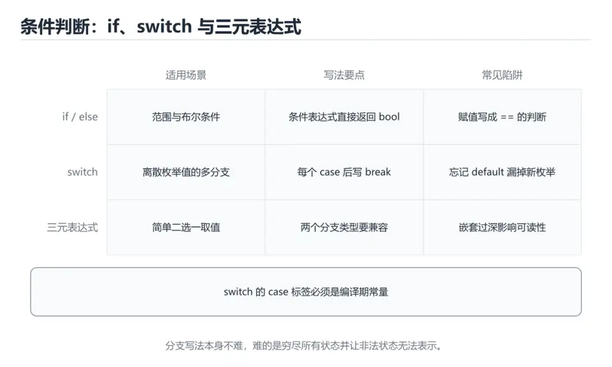
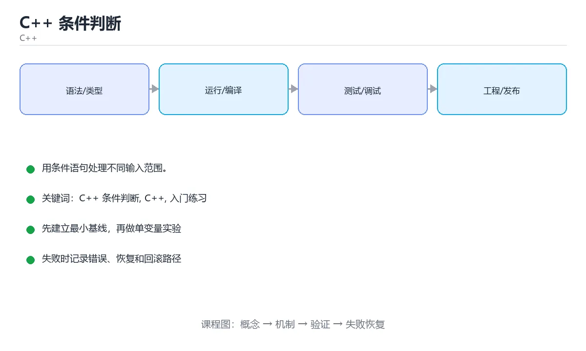

# C++ 条件判断

> 内容更新时间：2026-10-06 · 学习阶段：入门 · 预计用时：50 分钟





## 本节知识框架

上一课你学会了让程序记住数据、读取输入。这一课我们要让程序"做选择"——根据不同条件执行不同的代码。

学完这一课，你会：
- 理解 `bool` 类型只有 `true` 和 `false` 两个值
- 会写 `if`、`if-else`、`if-else if-else` 分支
- 了解 `switch` 的用法和 `break` 的重要性
- 知道三元运算符 `? :` 是 if-else 的简写
- 理解作用域：花括号决定了变量在哪里可见

**先修与衔接**：先修《C++ 变量与输入输出》。下一课：《C++ 循环入门》。

### 复习清单

- [ ] 能写 `if-else` 判断一个数是正数还是负数
- [ ] 能解释 `switch` 里 `break` 的作用
- [ ] 能说明花括号作用域对变量生命周期的影响

## 核心概念定义

| 术语 | 一句话说明 |
| --- | --- |
| bool 类型 | 只有 `true` 与 `false`，条件表达式的结果类型。 |
| if-else | 按条件选择分支执行，`else` 绑定最近的未配对 `if`。 |
| 作用域 | 花括号形成的作用域决定变量的可见范围与生命周期。 |
| 三元运算符 | `条件 ? 值1 : 值2`，用于在表达式位置做二选一。 |
| switch | 根据整数或枚举值选择对应 case 分支，忘记 break 会贯穿。 |
| 比较运算 | `==` 判断相等，`=` 是赋值——混淆是最常见的 bug 之一。 |
| 短路求值 | 逻辑与的左边已经为假、逻辑或的左边已经为真时，右边根本不会被计算。 |
| 贯穿 fall-through | `switch` 里缺 `break` 时，程序接着执行后面 case 的语句，而不是跳出。 |
| 容差 epsilon | 浮点比较用的误差上限，常见写法 `1e-9`，取值要跟着数据的量级走。 |
| 条件内声明 | 在 `if` 的括号里就把变量定义出来，它的作用域只覆盖这一条分支。 |

## 原理与运行机制

### 条件就像岔路口

想象你走到一个岔路口：如果下雨就走左边（带伞），如果晴天就走右边（戴墨镜）。`if-else` 就是代码里的岔路口：

```cpp
int temperature = 31;
if (temperature > 30) {
    std::cout << "hot\n";
} else {
    std::cout << "normal\n";
}
```

条件 `temperature > 30` 的结果是 `true` 或 `false`——这就是 `bool` 类型。条件为 `true` 就执行 `if` 后面的代码块，否则执行 `else` 后面的。

### 多个条件：else if

```cpp
int score = 78;

if (score >= 90) {
    std::cout << "优秀\n";
} else if (score >= 60) {
    std::cout << "及格\n";
} else {
    std::cout << "不及格\n";
}
```

程序从上往下逐个检查条件，一旦某个条件为 `true` 就执行对应分支并跳过剩余判断。

### switch：多路选择

```cpp
int day = 3;
switch (day) {
    case 1: std::cout << "周一\n"; break;
    case 2: std::cout << "周二\n"; break;
    case 3: std::cout << "周三\n"; break;
    default: std::cout << "周末\n"; break;
}
```

`switch` 把一个值和多个 `case` 比较，匹配就执行对应代码。**每个 case 末尾的 `break` 不能忘**——没有 `break`，程序会继续执行下一个 case 的代码，这叫"贯穿"（fall-through）。

### 三元运算符：简写的 if-else

```cpp
int temperature = 31;
std::cout << (temperature > 30 ? "hot" : "normal") << "\n";
```

`条件 ? 值1 : 值2` 是 `if-else` 的简写形式，适合简单的二选一场景。

### 作用域：花括号里的世界

```cpp
if (true) {
    int x = 10;
    std::cout << x << "\n";  // 可以访问 x
}
// std::cout << x;  // 错误！x 在这里不存在
```

花括号 `{}` 形成了一个**作用域**。在作用域里声明的变量，出了作用域就不存在了。这个规则适用于 `if`、`for`、`while`、`switch` 等所有带花括号的语句。

### bool 是从哪里"掉"出来的

`temperature > 30` 本身就是一个表达式，它的值是 `bool`，跟 `if` 无关。理解这一点之后，很多写法就顺理成章了：

```cpp
bool isHot = temperature > 30;      // 把判断结果存下来，后面反复用
if (isHot) { std::cout << "开空调\n"; }

int input = 7;
if (input) { /* 非 0 即真，这里会进 */ }
if (input == 0) { /* 想判"没值"要显式写出来 */ }
```

整数到 `bool` 的隐式转换是真实存在的：非零为 `true`，零为 `false`。这在写 `if (指针)`、`if (返回值)` 时很方便，但也解释了为什么 `if (a = b)` 不报错——赋值表达式的值又被打成了 `bool`。判"是否为零"请老老实实写 `== 0`，别靠隐式转换。

### 短路求值：右边常常压根没跑

```cpp
#include <iostream>

bool shout() { std::cout << "我执行了\n"; return true; }

int main() {
    if (false && shout()) { /* ... */ }   // 什么都不打印
    if (true || shout()) { /* ... */ }    // 同样不打印
}
```

左边已经能定结论时，编译器不会去算右边，这叫短路。它是写安全条件的利器：把"能不能安全算"的判断放在前面，把"拿它算一下"放后面。

```cpp
std::string name = "Ada";
int len = 0;
if (name.size() > 0 && name[0] == 'A') {   // 长度检查在前，越界访问就不会发生
    len = 1;
}
```

顺序反过来写就有风险：一旦前面的条件为真放行了解引用，后面才做的检查已经太晚了。

### 悬挂 else：花括号是唯一可靠的解药

`else` 绑定的是它上方**最近的、还没配对**的 `if`，跟缩进无关：

```cpp
if (score >= 60)
    if (score >= 90)
        std::cout << "优秀\n";
else
    std::cout << "不及格\n";   // 这个 else 其实属于内层 if
```

上面这段的缩进骗了你：分数 70 时外层成立、内层不成立，`else` 又不属于外层，于是什么都不打印。养成两个习惯就够了——**所有分支都写花括号**，以及 `else` 之前不留裸的单行 `if`。

### switch 能匹配什么，不能匹配什么

`switch` 的括号里只能是整数或枚举类型的值，`case` 后面必须是编译期就能确定的常量。所以字符串菜单不能直接 `switch`，要么用一长串 `if-else` 比较 `std::string`，要么先把选项映射成数字。

另外两个细节最容易踩：

```cpp
switch (code) {
    case 1: {
        int count = readCount();   // 用花括号把变量锁在这个 case 里
        std::cout << count << "\n";
        break;
    }
    case 2:
        std::cout << "第二项\n";
        break;
    case 3:
        std::cout << "和第三项合并处理\n";
        [[fallthrough]];           // 明确写出"我就是要贯穿"
    case 4:
        std::cout << "四项共用逻辑\n";
        break;
    default:
        std::cout << "未知选项\n";
        break;
}
```

不加花括号时，`count` 的作用域会铺满整个 `switch`：从 `case 2` 进来会跳过它的初始化，编译器直接拒绝。有意让两个 `case` 共用逻辑时，用 C++17 的 `[[fallthrough]]` 标注，这样读代码的人和 `-Wimplicit-fallthrough` 都不会以为你写忘了。

### 在条件里就把变量定义出来

```cpp
if (int temperature = readTemperature(); temperature > 30) {
    std::cout << "hot\n";          // temperature 在这里可见
}
// temperature 在这里已经不存在了
```

这是 C++17 的写法，好处正好落在本课的"作用域"考点上：判断用的临时值只在需要的地方活着，不会泄漏到分支外面被误用，也不会忘了初始化就用。

## 典型应用场景

条件判断无处不在：

- **成绩评级**：根据分数范围给出 A/B/C/D 等级
- **温度提示**：根据温度判断穿什么衣服
- **登录验证**：检查用户名和密码是否正确
- **游戏逻辑**：判断角色是否碰到敌人、血量是否归零
- **数据过滤**：只处理满足条件的数据

### 一个实际的小例子

```cpp
#include <iostream>

int main() {
    int age;
    std::cout << "请输入年龄：";
    std::cin >> age;

    if (age >= 18) {
        std::cout << "你是成年人\n";
    } else {
        std::cout << "你还未成年\n";
    }
    return 0;
}
```

### 场景一：分段提示，同时处理坏输入

天气站按温度给提示，`<`、`>=` 的边界怎么定、用户敲进字母时怎么办，都得一起写清楚——只看"正常温度能出正确提示"是不够的。

```cpp
#include <iostream>
#include <string>

int main() {
    double temperature = 0.0;
    std::cout << "请输入温度：";
    if (!(std::cin >> temperature)) {          // 读失败：不是数字，或直接到了文件末尾
        std::cout << "输入的不是数字，程序按未知处理\n";
        return 1;                              // 失败路径要有明确出口
    }

    std::cin.ignore();                         // 吃掉行尾换行，避免影响后续 getline

    std::string hint;
    if (temperature < -10.0) hint = "极寒，减少户外活动";
    else if (temperature < 0.0) hint = "结冰风险";
    else if (temperature < 30.0) hint = "体感舒适";
    else hint = "hot";

    std::cout << hint << "\n";
    return 0;
}
```

三个要点：`if (!(std::cin >> temperature))` 把"读不读得动"当成条件；每个阈值只写一次，边界归到哪一档是明确的；失败分支立刻 `return 1`，不让垃圾值继续参与判断。

### 场景二：判等要讲误差

判断"水温是不是 100 度"这种需求看着最简单，浮点一参与就会翻车：

```cpp
// 需要 #include <cmath>
double measured = 0.1 + 0.2;          // 实际存的是 0.30000000000000004
if (measured == 0.3) { /* 永远进不来 */ }
if (std::abs(measured - 0.3) < 1e-9) { /* 这里才会进 */ }
```

差值绝对值小于容差就算相等，这是浮点比较的唯一推荐写法。容差不是常量表：温度读到小数点后两位就用 `1e-3` 级别，金额一类的数据应该换成整数"分"或者定点类型，而不是跟 `double` 较劲。

## 代码/协议/SQL 示例

### 最小可运行示例

```cpp
#include <iostream>

int main() {
    int temperature = 31;
    std::cout << (temperature > 30 ? "hot" : "normal") << "\n";
    return 0;
}
```

输出：

```text
hot
```

### 完整示例：成绩评级

```cpp
#include <iostream>

int main() {
    int score;
    std::cout << "请输入分数：";
    std::cin >> score;

    if (score >= 90) {
        std::cout << "A\n";
    } else if (score >= 80) {
        std::cout << "B\n";
    } else if (score >= 60) {
        std::cout << "C\n";
    } else {
        std::cout << "F\n";
    }
    return 0;
}
```

### 动手练一练

- 修改成绩评级的分数范围，加入 `A+`（95 分以上）
- 写一个判断闰年的程序：能被 4 整除但不能被 100 整除，或者能被 400 整除
- 故意把 `==` 写成 `=`，打开 `-Wall` 编译看看报什么警告
- 把上面成绩评级的 `else if` 链改成先判 `score < 0 || score > 100` 的非法输入分支，看看顺序变了会怎样
- 给 `switch` 的某个 `case` 删掉 `break`，观察输出多打了哪几行，再补上 `[[fallthrough]]`

### 渐进示例：一个判断从三行到能复用

第一步，最小可跑，只回答"这一年是不是闰年"：

```cpp
#include <iostream>

int main() {
    int year = 2026;
    if (year % 4 == 0 && year % 100 != 0 || year % 400 == 0) {
        std::cout << year << " 是闰年\n";
    } else {
        std::cout << year << " 不是闰年\n";
    }
    return 0;
}
```

第二步，把规则收进函数，并让边界年份自己说话。这里的花括号不能省——`&&` 的优先级高于 `||`，不加括号时"能被 400 整除"会和后半段搅在一起：

```cpp
#include <iostream>

bool isLeap(int year) {
    return (year % 4 == 0 && year % 100 != 0) || (year % 400 == 0);
}

int main() {
    for (int year : {1900, 2000, 2024, 2100}) {
        std::cout << year << (isLeap(year) ? " 闰\n" : " 平\n");
    }
    return 0;
}
```

输出 `1900 平`、`2000 闰`、`2024 闰`、`2100 平`。四个年份刚好覆盖"整百年""四百整倍""普通闰年""下一个整百年"四种边界，只测 2024 是看不出括号有没有写错的。

第三步，把月份天数交给 `switch`，2 月再回头调用刚才的判断：

```cpp
int daysOfMonth(int month, int year) {
    switch (month) {
        case 1: case 3: case 5: case 7:
        case 8: case 10: case 12:
            return 31;
        case 4: case 6: case 9: case 11:
            return 30;
        case 2:
            return isLeap(year) ? 29 : 28;
        default:
            return -1;            // 非法月份：用约定的负值告诉调用方
    }
}
```

这段是"有意贯穿"的合法用法：连续几个 `case` 后面不写语句，让它们共用同一个 `return`，所以 `[[fallthrough]]` 在这里并不需要。而 `default` 返回 `-1` 而不是直接打印，是为了让调用方能检查失败路径。

### 本课速查卡

| 复习项 | 本课要点 |
| --- | --- |
| 核心结论 | `if-else` 按条件选分支，`switch` 按值匹配 case |
| 最少要写的代码 | `if (条件) { ... }` |
| 最常见的错误 | `=` 和 `==` 混淆；switch 忘写 break |
| 出错先查什么 | 检查条件表达式是否用了赋值而非比较 |

## 时间/空间复杂度或性能分析

条件判断本身是 O(1) 操作——无论条件多复杂，CPU 只需要计算一次布尔值然后跳转。

需要注意的性能问题：
- **switch vs if-else 链**：当 case 数量很多时，`switch` 通常比一长串 `if-else` 更快（编译器会用跳转表优化）
- **分支预测**：CPU 会猜测条件走哪边，如果猜测频繁失败会影响性能。把最常见的分支放在前面可以减少预测失败

### else if 链、switch、查找表怎么选

三条以上的分支，成本差别开始可见。`else if` 链是逐个比较，最坏情况要跑满整条链；`switch` 在 `case` 密集时会被编译成跳转表，一次索引直接落位；再往上则是把"值到结果"的映射放进 `std::map` 或有序数组里查，分支代码彻底消失，换成数据。初学阶段不用纠结：`case` 少于五个时差别在纳秒级，可读性比这纳秒重要得多。

真正该改写的信号是"每加一种情况都要动代码"——那说明这张表本来就该是数据。

### 浮点比较的代价与陷阱

`std::abs(a - b) < eps` 只有一步减法一次比较，性能完全不用担心，要担心的是取值。绝对容差在数值很大时会失效：`1e-9` 相对于 `1e6` 级别的量根本不算误差，两个明显不同的数也会被判定相等。稳妥做法是同时看绝对误差和相对误差：

```cpp
#include <algorithm>   // std::max
#include <cmath>       // std::abs

bool nearlyEqual(double a, double b) {
    double diff = std::abs(a - b);
    double scale = std::max(std::abs(a), std::abs(b));
    return diff < 1e-9 || diff < scale * 1e-12;
}
```

需要"精确相等"语义的量——金额、计数、分页序号——一开始就不该用 `double` 装。

### 结论要能在同一台环境上复现

本课所有片段都用 `-std=c++17` 编译，因为 `[[fallthrough]]`、条件里的初始化语句这两个写法在更早的标准里不存在。谈"某段条件代码行为如何"时，先记下 `g++ --version` 或 `clang++ --version` 的输出，再固定编译标准，否则同一份代码在两位同学机器上结论会不一样。

边界值的检查同理：温度恰好 `30.0`、分数恰好 `60`、月份为 `0` 或 `13`，这几条都要跑一遍。只跑"31 度""78 分"这种中间值，永远发现不了 `<` 与 `<=` 写反的那一位。

## 常见误区与易错点

| 容易犯的错误 | 会出现什么 | 怎么修 |
| --- | --- | --- |
| `if (a = b)` 写成赋值 | 条件恒为 b 的值，逻辑错误 | 写成 `if (a == b)`，或把常量写左边 `if (5 == a)` |
| switch 忘写 break | 贯穿到下一个 case | 每个 case 末尾加 `break` |
| 浮点数用 `==` 比较 | 精度误差导致判断失败 | 比较两者差值的绝对值是否小于一个容差 |
| else 匹配了错误的 if | 逻辑分支不符合预期 | `else` 总是绑定最近的未配对 `if`，用花括号明确结构 |
| 在条件外使用条件内的变量 | 编译报错"未声明的标识符" | 花括号形成的作用域决定变量的可见范围 |
| 在 `case` 里直接声明变量却不加花括号 | 编译报错：跳过变量初始化，或后面的 `case` 重名 | 每个需要局部变量的 `case` 用 `{}` 包起来 |
| 拿 `switch` 直接匹配字符串 | 编译报错：switch 的条件必须是整数或枚举 | 改用 `if-else` 比较 `std::string`，或先映射成数字 |
| 逻辑条件里检查与使用顺序颠倒 | 前半个条件放行，后半个先解引用越界 | 把"能不能安全访问"写在前面，靠短路求值兜住 |
| 容差写死一个绝对值就以为万事大吉 | 数值量级一大，两个明显不等的数被判成相等 | 绝对容差与相对容差一起比较 |
| 阈值边界用 `<` 还是 `<=` 全凭手感 | 恰好卡在边界的数据走进意料外的分支 | 给每个阈值写一句"等号归哪一档"的注释并测那个值 |

### 现场 1：条件表达式里赋值

**症状**：条件永远为真，程序行为不符合预期，编译器有警告但被忽略。

**根因与修复**：打开 `-Wall -Wextra`，比较写成明确表达式。把 `if (a = b)` 改成 `if (a == b)`。

### 现场 2：浮点数比较

**症状**：`0.1 + 0.2 == 0.3` 返回 `false`。

**根因与修复**：浮点数运算有精度误差。比较两者差值的绝对值是否小于一个容差：`abs(a - b) < 1e-9`。

### 现场 3：温度刚好 30 度时提示不对

**症状**：条件写的是 `temperature > 30` 打印 `hot`，可天气脚本传进来 `30.0` 时输出 `normal`，跟同事的机器"不一样"。

**根因与修复**：两人一个用 `>` 一个用 `>=`，边界值从没进过测试。先规定"30.0 归 hot"，再把 `if` 改成 `temperature >= 30.0`，然后专门用 `30.0`、`29.999`、`30.001` 三个输入各跑一次。边界规则要写在注释里，不然三个月后没人记得当初站哪边。

### 现场 4：switch 少一个 break，输出连撞三行

**症状**：`case 2` 打印之后，`case 3` 和 `case 4` 的内容也跟着打了出来。

**根因与修复**：`break` 的作用是结束当前 `switch`，避免继续执行后面的 `case`；漏掉它，程序就从命中的那一行一路往下执行到 `switch` 结束。给每个 `case` 补 `break`，确实要合并处理就依赖"空 `case` 连着写"的写法，并在需要跨越带语句的分支时显式写 `[[fallthrough]]`，同时打开 `-Wimplicit-fallthrough` 让编译器帮你盯着。

## 与其他知识点的关系

- **先修课**：《C++ 变量与输入输出》——条件表达式的两侧都需要已经读入或计算好的值。
- **后续课**：《C++ 循环入门》——把"满足条件就做一次"扩展成"满足条件就反复做"；《控制流与函数》再把成堆的分支收进可命名的函数里。
- **相关概念**：《命题逻辑与谓词逻辑》（离散数学）——`&&`、`||`、`!` 对应合取、析取与否定，德摩根律可以把一长串嵌套条件压成两层。
- **相关概念**：《数字逻辑与布尔代数》（计算机基础）——门电路同时求值，而 C++ 的 `&&` 与 `||` 会短路；右侧一旦含自增或函数调用，两者的结果就可能不同。
- **本课重点**：`switch` 忘记 `break` 会贯穿到下一个分支，`==` 与 `=` 的混淆是最常见的单字符缺陷；这两种情况在本课的误区对照表里给了可复现的最小片段。
- **下一课《C++ 循环入门》**：`while` 和 `for` 的停止条件就是本课的条件表达式，短路求值在循环里更常用——先判"还有没有下一个"，再访问它的值。
- **《变量、类型与运算符》**：条件里隐式的整数到 `bool` 转换、`double` 到 `int` 的截断，都在那一课被系统讲清；本课只需记住"能转，但要写明确"。
- **《控制流与函数》**：当 `else if` 链长到七八层，正确做法不是继续加，而是把每一档切成一个命名清楚的函数。
- **《STL 容器与算法》**：`switch` 映射成 `std::map` 查找表、用 `std::clamp` 处理越界输入，是把分支变成数据的标准手段。
- **《环境与编译流程》**：`-Wall -Wextra -Wimplicit-fallthrough` 这些开关能提前抓住赋值混淆和意外贯穿，比事后调试便宜得多。

## 自测题与参考答案

### 自测 1

写一个 `if-else` 判断一个整数是奇数还是偶数。

**参考答案**：`if (n % 2 == 0) { cout << "偶数"; } else { cout << "奇数"; }`

### 自测 2

解释 switch 里忘写 break 会发生什么。

**参考答案**：程序会"贯穿"到下一个 case 继续执行，直到遇到 break 或 switch 结束。

## 术语速查

| 术语 | 一句话说明 |
| --- | --- |
| `bool 类型` | 只有 `true` 与 `false`，条件表达式的结果类型。 |
| `if-else` | 按条件选择分支执行，`else` 绑定最近的未配对 `if`。 |
| `作用域` | 花括号形成的作用域决定变量的可见范围与生命周期。 |
| `三元运算符` | `条件 ? 值1 : 值2`，在表达式位置做二选一。 |
| `switch` | 根据值匹配 case 分支，忘记 break 会贯穿。 |
| `比较运算` | `==` 判断相等，`=` 是赋值——混淆是最常见的 bug。 |
| `短路求值` | 左边已能定结论时右边不执行，安全条件的顺序全靠它。 |
| `贯穿 fall-through` | `case` 缺 `break` 后继续执行下一条分支语句的行为。 |
| `容差 epsilon` | 浮点判等时允许的最大差值，要随数据量级一起取。 |
| `悬挂 else` | 没有花括号时 `else` 绑定最近的未配对 `if`，与缩进无关。 |
| `跳转表` | 编译器为密集 `case` 生成的直落表，让 switch 接近一次索引定位。 |

## 考点精讲

本课题库共 5 道题，下面逐题给出题干、正确项与判断依据。

### 考点 1

- **题目**：围绕“C++ 条件判断”中的 C++ 条件判断、C++、入门练习，下列哪两项是本课强调的实践判断？
- **选项**：验证 C++ 时要固定版本并覆盖边界输入，结论才可复现 / 把 C++ 的单次运行结果当成所有版本和规模都成立 / 学习 C++ 条件判断 时要同时说明输入、输出和失败路径，不能只看正常流程 / 只要 C++ 条件判断 的常规示例通过，就可以跳过边界与异常路径
- **正确项**：验证 C++ 时要固定版本并覆盖边界输入，结论才可复现；学习 C++ 条件判断 时要同时说明输入、输出和失败路径，不能只看正常流程
- **判断依据**：按《C++ 条件判断》的正文口径，本题要同时选中「验证 C++ 时要固定版本并覆盖边界输入，结论才可复现」、「学习 C++ 条件判断 时要同时说明输入、输出和失败路径，不能只看正常流程」，漏掉任一项都算没答全。术语 bool 类型（C++ 条件判断）：只有 true 与 false，条件表达式的结果类型。易错点是`if (a = b)` 写成赋值，会造成条件恒为 b 的值，逻辑错误，改法是写成 `if (a == b)`，或把常量写左边 `if (5 == a)`。

### 考点 2

- **题目**：`C++ 条件判断` 的示例代码用于验证 `bool 类型`，其背景是用条件语句处理不同输入范围。代码的真实内容是下面哪一项？
- **代码**：`int temperature = 31; std::cout << (temperature > 30 ? "hot" : "normal") << "\n";`
- **选项**：出现字面量 `.servers[].ip` / 出现字面量 `hot` / 出现字面量 `用暴力搜索作基线，评估近似索引的召回率。` / 出现字面量 `label`
- **正确项**：出现字面量 `hot`
- **判断依据**：本题正确项是「出现字面量 `hot`」。术语 bool 类型（C++ 条件判断）：只有 true 与 false，条件表达式的结果类型，本题取「出现字面量 `hot`」这条。易错点是switch 忘写 break，会造成贯穿到下一个 case，改法是每个 case 末尾加 `break`。本题干扰项「出现字面量 `.servers[].ip`」不成立：展示代码里找不到 `.servers[].ip`。

### 考点 3

- **题目**：比较两个浮点数是否相等时，推荐的做法是？
- **选项**：先把两个浮点数都强制转换成整数再比较 / 比较两个数的字符串形式是否完全一致 / 比较两者差值的绝对值是否小于一个容差 / 直接使用 ==，浮点数运算不会产生误差
- **正确项**：比较两者差值的绝对值是否小于一个容差
- **判断依据**：本题正确项是「比较两者差值的绝对值是否小于一个容差」。术语 bool 类型（C++ 条件判断）：只有 true 与 false，条件表达式的结果类型，本题取「比较两者差值的绝对值是否小于一个容差」这条。易错点是浮点数用 `==` 比较，会造成精度误差导致判断失败，改法是比较两者差值的绝对值是否小于一个容差。

### 考点 4

- **题目**：在 switch 语句中，case 末尾的 break 起到什么作用？
- **选项**：结束当前 switch，避免继续执行后面的 case / 结束整个函数的执行并返回调用方 / 让 switch 重新从头开始判断一次 / 只跳出当前循环，对 switch 本身没有影响
- **正确项**：结束当前 switch，避免继续执行后面的 case
- **判断依据**：本题正确项是「结束当前 switch，避免继续执行后面的 case」。术语 bool 类型（C++ 条件判断）：只有 true 与 false，条件表达式的结果类型，本题取「结束当前 switch，避免继续执行后面的 case」这条。易错点是else 匹配了错误的 if，会造成逻辑分支不符合预期，改法是`else` 总是绑定最近的未配对 `if`，用花括号明确结构。

### 考点 5

- **题目**：填空：补齐下面这段术语说明中的空缺。课程 `用条件语句处理不同输入范围。`，这段说明是：花括号形成的`____`决定变量的可见范围与生命周期。空缺处应填哪个术语？
- **正确项**：作用域
- **判断依据**：涉及术语 作用域：花括号形成的作用域决定变量的可见范围与生命周期。易错点：条件表达式里赋值会造成逻辑恒真且告警被忽略。正确做法：打开 -Wall -Wextra，比较写成明确表达式。判断时先确认输入和适用范围，对照 `C++ 条件判断`、`C++`、`入门练习` 复现一次，最后把错误表现与正确做法逐项对照。

## 内容元数据

- 内容版本：v2.0
- 最后更新：2026-10-06
- 学习阶段：入门
- 适用环境：C++17 / GCC 13+ 或 Clang 17+；本课聚焦 C++ 条件判断。
- 内容来源：内置结构化课程与工程实践整理
- 相关主题：C++ 条件判断、C++、入门练习

## 参考资料与复核

- 最后复核：2026-10-04
- 下次复核：2027-05-10
- 复核范围：条件语句语义、浮点比较、作用域规则

| 参考资料 | 本课用途 |
| --- | --- |
| [cppreference - if/else](https://en.cppreference.com/w/cpp/language/if) | if-else 语句语义详解 |
| [Learn C++ - Conditionals](https://www.learncpp.com/cpp-tutorial/if-statement/) | 条件判断入门教程 |
| [cplusplus.com - switch](https://cplusplus.com/doc/tutorial/control/) | switch 与循环控制 |
