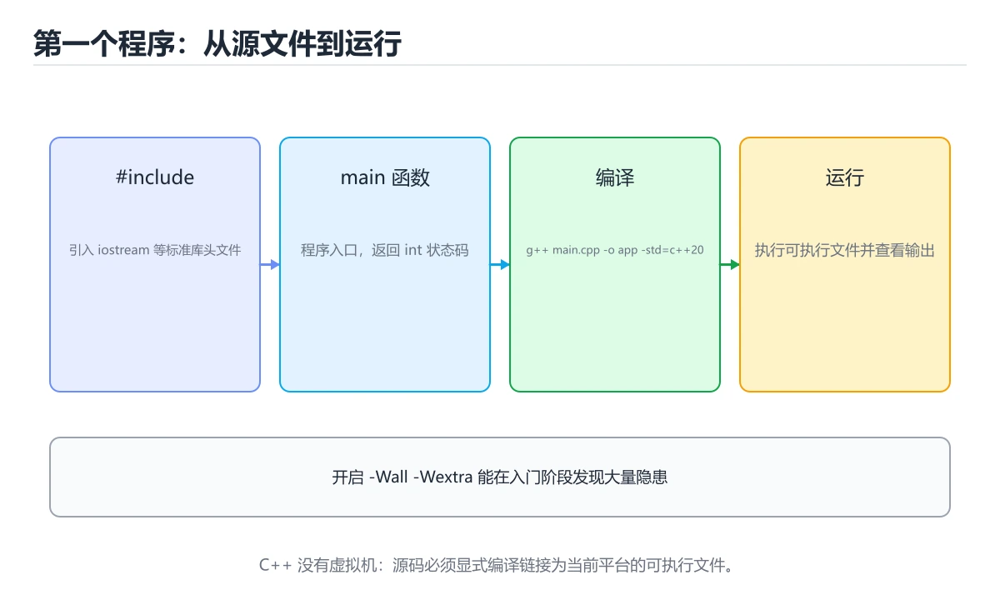
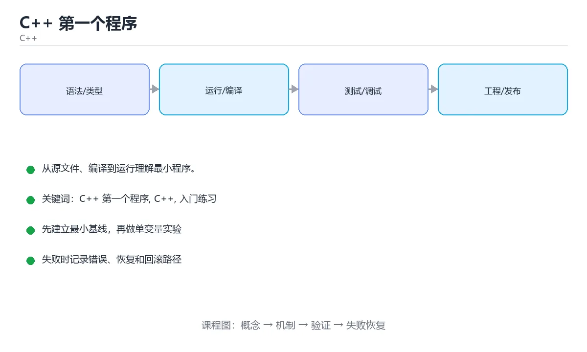

# C++ 第一个程序

> 内容更新时间：2026-10-06 · 学习阶段：入门 · 预计用时：40 分钟





## 本节知识框架

今天的目标很简单：**写一个 C++ 文件，编译它，运行它，看到屏幕上出现你写的文字。**

学完这一课，你会：
- 知道 C++ 程序长什么样、怎么编译运行
- 理解 `main` 函数是程序的入口
- 能用 `std::cout` 在屏幕上输出文字
- 了解从头文件到可执行文件的构建流程
- 遇到常见编译报错时知道怎么修

**先修与衔接**：本课是 C++ 分类的第 1 课，不需要任何编程基础。下一课：《C++ 变量与输入输出》。

### 复习清单

- [ ] 能独立创建一个 `.cpp` 文件并编译运行它
- [ ] 能用 `std::cout` 输出文字并解释 `<<` 的作用
- [ ] 能说出从 `.cpp` 到可执行文件经历了哪几个阶段

## 核心概念定义

先认识几个名词，后面会反复遇到：

| 术语 | 一句话说明 |
| --- | --- |
| main 函数 | 程序入口，返回 0 表示正常结束。每个 C++ 程序都必须有一个 `main`。 |
| 编译与链接 | 先把源码翻译成目标文件，再把库和多个目标文件合成可执行程序。C++ 是编译型语言，不像 Python 那样边读边跑。 |
| 命名空间 std | 标准库所在的命名空间，`std::` 前缀用于避免名字冲突。`cout`、`cin`、`string` 都住在 `std` 里。 |
| 入门练习 | 用最小输入和明确验收标准完成第一次动手验证。第一个程序就是最好的入门练习。 |
| 头文件 | 头文件通常放声明，源文件放定义。`#include` 在预处理阶段把头文件内容插入当前文件。 |
| 引用 | 值语义会复制对象，引用是已有对象的别名且必须初始化，指针保存地址并可以为空。 |
| `g++` | C++ 的编译驱动命令。一条 `g++ hello.cpp -o hello` 把预处理、编译、汇编、链接四步全走完。 |
| 预处理指令 | 以 `#` 开头、在编译真正开始前被处理的文本替换指令，`#include <iostream>` 属于这一类，末尾不写分号。 |
| 标准输出 | `std::cout` 写入的那条通道；`<<` 每接一次就送一件东西进去，出现顺序和你书写的顺序一致。 |
| 退出码 | `main` 返回给操作系统的整数，0 表示正常结束，非 0 表示出了问题，shell 用 `$?` 读它。 |

## 原理与运行机制

### 你的代码是怎么跑起来的

```text
你写的代码（hello.cpp）
    ↓ 预处理：展开 #include
    ↓ 编译：翻译成汇编代码
    ↓ 汇编：生成目标文件（.o）
    ↓ 链接：合并库和目标文件
可执行程序（hello.exe）
    ↓ 运行
屏幕上出现你写的文字
```

整个过程就像你把一份手写菜谱交给厨师团队：预处理先把"参见第 3 页的酱料做法"替换成真正的酱料配方；编译把中文步骤翻译成厨房术语；汇编变成具体的操作动作；链接把需要的调料和工具全部备齐。最后厨师（CPU）就能按步骤做菜了。

### main 函数：程序的大门

```cpp
int main() {
    // 你的代码写在这里
    return 0;
}
```

每个 C++ 程序都从 `main` 开始执行。`int` 表示 `main` 会返回一个整数给操作系统——返回 0 表示"一切正常"，返回其他数字表示"出错了"。你可以把 `main` 想象成一扇大门：程序启动时从这扇门走进来，结束时从这扇门走出去。

### std::cout：把文字送上传送带

```cpp
#include <iostream>

int main() {
    std::cout << "你好，C++" << std::endl;
    return 0;
}
```

把 `std::cout` 想成一根传送带：`<<` 是把包裹放上传送带的动作，你可以连续放好几件，它们就按顺序出现在屏幕上。`std::endl` 不仅换行，还会立刻刷新缓冲区，保证内容马上显示出来。

### #include：借别人的工具箱

```cpp
#include <iostream>
```

这行告诉编译器："我需要用到输入输出功能，请把 `iostream` 这个头文件的内容加进来。"没有这行，`std::cout` 就找不到——编译器会报一个"未声明的标识符"错误。

### 编译命令

```bash
g++ hello.cpp -o hello
```

`g++` 是 C++ 编译器，`hello.cpp` 是你的源文件，`-o hello` 表示输出的可执行文件叫 `hello`。编译成功后，Linux/macOS 用 `./hello` 运行，Windows 用 `hello.exe` 运行。

### 最小程序由四个零件拼成

把上面那五行代码拆开看，每一块都在做一件事：

| 零件 | 写在哪儿 | 少了它会怎样 |
| --- | --- | --- |
| `#include <iostream>` | 文件最顶部 | 编译器不认识 `std::cout`，报未声明的标识符 |
| `int main()` | 全局作用域，一个程序一份 | 链接阶段找不到入口，做不出可执行文件 |
| `std::cout << ...` | `main` 的花括号里 | 程序照常运行，但屏幕上什么也不显示 |
| `return 0;` | `main` 的最后一条语句 | 不会出错——C++ 规定 `main` 走到结尾隐式返回 0；但显式写出来，读代码的人和脚本都更容易看清结束状态 |

四个零件的顺序也是固定的：引入工具箱、定义大门、往传送带上放东西、报告收尾。

### `#include` 为什么不带分号

`#` 开头的那些行不是 C++ 语句，而是给编译之前那一步看的指令。预处理器的活是文本替换：看到 `#include <iostream>`，就把 iostream 里那份"cout 长这样、 endl 长这样"的声明原样抄进你的文件，抄完再交给编译器。既然是先替换文字，就不需要分号收尾，也不该加分号——写了反而可能制造一条多余的语句。

尖括号 `<>` 和引号 `""` 的差别也发生在同一步：尖括号去编译器的标准位置找，引号先在当前源文件所在目录找。自己写的 `#include "math_utils.h"` 通常用引号。

### `"\n"` 和 `std::endl` 什么时候有区别

两者都会让下一段输出从新行开始，区别在缓冲区：

- `"\n"` 只是往输出流里塞一个换行字符。
- `std::endl` 先塞换行，再立刻把缓冲区里的内容推给操作系统。

在终端里敲 `./hello`，屏幕是行缓冲的，写完一行通常会自己显示出来，两者看不出差别。差别出现在程序把输出重定向到文件、或者崩溃在半路的时候——没刷新的那几行会留在缓冲区里一起丢掉。入门阶段用哪个都行，但要记住"endl 多做了一件事"。

### 一条报错信息怎么读

第一次看到满屏红字不用慌，g++ 的报错有固定形状：

```text
hello.cpp:5:10: error: 'cout' was not declared in this scope
    5 |     cout << "hi" << std::endl;
      |     ^~~~
```

三件事按顺序读：哪个文件（`hello.cpp`）、第几行第几列（`5:10`）、它认为你错在哪（`'cout' was not declared`）。行号后面的 `^~~~` 指向它真正卡住的那个词。先看第一条 error，后面的常常是同一个原因被连锁触发；改完第一条重新编译，剩下的往往自己消失了。

### 入门练习要有验收标准

"跑起来了"不是验收标准，"输入、输出、失败路径都对"才是。给本课第一个程序定三条：

- **最小输入**：不带任何参数，直接 `./hello`。
- **期望输出**：屏幕上逐字等于 `hello from C++`，包括末尾换行。
- **失败路径**：删掉 `#include <iostream>` 那一行再编译，必须在编译阶段报出未声明，而不是"看起来没输出"。

第三条最容易被跳过，但它才是证明你真的理解头文件在干什么的那一步。

## 典型应用场景

C++ 的编译运行流程看起来比 Python 麻烦，但它换来了速度和可控性：

- **系统级开发**：操作系统、驱动程序、嵌入式固件都需要直接编译成机器码
- **游戏引擎**：Unity 的底层、Unreal Engine 全部用 C++ 编写，编译后才能跑
- **高性能计算**：科学模拟、金融建模、图像处理都靠编译型语言的速度优势
- **竞赛编程**：ACM/ICPC、Codeforces 等平台要求提交 C++ 源码并编译运行
- **学习其他语言的基础**：理解了编译链接，再学 Java、Rust、Go 的构建流程就轻松了

### 一个实际的小例子

假设你想在屏幕上打印两行文字：

```cpp
#include <iostream>

int main() {
    std::cout << "第一行" << std::endl;
    std::cout << "第二行" << std::endl;
    return 0;
}
```

编译运行后，屏幕上会出现：

```text
第一行
第二行
```

注意每条语句末尾的分号 `;`——C++ 用分号表示一条语句结束，漏掉就会报编译错误。

### 场景：把输出交给脚本去判断

```bash
g++ hello.cpp -o hello && ./hello > out.txt
echo $?
```

`&&` 只在前一条命令成功时才继续，所以编译报错就不会去跑旧的可执行文件。`> out.txt` 把标准输出重定向进文件，此时屏幕不再是确认的地方，得用 `diff out.txt expected.txt` 逐字比对——这一步才是"输入、输出、失败路径"里输出那一栏的硬证据。`echo $?` 打印的 0 来自 `main` 的 `return 0;`。

### 场景：换一台机器先固定编译器

```bash
g++ --version
clang++ --version
```

同一个 `.cpp` 在 GCC 和 Clang 下报错的文字完全不同，指的却是同一行。入门阶段把 `g++ --version` 那行输出抄在笔记的命令旁边，将来遇到"我这里能编过、他那里编不过"，第一个要核对的就是这两个版本号，而不是互相怀疑代码写错了。

### 场景：在集成环境之外跑通一次

IDE 里点绿色三角时，背后执行的仍然是编译加运行两条命令。专门找一次机会只用终端走完：`cd` 到源文件目录、`g++`、再运行产物。这样当 IDE 报出一长串构建失败时，你能立刻分辨是代码问题还是 IDE 的构建配置问题——很多人卡半天，其实只是 IDE 用的是另一个旧编译器。

## 代码/协议/SQL 示例

### 最小可运行示例

```cpp
#include <iostream>

int main() {
    std::cout << "hello from C++\n";
    return 0;
}
```

运行方式：把这段代码保存为 `hello.cpp`，在终端执行：

```bash
g++ hello.cpp -o hello
./hello
```

输出：

```text
hello from C++
```

### 完整示例：打招呼

```cpp
#include <iostream>

int main() {
    std::cout << "你好，C++" << std::endl;
    std::cout << "欢迎来到编程世界！" << std::endl;
    return 0;
}
```

逐行解释：

- `#include <iostream>`：引入输入输出流库，`std::cout` 和 `std::endl` 都由它提供。
- `int main()`：程序入口，返回整数给操作系统表示结束状态。
- `std::cout << "你好，C++"`：把字符串送进标准输出流。
- `std::endl`：输出换行并立刻刷新缓冲区。
- `return 0;`：告诉操作系统"程序正常结束"。

### 动手练一练

- 把输出文字改成自己的名字，重新编译运行，确认输出跟着变
- 再写一条 `std::cout << "第二行" << std::endl;`，观察两行的效果
- 把 `std::endl` 换成 `"\n"`，说明两者在刷新时机上的差别
- 故意删掉 `#include <iostream>`，编译一次，把完整的报错信息抄下来

### 本课速查卡

| 复习项 | 本课要点 |
| --- | --- |
| 核心结论 | C++ 程序从 main 函数开始执行，用 `<<` 把内容送进屏幕 |
| 最少要写的代码 | `int main() { return 0; }` |
| 编译命令 | `g++ hello.cpp -o hello` |
| 最常见的错误 | 写成 `#include <iostream.h>`（老写法）；漏掉 `std::` 前缀 |
| 出错先查什么 | 读第一条报错信息，回到最小示例只改一个地方 |
| 怎么确认学会了 | 把输出文字换成自己的名字，重新编译运行 |
| 接下来做什么 | 合上教程，凭记忆把最小代码重写一遍再编译运行 |

## 时间/空间复杂度或性能分析

第一课的代码只有几行 `cout`，暂时不需要关心性能。

等你写到处理大文件或循环几万次时，再回来关注：
- **编译时间**：C++ 编译速度跟头文件数量和模板复杂度有关
- **运行时间**：编译后的 C++ 程序运行速度接近硬件极限，比解释型语言快几十倍
- **可执行文件大小**：链接的标准库越多，文件越大；用 `-O2` 优化可以减小体积

现在记住一点就好：**先让代码编译通过，再考虑优化。**

### 第一个程序为什么要等一两秒才编完

你的文件只有五行，`g++` 实际处理的却可能有几万行——`#include <iostream>` 在预处理那一步展开的声明，比你自己的源码长出几个数量级。这就是入门阶段编译等待的主要来源，也是"别在头文件里放用不到的包含"这条建议的起点。想亲眼看到差距，可以试试只留 `int main() { return 0; }` 编一次，再加上那一行 `#include` 编一次，感受两边的时间差。

### 把"跑通了"写成能复现的三行

哪怕结论只是一行文字打出来了，也建议记成：`g++ --version` 的输出、你敲的完整命令、屏幕上出现的原文。再补一条失败路径——临时删掉 `#include <iostream>` 那一行，确认它真的在编译阶段报错而不是静悄悄没输出。别人照着这三行能在他的机器上得到同样结果，你的记录才站得住。

## 常见误区与易错点

| 容易犯的错误 | 会出现什么 | 怎么修 |
| --- | --- | --- |
| 写成 `#include <iostream.h>` | 编译器报"找不到文件" | 去掉 `.h`，现代 C++ 用 `#include <iostream>` |
| 漏掉 `std::` 前缀 | 报 `cout was not declared` | 加上 `std::` 前缀 |
| 忘写分号 | 报错常常指向下一行 | 每条语句末尾加分号 `;` |
| 直接双击 `.cpp` 文件 | 打开文本编辑器，不是运行 | 先编译再运行 |
| 编译后运行旧文件 | 输出没变化 | 改动代码后重新编译 |

### 现场 1：缺少头文件或命名空间

**症状**：编译器报 `cout was not declared` 或类似错误。

**根因与修复**：忘了写 `#include <iostream>` 或者漏掉 `std::` 前缀。加上头文件，补上前缀，重新编译就好。

### 现场 2：编译命令与源文件不匹配

**症状**：运行程序后发现输出没变化，还是上次的结果。

**根因与修复**：改了代码但忘了重新编译。养成习惯：每次改完代码都重新执行编译命令。

### 现场 3：忽略程序退出码

**症状**：程序运行出错了，但你看不到任何提示。

**根因与修复**：`main` 正常返回 0，失败返回非零并输出错误信息。这样操作系统和 CI 流水线才能知道程序是否成功。

## 与其他知识点的关系

- **后续课**：《C++ 变量与输入输出》——本课只把字符送上屏幕，下一课要让程序读回数据并保存中间结果，`std::cout` 会配上 `std::cin` 和变量。
- **后续课**：《环境与编译流程》——本课只求把程序跑起来，那一课把预处理、编译、汇编、链接四步拆开，解释为什么 `#include` 写错在编译真正开始前就报错。
- **相关概念**：《编译与程序运行原理》（计算机基础）——从源代码到机器码的通用路径，C++ 属于其中"先整体翻译、再链接运行"的一支。
- **跨语言对照**：《Python 第一个脚本》与《Java 第一个类》——同样是打印一行字，Python 边读边执行，Java 必须先把代码包进类，C++ 的代价是首次运行前多一道编译链接。
- **动手延伸**：本课 `main` 的返回值就是进程退出码，在《实战：追踪程序的全生命周期》里会配合 shell 的 `$?` 一起验证成功与失败两条路径。

## 自测题与参考答案

> 先独立作答，再对照参考答案。

### 自测 1（概念复述）

不看正文，写出 `main 函数` 的定义，并说明它为什么返回 `int`。

**参考答案**：程序入口，返回 0 表示正常结束。返回 `int` 是为了把程序的退出状态告诉操作系统。

### 自测 2（排错）

编译时报 `cout was not declared`，请写出原因和修复方法。

**参考答案**：原因是缺少 `#include <iostream>` 或漏掉 `std::` 前缀。修复方法是加上头文件引入，并使用 `std::cout`。

### 自测 3（动手验证）

运行本课的示例，把输出文字换成自己的名字后重新编译运行。

**参考答案**：正常编译后屏幕应显示你输入的名字。如果编译失败，先检查分号和头文件是否完整。

## 术语速查

| 术语 | 一句话说明 |
| --- | --- |
| `main 函数` | 程序入口，返回 0 表示正常结束。 |
| `编译与链接` | 先把源码翻译成目标文件，再把库和目标文件合成可执行程序。 |
| `命名空间 std` | 标准库所在的命名空间，`std::` 前缀避免名字冲突。 |
| `入门练习` | 用最小输入和明确验收标准完成第一次动手验证。 |
| `头文件` | 放声明的文本文件，`#include` 在预处理阶段展开。 |
| `引用` | 已有对象的别名，必须初始化；指针保存地址，可以为空。 |

## 考点精讲

本课题库共 5 道题，下面逐题给出题干、正确项与判断依据。

### 考点 1

- **题目**：从 hello.cpp 到可执行文件，C++ 程序的构建过程是？
- **选项**：解释器逐行读取源码并立即执行，无需链接 / 把源码打包成压缩文件，由操作系统自动解压 / 先运行程序，再由运行时补全缺失的机器码 / 预处理、编译、汇编、链接四个阶段依次完成
- **正确项**：预处理、编译、汇编、链接四个阶段依次完成
- **判断依据**：本题正确项是「预处理、编译、汇编、链接四个阶段依次完成」。术语 main 函数（C++ 第一个程序）：程序入口，返回 0 表示正常结束，本题取「预处理、编译、汇编、链接四个阶段依次完成」这条。易错点是写成 `#include <iostream.h>`，会造成编译器报"找不到文件"，改法是去掉 `.h`，现代 C++ 用 `#include <iostream>`。

### 考点 2

- **题目**：围绕“C++ 第一个程序”中的 C++ 第一个程序、C++、入门练习，下列哪两项是本课强调的实践判断？
- **选项**：把 C++ 的单次运行结果当成所有版本和规模都成立 / 学习 C++ 第一个程序 时要同时说明输入、输出和失败路径，不能只看正常流程 / 只要 C++ 第一个程序 的常规示例通过，就可以跳过边界与异常路径 / 验证 C++ 时要固定版本并覆盖边界输入，结论才可复现
- **正确项**：学习 C++ 第一个程序 时要同时说明输入、输出和失败路径，不能只看正常流程；验证 C++ 时要固定版本并覆盖边界输入，结论才可复现
- **判断依据**：按《C++ 第一个程序》的正文口径，本题要同时选中「学习 C++ 第一个程序 时要同时说明输入、输出和失败路径，不能只看正常流程」、「验证 C++ 时要固定版本并覆盖边界输入，结论才可复现」，漏掉任一项都算没答全。术语 入门练习（C++ 第一个程序）：用最小输入和明确验收标准完成第一次动手验证。易错点是漏掉 `std::` 前缀，会造成报 `cout was not declared`，改法是加上 `std::` 前缀。

### 考点 3

- **题目**：代码语言为 `cpp`，选自 `C++ 第一个程序` 的 `main 函数` 部分。课程问题为从源文件、编译到运行理解最小程序。哪一项描述与代码一致？
- **代码**：`#include <iostream>` 然后 `int main() { std::cout << "hello from C++\n"; return 0; }`
- **选项**：调用了 `AppendToOutgoingContext()` / 调用了 `run()` / 调用了 `main()` / 调用了 `NotImplementedError()`
- **正确项**：调用了 `main()`
- **判断依据**：本题正确项是「调用了 `main()`」。术语 main 函数（C++ 第一个程序）：程序入口，返回 0 表示正常结束，本题取「调用了 `main()`」这条。易错点是忘写分号，会造成报错常常指向下一行，改法是每条语句末尾加分号 `;`。本题干扰项「调用了 `AppendToOutgoingContext()`」不成立：展示代码里找不到 `AppendToOutgoingContext()`。

### 考点 4

- **题目**：#include <iostream> 这行预处理指令的作用是？
- **选项**：把 iostream 文件编译成独立的可执行程序 / 告诉链接器忽略所有标准库符号的定义 / 在编译前把输入输出库的声明插入当前源文件 / 在运行时从网络下载输入输出模块的代码
- **正确项**：在编译前把输入输出库的声明插入当前源文件
- **判断依据**：本题正确项是「在编译前把输入输出库的声明插入当前源文件」。术语 main 函数（C++ 第一个程序）：程序入口，返回 0 表示正常结束，本题取「在编译前把输入输出库的声明插入当前源文件」这条。易错点是直接双击 `.cpp` 文件，会造成打开文本编辑器，不是运行，改法是先编译再运行。

### 考点 5

- **题目**：填空：补齐下面这段术语说明中的空缺。课程 `从源文件、编译到运行理解最小程序。`，这段说明是：`____`：程序入口，返回 0 表示正常结束。空缺处应填哪个术语？
- **正确项**：main 函数
- **判断依据**：正确项：「main 函数」。涉及术语 main 函数：程序入口，返回 0 表示正常结束。易错点：缺少头文件或命名空间会造成编译报错但找不到直接原因。正确做法：显式包含所需头文件，避免全局展开命名空间。判断时先确认输入和适用范围，对照 `C++ 第一个程序`、`C++`、`入门练习` 复现一次，最后把错误表现与正确做法逐项对照。

## 内容元数据

- 内容版本：v2.0
- 最后更新：2026-10-06
- 学习阶段：入门
- 适用环境：C++17 / GCC 13+ 或 Clang 17+
- 内容来源：内置结构化课程与工程实践整理
- 相关主题：C++ 第一个程序、C++、入门练习

## 参考资料与复核

- 最后复核：2026-10-04
- 下次复核：2027-05-10
- 复核范围：版本兼容、编译命令、标准库行为与工程实践

| 参考资料 | 本课用途 |
| --- | --- |
| [cppreference - C++ 语言](https://en.cppreference.com/w/cpp/language) | C++ 语言规则与语义参考 |
| [Learn C++ - Introduction](https://www.learncpp.com/cpp-tutorial/introduction-to-cpp/) | 入门教程与第一个程序 |
| [C++ Core Guidelines](https://isocpp.github.io/CppCoreGuidelines/CppCoreGuidelines) | C++ 最佳实践指南 |
