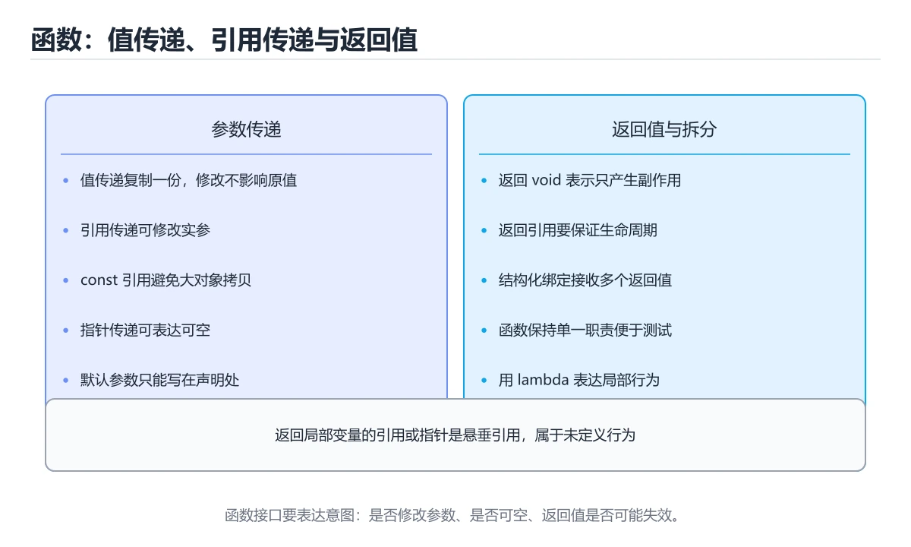
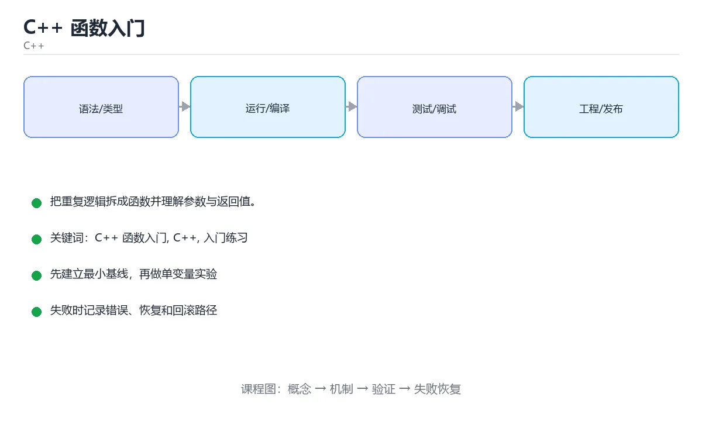

# C++ 函数入门

> 内容更新时间：2026-10-06 · 学习阶段：基础 · 预计用时：30 分钟





## 本节知识框架

前几课你写了所有代码都在 `main` 里。当程序变复杂时，把所有东西堆在一起会变得很难维护。这一课我们学习把重复逻辑拆成**函数**——就像把菜谱里的"做酱汁"单独写成一张卡片，需要时拿出来用。

学完这一课，你会：
- 理解函数声明和定义的区别
- 会写带参数和返回值的函数
- 知道 `void` 表示函数不返回值
- 理解值传递和引用传递的差异
- 了解函数重载的基本概念

**先修与衔接**：先修《C++ 循环入门》。函数会把循环里的重复逻辑提取出来。

### 复习清单

- [ ] 能定义一个带参数和返回值的函数并调用它
- [ ] 能解释值传递和引用传递的区别
- [ ] 能说明 `void` 的含义和使用场景

## 核心概念定义

| 术语 | 一句话说明 |
| --- | --- |
| 函数声明与定义 | 声明给出签名供调用方使用，定义提供函数体。声明像目录，定义像正文。 |
| 参数与返回值 | 参数是输入，返回值是输出，类型都要显式写出。 |
| void | 表示函数不返回任何值。用于"只做事情，不给结果"的函数。 |
| 值传递与引用传递 | 值传递复制实参，引用传递直接操作原对象，用 `&` 声明。 |
| 函数重载 | 同名函数通过参数列表不同来区分，编译器按实参选择。 |
| 头文件 | 头文件通常放声明，源文件放定义；`#include` 在预处理阶段展开。 |

## 原理与运行机制

### 函数就像一台自动售货机

你投币（传入参数），按下按钮（调用函数），机器给你一瓶饮料（返回值）。你不需要知道机器内部怎么工作的——这就是函数的核心思想：**封装**。

```cpp
int square(int n) {
    return n * n;
}
```

这个函数接收一个整数 `n`，返回 `n` 的平方。调用方式：

```cpp
int result = square(7);  // result = 49
std::cout << "square(7)=" << result << "\n";
```

### 声明与定义分离

```cpp
// 声明（放在头文件里）
int add(int a, int b);

// 定义（放在源文件里）
int add(int a, int b) {
    return a + b;
}
```

声明告诉编译器"有这么一个函数，参数是什么类型，返回什么类型"；定义提供函数的具体实现。分离的好处是：头文件里只需要声明，多个源文件都能调用，最后由链接器合并。

### 值传递：给你一份副本

```cpp
void increment(int x) {
    x = x + 1;  // 只修改了副本
}

int main() {
    int a = 10;
    increment(a);
    std::cout << a;  // 输出 10，a 没有被改变
}
```

值传递时，函数拿到的是实参的**副本**。修改副本不会影响原来的变量。就像你把文件复印一份给别人，别人在复印件上涂改，你的原件不受影响。

### 引用传递：直接操作原件

```cpp
void increment(int& x) {
    x = x + 1;  // 直接修改原件
}

int main() {
    int a = 10;
    increment(a);
    std::cout << a;  // 输出 11，a 被改变了
}
```

引用传递时，函数里的 `x` 就是 `a` 的别名。修改 `x` 就是修改 `a`。对于大对象（比如很长的字符串），引用传递避免了复制的开销。

### const 引用：只读不复制

```cpp
void print(const std::string& s) {
    std::cout << s << "\n";  // 只能读，不能改
}
```

`const std::string&` 表示"给我一个字符串的引用，但我保证不修改它"。这是 C++ 中最常用的参数传递方式——既避免了复制，又保证了安全。

### 函数重载

```cpp
int add(int a, int b) { return a + b; }
double add(double a, double b) { return a + b; }
int add(int a, int b, int c) { return a + b + c; }
```

同名函数可以有多个版本，只要参数列表（类型或数量）不同。编译器根据你传入的实参自动选择匹配的版本。

## 典型应用场景

函数是代码复用的基础：

- **数学计算**：把公式封装成函数，如 `double area(double r) { return 3.14159 * r * r; }`
- **数据处理**：读取、清洗、转换数据各用一个函数
- **输入验证**：检查用户输入是否合法，不合法就要求重新输入
- **游戏逻辑**：移动角色、检测碰撞、计算分数各拆成函数
- **代码组织**：把 `main` 里的长代码拆成几个有名字的小函数，可读性大增

### 一个实际的小例子

```cpp
#include <iostream>

int square(int n) { return n * n; }

int main() {
    std::cout << "square(7)=" << square(7) << "\n";
    return 0;
}
```

输出：`square(7)=49`

## 代码/协议/SQL 示例

### 最小可运行示例

```cpp
#include <iostream>

int square(int n) { return n * n; }

int main() {
    std::cout << "square(7)=" << square(7) << "\n";
    return 0;
}
```

输出：

```text
square(7)=49
```

### 完整示例：温度转换

```cpp
#include <iostream>

double celsiusToFahrenheit(double c) {
    return c * 9.0 / 5.0 + 32.0;
}

void printConversion(double c) {
    std::cout << c << "°C = " << celsiusToFahrenheit(c) << "°F\n";
}

int main() {
    printConversion(0);
    printConversion(100);
    printConversion(37);
    return 0;
}
```

逐行解释：

- `celsiusToFahrenheit`：接收一个 `double` 参数，返回转换后的华氏温度。
- `printConversion`：返回类型是 `void`，表示不返回值，只做打印。
- `main` 调用 `printConversion` 三次，每次传入不同的摄氏温度。

### 动手练一练

- 写一个 `max(int a, int b)` 函数，返回两个数中较大的那个
- 写一个 `isEven(int n)` 函数，返回 `bool` 表示 n 是否为偶数
- 把值传递改成引用传递，观察结果的变化

### 本课速查卡

| 复习项 | 本课要点 |
| --- | --- |
| 核心结论 | 函数把重复逻辑封装成有名操作，参数是输入，返回值是输出 |
| 最少要写的代码 | `int f(int x) { return x * 2; }` |
| 最常见的错误 | 按值传递大对象导致性能下降 |
| 出错先查什么 | 检查参数类型、返回值类型、是否漏写 return |

## 时间/空间复杂度或性能分析

函数调用本身的开销很小（通常只是一次跳转），但参数的传递方式会影响性能：

- **值传递**：每次调用都复制一份参数。对于 `int`、`double` 等小类型没问题，但对于 `std::string`、`std::vector` 等大对象，复制开销明显
- **const 引用传递**：不复制，只传一个引用（本质是指针），开销极小
- **返回值优化（RVO）**：编译器通常会优化掉返回临时对象的复制

原则：**只读参数用 `const &`，需要修改用 `&`，小类型用值传递。**

## 常见误区与易错点

| 容易犯的错误 | 会出现什么 | 怎么修 |
| --- | --- | --- |
| 按值传递大对象 | 每次调用都复制，性能明显下降 | 只读参数用 const 引用，需要拷贝时再按值传递 |
| 忘记写 return | 函数返回值未定义，结果不可预测 | 非 void 函数每条路径都要有 return |
| 声明和定义参数名不一致 | 不影响编译但容易混淆 | 声明和定义用相同的参数名 |
| 在头文件里写函数定义 | 多个源文件包含时链接报重复定义 | 头文件只放声明，定义放 .cpp 文件 |
| 混淆重载和默认参数 | 调用时出现歧义 | 重载靠参数类型/数量区分，默认参数从右往左设置 |

### 现场 1：按值传递大对象

**症状**：程序运行变慢，尤其是循环中频繁调用时。

**根因与修复**：只读参数用 const 引用，需要拷贝时再按值传递。

## 与其他知识点的关系

- **先修课**：《C++ 循环入门》——函数最常封装的就是重复出现的循环逻辑。
- **后续课**：《指针与引用》——本课的引用传递只要求会写 `&`，那一课才解释别名与地址的差别；《类与面向对象》把一组相关函数绑回数据身上。
- **相关概念**：《编译与程序运行原理》与《链接与加载》——声明与定义分离是链接期符号解析的前提，重复定义与缺失定义都在这一阶段暴露出来。
- **相关概念**：重载决议按实参类型挑选候选函数，因此 `int` 与 `long` 的同名函数可以共存；`void` 返回值意味着调用点不能把结果放进表达式。
- **动手延伸**：只读参数用 `const` 引用、需要拷贝才按值传递这条规则，到《内存管理与智能指针》会更精确；多文件拆分后的编译与链接在《实战：CMake 多文件项目》里落地。

## 自测题与参考答案

### 自测 1

写一个函数 `double average(double a, double b)` 返回两个数的平均值。

**参考答案**：`double average(double a, double b) { return (a + b) / 2.0; }`

### 自测 2

解释为什么 `void` 函数不需要 `return` 语句（但也可以写 `return;`）。

**参考答案**：`void` 表示不返回值。`return;` 可以提前退出函数，但不携带任何值。

## 术语速查

| 术语 | 一句话说明 |
| --- | --- |
| `函数声明与定义` | 声明给出签名供调用方使用，定义提供函数体。 |
| `参数与返回值` | 参数是输入，返回值是输出，类型都要显式写出。 |
| `void` | 表示函数不返回任何值。 |
| `值传递与引用传递` | 值传递复制实参，引用传递直接操作原对象。 |
| `函数重载` | 同名函数通过参数列表不同来区分。 |
| `const 引用` | 只读引用，避免复制又禁止修改。 |

## 考点精讲

本课题库共 5 道题，下面逐题给出题干、正确项与判断依据。

### 考点 1

- **题目**：围绕“C++ 函数入门”中的 C++ 函数入门、C++、入门练习，下列哪两项是本课强调的实践判断？
- **选项**：验证 C++ 时要固定版本并覆盖边界输入，结论才可复现 / 把 C++ 的单次运行结果当成所有版本和规模都成立 / 学习 C++ 函数入门 时要同时说明输入、输出和失败路径，不能只看正常流程 / 只要 C++ 函数入门 的常规示例通过，就可以跳过边界与异常路径
- **正确项**：验证 C++ 时要固定版本并覆盖边界输入，结论才可复现；学习 C++ 函数入门 时要同时说明输入、输出和失败路径，不能只看正常流程
- **判断依据**：本题正确项是验证 C++ 时要固定版本并覆盖边界输入，结论才可复现。术语 函数声明与定义（C++ 函数入门）：声明给出签名供调用方使用，定义提供函数体，本题取验证 C++ 时要固定版本并覆盖边界输入，结论才可复现这条。易错点是按值传递大对象会造成每次调用都复制，性能明显下降，改法是只读参数用 const 引用，需要拷贝时再按值传递，干扰项把 C++ 的单次运行结果当成所有版本和规模都成立正踩在这条上。

### 考点 2

- **题目**：C++ 中按值传递参数的特点是？
- **选项**：函数拿到实参的副本，修改形参不影响调用方变量 / 参数在传递时会被自动转换为指针类型 / 函数直接操作调用方变量，修改会立即生效 / 函数只能接收常量，不能接收变量作为参数
- **正确项**：函数拿到实参的副本，修改形参不影响调用方变量
- **判断依据**：本题正确项是函数拿到实参的副本，修改形参不影响调用方变量。术语 函数声明与定义（C++ 函数入门）：声明给出签名供调用方使用，定义提供函数体，本题取函数拿到实参的副本，修改形参不影响调用方变量这条。易错点是按值传递大对象会造成每次调用都复制，性能明显下降，改法是只读参数用 const 引用，需要拷贝时再按值传递，干扰项参数在传递时会被自动转换为指针类型正踩在这条上。

### 考点 3

- **题目**：阅读 `C++ 函数入门` 的 `函数声明与定义` 示例。它服务于把重复逻辑拆成函数并理解参数与返回值。代码中实际包含下列哪一项？
- **代码**：`int square(int n) { return n * n; }` 然后 `std::cout << "square(7)=" << square(7) << "\n";`
- **选项**：出现字面量 `square(7)=` / 出现字面量 `2026-10-02T08:12:33Z` / 出现字面量 `description` / 出现字面量 `三级读取：本地缓存、分布式缓存、数据库回填。`
- **正确项**：出现字面量 `square(7)=`
- **判断依据**：本题正确项是出现字面量 `square(7)=`。术语 函数声明与定义（C++ 函数入门）：声明给出签名供调用方使用，定义提供函数体，本题取出现字面量 `square(7)=`这条。易错点是按值传递大对象会造成每次调用都复制，性能明显下降，改法是只读参数用 const 引用，需要拷贝时再按值传递，干扰项出现字面量 `2026-10-02T08:12:33Z`正踩在这条上。

### 考点 4

- **题目**：示例中 square(7) 的调用结果是？
- **选项**：编译错误，因为函数名与变量名冲突，但这会牺牲可复现性 / 7，函数返回的是传入的参数本身 / 14，函数把参数与自身相加后返回 / 49，函数把参数相乘后通过 return 交回结果
- **正确项**：49，函数把参数相乘后通过 return 交回结果
- **判断依据**：本题正确项是49，函数把参数相乘后通过 return 交回结果。术语 函数声明与定义（C++ 函数入门）：声明给出签名供调用方使用，定义提供函数体，本题取49，函数把参数相乘后通过 return 交回结果这条。易错点是按值传递大对象会造成每次调用都复制，性能明显下降，改法是只读参数用 const 引用，需要拷贝时再按值传递，干扰项编译错误，因为函数名与变量名冲突，但这会牺牲可复现性正踩在这条上。

### 考点 5

- **题目**：填空：补齐下面这段术语说明中的空缺。课程 `把重复逻辑拆成函数并理解参数与返回值。`，这段说明是：`____`：表示函数不返回任何值。空缺处应填哪个术语？
- **正确项**：void
- **判断依据**：《C++ 函数入门》这题的填空口径是「void」，正文写法与其中任一项一致即可。术语「参数与返回值」在本课里的界定是参数是输入，返回值是输出，类型都要显式写出，题干「填空：补齐下面这段术语说明中的空缺，课程 `把重复逻辑拆成函数并理解」问的就是这一条。常见错法是按值传递大对象，其后果是每次调用都复制，性能明显下降。正确做法是只读参数用 const 引用，需要拷贝时再按值传递。

## 内容元数据

- 内容版本：v2.0
- 最后更新：2026-10-06
- 学习阶段：基础
- 适用环境：C++17 / GCC 13+ 或 Clang 17+
- 内容来源：内置结构化课程与工程实践整理
- 相关主题：C++ 函数入门、C++、入门练习

## 参考资料与复核

- [本课资料锚点 cpp_functions_intro](https://zh.wikipedia.org/w/index.php?search=cpp_functions_intro)

- 最后复核：2026-10-04
- 下次复核：2027-05-10
- 复核范围：函数语义、参数传递方式、重载规则

| 参考资料 | 本课用途 |
| --- | --- |
| [cppreference - Functions](https://en.cppreference.com/w/cpp/language/functions) | C++ 函数语义详解 |
| [Learn C++ - Functions](https://www.learncpp.com/cpp-tutorial/function-basics/) | 函数入门教程 |
| [cplusplus.com - Functions](https://cplusplus.com/doc/tutorial/functions/) | 函数定义与调用 |
