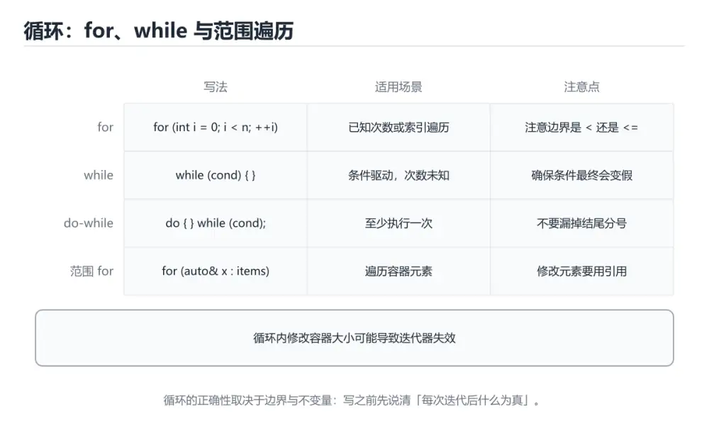
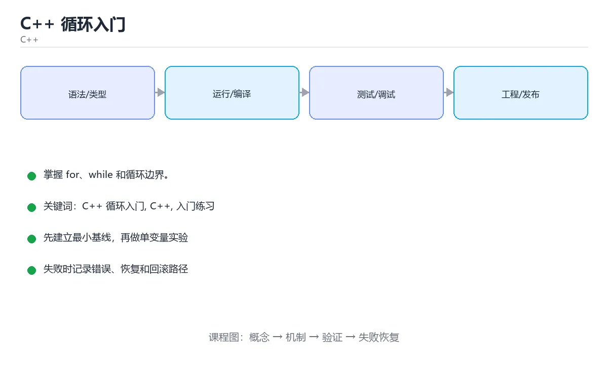

# C++ 循环入门

> 内容更新时间：2026-10-06 · 学习阶段：入门 · 预计用时：40 分钟





## 本节知识框架

上一课你学会了让程序做选择。这一课我们要让程序"重复做事"——就像你每天刷牙，不需要每天决定是否要刷。

学完这一课，你会：
- 掌握 `for` 循环的写法：初始化、条件、更新写在一行
- 掌握 `while` 循环：条件为真就继续执行
- 了解 `do-while`：先执行一次再判断
- 会用 `break` 提前退出循环、`continue` 跳过本轮
- 知道循环变量只在循环内可见

**先修与衔接**：先修《C++ 条件判断》。下一课：《C++ 函数入门》。

### 复习清单

- [ ] 能用 `for` 循环输出 1 到 10
- [ ] 能区分 `while` 和 `do-while` 的行为差异
- [ ] 能解释 `break` 和 `continue` 的区别

## 核心概念定义

| 术语 | 一句话说明 |
| --- | --- |
| for 循环 | 把初始化、条件、更新写在一行，适合次数确定的循环。 |
| while 循环 | 条件为真就执行，适合次数由运行情况决定的循环。 |
| do-while | 先执行一次再判断条件，循环体至少执行一次。 |
| break 与 continue | `break` 结束整个循环，`continue` 跳过本轮剩余语句。 |
| 循环变量作用域 | 在 `for` 的括号里声明的变量只在循环内可见。 |
| 无限循环 | 条件永远为真的循环，必须用 `break` 或外部条件退出。 |

## 原理与运行机制

### for 循环：计数器式重复

```cpp
for (int i = 0; i < 5; ++i) {
    std::cout << i << " ";
}
// 输出：0 1 2 3 4
```

`for` 循环把三件事写在一行：
1. **初始化** `int i = 0`：循环开始前做一次
2. **条件** `i < 5`：每轮开始前检查，为假就停
3. **更新** `++i`：每轮结束后做一次

把它想象成跑步训练：先站到起跑线（初始化），每跑一圈看是否到了 5 圈（条件），跑完一圈就计数器加 1（更新）。

### while 循环：条件式重复

```cpp
int n = 100;
while (n > 1) {
    if (n % 2 == 0) n = n / 2;
    else n = 3 * n + 1;
    std::cout << n << " ";
}
```

`while` 只关心条件：条件为真就执行循环体，条件为假就退出。适合"不知道要循环多少次，但知道什么时候该停"的场景。

### do-while：至少执行一次

```cpp
int choice;
do {
    std::cout << "请输入 1-3：";
    std::cin >> choice;
} while (choice < 1 || choice > 3);
```

`do-while` 先执行循环体，再检查条件。这意味着循环体**至少执行一次**。适合"先做一次，不满意就重来"的场景，比如菜单选择。

### break 与 continue

```cpp
for (int i = 0; i < 10; ++i) {
    if (i == 5) break;       // i 到 5 就彻底退出循环
    if (i % 2 == 0) continue; // 偶数就跳过本轮剩余代码
    std::cout << i << " ";
}
// 输出：1 3
```

- `break`：立刻结束整个循环，跳到循环后面的代码
- `continue`：跳过本轮循环体剩余的代码，直接进入下一轮

### ++i 与 i++

```cpp
for (int i = 0; i < 3; ++i) {
    std::cout << i;
}
// 输出：012
```

在 `for` 循环的更新表达式里，`++i` 和 `i++` 效果完全相同——都让 `i` 加 1。它们的区别只在作为表达式使用时才体现（`++i` 先加后用，`i++` 先用后加），但作为独立的更新语句没有差别。

## 典型应用场景

循环是编程中最常用的结构之一：

- **遍历数据**：逐个处理数组或列表中的每个元素
- **累加计算**：求 1+2+...+100 的和
- **重复提示**：直到用户输入合法值为止
- **搜索**：在一堆数据中查找目标
- **模拟**：重复执行某个过程直到收敛

### 一个实际的小例子

```cpp
#include <iostream>

int main() {
    int sum = 0;
    for (int i = 1; i <= 100; ++i) {
        sum += i;
    }
    std::cout << "1 到 100 的和是：" << sum << "\n";
    return 0;
}
```

输出：`1 到 100 的和是：5050`

## 代码/协议/SQL 示例

### 最小可运行示例

```cpp
#include <iostream>

int main() {
    for (int i = 0; i < 3; ++i) {
        std::cout << i;
    }
    return 0;
}
```

输出：

```text
012
```

### 完整示例：九九乘法表

```cpp
#include <iostream>

int main() {
    for (int i = 1; i <= 9; ++i) {
        for (int j = 1; j <= i; ++j) {
            std::cout << j << "x" << i << "=" << i * j << "\t";
        }
        std::cout << "\n";
    }
    return 0;
}
```

### 动手练一练

- 用 `for` 循环输出 1 到 100 中所有偶数
- 用 `while` 循环实现：不断读取输入，直到用户输入 0 为止
- 用 `do-while` 实现：要求用户输入一个正数，输入不对就重新提示

### 本课速查卡

| 复习项 | 本课要点 |
| --- | --- |
| 核心结论 | `for` 适合次数确定的循环，`while` 适合条件驱动的循环 |
| 最少要写的代码 | `for (int i = 0; i < n; ++i) { ... }` |
| 最常见的错误 | 边界差一（off-by-one）；无符号数反向遍历 |
| 出错先查什么 | 检查循环条件和更新表达式 |

## 时间/空间复杂度或性能分析

循环是时间复杂度的主要来源：

- 一层 `for` 循环从 0 到 n：O(n)
- 两层嵌套循环：O(n^2)
- 循环体内有常数操作：不改变量级

注意：循环次数很多时（百万级以上），循环体内的操作效率就变得重要。避免在循环内做不必要的内存分配或函数调用。

## 常见误区与易错点

| 容易犯的错误 | 会出现什么 | 怎么修 |
| --- | --- | --- |
| 边界差一（off-by-one） | 少循环一次或多循环一次 | 仔细检查 `<=` 还是 `<` |
| 用无符号数反向遍历 | 减到 0 后回绕成很大的数，循环不结束 | 用带符号下标，或先判断再自减 |
| 循环里修改容器大小 | 迭代器失效，程序崩溃 | 不要在范围 for 里增删元素 |
| `continue` 与 `break` 混用 | 逻辑混乱，循环提前结束 | `break` 跳出整体，`continue` 只跳本轮 |
| 忘记更新循环变量 | 无限循环 | 确认 `for` 的第三个表达式或 `while` 体内有更新 |

### 现场 1：用无符号数反向遍历

**症状**：循环不结束，或者访问了越界的下标。

**根因与修复**：无符号数减到 0 后再减 1 会回绕成最大值。用带符号下标，或先判断再自减。

## 与其他知识点的关系

### 概念复述

- 用一句话说明 for 和 while 的区别：for 适合次数确定，while 适合条件驱动。
- 说出 do-while 和 while 的行为差异：do-while 至少执行一次。
- 解释 break 和 continue 的区别。

### 迁移练习

- **下一课**：《C++ 函数入门》会把循环里的重复逻辑拆成函数。
- **术语归属**：`for 循环`、`while 循环`、`do-while` 的定义以本课为准。

### 容易混淆的相邻概念

- `for` vs `while`：for 把初始化、条件、更新写在一起更紧凑。
- `break` vs `continue`：break 退出整个循环，continue 只跳过本轮。

## 自测题与参考答案

### 自测 1

写一个 `for` 循环计算 1! + 2! + ... + 5!。

**参考答案**：用嵌套循环，外层遍历 1 到 5，内层计算阶乘，累加到总和。

### 自测 2

解释 `for (int i = 0; i < 3; ++i)` 中 `++i` 和 `i++` 的区别。

**参考答案**：作为独立的更新表达式时效果相同，都让 `i` 加 1。

## 术语速查

| 术语 | 一句话说明 |
| --- | --- |
| `for 循环` | 把初始化、条件、更新写在一行，适合次数确定的循环。 |
| `while 循环` | 条件为真就执行，适合次数由运行情况决定的循环。 |
| `do-while` | 先执行一次再判断条件，循环体至少执行一次。 |
| `break 与 continue` | `break` 结束整个循环，`continue` 跳过本轮剩余语句。 |
| `循环变量作用域` | 在 `for` 的括号里声明的变量只在循环内可见。 |
| `无限循环` | 条件永远为真，必须用 `break` 退出。 |

## 考点精讲

本课题库共 5 道题，下面逐题给出题干、正确项与判断依据。

### 考点 1

- **题目**：围绕“C++ 循环入门”中的 C++ 循环入门、C++、入门练习，下列哪两项是本课强调的实践判断？
- **选项**：只要 C++ 循环入门 的常规示例通过，就可以跳过边界与异常路径 / 验证 C++ 时要固定版本并覆盖边界输入，结论才可复现 / 把 C++ 的单次运行结果当成所有版本和规模都成立 / 学习 C++ 循环入门 时要同时说明输入、输出和失败路径，不能只看正常流程
- **正确项**：验证 C++ 时要固定版本并覆盖边界输入，结论才可复现；学习 C++ 循环入门 时要同时说明输入、输出和失败路径，不能只看正常流程
- **判断依据**：循环的边界（0 次、1 次、最大次数）是最容易出错的地方。

### 考点 2

- **题目**：在本课的 for 循环里，++i 与 i++ 有什么区别？
- **选项**：++i 会把 i 减一，i++ 才会把 i 加一 / 作为独立的更新表达式时效果相同，都让 i 加一 / i++ 在循环中不会生效，必须写成 ++i / 两者都会让循环跳过一轮迭代
- **正确项**：作为独立的更新表达式时效果相同，都让 i 加一
- **判断依据**：在 `for` 循环的更新表达式位置，`++i` 和 `i++` 作为独立语句效果完全相同。

### 考点 3

- **题目**：按“C++ 循环入门”中 C++ 循环入门、C++、入门练习 的实践顺序，把四个步骤排成从准备到复盘的合理顺序。
- **选项**：只改一个变量，记录边界与失败路径的变化 / 固定版本与证据，把“C++ 循环入门”的结论写成可复现记录 / 先明确 C++ 循环入门 的输入、输出与约束 / 写出最小示例并核对 C++ 的基线结果
- **正确顺序**：先明确 C++ 循环入门 的输入、输出与约束 → 写出最小示例并核对 C++ 的基线结果 → 只改一个变量，记录边界与失败路径的变化 → 固定版本与证据，把“C++ 循环入门”的结论写成可复现记录
- **判断依据**：科学验证的顺序是：明确目标 → 建立基线 → 单变量实验 → 记录结论。

### 考点 4

- **题目**：阅读下面的 C++ 代码，输出是什么？
- **代码**：`for (int i = 0; i < 3; ++i) { std::cout << i; }`
- **选项**：012 / 123 / 0 1 2 分三行 / 不确定
- **正确项**：012
- **判断依据**：`i` 从 0 开始，每轮输出 `i` 然后加 1，到 `i < 3` 为假时停止。输出 0、1、2 连在一起。

### 考点 5

- **题目**：填空：补齐下面这段术语说明中的空缺。课程 `掌握 for、while 和循环边界。`，这段说明是：`____`：先执行一次再判断条件，循环体至少执行一次。空缺处应填哪个术语？
- **正确项**：do-while
- **判断依据**：`do-while` 循环先执行循环体再检查条件，保证循环体至少执行一次。

## 内容元数据

- 内容版本：v2.0
- 最后更新：2026-10-06
- 学习阶段：入门
- 适用环境：C++17 / GCC 13+ 或 Clang 17+
- 内容来源：内置结构化课程与工程实践整理
- 相关主题：C++ 循环入门、C++、入门练习

## 参考资料与复核

- 最后复核：2026-10-04
- 下次复核：2027-05-10
- 复核范围：循环语义、边界条件、迭代器失效规则

| 参考资料 | 本课用途 |
| --- | --- |
| [cppreference - for loop](https://en.cppreference.com/w/cpp/language/for) | for 循环语义详解 |
| [Learn C++ - Loops](https://www.learncpp.com/cpp-tutorial/for-loops/) | 循环入门教程 |
| [cplusplus.com - Control Flow](https://cplusplus.com/doc/tutorial/control/) | 循环与跳转语句 |
