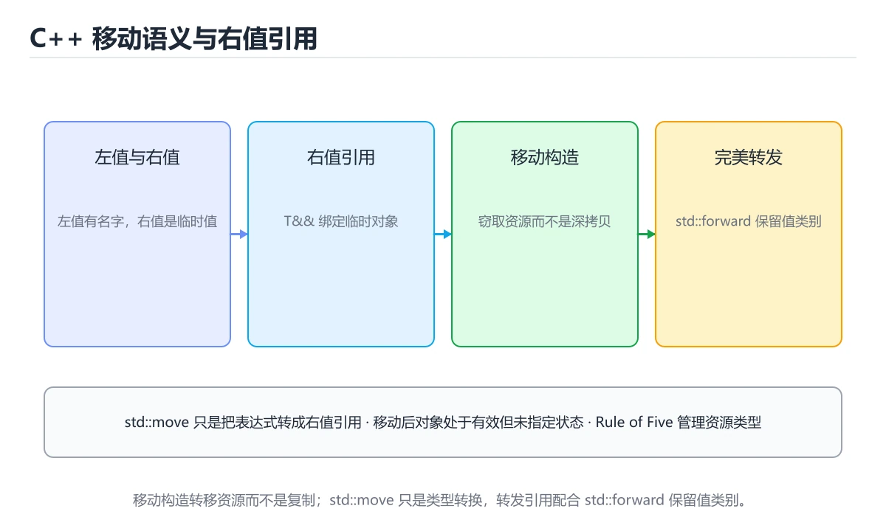

# C++ 移动语义与右值引用

> 内容更新时间：2026-10-06 · 学习阶段：高级 · 预计用时：35 分钟




## 本节知识框架

想象你要搬家。传统做法（拷贝）是把旧房子里所有东西复制一份到新房子——家具、衣服、书，全部复印一份。移动做法呢？直接把东西搬过去，旧房子空了就行。

C++ 的移动语义就是这第二种做法。当一个临时对象即将销毁时，我们不需要「复制」它的资源，而是直接「偷走」——把指针、缓冲区、文件句柄等昂贵资源的所有权转移出去，旧对象变成一个空壳。

本课是 C++ 性能优化的关键一课。你会学到：什么是左值和右值、`std::move` 到底做了什么、完美转发怎么保持参数的「身份」，以及编译器怎么帮你省掉不必要的拷贝（RVO）。

**学完本课你会掌握：**
- 区分左值和右值，理解移动语义解决什么问题
- 知道 `std::move` 只是类型转换，真正移动取决于类型是否实现了移动构造
- 用万能引用和 `std::forward` 实现完美转发
- 理解 RVO（返回值优化）如何让编译器帮你省掉拷贝

**先修知识：** 《实战：C++ 任务数据库 CLI》里的 RAII 和资源管理是本课的前提。后续课程《C++ Concepts 与 Ranges》会用到模板约束。

### 复习清单

- [ ] 能解释 `std::move` 做了什么、没做什么，并说出移动后对象的状态
- [ ] 能写出一个移动构造函数，并解释为什么需要 `noexcept`
- [ ] 能区分完美转发和移动的区别，并说出悬垂引用的风险

## 核心概念定义

| 术语 | 一句话说明 |
| --- | --- |
| `移动语义` | 把资源所有权从临时对象转移出去，避免不必要的深拷贝。 |
| `右值引用` | C++ 绑定临时对象或可移动资源的引用类型（`T&&`），用于实现移动语义。 |
| `完美转发` | C++ 在转发参数时保持原值类别，使左值和右值语义不被破坏。 |
| `RVO` | 返回值优化：编译器直接在调用方内存里构造返回对象，省掉一次拷贝或移动。 |

## 原理与运行机制

### 先建立一个直觉

在 C++11 之前，每次函数返回一个对象，都要经历一次拷贝：

```cpp
std::vector<int> create_vector() {
    std::vector<int> v = {1, 2, 3, 4, 5};
    return v;  // 拷贝整个 vector？
}
```

好消息是，编译器通常会做 RVO（返回值优化），直接在调用方的内存里构造 `v`，省掉拷贝。但如果 RVO 不适用呢？比如你有多个返回路径，或者返回的是一个函数参数——这时候就需要移动语义了。

### 1. 左值 vs 右值

左值是有名字的、能取地址的东西——变量、数组元素、解引用的指针。右值是没有名字的临时东西——字面量、函数返回的临时值、表达式结果。

```cpp
int x = 10;       // x 是左值，10 是右值
int y = x + 5;    // x + 5 的结果是右值（临时值）
std::string s = std::string("hello");  // string("hello") 是右值
```

移动语义的关键洞察：右值（临时对象）马上就要被销毁了，与其销毁它再创建一个新的，不如直接把它的资源「偷」过来。

### 2. std::move 只是类型转换

`std::move` 本身不做任何运行期操作——它只是把一个左值「转换」为右值引用，告诉编译器：「这个对象我不需要了，你可以偷它的资源。」

```cpp
#include <iostream>
#include <string>
#include <utility>

int main() {
    std::string source = "payload";
    std::string target = std::move(source);
    std::cout << "target=" << target << "\n";
    // source 现在处于「有效但未指定」状态
    return 0;
}
```

```text
target=payload
```

这段代码验证了移动语义的核心行为：`target` 获取了 `source` 的字符串内容。但 `std::move` 只是类型转换——是否真正移动取决于 `std::string` 是否实现了移动构造函数。如果类型没有移动构造，`std::move` 会退化为拷贝。

### 3. 移动构造函数

```cpp
class Buffer {
    int* data_;
    size_t size_;
public:
    // 移动构造：窃取资源
    Buffer(Buffer&& other) noexcept
        : data_(other.data_), size_(other.size_) {
        other.data_ = nullptr;  // 让旧对象变成空壳
        other.size_ = 0;
    }
    // 移动赋值
    Buffer& operator=(Buffer&& other) noexcept {
        if (this != &other) {
            delete[] data_;
            data_ = other.data_;
            size_ = other.size_;
            other.data_ = nullptr;
            other.size_ = 0;
        }
        return *this;
    }
};
```

注意 `noexcept`！这很重要。如果移动构造可能抛异常，`std::vector` 在扩容时会退回到拷贝而不是移动——因为它需要保证强异常安全。所以移动构造没有标记不抛异常会导致容器扩容退回复制而不是移动。

### 4. 完美转发

完美转发解决的问题：你写了一个包装函数，想把参数原封不动地传给另一个函数，同时保持参数是左值还是右值的「身份」。

```cpp
template <typename T>
void wrapper(T&& arg) {
    // std::forward 保持 arg 的值类别
    target(std::forward<T>(arg));
}
```

`T&&` 是万能引用（universal reference）——它既能绑定左值也能绑定右值。`std::forward<T>` 根据 `T` 的实际类型决定转发为左值还是右值。完美转发用万能引用和 forward 保持参数值类别，但要避免悬垂引用——如果转发的是一个临时对象的引用，而你在函数返回后还持有这个引用，就会访问已销毁的对象。

### 5. RVO（返回值优化）

RVO：返回值优化：编译器直接在调用方内存里构造返回对象，省掉一次拷贝或移动。

```cpp
std::string make_greeting() {
    return std::string("hello");  // RVO：直接在调用方构造
}

auto s = make_greeting();  // 没有拷贝，没有移动
```

C++17 起，RVO 在某些场景下是强制的（copy elision）。但编译器仍然可能在不满足条件的场景做可选的 RVO。

## 典型应用场景

### 场景一：大对象传递

```cpp
void process(std::vector<int> data);  // 拷贝整个 vector

void process(std::vector<int>&& data);  // 移动，零拷贝
process(std::vector<int>{1, 2, 3});  // 临时对象，自动移动
```

对于大对象（vector、string、map），移动的性能优势巨大——从 O(n) 降到 O(1)。但对于小对象（int、double），移动和拷贝没有区别。这就是为什么以为移动一定比拷贝快是一个误区——小对象或无法窃取资源时没有收益。

### 场景二：容器扩容

`std::vector` 扩容时需要把元素从旧数组搬到新数组。如果元素类型有 `noexcept` 的移动构造，vector 用移动（O(1) 每个元素）；否则退回到拷贝（为了异常安全）。

### 场景三：工厂函数

```cpp
std::unique_ptr<Widget> create_widget() {
    return std::make_unique<Widget>();  // 移动 unique_ptr
}
```

`unique_ptr` 不能拷贝（独占所有权），但可以移动。工厂函数返回 `unique_ptr` 时，移动语义让所有权从函数内部转移到调用方。

## 代码/协议/SQL 示例

### 最小可运行示例

```cpp
#include <iostream>
#include <string>
#include <utility>

int main() {
    std::string source = "payload";
    std::string target = std::move(source);
    std::cout << "target=" << target << "\n";
    return 0;
}
```

```text
target=payload
```

### 移动语义验证实验

```cpp
#include <iostream>
#include <vector>

int main() {
    std::vector<int> a = {1, 2, 3};
    std::cout << "a.data() = " << a.data() << "\n";

    std::vector<int> b = std::move(a);
    std::cout << "b.data() = " << b.data() << "\n";
    std::cout << "a.size() = " << a.size() << "\n";  // 0（被移走了）
    std::cout << "b.size() = " << b.size() << "\n";  // 3

    return 0;
}
```

这段代码展示了移动的核心行为：`b` 获取了 `a` 的内部缓冲区（相同的 `data()` 指针），`a` 变成空壳（`size() == 0`）。

## 时间/空间复杂度或性能分析

**拷贝 vs 移动**：
- `std::string` 拷贝：O(n)，n 是字符串长度
- `std::string` 移动：O(1)，只转移指针
- `std::vector` 拷贝：O(n)，n 是元素数量
- `std::vector` 移动：O(1)，只转移指针

**什么时候移动没有收益**：
- 小对象（int、double、小 struct）：移动和拷贝一样快
- 无法窃取资源的类型：如果类型没有实现移动构造，`std::move` 退化为拷贝
- 按资源规模判断，用基准测试验证

**测量方法**：用 `std::chrono` 测量拷贝和移动的耗时差异，用 `data()` 指针验证是否真正移动了资源。

## 常见误区与易错点

| 容易写错的做法 | 实际现象 | 正确做法 |
| --- | --- | --- |
| 以为移动一定比拷贝快 | 小对象或无法窃取资源时没有收益 | 按资源规模判断，用基准测试验证 |
| 移动后继续使用对象 | 对象处于有效但未指定状态 | 移动后不再依赖其值，需要时重新赋值 |
| 移动构造没有标记不抛异常 | 容器扩容退回复制而不是移动 | 不抛异常的移动操作标注 noexcept |

### 现场排错：移动后继续使用对象

**症状**：移动一个 `std::string` 后，打印它得到空字符串或乱码。

**根因**：移动后，源对象处于「有效但未指定」状态。对于 `std::string`，通常是空字符串，但标准不保证这一点。

**修复**：移动后不再依赖源对象的值。如果还需要使用，重新赋值。

### 现场排错：移动构造没加 noexcept

**症状**：`std::vector<MyClass>` 扩容时特别慢。

**根因**：移动构造函数没有标注 `noexcept`，vector 为了异常安全退回到拷贝。

**修复**：给移动构造和移动赋值都加上 `noexcept`。

## 与其他知识点的关系

- **先修**：《实战：C++ 任务数据库 CLI》。RAII 和资源管理是理解移动语义的前提。
- **后续**：《C++ Concepts 与 Ranges》。Concepts 可以为移动操作添加约束。
- **术语衔接**：《内存管理与智能指针》里的 `unique_ptr` 是移动语义最典型的应用。

### 知识脉络

```text
内存管理与智能指针（RAII、unique_ptr）
    ↓
C++ 移动语义与右值引用（左值右值、std::move、完美转发、RVO）  ← 你在这里
    ↓
C++ Concepts 与 Ranges（模板约束、惰性管道）
```

## 自测题与参考答案

> 先独立作答，再对照参考答案。

### 自测 1：`std::move` 做了什么？

**参考答案**：`std::move` 只是类型转换——把左值转换为右值引用。它不做任何运行期操作。是否真正移动取决于类型是否实现了移动构造函数。如果类型没有移动构造，`std::move` 退化为拷贝。

### 自测 2：移动后的对象处于什么状态？

**参考答案**：有效但未指定状态。对于 `std::string`，通常是空字符串；对于 `std::vector`，通常是空容器。但标准不保证具体状态，所以移动后不应该依赖源对象的值。

### 自测 3：为什么移动构造要加 `noexcept`？

**参考答案**：`std::vector` 扩容时需要搬运元素。如果移动构造可能抛异常，vector 为了保证强异常安全，会退回到拷贝（因为拷贝失败时可以回滚，移动失败时资源已经被破坏）。标注 `noexcept` 告诉 vector：移动不会失败，放心用。

## 考点精讲

本课题库有 6 道题，下面逐题讲解。

### 考点 1

**题目**：`C++ 移动语义与右值引用` 的示例代码用于验证 `移动语义`，其背景是理解左值右值、移动构造、完美转发和返回值优化。代码的真实内容是下面哪一项？

**答案**：出现字面量 `payload`

**讲解**：本课的最小示例是 `std::string source = "payload"; std::string target = std::move(source);`，其中 `"payload"` 是代码中的字面量。这个示例验证了移动语义的核心行为——资源从 source 转移到 target。

### 考点 2

**题目**：在 `C++ 移动语义与右值引用` 里，与 `移动语义` 有关的说法中，哪一项最符合理解左值右值、移动构造、完美转发和返回值优化。？

**答案**：std::move 只是类型转换，是否真正移动取决于类型是否实现移动操作

**讲解**：这是移动语义最关键的认知。`std::move` 本身不做运行期操作，它只是告诉编译器「这个对象可以移动」。真正执行移动的是类型的移动构造函数。如果类型没有实现移动构造，`std::move` 退化为拷贝。

### 考点 3

**题目**：在 `C++ 移动语义与右值引用` 里，与 `移动语义` 有关的说法中，哪一项最符合理解左值右值、移动构造、完美转发和返回值优化。？（C++ 移动语义与右值引用·C++ 第 3 题）

**答案**：完美转发用万能引用和 forward 保持参数值类别

**讲解**：完美转发是移动语义的延伸应用。`T&&`（万能引用）可以绑定左值或右值，`std::forward<T>` 根据实际类型决定转发为左值还是右值，保持参数的「身份」不被破坏。

### 考点 4

- **题目**：围绕“C++ 移动语义与右值引用”中的 移动语义、右值引用、完美转发，下列哪两项是本课强调的实践判断？

**答案**：验证 右值引用 时要固定版本并覆盖边界输入，结论才可复现；学习 移动语义 时要同时说明输入、输出和失败路径，不能只看正常流程

**讲解**：右值引用的行为可能随编译器版本变化（比如 RVO 的强制规则在 C++17 有变化），验证时要固定版本。移动语义的学习不能只看「移动成功」的路径，还要知道移动后源对象的状态、什么时候移动会退化为拷贝。

### 考点 5

**题目**：填空：补齐下面这段术语说明中的空缺。课程 `理解左值右值、移动构造、完美转发和返回值优化。`，这段说明是：`____`：返回值优化：编译器直接在调用方内存里构造返回对象，省掉一次拷贝或移动。空缺处应填哪个术语？

**答案**：RVO

**讲解**：RVO（Return Value Optimization）是编译器优化技术。C++17 起，某些场景下的 copy elision 是强制的，编译器必须在调用方内存里直接构造返回对象。

### 考点 6

**题目**：下面几项都与 `移动语义` 有关，请按 `C++ 移动语义与右值引用` 的正文顺序排列；该课主线是理解左值右值、移动构造、完美转发和返回值优化。

**答案**：核心知识 → 关键流程 → 实践路径 → 常见误区

**讲解**：本课的组织顺序是：先建立核心知识（左值右值、std::move、移动构造），然后讲关键流程（完美转发、RVO），接着是实践路径（大对象传递、容器扩容、工厂函数），最后是常见误区（移动不一定更快、移动后不能用、忘了 noexcept）。


## 延伸阅读

想更直观地理解本课概念？推荐参阅以下图解专题：

- [图解内存布局：栈、堆与引用](visual_memory_layout.md)

## 术语速查

| 术语 | 一句话说明 |
| --- | --- |
| `左值` | 有名字、能取地址的表达式，比如变量名。 |
| `右值` | 临时值，没有名字，即将被销毁，比如字面量和函数返回值。 |
| `std::move` | 类型转换工具，把左值转为右值引用，告诉编译器可以移动资源。 |
| `万能引用` | `T&&` 在模板参数推导中既能绑定左值也能绑定右值。 |
| `noexcept` | 告诉编译器和标准库「这个操作不会抛异常」，影响容器扩容策略。 |

## 内容元数据

- 内容版本：v2.0
- 最后更新：2026-10-06
- 学习阶段：高级
- 适用环境：C++20 / GCC 13+ 或 Clang 17+
- 内容来源：内置结构化课程与工程实践整理
- 相关主题：移动语义、右值引用、完美转发、RVO

## 参考资料与复核

- 最后复核：2026-10-04
- 下次复核：2027-05-10
- 复核范围：移动语义行为、完美转发规则、RVO 标准变化与性能特征
- 来源性质：官方文档、标准或权威教材

| 参考资料 | 本课用途 |
| --- | --- |
| [std::move 参考](https://en.cppreference.com/w/cpp/utility/move) | 移动语义的标准定义与示例 |
| [std::forward 参考](https://en.cppreference.com/w/cpp/utility/forward) | 完美转发的实现细节与值类别规则 |
| [C++ 值类别详解](https://en.cppreference.com/w/cpp/language/value_category) | 左值、右值、纯右值、将亡值的完整分类 |
