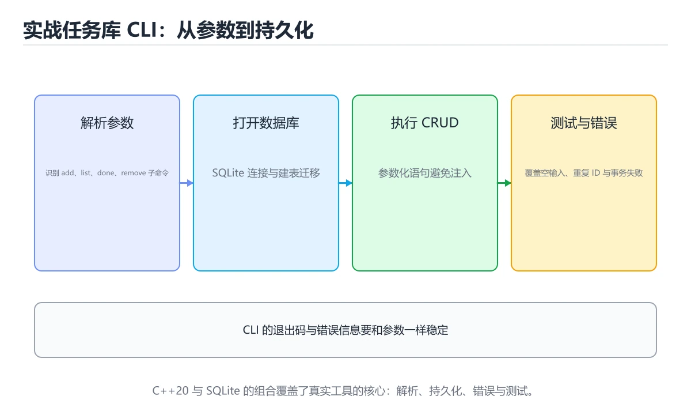
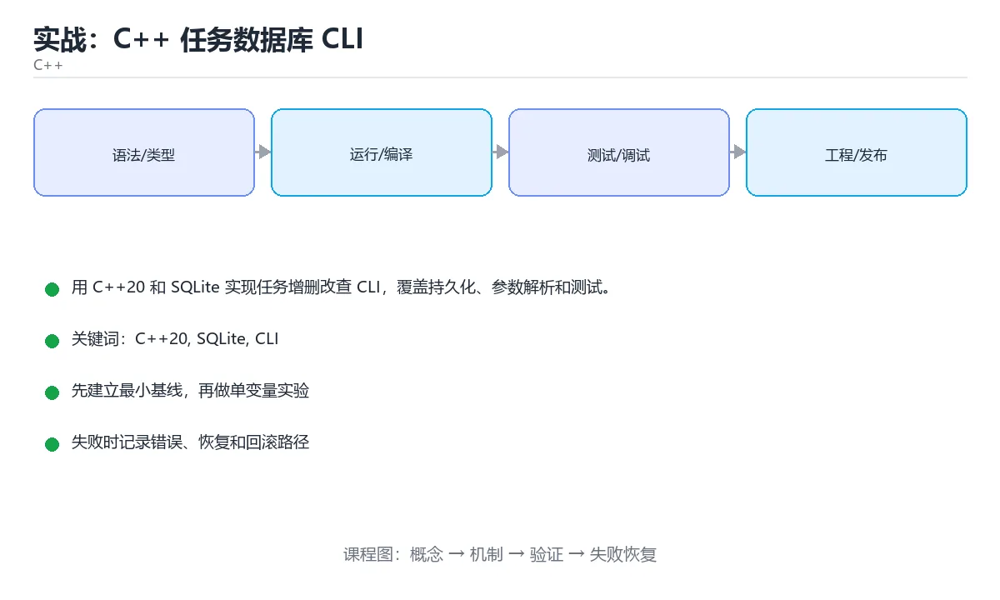

# 实战：C++ 任务数据库 CLI

> 内容更新时间：2026-10-06 · 学习阶段：高级 · 预计用时：70 分钟





## 本节知识框架

上一课你做了一个 HTTP 服务，数据存在内存里——程序一关，数据全没。现在我们要解决一个更实际的问题：把数据持久化到本地文件，程序退出后再打开，数据还在。

想象你是一个图书管理员。HTTP 服务就像在前台接待访客，而数据库是后面的书架——访客走了，书还留在书架上。SQLite 就是一个「单文件数据库」：整个数据库就是一个文件，不需要安装服务器，不需要配置网络，打开就能用。

本课带你用 C++20 和 SQLite 实现一个任务管理命令行工具：添加任务、列出任务、标记完成、删除任务。你会学到怎么安全地管理数据库连接、怎么用参数化 SQL 防止注入、怎么在测试中使用临时数据库。

**学完本课你会掌握：**
- 用 SQLite3 C API 打开、查询和关闭数据库
- 用参数化 SQL（`?` 占位符）代替字符串拼接，防止 SQL 注入
- 用 RAII 包装 `sqlite3*` 句柄，确保连接自动关闭
- 用 CLI11 解析命令行参数和子命令
- 用临时目录做测试数据库，不污染真实数据

**先修知识：** 《实战：C++ HTTP JSON 服务》里的 CMake 构建和单元测试是本课的前提。后续课程《C++ 移动语义与右值引用》会切换到语言特性主题。

### 复习清单

- [ ] 能解释为什么不能用字符串拼接写 SQL，并写出参数化查询的代码
- [ ] 能用 RAII 包装 sqlite3 句柄，确保异常安全
- [ ] 能在测试中使用临时数据库，不污染真实数据

## 核心概念定义

| 术语 | 一句话说明 |
| --- | --- |
| `SQLite` | 单文件嵌入式关系数据库，无需独立服务进程，通过 C API 直接读写，适合本地存储。 |
| `持久化` | 数据写入文件/数据库，程序退出后仍然存在，下次打开可以继续使用。 |
| `CRUD` | Create/Read/Update/Delete 的缩写，数据库操作的四种基本动作。 |
| `参数化 SQL` | 用 `?` 占位符绑定参数而不是拼接字符串，既避免注入也便于数据库复用执行计划。 |
| `退出码` | 进程结束时返回的整数，0 表示成功、非 0 表示失败，脚本与 CI 据此判断结果。 |

## 原理与运行机制

### 技术栈

| 组件 | 角色 | 为什么选它 |
| --- | --- | --- |
| C++20 | 语言标准 | `std::optional`、`std::format` 等现代特性 |
| SQLite3 | 数据库引擎 | 单文件、零配置、嵌入式，最适合本地存储 |
| CMake | 构建系统 | 跨平台，与 vcpkg 集成好 |
| CLI11 | 命令行解析 | 支持子命令、类型安全、自动生成帮助 |
| Catch2 | 测试框架 | 轻量，与 CTest 集成方便 |

### 功能范围

- [ ] `add` 添加任务并返回 ID
- [ ] `list` 支持状态过滤
- [ ] `done` 标记任务完成
- [ ] `remove` 删除任务并确认影响行数

### 第一步：定义数据库 schema

```cpp
#include <sqlite3.h>
#include <iostream>

int main(int argc, char** argv) {
  sqlite3* db = nullptr;
  if (sqlite3_open("tasks.db", &db) != SQLITE_OK) return 2;
  sqlite3_exec(db,
    "CREATE TABLE IF NOT EXISTS tasks("
    "  id INTEGER PRIMARY KEY,"
    "  title TEXT NOT NULL,"
    "  done INTEGER DEFAULT 0"
    ");", nullptr, nullptr, nullptr);
  std::cout << "database ready\n";
  sqlite3_close(db);
}
```

这段代码做了什么？打开（或创建）一个叫 `tasks.db` 的文件，在里面建一张 `tasks` 表。表有三列：`id`（自增主键）、`title`（任务标题，不能为空）、`done`（完成状态，默认 0）。

### 第二步：用 RAII 管理数据库连接

哪个做法最适合管理 sqlite3 句柄？RAII 包装并在析构关闭。

```cpp
class Database {
    sqlite3* db_ = nullptr;
public:
    explicit Database(const std::string& path) {
        if (sqlite3_open(path.c_str(), &db_) != SQLITE_OK) {
            throw std::runtime_error(sqlite3_errmsg(db_));
        }
    }
    ~Database() {
        if (db_) sqlite3_close(db_);
    }
    // 禁止拷贝，防止双重释放
    Database(const Database&) = delete;
    Database& operator=(const Database&) = delete;
    // 允许移动
    Database(Database&& other) noexcept : db_(other.db_) {
        other.db_ = nullptr;
    }
    sqlite3* get() const { return db_; }
};
```

为什么这很重要？如果忘了调用 `sqlite3_close`，文件锁不会释放，下次打开数据库时会报错。RAII 确保无论正常退出还是异常退出，连接都会被关闭。

### 第三步：用参数化 SQL 防注入

任务 ID 明明存在却查询失败，最可能的原因是？SQL 使用字符串拼接导致条件错误或注入风险。

```cpp
// 错误做法：字符串拼接
std::string sql = "SELECT * FROM tasks WHERE id = " + user_input;
// 如果 user_input 是 "1 OR 1=1"，就变成 "SELECT * FROM tasks WHERE id = 1 OR 1=1"
// 这会返回所有任务！

// 正确做法：参数化查询
sqlite3_stmt* stmt = nullptr;
sqlite3_prepare_v2(db, "SELECT * FROM tasks WHERE id = ?", -1, &stmt, nullptr);
sqlite3_bind_int(stmt, 1, task_id);
```

参数化 SQL 的核心思想：SQL 结构和数据值分开传递。数据库引擎先编译 SQL 模板，再把参数填进去。这样即使参数里包含恶意内容，也不会改变 SQL 的语义。

### 第四步：实现 CRUD 命令

```cpp
// 添加任务
int add_task(sqlite3* db, const std::string& title) {
    sqlite3_stmt* stmt = nullptr;
    sqlite3_prepare_v2(db, "INSERT INTO tasks (title) VALUES (?)", -1, &stmt, nullptr);
    sqlite3_bind_text(stmt, 1, title.c_str(), -1, SQLITE_TRANSIENT);
    sqlite3_step(stmt);
    int id = sqlite3_last_insert_rowid(db);
    sqlite3_finalize(stmt);
    return id;
}

// 标记完成
int complete_task(sqlite3* db, int id) {
    sqlite3_stmt* stmt = nullptr;
    sqlite3_prepare_v2(db, "UPDATE tasks SET done = 1 WHERE id = ?", -1, &stmt, nullptr);
    sqlite3_bind_int(stmt, 1, id);
    sqlite3_step(stmt);
    int changes = sqlite3_changes(db);
    sqlite3_finalize(stmt);
    return changes;  // 0 表示没找到任务
}
```

done 命令找不到任务时应该怎么做？返回非零并给出提示。如果 `sqlite3_changes` 返回 0，说明没有匹配的行，CLI 应该输出错误信息并返回非零退出码。

### 第五步：测试数据库应该放在哪里？

测试数据库应该放在哪里？临时目录中的独立文件。

```cpp
// 测试用临时数据库
TEST_CASE("添加任务后能查到", "[db]") {
    Database db(std::tmpnam(nullptr));  // 临时文件
    add_task(db.get(), "写测试");
    auto tasks = list_tasks(db.get());
    REQUIRE(tasks.size() == 1);
    CHECK(tasks[0].title == "写测试");
}
```

为什么不能直接用 `tasks.db`？因为测试会修改数据，如果用的是真实数据库，测试结束后数据就被污染了。临时文件每次测试都是干净的。

### 第六步：退出码与错误处理

```cpp
int main(int argc, char** argv) {
    CLI::App app{"Task Manager"};
    // ... 子命令定义 ...
    try {
        app.parse(argc, argv);
    } catch (const CLI::ParseError& e) {
        return app.exit(e);
    }
    return 0;
}
```

命令失败仍返回 0 会导致 CI 误判成功。正确做法是按错误类型返回稳定退出码：0 = 成功，1 = 参数错误，2 = 数据库错误。

### 项目专属规格

本项目用 C++20 和 SQLite 实现任务增删改查 CLI，覆盖持久化、参数解析和测试。核心关键词：C++20、SQLite、CLI、持久化、CRUD。

验收场景：
1. 正常路径：add → list → done → remove 全流程通过
2. 边界路径：空标题、超长输入、重复 ID 都得到明确处理
3. 失败路径：数据库文件损坏时快速失败并给出提示
4. 幂等路径：done 同一任务两次，第二次返回非零
5. 回滚路径：删除后数据不可恢复，但数据库保持一致

### 项目交付物

建议仓库结构：

```text
src/
  main.cpp
  database.cpp
  commands.cpp
include/
  database.h
  commands.h
tests/
  database_test.cpp
  commands_test.cpp
CMakeLists.txt
```

### 验证命令与预期输出

| 阶段 | 命令 | 预期输出 |
| --- | --- | --- |
| 配置构建 | `cmake -S . -B build -DCMAKE_BUILD_TYPE=Debug` | 生成 CMake 缓存且无错误 |
| 编译 | `cmake --build build --parallel` | 目标全部编译成功且无警告 |
| 添加任务 | `./build/taskcli add "写测试"` | 输出 `Added task #1` |
| 列出任务 | `./build/taskcli list` | 输出任务列表，包含「写测试」 |
| 标记完成 | `./build/taskcli done 1` | 输出 `Completed task #1` |
| 运行测试 | `ctest --test-dir build --output-on-failure` | 所有测试用例通过 |

## 典型应用场景

### 场景一：个人任务管理

最直接的用途：在终端里管理待办事项。`taskcli add "买牛奶"` 添加任务，`taskcli list` 查看列表，`taskcli done 1` 标记完成，`taskcli remove 1` 删除。数据存在本地 `tasks.db` 文件里，关机重启后还在。

### 场景二：CI 中的自动化测试

因为 CLI 用退出码表示成功/失败，CI 脚本可以直接判断命令是否成功。测试使用临时数据库文件，不污染真实数据，每次 CI 运行都是干净环境。

### 场景三：脚本集成与管道

CLI 工具的输出可以被其他脚本解析。比如 `taskcli list --format json` 输出 JSON，管道给 `jq` 做进一步处理。退出码稳定（0=成功，1=参数错误，2=数据库错误），脚本可以据此决定下一步动作。

## 代码/协议/SQL 示例

### 数据库 schema 与查询

```cpp
// 建表
CREATE TABLE IF NOT EXISTS tasks(
    id INTEGER PRIMARY KEY AUTOINCREMENT,
    title TEXT NOT NULL,
    done INTEGER DEFAULT 0,
    created_at TEXT DEFAULT (datetime('now'))
);

// 参数化查询：按状态过滤
SELECT id, title, done FROM tasks WHERE done = ?;

// 删除任务并返回影响行数
DELETE FROM tasks WHERE id = ?;
```

### CLI11 子命令配置

```cpp
CLI::App app{"Task Manager"};

auto add_cmd = app.add_subcommand("add", "添加任务");
std::string title;
add_cmd->add_option("title", title, "任务标题")->required();

auto list_cmd = app.add_subcommand("list", "列出任务");
bool show_done = false;
list_cmd->add_flag("--done", show_done, "显示已完成");

auto done_cmd = app.add_subcommand("done", "标记完成");
int task_id;
done_cmd->add_option("id", task_id, "任务 ID")->required();
```

## 时间/空间复杂度或性能分析

**查询性能**：SQLite 在小数据集（< 10 万行）上性能极好。单表查询通常 < 1ms。如果数据量增长，需要加索引。

**写入性能**：SQLite 默认每次写入都同步到磁盘（`PRAGMA synchronous = FULL`），保证数据不丢失，但牺牲了速度。如果需要批量写入，可以临时改为 `NORMAL`。

**文件大小**：SQLite 数据库文件比纯文本大一些（有 B-tree 索引开销），但对于任务管理这种场景，通常不超过几 MB。

**测量方法**：用 `EXPLAIN QUERY PLAN` 查看查询计划，确认是否命中索引。用 `time` 命令测量批量操作的耗时。

## 常见误区与易错点

| 容易写错的做法 | 实际现象 | 正确做法 |
| --- | --- | --- |
| 拼接 SQL 字符串 | SQL 注入和引号错误 | 使用参数绑定 |
| 忘记关闭数据库连接 | 文件锁或资源泄漏 | 用 RAII 包装 sqlite3 |
| 命令失败仍返回 0 | CI 误判成功 | 按错误类型返回稳定退出码 |
| 测试污染真实数据库 | 数据被覆盖 | 测试使用临时目录和独立文件 |

### 现场排错：SQL 注入

**症状**：用户输入包含单引号时程序崩溃，或者查询结果不符合预期。

**根因**：用字符串拼接构造 SQL，单引号破坏了 SQL 结构。

**修复**：改用参数化查询 `sqlite3_bind_text`，让数据库引擎处理特殊字符。

### 现场排错：文件锁未释放

**症状**：程序异常退出后，再次打开数据库时报 `database is locked`。

**根因**：程序崩溃时没有调用 `sqlite3_close`，文件锁未释放。

**修复**：用 RAII 包装 `sqlite3*`，析构函数里调用 `sqlite3_close`。无论正常退出还是异常退出，析构函数都会被调用。

## 与其他知识点的关系

- **先修**：《实战：C++ HTTP JSON 服务》。本课使用了上一课的 CMake 构建和单元测试模式。
- **后续**：《C++ 移动语义与右值引用》。下一课会切换到语言特性主题，但 RAII 的概念会继续使用。
- **跨分类**：《实战：C# 库存管理 CLI》也涉及 SQLite 和 CLI，但用 C# 实现。可以对比两种语言的实现差异。

### 知识脉络

```text
实战：C++ HTTP JSON 服务（内存存储、HTTP 接口）
    ↓
实战：C++ 任务数据库 CLI（SQLite 持久化、CLI 接口）  ← 你在这里
    ↓
C++ 移动语义与右值引用（语言特性、性能优化）
```

## 自测题与参考答案

> 先独立作答，再对照参考答案。

### 自测 1：为什么不能用字符串拼接写 SQL？

**参考答案**：字符串拼接会让用户输入直接嵌入 SQL 语句，改变 SQL 的语义。比如输入 `1 OR 1=1` 会让条件永远成立，返回所有数据。参数化查询把结构和数据分开，数据库引擎先编译 SQL 模板，再填入参数，用户输入无法改变 SQL 结构。

### 自测 2：测试数据库为什么用临时文件？

**参考答案**：测试会修改数据。如果用真实数据库文件，测试结束后数据就被污染了，下次测试可能因为残留数据而失败。临时文件每次测试都是干净的，测试完自动清理。

### 自测 3：done 命令找不到任务时应该怎么做？

**参考答案**：返回非零退出码并给出提示信息。比如 `sqlite3_changes` 返回 0 时，输出 `Task #99 not found` 并返回退出码 1。这样脚本和 CI 才能正确判断操作是否成功。

## 考点精讲

本课题库有 6 道题，下面逐题讲解。

### 考点 1

- **题目**：围绕“实战：C++ 任务数据库 CLI”中的 C++20、SQLite、CLI，下列哪两项是本课强调的实践判断？

**答案**：学习 C++20 时要同时说明输入、输出和失败路径，不能只看正常流程；验证 SQLite 时要固定版本并覆盖边界输入，结论才可复现

**讲解**：C++20 的新特性（如 `std::optional`）要配合错误处理一起理解——不只是「怎么用」，还要知道「什么时候会失败」。SQLite 的版本会影响行为（比如 JSON 支持），验证时要固定版本。

### 考点 2

**题目**：哪个做法最适合管理 sqlite3 句柄？

**答案**：RAII 包装并在析构关闭

**讲解**：`sqlite3*` 是裸指针，需要手动关闭。RAII 把关闭操作绑定到析构函数，确保无论正常退出还是异常退出，连接都会被关闭。这是 C++ 资源管理的基本惯用法。

### 考点 3

**题目**：测试数据库应该放在哪里？

**答案**：临时目录中的独立文件

**讲解**：测试需要可重复运行。如果测试用的是固定路径的数据库文件，前一次测试的数据会影响后一次。临时文件（`std::tmpnam` 或系统临时目录）每次都是干净的。

### 考点 4

**题目**：done 命令找不到任务时应该怎么做？

**答案**：返回非零并给出提示

**讲解**：命令行工具的退出码是脚本和 CI 判断成功与否的依据。如果 done 找不到任务却返回 0，CI 会以为操作成功了。正确做法是返回非零退出码（如 1）并输出错误提示。

### 考点 5

**题目**：任务 ID 明明存在却查询失败，最可能的原因是？

**答案**：SQL 使用字符串拼接导致条件错误或注入风险

**讲解**：字符串拼接 SQL 时，如果参数包含特殊字符（如单引号），会破坏 SQL 结构。比如 `title = 'O'Brien'` 会因为多出的单引号导致语法错误。参数化查询用 `?` 占位符，数据库引擎自动处理转义。

### 考点 6

**题目**：下面几项都与 `SQLite` 有关，请按 `实战：C++ 任务数据库 CLI` 的正文顺序排列；该课主线是用 C++20 和 SQLite 实现任务增删改查 CLI，覆盖持久化、参数解析和测试。

**答案**：项目背景 → 技术栈 → 架构与数据流 → 功能范围

**讲解**：本课的组织顺序是：先介绍项目背景（为什么要做这个 CLI），然后列出技术栈（SQLite、CLI11 等），接着描述架构与数据流（请求如何从 CLI 传到数据库），最后定义功能范围（add/list/done/remove）。

## 术语速查

| 术语 | 一句话说明 |
| --- | --- |
| `sqlite3_open` | 打开或创建数据库文件，返回 `SQLITE_OK` 表示成功。 |
| `sqlite3_prepare_v2` | 编译 SQL 模板为字节码，支持 `?` 占位符。 |
| `sqlite3_bind_*` | 把参数值绑定到预编译语句的占位符上。 |
| `sqlite3_step` | 执行一条预编译语句，返回 `SQLITE_ROW` 或 `SQLITE_DONE`。 |
| `CLI11` | C++ 命令行解析库，支持子命令、类型安全和自动帮助生成。 |

## 内容元数据

- 内容版本：v2.0
- 最后更新：2026-10-06
- 学习阶段：高级
- 适用环境：C++20 / GCC 13+ 或 Clang 17+；本课聚焦 C++20。
- 内容来源：内置结构化课程与工程实践整理
- 相关主题：C++20、SQLite、CLI、持久化、CRUD

## 参考资料与复核

- 最后复核：2026-10-04
- 下次复核：2027-05-10
- 复核范围：SQLite API 行为、参数化查询安全、CLI 参数解析与测试策略
- 来源性质：官方文档、标准或权威教材

| 参考资料 | 本课用途 |
| --- | --- |
| [SQLite 官方文档](https://sqlite.org/docs.html) | C API 参考、SQL 语法与性能优化 |
| [CLI11 文档](https://github.com/CLIUtils/CLI11) | 命令行解析的子命令配置与类型绑定 |
| [std::optional 参考](https://en.cppreference.com/w/cpp/utility/optional) | 用 optional 表达「可能失败」的查询结果 |
