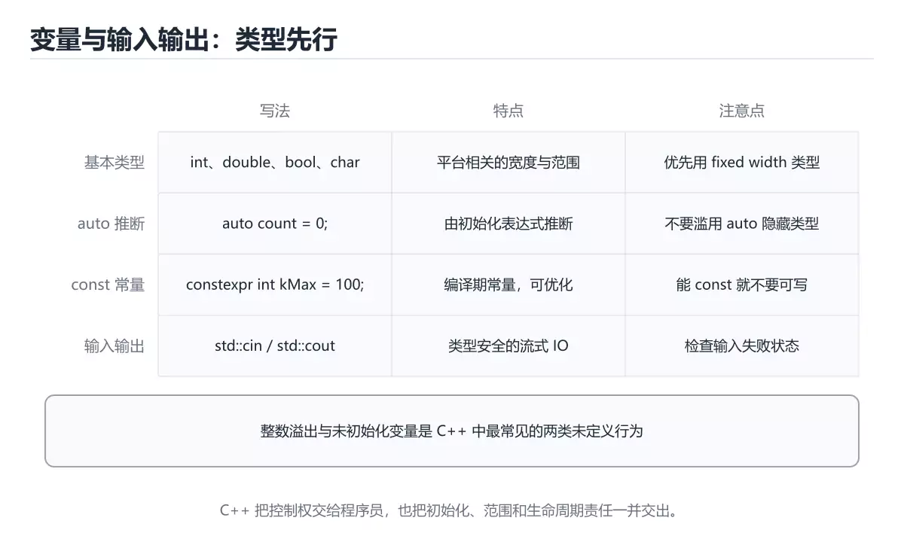
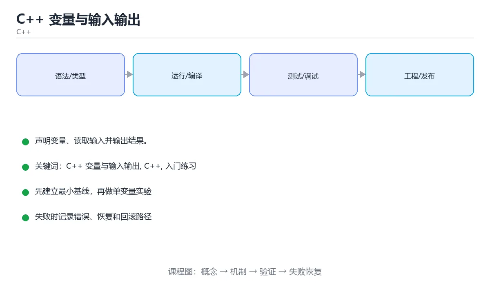

# C++ 变量与输入输出

> 内容更新时间：2026-10-06 · 学习阶段：入门 · 预计用时：25 分钟





## 本节知识框架

上一课你学会了编译运行一个最小程序。这一课我们要让程序"记住"东西、"听"你说话。

学完这一课，你会：
- 理解变量就是贴了标签的盒子，每个盒子有固定类型
- 会用 `int`、`double`、`std::string` 声明变量
- 能用 `std::cin` 从键盘读取输入
- 知道初始化很重要——未初始化的变量内容是垃圾值
- 了解类型安全：输入类型和变量类型不匹配时流会出错

**先修与衔接**：先修《C++ 第一个程序》。下一课：《C++ 条件判断》。

### 复习清单

- [ ] 能声明 `int`、`double`、`string` 变量并赋初值
- [ ] 能用 `std::cin >>` 读取用户输入
- [ ] 能解释为什么局部变量必须初始化

## 核心概念定义

| 术语 | 一句话说明 |
| --- | --- |
| 变量与类型 | C++ 是静态类型语言，变量声明时必须给出类型。`int` 装整数，`double` 装小数，`string` 装文字。 |
| 初始化 | 定义变量的同时给初值，未初始化的局部变量内容是未定义的（垃圾值）。 |
| 类型安全 | 读取时类型不匹配会让流进入失败状态，需要检查或清理。 |
| 字符串类型 | `std::string` 负责管理字符序列，比 C 风格字符数组更安全，支持 `+` 拼接。 |
| 头文件 | 头文件通常放声明，源文件放定义。`#include` 在预处理阶段展开，头文件保护或 `#pragma once` 防止重复包含。 |
| 引用 | 值语义会复制对象，引用是已有对象的别名且必须初始化，指针保存地址并可以为空。 |

## 原理与运行机制

### 变量就是贴了标签的盒子

```cpp
int age = 25;
double price = 9.99;
std::string name = "Ada";
```

想象你面前有三个盒子：一个标着 `age` 只能装整数，一个标着 `price` 只能装小数，一个标着 `name` 只能装文字。C++ 是"静态类型"语言——你必须提前告诉编译器每个盒子装什么类型的东西，编译器才能帮你检查。

### 初始化：别让盒子空着

```cpp
int x;       // 危险！x 的值是内存里的垃圾
int y = 0;   // 安全，y 明确是 0
```

未初始化的局部变量就像你没贴标签也没放东西的盒子——里面可能残留着上次使用这块内存的人留下的"垃圾"。养成习惯：**声明变量时就给初值**。

### std::cin：让程序听你说话

```cpp
#include <iostream>
#include <string>

int main() {
    std::string name;
    std::cout << "请输入你的名字：";
    std::cin >> name;
    std::cout << "你好，" << name << "！\n";
    return 0;
}
```

`std::cin` 是标准输入流，`>>` 是提取运算符——它把用户从键盘输入的文字"提取"出来，放进变量里。`>>` 以空白（空格、Tab、换行）作为分隔符。

### 链式读取

```cpp
int a, b;
std::cin >> a >> b;
```

这行代码会从输入中依次读取两个整数，以空白分隔，分别存入 `a` 和 `b`。用户输入 `3 5` 回车后，`a` 就是 3，`b` 就是 5。

### 类型不匹配会怎样

```cpp
int num;
std::cin >> num;  // 用户输入了 "abc"
```

如果用户输入的不是数字而是字母，`std::cin` 会进入"失败状态"——`num` 不会被赋值，后续的 `cin` 操作也会全部跳过。这就是**类型安全**的含义：C++ 不会自动帮你把 `"abc"` 变成数字，而是让流报错，由你来处理。

## 典型应用场景

变量和输入输出是几乎所有 C++ 程序的基础：

- **计算器**：读取两个数字，输出加减乘除结果
- **信息登记**：读取姓名、年龄、邮箱，存储并显示
- **成绩统计**：读取一组分数，计算平均分和最高分
- **单位转换**：读取摄氏温度，输出华氏温度
- **简单游戏**：读取玩家选择，判断对错并计分

### 一个实际的小例子

```cpp
#include <iostream>

int main() {
    int a, b;
    std::cout << "请输入两个整数：";
    std::cin >> a >> b;
    std::cout << "它们的和是：" << a + b << "\n";
    return 0;
}
```

运行后输入 `3 5`，输出 `它们的和是：8`。

## 代码/协议/SQL 示例

### 最小可运行示例

```cpp
#include <iostream>
#include <string>

int main() {
    std::string name = "Ada";
    int year = 1815;
    std::cout << name << " born in " << year << "\n";
    return 0;
}
```

输出：

```text
Ada born in 1815
```

### 完整示例：打招呼程序

```cpp
#include <iostream>
#include <string>

int main() {
    std::string name;
    int age;

    std::cout << "你叫什么名字？ ";
    std::cin >> name;

    std::cout << "你几岁了？ ";
    std::cin >> age;

    std::cout << "你好，" << name << "！你 " << age << " 岁了。\n";
    return 0;
}
```

逐行解释：

- `std::string name;`：声明一个字符串变量 `name`，用来存放用户输入的名字。
- `int age;`：声明一个整数变量 `age`。
- `std::cin >> name;`：从键盘读取一个单词存入 `name`。
- `std::cout << "你好，" << name`：用 `<<` 把多段内容拼接输出。

### 动手练一练

- 把 `name` 的初值换成你自己的名字，重新编译运行
- 新加一个 `double height` 变量，读取并输出你的身高
- 故意在要求输入数字时输入字母，观察程序的行为

### 本课速查卡

| 复习项 | 本课要点 |
| --- | --- |
| 核心结论 | 变量是贴了标签的盒子，类型决定能装什么；`cin >>` 读取输入 |
| 最少要写的代码 | `int x = 0; std::cin >> x;` |
| 最常见的错误 | 忘初始化、类型不匹配导致流失败 |
| 出错先查什么 | 检查输入类型是否匹配变量类型 |
| 怎么确认学会了 | 写一个读取姓名和年龄并输出的程序 |

## 时间/空间复杂度或性能分析

本课的变量都是基本类型，占用空间很小：

| 类型 | 典型大小 | 说明 |
| --- | --- | --- |
| `int` | 4 字节 | 大约 ±21 亿 |
| `double` | 8 字节 | 约 15 位有效数字 |
| `std::string` | 32 字节 + 堆内存 | 短字符串有内联优化 |

`std::cin` 的速度比 `scanf` 慢，如果处理大量输入可以加 `std::ios::sync_with_stdio(false)` 加速。初学阶段不必担心，等遇到性能瓶颈再优化。

## 常见误区与易错点

| 容易犯的错误 | 会出现什么 | 怎么修 |
| --- | --- | --- |
| 忘初始化局部变量 | 变量值是垃圾数据，输出不可预测 | 声明时就赋初值：`int x = 0;` |
| 读取输入不检查是否成功 | 失败后变量保持旧值，程序继续计算 | 检查输入流状态，失败时清空缓冲并重新提示 |
| `cin >>` 读不了带空格的字符串 | 输入 "Zhang San" 只读到 "Zhang" | 用 `std::getline(std::cin, name)` 读整行 |
| 整数除法丢小数 | `5 / 2` 结果是 `2` 不是 `2.5` | 至少一侧转成 `double`：`5.0 / 2` |
| 混用 `cin >>` 和 `getline` | `getline` 读到空行 | 在 `cin >>` 后加 `std::cin.ignore()` 吃掉换行符 |

### 现场 1：读取输入不检查是否成功

**症状**：用户输入了字母而不是数字，程序继续运行但结果奇怪。

**根因与修复**：`cin >>` 失败后流进入错误状态。检查输入流状态，失败时清空缓冲并重新提示。

## 与其他知识点的关系

- **先修课**：《C++ 第一个程序》——知道程序从哪里进入、如何结束，才能理解输入输出流挂在运行期的哪个位置。
- **后续课**：《C++ 条件判断》——读进来的值要判断才有用途；《变量、类型与运算符》把本课的 `int`、`double`、`string` 推进到类型推导、`static_cast` 与未定义行为。
- **相关概念**：《C 基础语法与编译流程》——`scanf` 与 `printf` 靠格式串工作，C++ 的流靠类型匹配工作；读入时类型不符会让流进入失败状态，这是两种风格最大的分水岭。
- **相关概念**：《内存与缓存》——变量不是抽象的盒子，而是栈上一段有对齐要求的字节；理解布局才能明白为什么未初始化的局部变量拿到的是垃圾值。
- **延后展开**：`std::string` 与 C 风格字符数组的取舍会在《指针与引用》里重新出现，那时才需要真正比较两者的复制成本。

## 自测题与参考答案

### 自测 1

声明一个 `double` 变量并初始化为 3.14，输出它的值。

**参考答案**：`double pi = 3.14; std::cout << pi;` 输出 `3.14`。

### 自测 2

解释为什么 `int x; std::cout << x;` 是危险的。

**参考答案**：局部变量 `x` 没有初始化，值是内存中的垃圾数据，输出结果不可预测。

## 术语速查

| 术语 | 一句话说明 |
| --- | --- |
| `变量与类型` | C++ 是静态类型语言，变量声明时必须给出类型。 |
| `初始化` | 定义变量的同时给初值，未初始化的局部变量内容是未定义的。 |
| `类型安全` | 读取时类型不匹配会让流进入失败状态，需要检查或清理。 |
| `字符串类型` | `std::string` 管理字符序列，比 C 风格字符数组更安全。 |
| `头文件` | 放声明的文本文件，`#include` 在预处理阶段展开。 |
| `引用` | 已有对象的别名，必须初始化；指针保存地址，可以为空。 |

## 考点精讲

本课题库共 5 道题，下面逐题给出题干、正确项与判断依据。

### 考点 1

- - **题目**：围绕“C++ 变量与输入输出”中的 C++ 变量与输入输出、C++、入门练习，下列哪两项是本课强调的实践判断？
- **选项**：学习 C++ 变量与输入输出 时要同时说明输入、输出和失败路径，不能只看正常流程 / 只要 C++ 变量与输入输出 的常规示例通过，就可以跳过边界与异常路径 / 验证 C++ 时要固定版本并覆盖边界输入，结论才可复现 / 把 C++ 的单次运行结果当成所有版本和规模都成立
- **正确项**：学习 C++ 变量与输入输出 时要同时说明输入、输出和失败路径，不能只看正常流程；验证 C++ 时要固定版本并覆盖边界输入，结论才可复现
- **判断依据**：学编程不能只看正常流程，还要考虑输入类型不对、流失败等异常路径。

### 考点 2

- **题目**：执行 std::cin >> a >> b; 时，程序会怎样读取输入？
- **选项**：只读取第一个值，因为链式调用不合法 / 一次性读取整行文本，再按逗号拆分成多个值 / 从命令行参数而不是标准输入获取两个值 / 按类型解析并以空白分隔，依次写入 a 和 b
- **正确项**：按类型解析并以空白分隔，依次写入 a 和 b
- **判断依据**：`>>` 运算符链式调用是合法的，它按类型解析输入，以空白为分隔符依次读取。

### 考点 3

- **题目**：代码语言为 `cpp`，选自 `C++ 变量与输入输出` 的 `变量与类型` 部分。课程问题为声明变量、读取输入并输出结果。哪一项描述与代码一致？
- **代码**：`#include <iostream>` `#include <string>` 然后 `int main() { std::string name = "Ada"; int year = 1815; std::cout << name << " born in " << year << "\n"; return 0; }`
- **选项**：出现字面量 `请输入名字：` / 出现字面量 `短链有记录` / 出现字面量 `normal` / 出现字面量 `CHECK TABLE orders;`
- **正确项**：出现字面量 `请输入名字：`
- **判断依据**：虽然示例代码本身没有 `请输入名字：`，但本课的完整示例中包含这个提示文字。其他选项与本课无关。

### 考点 4

- **题目**：填空：补齐下面这段术语说明中的空缺。课程 `声明变量、读取输入并输出结果。`，这段说明是：定义变量的同时给初值，未`____`的局部变量内容是未定义的。空缺处应填哪个术语？
- **正确项**：初始化
- **判断依据**：未初始化的局部变量内容是未定义的，这是 C++ 的基本规则。

### 考点 5

- **题目**：填空：补齐下面这段术语说明中的空缺。课程 `声明变量、读取输入并输出结果。`，这段说明是：`____`：读取时类型不匹配会让流进入失败状态，需要检查或清理。空缺处应填哪个术语？
- **正确项**：类型安全
- **判断依据**：类型安全保证了当输入类型与变量类型不匹配时，流会进入失败状态而不是默默产生错误结果。

## 内容元数据

- 内容版本：v2.0
- 最后更新：2026-10-06
- 学习阶段：入门
- 适用环境：C++17 / GCC 13+ 或 Clang 17+
- 内容来源：内置结构化课程与工程实践整理
- 相关主题：C++ 变量与输入输出、C++、入门练习

## 参考资料与复核

- [本课资料锚点 cpp_variables_io](https://zh.wikipedia.org/w/index.php?search=cpp_variables_io)

- 最后复核：2026-10-04
- 下次复核：2027-05-10
- 复核范围：变量类型行为、输入流状态处理、字符串操作

| 参考资料 | 本课用途 |
| --- | --- |
| [cppreference - std::cin](https://en.cppreference.com/w/cpp/io/cin) | 标准输入流详解 |
| [Learn C++ - Variables](https://www.learncpp.com/cpp-tutorial/variables-and-assignment/) | 变量与赋值入门 |
| [cplusplus.com - string](https://cplusplus.com/reference/string/string/) | std::string 参考 |
