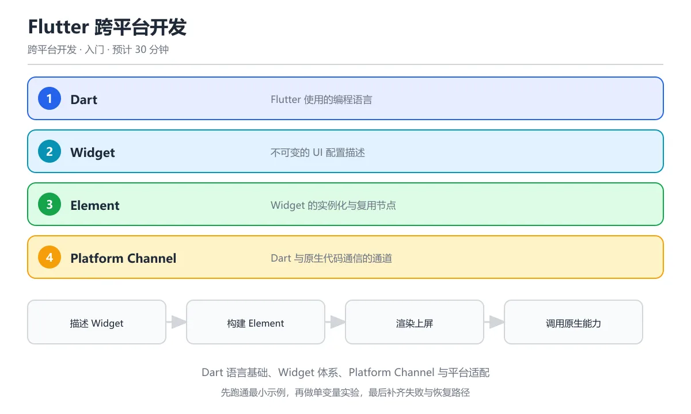

# Flutter 跨平台开发



> 内容更新时间：2026-10-06 · 学习阶段：进阶 · 预计用时：30 分钟

## 本节知识框架

**课程定位**：分类「cross_platform」· 学习阶段 进阶 · 建议用时 30 分钟。

本课主线：掌握 Flutter 跨平台开发的核心机制，包括 Skia/Impeller 渲染引擎、平台通道通信、多端适配策略与插件生态。

### 复习清单

- [ ] 能不看正文复述本课核心术语，并指出一个边界或反例。
- [ ] 能运行或推演本课示例，记录输入、输出与失败现象。
- [ ] 能完成一次自测，并把错题对照考点精讲定位原因。

### 课程导言

Flutter 就像一位"全能画师"——它不依赖系统自带的控件，而是拿起画笔（Skia/Impeller 渲染引擎）在 Canvas 上一笔一划地绘制所有界面。这让它能在 iOS、Android、Web、桌面甚至嵌入式设备上保持高度一致的视觉效果，就像同一个设计师在不同尺寸的画布上作画，风格统一、体验流畅。本课将带你深入 Flutter 跨平台开发的核心机制，从渲染原理到平台通信，再到实战中的多端适配策略。

### 学习目标

学完本章后，你将能够：

1. 理解 Flutter 的渲染引擎（Skia 与 Impeller）如何工作
2. 掌握 Platform Channel 实现 Dart 与原生代码的双向通信
3. 了解 Flutter 在 iOS、Android、Web、桌面等多端适配的差异与策略
4. 学会使用条件导入和平台判断处理多端逻辑
5. 理解 Flutter 插件生态及其跨平台能力边界
6. 能够评估 Flutter 在真实项目中的适用场景与局限

## 核心概念定义

| 术语 | 一句话说明 |
| --- | --- |
| Flutter 跨平台 | 用一套 Dart 代码覆盖 iOS、Android、Web、桌面等多端，通过自绘引擎保证视觉一致性，代价是包体偏大且深度原生功能需走平台通道。 |
| Skia / Impeller | Flutter 的 2D 渲染引擎；Skia 是早期跨平台图形库，Impeller 是 Flutter 3.x 推出的新引擎，预编译着色器以消除首帧卡顿。 |
| Platform Channel | Dart 与宿主平台（Swift/Kotlin）之间的异步消息通道，分为 MethodChannel、EventChannel 和 BasicMessageChannel 三种。 |
| Flutter 插件 | 封装平台原生能力的 Dart 包，内部通过 Platform Channel 调用系统 API，对外暴露纯 Dart 接口供业务调用。 |
| 条件导入 | Dart 的 `dart.library.io` / `dart.library.html` 判断机制，让同一份业务代码在不同平台导入不同实现文件。 |

## 原理与运行机制

《Flutter 跨平台开发》正文各章按「输入是什么 → 中间如何转换 → 输出到哪 → 失败时怎样表现」四问展开；复习时给每个机制补一句自己的复述，再回到对应章节核对。

### 生活类比拆解

#### Flutter 渲染引擎：像一位自带画具的画家

想象你要在不同城市的画廊办展览。**原生开发**像是到每个城市找当地画家，用当地的颜料和风格各画一幅——效果最地道，但风格可能不一致。**Flutter** 则像带着一位专属画家和全套画具旅行，不管在哪个城市的画廊，都用同样的颜料和技法作画——风格高度统一，但需要自带所有工具（引擎体积较大）。

#### Platform Channel：像翻译官

Flutter 的 Dart 代码和宿主平台（iOS 的 Swift、Android 的 Kotlin）讲不同的"语言"。Platform Channel 就是一位**翻译官**，站在两种语言之间传递消息。Dart 说"我要获取电池电量"，翻译官把这句话转达给 Swift 或 Kotlin，它们执行完后把结果再通过翻译官传回来。

#### 条件导入：像万能插座适配器

你有一个电器（Dart 业务代码），但不同国家的插座标准不同（平台 API）。条件导入就像一个**万能插座适配器**——它检测当前在哪个国家（平台），自动切换到对应的插头标准（实现文件），让你的电器在任何地方都能正常工作。

### 渲染管线详解

Flutter 的渲染流程可以拆解为以下阶段：

```text
Dart 代码 → Widget 树 → Element 树 → RenderObject 树 → Layer 树 → Skia/Impeller → GPU → 屏幕像素
```

1. **Widget 树构建**：开发者编写 Widget 描述界面结构，Widget 是不可变的配置对象。
2. **Element 树**：Flutter 框架将 Widget 实例化为 Element，Element 持有对 Widget 和 RenderObject 的引用。
3. **RenderObject 树**：负责布局（layout）和绘制（paint），计算每个节点的大小和位置。
4. **Layer 树**：将 RenderObject 的绘制指令转化为 GPU 可理解的图层结构。
5. **引擎渲染**：Skia 或 Impeller 将 Layer 树光栅化为像素，送到屏幕显示。

### Platform Channel 通信机制

```text
┌──────────────┐     MethodChannel      ┌──────────────────┐
│  Dart 端     │ ◄────────────────────► │  宿主平台         │
│  (Flutter)   │   异步消息序列化        │  (iOS/Android)   │
└──────────────┘                        └──────────────────┘
```

- **MethodChannel**：一次性调用-响应模式，类似函数调用。
- **EventChannel**：持续数据流模式，适合传感器数据、网络状态等。
- **BasicMessageChannel**：自定义编解码的消息传递，灵活度最高。

## 典型应用场景

- **跨平台移动应用**：一套代码同时发布 iOS 和 Android，适合电商、社交、工具类 App。
- **Flutter Web**：将移动应用扩展到浏览器，适合管理后台、展示型网站。
- **桌面应用**：Flutter 3.x 支持 Windows、macOS、Linux，适合内部工具和轻量桌面软件。
- **嵌入式设备**：Flutter Engine 可嵌入车载系统、智能终端等，适合需要自定义 UI 的硬件产品。
- **游戏化界面**：自绘引擎天然适合复杂动画和自定义视觉效果，如交互动画 App、教育类应用。

## 代码/协议/SQL 示例

《Flutter 跨平台开发》正文首个示例可作为最小验证起点（原样保留在上方章节）：先跑通，再改一个输入观察输出变化。

### Platform Channel 示例：获取电池电量

```dart
// Dart 端
import 'package:flutter/services.dart';

class BatteryService {
  static const platform = MethodChannel('com.example.app/battery');

  Future<int> getBatteryLevel() async {
    try {
      final int result = await platform.invokeMethod('getBatteryLevel');
      return result;
    } on PlatformException catch (e) {
      print('获取电量失败: ${e.message}');
      return -1;
    }
  }
}
```

```kotlin
// Android 端 (Kotlin)
class MainActivity : FlutterActivity() {
    private val CHANNEL = "com.example.app/battery"

    override fun configureFlutterEngine(flutterEngine: FlutterEngine) {
        super.configureFlutterEngine(flutterEngine)
        MethodChannel(flutterEngine.dartExecutor.binaryMessenger, CHANNEL)
            .setMethodCallHandler { call, result ->
                if (call.method == "getBatteryLevel") {
                    val batteryLevel = getBatteryLevel()
                    if (batteryLevel != -1) {
                        result.success(batteryLevel)
                    } else {
                        result.error("UNAVAILABLE", "电量信息不可用", null)
                    }
                } else {
                    result.notImplemented()
                }
            }
    }

    private fun getBatteryLevel(): Int {
        val bm = getSystemService(BATTERY_SERVICE) as BatteryManager
        return bm.getIntProperty(BatteryManager.BATTERY_PROPERTY_CAPACITY)
    }
}
```

```swift
// iOS 端 (Swift)
class ViewController: FlutterViewController {
    private let CHANNEL = "com.example.app/battery"
    
    override func viewDidLoad() {
        super.viewDidLoad()
        let batteryChannel = FlutterMethodChannel(
            name: CHANNEL,
            binaryMessenger: engine!.binaryMessenger
        )
        batteryChannel.setMethodCallHandler { [weak self] call, result in
            if call.method == "getBatteryLevel" {
                self?.receiveBatteryLevel(result: result)
            } else {
                result(FlutterMethodNotImplemented)
            }
        }
    }
    
    private func receiveBatteryLevel(result: FlutterResult) {
        let device = UIDevice.current
        device.isBatteryMonitoringEnabled = true
        if device.batteryLevel == -1.0 {
            result(FlutterError(code: "UNAVAILABLE", message: "电量不可用", details: nil))
        } else {
            result(Int(device.batteryLevel * 100))
        }
    }
}
```

### 条件导入示例：跨平台存储

```dart
// storage.dart — 统一接口
import 'src/storage_stub.dart'
    if (dart.library.io) 'src/storage_mobile.dart'
    if (dart.library.html) 'src/storage_web.dart';

abstract class Storage {
  Future<void> write(String key, String value);
  Future<String?> read(String key);
}

Storage createStorage() => createPlatformStorage();
```

```dart
// src/storage_mobile.dart — 移动端实现
import 'dart:io';
import 'package:path_provider/path_provider.dart';

Storage createPlatformStorage() => FileStorage();

class FileStorage implements Storage {
  Future<File> get _file async {
    final dir = await getApplicationDocumentsDirectory();
    return File('${dir.path}/app_data.json');
  }

  @override
  Future<void> write(String key, String value) async {
    final file = await _file;
    await file.writeAsString('{"$key":"$value"}');
  }

  @override
  Future<String?> read(String key, ) async {
    final file = await _file;
    if (!await file.exists()) return null;
    final content = await file.readAsString();
    return content;
  }
}
```

### 多端适配示例：响应式布局

```dart
class ResponsiveLayout extends StatelessWidget {
  final Widget mobile;
  final Widget tablet;
  final Widget desktop;

  const ResponsiveLayout({
    required this.mobile,
    required this.tablet,
    required this.desktop,
  });

  static bool isMobile(BuildContext context) =>
      MediaQuery.of(context).size.width < 600;
  static bool isTablet(BuildContext context) =>
      MediaQuery.of(context).size.width >= 600 &&
      MediaQuery.of(context).size.width < 1100;

  @override
  Widget build(BuildContext context) {
    return LayoutBuilder(
      builder: (context, constraints) {
        if (constraints.maxWidth >= 1100) return desktop;
        if (constraints.maxWidth >= 600) return tablet;
        return mobile;
      },
    );
  }
}
```

## 时间/空间复杂度或性能分析

- 在《Flutter 跨平台开发》里处理规模 n 时，先估计主循环与嵌套层数，再决定优化方向；小样本上的耗时读数不能外推。
- 性能结论要绑定输入分布：换数据规模、并发度或缓存命中情况后须重新测量。

### Flutter 渲染性能关键点

| 指标 | 目标值 | 影响因素 | 优化方向 |
| --- | --- | --- | --- |
| 帧率 | 60fps / 120fps | Widget 重建范围、复杂布局嵌套 | 使用 const Widget、RepaintBoundary 隔离重绘 |
| 首帧耗时 | < 200ms | Skia 着色器编译 | 启用 Impeller 引擎，预编译着色器 |
| 包体大小 | iOS < 15MB, Android < 10MB | Flutter 引擎 + 框架代码 | 代码压缩、资源优化、按需加载 |
| 内存占用 | < 150MB | 图片缓存、Widget 树深度 | 使用 `cached_network_image` 限制缓存、扁平化 Widget 树 |

## 常见误区与易错点

| 错误做法 | 典型现象 | 修复方向 |
| --- | --- | --- |
| 在主线程做耗时 I/O | 界面卡顿掉帧 | 用 `compute()` 或 `Isolate` 将计算移到后台线程 |
| 忽略 Platform Channel 线程 | 原生回调在子线程触发 UI 异常 | 确保原生端在主线程（UI Thread）回调 result |
| 所有 Widget 都用 StatefulWidget | 不必要的重建和内存开销 | 纯展示型 Widget 用 StatelessWidget，配合 const 构造 |
| Web 端使用 dart:io | 编译报错，Web 不支持 | 用条件导入或 `universal_io` 包做兼容 |

### 常见陷阱与解决方案

| 陷阱 | 表现 | 原因 | 解决方案 |
|------|------|------|----------|
| 热重载后状态丢失 | 页面回到初始状态 | 修改了 Widget 结构导致 State 重建 | 使用 const 构造，避免不必要的 Widget 类型变更 |
| Platform Channel 调用无响应 | Future 永远不完成 | 原生端未注册 Channel 或方法名拼写错误 | 检查 Channel name 一致性，添加日志排查 |
| Web 端布局错乱 | 样式与移动端不一致 | 浏览器默认样式和字体差异 | 使用 `kIsWeb` 判断并针对性调整样式 |
| 包体过大 | 安装包超过 50MB | 未移除调试资源，图片未压缩 | 使用 `--release` 构建，压缩资源，启用 tree shaking |
| Impeller 渲染异常 | 部分特效显示不正确 | Impeller 尚不支持所有 Skia 特性 | 回退到 Skia 或调整特效实现方式 |

## 与其他知识点的关系

本课与分类「cross_platform」内相邻课程互为补充：
- **前置知识**：Flutter Widget 入门（flutter_widget_intro）、Dart 语言基础
- **并行课程**：React Native 跨平台开发（mobile_react_native）——对比两种跨平台方案的渲染策略
- **后续课程**：跨平台架构对比与选型（mobile_cross_platform_comparison）——在更宏观的视角评估 Flutter 的定位
- **关联课程**：跨平台状态管理（cross_platform_state_management）——Flutter 中的状态管理方案是跨平台状态管理的子集

## 自测题与参考答案

以下题目与题库同源，作答后再看解析；错误项要能说出错在哪一步。

## 考点精讲

### 考点 1

Flutter 的渲染机制与 React Native 的核心区别是什么？

A. Flutter 使用原生组件

B. Flutter 自带渲染引擎（Skia/Impeller），直接绘制像素；RN 使用原生组件桥接

C. RN 渲染更快

D. 没有区别

**正确答案：B**

**详细解释**：Flutter 不依赖原生组件，用 Skia/Impeller 引擎直接绘制 UI，保证跨平台一致性；RN 映射到原生组件。 自绘引擎的代价是包体积更大，也意味着系统控件更新不会自动同步，需要等 Flutter 引擎和框架适配。 因此 Flutter 应用在不同系统上的观感高度一致，但也要自己处理平台差异化的交互习惯和返回手势。

---

### 考点 2

Flutter 中 Stateful Widget 和 Stateless Widget 的区别是什么？

A. Stateful 更慢

B. Stateful 持有可变状态，Stateless 不可变

C. Stateless 支持动画

D. 没有区别

**正确答案：B**

**详细解释**：Stateless Widget 构建后不变，Stateful Widget 持有 State 对象，状态变化时触发 rebuild。 需要跨组件共享状态时，通常借助 Provider、Riverpod 或 BLoC，把状态提升到 Widget 树上层统一管理。

---

### 考点 3

Platform Channel 的作用是什么？

A. 管理状态

B. 在 Dart 和原生平台代码（Kotlin/Swift）之间通信

C. 处理网络请求

D. 管理数据库

**正确答案：B**

**详细解释**：Platform Channel 让 Flutter 调用原生 API（如相机、GPS），原生代码也可向 Dart 发送消息。 Channel 调用是异步的，频繁的小数据往返会有序列化开销，批量传输或改用 FFI 往往更高效。 如果共享逻辑较重，可以只把 Flutter 当作 UI 层，把业务逻辑放在 Dart 包或原生 SDK 中复用。

---

### 考点 4

Flutter 热重载（Hot Reload）的优势是什么？

A. 加快编译速度

B. 修改代码后毫秒级刷新 UI，保留应用状态

C. 减少内存使用

D. 自动修复 bug

**正确答案：B**

**详细解释**：Hot Reload 把代码变更注入运行中的 Dart VM，UI 立即更新且保留当前页面状态，大幅提升开发效率。 热重载保留的是 Dart 层状态，原生代码改动和部分静态初始化仍需完整重启才能生效。 频繁热重载会积累旧的 State，遇到状态异常时先执行 Hot Restart，再判断是代码问题还是调试环境问题。

---

### 考点 5

Flutter 的 Widget 和 Element 的关系是什么？

A. 完全相同

B. Widget 是配置描述，Element 是 Widget 的实例化对象，管理渲染树

C. Element 是 Widget 的子类

D. Widget 包含 Element

**正确答案：B**

**详细解释**：Widget 是不可变的配置，Framework 根据 Widget 创建 Element 形成 Element Tree，Element 才是实际渲染的对象。 Widget 可以频繁重建，Element 会被复用，判断两个 Widget 能否复用同一 Element 靠的是 runtimeType 和 key。


## 术语速查

| 术语 | 一句话说明 |
| --- | --- |
| Flutter 跨平台 | 一套 Dart 代码覆盖多端，自绘引擎保证视觉一致，深度原生功能走 Platform Channel。 |
| Skia / Impeller | Flutter 的 2D 渲染引擎，Impeller 预编译着色器消除首帧卡顿。 |
| Platform Channel | Dart 与宿主平台之间的异步消息通道，分 Method/Event/BasicMessage 三种。 |
| Flutter 插件 | 封装原生能力的 Dart 包，内部走 Platform Channel，对外暴露纯 Dart 接口。 |
| 条件导入 | 根据 `dart.library.io` / `dart.library.html` 在不同平台导入不同实现。 |
| Isolate | Dart 的并发单元，独立内存堆，通过消息传递通信，用于后台计算。 |

## 参考资料与复核

- 官方/权威资料：[Flutter 官方文档 - 平台集成](https://docs.flutter.dev/platform-integration)
- 主题延伸：[Flutter Impeller 渲染引擎](https://docs.flutter.dev/perf/impeller)
- 主题延伸：[Platform Channels 详解](https://docs.flutter.dev/platform-integration/platform-channels)

- 最后复核：2026-10-04
- 下次复核：2027-10-17

## 内容元数据

- 内容版本：v2.0
- 最后更新：2026-10-06
- 学习阶段：进阶
- 适用环境：通用开发环境
- 内容来源：内置结构化课程与工程实践整理
- 相关主题：cross platform flutter
- 质量版本：P0 测验标准 + P1 覆盖扩展 + P2 体验补全