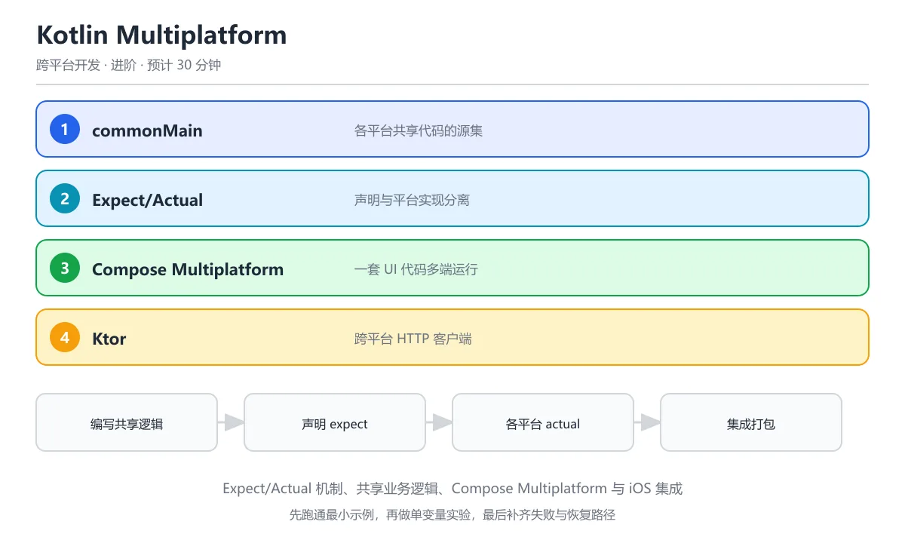

# Kotlin Multiplatform



> 内容更新时间：2026-10-06 · 学习阶段：进阶 · 预计用时：35 分钟

## 本节知识框架

**课程定位**：分类「cross_platform」· 学习阶段 进阶 · 建议用时 30 分钟。

本课主线：掌握 Kotlin Multiplatform（KMP）的共享逻辑、Expect/Actual 机制、多端 UI 方案（Compose Multiplatform）与工程实践。

### 复习清单

- [ ] 能复述 KMP 的职责，并给出一个输入越界时的反例。
- [ ] 能用「Kotlin Multiplatform」的示例复现结果，并说明Expect/Actual出错时输出的第一条信息。
- [ ] 能完成一次自测，并把错题对照考点精讲定位原因。

### 课程导言

Kotlin Multiplatform 就像一位"双语程序员"——他用 Kotlin 写核心业务逻辑（网络请求、数据处理、算法），然后在不同平台上只替换与系统相关的部分（UI、存储、传感器）。这好比一位厨师写了一份通用菜谱（共享逻辑），但在法式厨房（iOS）用黄油煎，在中式厨房（Android）用大火爆炒（平台特定实现）。KMP 不强制你共享 UI，而是让你灵活选择共享多少代码——从纯逻辑层到完整界面（Compose Multiplatform），自由度极高。

### 学习目标

学完本章后，你将能够：

1. 理解 KMP 的项目结构和模块划分策略
2. 掌握 Expect/Actual 机制实现平台特定代码
3. 了解 Compose Multiplatform 的 UI 共享方案
4. 学会使用 Ktor、SQLDelight 等跨平台库
5. 评估 KMP 与 Flutter、React Native 的差异与适用场景
6. 搭建一个包含共享逻辑和平台 UI 的 KMP 工程

## 核心概念定义

| 术语 | 一句话说明 |
| --- | --- |
| Kotlin Multiplatform (KMP) | JetBrains 推出的跨平台方案，共享 Kotlin 业务逻辑，平台特定部分用 Expect/Actual 机制分别实现。 |
| Expect/Actual | KMP 的核心机制：common 模块声明 `expect` 接口（"我要什么"），各平台模块提供 `actual` 实现（"怎么做"）。 |
| Compose Multiplatform | 基于 Jetpack Compose 的跨平台 UI 框架，一套声明式 UI 代码可运行在 Android、iOS、桌面和 Web。 |
| Ktor | JetBrains 的跨平台网络库，用 Kotlin 协程编写，在 common 模块中统一调用 HTTP 接口。 |
| 分层架构 | KMP 项目的典型结构：shared 模块放共享逻辑，androidApp / iosApp / desktopApp 各放平台入口。 |

## 原理与运行机制

《Kotlin Multiplatform》正文各章按「输入是什么 → 中间如何转换 → 输出到哪 → 失败时怎样表现」四问展开；复习时给每个机制补一句自己的复述，再回到对应章节核对。

### 生活类比拆解

#### Expect/Actual：像合同与施工方

想象你是甲方（common 模块），你写了一份**合同**（`expect` 声明），规定了"我需要获取设备信息"这个能力，但不关心怎么实现。iOS 施工方（iosApp）和 Android 施工方（androidApp）各自按合同要求，用自己的方式完成施工（`actual` 实现）。只要接口对得上，甲方不需要知道具体细节。

#### KMP 项目结构：像一棵树

```text
MyApp/
├── shared/              ← 树干：共享业务逻辑（Kotlin）
│   ├── commonMain/      ← 通用代码
│   ├── androidMain/     ← Android 特定实现
│   └── iosMain/         ← iOS 特定实现
├── androidApp/          ← 树枝 A：Android 入口
├── iosApp/              ← 树枝 B：iOS 入口（Swift/ObjC 桥接）
└── desktopApp/          ← 树枝 C：桌面入口（可选）
```

树干（shared）提供营养（业务逻辑）给所有树枝，每根树枝只负责自己平台特有的部分（UI、系统集成）。

#### Compose Multiplatform：像同一套图纸建不同材质的房子

Compose Multiplatform 就像一套**建筑图纸**（声明式 UI 代码），可以用不同材质（平台渲染后端）建造：Android 上用 View 系统渲染，iOS 上用 UIKit 桥接，桌面用 Swing/AWT。图纸不变，材质因地制宜。

### 编译与运行机制

KMP 的编译流程：

```text
Kotlin 源码 (common) → Kotlin/IR (中间表示)
    ├── → JVM 字节码 (Android)
    ├── → LLVM 原生代码 (iOS，通过 Kotlin/Native)
    └── → JavaScript (Web，通过 Kotlin/JS)
```

- **Android 端**：共享代码编译为 JVM 字节码，与 Android 原生代码无缝集成。
- **iOS 端**：Kotlin/Native 将共享代码编译为 ARM 原生框架（.framework 或 .xcframework），Swift 代码通过桥接头文件调用。
- **Web 端**：Kotlin/JS 编译为 JavaScript，或配合 Compose Multiplatform 编译为 WebAssembly。

## 典型应用场景

- **共享业务逻辑**：网络请求、数据解析、本地存储、业务规则等与 UI 无关的代码，在 common 模块中一次编写。
- **跨平台 UI**：使用 Compose Multiplatform 共享界面代码，适合内部工具、管理后台、简单展示型 App。
- **渐进式采用**：在现有 Android/iOS 原生项目中逐步引入 KMP 共享模块，不必一次性重写全部代码。
- **后端与客户端共享**：Kotlin 同时用于服务端（Ktor Server）和客户端（Ktor Client），共享数据模型和验证逻辑。
- **多端工具库**：日期处理、加密算法、文件格式解析等通用工具，用 KMP 一次编写，多端复用。

## 代码/协议/SQL 示例

《Kotlin Multiplatform》正文首个示例可作为最小验证起点（原样保留在上方章节）：先跑通，再改一个输入观察输出变化。

### Expect/Actual 基础示例：获取平台信息

```kotlin
// shared/src/commonMain/kotlin/Platform.kt
// 通用声明 —— "我需要什么能力"
expect class Platform() {
    val name: String
    val version: String
}

// 通用业务逻辑 —— 使用 expect 接口，不关心具体实现
class DeviceInfoService {
    fun getDeviceInfo(): String {
        val platform = Platform()
        return "运行在 ${platform.name} ${platform.version} 上"
    }
}
```

```kotlin
// shared/src/androidMain/kotlin/Platform.kt
// Android 实现 —— "我怎么做"
actual class Platform actual constructor() {
    actual val name: String = "Android"
    actual val version: String = android.os.Build.VERSION.SDK_INT.toString()
}
```

```kotlin
// shared/src/iosMain/kotlin/Platform.kt
// iOS 实现
actual class Platform actual constructor() {
    actual val name: String = "iOS"
    actual val version: String = UIDevice.currentDevice.systemVersion
}
```

### Ktor 网络请求示例（共享层）

```kotlin
// shared/src/commonMain/kotlin/network/ApiClient.kt
import io.ktor.client.*
import io.ktor.client.request.*
import io.ktor.client.statement.*
import io.ktor.serialization.kotlinx.json.*
import io.ktor.client.plugins.contentnegotiation.*
import kotlinx.serialization.Serializable

@Serializable
data class User(val id: Int, val name: String, val email: String)

class ApiClient {
    private val client = HttpClient {
        install(ContentNegotiation) {
            json()
        }
    }

    suspend fun fetchUser(id: Int): User {
        val response: HttpResponse = client.get("https://api.example.com/users/$id")
        return response.body<User>()
    }

    fun close() {
        client.close()
    }
}
```

### Compose Multiplatform UI 示例

```kotlin
// shared/src/commonMain/kotlin/ui/App.kt
import androidx.compose.material3.*
import androidx.compose.runtime.*

@Composable
fun App() {
    MaterialTheme {
        var count by remember { mutableStateOf(0) }
        
        Scaffold(
            topBar = {
                TopAppBar(title = { Text("KMP Demo") })
            },
            floatingActionButton = {
                FloatingActionButton(onClick = { count++ }) {
                    Text("+")
                }
            }
        ) { padding ->
            Column(
                modifier = Modifier.padding(padding).fillMaxSize(),
                horizontalAlignment = Alignment.CenterHorizontally,
                verticalArrangement = Arrangement.Center
            ) {
                Text("点击次数：$count", style = MaterialTheme.typography.headlineMedium)
                Button(onClick = { count = 0 }) {
                    Text("重置")
                }
            }
        }
    }
}
```

```kotlin
// androidApp/src/main/java/MainActivity.kt
// Android 入口
class MainActivity : ComponentActivity() {
    override fun onCreate(savedInstanceState: Bundle?) {
        super.onCreate(savedInstanceState)
        setContent {
            App()  // 直接复用 shared 模块的 Compose UI
        }
    }
}
```

### iOS 入口桥接

```swift
// iosApp/iosApp/ContentView.swift
import SwiftUI
import shared  // 导入 KMP 编译的 framework

struct ContentView: View {
    var body: some View {
        // 方式一：使用 Compose Multiplatform（如果共享了 UI）
        ComposeView()
        
        // 方式二：仅使用共享逻辑，UI 用 SwiftUI 原生写
        // let info = DeviceInfoService().getDeviceInfo()
        // Text(info)
    }
}

struct ComposeView: UIViewControllerRepresentable {
    func makeUIViewController(context: Context) -> UIViewController {
        MainViewControllerKt.MainViewController()
    }
    func updateUIViewController(_ uiViewController: UIViewController, context: Context) {}
}
```

## 时间/空间复杂度或性能分析

- 在《Kotlin Multiplatform》里处理规模 n 时，先估计主循环与嵌套层数，再决定优化方向；小样本上的耗时读数不能外推。
- 关于 KMP 的性能结论要写明输入分布，环境或规模一变就必须重测。

### KMP 各端编译产物分析

| 平台 | 编译目标 | 包体增量 | 启动开销 | 运行时开销 |
| --- | --- | --- | --- | --- |
| Android | JVM 字节码 | +1~2 MB（Kotlin 标准库） | 无额外开销 | 与原生 Kotlin 相同 |
| iOS | Kotlin/Native framework | +3~5 MB | 首次初始化 runtime ~50ms | 接近原生，GC 暂停 < 1ms |
| Desktop (JVM) | JVM 字节码 | +1~2 MB | 无额外开销 | 与 Android 相同 |
| Web (JS) | JavaScript | +200~400 KB | 加载 JS bundle | 受 JS 引擎性能限制 |
| Web (Wasm) | WebAssembly | +500 KB~1 MB | 编译 Wasm ~100ms | 接近原生速度 |

## 常见误区与易错点

| 错误做法 | 典型现象 | 修复方向 |
| --- | --- | --- |
| 在 common 模块引用平台特定 API | 编译报错：unresolved reference | 使用 expect/actual 或 `kotlinx` 跨平台库 |
| iOS 端忘记导出 framework | Swift 代码找不到 shared 模块 | 配置 `binaries.framework` 并正确设置 Xcode 依赖 |
| 共享 UI 时忽略平台差异 | iOS 上交互不符合 HIG 规范 | 用 `expect` 声明平台特定组件，或限制共享 UI 的范围 |
| 协程在 iOS 主线程阻塞 | 界面卡顿或 ANR | 使用 `Dispatchers.Main` 确保 UI 更新在主线程 |

### 常见陷阱与解决方案

| 陷阱 | 表现 | 原因 | 解决方案 |
|------|------|------|----------|
| Expect/Actual 接口不一致 | 编译通过但运行时崩溃 | common 和平台端的 actual 签名不匹配 | 使用 IDE 导航检查 actual 实现，编写单元测试覆盖 |
| Kotlin/Native 内存模型问题 | iOS 上偶发崩溃 | 旧内存模型下跨线程对象访问 | 升级到新内存模型（Kotlin 1.7.20+），使用 `@Volatile` |
| iOS 构建配置复杂 | 构建失败或 Xcode 报错 | Gradle 与 Xcode 构建系统集成配置繁琐 | 使用 KMP 向导模板，遵循官方 iOS 集成文档 |
| Compose Multiplatform iOS 限制 | 部分 Compose 特性在 iOS 不可用 | iOS 后端仍在完善中 | 检查兼容性列表，iOS 端用 SwiftUI 替代不兼容部分 |
| 共享模块依赖冲突 | Android 和 iOS 依赖版本不一致 | 各平台库版本不同 | 在 common 中使用 version catalog 统一管理版本 |

## 与其他知识点的关系

本课与分类「cross_platform」内相邻课程互为补充：
- **前置知识**：Kotlin 语言基础、协程概念
- **并行课程**：Flutter 跨平台开发（cross_platform_flutter）——对比 KMP 与 Flutter 的共享策略
- **后续课程**：跨平台架构对比与选型（mobile_cross_platform_comparison）——在宏观视角评估 KMP 的定位
- **关联课程**：跨平台状态管理（cross_platform_state_management）——KMP 中的状态管理方案

## 自测题与参考答案

本课测验与题库同源，答题时先写 KMP 与 Expect/Actual 的判断依据，再对照解析修正。

## 考点精讲

### 考点 1

Kotlin Multiplatform 的核心机制是什么？

A. 热重载

B. Expect/Actual —— 共享模块声明接口，各平台提供实现

C. 字节码转换

D. 自动 UI 适配，把共享的布局按屏幕尺寸映射成各平台原生控件  

**正确答案：B**

**详细解释**：Expect 在共享模块声明平台相关的接口/类，Actual 在各平台模块（Android/iOS）提供具体实现。 expect 只能声明，不能有实现，编译器会强制每个目标平台都提供 actual，漏写会在编译期报错。 编译时 Gradle 会为每个目标平台分别编译 commonMain 和对应的平台源集，最终产出各平台的库文件。 本题正确项是「Expect/Actual —— 共享模块声明接口，各平台提供实现」。

---

### 考点 2

KMP 最适合共享什么类型的代码？

A. UI 组件，由共享模块直接生成各平台原生控件树  

B. 业务逻辑、网络请求、数据模型等平台无关代码

C. 动画效果

D. 手势处理

**正确答案：B**

**详细解释**：KMP 擅长共享业务逻辑层（网络、数据库、算法），UI 层因平台差异大通常各自实现或用 Compose Multiplatform。 判断能否共享的标准是这段逻辑是否依赖平台 API，纯算法和数据模型最容易共享，UI 和权限相关代码则要分平台实现。 本题正确项是「业务逻辑、网络请求、数据模型等平台无关代码」。

---

### 考点 3

Compose Multiplatform 的目标是什么？

A. 只支持 Android，Compose 运行时必须挂在一个 Android View 上才能启动  

B. 用一套 Compose UI 代码运行在 Android、iOS、Desktop 和 Web

C. 替代 Flutter

D. 只支持 Web

**正确答案：B**

**详细解释**：Compose Multiplatform 把 Jetpack Compose 扩展到更多平台，一套 UI 代码多端运行。 Compose Multiplatform 目前对 iOS 的支持已经稳定，但复杂原生交互仍需要和 SwiftUI 混合使用。 本题正确项是「用一套 Compose UI 代码运行在 Android、iOS、Desktop 和 Web」。

---

### 考点 4

KMP 项目中 commonMain 源集的作用是什么？

A. 存放 Android 专属代码，由 Gradle 自动拆分  

B. 存放各平台共享的代码，可访问 expect 声明

C. 存放测试代码

D. 存放构建脚本

**正确答案：B**

**详细解释**：commonMain 是共享代码的源集，包含业务逻辑和 expect 声明，编译到所有目标平台。 依赖 Android 的代码要放到 androidMain，依赖 iOS 的放到 iosMain，公共代码只能引用 commonMain 里声明的 API。 本题正确项是「存放各平台共享的代码，可访问 expect 声明」。

---

### 考点 5

Ktor 在 KMP 项目中的角色是什么？

A. UI 框架，用 Composable 函数拼出界面  

B. 跨平台 HTTP 客户端，在共享模块中发起网络请求

C. 数据库

D. 构建工具

**正确答案：B**

**详细解释**：Ktor Client 支持 Kotlin Multiplatform，在 commonMain 中编写网络请求代码，自动适配各平台底层实现。 Ktor 的引擎是可替换的，Android 用 OkHttp，iOS 用 Darwin，切换引擎不需要改动共享层的请求代码。 本题正确项是「跨平台 HTTP 客户端，在共享模块中发起网络请求」。

---

### 考点 6

题目：在「Kotlin Multiplatform」的术语表里，下列术语与解释的配对哪些是正确的？（多选）
A. 「Kotlin/Native」：将 Kotlin 编译为 LLVM 原生代码的技术，用于 iOS 等平台无需虚拟机  
B. 「Ktor」：JetBrains 跨平台方案，共享 Kotlin 逻辑，平台特定部分用 Expect/Actual 实现  
C. 「Kotlin Multiplatform」：JetBrains 跨平台网络库，common 模块统一调用 HTTP 接口  
D. 「Expect/Actual」：common 模块声明 expect 接口，各平台模块提供 actual 实现，编译时强制检查一致性  
正确答案：AD

**解析**：本题正确项是「Kotlin/Native」：将 Kotlin 编译为 LLVM 原生代码的技术，用于 iOS 等平台无需虚拟机，以及「Expect/Actual」：common 模块声明 expect 接口，各平台模块提供 actual 实现，编译时强制检查一致性，这两组配对与术语表一致。另外两组把术语和解释张冠李戴：「Ktor」被安上了JetBrains 跨平台方案，共享 Kotlin 逻辑，平台特定部分用 Expect/Actual 实现的解释，「Kotlin Multiplatform」反而拿到了JetBrains 跨平台网络库，common 模块统一调用 HTTP 接口的定义，所以两组都不能选。复习时回到「Kotlin Multiplatform」的术语速查表逐条核对，配对题考的是定义里描述的对象和边界，而不是术语的字面长相。

---

## 术语速查

| 术语 | 一句话说明 |
| --- | --- |
| Kotlin Multiplatform | JetBrains 跨平台方案，共享 Kotlin 逻辑，平台特定部分用 Expect/Actual 实现。 |
| Expect/Actual | common 模块声明 expect 接口，各平台模块提供 actual 实现，编译时强制检查一致性。 |
| Compose Multiplatform | 基于 Jetpack Compose 的跨平台 UI 框架，支持 Android、iOS、桌面和 Web。 |
| Ktor | JetBrains 跨平台网络库，common 模块统一调用 HTTP 接口。 |
| Kotlin/Native | 将 Kotlin 编译为 LLVM 原生代码的技术，用于 iOS 等平台无需虚拟机。 |

## 参考资料与复核

- 官方/权威资料：[Kotlin Multiplatform 官方文档](https://kotlinlang.org/docs/multiplatform.html)
- 主题延伸：[Compose Multiplatform](https://www.jetbrains.com/lp/compose-multiplatform/)
- 主题延伸：[Ktor Client 跨平台网络](https://ktor.io/docs/client-create-new-application.html)

- 最后复核：2026-10-04
- 下次复核：2027-10-17

## 内容元数据

- 内容版本：v2.0
- 最后更新：2026-10-06
- 学习阶段：进阶
- 适用环境：通用开发环境；本课聚焦 KMP。
- 内容来源：内置结构化课程与工程实践整理
- 相关主题：cross platform kmp
- 质量版本：P0 测验标准 + P1 覆盖扩展 + P2 体验补全