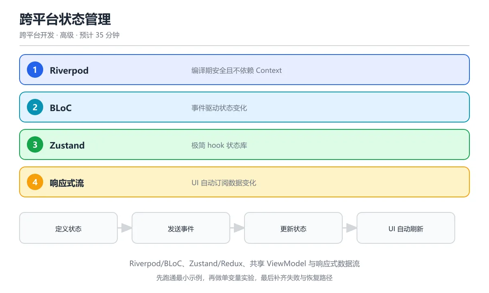

# 跨平台状态管理



> 内容更新时间：2026-10-06 · 学习阶段：高级 · 预计用时：40 分钟

## 本节知识框架

**课程定位**：分类「cross_platform」· 学习阶段 高级 · 建议用时 35 分钟。

本课主线：掌握跨平台应用中的状态管理架构，包括单向数据流、响应式编程、跨端状态同步与常见方案对比（Redux/Riverpod/BLoC/MVVM）。

### 复习清单

- [ ] 能用自己的话说明「跨平台状态管理」里的 Riverpod，再举一个它不成立的场景。
- [ ] 能运行「跨平台状态管理」的示例，记录输入、输出与第一次失败的现象。
- [ ] 能完成一次自测，并把错题对照考点精讲定位原因。

### 课程导言

状态管理就像餐厅的**中央厨房调度系统**——顾客（用户）点了一道菜（触发事件），调度员（状态管理器）需要决定：这道菜的配方在哪里（状态存储）、谁来做（业务逻辑层）、做完怎么通知服务员上菜（UI 更新）、如果同时来了 100 个订单怎么不乱套（并发控制）。在跨平台开发中，这个"调度系统"尤其关键，因为不同平台（iOS、Android、Web）的 UI 框架各不相同，但业务状态必须保持一致——就像中央厨房不管在哪个城市开分店，菜品配方和出餐流程必须统一。

### 学习目标

学完本章后，你将能够：

1. 理解状态管理的核心问题：单一数据源、可预测性、可测试性
2. 掌握单向数据流（Unidirectional Data Flow）的设计原则
3. 对比 Redux、Riverpod、BLoC、MVVM 等主流方案的架构差异
4. 学会在 Flutter、React Native、KMP 中选择合适的状态管理方案
5. 处理跨端状态同步、离线缓存与服务端状态协调
6. 设计可测试、可维护的状态管理架构

## 核心概念定义

| 术语 | 一句话说明 |
| --- | --- |
| 状态 (State) | 应用在某一时刻的所有数据的快照，包括 UI 状态（展开/折叠）、业务数据（用户信息）和系统状态（网络连通性）。 |
| 单向数据流 (UDF) | 事件从 UI 流向状态容器，状态容器计算新状态后流回 UI，禁止 UI 直接修改状态——像水流只往一个方向流。 |
| 状态容器 (Store/ViewModel) | 集中管理状态的对象，接收事件、执行业务逻辑、输出新状态。UI 只读状态并发送事件。 |
| 响应式流 | 基于观察者模式的数据流，状态变化自动通知所有订阅者（UI 组件），无需手动刷新。 |
| 不可变状态 | 状态对象创建后不可修改，每次更新生成新对象。避免引用突变导致的难以追踪的 bug。 |

## 原理与运行机制

《跨平台状态管理》正文各章按「输入是什么 → 中间如何转换 → 输出到哪 → 失败时怎样表现」四问展开；复习时给每个机制补一句自己的复述，再回到对应章节核对。

### 生活类比拆解

#### 单向数据流：像银行转账流程

你在手机银行转账（UI 发送事件），银行系统验证余额、记录流水、更新账户（状态容器处理），最后你的手机显示新余额（UI 接收新状态）。整个过程是**单向的**：你无法直接修改银行系统里的数字（UI 不能直接改状态），只能通过转账操作（发送事件）让系统更新。这种设计让每一步都可追踪、可回滚、可审计。

#### Redux：像一本流水账

Redux 把所有状态放在一个"大账本"（Store）里。每次操作（Action）都是一条"记账记录"，Reducer 是"记账规则"——根据旧账目和新记录算出新账目。你想查任何数据，翻账本就知道了（单一数据源）。缺点是账本太大时翻找慢（性能问题），记账规则太复杂时容易出错（Reducer 膨胀）。

#### BLoC：像工厂流水线

BLoC（Business Logic Component）把状态管理拆成"输入事件 → 处理逻辑 → 输出状态"三段。就像工厂流水线：原材料（用户点击）进入流水线，经过加工站（BLoC 的业务逻辑），产出成品（新状态）送到门店（UI）。每个加工站只负责一道工序，职责清晰，易于测试。

#### MVVM：像餐厅的前后台分工

MVVM（Model-View-ViewModel）中，ViewModel 是"前台经理"——它持有当前餐桌的所有信息（状态），接收顾客需求（用户操作），通知厨房做菜（调用 Model），再把做好的菜端给顾客（更新 View）。前台经理不自己炒菜（不包含业务逻辑），只负责协调。

### 状态管理架构对比

```text
┌─────────────────────────────────────────────────────────────┐
│                    状态管理架构对比                           │
├──────────┬──────────┬──────────┬──────────┬────────────────┤
│   维度   │  Redux   │  BLoC    │  Riverpod│   MVVM         │
├──────────┼──────────┼──────────┼──────────┼────────────────┤
│ 数据流   │ 单向     │ 单向     │ 单向     │ 双向绑定       │
│ 状态位置 │ 全局Store│ 多个BLoC │ Provider │ ViewModel      │
│ 学习曲线 │ 陡峭     │ 中等     │ 中等     │ 平缓           │
│ 样板代码 │ 多       │ 多       │ 少       │ 中等           │
│ 可测试性 │ 优秀     │ 优秀     │ 优秀     │ 良好           │
│ 适用规模 │ 大型     │ 中大型   │ 中小型   │ 各规模         │
└──────────┴──────────┴──────────┴──────────┴────────────────┘
```

## 典型应用场景

- **电商应用**：购物车状态、用户认证、商品列表缓存——需要全局状态容器协调多个页面。
- **社交应用**：消息列表、未读数、在线状态——需要响应式流实时更新 UI。
- **工具类应用**：设置项、主题切换、离线数据——状态简单，轻量方案即可。
- **跨端同步**：多设备登录同一账号，状态需要在 Flutter 移动端和 Web 端保持一致。
- **离线优先应用**：本地状态与服务端状态的协调，需要乐观更新和冲突解决。

## 代码/协议/SQL 示例

《跨平台状态管理》正文首个示例可作为最小验证起点（原样保留在上方章节）：先跑通，再改一个输入观察输出变化。

### Flutter Riverpod 示例：计数器状态管理

```dart
// 1. 定义 Provider（状态容器）
import 'package:flutter_riverpod/flutter_riverpod.dart';

// 不可变状态类
class CounterState {
  final int count;
  final bool isLoading;
  
  const CounterState({this.count = 0, this.isLoading = false});
  
  CounterState copyWith({int? count, bool? isLoading}) {
    return CounterState(
      count: count ?? this.count,
      isLoading: isLoading ?? this.isLoading,
    );
  }
}

// StateNotifier 管理状态变化
class CounterNotifier extends StateNotifier<CounterState> {
  CounterNotifier() : super(const CounterState());

  void increment() {
    state = state.copyWith(count: state.count + 1);
  }

  void decrement() {
    state = state.copyWith(count: state.count - 1);
  }

  Future<void> fetchFromServer() async {
    state = state.copyWith(isLoading: true);
    try {
      // 模拟网络请求
      await Future.delayed(const Duration(seconds: 1));
      state = state.copyWith(count: 42, isLoading: false);
    } catch (e) {
      state = state.copyWith(isLoading: false);
    }
  }
}

// Provider 声明
final counterProvider = StateNotifierProvider<CounterNotifier, CounterState>(
  (ref) => CounterNotifier(),
);
```

```dart
// 2. UI 消费状态
import 'package:flutter/material.dart';
import 'package:flutter_riverpod/flutter_riverpod.dart';

class CounterPage extends ConsumerWidget {
  @override
  Widget build(BuildContext context, WidgetRef ref) {
    // 监听状态变化，自动重建 UI
    final counterState = ref.watch(counterProvider);
    
    return Scaffold(
      appBar: AppBar(title: const Text('Riverpod 计数器')),
      body: Center(
        child: counterState.isLoading
            ? const CircularProgressIndicator()
            : Text(
                '计数: ${counterState.count}',
                style: const TextStyle(fontSize: 32),
              ),
      ),
      floatingActionButton: Row(
        mainAxisAlignment: MainAxisAlignment.end,
        children: [
          FloatingActionButton(
            heroTag: 'dec',
            onPressed: () => ref.read(counterProvider.notifier).decrement(),
            child: const Icon(Icons.remove),
          ),
          const SizedBox(width: 16),
          FloatingActionButton(
            heroTag: 'inc',
            onPressed: () => ref.read(counterProvider.notifier).increment(),
            child: const Icon(Icons.add),
          ),
        ],
      ),
    );
  }
}
```

### Flutter BLoC 示例：同一功能的 BLoC 实现

```dart
// 1. 定义事件（输入）
abstract class CounterEvent {}
class Increment extends CounterEvent {}
class Decrement extends CounterEvent {}
class FetchCount extends CounterEvent {}

// 2. 定义状态（输出）
class CounterState {
  final int count;
  final String status; // 'idle' | 'loading' | 'error'
  
  const CounterState({this.count = 0, this.status = 'idle'});
  
  CounterState copyWith({int? count, String? status}) {
    return CounterState(
      count: count ?? this.count,
      status: status ?? this.status,
    );
  }
}

// 3. BLoC 处理事件 → 产出状态
import 'package:flutter_bloc/flutter_bloc.dart';

class CounterBloc extends Bloc<CounterEvent, CounterState> {
  CounterBloc() : super(const CounterState()) {
    on<Increment>((event, emit) {
      emit(state.copyWith(count: state.count + 1));
    });
    
    on<Decrement>((event, emit) {
      emit(state.copyWith(count: state.count - 1));
    });
    
    on<FetchCount>((event, emit) async {
      emit(state.copyWith(status: 'loading'));
      try {
        await Future.delayed(const Duration(seconds: 1));
        emit(state.copyWith(count: 100, status: 'idle'));
      } catch (e) {
        emit(state.copyWith(status: 'error'));
      }
    });
  }
}
```

```dart
// 4. UI 使用 BLoC
class CounterPage extends StatelessWidget {
  @override
  Widget build(BuildContext context) {
    return BlocProvider(
      create: (_) => CounterBloc(),
      child: Scaffold(
        body: BlocBuilder<CounterBloc, CounterState>(
          builder: (context, state) {
            return Center(
              child: state.status == 'loading'
                  ? const CircularProgressIndicator()
                  : Text('计数: ${state.count}'),
            );
          },
        ),
        floatingActionButton: FloatingActionButton(
          onPressed: () => context.read<CounterBloc>().add(Increment()),
          child: const Icon(Icons.add),
        ),
      ),
    );
  }
}
```

### React Native 状态管理示例（Zustand）

```typescript
// 1. 定义 Store
import { create } from 'zustand';

interface CartItem {
  id: string;
  name: string;
  price: number;
  quantity: number;
}

interface CartStore {
  items: CartItem[];
  totalPrice: () => number;
  addItem: (item: Omit<CartItem, 'quantity'>) => void;
  removeItem: (id: string) => void;
  clearCart: () => void;
}

const useCartStore = create<CartStore>((set, get) => ({
  items: [],
  
  totalPrice: () => get().items.reduce(
    (sum, item) => sum + item.price * item.quantity, 0
  ),
  
  addItem: (newItem) => set((state) => {
    const existing = state.items.find(i => i.id === newItem.id);
    if (existing) {
      return {
        items: state.items.map(i =>
          i.id === newItem.id ? { ...i, quantity: i.quantity + 1 } : i
        ),
      };
    }
    return { items: [...state.items, { ...newItem, quantity: 1 }] };
  }),
  
  removeItem: (id) => set((state) => ({
    items: state.items.filter(i => i.id !== id),
  })),
  
  clearCart: () => set({ items: [] }),
}));
```

```typescript
// 2. 组件消费 Store
import React from 'react';
import { View, Text, FlatList, Pressable, StyleSheet } from 'react-native';

function CartScreen() {
  const items = useCartStore(s => s.items);
  const totalPrice = useCartStore(s => s.totalPrice);
  const removeItem = useCartStore(s => s.removeItem);

  return (
    <View style={styles.container}>
      <FlatList
        data={items}
        keyExtractor={item => item.id}
        renderItem={({ item }) => (
          <Pressable
            style={styles.row}
            onLongPress={() => removeItem(item.id)}
          >
            <Text>{item.name} x{item.quantity}</Text>
            <Text>¥{item.price * item.quantity}</Text>
          </Pressable>
        )}
      />
      <Text style={styles.total}>总计: ¥{totalPrice()}</Text>
    </View>
  );
}

const styles = StyleSheet.create({
  container: { flex: 1, padding: 16 },
  row: { flexDirection: 'row', justifyContent: 'space-between', padding: 12 },
  total: { fontSize: 20, fontWeight: 'bold', textAlign: 'right', padding: 16 },
});
```

### KMP 共享状态管理示例

```kotlin
// shared/src/commonMain/kotlin/state/AppViewModel.kt
import kotlinx.coroutines.flow.MutableStateFlow
import kotlinx.coroutines.flow.StateFlow
import kotlinx.coroutines.flow.asStateFlow
import kotlinx.coroutines.flow.update

// 不可变状态
data class AppState(
    val items: List<String> = emptyList(),
    val isLoading: Boolean = false,
    val error: String? = null
)

// 共享 ViewModel（跨平台状态容器）
class AppViewModel {
    private val _state = MutableStateFlow(AppState())
    val state: StateFlow<AppState> = _state.asStateFlow()

    fun addItem(item: String) {
        _state.update { current ->
            current.copy(items = current.items + item)
        }
    }

    fun removeItem(index: Int) {
        _state.update { current ->
            current.copy(items = current.items.toMutableList().apply {
                removeAt(index)
            })
        }
    }

    fun setLoading(loading: Boolean) {
        _state.update { it.copy(isLoading = loading) }
    }

    fun setError(message: String?) {
        _state.update { it.copy(error = message, isLoading = false) }
    }
}
```

## 时间/空间复杂度或性能分析

- 在《跨平台状态管理》里处理规模 n 时，先估计主循环与嵌套层数，再决定优化方向；小样本上的耗时读数不能外推。
- 性能结论要绑定 Riverpod 的输入分布：换数据规模、并发度或缓存命中情况后须重新测量。

### 状态管理性能关键指标

| 维度 | 关注点 | 优化策略 | 测量方法 |
| --- | --- | --- | --- |
| 重建范围 | 状态变化时多少 Widget 被重建 | 精细化 Provider/BLoC 拆分，避免全局状态 | Flutter DevTools 的 Widget 重建计数 |
| 状态比较 | 如何判断状态是否变化 | 使用不可变对象 + `==` 重写，或 Equatable | 对比 `shouldRebuild` 调用频率 |
| 内存占用 | 状态对象的内存大小 | 及时清理不用的状态，避免缓存无限增长 | 使用内存分析工具监控 |
| 序列化开销 | 跨 Isolate/线程传递状态的成本 | 减少跨线程状态传递，使用共享内存 | Profile 模式下的耗时统计 |
| 选择器粒度 | 从大状态中选取小片段的效率 | 使用 selector 模式，只订阅需要的字段 | 对比不同 selector 方案的重建次数 |

## 常见误区与易错点

| 错误做法 | 典型现象 | 修复方向 |
| --- | --- | --- |
| 把所有状态放全局 Store | 任何小变化都触发全应用重建 | 按功能域拆分状态容器，局部状态用局部管理 |
| 在 build 方法中修改状态 | 无限循环重建或编译报错 | 状态修改放在事件回调或 initState 中 |
| 忘记取消订阅 | 页面销毁后仍收到状态更新，内存泄漏 | 使用 autoDispose（Riverpod）或在 dispose 中取消 |
| 状态对象可变 | 难以追踪变化来源，bug 难定位 | 使用 data class/copyWith 保证不可变性 |

### 常见陷阱与解决方案

| 陷阱 | 表现 | 原因 | 解决方案 |
|------|------|------|----------|
| 过度使用全局状态 | 应用任何地方变化都触发大量重建 | 全局 Store 粒度过粗 | 按功能模块拆分状态，使用 selector 精细订阅 |
| 状态竞态条件 | 快速点击导致数据错乱 | 异步操作未取消前一个请求 | 使用 debounce、switchMap 或取消令牌 |
| 跨端状态不同步 | 移动端和 Web 端显示不同数据 | 各自独立管理状态 | 使用统一的后端数据源，客户端做缓存同步 |
| 测试困难 | 状态管理逻辑难以单元测试 | 状态与 UI 耦合 | 将状态逻辑抽取到纯函数或独立类中 |
| 派生状态冗余 | 存储了可以通过其他状态计算出的值 | 违反单一数据源原则 | 只存储原始状态，派生值通过 getter 计算 |

## 与其他知识点的关系

本课与分类「cross_platform」内相邻课程互为补充：
- **前置知识**：Flutter Widget 入门、Dart/Kotlin/TypeScript 基础、响应式编程概念
- **并行课程**：Flutter 跨平台开发（cross_platform_flutter）、Kotlin Multiplatform（cross_platform_kmp）——本课的状态管理方案在这些课程中有具体应用
- **后续课程**：跨平台架构对比与选型（mobile_cross_platform_comparison）——状态管理是架构选型的重要维度
- **关联课程**：离线优先架构（mobile_offline_first）——离线场景下的状态持久化与同步

## 自测题与参考答案

本课测验与题库同源，答题时先写 Riverpod 与 BLoC 的判断依据，再对照解析修正。

## 考点精讲

### 考点 1

Flutter BLoC 模式的核心思想是什么？

A. 直接修改 UI，在事件回调里按当前页面定位控件并改属性值  

B. 通过事件（Event）触发状态（State）变化，UI 响应式重建

C. 全局变量

D. 手动刷新 UI

**正确答案：B**

**详细解释**：BLoC（Business Logic Component）接收事件，处理业务逻辑，输出新状态，UI 监听状态变化自动重建。 使用 BLoC 时要保证事件处理是单向的，UI 只发事件不直接改状态，这样状态变化才可追踪、可复现。 事件和状态都应该是不可变对象，配合 Equatable 或 == 判断，UI 才能准确知道状态是否真的发生了变化。 本题正确项是「通过事件（Event）触发状态（State）变化，UI 响应式重建」。

---

### 考点 2

Riverpod 相比 Provider 的主要改进是什么？

A. 速度更快

B. 编译时安全，不依赖 Context，支持异步和自动销毁

C. 只能管理字符串，复杂对象要先序列化成文本再读取  

D. 不支持测试

**正确答案：B**

**详细解释**：Riverpod 在编译时检查依赖关系，不需要 BuildContext，天然支持 FutureProvider/StreamProvider。 Provider 依赖 BuildContext 查找依赖，Riverpod 把依赖声明在全局 Provider 里，测试时替换 override 更方便。 本题正确项是「编译时安全，不依赖 Context，支持异步和自动销毁」。

---

### 考点 3

React Native 中 Zustand 的特点是什么？

A. 需要大量样板代码，每次新增状态都要写 reducer 与 Provider  

B. 极简 API，无 Provider 包裹，用 hook 直接访问和更新状态

C. 只支持类组件

D. 不支持中间件

**正确答案：B**

**详细解释**：Zustand 只有一个 create 函数和 useStore hook，无需 Provider 包裹，API 极简但功能完整。 Zustand 的状态更新走不可变合并，选择器可以精确订阅某个字段，避免无关状态变化触发整个组件重渲染。 状态多了以后可以拆成多个小 store，用选择器组合读取，避免单个巨型 store 让所有组件都跟着重渲染。 本题正确项是「极简 API，无 Provider 包裹，用 hook 直接访问和更新状态」。

---

### 考点 4

KMP 中共享 ViewModel 的挑战是什么？

A. 不需要共享

B. 需要抽象平台差异（如 iOS 没有 ViewModel 生命周期），用 expect/actual 适配

C. 完全相同

D. 只能用于 Android，共享层必须继承 Android 的 ViewModel 才能被系统保留  

**正确答案：B**

**详细解释**：Android ViewModel 有生命周期感知，iOS 没有对应概念，KMP 共享 ViewModel 需要抽象生命周期差异。 共享 ViewModel 时通常把状态暴露成 Flow，Android 用 collectAsState，iOS 用 Swift 包装层把 Flow 转成可观察对象。 本题正确项是「需要抽象平台差异（如 iOS 没有 ViewModel 生命周期），用 expect/actual 适配」。

---

### 考点 5

响应式数据流（Flow/Combine/RxJS）在状态管理中的作用是什么？

A. 存储数据，把每次数据变更落到内存表里供页面随时查询  

B. 让 UI 自动订阅数据变化，数据更新时 UI 自动刷新

C. 加密数据

D. 压缩数据

**正确答案：B**

**详细解释**：响应式流让 UI 订阅数据源，数据变化时自动通知订阅者更新 UI，避免手动同步状态。 响应式流还要处理背压和生命周期，页面销毁时要取消订阅，否则会继续接收数据并造成内存泄漏。 把 UI 状态和业务状态分开管理，加载中、错误这些临时状态留在页面内，跨页面共享的才放进全局状态。 本题正确项是「让 UI 自动订阅数据变化，数据更新时 UI 自动刷新」。

---

### 考点 6

题目：填空：本课术语表里有一条解释被挖掉了术语名称，请补全。解释：应用在某一时刻所有数据的快照，包括 UI 状态、业务数据和系统状态。空缺处应填哪个术语？
正确答案：「状态 (State)」

**解析**：正确项：「状态 (State)」。本课术语表对它的解释是：应用在某一时刻所有数据的快照，包括 UI 状态、业务数据和系统状态。题干只挖掉了术语名称，填写「状态 (State)」即可。容易和它混淆的是「单向数据流」：两者在「跨平台状态管理」里分别对应不同的使用场景，答题时先看定义里描述的对象和边界，再决定填哪一个。

---

## 术语速查

| 术语 | 一句话说明 |
| --- | --- |
| 状态 (State) | 应用在某一时刻所有数据的快照，包括 UI 状态、业务数据和系统状态。 |
| 单向数据流 | 事件 → 状态容器 → 新状态 → UI，禁止 UI 直接修改状态。 |
| 状态容器 | 集中管理状态的对象，如 Redux Store、BLoC、ViewModel。 |
| 响应式流 | 基于观察者模式，状态变化自动通知 UI 更新。 |
| 不可变状态 | 状态对象创建后不可修改，每次更新生成新对象。 |
| 乐观更新 | 先更新本地 UI 展示，再发请求到服务端，失败时回滚。 |

## 参考资料与复核

- 官方/权威资料：[Flutter 状态管理文档](https://docs.flutter.dev/data-and-backend/state-mgmt)
- 主题延伸：[Riverpod 官方文档](https://riverpod.dev/)
- 主题延伸：[Flutter BLoC 库](https://bloclibrary.dev/)
- 主题延伸：[Zustand (React Native 状态管理)](https://github.com/pmndrs/zustand)

- 最后复核：2026-10-04
- 下次复核：2027-10-17

## 内容元数据

- 内容版本：v2.0
- 最后更新：2026-10-06
- 学习阶段：高级
- 适用环境：通用开发环境；本课聚焦 Riverpod。
- 内容来源：内置结构化课程与工程实践整理
- 相关主题：cross platform state management
- 质量版本：P0 测验标准 + P1 覆盖扩展 + P2 体验补全