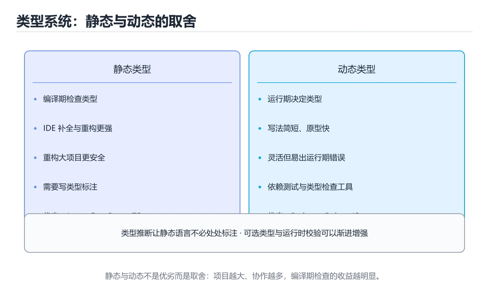

# 类型与变量：九种语言横向对照




> 内容更新时间：2026-10-06 · 学习阶段：入门 · 预计用时：40 分钟

## 本节知识框架

**课程定位**：所属分类 `cross_language`（跨语言对照），课程主题 `类型与变量：九种语言横向对照`，学习阶段 入门，建议用时 55 分钟。

本课主线：静态与动态、可变与不可变、空值表达的横向对照。

**学完本课应当能够**
- 说清 `变量` 与 `不可变` 的含义与区别，并各举一个正例和一个反例。
- 用本课示例验证 `装箱与拆箱` 的行为，记录输入、输出与失败条件。
- 遇到「用一门语言的类型规则套另一门」这类问题时，能说出触发条件与修复顺序。

### 复习清单

- [ ] 能用自己的话说明「类型与变量：九种语言横向对照」里的 类型系统，再举一个它不成立的场景。
- [ ] 能运行「类型与变量：九种语言横向对照」的示例，记录输入、输出与第一次失败的现象。
- [ ] 能完成一次自测，并把错题对照错误表定位原因。

## 核心概念定义

| 术语 | 操作性定义 | 常见边界与风险 |
| --- | --- | --- |
| 变量 | 类型与变量：九种语言横向对照解决了什么问题，而不是只背术语。 | 声明写法与默认语义各家不同：Shell 的 `x=1` 存进去是字符串，Rust 不写 `mut` 连重新赋值都不允许，照搬别家习惯当场就编不过。 |
| 不可变 | 对象创建后状态不再改变，更新时生成新对象，从而减少共享状态和并发错误。 | 易错：以为 `const`、`val` 锁住了对象内容；它只挡重新赋值，对象内部字段照样能改，共享出去仍会被并发改坏。 |
| 装箱与拆箱 | 值类型转成堆上对象再取回，每次都会分配或复制，是循环里常见的隐形开销。 | 只在值类型被当成对象用时才发生：循环里反复装箱把对象头开销放大成热路径瓶颈，包装值为空时取回又直接抛空指针。 |
| 隐式转换 | 编译器自动完成的类型转换，可能静默丢精度或改变比较结果，跨类型运算时要显式写清。 | 易错：隐式转换与溢出行为完全不同；正确做法是先查目标语言的数据模型与转换规则再迁移代码。 |
| Python | `x = 1` | 类型运行期才确定；`"1" + 1` 这类类型错误编译期拦不住，跑到才抛 `TypeError`。 |
| JavaScript | `let x = 1` | 隐式转换最容易踩坑：`"1" + 1` 拼成 "11"，`"1" - 1` 又算成 0；运算前要显式 `Number` 转换。 |
| TypeScript | `let x: number = 1` | 注解只在编译期拦截，转译后类型消失；数据来自运行期外部输入时这条保障不再存在。 |
| Java | `int x = 1;` | 类型编译期定死；数字与字符串相加看顺序：`1 + 2 + "a"` 得 "3a"，`"a" + 1 + 2` 得 "a12"。 |
| C# | `int x = 1;` | 数字与字符串直接相加要先注意顺序；示例给出的更安全的写法是插值 `$"{1 + 1}"`。 |
| C++ | `int x = 1;` | 两个整数相除是这条声明的经典坑：`double a = 5 / 2;` 得 2.0，要 2.5 须写 `5 / 2.0`。 |
| Go | `x := 1` | `:=` 推断出类型后就定死；不能像别的语言那样混着浮点用，须写 `b := float64(a) + 1.5`。 |
| Rust | `let mut x = 1;` | 不写 `mut` 就无法重新赋值；`mut` 也不让整数浮点混算，`1i32` 仍要显式 `as f64` 再参与运算。 |
| Shell | `x=1` | 存进去的是字符串不是数字：`echo "$a + 2"` 原样输出 "1 + 2"，要 `b=$((a + 2))` 才得 3。 |
| 静态 / 动态 | 类型在编译期还是运行时确定 | 它只回答类型何时确定，不说检查严不严：静态语言也有靠反射与强转才暴露的问题，动态语言则一次编译期拦截都没有。 |
| 强 / 弱 | 是否允许隐式跨类型转换 | 易错：把强类型当成静态类型；Python 强而动态、JavaScript 弱而动态，这一维只看敢不敢自动跨类型，与何时检查无关。 |
| 显式 / 推断 | 是否必须手写类型 | 推断省掉的只是书写：右侧表达式一确定结果就定死，它既不替你判空，也不改变可变性，更不能当成动态类型。 |
| 可变 / 不可变 | 默认能否重新赋值 | 各语言默认不同：Rust 要加 `mut`、Kotlin 用 `val`、TS 用 `const`；别把一门语言的默认搬到另一门。 |
| Python | 近似不允许（数字间除外） | 字符串与数字之间没有隐式转换：`"1" + 1` 直接抛 `TypeError`，须自己写 `str(1)` 或 `int("1")`。 |
| JavaScript | **大量隐式转换** | 同一个运算符结果类型不定：`"1" + 1` 变字符串 "11"，`"1" - 1` 变数字 0；比较运算前先用 `Number` 统一。 |
| TypeScript | 编译期拦截大部分 | 「大部分」不等于全拦：本课示例里 `a + "1"` 照样被放行、只是结果变成字符串，且转译之后注解整体消失。 |
| Java | 小范围到大范围自动 | 自动只覆盖小到大；反向和混用宽度会踩误区表「忽略数值宽度与默认类型」，触发整型溢出或浮点精度丢失。 |
| C# | 同上，另有 `checked` | 「同上」的自动同样只管小到大；范围外和溢出要动用这条多出的 `checked`，不能指望默认行为兜底。 |
| C++ | 大量隐式（含构造转换） | 构造转换与数值转换一样在调用处静默发生；再叠上整数除法 `5 / 2` 丢小数成 2.0 的经典坑，跨类型要显式写。 |
| Go | **不允许隐式数值转换** | 从 JavaScript、Python 迁来会处处被拦：`var b float64 = a` 是编译错误，只能显式 `float64(a)`。 |
| Rust | 不允许隐式转换 | 整数浮点混算要写 `let a = 1i32` 再显式 `a as f64`；与 C++ 的构造转换路径相反，编译器不会替你转。 |
| Shell | 一切皆字符串 | 没有数值类型兜底：离开 `$(( ))` 直接相加只会拼字符串，别指望 `+` 是其他语言里的数字加法。 |
| 内存 | 每个包装对象有对象头开销 | 对象头只在装箱发生时逐个增加；值类型不装箱就没有这项，要警惕的是循环里「每次都会分配或复制」。 |
| 性能 | 频繁装箱在热路径上会显著变慢 | 小流量下察觉不到，是循环次数把它放大；先固定输入跑基线，再把规模提高一个数量级复测才能下结论。 |
| 空值 | 包装类可能为 `null`，拆箱会抛空指针 | 易错：不同语言里空、未定义与默认值语义不同；正确做法是明确区分空值、缺失与默认值，并在序列化时写清约定。 |
| Java | `var list = new ArrayList<String>()` | 推断靠右侧完整构造，结果仍是写死的具体类型，之后不能换；这是编译期推断，不是动态类型。 |
| C# | `var user = new User()` | `var` 只推断出类型是 `User`；是否为空是另一回事，要按本课空值行的可空引用类型单独判断，别混为一谈。 |
| C++ | `auto p = std::make_unique<T>()` | `auto` 只是推断出右侧类型；空值检查仍要按本课空值行用 `nullptr` 判空，推断不会替你处理。 |
| Go | `n := 42` | 推断出的 `int` 当场定死；结合「不允许隐式数值转换」，之后不能与 float64 混用，须显式 `float64(n)`。 |
| Rust | `let x = 5;` | 类型推断不改变可变性：不写 `mut` 就不能重新赋值，要改须换成本表声明行的 `let mut x = 1;` 形式。 |
| Kotlin | `val x = 5` | 右侧 `5` 定类型、`val` 锁绑定，推断与不可变是这一行的两件事；不能因为没写类型就当成可变。 |
| TypeScript | `const x = 5` | 锁的是绑定可变性；且按本课检查时机行，TypeScript 只在编译期起作用，转译后这套约束就消失了。 |
| TypeScript | 编译期（转译后类型消失） | 它是这几行里唯一「检查做完就消失」的：产物是纯 JavaScript，同一段代码一到运行期就回到 JavaScript 那套隐式转换行为。 |
| Java / C# | 编译期 + 运行时（反射、强转） | 编译器给的绿灯只覆盖前半段：反射拿到的对象和向下强转要执行时才暴露，这一段静态检查管不到。 |
| Rust | 编译期 | 检查全压在编译期：漏写 `mut`、没处理 `Option<T>` 当场就编不过，所以运行期几乎不报这类错，别拿运行期没报错当作它没生效。 |
| Go | 编译期 + 运行时断言 | 断言那一步要执行时才定成败，编译通过不代表猜对了接口里装的实际类型；`nil` 也只出现在指针、切片、map 与接口这几类值上。 |
| Python / JavaScript | 运行时 | 没有编译期兜底：同一类输入 Python 抛 `TypeError`、JS 静默拼成 "11"，都要跑到才见分晓。 |
| 错误处理 | 显式返回或抛出 | 各语言口径不同：Python 类型错误直接抛异常，Rust 用 `Option<T>` 靠 `match`、`?` 强制处理；别只带一家的习惯去套另一家。 |
| 并发模型 | 线程、协程或事件循环 | 三种模型的调度顺序不同，串行跑一遍通过不代表共享状态在真并发下也安全；本课只做类型对照，没给各家的同步写法。 |
| 依赖管理 | 官方包管理器 | 这条只说明每种语言有自己的官方入口；正文未给出各家命令与版本策略，最忌把一门语言的依赖习惯套到另一门。 |

## 原理与运行机制

### 机制总览

**教材衔接：一句话目标**

变量「怎么声明、能不能改、能不能换类型」，最能体现一门语言的性格。
本文把九种语言放在同一张表里对照。

**教材衔接：空值怎么表达**

| 语言 | 空值 | 检查方式 |
| --- | --- | --- |
| Python | `None` | `if x is None:` |
| JavaScript | `null` / `undefined` | `x == null` 或 `x === undefined` |
| TypeScript | 同 JavaScript，加 `strictNullChecks` | 用 `?.` 与 `??` |
| Java | `null` | `Optional` 或判空 |
| C# | `null`（可空引用类型） | `?.` 与 `??` |
| C++ | `nullptr` | 判空或 `std::optional` |
| Go | `nil`（仅指针、切片、map、接口等） | `if x == nil` |
| Rust | 没有 null，用 `Option<T>` | `match`、`?`、`unwrap_or` |
| Shell | 空字符串 `""` | `[[ -z "$x" ]]` |

**Rust 用类型系统消灭了空指针**：想表达「可能没有」，就必须用 `Option<T>`，编译器强制你处理。

## 典型应用场景

- **用一门语言的类型规则套另一门**：典型现象是隐式转换与溢出行为完全不同；正确做法是先查目标语言的数据模型与转换规则再迁移代码。
- **忽略数值宽度与默认类型**：典型现象是整型溢出或浮点精度丢失；正确做法是明确位宽与精度，必要时显式指定类型。
- **把空值与缺失混为一谈**：典型现象是不同语言里空、未定义与默认值语义不同；正确做法是明确区分空值、缺失与默认值，并在序列化时写清约定。

### 最小验证场景

- 准备：保留 `text` 示例的原始输入，先记录 `类型与变量：九种语言横向对照` 的基线输出和完整运行命令。
- 观察：先核对 调用了 `println()`，再改变一个与 `变量` 相关的条件。
- 判定：新结果与 `类型与变量：九种语言横向对照` 的基线不同不等于错误；只有当差异破坏了 `变量` 的定义或错误表中的约束，才判定为失败。

### 选择与边界

- 使用 `变量` 时，类型与变量：九种语言横向对照解决了什么问题，而不是只背术语；静态检查只在编译期成立，运行期输入仍需校验。
- 使用 `不可变` 时，对象创建后状态不再改变，更新时生成新对象，从而减少共享状态和并发错误；共享状态与调度顺序会改变结论，单线程或串行测试通过不等于并发下成立。
- 使用 `装箱与拆箱` 时，值类型转成堆上对象再取回，每次都会分配或复制，是循环里常见的隐形开销；静态检查只在编译期成立，运行期输入仍需校验。
- 使用 `隐式转换` 时，编译器自动完成的类型转换，可能静默丢精度或改变比较结果，跨类型运算时要显式写清；易错：隐式转换与溢出行为完全不同；正确做法是先查目标语言的数据模型与转换规则再迁移代码。

## 代码/协议/SQL 示例

**教材衔接：数字与字符串的坑：九种语言对比**

```python
# Python：类型错误会直接抛异常
"1" + 1          # TypeError
"1" + str(1)     # "11"
int("1") + 1     # 2
```

```javascript
// JavaScript：会隐式转换，最容易踩坑
"1" + 1          // "11"（字符串拼接）
"1" - 1          // 0（转成数字）
Number("1") + 1  // 2
```

```typescript
// TypeScript：编译期就拦住
const a: number = 1;
// a + "1" 会被允许（结果为 string），但类型会变化
```

```java
// Java：字符串与数字相加会拼接，且顺序影响结果
System.out.println(1 + 2 + "a");   // "3a"
System.out.println("a" + 1 + 2);   // "a12"
```

```csharp
// C#：字符串插值是更安全的写法
Console.WriteLine($"{1 + 1}");      // "2"
```

```cpp
// C++：整数除法丢小数是最经典的坑
double a = 5 / 2;                  // 2.0，不是 2.5
double b = 5 / 2.0;                // 2.5
```

```go
// Go：类型严格，必须显式转换
var a int = 1
// var b float64 = a        // 编译错误
b := float64(a) + 1.5
```

```rust
// Rust：同样严格，整数与浮点不能混算
let a = 1i32;
let b = a as f64 + 1.5;
```

```bash
# Shell：一切皆字符串，需要算术时用 (( ))
a=1
b=$((a + 2))
echo "$b"                        # 3
echo "$a + 2"                    # 1 + 2（字符串）
```

## 时间/空间复杂度或性能分析

**性能关注点（类型与变量：九种语言横向对照）**：同一算法的实现差异体现在常数项与内存模型：用同一输入横向对比耗时与内存。

**本课特有开销（类型与变量：九种语言横向对照 · 类型系统）**：并发度提高后要观察是否出现拐点：延迟上升而吞吐不增，说明瓶颈已转移。

**测量方法**：以 `类型与变量：九种语言横向对照` 的 `类型系统` 场景为对象，固定输入跑一遍记录基线，再把规模或并发度提高一个数量级复测；两次结果的差值与波动范围才是结论依据。

## 常见误区与易错点

| 容易写错的做法 | 实际现象 | 原因与正确做法 |
| --- | --- | --- |
| 用一门语言的类型规则套另一门 | 隐式转换与溢出行为完全不同。 | 先查目标语言的数据模型与转换规则再迁移代码。 |
| 忽略数值宽度与默认类型 | 整型溢出或浮点精度丢失。 | 明确位宽与精度，必要时显式指定类型。 |
| 把空值与缺失混为一谈 | 不同语言里空、未定义与默认值语义不同。 | 明确区分空值、缺失与默认值，并在序列化时写清约定。 |

### 现场 1：用一门语言的类型规则套另一门

**症状**：隐式转换与溢出行为完全不同。

**根因与修复**：先查目标语言的数据模型与转换规则再迁移代码。

**自检**：在本课示例里复现「用一门语言的类型规则套另一门」，改成先查目标语言的数据模型与转换规则再迁移代码后重跑；如果症状消失且失败路径按预期变化，说明定位正确。

### 现场 2：忽略数值宽度与默认类型

**症状**：整型溢出或浮点精度丢失。

**根因与修复**：明确位宽与精度，必要时显式指定类型。

**自检**：在本课示例里复现「忽略数值宽度与默认类型」，改成明确位宽与精度，必要时显式指定类型后重跑；如果症状消失且失败路径按预期变化，说明定位正确。

### 现场 3：把空值与缺失混为一谈

**症状**：不同语言里空、未定义与默认值语义不同。

**根因与修复**：明确区分空值、缺失与默认值，并在序列化时写清约定。

**自检**：在本课示例里复现「把空值与缺失混为一谈」，改成明确区分空值、缺失与默认值，并在序列化时写清约定后重跑；如果症状消失且失败路径按预期变化，说明定位正确。

## 与其他知识点的关系

- **先修**：`九种语言的第一个程序`。本课默认这些内容已经掌握。
- **相关或后续**：`集合类型：九种语言横向对照`。本课术语会在这些课程里继续使用。
- **术语归属**：`变量`、`不可变`、`装箱与拆箱` 的定义以本课「核心概念定义」为准，换到其他课程时先确认定义是否被改写。

## 自测题与参考答案

> 先独立作答，再对照参考答案；答案都能在本课正文、术语表或错误表里找到依据。

### 自测 1（概念复述）

不看正文，写出 `变量` 的操作性定义，并说明它与 `不可变` 的区别。

**参考答案**：类型与变量：九种语言横向对照解决了什么问题，而不是只背术语。

`不可变` 的定位是：对象创建后状态不再改变，更新时生成新对象，从而减少共享状态和并发错误；两者的差别要从适用对象与失败模式上说明。

### 自测 2（排错）

本课错误表记录了「用一门语言的类型规则套另一门」这类做法。请写出它会出现的现象、根因，以及修复顺序。

**参考答案**：现象是隐式转换与溢出行为完全不同；正确做法是先查目标语言的数据模型与转换规则再迁移代码。修复时先复现现象并保留证据，再改动一处假设重跑，确认现象消失。

### 自测 3（动手验证）

运行本课的 `text` 示例，改动一个与 类型系统 有关的输入后重跑，记录输出与错误信息。

**参考答案**：正常输入下 `text` 示例应当复现正文给出的结果；改动输入后，如果结果改变或报错，先核对它是否满足 `类型与变量：九种语言横向对照` 中`变量` 的适用范围，再检查错误表里是否有同类现象。

### 自测 4（代码阅读）

阅读本课开头的 `text` 示例，说明它体现了`变量` 的哪一条性质，并指出改动哪个输入会让这条性质不再成立。

**参考答案**：`变量` 的定义是 类型与变量：九种语言横向对照解决了什么问题，而不是只背术语，示例正是在实现这条定义。改动与 `变量` 有关的一个输入后，如果结果不再符合 `类型与变量：九种语言横向对照` 的正文描述，就说明该性质只在当前前提成立。

### 自测 5（迁移）

把 `类型与变量：九种语言横向对照` 的方法迁移到自己的项目：围绕 `变量` 写出一个与错误表同类的风险点，并说明触发条件和检验方式。

**参考答案**：例如「把空值与缺失混为一谈」，它会导致不同语言里空、未定义与默认值语义不同；检验方式是按明确区分空值、缺失与默认值，并在序列化时写清约定改一处再复现，确认现象消失且没有引入新的失败分支。

### 自测 6（对比）

用一个表格对比 `变量` 与 `不可变`：各写一行适用场景、一行失败表现。

**参考答案**：`变量` 的定义是类型与变量：九种语言横向对照解决了什么问题，而不是只背术语；`不可变` 的定义是对象创建后状态不再改变，更新时生成新对象，从而减少共享状态和并发错误。两者的失败表现分别对应本课错误表里与本术语相关的行。

### 自测 7（排错顺序）

面对「用一门语言的类型规则套另一门」引发的问题，请把“复现 隐式转换与溢出行为完全不同 → 保留证据 → 先查目标语言的数据模型与转换规则再迁移代码 → 回归验证”四步写成可执行的检查清单。

**参考答案**：第一步按隐式转换与溢出行为完全不同复现；第二步记录输入、版本与完整报错；第三步按先查目标语言的数据模型与转换规则再迁移代码只改一处；第四步重跑并确认失败路径也按预期变化。

### 自测 8（边界判断）

针对 `隐式转换`，分别写出“可以使用”的条件和“结论不再成立”的条件。

**参考答案**：易错：隐式转换与溢出行为完全不同；正确做法是先查目标语言的数据模型与转换规则再迁移代码。 同时要把 `隐式转换` 的定义 编译器自动完成的类型转换，可能静默丢精度或改变比较结果，跨类型运算时要显式写清 与实际输入逐项对照。

### 自测 9（机制重建）

不看正文，按输入、转换、输出、验证四段重建 `变量` → `不可变` → `装箱与拆箱` → `隐式转换` 的作用链。

**参考答案**：起点是 `变量` 的定义 类型与变量：九种语言横向对照解决了什么问题，而不是只背术语；中间每一步都保留可观察状态；终点由 `隐式转换` 检查，失败时回到错误表定位第一个偏离定义的步骤。

### 自测 10（综合排错）

在 `类型与变量：九种语言横向对照` 中，现象是 不同语言里空、未定义与默认值语义不同。请围绕 把空值与缺失混为一谈 写出最小复现、关键证据、修复动作和回归验证，并说明为什么不能只凭一次运行下结论。

**参考答案**：先复现 把空值与缺失混为一谈，记录输入与完整错误；再按 明确区分空值、缺失与默认值，并在序列化时写清约定 只改一处。回归时同时跑正常路径和边界路径，只有两次结果都可解释，才把修复视为完成。

### 自测 11（一分钟复述）

用每分钟约 200 字的速度复述 `类型与变量：九种语言横向对照`：先给主问题，再按顺序说出 `变量`、`不可变`、`装箱与拆箱`、`隐式转换`，最后给一个失败案例。

**自评标准**：主问题必须对应 静态与动态、可变与不可变、空值表达的横向对照；每个术语都要能接上一句定义或边界；失败案例必须写成可观察现象，不能用“可能有风险”代替证据。

## 术语速查

| 术语 | 一句话说明 |
| --- | --- |
| `变量` | 类型与变量：九种语言横向对照解决了什么问题，而不是只背术语。 |
| `不可变` | 对象创建后状态不再改变，更新时生成新对象，从而减少共享状态和并发错误。 |
| `装箱与拆箱` | 值类型转成堆上对象再取回，每次都会分配或复制，是循环里常见的隐形开销。 |
| `隐式转换` | 编译器自动完成的类型转换，可能静默丢精度或改变比较结果，跨类型运算时要显式写清。 |

**术语关系**：`变量`（类型与变量：九种语言横向对照解决了什么问题） → `不可变`（对象创建后状态不再改变） → `装箱与拆箱`（值类型转成堆上对象再取回） → `隐式转换`（编译器自动完成的类型转换）。

## 考点精讲

`类型与变量：九种语言横向对照` 的题库有 6 道题，下面逐题给出题干、正确项与判断依据：先自己作答，再核对正确项，最后回到正文对应小节复核。

### 考点 1：第 1 题

- **题目**：按“类型与变量：九种语言横向对照”中 类型系统、变量、不可变 的实践顺序，把四个步骤排成从准备到复盘的合理顺序。
- **正确项**：先明确 类型系统 的输入、输出与约束 → 写出最小示例并核对 变量 的基线结果 → 只改一个变量，记录边界与失败路径的变化 → 固定版本与证据，把“类型与变量：九种语言横向对照”的结论写成可复现记录
- **判断依据**：按《类型与变量：九种语言横向对照》正文的先后，本题顺序是「先明确 类型系统 的输入、输出与约束」 → 「写出最小示例并核对 变量 的基线结果」 → 「只改一个变量，记录边界与失败路径的变化」 → 「固定版本与证据，把“类型与变量：九种语言横向对照”的结论写成可复现记录」。题干里的「按类型与变量九种语言横向对照中类」要放回《类型与变量：九种语言横向对照》的主线里看：静态与动态、可变与不可变、空值表达的横向对照。做「按类型与变量九种语言横向对照中类」这类判断时，常踩的坑是用一门语言的类型规则套另一门，其后果是隐式转换与溢出行为完全不同。按本课口径，「按类型与变量九种语言横向对照中类」这类题应是先查目标语言的数据模型与转换规则再迁移代码。

### 考点 2：第 2 题

- **题目**：在 JavaScript 中，表达式 "1" + 1 的结果是？
- **正确项**："11"
- **判断依据**：按《类型与变量：九种语言横向对照》的正文口径，本题正确项是「"11"」。题干里的「在JavaScript中表达式"」要放回《类型与变量：九种语言横向对照》的主线里看：静态与动态、可变与不可变、空值表达的横向对照。做「在JavaScript中表达式"」这类判断时，常踩的坑是用一门语言的类型规则套另一门，其后果是隐式转换与溢出行为完全不同。按本课口径，「在JavaScript中表达式"」这类题应是先查目标语言的数据模型与转换规则再迁移代码。干扰项「抛出类型错误」与题干「在 JavaScript 中，表达式 "1" + 1 的结果是」的要求对不上，应排除。

### 考点 3：第 3 题

- **题目**：哪门语言用类型系统彻底消灭了空指针？
- **正确项**：Rust
- **判断依据**：按《类型与变量：九种语言横向对照》的正文口径，本题正确项是「Rust」。题干里的「哪门语言用类型系统彻底消灭了空指」要放回《类型与变量：九种语言横向对照》的主线里看：静态与动态、可变与不可变、空值表达的横向对照。做「哪门语言用类型系统彻底消灭了空指」这类判断时，常踩的坑是用一门语言的类型规则套另一门，其后果是隐式转换与溢出行为完全不同。按本课口径，「哪门语言用类型系统彻底消灭了空指」这类题应是先查目标语言的数据模型与转换规则再迁移代码。干扰项「Java」与题干「哪门语言用类型系统彻底消灭了空指针」的要求对不上，应排除。

### 考点 4：第 4 题

- **题目**：关于整数除法，下面哪个说法正确？
- **正确项**：C++、Java、Go 的整数除法会截断小数部分
- **判断依据**：按《类型与变量：九种语言横向对照》的正文口径，本题正确项是「C++、Java、Go 的整数除法会截断小数部分」。题干里的「关于整数除法下面哪个说法正确」要放回《类型与变量：九种语言横向对照》的主线里看：静态与动态、可变与不可变、空值表达的横向对照。做「关于整数除法下面哪个说法正确」这类判断时，常踩的坑是用一门语言的类型规则套另一门，其后果是隐式转换与溢出行为完全不同。按本课口径，「关于整数除法下面哪个说法正确」这类题应是先查目标语言的数据模型与转换规则再迁移代码。干扰项「所有语言的 5 / 2 都等于 2.5」与题干「关于整数除法，下面哪个说法正确」的要求对不上，应排除。

### 考点 5：第 5 题

- **题目**：`类型与变量：九种语言横向对照` 的示例代码服务于“静态与动态、可变与不可变、空值表达的横向对照。”哪一条判断是正确的？
- **正确项**：Rust
- **判断依据**：按《类型与变量：九种语言横向对照》的正文口径，本题正确项是「Rust」。题干里的「类型与变量九种语言横向对照的示例」要放回《类型与变量：九种语言横向对照》的主线里看：静态与动态、可变与不可变、空值表达的横向对照。做「类型与变量九种语言横向对照的示例」这类判断时，常踩的坑是用一门语言的类型规则套另一门，其后果是隐式转换与溢出行为完全不同。按本课口径，「类型与变量九种语言横向对照的示例」这类题应是先查目标语言的数据模型与转换规则再迁移代码。干扰项「JavaScript」与题干「`类型与变量：九种语言横向对照` 的示例代码服务于静态与动态、可变与不可变、空值表达的横向对照。哪一条判断是正确的？」的要求对不上，应排除。

### 考点 6：第 6 题

- **题目**：关于 `变量`，下列哪些说法与 `类型与变量：九种语言横向对照` 的正文一致？判断时以静态与动态、可变与不可变、空值表达的横向对照。为主线。（多选）
- **正确项**："11"；Rust
- **判断依据**：按《类型与变量：九种语言横向对照》的正文口径，本题要同时选中「"11"」、「Rust」，漏掉任一项都算没答全。题干里的「关于变量下列哪些说法与类型与变量」要放回《类型与变量：九种语言横向对照》的主线里看：静态与动态、可变与不可变、空值表达的横向对照。做「关于变量下列哪些说法与类型与变量」这类判断时，常踩的坑是用一门语言的类型规则套另一门，其后果是隐式转换与溢出行为完全不同。按本课口径，「关于变量下列哪些说法与类型与变量」这类题应是先查目标语言的数据模型与转换规则再迁移代码。

### 考点 7：`变量`

- **要点**：类型与变量：九种语言横向对照解决了什么问题，而不是只背术语。
- **变量 的边界**：静态检查只在编译期成立，运行期输入仍需校验。

### 考点 8：`不可变`

- **要点**：对象创建后状态不再改变，更新时生成新对象，从而减少共享状态和并发错误。
- **不可变 的边界**：共享状态与调度顺序会改变结论，单线程或串行测试通过不等于并发下成立。

### 考点 9：`装箱与拆箱`

- **要点**：值类型转成堆上对象再取回，每次都会分配或复制，是循环里常见的隐形开销。
- **装箱与拆箱 的边界**：静态检查只在编译期成立，运行期输入仍需校验。

### 考点 10：`隐式转换`

- **要点**：编译器自动完成的类型转换，可能静默丢精度或改变比较结果，跨类型运算时要显式写清。
- **隐式转换 的边界**：易错：隐式转换与溢出行为完全不同；正确做法是先查目标语言的数据模型与转换规则再迁移代码。

### 考点 11：排错——用一门语言的类型规则套另一门

- **现象**：隐式转换与溢出行为完全不同。
- **处理**：先查目标语言的数据模型与转换规则再迁移代码。

### 考点 12：排错——忽略数值宽度与默认类型

- **现象**：整型溢出或浮点精度丢失。
- **处理**：明确位宽与精度，必要时显式指定类型。

### 考点 13：综合辨析——`变量` 与 `隐式转换`

- **辨析点**：`变量` 的定义是 类型与变量：九种语言横向对照解决了什么问题，而不是只背术语；`隐式转换` 的定义是 编译器自动完成的类型转换，可能静默丢精度或改变比较结果，跨类型运算时要显式写清。
- **答题要求**：面对 `类型与变量：九种语言横向对照` 的题目，先判断描述的是 `变量` 还是 `隐式转换`，再归到对应定义，最后写出一个会让该定义失效的边界输入。

### 考点 14：排错评分点

- **现象分**：能写出 隐式转换与溢出行为完全不同，而不是只写“程序有错”。
- **证据分**：保留触发 用一门语言的类型规则套另一门 的输入、版本和错误原文。
- **修复分**：按 先查目标语言的数据模型与转换规则再迁移代码 只改一处，并同时回归正常路径与边界路径。

## 内容元数据

- 内容版本：v2.0
- 最后更新：2026-10-06
- 学习阶段：入门
- 适用环境：九种主流语言生态横向对照；本课聚焦 类型系统。
；本课聚焦 类型系统。
- 内容来源：内置结构化课程与工程实践整理
- 相关主题：类型系统、变量、不可变、空值、类型推断
- 质量版本：P0 测验标准 + P1 覆盖扩展 + P2 体验补全

## 参考资料与复核

- 最后复核：2026-10-04
- 下次复核：2027-07-17
- 复核范围：版本兼容、API 行为、安全建议与工程实践
- 来源性质：官方文档、标准或权威教材；本课核对关键词：类型系统、变量、不可变、空值、类型推断。

| 参考资料 | 本课用途 |
| --- | --- |
| [DevDocs](https://devdocs.io/) | 多语言 API 快速检索 |
| [Exercism](https://exercism.org/docs) | 多语言练习与反馈 |
| [Rosetta Code](https://rosettacode.org/wiki/Rosetta_Code) | 同一任务的跨语言实现 |

| [本课术语索引：类型与变量：九种语言横向对照](#核心概念定义) | 按本课输入、术语边界和错误表现逐项核对 |
> 「类型与变量：九种语言横向对照」的链接用于离线阅读后的延伸核对；App 不会自动联网。