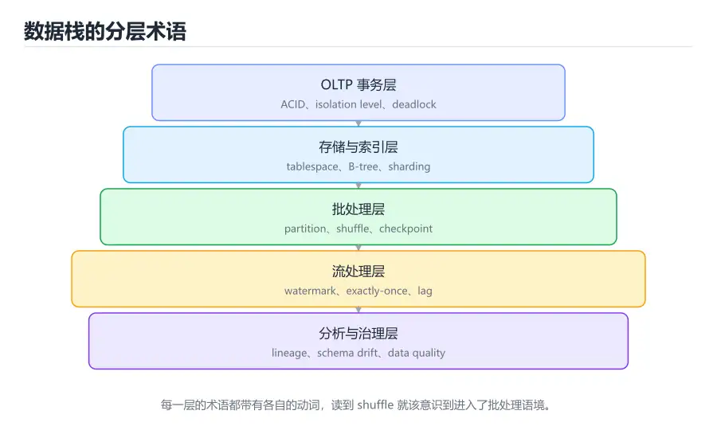

# 数据库与大数据英语：ACID、OLAP 与论文里的定义句

> 内容更新时间：2026-10-06 · 学习阶段：进阶 · 预计用时：42 分钟



## 本节知识框架

**课程定位**：所属分类 `cs_english`（计算机专业英语）· 学习阶段 进阶 · 建议用时 42 分钟。

先看一段最典型的数据库英文报错：

> `ERROR:  column "u.name" must appear in the GROUP BY clause or be used in an aggregate function`
> `LINE 1: SELECT u.id, u.name FROM users u GROUP BY u.id;`

三行各有分工：第一行是问题本体（`must appear in ... or be used in ...` 二选一），第二行回显出错位置并插入脱字符，第三行给出建议。读数据库报错的口诀是「先抓动词短语，再看被引号包住的标识符，最后找 HINT」——引号里的 `u.name` 才是真正要改的东西，而不是整句话。

数据类文本分三层，英文脾气完全不同：**SQL 标准与官方手册**用大量被动与形式化定义句（`is guaranteed to produce`、`must not occur`）；**引擎文档与报错**用短句加固定搭配（`violates unique constraint`、`does not exist`）；**分布式与大数据论文/文档**爱用「机制 + 代价」句式（`making the shuffle a complex and costly operation`）。配图把这五层串起来：OLTP 事务层、存储索引层、批处理层、流处理层、分析治理层。读到 `watermark` 就该意识到进了流处理语境，读到 `shuffle` 就在批处理语境，读到 `lineage` 就在治理语境——**用动词定位语境**是本课的核心技巧。

**复习清单**

- [ ] 能说出 ACID 四个字母各自的英文全称与词源本义
- [ ] 能区分 OLTP 与 OLAP 两个缩写的第三个字母所代表的不同名词
- [ ] 能还原 DML、DDL、MVCC、WAL、ETL、CAP 六个缩写并说明差别
- [ ] 能把一句 45 词的 SQL 标准定义句拆成主干加两层定语再翻译
- [ ] 能识别 Suppose the power to the computer were cut 里的虚拟语气并正确理解
- [ ] 能从 PostgreSQL 三段式报错（ERROR/DETAIL/HINT）里判断修复动作
- [ ] 能解释 `tuple`、`cardinality`、`quorum`、`record` 四个词的日常本义如何变成术语

## 核心概念定义

| 术语 | 一句话说明 |
| --- | --- |
| 定义句式 | `X is defined as ... which says that ...`，标准文本用嵌套从句把性质包进一句里，读时要先剥从句 |
| 强制与禁止 | `must not occur`、`is guaranteed to`，前者是禁止性条款，后者是保证性条款，语气不可互换 |
| 虚拟语气 | `Suppose the power were cut` 用 were 表假设，说明这是在构想一个尚未发生的场景 |
| 三段式报错 | 引擎输出常分 ERROR（问题）、DETAIL（证据）、HINT（动作），英文长度递增、动词递减 |
| 事务 | transaction，`trans-`（跨越）+ `act`（做），字面「跨过去的一次动作」，故强调不可分 |
| 隔离级别 | isolation level，SQL 标准定义四档，文档用 phenomena（现象）而不是 errors 来刻画破坏 |
| 快照 | snapshot，`snap`（一拍）+ `shot`，指某一时刻数据状态的一份可读副本 |
| 倾斜 | skew，本义「斜置」，数据倾斜是 `skewed`，读写时都当形容词用 |
| 背压 | backpressure，流处理里下游对上游说「慢一点」，动词形式是 `apply backpressure` |
| 血缘 | lineage，来自 `line`，指字段从哪张表经哪些作业流过来的链路记录 |

## 原理与运行机制

### 一段 SQL 标准定义的逐句剥洋葱

PostgreSQL 手册讲隔离级别时转述了 SQL 标准的定义，这是典型的形式化长句：

> **The SQL standard defines four levels of transaction isolation. The most strict is Serializable, which is defined by the standard in a paragraph which says that any concurrent execution of a set of Serializable transactions is guaranteed to produce the same effect as running them one at a time in some order.**

拆法：第一句是主谓宾骨架（标准定义四级）。第二句主干是 `The most strict is Serializable`，后面挂了三层嵌套：`which is defined by the standard in a paragraph`（限定 Serializable）、`which says that ...`（限定那个段落）、`that` 从句里真正的内容是 `any concurrent execution ... is guaranteed to produce the same effect as running them one at a time in some order`。注意三个短语：`a set of`（一组）、`in some order`（按某种顺序，some 在这里不是「某个未知的」而是「存在某一个」）、`the same effect as running them one at a time`（与逐个执行的效果相同）。中文必须拆成三到四个短句，否则会把「按某种顺序逐个执行」丢掉。

同一段落后面还有一句值得记：

> **This is acceptable under the SQL standard because the standard specifies which anomalies must not occur at certain isolation levels; higher guarantees are acceptable.**

`under the standard` 是「按照该标准」（`under` 在法律与规范文本里常见），`anomalies` 指异常现象而非「故障」，分号后的 `higher guarantees are acceptable` 是结论：允许给出比标准更强的保证。

### 虚拟语气与省略：SQLite 的一段说明

> **An atomic commit is supposed to happen instantaneously. But the processing described above clearly takes a finite amount of time. Suppose the power to the computer were cut part way through the commit operation described above.**

三句话三个语法点。第一句 `is supposed to` 不是「被猜测」而是「按定义应当」，与 `is expected to` 同类但更强；`instantaneously` 来自 `instant`，「一瞬间」。第二句 `the processing described above` 是「过去分词短语作后置定语」，`a finite amount of time` 意为「有限时间」即「不是零」。第三句是本课的重点：`Suppose the power ... were cut` 是祈使句引导的假设，从句用 `were`（不是 `was`）表明虚拟语气，意思是「设想供电在提交过程中途被切断」——读成「当时电源被切断了」就把假设当成了事实。同一段里还有 `In order to maintain the illusion that the changes were instantaneous` —— `illusion`（幻觉）在这里是「对外表现出的假象」，指数据库要维持「变更是瞬时发生」这一假象。

SQLite 官网那句口号式的短语也值得玩味：

> **Small. Fast. Reliable. Choose any three.**

三个形容词独立成句、没有主语没有谓语，第四句是祈使句。英文技术标语就爱这种「名词/形容词 + 句号」的极简结构，中文如果补全成「它是小的、快的、可靠的」反而失去了味道；`Choose any three` 的字面是「任选三个」，隐含的玩笑是三者难以同时得到。

### 论文与引擎文档里的「机制 + 代价」句式

Spark 文档解释 shuffle 时的写法，几乎是所有大数据论文的模板：

> **The shuffle is Spark's mechanism for re-distributing data so that it's grouped differently across partitions. This typically involves copying data across executors and machines, making the shuffle a complex and costly operation.**

第一句是下定义：`X is the mechanism for V-ing so that 从句`。第二句给代价：`This typically involves V-ing ..., making X a ... operation`，其中 `making ...` 是现在分词短语作结果状语，中文要补出「因此」。`re-distributing` 里的 `re-`（再一次）与 `dis-`（分开）叠加，字面「重新拆开分发」，正是按 key 重排的含义；`across partitions` 的 `across` 表「横跨多个」。把这套句式背下来，读任何一篇系统论文的方法段都能预测下文。

### 词源与缩写：数据领域的两张词表

**词源**。`record` 本义「再想起」（`re-` + `cor`/`cord` 心，与 `core`、`concord` 同族），所以「记录」的原义是「写下来供回忆的东西」；`index` 来自拉丁 `index`「食指」，引申为「指出位置的东西」，中文「索引」正好对应；`tuple` 是从 `sextuple`（六元组）等词里反推出来的逆构词（back-formation），本义「几重」，在关系模型里指一行元组；`cardinality` 来自 `cardo`（门轴），字面「门轴的数量」，数学里指集合的势；`quorum` 是拉丁语 `of whom`，源自教会「需要多少人在场决议才有效」，分布式共识协议直接借用了这个词；`schema` 来自希腊 `schēma`（形状、图式），与 `scheme` 同源，中文分别定名「模式」与「方案」；`null` 来自拉丁 `nullus`（没有任何），`NULL` 在 SQL 里表示「未知」而不是「空字符串」，这条区别在英文文档里靠 `unknown value` 一词点明。

**缩写**。ACID = Atomicity、Consistency、Isolation、Durability（原子性、一致性、隔离性、持久性；`atomic` 来自希腊 `atomos`「不可分割」，`durability` 来自 `durare`「持续」，与 `endure`、`durable goods` 同族）；BASE = Basically Available、Soft state、Eventual consistency，是与 ACID 对立的工程取舍口径；CAP 是 Consistency、Availability、Partition tolerance 三选二的定理名；OLTP = Online Transaction Processing，OLAP = Online Analytical Processing，两个缩写的差别全在第三个名词（transaction 与 analytical），`online` 在这里指「即时响应」而不是「联网」；DML = Data Manipulation Language（增删改查数据本身），DDL = Data Definition Language（建表改结构），DCL = Data Control Language（授权），TCL = Transaction Control Language（提交回滚）；MVCC = Multi-Version Concurrency Control；WAL = Write-Ahead Logging（`ahead` 表示「在……之前先写」）；ETL = Extract, Transform, Load；NoSQL 的 `No` 官方口径是「not only」而非「no」，属于借缩写做的重新解释。

顺便记一段命名史：SQL 最初在 IBM 叫 **SEQUEL**（Structured English Query Language 的缩写），因商标问题改名 SQL。所以老工程师读到 `sequel` 与 `SQL` 是同一个东西，读音上 `/ɛs kjuː ɛl/` 与 `/siːkwəl/` 两种都算规范——这类「读法之争」在 `SQL`、`GUI`、`HTTP` 上都会遇到，先记住全称再决定读音最稳。

## 典型应用场景

### 场景一：读一段引擎报错

```text
ERROR:  duplicate key value violates unique constraint "users_email_key"
DETAIL:  Key (email)=(user@mail.acme.io) already exists.
HINT:  Use INSERT ... ON CONFLICT to update the existing row instead.
```

三行的英文结构固定：`violates ... constraint`（违反了某个约束，`violate` 本义「违犯」，宾语只能是规则不能是人）、`Key (col)=(value)`（键值对回显，括号里是列名、等号后是值）、`already exists`（已存在）。约束名 `users_email_key` 是 PostgreSQL 自动命名规则 `表名_列名_key`，读到后缀 `_key`、`_pkey`、`_fkey`、`_check` 就能反推约束类型。这类句子的中文翻译要点是把被动还原成主动：「插入的 email 值与唯一约束冲突，该值已存在」。

### 场景二：读论文摘要里的取舍句

> **We trade strong consistency for availability during a network partition, which allows the system to keep serving reads from a stale replica.**

`trade A for B`（用 A 换 B，方向不要读反）、`during a network partition`（在网络分区期间）、`stale replica`（过期副本，`stale` 本义「放久了不新鲜的」）。摘要里的取舍句几乎都是这个骨架，认出 `trade ... for ...`、`at the cost of`、`sacrifice X to gain Y` 三种变体就够了。

### 场景三：读作业日志里的流处理术语

```text
[KafkaConsumer] Consumer group order-pipeline rebalancing: joining 3 members
[StreamThread] Detected lag 128437 records on partition orders-0; applying backpressure
[Watermark] Advancing stream watermark from 1712340000 to 1712340060
```

`rebalancing`（再平衡，`balance` 加 `re-`）、`lag`（落后量，动词是 `fall behind`，名词多用 lag 或 consumer lag）、`applying backpressure`（施加背压）、`Advancing ... watermark`（推进水位线，`advance` 及物用法）。看到 `watermark` 就该明白这是「事件时间的进度标记」，不是图片上的水印——同一个英文词在不同语境里义项完全不同，这是专业英语考试最爱设的陷阱。

### 场景四：把中文设计文档翻成英文

写英文表设计时三条规矩：字段名用一般现在时主动语态（`stores the last login timestamp`，别写 `is used for storing`）、约束说明用名词短语（`Unique per tenant`）、限制条款用 `must`（`Callers must hold the lock before writing.`）。避免中文直译腔的经典错句：`This table is used to store the user information.` 更地道的写法是 `Holds one row per user; keyed by (tenant_id, email).`

## 代码/协议/SQL 示例

### 用 SQL 复现并读懂两条报错

```sql
CREATE TABLE users (
    id         BIGSERIAL PRIMARY KEY,
    email      TEXT NOT NULL UNIQUE,
    created_at TIMESTAMPTZ NOT NULL DEFAULT now()
);

-- 触发第一条：SELECT 列表里出现了未聚合也未分组的列
SELECT id, email, count(*) FROM users GROUP BY id;

-- 触发第二条：违反唯一约束，看 DETAIL 行的 Key (email)=(...) 结构
INSERT INTO users (email) VALUES ('user@mail.acme.io');
```

第一句报错里的 `must appear in the GROUP BY clause or be used in an aggregate function` 是两个可选动作，英文用 `or` 连接；第二句报错的 `violates` 主语是「值」，中文别译成「数据库违反了约束」。

### 用 Python 观察事务隔离的英文行为

```python
import sqlite3

conn = sqlite3.connect(":memory:", isolation_level=None)
conn.execute("BEGIN IMMEDIATE")
conn.execute("CREATE TABLE t (k INTEGER PRIMARY KEY, v TEXT)")
conn.execute("INSERT INTO t VALUES (1, 'pending')")
cur = conn.execute("SELECT v FROM t WHERE k = 1")
print(cur.fetchone()[0], conn.in_transaction)  # 提交前仍在事务中
conn.execute("COMMIT")
```

`isolation_level=None` 在 Python 的 sqlite3 文档里的说明是自动提交模式，`BEGIN IMMEDIATE` 的名字直接告诉你它要立刻拿写锁；`in_transaction` 是布尔属性，读作「是否处于事务中」。这类 API 名本身就是英文短句，别把它们当变量符号死记。

## 时间/空间复杂度或性能分析

### 阅读成本：三层文本三种速度

标准定义句一句 40~50 词、三层从句，精读约 90 秒；引擎文档的功能描述句平均 20 词，约 25 秒；报错三行通常 8 秒可定位到要改的标识符。大数据论文的摘要约 200 词，第一遍应在 3 分钟内只抓四件事：问题、方法、数据集、量化结论。练习方法是给每段做「五个词复述」——复述不出来说明主干读错了，而不是词汇不够。

### 术语口径与性能指标的对应

数据领域英文指标最容易被混译：`qps`（queries per second）与 `rps`（requests per second）主语不同，`p99` 与 `avg` 口径不同，`throughput` 高不等于 `latency` 低。批处理里 `shuffle volume` 指跨节点搬运的数据量，英文文档说 `the shuffle is expensive since it involves disk I/O, data serialization, and network I/O`，三个名词并列即成本来源；读到这里就明白为什么 `broadcast join` 用内存换网络。写英文报告时把数字的口径写在括号里（`45 ms (p99, 200 RPS)`），可以避免绝大多数误解。

## 常见误区与易错点

| 序号 | 容易踩的做法 | 正确的判断 |
| --- | --- | --- |
| 1 | 把 `isolation` 一律译成「隔离」而忽略级别 | 文档里 `isolation level` 是四档之一的专名，需带级别名一起译 |
| 2 | 把 `anomaly` 译成「故障」 | 规范文本用 anomaly 指「异常现象」，是可观察的破坏模式而非 bug |
| 3 | 把 `Suppose the power were cut` 译成「假设电源被切断了（已发生）」 | 虚拟语气，指设想场景，与事实无关 |
| 4 | 把 `is supposed to` 译成「据说应该」 | 它是「按定义/按规范应当」，比 `is expected to` 更强调约定 |
| 5 | 把 OLAP 的 online 理解成「需要联网」 | 此处 online 指即时响应，与离线批处理相对 |
| 6 | 把 DML 当成「数据建模语言」 | DML 是 Data Manipulation Language，建模属于 DDL 或设计文档 |
| 7 | 把 `stale replica` 译成「失效副本」 | stale 是「尚未刷新」，仍在服务但可能读到旧值 |
| 8 | 把 `violates unique constraint` 译成「数据库违反唯一约束」 | 主语是插入的值或语句，不是数据库本身 |
| 9 | 把 `watermark` 一律译成水印 | 流处理里是事件时间进度标记，中文常直译「水位线」 |
| 10 | 把 `trade consistency for availability` 译成「用可用性换一致性」 | `trade A for B` 是放弃 A 换取 B，方向弄反结论就全反 |

## 与其他知识点的关系

### 分类内的上下游

本课大量使用第 1 课 `cs_english_overview` 的 `st/stat`（state、instance、constant）、`pon/pos`（component、repository）、`duc`（reduce、produce）三个词根；`record` 与 `cardinality` 属 `cord`、`cardo` 两支拉丁词根。被动语态与定语从句的处理规则在第 7 课 `cs_english_reading_strategy` 里被系统化成五步法，本课的 SQL 标准长句是它的练习材料；缩写还原三步法来自第 2 课 `cs_english_hardware`，本课把它用在 ACID、BASE、MVCC、WAL 上。

### 与技术类课程的对应

`database_system` 分类讲范式分解与并发调度，本课讲 `normal form`、`anomaly`、`serializable` 这些英文词为什么这样命名；`big_data` 分类讲 MapReduce 与 shuffle 实现，本课讲 `The shuffle is Spark's mechanism for re-distributing data` 这类机制句的读法与仿写。把术语的英文原名记牢，还能帮你直接在搜索引擎里定位到官方章节，避免二手译文。

## 自测题与参考答案

下面 5 道题与「考点精讲」是同一批数据：题干、四个选项原文、答案字母（A 对应第 1 个选项）都一致。建议先只读题干作答、记下自己的理由，再翻到精讲逐条核对。

### 自测 1（单选）

ACID 里 Durability 一词的英文本义与中文定名的对应关系，下列说法正确的是哪一项？

A. 来自 durable 的名词化，指数据被备份到多份副本因而不会丢失，中文应译成冗余性

B. 词根 dur 表坚硬，因此该属性描述的是存储介质的物理强度，与事务提交顺序无关

C. 词根 dur 表持续，与 endure 同族，含义是提交完成后即使断电也不再丢失，中文定名持久性

D. 与 duration 同源，含义是事务存活时间足够长，中文应译成持续性并用于超时配置

**参考答案：C**

### 自测 2（单选）

SQLite 文档里 Suppose the power to the computer were cut part way through the commit operation 一句，读法要点是什么？

A. 用一般过去时叙述一次真实发生过的断电事故，后文会给出该事故的处理结果

B. 用 Suppose 引导假设、were 表虚拟语气，构想的场景并未发生，中文要说设想断电发生在中途

C. 用被动语态说明电源被运维人员按计划切断，part way 指切断了线路的一部分而非时间

D. 用祈使句要求读者亲手切断电源以复现故障，属于实验步骤而不是假设推理

**参考答案：B**

### 自测 3（代码）

执行上面的查询得到 must appear in the GROUP BY clause or be used in an aggregate function 这条报错，关于英文原句的理解，下列判断正确的是哪一项？

```sql
SELECT u.id, u.name, count(*) AS n
  FROM users u JOIN orders o ON o.user_id = u.id
 GROUP BY u.id;
```

A. 报错给出两个可选动作：把该列加入分组，或把它包进聚合函数，二选一即可通过语法检查

B. 报错说明该列名拼写有误，引擎找不到名为 name 的列，需要核对表结构后再重新提交

C. 报错要求删除该列，因为 GROUP BY 之后任何非分组列都不允许出现在选择列表里

D. 报错说明连接条件写错导致出现重复行，应先修正 ON 子句再考虑分组问题

**参考答案：A**

### 自测 4（单选）

论文摘要里 We trade strong consistency for availability during a network partition 一句，译文的正确方向是哪一项？

A. 在分区期间用可用性换取强一致性，即牺牲可用性来保证一致性不被破坏

B. 在分区期间把一致性交给可用性模块处理，两者通过接口交换数据来完成读写

C. 在分区期间同时保住强一致性与可用性，二者互相交换以实现最优的读性能

D. 在分区期间放弃强一致性以换取可用性，即允许部分节点继续服务而可能读到旧值

**参考答案：D**

### 自测 5（多选）

关于数据系统文档里几个常见缩写的还原，下列哪些说法是正确的？（多选）

A. OLAP 的第三个字母来自 Application，说明它面向应用层调用，与联机事务处理在英文定名上并无区别

B. DML 是 Data Manipulation Language，处理表中的数据行，建表与改结构属于 DDL 而非 DML

C. WAL 的 Write-Ahead 表示日志必须先于数据页落盘，ahead 在此读作在……之前

D. MVCC 的 Multi-Version 指同一行保留多个历史版本，靠快照读代替加锁读以提高并发

**参考答案：B、C、D**

### 自测 6（单选）

引擎报错 duplicate key value violates unique constraint "users_email_key" 中，主语与谓语的关系应如何理解？

A. 主语是被插入的键值，违反约束的是这条语句，数据库只是判定并拒绝的一方

B. 主语是数据库进程，说明数据库实现有缺陷，应当提交缺陷报告等待补丁发布

C. 主语是唯一约束本身，它违反了键值的要求，因此需要删除该约束才能继续写入

D. 主语与谓语之间缺少助动词，这句是残缺句子，真实含义无法从英文原文判断

**参考答案：A**

## 考点精讲

每条先给判断依据的落点，再复述正确项原文与干扰项的处理方式。

### 考点 1

**第 1 题** ACID 里 Durability 一词的英文本义与中文定名的对应关系，下列说法正确的是哪一项？

**正确答案：C**


A. 来自 durable 的名词化，指数据被备份到多份副本因而不会丢失，中文应译成冗余性

B. 词根 dur 表坚硬，因此该属性描述的是存储介质的物理强度，与事务提交顺序无关

C. 词根 dur 表持续，与 endure 同族，含义是提交完成后即使断电也不再丢失，中文定名持久性

D. 与 duration 同源，含义是事务存活时间足够长，中文应译成持续性并用于超时配置


**解析**：本题正确项是「词根 dur 表持续，与 endure 同族，含义是提交完成后即使断电也不再丢失，中文定名持久性」。`durare` 是拉丁语「持续」，派生出 `durable`、`durability`、`endure`，在事务语境里专指已提交的写入不会因掉电或崩溃被抹去，实现手段就是先写日志再改数据页。备份多份属于冗余（`redundancy`），时长设置属于 `duration`，这两者都不能拿来解释 ACID 的 D。干扰项「来自 durable 的名词化，指数据被备份到多份副本因而不会丢失，中文应译成冗余性」把冗余与持久混为一谈；干扰项「与 duration 同源，含义是事务存活时间足够长，中文应译成持续性并用于超时配置」虽抓住同源词却把语义换成时间长度，方向偏了。

### 考点 2

**第 2 题** SQLite 文档里 Suppose the power to the computer were cut part way through the commit operation 一句，读法要点是什么？

**正确答案：B**


A. 用一般过去时叙述一次真实发生过的断电事故，后文会给出该事故的处理结果

B. 用 Suppose 引导假设、were 表虚拟语气，构想的场景并未发生，中文要说设想断电发生在中途

C. 用被动语态说明电源被运维人员按计划切断，part way 指切断了线路的一部分而非时间

D. 用祈使句要求读者亲手切断电源以复现故障，属于实验步骤而不是假设推理


**解析**：本题正确项是「用 Suppose 引导假设、were 表虚拟语气，构想的场景并未发生，中文要说设想断电发生在中途」。判断依据有两处：`Suppose` 后接从句时主句动词用原形，从句动词用 were 而不是 was，是虚拟语气的形式标记；`part way through the commit operation` 说的是「提交过程进行到一半」，part way 修饰时间进度。全句为下一句的回滚设计提供前提。干扰项「用一般过去时叙述一次真实发生过的断电事故，后文会给出该事故的处理结果」把虚拟语气读成过去事实，正是文档阅读里最常见的一次语义跳跃；干扰项「用被动语态说明电源被运维人员按计划切断，part way 指切断了线路的一部分而非时间」补出了原文根本没有的施事者，也曲解了 part way。

### 考点 3

**第 3 题** 执行上面的查询得到 must appear in the GROUP BY clause or be used in an aggregate function 这条报错，关于英文原句的理解，下列判断正确的是哪一项？

**正确答案：A**


A. 报错给出两个可选动作：把该列加入分组，或把它包进聚合函数，二选一即可通过语法检查

B. 报错说明该列名拼写有误，引擎找不到名为 name 的列，需要核对表结构后再重新提交

C. 报错要求删除该列，因为 GROUP BY 之后任何非分组列都不允许出现在选择列表里

D. 报错说明连接条件写错导致出现重复行，应先修正 ON 子句再考虑分组问题


```sql
SELECT u.id, u.name, count(*) AS n
  FROM users u JOIN orders o ON o.user_id = u.id
 GROUP BY u.id;
```


**解析**：本题正确项是「报错给出两个可选动作：把该列加入分组，或把它包进聚合函数，二选一即可通过语法检查」。关键词是 `or` 连接的两个被动与不定式结构：`must appear in the GROUP BY clause` 与 `must be used in an aggregate function`，引擎把两种修复路径都写进了同一条句子，这在英文报错里很常见，读到 `or` 就该知道自己在做选择题。干扰项「报错说明该列名拼写有误，引擎找不到名为 name 的列，需要核对表结构后再重新提交」把语法约束错当成对象不存在，找不到列的固定说法是 column 加 does not exist；干扰项「报错要求删除该列，因为 GROUP BY 之后任何非分组列都不允许出现在选择列表里」漏掉了原文给的另一个选项，把可选择题读成了禁止题；干扰项「报错说明连接条件写错导致出现重复行，应先修正 ON 子句再考虑分组问题」则无中生有，原文没有涉及连接语义。

### 考点 4

**第 4 题** 论文摘要里 We trade strong consistency for availability during a network partition 一句，译文的正确方向是哪一项？

**正确答案：D**


A. 在分区期间用可用性换取强一致性，即牺牲可用性来保证一致性不被破坏

B. 在分区期间把一致性交给可用性模块处理，两者通过接口交换数据来完成读写

C. 在分区期间同时保住强一致性与可用性，二者互相交换以实现最优的读性能

D. 在分区期间放弃强一致性以换取可用性，即允许部分节点继续服务而可能读到旧值


**解析**：本题正确项是「在分区期间放弃强一致性以换取可用性，即允许部分节点继续服务而可能读到旧值」。`trade A for B` 的骨架是「放弃 A、得到 B」，A 在 for 之前、B 在 for 之后，与 `replace A with B` 的方向一致但语义更弱；`during a network partition` 限定的是分区这段窗口，正常时期不受影响。这一句式对应 BASE 口径里的 Basically Available 与 Eventual consistency。干扰项「在分区期间用可用性换取强一致性，即牺牲可用性来保证一致性不被破坏」把 A 与 B 对调了，恰好是 CAP 取舍的另一端，方向错误会让结论反转；干扰项「在分区期间同时保住强一致性与可用性，二者互相交换以实现最优的读性能」把 trade 误读成互相交换，抹掉了这句里的牺牲含义。

### 考点 5

**第 5 题** 关于数据系统文档里几个常见缩写的还原，下列哪些说法是正确的？（多选）

**正确答案：B、C、D**


A. OLAP 的第三个字母来自 Application，说明它面向应用层调用，与联机事务处理在英文定名上并无区别

B. DML 是 Data Manipulation Language，处理表中的数据行，建表与改结构属于 DDL 而非 DML

C. WAL 的 Write-Ahead 表示日志必须先于数据页落盘，ahead 在此读作在……之前

D. MVCC 的 Multi-Version 指同一行保留多个历史版本，靠快照读代替加锁读以提高并发


**解析**：本题要同时选中「DML 是 Data Manipulation Language，处理表中的数据行，建表与改结构属于 DDL 而非 DML」，以及「WAL 的 Write-Ahead 表示日志必须先于数据页落盘，ahead 在此读作在……之前」和「MVCC 的 Multi-Version 指同一行保留多个历史版本，靠快照读代替加锁读以提高并发」，三条都符合先还原全称再理解的路径。OLAP 的第三个字母来自 Analytical 而不是 Application，它与 OLTP 的差别恰好就在 Transaction 与 Analytical 这两个名词上，把它当成应用层调用就丢了整个语义。干扰项「OLAP 的第三个字母来自 Application，说明它面向应用层调用，与联机事务处理在英文定名上并无区别」错在词首还原，两个缩写的 online 都指即时响应而非联网，第三个字母才是区分关键；把 DDL 与 DML 混为一谈则是另一类高频错误，一个改结构定义、一个改数据行。

### 考点 6

**第 6 题** 引擎报错 duplicate key value violates unique constraint "users_email_key" 中，主语与谓语的关系应如何理解？

**正确答案：A**


A. 主语是被插入的键值，违反约束的是这条语句，数据库只是判定并拒绝的一方

B. 主语是数据库进程，说明数据库实现有缺陷，应当提交缺陷报告等待补丁发布

C. 主语是唯一约束本身，它违反了键值的要求，因此需要删除该约束才能继续写入

D. 主语与谓语之间缺少助动词，这句是残缺句子，真实含义无法从英文原文判断


**解析**：本题正确项是「主语是被插入的键值，违反约束的是这条语句，数据库只是判定并拒绝的一方」。`duplicate key value` 是名词短语作主语，`violates` 用一般现在时第三人称单数与主语保持一致，这类句子的中文翻译要把施事者还原清楚：「（本次写入的）重复键值违反了唯一约束」，而不是「数据库违反了约束」。约束名 `users_email_key` 遵循表名加列名加类型的自动命名规则，读后缀即可判断约束类别。干扰项「主语是数据库进程，说明数据库实现有缺陷，应当提交缺陷报告等待补丁发布」把责任主体安错位置，这类报错是预期内的完整性检查；干扰项「主语是唯一约束本身，它违反了键值的要求，因此需要删除该约束才能继续写入」把主宾颠倒，删除约束更是把校验整个关掉的高危动作。


## 术语速查

| 术语 | 一句话说明 |
| --- | --- |
| ACID | Atomicity、Consistency、Isolation、Durability 四个首字母，描述单节点事务的四条保证 |
| atomicity | 原子性，`a-`（不）+ `tom`（切）+ `-icity`，字面「不可被切开」，来自希腊语 atomos |
| durability | 持久性，`durare`（持续）+ `-ity`，与 `endure`、`durable` 同族，指提交后不再丢失 |
| BASE | Basically Available、Soft state、Eventual consistency，与 ACID 相对的分布式取舍口径 |
| OLTP / OLAP | 差别在第三个名词：Transaction Processing 与 Analytical Processing，online 指即时响应 |
| DML / DDL | Data Manipulation Language 改数据本身，Data Definition Language 改结构定义 |
| MVCC | Multi-Version Concurrency Control，多版本并发控制，靠快照代替加锁读写 |
| WAL | Write-Ahead Logging，`ahead` 表「先于」，指日志必须先于数据页落盘 |
| ETL | Extract、Transform、Load，三个动名词构成的流水线命名范式 |
| anomaly | 规范文本里的「异常现象」，指可观察的破坏模式（dirty read、phantom read 等），不等同故障 |
| snapshot | 快照，`snap`（一拍）+ `shot`，指某时刻可读状态的一份副本 |
| skew | 倾斜，`data skew` 指分区分布不均，形容词形式是 `skewed`，动词是 `skew` |
| backpressure | 背压，下游对上游说「慢一点」，文档里的搭配是 `apply backpressure` |
| watermark | 流处理里事件时间的进度标记，直译「水位线」，与图像水印同词不同义 |
| quorum | 法定人数，拉丁语 `of whom`，共识协议里指达成决议所需的最小票数 |
| tuple | 元组，从 `sextuple` 一类词反推出来的逆构词，关系模型里对应表中的一行 |

## 参考资料与复核

- 复核范围：SQL 标准转述段、SQLite 原子提交段、Spark shuffle 定义段逐字核对，错误码格式与约束命名规则复核

| 参考资料 | 本课用途 |
| --- | --- |
| [PostgreSQL Documentation: Transaction Isolation](https://www.postgresql.org/docs/current/transaction-iso.html) | 隔离级别定义长句与 `higher guarantees are acceptable` 结论句的原文出处 |
| [PostgreSQL Documentation: Concurrency Control](https://www.postgresql.org/docs/current/mvcc.html) | 并发行为章节的开头句式，用于练习「先说场景再说目标」的段落结构 |
| [SQLite: Atomic Commit In SQLite](https://www.sqlite.org/atomiccommit.html) | `Suppose the power to the computer were cut` 虚拟语气段落与站点标语出处 |
| [Apache Spark RDD Programming Guide](https://spark.apache.org/docs/latest/rdd-programming-guide.html) | shuffle 机制句与「机制 + 代价」句式的原文出处 |
| [RFC 2119: Key words for use in RFCs](https://www.rfc-editor.org/rfc/rfc2119) | 规范强度动词 must、should、may 的定义，用于对照标准文本措辞 |

- 最后复核：2026-10-04
- 下次复核：2027-03-24

## 内容元数据

- 内容版本：v2.0
- 最后更新：2026-10-06
- 学习阶段：进阶
- 适用环境：通用开发环境；本课聚焦数据库、事务与大数据系统的英文原文读法。
- 内容来源：内置结构化课程与英文官方文档复核整理
- 相关主题：SQL standard wording, transaction isolation English, data system terminology
- 质量版本：P0 测验标准 + P1 覆盖扩展 + P2 体验补全
