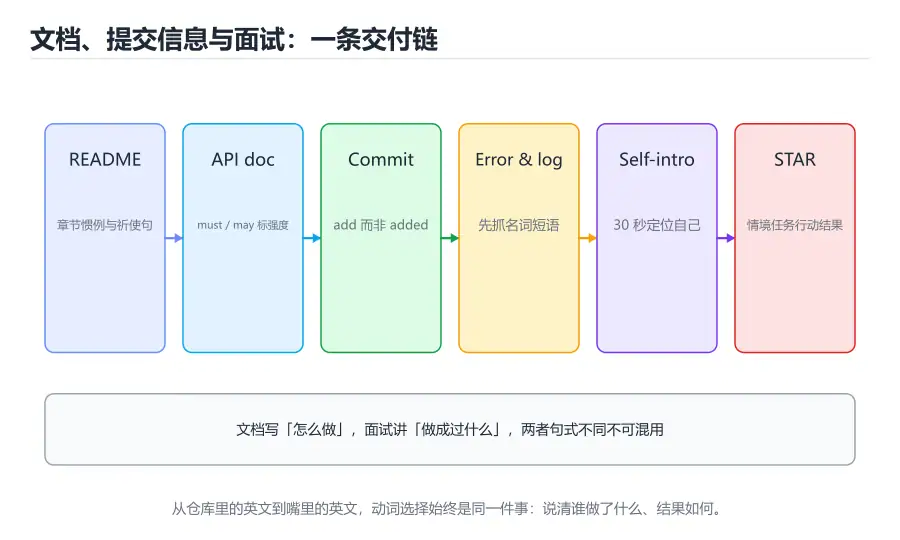

# 技术文档、提交信息与英文面试



> 内容更新时间：2026-10-06 · 学习阶段：高级 · 预计用时：42 分钟

## 本节知识框架

**课程定位**：所属分类 `cs_english`（计算机专业英语），本课为第 8 门 · 学习阶段 高级 · 建议用时 42 分钟。

仓库里最重要的一屏英文往往只有四行：

```text
## Quick start

Install the CLI with `npm i -g report-cli`.
Run `report init` in your project root, then `report build --watch`.
Open the URL printed by the command to view the generated dashboard.
```

四个句子全是祈使句：省略主语 you，动词用原形（Install、Run、Open），没有 `is used to`、没有 `should be`。这是技术文档的默认语气——**读者是执行者，不是旁观者**。同一段落如果写成 `The CLI can be installed by the user with ...`，字数翻倍而且没人知道该谁动手。

本课把这条语气规则推到三个场景：**仓库里的英文**（README、API 文档、CHANGELOG、提交信息）、**运行时吐出的英文**（编译器诊断、异常栈、日志行）、**嘴里的英文**（面试自我介绍与技术描述）。三者句式不同但词表高度重合，配图按六个环节串成一条交付链。到这一课，英文不再是读懂即可，而是要能当场产出。

**复习清单**

- [ ] 能说出 README 七个常见章节的顺序与各自语气
- [ ] 能解释提交标题为什么写 add 而不写 added，并给出可验证的判据
- [ ] 能写出带 type 与 scope 的 Conventional Commit 标题与正文
- [ ] 能按「异常名 → 文件与行号 → 回显代码」三步读一条英文报错
- [ ] 能从日志行的字段名读出级别、口径与时间语义
- [ ] 能用 30 秒与 2 分钟两种长度做英文自我介绍
- [ ] 能把三条中文简历条目改写成动词加手段加数字的 STAR bullet

## 核心概念定义

| 术语 | 一句话说明 |
| --- | --- |
| 祈使句 | 文档操作句的默认语气，动词原形开头、隐含主语 you：Install the package, then run the script |
| 章节惯例 | README、API doc、CHANGELOG 各有约定俗成的小节顺序，读者按顺序找信息 |
| must / may | 规范文本里的强度词：must 是强制，may 是可选，来自 RFC 关键词定义 |
| type 与 scope | 提交标题的分类前缀与影响范围，形如 fix(auth): ...，scope 可省略 |
| imperative mood | 提交标题的语法要求：描述「应用该提交后会发生什么」，因此用动词原形 |
| BREAKING CHANGE | 提交页脚里标记不兼容变更的关键字，工具据此推断版本号跳位 |
| diagnostic | 编译器与解释器的报错句，通常包含位置、症状与修复建议三部分 |
| log level | 日志级别名：debug、info、warn、error、fatal，严重度依次升高 |
| reason phrase | HTTP 响应状态码后的英文短语，如 Not Found，是人可读的状态说明 |
| self-introduction | 面试开场：一句话定位角色，两句交代最近一段经历，一句给出求职动机 |
| STAR | Situation、Task、Action、Result 四拍，回答行为面试题的标准结构 |
| bullet | 简历条目：过去式动词开头，中间写手段，结尾给可核查的数字 |

## 原理与运行机制

### 一、README 的章节顺序与语气分工

常见顺序是 **What → Why → Install → Quick start → Configuration → Examples → Troubleshooting → Contributing → License**。前两段允许陈述句（`Report CLI turns CSV dumps into shareable dashboards.`），从 Install 起全部换成祈使句，并且遵守三条细则：**一条命令一行**、命令与其输出分开写、可选参数放在方括号里（`report build [--watch]`）。版本要求写成 `Requires Node.js 18 or later.` 而不是 `Please make sure you are using ...`，前者 5 个词，后者 9 个词，信息量一样。

配置表的英文惯例是三列：option、type、default，说明列用一般现在时（`Sets the output directory. Defaults to ./dist.`）。API 文档给参数约束时用强度词：`Callers must pass a non-empty array.`、`The field may be omitted.`。

### 二、Conventional Commits：为什么是 add 而不是 added

标题形状是 `type(scope): imperative summary`，六个常用 type：`feat`、`fix`、`docs`、`refactor`、`test`、`chore`。祈使句的理由不在语法课本里，而在 Git 自己的消息里：合并时自动生成 `Merge branch 'auth' into main`，回滚时生成 `Revert "feat(auth): add token rotation"`，两者都是动词原形开头。人工提交沿用同一语气，历史读起来才像一个人写的。

判据是一句可以在心里做完形填空的话：**If applied, this commit will ________.** 填 `fix a timeout` 通顺，填 `fixed a timeout` 不通。这条测试在协作规范文档里被反复引用，比「社区习惯」更好传播。标题另有三条硬约束：不超过 50~72 字符、句末不加句号、不写 `wip` 之外的含糊名词。正文说明动机与取舍，页脚写 `BREAKING CHANGE:` 与关联 issue 号。

改写对照：

| 不合规标题 | 改后 | 问题所在 |
| --- | --- | --- |
| updated deps and stuff | chore(deps): bump axios to 1.7.2 | 过去式、无 type、stuff 无法界定范围 |
| Fix the login bug. | fix(auth): reject expired sessions on refresh | 太含糊，句号多余 |
| Added docs for install | docs: document the npm install path | 过去式，且没说改了哪一节 |
| big refactor | refactor(parser): split tokenizer from AST builder | 没有信息量 |

### 三、报错、诊断与日志行的读法

读任何英文报错都走三步：**最后一行的异常名与宾语**（`AttributeError: 'BertModel' object has no attribute 'encode'`，说明对象缺这个属性）→ **栈帧里的文件名与行号**（`File "infer.py", line 42` 才是你要改的位置）→ **回显的那行代码**（确认调用点）。编译器诊断同构：`error: use of undeclared identifier 'checksum'` 里 undeclared identifier 是症状名，引号里的标识符是对象；带方括号的 `-Wunused-variable` 之类是诊断开关名，告诉你怎么关掉或为什么被打开。

日志行的英文最省字，读法靠字段名：`level=warn msg="retry budget exhausted" attempt=3 latency_ms=412 tenant=acme`。`level` 给严重度，`msg` 是事件本体（一般现在时描述当下发生的规律），等号后的键值对是口径。看到 `latency_ms` 要知道它是延迟而不是耗时占比；看到 `attempt=3` 要知道这是第 3 次重试，与最终失败不是同一件事。线上排错时先按 level 过滤 warn 与 error，再按 tenant 缩小范围，最后读 msg 的动词决定下一步。

### 四、英文面试：自我介绍与技术描述句式

30 秒版本三句话：`I'm a backend engineer with four years on data-intensive services.`（定位）→ `Most recently I owned the reporting pipeline that served 300 internal analysts.`（当前战场）→ `I'm looking for a role where I can work closer to the inference stack.`（动机）。2 分钟版本再加一段最难的问题与你的处理。时态规则：**现在的角色用现在时，已结束的项目用过去时，影响延续到现在的用现在完成时**（`Since then we've kept the error budget under 0.1%.`）。

技术描述要留出余量：`roughly 20%`、`somewhere between 10 and 15 milliseconds`、`as far as I can tell from the dashboard`。数字给得太死，面试官追问口径时容易失守；给出范围与来源反而显得可靠。被问到不会的东西，通行回答是 `I haven't worked with it directly, but I'd approach it by ...`——承认边界同时给出学习路径。

### 五、把中文简历条目改成 STAR

中文条目爱写岗位，英文 bullet 要写动作与结果。三步：换动词（负责 → owned / rebuilt）、补手段（by 加动名词或通过具体动作串联）、给数字（from ... to ...）。

| 中文条目 | 英文改写 | 说明 |
| --- | --- | --- |
| 负责报表系统的性能优化 | Refactored the monolithic report job into three idempotent tasks, cutting month-end latency by 70%. | 动词加手段加数字 |
| 参与日志平台开发 | Built the ingest path for a log pipeline handling 12M events per day, with p99 write latency under 40 ms. | 把「参与」换成可核查的动作 |
| 带领团队完成微服务拆分 | Led a team of four to split the billing monolith into five services and ship them behind a feature flag. | 领导力用 led，配规模与做法 |

面试里讲同一段经历就换 STAR 四拍：Situation 给系统与角色，Task 给触发条件，Action 给你的具体动作，Result 给数字。书面 bullet 与口头 STAR 用的是同一批动词，只是时态与人称不同。

## 典型应用场景

### 场景一：错误响应体的文档措辞

```json
{
  "error": {
    "code": "invalid_argument",
    "message": "The `limit` field must be an integer between 1 and 200.",
    "details": "Received \"limit\": \"all\".",
    "doc_url": "https://docs.acme.io/api/errors#invalid-argument"
  }
}
```

三行三种语气：`code` 是稳定的机器可读标识（蛇形小写，不会因翻译改变）；`message` 面向开发者，用 must 陈述约束；`details` 回显现场值，只给事实不给建议。文档里解释状态码时沿用 reason phrase 的说法：400 Bad Request 表示请求本身不合规，401 Unauthorized 表示缺少身份凭据，404 Not Found 表示资源不存在——这三个词的差别必须能一口说出。

### 场景二：CHANGELOG 与维护信息

```text
## [2.3.0] - 2026-09-14
### Added
- `--watch` flag to the build command.
### Changed
- Default output directory moved from ./out to ./dist.
### Deprecated
- `report serve`; use `report preview` instead.
### Removed
- Support for Node.js 16.
### Fixed
- Escaped quotes in raw strings broke the parser (issue #418).
```

分组名用过去分词（Added、Fixed、Removed），条目正文用名词短语或祈使句，这是 Keep a Changelog 一派的习惯：**版本记录「发生了什么」，与提交信息的「应用后会怎样」语气相反**，两者不要混。

## 代码/协议/SQL 示例

### 查看与书写提交信息

```bash
$ git log --oneline --no-merges -5
a1f9c2d feat(auth): add refresh token rotation
73be104 fix(parser): handle escaped quotes in raw strings
9c2d5e7 docs: correct the install steps for Windows
55e0b1a updated the dependencies and other stuff
e7b1234 refactor(api): remove unused legacy headers

$ git commit --amend -m "chore(deps): bump axios to 1.7.2"
```

第 55e0b1a 行三处偏离规范：动词过去式、缺 type 前缀、other stuff 无法界定变更边界。要改历史里的提交说明，规范做法是改写本地未推送的提交或用 revert 生成新提交，而不是删记录。

### 从历史里统计类型分布

```bash
$ git log --pretty=%s | cut -d'(' -f1 | cut -d':' -f1 | sort | uniq -c | sort -rn
   482 fix
   351 feat
   128 refactor
    96 docs
    41 chore
```

这种统计的前提是标题格式统一：一旦有人写 `Fixed the bug`，`cut` 就取不到 type，分布表会自动暴露不合规的提交。文档腐化程度可以这样量化，比逐条人肉检查省力。

### 一条完整提交的结构

```text
fix(auth): reject expired sessions on refresh

Sessions created before the 2.2 rollout were not checked against the new
token expiry, so a refresh could silently issue a second valid token.
Validate the stored token before minting a new one and return 401 otherwise.

BREAKING CHANGE: clients must now handle a 401 response on the refresh endpoint.
Refs: #418
```

标题一句、正文说明动机与做法、页脚给不兼容声明与 issue 引用，是可直接套用的形状。

## 时间/空间复杂度或性能分析

### 写一屏文档的成本分配

一个合格 README 的 Quick start 段落约 60 词，写它的时间不该花在措辞上，而该花在**验证命令能否照抄运行**：抄一遍、粘贴到干净环境、确认输出与文中贴的一致，通常 10 分钟；纯写作 3 分钟。没有这一步验证，文档第一次被用户指出错误的时间就是它的真实成本。

### 提交规范的迭代成本

一次性把标题格式统一，比长期靠评审纠正便宜：格式类问题在评审里来回一次至少 20 分钟，而脚本化的检查（如上面的类型分布统计）是常数时间。类型分布本身还能提示结构问题——`fix` 数量远超 `feat` 通常意味着需求描述不稳定，`docs` 接近零意味着新人的上手成本正在转嫁给口头沟通。

### 面试表达的准备成本

自我介绍 30 秒版本约 90 词，背熟并计时三遍即可稳定；STAR 故事准备 5 个（技术难点、冲突、失败、带人、跨团队合作），每个 90~120 秒，总准备时间约 4 小时。反问环节的两句问题准备成本最低但收益明显：`What does the on-call rotation look like for this team?` 比 `I don't have questions.` 强得多。

## 常见误区与易错点

| 序号 | 容易踩的做法 | 正确的判断 |
| --- | --- | --- |
| 1 | 文档里写 The user should install ... | 祈使句直接 Install ...，读者不必被第三人称转述 |
| 2 | 提交标题写 fixed a bug | 标题描述应用后的变化，用 fix；且 Git 自动消息同为祈使句 |
| 3 | 提交标题写 `WIP: stuff` 并长期保留 | 合并前重写历史或用 squash，把含糊标题留在主线会污染统计 |
| 4 | CHANGELOG 条目用将来时 | 版本记录已发生的事，分组名用 Added、Fixed 等过去分词 |
| 5 | 把 must 与 may 混用 | 强度词有规范定义，混用会改变接口语义 |
| 6 | 读报错只看第一行 Traceback | 有效信息在最后一行的异常名与宾语 |
| 7 | 把 `warning` 与 `error` 同等处理 | 级别不同：warn 可继续运行，error 表示该操作失败 |
| 8 | 简历里写 Responsible for the report system | 换成有产出的动词：owned / rebuilt / migrated |
| 9 | 简历条目只有动作没有数字 | 每条给一个可核查口径的数字，写清 from 与 to |
| 10 | 面试用一般现在时讲已结束的项目 | 已结束用过去时，影响延续用现在完成时 |

## 与其他知识点的关系

### 分类内的上下游

第 1 课 `cs_english_overview` 的构词法在这里负责一批名字：`imperative`（imper- 命令 + -ative）、`diagnostic`、`deprecated`（de- + precare 请求，规范文本里指「不建议再用」）；第 3 课 `cs_english_os_software` 讲需求与发布术语链，本课把其中的 release note、changelog 落到可写的句式；第 4 课 `cs_english_network_web` 的 must、should、may 强度分级在本课变成 API 文档的措辞规范；第 5 课 `cs_english_db_bigdata` 的三段式报错读法（问题、证据、建议）是本课报错读法三步的特例；第 7 课 `cs_english_paper_writing` 处理书面学术英文，本课处理工程书面与口语英文，时态规则在两课里正好相反：论文描述实验用过去时，文档指导操作用祈使句。

### 与技术类课程的对应

`shell` 与 `fundamentals` 分类里的 Git 课程讲命令与分支模型，本课讲这些命令输出里的英文；`se` 分类的文档与协作课程讲章节设计与可维护性，本课讲同一件事在英文里的具体措辞。技术面试类课程问「怎么答」，本课问「怎么用英文说清」。

## 自测题与参考答案

下面 6 道题与「考点精讲」是同一批数据：题干、选项原文、答案字母（A 对应第 1 个选项）完全一致。

### 题目 1（单选题）

Conventional Commits 与 Git 社区惯例都要求提交标题用祈使句，例如写 fix a bug 而不写 fixed a bug，其主要理由是？

1. 标题描述的是应用该提交后代码发生的变化，与 Git 自动生成的合并回滚消息同构
2. 过去式在英文里属于非法词形，Git 解析标题时会把 added 识别为未知关键字并报错
3. 祈使句更短，可以节省一行字符，因此只是排版偏好，与工具生成的消息没有关联
4. 标题会被 shell 再次解释成命令，所以必须以动词原形开头才能通过命令行语法检查

**参考答案**：A

本题正确项是「标题描述的是应用该提交后代码发生的变化，与 Git 自动生成的合并回滚消息同构」。判断口诀是把标题填进 If applied, this commit will ___ 这个句式：填 fix a bug 读得通，填 fixed a bug 读不通。Git 自己生成的合并与回滚消息就是祈使句（Merge branch ...、Revert ...），人为提交保持同样语气，历史里才不会出现两种时态混排。干扰项「过去式在英文里属于非法词形，Git 解析标题时会把 added 识别为未知关键字并报错」不存在这种解析，Git 不检查英语语法。干扰项「标题会被 shell 再次解释成命令，所以必须以动词原形开头才能通过命令行语法检查」把标题与命令行之混淆，标题只是普通字符串。

### 题目 2（代码题）

上面这段 git log 输出里有一条提交信息不符合英文惯例，关于它的问题所在，下列说法正确的是哪一项？

```bash
a1f9c2d feat(auth): add refresh token rotation
73be104 fix(parser): handle escaped quotes in raw strings
9c2d5e7 docs: correct the install steps for Windows
55e0b1a updated the dependencies and other stuff
e7b1234 refactor(api): remove unused legacy headers
```

1. 55e0b1a 用了过去时且类型前缀缺失，other stuff 无法说明改了什么
2. docs: 一行没有括号作用域，因此所有不带作用域的写法都非法
3. refactor(api) 一行有问题，动词应当写在括号内而不是括号外
4. 55e0b1a 写法合理，依赖升级属于日常维护，用过去式更能表达已完成

**参考答案**：A

本题正确项是「55e0b1a 用了过去时且类型前缀缺失，other stuff 无法说明改了什么」。Conventional Commits 的标题形状是 type(scope): imperative summary，updated the dependencies and other stuff 三处偏离：动词用了过去式、没有 type 前缀、other stuff 这类含糊名词让读者与工具都无法判断变更边界。干扰项「docs: 一行没有括号作用域，因此所有不带作用域的写法都非法」把作用域说成必填，规范里 scope 是可选的；干扰项「refactor(api) 一行有问题，动词应当写在括号内而不是括号外」正好记反了格式，括号里放的是影响范围而不是动词。

### 题目 3（编程题）

读下面这段英文报错，关于它的定位方式与修复方向，下列说法正确的是哪一项？

```python
Traceback (most recent call last):
  File "infer.py", line 42, in <module>
    logits = model.encode(texts)
AttributeError: 'BertModel' object has no attribute 'encode'
```

1. AttributeError 表示 BertModel 类型选错，必须换成另一个模型库重写脚本
2. line 42 指的是解释器自身源码的行号，与用户脚本无关，改代码没有用
3. has no attribute 说明对象缺该属性，encode 属于上层封装类，应换用提供者
4. Traceback 一词说明这是缩进引起的语法错误，调整空白后即可正常运行

**参考答案**：C

本题正确项是「has no attribute 说明对象缺该属性，encode 属于上层封装类，应换用提供者」。读法顺序是最后一行的异常名加宾语（AttributeError、'BertModel' object、no attribute encode），再回到倒数第二段看文件名与行号，最后看回显的那行代码确认调用点；encode 通常由高层封装类提供，换成提供该方法的类或改调用它已有的方法即可。干扰项「line 42 指的是解释器自身源码的行号，与用户脚本无关，改代码没有用」把栈帧的行号读反，infer.py 才是需要改的文件；干扰项「Traceback 一词说明这是缩进引起的语法错误，调整空白后即可正常运行」把异常类型当成语法错误，IndentationError 才是缩进问题的名字。

### 题目 4（多选题）

关于 README、API 文档与错误码表的英文惯例，下列说法正确的有哪些？（多选）

1. README 的 Usage 小节用祈使句给最短可运行命令，原理介绍另起小节
2. 文档里的 must 与 may 可以随意互换，读者会自己判断约束的强弱
3. 错误码表按含义、触发条件、建议动作三列书写，解释句用一般现在时
4. 安装步骤写成过去时更准确，因为读者照着做的时候步骤已经完成了

**参考答案**：A、C

本题要同时选中「README 的 Usage 小节用祈使句给最短可运行命令，原理介绍另起小节」和「错误码表按含义、触发条件、建议动作三列书写，解释句用一般现在时」两条。技术文档的第二人称隐含主语是读者，动作由读者执行，所以动词用原形开头（Install the package、Run the script）；错误码描述的是每次触发都成立的规律，因此用一般现在时。干扰项「文档里的 must 与 may 可以随意互换，读者会自己判断约束的强弱」把规范关键词当普通词，会直接改变接口语义；干扰项「安装步骤写成过去时更准确，因为读者照着做的时候步骤已经完成了」时态方向弄反了，安装动作由读者在未来执行。

### 题目 5（排序题）

面试里回答「讲一个你优化系统的经历」，把下面四句英文按 STAR 结构的正常讲述顺序排列，正确的是哪一项？

1. As a result, the p99 latency dropped from 450 to 120 milliseconds.
2. I was responsible for the reporting service used by 300 internal analysts.
3. I profiled the query path, replaced the N+1 lookups with a batch loader, and added a cache.
4. Because the dashboard timed out during month-end close, we had to rebuild the read path.

**参考答案**：B → D → C → A

STAR 的四拍是 Situation、Task、Action、Result：先用一句话交代系统与角色，再说明为什么必须动手，然后讲自己具体做了哪几件事，最后给可核查的数字。四句里的连接词本身就是线索：Because 引出触发条件，只能紧跟情境；As a result 只能收尾；中间那句一连串动词（profiled、replaced、added）是 Action 段的标志。面试官追问的通常就是这三层：你个人的动作、动作与结果的因果、数字的口径。

### 题目 6（填空题）

把中文简历条目「负责报表系统的性能优化」改写成英文简历 bullet 时，开头应换成有产出的动词。在空格处填入一个表示「重构」的过去式动词：________ the monolithic report job into three idempotent tasks, cutting month-end latency by 70%.（首字母大写，只填一个词）

**参考答案**：Refactored

本题正确项是「Refactored」。英文简历忌讳以 Responsible for 或 In charge of 开头，那只是在描述岗位而不是贡献；动词过去式加宾语再加量化结果，才是 bullet 的标准形状。Refactored ... into ... 表达「改变内部结构而外部行为不变」，与后面 cutting month-end latency by 70% 的因果关系成立。Rewrote、Restructured 同样可接受，但若写成 Optimized the report job 就丢了手段信息，读的人不知道你具体动了哪一层结构。

## 考点精讲

每条先给答案字母与正确项原文，再复述判断依据，字段内容与题库完全一致。

### 考点 1（单选题 · 提交语气）

- **题目**：Conventional Commits 与 Git 社区惯例都要求提交标题用祈使句，例如写 fix a bug 而不写 fixed a bug，其主要理由是？
- **答案**：A
- **正确项**：标题描述的是应用该提交后代码发生的变化，与 Git 自动生成的合并回滚消息同构
- **判断依据**：本题正确项是「标题描述的是应用该提交后代码发生的变化，与 Git 自动生成的合并回滚消息同构」。判断口诀是把标题填进 If applied, this commit will ___ 这个句式：填 fix a bug 读得通，填 fixed a bug 读不通。Git 自己生成的合并与回滚消息就是祈使句（Merge branch ...、Revert ...），人为提交保持同样语气，历史里才不会出现两种时态混排。干扰项「过去式在英文里属于非法词形，Git 解析标题时会把 added 识别为未知关键字并报错」不存在这种解析，Git 不检查英语语法。干扰项「标题会被 shell 再次解释成命令，所以必须以动词原形开头才能通过命令行语法检查」把标题与命令行之混淆，标题只是普通字符串。

### 考点 2（代码题 · 提交格式）

- **题目**：上面这段 git log 输出里有一条提交信息不符合英文惯例，关于它的问题所在，下列说法正确的是哪一项？
- **答案**：A
- **正确项**：55e0b1a 用了过去时且类型前缀缺失，other stuff 无法说明改了什么
- **判断依据**：本题正确项是「55e0b1a 用了过去时且类型前缀缺失，other stuff 无法说明改了什么」。Conventional Commits 的标题形状是 type(scope): imperative summary，updated the dependencies and other stuff 三处偏离：动词用了过去式、没有 type 前缀、other stuff 这类含糊名词让读者与工具都无法判断变更边界。干扰项「docs: 一行没有括号作用域，因此所有不带作用域的写法都非法」把作用域说成必填，规范里 scope 是可选的；干扰项「refactor(api) 一行有问题，动词应当写在括号内而不是括号外」正好记反了格式，括号里放的是影响范围而不是动词。

### 考点 3（编程题 · 报错读法）

- **题目**：读下面这段英文报错，关于它的定位方式与修复方向，下列说法正确的是哪一项？
- **答案**：C
- **正确项**：has no attribute 说明对象缺该属性，encode 属于上层封装类，应换用提供者
- **判断依据**：本题正确项是「has no attribute 说明对象缺该属性，encode 属于上层封装类，应换用提供者」。读法顺序是最后一行的异常名加宾语（AttributeError、'BertModel' object、no attribute encode），再回到倒数第二段看文件名与行号，最后看回显的那行代码确认调用点；encode 通常由高层封装类提供，换成提供该方法的类或改调用它已有的方法即可。干扰项「line 42 指的是解释器自身源码的行号，与用户脚本无关，改代码没有用」把栈帧的行号读反，infer.py 才是需要改的文件；干扰项「Traceback 一词说明这是缩进引起的语法错误，调整空白后即可正常运行」把异常类型当成语法错误，IndentationError 才是缩进问题的名字。

### 考点 4（多选题 · 文档惯例）

- **题目**：关于 README、API 文档与错误码表的英文惯例，下列说法正确的有哪些？（多选）
- **答案**：A、C
- **正确项**：README 的 Usage 小节用祈使句给最短可运行命令，原理介绍另起小节；错误码表按含义、触发条件、建议动作三列书写，解释句用一般现在时
- **判断依据**：本题要同时选中「README 的 Usage 小节用祈使句给最短可运行命令，原理介绍另起小节」和「错误码表按含义、触发条件、建议动作三列书写，解释句用一般现在时」两条。技术文档的第二人称隐含主语是读者，动作由读者执行，所以动词用原形开头（Install the package、Run the script）；错误码描述的是每次触发都成立的规律，因此用一般现在时。干扰项「文档里的 must 与 may 可以随意互换，读者会自己判断约束的强弱」把规范关键词当普通词，会直接改变接口语义；干扰项「安装步骤写成过去时更准确，因为读者照着做的时候步骤已经完成了」时态方向弄反了，安装动作由读者在未来执行。

### 考点 5（排序题 · STAR 讲述）

- **题目**：面试里回答「讲一个你优化系统的经历」，把下面四句英文按 STAR 结构的正常讲述顺序排列，正确的是哪一项？
- **答案**：B、D、C、A
- **正确项**：I was responsible for the reporting service used by 300 internal analysts. → Because the dashboard timed out during month-end close, we had to rebuild the read path. → I profiled the query path, replaced the N+1 lookups with a batch loader, and added a cache. → As a result, the p99 latency dropped from 450 to 120 milliseconds.
- **判断依据**：STAR 的四拍是 Situation、Task、Action、Result：先用一句话交代系统与角色，再说明为什么必须动手，然后讲自己具体做了哪几件事，最后给可核查的数字。四句里的连接词本身就是线索：Because 引出触发条件，只能紧跟情境；As a result 只能收尾；中间那句一连串动词（profiled、replaced、added）是 Action 段的标志。面试官追问的通常就是这三层：你个人的动作、动作与结果的因果、数字的口径。

### 考点 6（填空题 · 简历动词）

- **题目**：把中文简历条目「负责报表系统的性能优化」改写成英文简历 bullet 时，开头应换成有产出的动词。在空格处填入一个表示「重构」的过去式动词：________ the monolithic report job into three idempotent tasks, cutting month-end latency by 70%.（首字母大写，只填一个词）
- **答案**：Refactored
- **正确项**：Refactored（Rewrote、Restructured 同可）
- **判断依据**：本题正确项是「Refactored」。英文简历忌讳以 Responsible for 或 In charge of 开头，那只是在描述岗位而不是贡献；动词过去式加宾语再加量化结果，才是 bullet 的标准形状。Refactored ... into ... 表达「改变内部结构而外部行为不变」，与后面 cutting month-end latency by 70% 的因果关系成立。Rewrote、Restructured 同样可接受，但若写成 Optimized the report job 就丢了手段信息，读的人不知道你具体动了哪一层结构。

## 术语速查

| 术语 | 一句话说明 |
| --- | --- |
| imperative mood | 祈使语气，动词原形开头、隐含主语 you，文档与提交标题共用 |
| Quick start | README 里最短可跑通路径的小节，全篇祈使句，一条命令一行 |
| prerequisites | 前置条件小节，用陈述句列版本与依赖，如 Requires Node.js 18 or later |
| type(scope): summary | Conventional Commits 的标题形状，type 分类、scope 标影响范围、summary 用祈使句 |
| BREAKING CHANGE | 页脚关键字，声明不兼容变更，版本工具据此决定主版本号跳位 |
| changelog groups | Added、Changed、Deprecated、Removed、Fixed、Security 六类分组名 |
| reason phrase | 状态码后的人读短语：400 Bad Request、401 Unauthorized、404 Not Found |
| error code | 机器可读的稳定标识，蛇形小写，翻译时不能改 |
| diagnostic flag | 编译器诊断后的开关名，如 -Wunused-variable，用于定位或抑制该条提示 |
| stack frame | 异常栈里的一帧，含文件名、行号与函数名，是定位修改点的依据 |
| log level | debug、info、warn、error、fatal 五档严重度，决定是否进入告警 |
| structured fields | 日志里的 key=value 字段名，读数字前先认口径 |
| self-introduction | 面试开场三句：角色定位、最近战场、求职动机 |
| STAR | Situation、Task、Action、Result 四拍，行为面试题的通用答法 |
| résumé bullet | 简历条目，过去式动词加手段加数字，避免 Responsible for 开头 |
| hedging phrase | 留余量的说法：roughly、as far as I can tell from the dashboard |

## 参考资料与复核

- 复核范围：README 章节顺序、Conventional Commits 标题形状与页脚关键字、Keep a Changelog 分组名、Python 异常栈与 clang 诊断措辞、HTTP reason phrase 名称逐条核对。
- 来源性质：协作规范、工具书与官方文档为一手语料；示例命令输出与句式归纳为整理者总结。

| 参考资料 | 本课用途 |
| --- | --- |
| [Conventional Commits 1.0.0](https://www.conventionalcommits.org/en/v1.0.0/) | 提交标题形状、type 列表与 BREAKING CHANGE 的规范原文 |
| [Pro Git: Contributing to a Project](https://git-scm.com/book/en/v2/Distributed-Git-Contributing-to-a-Project) | 提交信息风格与 Git 自动消息用词的社区惯例出处 |
| [Keep a Changelog 1.1.0](https://keepachangelog.com/en/1.1.0/) | CHANGELOG 六类分组名与条目写法 |
| [MDN: HTTP](https://developer.mozilla.org/en-US/docs/Web/HTTP) | 状态码与 reason phrase 名称的工程侧对照 |
| [LLVM Language Reference Manual](https://llvm.org/docs/LangRef.html) | 大型语言参考文档的章节组织与术语定义写法范例 |

- 最后复核：2026-10-04
- 下次复核：2027-03-24

## 内容元数据

- 内容版本：v2.0
- 最后更新：2026-10-06
- 学习阶段：高级
- 预计用时：42 分钟
- 分类归属：`cs_english`（计算机专业英语），本课为第 8 门
- 适用环境：通用开发环境；本课聚焦仓库文档、提交信息、运行时报错日志与英文面试口语。
- 内容来源：内置结构化课程与协作规范、官方文档复核整理
- 相关主题：imperative mood in docs, commit message conventions, STAR interview answers
- 质量版本：P0 测验标准 + P1 覆盖扩展 + P2 体验补全
