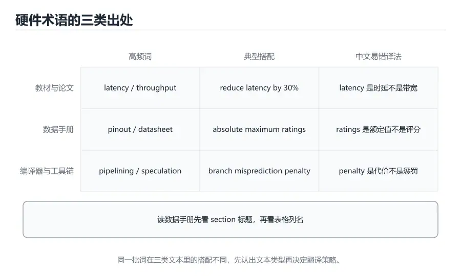

# 硬件与体系结构英语：数据手册、论文与工具链里的三类措辞

> 内容更新时间：2026-10-06 · 学习阶段：基础 · 预计用时：40 分钟



## 本节知识框架

**课程定位**：所属分类 `cs_english`（计算机专业英语）· 学习阶段 基础 · 建议用时 40 分钟。

先给你一个能立刻用上的最小例子。数据手册里最常见的句子长这样：

> **The device operates from a 3.3 V supply, and the oscillator is disabled when PB0 is held low.**

只有 20 个词，但里面挤满了硬件英语的四条规矩：`the device` 是「本器件」（不是「这个设备」那种泛指）；`operates from` 表示「由……供电」，介词 `from` 引出电源；`is disabled` 是被动语态，真正的动作发出者在后半句的 `when` 从句里；`held low` 是电平说法，意思是「把它拉低并保持」。能把这句读顺，你就已经跨过了硬件英语的第一道门槛。

硬件类文本其实分三种脾气，本课按这三条线走：教材与论文（讲概念，爱用名词堆叠和抽象动词）、数据手册与规格书（讲约束，爱用被动语态和额定值）、编译器与工具链输出（讲事实，句子被压缩到最短）。同一批词在三类文本里的搭配完全不同：`latency` 在论文里配 `reduce`，在手册里配 `maximum`，在工具链日志里几乎不出现，取而代之的是 `cycles`。先认出文本类型，再决定翻译策略，这是本课的方法主线。

**复习清单**

- [ ] 能把 `latency`、`throughput`、`bandwidth` 三个词按词根说出本义与术语义
- [ ] 看到 `erratum`、`errata`、`quantum`、`quanta` 能判断单复数并正确翻译
- [ ] 能把一句 25 词的数据手册句子拆成「器件 / 条件 / 结果」三段再译成中文
- [ ] 能还原 `MMU`、`TLB`、`SIMD`、`VLIW`、`ASIC`、`RTL` 六个缩写的全称
- [ ] 能读懂 `unrecognized command line option` 这类工具链报错，说出该改哪个参数
- [ ] 能区分 `Absolute Maximum Ratings` 与推荐工作条件两段英文的措辞差异
- [ ] 能用 `is designed to / provides / supports / shall` 四种句式各造一句英文

## 核心概念定义

| 术语 | 一句话说明 |
| --- | --- |
| 文本类型 | 硬件英语的三种来源：教材论文、数据手册、工具链输出，各自的句式与信息密度不同 |
| 词源 | 一个词的来历，如 `latency` 来自拉丁动词 `latere`「躲藏」，所以本义是「东西藏起来、看不见的这段时间」，即时延 |
| 名词堆叠 | 三个以上名词连续当定语，如 `out-of-order superscalar pipeline`，读时要从右往左确定中心词 |
| 被动语态 | `is disabled / are supported`，数据手册用它隐藏施事者，把器件放在主语位置 |
| 额定值 | ratings 在手册里是「额定值、限值」，不是「评分」；`Absolute Maximum Ratings` 是「绝对最大额定值」 |
| 助记符 | `mov`、`ldr`、`addi` 这类指令的英文缩写，读指令集手册时的第一道词汇关 |
| 缩写还原 | 把 `MMU` 展开成 `Memory Management Unit` 再理解，展开后构词零件会自动透明 |
| 约束句 | 用 `shall / must / may / should` 表强制或允许程度的句子，来自标准文档的分级用词传统 |
| 电平描述 | `held high/low`、`driven low`、`pulled up`，说的是引脚电压状态，动词全是及物的 |
| 步进版本 | `stepping`/`rev` 指同一颗芯片的金属层改版，中文常译「步进号」，报错勘误表按它编号 |

## 原理与运行机制

### 三类文本，三种读法

**教材与论文**：作者要讲清一个机制，句子以「我们做了什么」或「某结构提供什么」为主干，动词偏抽象（`exploit`、`leverage`、`expose`、` amortize`），数字用来支撑结论。典型句式：

> **We exploit the memory-level parallelism exposed by the out-of-order engine to amortize the cache miss penalty.**

这句话里有四个名词堆叠和两个抽象动词。读法是：先抓谓语 `exploit`（利用），再找宾语中心词 `parallelism`（并行度），`memory-level` 是它的定语（访存级），后面的 `exposed by ...` 是过去分词短语作后置定语（被乱序引擎暴露出来的），最后 `to amortize ...` 是目的状语（用来摊薄缺失代价）。中文按「手段—目的」重排：「乱序执行引擎暴露出访存级并行，我们用这一点来摊薄缓存缺失的代价」。`amortize` 本义是「分期偿还贷款」，在这里就是「把一次性开销摊到很多次操作上」。

**数据手册**：只讲约束和事实，句子短、被动多、数字密集。开头引的那句就是标准形态。手册里另一个高频句式是「条件 + 结果」：

> **Stresses exceeding the values listed in this section may cause permanent damage.**

`stresses` 在这里不是「压力」而是「超出规格的应力（电压、温度）」，`exceeding ...` 是现在分词短语作后置定语，`may cause` 用 `may` 表可能性而非许可。整句译作「超过本节所列数值的应力可能导致器件永久损坏」。紧随其后几乎总有一句 `This is a stress rating only ...`，直译「这只是应力额定值」，工程含义是「不代表器件能在这个条件下正常工作」——这是中文翻译最容易丢掉的一层。

**编译器与工具链**：省略到只剩骨架，一句报错没有主语也没有冠词。

> `gcc: error: unrecognized command line option '-march=native'`

它的信息结构是「谁说的（gcc）+ 什么级别（error）+ 什么问题（unrecognized）+ 具体对象（引号里的原文）」。看到 `unrecognized`，不要理解成「编译器不认识这个 CPU」，而是「这个命令行选项在当前编译器版本/平台组合下不存在」。修复方向永远是查该版本的选项表，而不是换机器。

### 词根：硬件词汇的六个高产零件

| 词根/来源 | 本义 | 派生的硬件术语 |
| --- | --- | --- |
| `lat-`（latere） | 躲藏 | `latency` 时延、`latent` 潜在的 |
| `duc/duct` | 引导 | `conduit` 通道、`reduce`、`clock domain` 里的 `do-`（give）同源族 |
| `grad/scala` | 步、梯级 | `upgrade`、`superscalar`（超流水线阶梯）、`stepping` 步进 |
| `spec-`（specere） | 看 | `speculation` 投机执行、`spec` 规格（prospectus 展望）|
| `struct` | 建造 | `microarchitecture` 微架构、`structure`、`instruct` |
| `port-` | 搬运 | `port` 端口、`portable`、`transpose`、`pinout` 的 `out` 即引出顺序 |

`superscalar` 值得单独讲：`super-`（超过）+ `scal`（阶梯，与 `scale`、`scala` 同源）+ `-ar`（形容词），字面是「超过一个台阶」，即一个时钟周期内发射多条指令。与之相对 `VLIW` = `Very Long Instruction Word`（官方拼写就是很长的指令字），靠编译器而不是硬件来找并行。这两个词常在同一段里对比，认出构词就不用背两个定义。

### 缩写的三层还原

缩写是本课的重头戏。规则：**先还原全称，再看构词零件，最后落到中文定名**。

- 处理器内部：`CPU` = Central Processing Unit；`ALU` = Arithmetic Logic Unit（`arith-` 来自希腊语「数」）；`CU` = Control Unit；`FPU` = Floating-Point Unit；`AGU` = Address Generation Unit。
- 存储与地址：`MMU` = Memory Management Unit；`MPU` = Memory Protection Unit（嵌入式里常见，只做保护不做页表）；`TLB` = Translation Lookaside Buffer（`lookaside` = 在旁边看一眼，所以是「转换旁路缓冲」，靠「旁路」二字理解它为什么能加速）；`SRAM`/`DRAM` = (Static/Dynamic) Random Access Memory，`dynamic` 指需要刷新；`DDR` = Double Data Rate，`double` 是「一个时钟周期传输两次」。
- 总线与外设：`DMA` = Direct Memory Access；`PCIe` = Peripheral Component Interconnect Express（`periph-` 来自希腊语「在周围」，所以外设就是「挂在主存和 CPU 旁边的东西」）；`SATA` = Serial ATA；`IRQ` = Interrupt Request（`inter-` 之间 + `rupt` 断裂 → 打断）；`MSI` = Message Signaled Interrupt（用消息信号代替电平）。
- 芯片形态：`SoC` = System on Chip；`ASIC` = Application-Specific Integrated Circuit；`FPGA` = Field-Programmable Gate Array；`RTL` = Register Transfer Level（寄存器传输级，硬件描述语言抽象的层次）；`BGA`/`QFP` 是封装名（Ball/Quad Flat Package）。

`BIOS` = Basic Input/Output System 是历史名词，`bootstrap`（鞋带）→「用鞋带把自己提起来」→ 引导加载，这个比喻在英文里人人懂，中文说「自举」就不太直观了。

### 被动语态与定语从句的翻译套路

硬件英文里三种结构最高频：

1. **无主语被动**：`The pin is configured as an output.` 中文补出施事者：「（软件/上电默认）把该引脚配置为输出」。
2. **`which` 非限定从句**：`The register, which is cleared on reset, holds the error count.` 从句要拆成独立短句：「该寄存器在复位时被清零，用于保存错误计数」。非限定从句（前面有逗号）提供补充信息，限定从句（无逗号）在缩小范围，中文里前者用「，它……」后者用「……的」。
3. **分词短语作状语**：`Measured at 25 °C, the typcial value is 4 ns.` 逻辑主语是 `the typical value`，不是「人」，译成「在 25 °C 条件下测得，典型值为 4 ns」。

## 典型应用场景

### 场景一：读一份引脚表

手册的引脚表列名几乎固定：`Pin Name`、`Pin Number`、`Type`、`Description`、`Alternate Function`。`Type` 那一列的值是 `I`（input）、`O`（output）、`I/O`、`P`（power）、`OD`（open-drain 开漏）、`PU`（pull-up 上拉）。表里的描述行常这样写：

> `PB0 — I/O — Timer 1 capture input; Schmitt-trigger input, pull-up enabled by default.`

读法是把分号当句号，`Schmitt-trigger` 是人名（Helmut Schmidt 命名的迟滞比较器结构），`enabled by default` 是「上电默认开启」。人名 + 连字符 + 术语，是硬件英语的固定构词方式。

### 场景二：读论文里的性能结论句

> **Our scheme reduces the average memory access time by 18% on the SPEC CPU benchmarks, at the cost of 4.2% additional area.**

四个必抓信息：改了什么指标（`average memory access time`）、幅度（`by 18%`，`by` 后是差值不是结果）、测试基准（`on the SPEC CPU benchmarks`）、代价（`at the cost of ... additional area`，面积多花 4.2%）。中文里 `by 18%` 必须译成「降低了 18%」，把它译成「降低到 18%」就是硬伤。

### 场景三：读懂链接与交叉编译报错

嵌入式项目里最常见的一串：

> `ld: cannot find -lc: No such file or directory for target arm-none-eabi`

`cannot find -lc` 的意思是「找不到 `libc.a`/`libc.so`」，`-l` 是 library 的缩写（link 时的 library 选项），`arm-none-eabi` 是目标三元组（arch-vendor-os），`none` 表示没有操作系统，`eabi` = Embedded Application Binary Interface。这类报错的修复方向是装对应工具链，而不是改源码。

### 场景四：写一句给国外社区的提问

好的提问长这样：「Board: STM32F4DISCOVERY. Toolchain: arm-none-eabi-gcc 12.2. Steps: 1) ... Expected: ... Actual: ...」——名词短语打头、不带客套、把版本和复现步骤列全，这正是第 8 课要展开的技术写作模板。

## 代码/协议/SQL 示例

### 用 C 的易失性关键字读一段寄存器代码

```c
#include <stdint.h>

#define USART1_SR   (*(volatile uint32_t *)0x40011000UL)
#define USART1_DR   (*(volatile uint32_t *)0x40011004UL)
#define SR_TXE      (1UL << 7)   /* transmit data register empty */

void usart_putc(char c) {
    while (!(USART1_SR & SR_TXE)) {
        /* spin until the hardware clears the flag */
    }
    USART1_DR = (uint32_t)c;
}
```

三处英文值得停下来看：注释里的 `transmit data register empty` 是 `TXE` 标志的全称还原，手册里也这么写；`volatile` 的英文本义是「易变的」，在这里表示「这个地址的值可能被硬件改，编译器别把它缓存到寄存器」；`spin` 在英文里就是「空转」，`spinlock` 即自旋锁。宏名 `SR`/`DR` 是 Status Register / Data Register 的缩写，全大写下划线连字符是 C 命名习惯，也是日志里最常见的符号形态。

### 用命令行看目标架构选项

```bash
# 查看当前 gcc 支持哪些机器码选项（输出本身就是硬件英语词表）
gcc -march=native -Q --help=target | head -n 20
arm-none-eabi-gcc -print-multi-lib          # 列出支持的目标库组合
objdump -d firmware.elf | less              # 反汇编助记符：mov/add/ldr/str/bl
readelf -h firmware.elf | grep -i machine   # Machine: ARM (返回的就是 ELF 头里的字段名)
```

`--help=target` 的输出列名如 `-mtune=`、`-mfloat-abi=`、`-msingle-pic-base`，读它等于免费过一遍体系结构词汇。`objdump` 输出里的 `bl` 是 branch with link（带返回地址的跳转），`ldr` 是 load register（加载到寄存器），这些助记符本身就是被压缩到极致的英文短语。

## 时间/空间复杂度或性能分析

### 单位与量词的读法就是翻译难点

硬件句子里的数字后面常跟一串单位缩写，读错就全错：

| 写法 | 英文读法 | 含义 |
| --- | --- | --- |
| `3.3 V` | three point three volts | 电压，句子里当定语时要加连字符写成 `3.3-volt` |
| `1.2 GHz` | one point two gigahertz | 时钟频率，`giga-` = 10⁹，注意 hertz 是人名、符号小写 |
| `1600 MT/s` | one thousand six hundred mega transfers per second | DDR 的有效传输次数，不等于 `MHz` |
| `25.6 GB/s` | twenty-five point six gigabytes per second | 带宽，`GB` 与 `Gb` 差 8 倍 |
| `4 ns` | four nanoseconds | 时延，`nano-` = 10⁻⁹ |
| `128 KiB` | one hundred twenty-eight kibibytes | 二进制容量单位，`Ki` 由 IEC 定名，区别于 `kB` |

`DDR4-3200` 的读法是「double data rate four, thirty-two hundred」，那个 3200 是 `MT/s` 而不是核频 3200 MHz——这是最容易在面试与翻译里出错的一处，因为手册同时给了 `1600 MHz` 的时钟频率。记住「一个词根的两种计量口径」，就不会被数字骗。

### 阅读成本模型

一条数据手册句子平均 18~22 词，但信息点是 3~5 个，翻译速度天然比读论文慢。可操作的目标是：**引脚表每秒一行、正文每分钟两句、报错每处三秒定位符号名**。练习时先测自己 10 分钟能读多少页，用「页数/时间」而不是「感觉难不难」来评估进步。

## 常见误区与易错点

| 序号 | 容易踩的做法 | 正确的判断 |
| --- | --- | --- |
| 1 | 把 `latency` 译成「带宽」 | `latency` 是一次操作要等多久，`throughput` 是单位时间完成多少，二者可反向变化 |
| 2 | 把 `ratings` 当「评分」 | 手册里是「额定值」；`Absolute Maximum Ratings` 是「绝对最大额定值」 |
| 3 | 把 `penalty` 译成「惩罚」 | 体系结构里指「代价」，如 `branch misprediction penalty` 是分支预测失败代价 |
| 4 | 把 `errata` 当单数 | `erratum` 是单数、`errata` 是拉丁语复数，中文「勘误表」指整份文档 |
| 5 | 把 `stresses ... may cause damage` 译成「压力可能引起损坏」 | `stresses` 指超出规格的电压/温度应力，`may` 表可能性不是许可 |
| 6 | 见 `disable` 就找人为动作 | 被动句里施事者常被省略，`is disabled when PB0 is held low` 的条件在从句 |
| 7 | 把 `unrecognized command line option` 理解成 CPU 不支持 | 它指该选项在这个编译器版本里不存在，先看版本再看平台 |
| 8 | 把 `MT/s` 与 `MHz` 混用 | DDR 一次时钟传两次，`MT/s = 2 × MHz`，数字口径不同 |
| 9 | 把 `cache` 与 `buffer` 混译 | cache 为加速保存副本，buffer 为协调速率差暂存，定名不同源于词源不同 |
| 10 | 把 `die` 只译成「死亡」 | 硬件里 `die` 是裸片（拉丁语 `dies`「日子/方块」的旧义），`die shot` 是裸片照片 |

## 与其他知识点的关系

### 分类内的上下游

第 1 课 `cs_english_overview` 给的词根表在本课全部落地：`lat`、`spec`、`grad`、`port` 四个词根都能在这里找到具体术语。本课的缩写还原方法直接服务第 4 课 `cs_english_network_web`（`PDU` = Protocol Data Unit、`MTU` = Maximum Transmission Unit）与第 5 课 `cs_english_db_bigdata`（`OLAP` = Online Analytical Processing），它们用同一套「先展开再理解」的三步流程。第 7 课 `cs_english_reading_strategy` 会把手册里的被动语态与分词短语做成通用规则，本课的例句是它的语料。

### 与技术类课程的对应

`computer_organization` 分类讲 `MMU` 页表与 `TLB` 命中，本课讲的是这两个缩写为什么这样定名；`embedded_system` 讲寄存器配置，本课讲 `TXE`/`RI`/`TC` 这些标志位缩写在手册英文里的全称与句式。两边一起看，术语才既读得出又用得对。

## 自测题与参考答案

下面 5 道题与「考点精讲」是同一批数据：题干、四个选项原文、答案字母（A 对应第 1 个选项）都一致。建议先只读题干作答、记下自己的理由，再翻到精讲逐条核对。

### 自测 1（单选）

数据手册同时给出 `latency` 与 `throughput` 两个指标，关于这两个词的英文本义与中文定名，下列说法正确的是哪一项？

A. latency 的词根 latere 表「躲藏」，本义是看不见的等待时间，中文定名时延；throughput 指单位时间内完成的量

B. latency 与 throughput 只是同一件事的两种单位写法，前者写纳秒、后者写字节，所以在任何手册表格里两者数值总是一样

C. latency 指带宽，也就是链路能容纳的数据量；throughput 指时延，也就是一次往返要等多久，二者只差在测量工具不同

D. latency 只在网络文档里出现，throughput 只在磁盘文档里出现，因此阅读硬件手册时基本不会同时遇到这两个词

**参考答案：A**

### 自测 2（单选）

数据手册中 Stresses exceeding the values listed in this section may cause permanent damage 一句，正确的理解与译法是哪一项？

A. 只要器件从不工作在这些数值下，就能保证长期可靠运行，因此这行字实际上是被当作质量保证条款来写的

B. stresses 指超出规格的电压或温度应力，may 表可能性而非许可，整句意为应力超限可能导致永久损坏

C. 本节列出的是推荐工作条件，意味着器件可以长时间在这些数值下正常工作，只是能效指标会有所下降

D. 这句话是对测试仪器说的，意思是超出这些数值可能损坏测试设备，与器件本身的耐受能力并无关系

**参考答案：B**

### 自测 3（代码）

在 x86-64 机器上执行下面的命令后得到这条报错，关于报错原文的读法与下一步动作，哪一项判断是正确的？

```bash
$ gcc -O2 -march=native -mavx512f app.c
cc1: error: unrecognized command line option '-mavx512f'; did you mean '-mavx2'?
$ gcc --version
gcc (Ubuntu 11.4.0) 11.4.0
```

A. 报错说明编译器不认识这组指令，等同于本机 CPU 不支持 AVX-512，只能换一台服务器才能继续编译

B. error 级别说明源码已被破坏，应当先把 app.c 恢复到初始版本，再重新执行一次同样的命令

C. unrecognized command line option 指该选项在这个编译器版本的选项表里不存在，应先查版本再改写

D. 选项名里的 -m 前缀表示它只适用于 macOS，在 Linux 上必须把 -mavx512f 换成 /avx512f 形式

**参考答案：C**

### 自测 4（单选）

论文中 Our scheme reduces the average memory access time by 18% 一句，译文里最关键的一处处理是什么？

A. by 18% 要译成「降低到原来的 18%」，因为英文介词 by 后面接的是变化之后的最终结果

B. average 在这里是「普通的、不上不下的」，整句其实在说访存表现平平，并没有任何量化含义

C. reduces 后面跟的是指标名，所以中文里最好保留英文缩写不译，写成 reduces AMAT 18% 最稳妥

D. by 18% 表示变化的幅度，必须译成「降低了 18%」，而平均访存时间这一指标名要还原成中文全称

**参考答案：D**

### 自测 5（单选）

把 `TLB` 还原为 Translation Lookaside Buffer 之后，关于这个术语的读法与中文定名，哪一项最准确？

A. lookaside 是「向后看」的意思，所以这块缓冲存放上一次被淘汰的页表项，中文应当叫它回看缓冲

B. buffer 说明它就是一级缓存，因此 `TLB` 与 `L1 cache` 是同一个部件的两种叫法，只是文档习惯不同

C. lookaside 字面是在旁边看一眼，指为加速页表地址转换而设的旁路缓存，中文定名转换旁路缓冲器

D. Translation 在这里指自然语言翻译，整个术语描述的是把中文指令翻译成英文指令的那套部件

**参考答案：C**

### 自测 6（排序）

阅读数据手册正文时，下面四个动作的合理先后顺序是哪一项？

A. 把缩写还原成全称，例如把 DDR 还原成 Double Data Rate 再理解

B. 确认这句话属于哪一类信息：绝对额定值、推荐工作条件还是功能描述

C. 把单位与数值口径核对一遍，例如把 MT/s 换算成时钟频率之后再比较

D. 找出句子的谓语与隐含施事者，判断它是被动陈述还是条件加结果

**参考答案：B、A、D、C**

## 考点精讲

每条先给判断依据的落点，再复述正确项原文与干扰项的处理方式。

### 考点 1

**第 1 题** 数据手册同时给出 `latency` 与 `throughput` 两个指标，关于这两个词的英文本义与中文定名，下列说法正确的是哪一项？

**正确答案：A**


A. latency 的词根 latere 表「躲藏」，本义是看不见的等待时间，中文定名时延；throughput 指单位时间内完成的量

B. latency 与 throughput 只是同一件事的两种单位写法，前者写纳秒、后者写字节，所以在任何手册表格里两者数值总是一样

C. latency 指带宽，也就是链路能容纳的数据量；throughput 指时延，也就是一次往返要等多久，二者只差在测量工具不同

D. latency 只在网络文档里出现，throughput 只在磁盘文档里出现，因此阅读硬件手册时基本不会同时遇到这两个词


**解析**：本题正确项是「latency 的词根 latere 表「躲藏」，本义是看不见的等待时间，中文定名时延；throughput 指单位时间内完成的量」。抓住 `latere`「躲藏」这一本义，就能解释为什么英文用 latency 描述「你看不见的那段等待」，而 `through`（贯穿）+ `put`（放置）描述「单位时间里放过去了多少」；加缓存往往让 throughput 上升而 latency 抖动，两者并不绑定。干扰项「latency 指带宽，也就是链路能容纳的数据量；throughput 指时延，也就是一次往返要等多久，二者只差在测量工具不同」把两组概念整个对调，带宽对应的英文是 `bandwidth`；干扰项「latency 只在网络文档里出现，throughput 只在磁盘文档里出现，因此阅读硬件手册时基本不会同时遇到这两个词」也不成立，同一份存储器手册经常并列这两列数据。

### 考点 2

**第 2 题** 数据手册中 Stresses exceeding the values listed in this section may cause permanent damage 一句，正确的理解与译法是哪一项？

**正确答案：B**


A. 只要器件从不工作在这些数值下，就能保证长期可靠运行，因此这行字实际上是被当作质量保证条款来写的

B. stresses 指超出规格的电压或温度应力，may 表可能性而非许可，整句意为应力超限可能导致永久损坏

C. 本节列出的是推荐工作条件，意味着器件可以长时间在这些数值下正常工作，只是能效指标会有所下降

D. 这句话是对测试仪器说的，意思是超出这些数值可能损坏测试设备，与器件本身的耐受能力并无关系


**解析**：本题正确项是「stresses 指超出规格的电压或温度应力，may 表可能性而非许可，整句意为应力超限可能导致永久损坏」。RFC 2119 确立的分级用词传统同样渗透进数据手册：`may` 只表可能性，`shall/must` 才是强制，`should` 是建议；加上主语 `stresses exceeding ...` 是现在分词短语作后置定语，句子才读得完整。干扰项「本节列出的是推荐工作条件，意味着器件可以长时间在这些数值下正常工作，只是能效指标会有所下降」把绝对额定值与推荐条件混为一谈，这两段在手册里是分开列出的；干扰项「只要器件从不工作在这些数值下，就能保证长期可靠运行，因此这行字实际上是被当作质量保证条款来写的」把一个可能性声明读成了保证承诺，原文完全没有这种语气。

### 考点 3

**第 3 题** 在 x86-64 机器上执行下面的命令后得到这条报错，关于报错原文的读法与下一步动作，哪一项判断是正确的？

**正确答案：C**


A. 报错说明编译器不认识这组指令，等同于本机 CPU 不支持 AVX-512，只能换一台服务器才能继续编译

B. error 级别说明源码已被破坏，应当先把 app.c 恢复到初始版本，再重新执行一次同样的命令

C. unrecognized command line option 指该选项在这个编译器版本的选项表里不存在，应先查版本再改写

D. 选项名里的 -m 前缀表示它只适用于 macOS，在 Linux 上必须把 -mavx512f 换成 /avx512f 形式


```bash
$ gcc -O2 -march=native -mavx512f app.c
cc1: error: unrecognized command line option '-mavx512f'; did you mean '-mavx2'?
$ gcc --version
gcc (Ubuntu 11.4.0) 11.4.0
```


**解析**：本题正确项是「unrecognized command line option 指该选项在这个编译器版本的选项表里不存在，应先查版本再改写」。这条报错由编译后端 `cc1` 发出，关键词是 `unrecognized`（无法识别），它的对象是「command line option」而不是 CPU，因此第一动作永远是 `gcc --version` 与 `gcc -Q --help=target`，对照本版本到底有哪些机器选项；后面的 `did you mean` 是拼写建议，与错误原因无关。干扰项「报错说明编译器不认识这组指令，等同于本机 CPU 不支持 AVX-512，只能换一台服务器才能继续编译」把编译期选项检查误当成运行期能力检测，二者口径完全不同；干扰项「选项名里的 -m 前缀表示它只适用于 macOS，在 Linux 上必须把 -mavx512f 换成 /avx512f 形式」也不对，`-m` 只是机器相关选项的惯例前缀，与操作系统无关。

### 考点 4

**第 4 题** 论文中 Our scheme reduces the average memory access time by 18% 一句，译文里最关键的一处处理是什么？

**正确答案：D**


A. by 18% 要译成「降低到原来的 18%」，因为英文介词 by 后面接的是变化之后的最终结果

B. average 在这里是「普通的、不上不下的」，整句其实在说访存表现平平，并没有任何量化含义

C. reduces 后面跟的是指标名，所以中文里最好保留英文缩写不译，写成 reduces AMAT 18% 最稳妥

D. by 18% 表示变化的幅度，必须译成「降低了 18%」，而平均访存时间这一指标名要还原成中文全称


**解析**：本题正确项是「by 18% 表示变化的幅度，必须译成「降低了 18%」，而平均访存时间这一指标名要还原成中文全称」。英文里 `increase/decrease by X` 说的是差值，`increase/decrease to X` 才是结果值，这一字之差在论文复现里代价极大；`average memory access time` 展开后就是 AMAT，术语在中文正文里应给全称并附缩写。干扰项「reduces 后面跟的是指标名，所以中文里最好保留英文缩写不译，写成 reduces AMAT 18% 最稳妥」放弃了还原全称这一步，读者根本不知道指标指的是什么；另一项把 by 读成「降低到」，等于把性能夸大了好几倍，属于典型的介词误译。

### 考点 5

**第 5 题** 把 `TLB` 还原为 Translation Lookaside Buffer 之后，关于这个术语的读法与中文定名，哪一项最准确？

**正确答案：C**


A. lookaside 是「向后看」的意思，所以这块缓冲存放上一次被淘汰的页表项，中文应当叫它回看缓冲

B. buffer 说明它就是一级缓存，因此 `TLB` 与 `L1 cache` 是同一个部件的两种叫法，只是文档习惯不同

C. lookaside 字面是在旁边看一眼，指为加速页表地址转换而设的旁路缓存，中文定名转换旁路缓冲器

D. Translation 在这里指自然语言翻译，整个术语描述的是把中文指令翻译成英文指令的那套部件


**解析**：本题正确项是「lookaside 字面是在旁边看一眼，指为加速页表地址转换而设的旁路缓存，中文定名转换旁路缓冲器」。`aside` 是「放到一边」，加 `look-` 就是「顺路看一眼」，因此它不是主路径上的数据缓存，而是为地址转换单开的一条快路；`Translation` 指的是虚拟地址到物理地址的转换，与语言翻译无关。干扰项「buffer 说明它就是一级缓存，因此 `TLB` 与 `L1 cache` 是同一个部件的两种叫法，只是文档习惯不同」混淆了两类部件存的内容，一个存地址映射、一个存数据；干扰项「Translation 在这里指自然语言翻译，整个术语描述的是把中文指令翻译成英文指令的那套部件」把体系结构术语错接到语言学义项上，还原全称即可排除。

### 考点 6

**第 6 题** 阅读数据手册正文时，下面四个动作的合理先后顺序是哪一项？

**正确答案：B、A、D、C**


A. 把缩写还原成全称，例如把 DDR 还原成 Double Data Rate 再理解

B. 确认这句话属于哪一类信息：绝对额定值、推荐工作条件还是功能描述

C. 把单位与数值口径核对一遍，例如把 MT/s 换算成时钟频率之后再比较

D. 找出句子的谓语与隐含施事者，判断它是被动陈述还是条件加结果


**解析**：顺序是「确认这句话属于哪一类信息」先行，因为同一句 `the device may be damaged` 在额定值段落与功能描述段落里的含义完全不同；接着「把缩写还原成全称，例如把 DDR 还原成 Double Data Rate 再理解」，缩写不展开后面全白读；第三步「找出句子的谓语与隐含施事者，判断它是被动陈述还是条件加结果」决定中文要不要补出主语；最后「把单位与数值口径核对一遍，例如把 MT/s 换算成时钟频率之后再比较」，因为口径核对依赖前三步建立的语境。把单位核对放在开头是最常见的读法错误：数值抄得再快，落在错误的段落类型上也只能得到错误的结论。


## 术语速查

| 术语 | 一句话说明 |
| --- | --- |
| latency | 时延，一次操作从发出到完成要等多久；词根 `lat-`「躲藏」，强调「看不见的等待时间」 |
| throughput | 吞吐率，单位时间完成的量；`through` + `put`（放置），字面是「贯穿放过去」 |
| bandwidth | 带宽，`band`（频带）+ `width`（宽度），字面「能承受的宽度」，与吞吐率不是同一口径 |
| penalty | 代价，如 `branch misprediction penalty` 指预测失败浪费的周期数，不译「惩罚」 |
| erratum / errata | 勘误条目单数 / 复数，拉丁语复数形式，芯片改版勘误表按条编号 |
| stepping | 同一颗芯片的金属层改版号，常缩写为 `rev`，报错勘误按 stepping 生效 |
| Absolute Maximum Ratings | 绝对最大额定值，超出可能永久损坏，只是「应力限值」而非可工作条件 |
| metastability | 亚稳态，`meta-`（介于之间）+ `stability`，指触发器在两个电平之间悬而不决 |
| open-drain (OD) | 开漏输出，只能把引脚拉低、需要外部上拉，引脚表 `Type` 列的常见值 |
| MMU / MPU | Memory Management Unit 带页表与虚拟地址，Memory Protection Unit 只做区域权限保护 |
| TLB | Translation Lookaside Buffer，页表转换的旁路缓存，`lookaside` 即「在旁边看一眼」 |
| MT/s | Mega Transfers per second，每秒百万次传输；DDR 的 `MT/s = 2 × 时钟 MHz` |
| register map | 寄存器映射表，手册里以地址递增排列的位段清单，读它是纯英文查表训练 |
| bit-bang | 用软件翻转 GPIO 模拟总线时序，`bang` 指「猛按一下」，中文「位敲/软件模拟」 |

## 参考资料与复核

- 复核范围：三段英文原文逐字核对、缩写全称与单位口径复核、工具链报错措辞复核

| 参考资料 | 本课用途 |
| --- | --- |
| [Linux Kernel Documentation: Linux and the Devicetree](https://www.kernel.org/doc/html/latest/devicetree/usage-model.html) | Devicetree 定义段的原文出处，用来练习「定义 + 补充说明」两段式句读 |
| [QEMU documentation: System Emulation Introduction](https://www.qemu.org/docs/master/system/introduction.html) | 目标架构与机型相关警告句的原文出处，练习限定条件前置 |
| [Zephyr Project Documentation: Introduction](https://docs.zephyrproject.org/latest/introduction/index.html) | 编译期资源定义与设备模型描述句的原文出处 |
| [Arm Architecture Reference Manual 入口](https://developer.arm.com/documentation/ihi0039/latest/) | 体系结构权威文档，用于核对 `pipeline`、`speculation` 等术语规范用法 |
| [The Linux Kernel documentation: Kernel Coding Style](https://www.kernel.org/doc/html/latest/process/coding-style.html) | 核对 C 代码注释与命名中的英文写法 |

- 最后复核：2026-10-04
- 下次复核：2027-03-24

## 内容元数据

- 内容版本：v2.0
- 最后更新：2026-10-06
- 学习阶段：基础
- 适用环境：通用开发环境；本课聚焦硬件与体系结构类英文文本的读法。
- 内容来源：内置结构化课程与英文官方文档复核整理
- 相关主题：hardware datasheet English, architecture papers, toolchain messages
- 质量版本：P0 测验标准 + P1 覆盖扩展 + P2 体验补全
