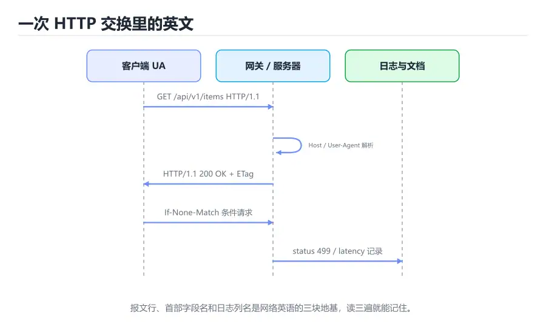

# 网络与 Web 英语：RFC 原文、HTTP 报文与日志精读

> 内容更新时间：2026-10-06 · 学习阶段：基础 · 预计用时：40 分钟



## 本节知识框架

**课程定位**：所属分类 `cs_english`（计算机专业英语）· 学习阶段 基础 · 建议用时 40 分钟。

先给你一行真东西。浏览器按下回车后，网络上飞出去的第一句话是：

> `GET /api/v1/items HTTP/1.1`
> `Host: shop.acme.io`
> `User-Agent: curl/8.5.0`
> `Accept-Encoding: gzip, deflate`

配图把一次 HTTP 交换拆成五个动作：请求行 → 首部解析 → 响应状态与 ETag → 条件请求 → 日志记录。报文行、首部字段名、日志列名就是网络英语的三块地基。

网络英语最特殊的地方在于它有**法典**。RFC 里的动词是分等级的：`MUST` 是硬性要求，`SHOULD` 允许有理由地违背，`MAY` 只是许可，而全小写的 `must` 在法律上什么都不表示。读 RFC 不是读技术，是读条文——句子结构高度模板化，先认措辞等级，再认指代对象，最后才认实现细节。本课按这四块推进：RFC 的定义句与等级动词、报文原文逐词读、连接失败与状态行的日志英文、以及一批从希腊拉丁来的构词零件。

**复习清单**

- [ ] 能说出 `MUST`、`SHOULD`、`MAY`、`should not` 四种措辞的合规强度差别
- [ ] 能解释 `protocol` 一词来自希腊语「贴在文件第一页的胶纸」，并由此说明词义
- [ ] 能把 `idempotent` 拆成 `idem` + `potent` 并给出中文定名「幂等」的来由
- [ ] 能读懂一条 `Connection refused` 日志，指出它是哪一端、哪个环节报出的
- [ ] 能区分 `safe method` 里的 safe 与日常英语「安全」的含义差别
- [ ] 能还原 `URI`、`PDU`、`MTU`、`CORS`、`SNI`、`REST` 六个缩写的全称
- [ ] 能用英文写出一段可复现步骤（steps to reproduce）的网络问题描述

## 核心概念定义

| 术语 | 一句话说明 |
| --- | --- |
| 规范关键词 | RFC 里全大写的 `MUST`/`SHOULD`/`MAY` 等词，含义由 RFC 2119（后由 RFC 8174 收紧）定义，小写形式不携带规范力量 |
| 定义句式 | `A request method is considered "X" if ...`，先给判断条件再给术语名，是 RFC 最常见的下定义方式 |
| 报文三件套 | 请求行（方法 + 目标 + 版本）、首部（字段名: 值）、正文，读报文先定位这三层 |
| 状态行 | `HTTP/1.1 502 Bad Gateway`，短语部分是 reason phrase，属于提示文本，不可当作可编程依据 |
| 目标资源 | `target resource`，RFC 用词，指请求行里定位的那个东西；`current representation` 是它此刻的表示形式 |
| 幂等 | `idempotent`，多次相同请求的意图效果与一次相同；`idem`（同一）+ `potent`（作用力） |
| 安全方法 | `safe` 指「不假定有副作用」，不是「加密」也不是「不会崩」，与 `idempotent` 是两个维度 |
| 校验器 | `validator`（如 ETag、Last-Modified）指用来判断缓存能否复用的不透明字符串，不是「验证的人」 |
| 条件请求 | 带 `If-None-Match` 一类首部的请求，英文 `conditional request`，直译「有条件的请求」 |
| 转发方 | `proxy`/`gateway` 的差别在英文原文里靠动词体现：proxy 会重写请求，gateway 完整翻译另一端协议 |

## 原理与运行机制

### RFC 原文逐句带读

RFC 9110 给「幂等」下的定义是标准句式，值得逐词抠：

> **A request method is considered "idempotent" if the intended effect on the server of multiple identical requests with that method is the same as the effect for a single such request.**

| 成分 | 原词 | 读法 |
| --- | --- | --- |
| 主干 | A request method is considered "idempotent" | 被动 + 主语补足语，中文「若……则该方法是幂等的」，条件要先说 |
| 条件 | if the intended effect ... is the same as ... | 比较对象是 effect，不是请求本身；`intended`（意图上的）一词很关键，实现跑偏不算破坏幂等 |
| 后置定语 | on the server / of multiple identical requests with that method | 两层 `of/on` 短语都修饰 effect，中文要把它们拆开重排 |
| 参照 | the effect for a single such request | `such` 指「同类的一次」，不是「这样的」，英文条文里 such 常当「同一类的」用 |

紧接着的一句给结论：

> **Of the request methods defined by this specification, PUT, DELETE, and safe request methods are idempotent.**

注意句首的 `Of ...`：这是「在……之中」的介词短语前置，等于 `Among the methods ...`，中文要说「在本规范定义的方法中」。`DELETE` 被列入幂等常常让人意外——重复删除同一条记录，第二次通常是 404 或无变化，**意图效果**相同即可，状态码不同不影响判断，这就是 `intended` 三字的分量。

另一句更经典，RFC 用「不幸的副作用」来警告别把有副作用的操作挂到 GET 上：

> **Failure to do so will result in unfortunate side effects when automated processes perform a GET on every URI reference for the sake of link maintenance, pre-fetching, building a search index, etc.**

`Failure to do so` 是无主语的抽象名词短语开头（不这样做），`for the sake of` 是「为了……的目的」，`perform a GET on every URI` 里的 `perform` 是万能动词，等价于「发一个 GET」。整句译成：「如果不这样做，当自动化程序为了维护链接、预取、建搜索索引而对每个 URI 发 GET 时，就会产生不幸的副作用。」

### 措辞等级：一词之差改变合规结论

RFC 2119 的原文定义是：

> **MUST — This word, or the terms "REQUIRED" or "SHALL", mean that the definition is an absolute requirement of the specification.**
> **SHOULD — This word, or the adjective "RECOMMENDED", mean that there may exist valid reasons in particular circumstances to ignore a particular item, but the full implications must be understood and carefully evaluated before choosing a different course.**

读 `SHOULD` 时要把后半句一起读进去：它可以违背，但必须理解全部影响并慎重评估。中文常把 SHOULD 译成「应该」，语气太软；在评审合规性时按「应当（允许有理由地偏离）」更贴切。`MAY` 只表示「允许」，不含推荐意味。而 RFC 8174 特别强调：小写的 `must`、`should` 不算关键词，所以看到 `this must be handled` 之类的小写句，别当成规范要求。

### 网络词汇的构词零件

- `protocol`：希腊语 `prōtókollon`，`prōtos`（第一）+ `kolla`（胶），原指封在文件第一页、用来证明真伪的那张贴纸——所以「协议」的本义是「先亮明身份的那一页」。
- `packet`：中古荷兰语 `pak`（包）+ `-et`（小），「小包」。与之成对的是 `frame`（帧，本义骨架）、`segment`（段，`sect-` 切）、`datagram`（`data` + `telegram` 的混成词，电报式数据报）。`PDU` = Protocol Data Unit，是这些词的上位概念。
- `transfer`：`trans-`（跨越）+ `fer`（带），「搬过去」；HTTP 全称里的 HyperText = `hyper-`（在上、超出）+ text，指「叠在文字之上的超文本」。
- `resource`：法语 `resoudre/re-source`，「重新涌出的供给」，所以「资源」本义是「能反复取用的东西」，这解释了 RFC 为什么用 `resource` 而不是 `file`。
- `socket`：本义「插座、球杆的接头」，指两个东西相接的位置；`port` 来自拉丁 `porta`（门），`endpoint` 是 `end` + `point` 的复合词。
- `bandwidth`：`band`（频带）+ `width`（宽度）；`MTU` = Maximum Transmission Unit，注意它是「单元大小」不是「最大传输次数」，单位是字节。
- `opaque`：`op-`(against) + `aque`，本义「不透光的」，工程里指「你不需要理解其内部结构」，如 `an opaque token`。
- `validator`：`valid`(使有效) + `-or`(执行者)，指 ETag、Last-Modified 这类**用于判定的值**，不是「做验证的人」。

常见缩写按三层还原：`URI` = Uniform Resource Identifier（统一资源标识符，`Locator` 与 `Identifier` 的差别是「怎么找到」与「它是什么」）、`URL` = Uniform Resource Locator、`DNS` = Domain Name System、`TTL` = Time To Live、`TLS` = Transport Layer Security（取代 SSL = Secure Sockets Layer，命名从「套接字层」变成「传输层」，说明定位变了）、`CDN` = Content Delivery Network、`CORS` = Cross-Origin Resource Sharing、`SNI` = Server Name Indication、`ALPN` = Application-Layer Protocol Negotiation、`REST` = Representational State Transfer。

## 典型应用场景

### 场景一：读连接失败的英文

```text
curl: (7) Failed to connect to shop.acme.io port 443 after 3021 ms: Connection refused
curl: (28) Connection timed out after 10001 milliseconds
curl: (6) Could not resolve host: shop.acme.io
```

三条报错的英文主语都是 `curl`，差别在谓语：`Failed to connect` 说明 TCP 握手被拒（对端端口没监听或被防火墙 RST），`timed out` 说明 SYN 发出去没回音（多半是丢包或静默丢弃），`Could not resolve host` 说明连 IP 都没拿到（DNS 环节）。`Connection refused` 对应 errno 的 `ECONNREFUSED`，`Connection reset by peer` 对应 `ECONNRESET`，`Address already in use` 对应 `EADDRINUSE`——这三句是服务端启动日志里出现频率最高的固定短语，读熟它们等于省掉一次搜索。

### 场景二：读状态行与缓存头

```text
HTTP/1.1 200 OK
ETag: "675af34563dc-trunc"
Cache-Control: max-age=604800
HTTP/1.1 304 Not Modified
```

`Not Modified` 的主语是资源表示（representation），不是服务器；`If-None-Match: "675af34563dc-trunc"` 里的 `If-None-Match` 读作「若没有任何一个匹配」，即「我手上这个标签你那儿没有对得上的」。`max-age=604800` 的单位是秒，`stale-while-revalidate` 里的 `stale` 本义「放久的、不新鲜的」，工程上指「过期但可临时顶上」。

### 场景三：在日志与文档里认列名

访问日志的列名是压缩到极致的英文：`remote_addr`、`request_method`、`status`、`body_bytes_sent`、`request_time`、`upstream_response_time`、`http_referer`。注意 `referer` 是拼写错误却被标准化了（正确拼法是 referrer），这是网络英语里最有名的历史 bug；`upstream` 表示「上游」，Nginx 用它指被代理的后端。读性能报告时把 `p50`、`p95`、`p99` 读作「第 50/95/99 百分位」，`p99 latency 45 ms` 意思是 99% 的请求比 45 毫秒更快，别译成「平均」。

### 场景四：用英文提问网络问题

社区里有效的提问格式是「症状—范围—复现—期望」四段，全用名词短语：

> `Symptom: intermittent 502 from the ALB to our NodePort service.`
> `Scope: only affects POST requests larger than 64 KB.`
> `Steps: 1) upload via curl -F 2) observe 502 within 3 requests.`
> `Expected: 413 Payload Too Large instead of a gateway error.`

`intermittent`（间歇的，`inter-` 之间 + `mitt` 送，「断断续续送过来」）、`affects`（影响，注意不是「效果」）、`instead of`（而不是）是这类帖子里的三个高频词。

## 代码/协议/SQL 示例

### 用 curl 与 Python 观察报文英文

```bash
curl -sv https://shop.acme.io/api/v1/items -o /dev/null 2>&1 | head -n 12
# > GET /api/v1/items HTTP/1.1        以 > 开头的是客户端发出的行
# < HTTP/1.1 200 OK                   以 < 开头的是服务端返回的行
# < ETag: "675af34563dc-trunc"
```

```python
import httpx

resp = httpx.get("https://shop.acme.io/api/v1/items", timeout=3.0)
resp.raise_for_status()  # 4xx/5xx 时抛出 HTTPStatusError
print(resp.headers["cache-control"], resp.elapsed.total_seconds())
```

`raise_for_status` 这个函数名就是一条英文句：「为状态码抛出异常」；`HTTPStatusError` 的三段命名（领域 + 对象 + 错误类别）是异常类型的通用构词法。`timeout=3.0` 的单位在文档里靠 `seconds` 一词说明，遇到不带单位的参数一定要回文档确认。

## 时间/空间复杂度或性能分析

### 报文阅读的时间分配

一份 20 行的报文里，请求行与状态行占 2 行、首部占 15 行、正文占 3 行。有经验的读法是「三遍法」：第一遍只看首尾两行确定方法与状态码（约 5 秒），第二遍扫 `Cache-Control`、`Content-Type`、`Content-Length`、`Vary` 四个关键首部（约 15 秒），第三遍才读正文或调试输出（视长度而定）。RFC 正文同理：先读 `Abstract` 与 `Status of This Memo`，再读目录里带 `Overview` 的小节，最后按需查具体字段定义——按顺序通读 RFC 是最耗时的错误策略。

### 术语口径与指标口径

`latency`、`throughput`、`bandwidth` 三个词在报告里常混用，读英文指标要盯介词：`reduce latency by 30%` 是相对下降，`latency of 45 ms` 是绝对值，`at p99` 是百分位口径，`under a load of 200 RPS` 是压力条件（`under` 表「在……条件下」）。同一句里的 `improves throughput 2.1×` 是倍数，`scales linearly up to 16 cores` 里的 `up to` 是上界而非等号。

## 常见误区与易错点

| 序号 | 容易踩的做法 | 正确的判断 |
| --- | --- | --- |
| 1 | 把 `MAY` 译成「可能」 | 规范语境里是「允许、可以」，表许可不表推测 |
| 2 | 把 `safe` 译成「安全」 | `safe method` 指不假定有副作用，与加密、健壮性都无关 |
| 3 | 把 `idempotent` 当成「幂等所以返回相同状态码」 | 定义只约束**意图效果**，第二次返回 404 仍可是幂等 |
| 4 | 把 reason phrase 当可编程依据 | `Bad Gateway` 只是提示文本，客户端逻辑应只看数字状态码 |
| 5 | 把 `Could not resolve host` 译成「无法解析主机内容」 | resolve 在此指域名到地址的解析，失败发生在建连之前 |
| 6 | 把 `upstream` 译成「上游带宽」 | 它是被代理的后端服务，与带宽（`bandwidth`）无关 |
| 7 | 把 `validator` 译成「验证器程序」 | 指 ETag、Last-Modified 这类参与缓存判定的值 |
| 8 | 忽略小写 `must` 与 `should` | RFC 8174 明确小写不算关键词，规范强度只认全大写 |
| 9 | 把 `stale-while-revalidate` 的 stale 译成「失效」 | 本义「不新鲜」，指可短暂顶替旧内容，不是彻底不可用 |
| 10 | 把 `p99 latency 45 ms` 读成平均延迟 | 百分位口径，含义是 99% 的请求快于 45 毫秒 |

## 与其他知识点的关系

### 分类内的上下游

第 1 课 `cs_english_overview` 的词根表在这里全部兑现：`port`（transport、port）、`duc`（reduce、conduct）、`vert`（convert、version）都能在本课找到具体词条。第 2 课 `cs_english_hardware` 教的缩写还原三步（展开全称—核对零件—落到定名）本课直接用在 `MTU`、`PDU`、`SNI` 上；`latency` 与 `throughput` 的辨析也延续自那里。第 7 课 `cs_english_reading_strategy` 会把本课 `Of the request methods defined by this specification, ...` 这类介词前置句总结成通用规则。

### 与技术类课程的对应

`computer_network` 分类讲 TCP 三次握手与 HTTP 状态机，本课讲的是 `SYN`、`RST`、`refused`、`reset` 这些英文词在日志里长什么样；`web_frontend` 讲跨域，本课讲 `Cross-Origin Resource Sharing` 每个单词在说什么（origin 指协议 + 主机 + 端口三元组，不是「来源页」的模糊含义）。两边对照，术语才既能读懂原文又能写进代码。

## 自测题与参考答案

下面 5 道题与「考点精讲」是同一批数据：题干、四个选项原文、答案字母（A 对应第 1 个选项）都一致。建议先只读题干作答、记下自己的理由，再翻到精讲逐条核对。

### 自测 1（单选）

规范文本里 SHOULD 与 MAY 两个关键词的合规强度，下列理解正确的是哪一项？

A. SHOULD 允许在有充分理由时偏离但需慎重评估，MAY 只表许可不含推荐，二者强度不同

B. SHOULD 与 MAY 强度相同，都只表示编写者个人的偏好，工程上可以一律忽略

C. MAY 表示有可能发生，属于推测语气，因此它比 SHOULD 的强制程度更强一些

D. SHOULD 等价于 MUST，只是行文更客气，评审时必须按绝对要求逐条落实不允许偏离

**参考答案：A**

### 自测 2（单选）

RFC 9110 中 A request method is considered "idempotent" if the intended effect on the server of multiple identical requests with that method is the same as the effect for a single such request. 一句的读法要点是什么？

A. 主干是多次请求等于一次请求，因此只要状态码相同就可以判定该方法幂等

B. 主干是被动加主语补足语，判断对象是意图上的效果而非返回值，such 表同类而非这样的

C. 主干是 if 引导的条件句，intended 一词说明该定义只适用于作者打算实现的那些方法

D. 主干是比较级结构，multiple 与 single 相对，因此幂等只在并发场景下才有讨论意义

**参考答案：B**

### 自测 3（代码）

执行上面的命令得到这条英文输出，关于它的读法与排查方向，下列判断正确的是哪一项？

```bash
$ curl -sv https://shop.acme.io/api/v1/items
*   Trying 203.0.113.27:443...
* connect to 203.0.113.27 port 443 failed: Connection refused
* Failed to connect to shop.acme.io port 443 after 3021 ms: Connection refused
curl: (7) Failed to connect to shop.acme.io port 443 after 3021 ms: Connection refused
```

A. Connection refused 说明域名解析失败，应当先修改 hosts 文件再重试这条命令

B. after 3021 ms 表示服务端处理耗时三千余毫秒，问题在后端业务代码的响应速度

C. Failed to connect 意味着 TLS 证书校验未通过，需要换成 http 协议才能继续排查

D. 这句话表明 TCP 连接被对端拒绝，方向是确认目标端口有无监听以及是否有拦截策略

**参考答案：D**

### 自测 4（单选）

HTTP 语义里 safe method 一词中 safe 的准确含义是哪一项？

A. 指该方法启用了加密套件，通信内容不会被中间设备读取或篡改

B. 指该方法实现完善、不会抛出异常，可以在任何客户端里放心调用

C. 指规范不假定该方法会改变服务器状态，与是否加密和是否健壮都没有关系

D. 指该方法只能由管理员权限调用，普通用户发起时会被网关直接拒绝

**参考答案：C**

### 自测 5（单选）

性能报告里 reduce the p99 latency of the checkout API by 30% under a load of 200 RPS 这句，口径理解正确的是哪一项？

A. by 30% 指下降到 30 毫秒，200 RPS 是压测脚本的并发线程数量，两者都是绝对值

B. p99 表示平均值的 99 倍，under a load 说明测试是在低于设计负载的情况下完成的

C. reduce 后接的是接口名，因此这句只描述成功率提升，与时延和负载条件均无关联

D. by 30% 是相对下降幅度，p99 是第 99 百分位口径，under a load 给出压力条件

**参考答案：D**

### 自测 6（填空）

填空：URI 还原成全称是 Uniform Resource ____，它与 URL 的差别在于前者只标识「它是什么」，后者给出「怎么找到它」。

**参考答案：Identifier**（同义写法均算对）

## 考点精讲

每条先给判断依据的落点，再复述正确项原文与干扰项的处理方式。

### 考点 1

**第 1 题** 规范文本里 SHOULD 与 MAY 两个关键词的合规强度，下列理解正确的是哪一项？

**正确答案：A**


A. SHOULD 允许在有充分理由时偏离但需慎重评估，MAY 只表许可不含推荐，二者强度不同

B. SHOULD 与 MAY 强度相同，都只表示编写者个人的偏好，工程上可以一律忽略

C. MAY 表示有可能发生，属于推测语气，因此它比 SHOULD 的强制程度更强一些

D. SHOULD 等价于 MUST，只是行文更客气，评审时必须按绝对要求逐条落实不允许偏离


**解析**：本题正确项是「SHOULD 允许在有充分理由时偏离但需慎重评估，MAY 只表许可不含推荐，二者强度不同」。RFC 2119 对 SHOULD 的后半句写得很清楚：违背可以，但必须先理解全部影响并慎重评估；`MAY` 则纯粹是许可，既不鼓励也不描述概率。中文里把 SHOULD 译成「应该」、MAY 译成「可能」都会丢掉强度信息。干扰项「MAY 表示有可能发生，属于推测语气，因此它比 SHOULD 的强制程度更强一些」把许可误读成推测，还颠倒了强度顺序；干扰项「SHOULD 等价于 MUST，只是行文更客气，评审时必须按绝对要求逐条落实不允许偏离」抹掉了规范文本刻意保留的偏离空间，会把可选实现判成缺陷。

### 考点 2

**第 2 题** RFC 9110 中 A request method is considered "idempotent" if the intended effect on the server of multiple identical requests with that method is the same as the effect for a single such request. 一句的读法要点是什么？

**正确答案：B**


A. 主干是多次请求等于一次请求，因此只要状态码相同就可以判定该方法幂等

B. 主干是被动加主语补足语，判断对象是意图上的效果而非返回值，such 表同类而非这样的

C. 主干是 if 引导的条件句，intended 一词说明该定义只适用于作者打算实现的那些方法

D. 主干是比较级结构，multiple 与 single 相对，因此幂等只在并发场景下才有讨论意义


**解析**：本题正确项是「主干是被动加主语补足语，判断对象是意图上的效果而非返回值，such 表同类而非这样的」。`is considered "idempotent"` 属于「被动 + 主语补足语」结构，中文要把 if 条件提前；`intended effect` 限定的是意图效果，所以重复删除同一条记录第二次返回未找到，仍然满足幂等；`such` 在条文里读作「同一类的」，`a single such request` 即「同类的一次请求」。干扰项「主干是多次请求等于一次请求，因此只要状态码相同就可以判定该方法幂等」把判断对象从效果换成状态码，与原文的 intended 相冲突；干扰项「主干是 if 引导的条件句，intended 一词说明该定义只适用于作者打算实现的那些方法」把 intended 错解成「作者的打算」，逻辑主语也读错了。

### 考点 3

**第 3 题** 执行上面的命令得到这条英文输出，关于它的读法与排查方向，下列判断正确的是哪一项？

**正确答案：D**


A. Connection refused 说明域名解析失败，应当先修改 hosts 文件再重试这条命令

B. after 3021 ms 表示服务端处理耗时三千余毫秒，问题在后端业务代码的响应速度

C. Failed to connect 意味着 TLS 证书校验未通过，需要换成 http 协议才能继续排查

D. 这句话表明 TCP 连接被对端拒绝，方向是确认目标端口有无监听以及是否有拦截策略


```bash
$ curl -sv https://shop.acme.io/api/v1/items
*   Trying 203.0.113.27:443...
* connect to 203.0.113.27 port 443 failed: Connection refused
* Failed to connect to shop.acme.io port 443 after 3021 ms: Connection refused
curl: (7) Failed to connect to shop.acme.io port 443 after 3021 ms: Connection refused
```


**解析**：本题正确项是「这句话表明 TCP 连接被对端拒绝，方向是确认目标端口有无监听以及是否有拦截策略」。`Connection refused` 对应错误码宏名 `ECONNREFUSED`，它是收到 RST 之后的结果，说明包已到达对端但没人监听这个端口或被中间设备主动拒绝；与之相对，`Connection timed out` 才是 SYN 发出去无声响。`after 3021 ms` 是 curl 统计的建连耗时而不是服务端处理时间，读这类句要盯主语是谁。干扰项「Connection refused 说明域名解析失败，应当先修改 hosts 文件再重试这条命令」混淆了 DNS 与传输层，解析失败的固定说法是 Could not resolve host；干扰项「Failed to connect 意味着 TLS 证书校验未通过，需要换成 http 协议才能继续排查」把证书类错误与建连被拒混为一谈，证书问题会明确写出与证书相关的字样；干扰项「after 3021 ms 表示服务端处理耗时三千余毫秒，问题在后端业务代码的响应速度」读错了时间量的归属对象。

### 考点 4

**第 4 题** HTTP 语义里 safe method 一词中 safe 的准确含义是哪一项？

**正确答案：C**


A. 指该方法启用了加密套件，通信内容不会被中间设备读取或篡改

B. 指该方法实现完善、不会抛出异常，可以在任何客户端里放心调用

C. 指规范不假定该方法会改变服务器状态，与是否加密和是否健壮都没有关系

D. 指该方法只能由管理员权限调用，普通用户发起时会被网关直接拒绝


**解析**：本题正确项是「指规范不假定该方法会改变服务器状态，与是否加密和是否健壮都没有关系」。`safe` 在这里是「无副作用」的技术含义，判断依据是规范措辞 rather than 实现质量，它和 `idempotent` 是两个正交维度：GET 通常既安全又幂等，POST 通常既不安全也不幂等，而 PUT 不安全却幂等。加密相关的英文是 `secure`、`TLS`，健壮相关的英文是 `robust`。干扰项「指该方法启用了加密套件，通信内容不会被中间设备读取或篡改」把 safe 与 secure 混译，这是专业英语阅读里最容易犯的词义串线；干扰项「指该方法实现完善、不会抛出异常，可以在任何客户端里放心调用」则把规范层面的约定当成实现质量承诺，方向完全偏离。

### 考点 5

**第 5 题** 性能报告里 reduce the p99 latency of the checkout API by 30% under a load of 200 RPS 这句，口径理解正确的是哪一项？

**正确答案：D**


A. by 30% 指下降到 30 毫秒，200 RPS 是压测脚本的并发线程数量，两者都是绝对值

B. p99 表示平均值的 99 倍，under a load 说明测试是在低于设计负载的情况下完成的

C. reduce 后接的是接口名，因此这句只描述成功率提升，与时延和负载条件均无关联

D. by 30% 是相对下降幅度，p99 是第 99 百分位口径，under a load 给出压力条件


**解析**：本题正确项是「by 30% 是相对下降幅度，p99 是第 99 百分位口径，under a load 给出压力条件」。英文指标句的口径几乎全靠介词承担：`reduce by X` 是差值、`reduce to X` 是结果值、`at p99` 是百分位、`under a load of 200 RPS` 是压力前提，其中 `of the checkout API` 修饰 latency 而非 reduce 的宾语。四个口径一起读出，才能判断结论能不能复现。干扰项「by 30% 指下降到 30 毫秒，200 RPS 是压测脚本的并发线程数量，两者都是绝对值」把 by 与 to 混掉，又把 RPS（每秒请求数）当成线程数；干扰项「p99 表示平均值的 99 倍，under a load 说明测试是在低于设计负载的情况下完成的」对百分位的理解根本错误，`under` 也不含「低于设计值」这层意思。

### 考点 6

**第 6 题** 填空：URI 还原成全称是 Uniform Resource ____，它与 URL 的差别在于前者只标识「它是什么」，后者给出「怎么找到它」。

**正确答案：Identifier**


**解析**：空缺处应填 Identifier 一词，中文定名是标识符。`Uniform` 表统一格式、`Resource` 指可反复取用的对象、`Identifier` 来自 identify，只回答「这是哪个东西」；而 Locator 里的 `locate` 是「定位」，额外要求给出访问路径，所以 URL 是 URI 的子集。记住这一字之差，读 RFC 与浏览器文档时就不会把两者当同义词替换。


## 术语速查

| 术语 | 一句话说明 |
| --- | --- |
| MUST / SHALL | 绝对要求，二者同义，来自 RFC 2119 的分级用词传统，小写形式不具规范力 |
| SHOULD | 应当，允许在有充分理由时偏离，但必须先理解全部影响并慎重评估 |
| MAY | 允许，仅表示可做，不含推荐意味，也不表示「可能」 |
| target resource | 请求目标所定位的资源，`resource` 词源是「能反复取用的供给」，故不等同于文件 |
| representation | 资源在某一时刻的表示形式，`re-` 再次 + `present` 呈现，中文「表示」 |
| idempotent | 幂等，`idem`（同一）+ `potent`（作用力），只看意图效果是否等同单次请求 |
| safe method | 不假定有副作用的方法，与加密强度、健壮性无关，两个概念不要混 |
| validator | ETag、Last-Modified 一类参与缓存判定的不透明值，不是执行校验的程序 |
| opaque | 不透光的、内部结构无需理解的，常见搭配 `opaque token`、`opaque string` |
| upstream | 被代理转发到的后端服务，日志列名 `upstream_response_time` 即其耗时 |
| referer | HTTP 首部名，历史上拼错（应为 referrer）却已固化，读到不要「纠正」 |
| ECONNREFUSED / ECONNRESET | 分别对应 Connection refused 与 Connection reset by peer 两个错误码宏名 |
| TTL | Time To Live，存活时间，DNS 与 IP 头都用它，单位是秒而非次数 |
| p99 latency | 第 99 百分位时延，读作 ninety-ninth percentile，不是平均时延 |

## 参考资料与复核

- 复核范围：RFC 引文逐字核对、规范关键词定义、curl 与 Nginx 报错固定短语、缩写全称复核

| 参考资料 | 本课用途 |
| --- | --- |
| [RFC 9110: HTTP Semantics](https://www.rfc-editor.org/rfc/rfc9110.html) | 幂等定义句、`Of the request methods ...` 与副作用警告句的原文出处 |
| [RFC 2119: Key words for use in RFCs](https://www.rfc-editor.org/rfc/rfc2119) | MUST、SHOULD、MAY 三级措辞定义原文 |
| [RFC 8259: The JavaScript Object Notation (JSON) Data Interchange Format](https://www.rfc-editor.org/rfc/rfc8259.html) | 摘要里 lightweight、text-based、language-independent 三个定语的连用范式 |
| [RFC 3986: Uniform Resource Identifier (URI): Generic Syntax](https://datatracker.ietf.org/doc/html/rfc3986) | URI 与 URL 术语边界的规范出处 |
| [MDN: HTTP](https://developer.mozilla.org/en-US/docs/Web/HTTP) | 状态码 reason phrase 与首部字段名的工程侧对照 |

- 最后复核：2026-10-04
- 下次复核：2027-03-24

## 内容元数据

- 内容版本：v2.0
- 最后更新：2026-10-06
- 学习阶段：基础
- 适用环境：通用开发环境；本课聚焦 RFC、HTTP 报文与服务端日志里的英文原文。
- 内容来源：内置结构化课程与英文标准文档复核整理
- 相关主题：RFC wording, HTTP messages, connection error phrases
- 质量版本：P0 测验标准 + P1 覆盖扩展 + P2 体验补全
