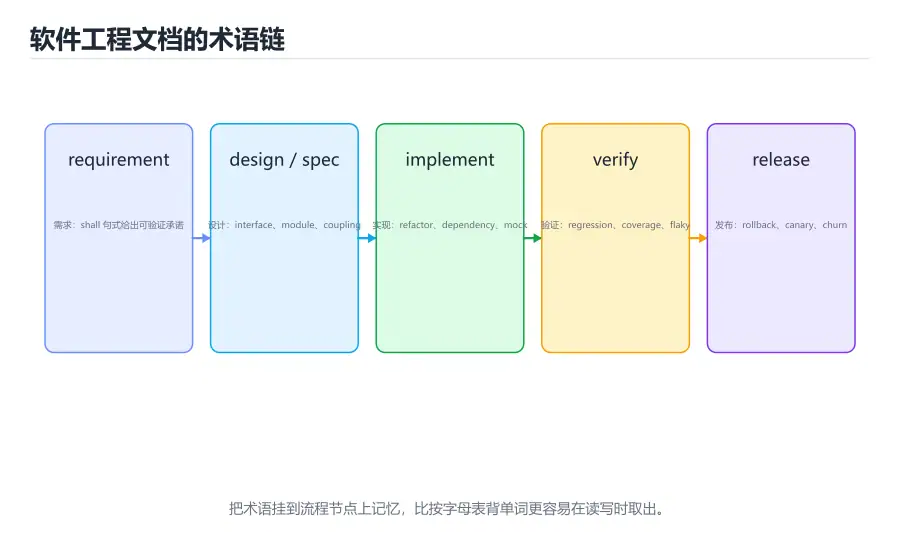

# 操作系统与软件工程英语：从需求到发布的术语链

> 内容更新时间：2026-10-06 · 学习阶段：基础 · 预计用时：38 分钟



## 本节知识框架

**课程定位**：所属分类 `cs_english`（计算机专业英语）· 学习阶段 基础 · 建议用时 38 分钟。

先看一句能立刻用上的话。Linux 手册页里介绍调度接口的句子是这样的：

> `sched_setscheduler(2)` — Set the scheduling policy and parameters of a specified thread.

它只有 11 个词，却把操作系统英语的三个脾气全暴露出来了：**动词开头**（`Set`，没有主语，也没有「本函数」这种词）、**术语成对**（`policy` 与 `parameters` 是调度的两个正交维度）、**限定精确**（`of a specified thread` 说的是「指定线程」而不是「进程」，句末还有句号）。把这句话读顺，你就知道手册页怎么查了；把它仿写出来，你就知道英文注释该怎么写。

配图把本课的术语挂在流程节点上：`requirement`（需求）→ `design/spec`（设计）→ `implement`（实现）→ `verify`（验证）→ `release`（发布）。按流程记术语，比按字母表背单词容易取出得多——读到 `coupling` 就想到设计评审，读到 `flaky` 就想到 CI 流水线，读到 `canary` 就想到发布策略。本课的四块正文就按这个顺序走：需求句与设计名词、实现期动词、验证与错误码原文、发布与流程术语。

**复习清单**

- [ ] 能说明 man page 八个分节（NAME 到 BUGS）各自回答什么问题
- [ ] 能用 `shall / should / may / can / must` 五种动词区分强制、建议与允许
- [ ] 能还原 `mutex`、`semaphore`、`daemon`、`buffer`、`preempt`、`thrash` 六个词的字面来源
- [ ] 能在 3 秒内从 `ENOMEM` 的两条说明里判断是内存不够还是映射数超限
- [ ] 能读懂 `since Linux 2.5.37`、`on older kernels` 这类时间限定语并正确翻译
- [ ] 能写出一条符合内核文档要求的英文 commit 说明（祈使句、说问题不说结果）
- [ ] 能解释 `regression`、`flaky`、`coverage`、`canary` 四个词在本行业的比喻来源

## 核心概念定义

| 术语 | 一句话说明 |
| --- | --- |
| 手册页分节 | man page 的固定结构：NAME、SYNOPSIS、DESCRIPTION、RETURN VALUE、ERRORS、CONFORMING TO、NOTES、BUGS，每节回答一个固定问题 |
| 祈使句定义 | 文档用动词原形开头描述行为，如 `Mark the mapped region to be locked...`，主语被省略 |
| 错误码条目 | `ERRORS` 一节的格式是「宏名 + 一句话」，句子用一般现在时陈述事实，不写因果关系 |
| 强制语气 | `must`/`shall` 表绝对要求，`should` 表建议，`may`/`can` 表允许或可能，级别不可混用 |
| 时间限定语 | `since Linux 2.5.37`、`in older kernels`，限定的是行为生效的版本范围，不是句子时态 |
| 名词化 | 用名词代替从句，如 `the initialization of the mapping`，是学术与技术英文压缩信息的主要手段 |
| 混成词 | `mutex` = mutual + exclusion 拼成，读的时候必须还原两半才能理解「互斥」 |
| 比喻术语 | 借日常事物命名的词，如 `canary`（矿道里的金丝雀）、`thundering herd`（惊群）、`zombie`（僵尸进程） |
| 需求句 | 工程文档里 `The system shall ...` 的句式，一条只承诺一件可验证的事 |
| 评审用语 | 代码评审的固定缩略：`nit:` 吹毛求疵级建议、`LGTM` 我看行、`suggestion:` 可改可不改 |

## 原理与运行机制

### 一段 man page 原文的逐句带读

内核手册页关于 `MAP_LOCKED` 标志的说明是标准的工程英文，我们一句句拆：

> **MAP_LOCKED (since Linux 2.5.37) Mark the mapped region to be locked in the same way as mlock(2). This implementation will try to populate (prefault) the whole range but the mmap() call doesn't fail with ENOMEM if this fails.**

| 成分 | 原词 | 拆解与读法 |
| --- | --- | --- |
| 时间限定 | since Linux 2.5.37 | 括号里的是生效版本，中文写「自 Linux 2.5.37 起」，不要译成「自从」 |
| 祈使谓语 | Mark ... to be locked | `mark` 是「标记」，`to be locked` 是不定式的被动形式，「要被锁住」 |
| 比较方式 | in the same way as mlock(2) | 与 `mlock(2)` 的行为一致；末尾的 `(2)` 是手册分节号，指系统调用而非库函数 |
| 未来倾向 | will try to populate (prefault) | `will` 在这里表「倾向性行为」不是将来时；`populate` 本义「填充人口」，这里是「提前把页真正分配出来」；括号里的 `prefault` = `pre-`(提前) + `fault`(缺页) |
| 让步否定 | doesn't fail with ENOMEM if this fails | 两个 `fail` 含义不同：前者是「调用失败」，后者是「预填充失败」，中文要分开译 |
| 后果补述 | Therefore major faults might happen later on | `major fault` 是需要真正读盘的缺页，`might` 表可能，`later on` 是「稍后」 |

这一句读下来，你就掌握了工程英文的四个高频手法：括号限定、不定式被动、同词多义、让步从句。

### 错误码条目：最短的英文，最贵的翻译

`ERRORS` 一节的写法是「宏名 + 一般现在时句子」。真实条目：

> **ENOMEM — No memory is available.**
> **ENOMEM — The process's maximum number of mappings would have been exceeded.**
> **ENFILE — The system-wide limit on the total number of open files has been reached.**

三条句子结构完全不同：第一条是无宾语的短句，指物理内存或地址空间不足；第二条用 `would have been exceeded`（虚拟语气，本会超过），强调这是配额检查而不是内存耗尽；第三条用现在完成时被动 `has been reached`，强调系统级上限已被触及。中文如果统一译成「内存不足」，就把三个不同的排查方向压成了一个——这正是专业英语阅读的价值所在：**时态与语态在工程文本里承担诊断信息**。

缩写还原也在这里：`ENOMEM` = error + no memory，`ENFILE` = error + file，`EBADF` = error + bad file descriptor，`EINTR` = error + interrupted（`inter-` 之间 + `rupt` 打断）。前缀 `E` 之后全是大写单词的首部，看到就能直接猜方向。

### 词源：把六个术语的来历讲一遍

- `kernel`：古英语 `cyrecan` 指「果核、谷粒」，引申为「最里面那一层」。操作系统把最内层特权代码叫 kernel，中文定名「内核」是直译。
- `daemon`：希腊语 `daimon` 是「在人与神之间跑腿的存在」，不是 `demon`（恶魔）。`pdflush`、`sshd` 这类长期驻留进程因此得名；读 `systemd` 时要读 /ˈsɪstəm dæmən/? 不，社区普遍读作 `system-dee`，因为结尾的 `d` 取自 `daemon` 的首字母。
- `mutex`：`mutual exclusion` 的混成词（portmanteau），构词法上和 `brunch`（breakfast + lunch）同类。还原成两半才知道它既含「相互」又含「排除」。
- `semaphore`：`sema`（希腊语「标志」）+ `phoros`（携带），字面「举旗传信号」，来自铁路的臂板信号机。Dijkstra 命名的 PV 操作 `P`/`V` 取自荷兰语 `proberen`（尝试）与 `verhogen`（增加）。
- `preempt`：`prae-`（在前）+ `empt-`（买、拿），本义「抢先买走」，调度里就是「抢先占用 CPU」。`CONFIG_PREEMPT_RT` 是内核实时补丁的符号名。
- `thrash`：由 `thresh`（打谷）变来，谷粒被反复摔打脱粒，术语借指页面被反复换入换出、CPU 全花在搬运上，中文叫「颠簸」。

### 需求、设计与评审的三套句式

需求阶段最爱 `shall`：`The scheduler shall select the runnable thread with the earliest deadline.` 一条只讲一件可验证的事，主语是系统，动词是 `shall`，条件与对象都写死。设计阶段全是名词：`coupling`（耦合，`couple` 成对）、`cohesion`（内聚，`co-` 一起 + `haer` 粘）、`interface`、`abstraction`、`invariant`（不变式，`in-` 不 + `variant` 变）。评审阶段的句子最短，而且刻意降低语气：`nit: consider renaming `ticks` to `quantum``、`suggestion: this branch could be inverted`、`LGTM`。英文评审的礼貌靠「虚拟语气 + 动词原形」实现，而不是靠客套话，这一点在第 8 课会继续展开。

## 典型应用场景

### 场景一：查一个陌生系统调用

按 NAME → SYNOPSIS → DESCRIPTION → RETURN VALUE → ERRORS 的顺序读，每节只找一样东西：NAME 找动词，SYNOPSIS 找参数类型，DESCRIPTION 找限定条件，RETURN VALUE 找成功与失败的分界，ERRORS 找自己碰到的那个宏名。`man 2 mmap` 与 `man 3 malloc` 的差别就在分节号：2 是内核提供的系统调用，3 是 C 库函数，报错的层次完全不同。

### 场景二：读内核提交规范里的英文要求

内核文档对提交说明的写法是硬性要求：

> **Describe your changes in imperative mood, e.g. "make xyzzy do frotz" instead of "[This patch] makes xyzzy do frotz" or "[I] changed xyzzy to do frotz", as if you are giving orders to the codebase to change its behaviour.**

句子里的 `imperative mood` 就是「祈使语气」，`as if you are giving orders to the codebase` 是整段最形象的一处：把代码库当成下属来下命令。中文社区常译成「描述你的改动时使用祈使句，就像在给代码库下命令」，这一译法保留了原文的比喻。

### 场景三：读 CI 与评审里的缩写

日志里出现 `flaky test`、`regression detected`、`coverage dropped by 0.4%`、`canary rollout at 5%`。`flaky` 本义「铺 flakes（薄片）的」，引申为「不稳、时好时坏」；`regression` = `re-` 回 + `gress` 走 → 走回头路，中文「回归」；`canary` 来自矿井带金丝雀测毒气的做法，先放 5% 流量当哨兵。这类词没有词表可背，只能靠「比喻来源」记牢。

### 场景四：写一句给国外维护者的说明

内核文档还有一句值得仿写：

> **Whether your patch is a one-line bug fix or 5000 lines of a new feature, there must be an underlying problem that motivated you to do this work.**

`whether ... or ...` 在这里是让步（无论……还是……），`underlying problem` 是「底层的问题」，`motivated` 是「促使」。仿写出来就是：`Whether the build runs locally or in CI, there must be a single command that reproduces the failure.`

## 代码/协议/SQL 示例

### 用 C 的错误码分支读英文

```c
#define _GNU_SOURCE
#include <stdio.h>
#include <string.h>
#include <errno.h>
#include <fcntl.h>

int open_log(const char *path) {
    int fd = open(path, O_RDWR | O_CREAT, 0644);
    if (fd < 0) {
        switch (errno) {
            case EACCES:   /* Permission denied: check file mode and dir bits */
                return -1;
            case ENAMETOOLONG: /* Name too long: path exceeds PATH_MAX */
                return -2;
            case EMFILE:   /* Per-process descriptor table is full */
                return -3;
            default:
                perror("open_log");  /* prints "open_log: <strerror text>" */
                return -1;
        }
    }
    return fd;
}
```

`EACCES` = error + access，`ENAMETOOLONG` 是三个词直接连写（name + to + long），`EMFILE` = error + (too many open) files。注释里全是无主语短句，这是内核代码注释的典型形态。`perror` 打印的那行由程序名 + 冒号 + `strerror(errno)` 的英文原文组成，例如 `open_log: Permission denied`，读日志时先抓冒号后面的固定短语，再反查宏名。

### 带签名的提交流程

```bash
git commit -s -m "sched/deadline: fix runtime accounting after a CPU hotplug"
# -s 追加 Signed-off-by 行（Developer's Certificate of Origin 的落款）
git log --oneline -1
# 标题行遵循 subsystem: imperative summary 的约定，不超过 72 列
```

标题里的 `sched/deadline:` 是子系统前缀，冒号后接祈使句摘要，`after a CPU hotplug` 是时间条件。`hotplug`（热插拔）这个复合词的来源是早期服务器带电插拔 SCSI 盘时冒火花的场景，英文里当动词和名词都能用：`hotplug a device`、`a CPU hotplug event`。

## 时间/空间复杂度或性能分析

### 读一页文档的时间预算

工程英文的阅读速度可以按「句子类型」估：定义句（`X is a Y that Zs`）约 8 秒，条件句（含 `if/unless/provided that`）约 12 秒，错误码条目约 5 秒，而带三层从句的设计说明约 25 秒。一页 man page 平均 20 个信息句，因此 3~4 分钟是合理目标。读不完通常不是词汇问题，而是把每个限定语都当新词查了——`since Linux 2.5.37`、`on older kernels` 这类是模板，认识一次就永久省下时间。

### 术语密度与内存指标的对应

术语密度高的段落往往在讲机制，低密度段落在讲用法。可以粗略用「每百词术语数」判断该段值不值得精读：man page 的 DESCRIPTION 常在 12~18 之间，NOTES 在 6~10，社区回答往往低于 5。这与内存指标类比很有意思：`RSS`（Resident Set Size，常驻集大小）是「真正占了多少物理页」，`VSZ`（Virtual Size，虚拟地址空间）是「声称占了多少」——读文档也分这两层，精读 RSS 高的段落，略读 VSZ 高但 RSS 低的段落。

## 常见误区与易错点

| 序号 | 容易踩的做法 | 正确的判断 |
| --- | --- | --- |
| 1 | 把 `Set the scheduling policy` 译成「设置调度策略的功能」 | 这是定义句的祈使语气，中文写「设置……的策略」，不必补「本函数」 |
| 2 | 把所有 `ENOMEM` 都译成「内存不足」 | man page 用两条 ENOMEM 区分内存耗尽与映射数超上限，排查方向完全不同 |
| 3 | 把 `would have been exceeded` 译成「将会超过」 | 这是虚拟语气，意为「本会超过（因为检查而没让它超过）」，说明是配额拦截 |
| 4 | 把 `since Linux 2.5.37` 译成「自从 Linux 2.5.37 以来一直」 | 中文习惯只写「自 Linux 2.5.37 起」，它限定行为存在范围，不表完成时 |
| 5 | 认为 `must` 与 `should` 只差语气强弱 | `should` 是「可以不理但有理由才行」，`must` 是绝对要求，级别错译会改变合规结论 |
| 6 | 把 `mutex` 拆成 `mut` + `tex` | 正确还原是 `mutual exclusion`，混成词只能按两半理解 |
| 7 | 把 `nit:` 当成反对意见 | 它是「小得近乎吹毛求疵的建议」，不阻塞合入，中文可译「小建议」 |
| 8 | 把 `regression` 一律译成「回归分析」 | 工程语境指「改出老问题」，统计学语境才译「回归」 |
| 9 | 把 `kernel` 与 `core` 混译 | core 指内核态或核心转储（`core dump`），kernel 特指操作系统最内层 |
| 10 | 认为 `flaky` 是骂人的话 | 它描述测试结果不稳定这一客观现象，与代码作者无关，是中性术语 |

## 与其他知识点的关系

### 分类内的上下游

词根本课沿用第 1 课 `cs_english_overview` 的 `grad/gress`（regress、upgrade）、`port`（export、portable）、`clud`（include、exclusive）三个零件；句式分析交给第 7 课 `cs_english_reading_strategy`，那里会把 `would have been` 与虚拟语气做成通用规则；第 8 课 `cs_english_tech_writing` 会把本课的祈使句要求扩展成 README、commit 与注释三套模板。缩写还原在第 2 课 `cs_english_hardware` 里已经练过，本课把它用在错误码与配置符号上。

### 与技术类课程的对应

`operating_system` 分类讲 CFS 与 EEVDF 调度算法，本课讲 `Completely Fair Scheduler` 的定名与 `deadline`、`runtime`、`lag` 这些英文字段；`software_engineering` 讲需求追溯矩阵，本课讲 `shall` 句式为什么能保证可验证；`linux_shell` 讲 `strace` 输出格式，本课讲 `errno` 宏名的构词，两边一起看才既会查又会读。

## 自测题与参考答案

下面 5 道题与「考点精讲」是同一批数据：题干、四个选项原文、答案字母（A 对应第 1 个选项）都一致。建议先只读题干作答、记下自己的理由，再翻到精讲逐条核对。

### 自测 1（单选）

Linux 手册页 DESCRIPTION 一节里 `sched_setscheduler(2) Set the scheduling policy and parameters of a specified thread.` 这句的英文写法特征，下列说明正确的是哪一项？

A. 用动词原形开头的祈使句，主语被省略，术语成对出现，末尾的 (2) 指手册分节号而非参数

B. 用一般现在时的陈述句，主语是本函数，(2) 表示该接口在头文件里排第二个位置

C. 用被动语态强调动作承受者，policy 与 parameters 是同一件事的两种拼法，(2) 是版本号

D. 用虚拟语气表达建议，因为调度策略由用户决定，(2) 说明它是第二个可选参数

**参考答案：A**

### 自测 2（调试）

上面这段代码打印出 mmap failed: No memory is available，关于这条英文输出与它背后的错误码，下列判断正确的是哪一项？

```c
void *p = mmap(NULL, len, PROT_READ, MAP_PRIVATE, fd, 0);
if (p == MAP_FAILED) {
    /* errno == ENOMEM */
    fprintf(stderr, "mmap failed: %s\n", strerror(errno));
}
```

A. strerror 的输出可以随意改写，只要程序能崩在正确位置，排查思路不受这句话影响

B. 这句话只可能是物理内存耗尽，因为 man page 里 ENOMEM 的定义就是没有可用内存

C. 只要把 len 改小就能验证结论，英文提示里的 available 一词已经指明是容量问题

D. 手册页对 ENOMEM 给了两条说明，除内存耗尽外还有映射条数超上限，需要结合调用点判断

**参考答案：D**

### 自测 3（单选）

手册页中 The process's maximum number of mappings would have been exceeded 一句里 would have been exceeded 的语法作用是什么？

A. 表示过去某个时刻确实超过了上限，属于对历史事实的回忆性陈述

B. 用虚拟语气说明检查机制拦下了这次调用，本会超过但因被拒绝而未发生

C. 表示将来的推测，等价于 will be exceeded，只是行文更正式一些

D. 构成条件句的主句，必须有 if 从句出现在同一句里才算合法用法

**参考答案：B**

### 自测 4（单选）

把 `mutex` 与 `semaphore` 两个术语按构词还原，下面哪一项的说法站得住？

A. mutex 拆成 mut + tex，semaphore 拆成 semi + phone，前者与变化有关、后者与电话有关

B. 两个词都是希腊语原生的复合名词，在英语里没有被重新拼合过，因此无法拆解

C. mutex 由 mutual 与 exclusion 混成，semaphore 由 sema（标志）与 phoros（携带）组成

D. mutex 是人名缩写，semaphore 来自日语，两者都属于专有名词而非普通术语

**参考答案：C**

### 自测 5（单选）

内核文档写道 Describe your changes in imperative mood, e.g. "make xyzzy do frotz" ，对这条要求的正确执行方式是哪一项？

A. 写成 this patch fixes a NULL pointer dereference，说明补丁做了什么更清楚

B. 写成 I changed the driver to handle the reset case，把作者作为主语更易追溯

C. 写成 the bug has been fixed in the interrupt path，用被动语态显得客观中立

D. 写成 handle the reset case in the interrupt path，动词原形开头且不带主语

**参考答案：D**

### 自测 6（多选）

阅读英文 man page 与内核文档时，下列哪些做法符合正确的读法要求？（多选）

A. 先看分节号再读内容，例如 2 查系统调用、3 查库函数，两者报错层次不同

B. 把 since Linux 2.5.37 这类限定语当成时态线索，据此判断句子的动作发生在过去

C. 对同一宏名下的多条说明逐条核对，例如 ENOMEM 既可能是内存耗尽也可能是映射数超限

D. 把 nit: 与 LGTM 视为语气强弱不同的评审用语，前者是小建议、后者是认可

**参考答案：A、C、D**

## 考点精讲

每条先给判断依据的落点，再复述正确项原文与干扰项的处理方式。

### 考点 1

**第 1 题** Linux 手册页 DESCRIPTION 一节里 `sched_setscheduler(2) Set the scheduling policy and parameters of a specified thread.` 这句的英文写法特征，下列说明正确的是哪一项？

**正确答案：A**


A. 用动词原形开头的祈使句，主语被省略，术语成对出现，末尾的 (2) 指手册分节号而非参数

B. 用一般现在时的陈述句，主语是本函数，(2) 表示该接口在头文件里排第二个位置

C. 用被动语态强调动作承受者，policy 与 parameters 是同一件事的两种拼法，(2) 是版本号

D. 用虚拟语气表达建议，因为调度策略由用户决定，(2) 说明它是第二个可选参数


**解析**：本题正确项是「用动词原形开头的祈使句，主语被省略，术语成对出现，末尾的 (2) 指手册分节号而非参数」。man page 的定义句几乎都以 `Set`、`Return`、`Fetch` 这类动词原形起头，读者要抓的是「动作 + 宾语 + 限定范围」三件事；分节号 1 到 8 各有含义，2 是系统调用、3 是库函数，查错分节会读到完全不同的说明。干扰项「用一般现在时的陈述句，主语是本函数，(2) 表示该接口在头文件里排第二个位置」把祈使句误当陈述句，还编造了排序含义；干扰项「用被动语态强调动作承受者，policy 与 parameters 是同一件事的两种拼法，(2) 是版本号」既弄错了语态又把两个正交维度说成同义词。

### 考点 2

**第 2 题** 上面这段代码打印出 mmap failed: No memory is available，关于这条英文输出与它背后的错误码，下列判断正确的是哪一项？

**正确答案：D**


A. strerror 的输出可以随意改写，只要程序能崩在正确位置，排查思路不受这句话影响

B. 这句话只可能是物理内存耗尽，因为 man page 里 ENOMEM 的定义就是没有可用内存

C. 只要把 len 改小就能验证结论，英文提示里的 available 一词已经指明是容量问题

D. 手册页对 ENOMEM 给了两条说明，除内存耗尽外还有映射条数超上限，需要结合调用点判断


```c
void *p = mmap(NULL, len, PROT_READ, MAP_PRIVATE, fd, 0);
if (p == MAP_FAILED) {
    /* errno == ENOMEM */
    fprintf(stderr, "mmap failed: %s\n", strerror(errno));
}
```


**解析**：本题正确项是「手册页对 ENOMEM 给了两条说明，除内存耗尽外还有映射条数超上限，需要结合调用点判断」。man page 的 ERRORS 一节允许同一个宏名挂多条句子，第二条用的是虚拟语气 `would have been exceeded`，说的是配额检查而非内存不足；日志里 `%s` 打出来的英文短句只是第一条说明的字符串形式，不能当作唯一诊断。干扰项「这句话只可能是物理内存耗尽，因为 man page 里 ENOMEM 的定义就是没有可用内存」正是被单条说明误导的典型结论；干扰项「只要把 len 改小就能验证结论，英文提示里的 available 一词已经指明是容量问题」把映射数超限的可能排除掉了，改小长度反而会让真正的原因继续隐藏；干扰项「strerror 的输出可以随意改写，只要程序能崩在正确位置，排查思路不受这句话影响」忽视了固定英文短语的诊断价值。

### 考点 3

**第 3 题** 手册页中 The process's maximum number of mappings would have been exceeded 一句里 would have been exceeded 的语法作用是什么？

**正确答案：B**


A. 表示过去某个时刻确实超过了上限，属于对历史事实的回忆性陈述

B. 用虚拟语气说明检查机制拦下了这次调用，本会超过但因被拒绝而未发生

C. 表示将来的推测，等价于 will be exceeded，只是行文更正式一些

D. 构成条件句的主句，必须有 if 从句出现在同一句里才算合法用法


**解析**：本题正确项是「用虚拟语气说明检查机制拦下了这次调用，本会超过但因被拒绝而未发生」。工程英文里 `would + have + 过去分词` 常用来描述「如果没有这道检查就会怎样」，它把「拦截成功」这一事实压缩进动词形态，中文要显式补出「本会……但因被拒绝而未发生」。这一形态与上一条 `No memory is available` 的一般现在时形成对照：前者讲拦截规则，后者讲实际资源。干扰项「表示将来的推测，等价于 will be exceeded，只是行文更正式一些」抹掉了虚拟语气与真实将来之间的差别，会把排查方向引向容量预测；干扰项「构成条件句的主句，必须有 if 从句出现在同一句里才算合法用法」也不成立，技术文档里虚拟语气经常独立成句，条件由上下文提供。

### 考点 4

**第 4 题** 把 `mutex` 与 `semaphore` 两个术语按构词还原，下面哪一项的说法站得住？

**正确答案：C**


A. mutex 拆成 mut + tex，semaphore 拆成 semi + phone，前者与变化有关、后者与电话有关

B. 两个词都是希腊语原生的复合名词，在英语里没有被重新拼合过，因此无法拆解

C. mutex 由 mutual 与 exclusion 混成，semaphore 由 sema（标志）与 phoros（携带）组成

D. mutex 是人名缩写，semaphore 来自日语，两者都属于专有名词而非普通术语


**解析**：本题正确项是「mutex 由 mutual 与 exclusion 混成，semaphore 由 sema（标志）与 phoros（携带）组成」。混成词（portmanteau）在英语里并不少见，`brunch` 由 breakfast 与 lunch 拼成，`mutex` 同理，必须还原成 `mutual exclusion` 才能明白它同时表达「相互」与「排除」；`semaphore` 的两个希腊零件字面是「携带标志」，Dijkstra 借用铁路臂板信号机的意象为 P、V 操作命名。干扰项「mutex 拆成 mut + tex，semaphore 拆成 semi + phone，前者与变化有关、后者与电话有关」是把 `semi-`（一半）与 `phone`（声音）硬贴上去的假拆词，`mutex` 中间并没有 `semi`；干扰项「两个词都是希腊语原生的复合名词，在英语里没有被重新拼合过，因此无法拆解」否认了混成这一构词手段，与 `brunch` 这类常见词的证据矛盾。

### 考点 5

**第 5 题** 内核文档写道 Describe your changes in imperative mood, e.g. "make xyzzy do frotz" ，对这条要求的正确执行方式是哪一项？

**正确答案：D**


A. 写成 this patch fixes a NULL pointer dereference，说明补丁做了什么更清楚

B. 写成 I changed the driver to handle the reset case，把作者作为主语更易追溯

C. 写成 the bug has been fixed in the interrupt path，用被动语态显得客观中立

D. 写成 handle the reset case in the interrupt path，动词原形开头且不带主语


**解析**：本题正确项是「写成 handle the reset case in the interrupt path，动词原形开头且不带主语」。内核文档给出的理由是把代码库当成下命令的对象：`make xyzzy do frotz` 读起来像「让 xyzzy 去做 frotz」，因此标题行应是命令而不是记叙；三种被否决的写法分别落在「补丁作主语」「作者作主语」「被动完成时」，都是同一类错误。干扰项「写成 this patch fixes a NULL pointer dereference，说明补丁做了什么更清楚」恰好是文档点名反对的写法；干扰项「写成 I changed the driver to handle the reset case，把作者作为主语更易追溯」同样违规，而且日志里没人能追溯「I」是谁。

### 考点 6

**第 6 题** 阅读英文 man page 与内核文档时，下列哪些做法符合正确的读法要求？（多选）

**正确答案：A、C、D**


A. 先看分节号再读内容，例如 2 查系统调用、3 查库函数，两者报错层次不同

B. 把 since Linux 2.5.37 这类限定语当成时态线索，据此判断句子的动作发生在过去

C. 对同一宏名下的多条说明逐条核对，例如 ENOMEM 既可能是内存耗尽也可能是映射数超限

D. 把 nit: 与 LGTM 视为语气强弱不同的评审用语，前者是小建议、后者是认可


**解析**：本题要同时选中「先看分节号再读内容，例如 2 查系统调用、3 查库函数，两者报错层次不同」和「对同一宏名下的多条说明逐条核对，例如 ENOMEM 既可能是内存耗尽也可能是映射数超限」，再加上「把 nit: 与 LGTM 视为语气强弱不同的评审用语，前者是小建议、后者是认可」，三条覆盖了查手册、查错误码、读评审三种场景。干扰项「把 since Linux 2.5.37 这类限定语当成时态线索，据此判断句子的动作发生在过去」把版本限定语误读成完成时线索：它限定的是行为在哪个版本开始出现，与动词时态无关，按过去时理解会让人以为旧内核才有这个行为。


## 术语速查

| 术语 | 一句话说明 |
| --- | --- |
| kernel | 操作系统内核，词源是古英语「果核、谷粒」，指最里面那一层特权代码 |
| daemon | 常驻后台进程，来自希腊语 `daimon`「中间跑腿的存在」，与 `demon`（恶魔）不同源 |
| mutex | 互斥锁，`mutual exclusion` 的混成词，还原两半才知道既表「相互」又表「排除」 |
| semaphore | 信号量，`sema`（标志）+ `phoros`（携带），字面「举旗传信号」，取自铁路臂板信号机 |
| preempt | 抢占，`prae-`（在前）+ `empt-`（买、拿），本义「抢先买走」，指抢先占用 CPU |
| thrash | 颠簸，由 `thresh`（打谷）变来，指页面反复换入换出、CPU 全花在搬运上 |
| ENOMEM 等错误码 | 构词是 `E` + 大写短语首部，读作 error + no memory / too many open files |
| strerror | 把错误码转成英文句子的库函数，日志里冒号后面的短语就来自它的固定文本 |
| flaky test | 结果不稳定的测试，`flaky` 本义「铺薄片的」，引申为「时好时坏」，中性描述 |
| regression | 回归缺陷，`re-` 回 + `gress` 走，字面「走回头路」，与统计学的回归分析不同义 |
| canary release | 金丝雀发布，借矿井带金丝雀测毒气的比喻，先放小比例流量当哨兵 |
| hotplug | 热插拔，动名两用，来源是早期服务器带电拔插 SCSI 盘会打火花的场景 |
| RSS / VSZ | Resident Set Size 是真正常驻的物理页，Virtual Size 是申请的虚拟地址空间 |
| imperative mood | 祈使语气，文档与 commit 标题的标准写法，动词原形开头、不写主语 |

## 参考资料与复核

- 复核范围：man page 分节结构与错误码原文、内核提交规范引文、LLVM 注释规范引文、术语词源说法

| 参考资料 | 本课用途 |
| --- | --- |
| [mmap(2) — Linux manual page](https://man7.org/linux/man-pages/man2/mmap.2.html) | MAP_LOCKED 段落与 ENOMEM、ENFILE 条目的原文出处 |
| [sched(7) — Linux manual page](https://man7.org/linux/man-pages/man7/sched.7.html) | 「Set the scheduling policy and parameters of a specified thread.」句式出处 |
| [Kernel Documentation: Submitting Patches](https://www.kernel.org/doc/html/latest/process/submitting-patches.html) | 祈使语气与「先描述问题」两条英文要求的原文出处 |
| [LLVM Coding Standards](https://llvm.org/docs/CodingStandards.html) | 注释要写成英文散文、说明「为什么」而非「怎么做」的要求出处 |
| [Zephyr Project Documentation: Introduction](https://docs.zephyrproject.org/latest/introduction/index.html) | 无 MMU/MPU 平台的单镜像描述，用于练习限定条件前置的长句 |

- 最后复核：2026-10-04
- 下次复核：2027-03-24

## 内容元数据

- 内容版本：v2.0
- 最后更新：2026-10-06
- 学习阶段：基础
- 适用环境：通用开发环境；本课聚焦操作系统与软件工程类英文文本的读法与写法。
- 内容来源：内置结构化课程与英文官方文档复核整理
- 相关主题：man page English, kernel error codes, requirement and commit wording
- 质量版本：P0 测验标准 + P1 覆盖扩展 + P2 体验补全
