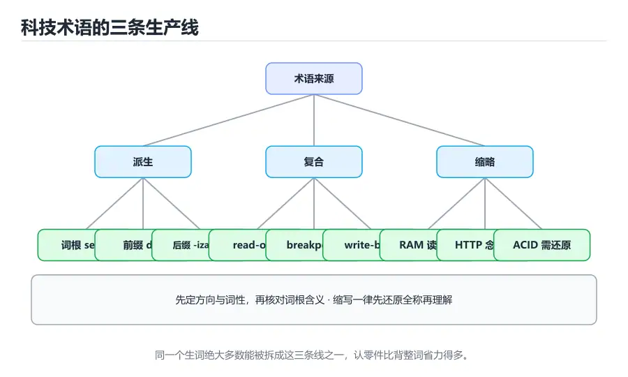

# 计算机专业英语导论：构词法与词根词缀

> 内容更新时间：2026-10-06 · 学习阶段：入门 · 预计用时：40 分钟



## 本节知识框架

**课程定位**：所属分类 `cs_english`（计算机专业英语）· 学习阶段 入门 · 建议用时 40 分钟。

先说一句可能让你松口气的话：计算机专业英语并不是「另一门英语」。它的词汇有 80% 以上由有限的拉丁—希腊词根加上英语前后缀拼出来，句法上又高度模板化——论文摘要、官方文档、报错信息各自有一套几乎可以背下来的写法。所以这门课的目标不是让你「英语变好」，而是让你用工程方法对付它：认识构词零件、掌握拆解套路、积累可复用的模板句。

本课主线：先把专业英语和四六级英语的差异讲清楚，再建立「词根 + 前缀 + 后缀 = 术语」的生产线模型，学会把 `heterogeneous`、`prefetch`、`serializability` 这类长词当场拆成可猜的碎片，最后练三个真实场景：读论文摘要的一句、读官方文档的一段、读编译器的一条报错。

**复习清单**

- [ ] 能说出专业英语与四六级英语在词汇来源、句式和信息密度上的三点差异
- [ ] 能用词根词缀法当场推断 10 个没见过术语的中文含义
- [ ] 能把 `un-, re-, pre-, sub-, inter-, trans-` 六个前缀各自的方向说清楚
- [ ] 能区分 `-able / -tion / -ity / -ize / -ic` 五类后缀造成的词性变化
- [ ] 能解释 acronym、abbreviation、back-formation 三种缩略方式并各举一例
- [ ] 能独立读懂本课给定的 IEEE 风格摘要片段，并把主干划出来
- [ ] 能跑通本课的 Python 词缀统计脚本，说出它统计的是什么、不能统计什么

## 核心概念定义

| 术语 | 一句话说明 |
| --- | --- |
| 构词法 | 研究词是怎么被拼出来的规则，英文叫 morphology，是专业词汇量爆发的底层机制 |
| 词根 | 承载核心含义的最小部分，通常来自拉丁语或希腊语，例如 `port`（搬运）、`struct`（建造） |
| 前缀 | 贴在词根前面、只改变方向或程度的零件，例如 `pre-`（提前）、`re-`（再次） |
| 后缀 | 贴在词根后面、主要决定词性的零件，例如 `-tion` 把动词变成名词 |
| 派生词 | 由词根加词缀生成的新词，如 `serializable` 派生自 `serialize` |
| 复合词 | 两个完整词直接拼起来，如 `read-only`、`write-back`、`breakpoint` |
| 首字母缩略词 | 取每个单词首字母并当成一个词读出来，如 `RAM`、`CUDA`；逐字母念出来的叫 initialism，如 `HTTP` |
| 假朋友 | 长得像但意思不同的词，如 `actual` 不是「动词」而是「实际的」，`argument` 在程序里是「实参」 |
| 词义窄化 | 普通词进入计算机领域后范围缩小，如 `mouse` 只剩「鼠标」这一义项 |
| 术语的中文定名 | 全国科学技术名词审定委员会给出的规范译法，如 `cache` 定名「高速缓冲存储器」 |

## 原理与运行机制

### 专业英语的三个真实门槛

把一段四六级真题和一段操作系统教材并排放，你会立刻发现难点不在同一个地方。

第一是词的来源。四六级考的是日常英语的高频词，专业英语考的是学术英语的拉丁—希腊词根。于是同一个概念往往有两个词：口语用 `set up`，论文用 `initialize`；口语用 `size`，论文用 `capacity`；口语用 `give back`，论文用 `return` 或 `reclaim`。中文里我们也这么说——「装系统」和「初始化系统」是同一件事的两个语域。

第二是信息密度。英文技术句喜欢用名词堆叠当定语，把三个句子压成一个：

> Thread pool starvation causes latency spikes in garbage-collected services.

直译成「线程池饥饿导致垃圾回收服务里的延迟尖峰」勉强能懂，但正规译法是「垃圾回收型服务会出现延迟尖峰，原因是线程池被耗尽了」。英文把因果压进一个动词 `causes`，中文习惯把结论提前、原因后置，读长句时要有意识地把这条链重新拉直。

第三是模板化。摘要、文档、报错各自有固定句式，认得模板就能预测下文。

### 一段摘要原文的逐句拆解

下面这段是本课自拟的 IEEE 风格摘要（不是从任何受版权保护论文中抄来的原句），我们一句句拆。

> **Context-oriented pruning significantly reduces the memory footprint of on-device recommendation models without degrading top-k accuracy.**

| 成分 | 原词 | 拆解 |
| --- | --- | --- |
| 主语 | Context-oriented pruning | `orient` 定方向，`-ed` 表被动修饰，「面向上下文的剪枝」；`prune` 本义「修剪树枝」，术语义「剪枝」 |
| 状语 | significantly | `sign-`(标记) + `-fic`(做) + `-ant`(形容词) + `-ly`(副词)，论文里几乎等于「统计显著」，不能想当然译成「大量」 |
| 谓语 | reduces | `re-` 回、向下 + `duc`(引导)，「使下降」 |
| 宾语 | the memory footprint | `footprint` 本义脚印，计算机里指占用量，「内存占用」 |
| 让步状语 | without degrading top-k accuracy | `degrade` = `de-`(向下) + `grad`(步级)，「使性能退化」；`top-k accuracy` 是「前 k 个候选的命中率」 |

第二句给出方法与代价：

> **The proposed mechanism operates as a preprocessing stage and requires no retraining of the underlying embedding tables.**

`proposed` 是论文里出现频率最高的形容词之一，务必译作「所提出的（方法）」而不是「被建议的」；`preprocessing` 里 `pre-` 表示「在……之前」，所以是预处理；`requires no retraining` 是典型的英文否定前置，中文要说「无需重新训练」；`underlying` 不是「下面的」而是「底层的」，因为它修饰 `embedding tables`。

第三句给量化结论，这是所有审稿人都会看的一句：

> **Measured on three public benchmarks, our implementation attains a 4.1× reduction in resident memory at a cost of 0.2 percentage points.**

`Measured on ...` 是过去分词短语开头做状语，主语在后面（`our implementation`），这类「悬垂分词」是长难句的头号考点；`attains a 4.1× reduction` 要读成「降低到约四分之一」，`at a cost of` 引出代价。术语误译高发区是 `percentage points`：它指百分点的绝对差，不是「下降了 0.2%」。

### 高产出词根：记住 20 个能猜 400 个词

| 词根 | 本义 | 计算机里的常见派生 |
| --- | --- | --- |
| `struct` | 建造 | structure, constructor, destruct, restructure, instrument |
| `port` | 搬运 | import, export, portable, transport, port（端口） |
| `duc/duct` | 引导 | reduce, produce, conduct, pipeline（引导水流）, deduce |
| `scrib/script` | 写 | describe, subscribe, JavaScript, postscript, inscription |
| `form` | 形状 | format, inform, platform, transform, performance |
| `grad/gress` | 步 | upgrade, downgrade, progressive, regress, gradient |
| `plic/plex` | 折叠 | compile, complex, multiply, implicit, deploy |
| `cap/cept` | 抓 | capture, accept, exception, capacity, intercept |
| `vert/vers` | 转 | convert, reverse, version, subvert, adversarial |
| `ject` | 投掷 | object, project, inject, reject, subject |
| `fer` | 带 | transfer, refer, prefer, offer, infer |
| `man` | 手 | manual, manipulate, manufacture, remote maintenance |
| `meter/meas` | 量 | parameter, symmetric, telemetry, benchmark |
| `nom/noun` | 名字 | parse 用到的 token, synonym, rename, autonomous |
| `path` | 承受 | bandwidth（能承受的宽度）, buffer, compatible, passive |
| `st/stat` | 站立 | state, status, static, instance, constant |
| `clud/clus` | 关 | include, exclude, cluster, preclusive |
| `vid/vis` | 看 | video, visit, evidence, preview, visualizable |
| `pon/pos` | 放 | component, repository, deploy, position, expose |
| `gen/gn` | 产生 | generate, engine, generic, regression, lineage |

### 前后缀决定方向和词性

前缀只管方向与程度，最常见的九个：`un-`/`in-`/`dis-` 表否定（unavailable, inconsistent, distributed 的 `dis-` 是「分开」），`re-` 再一次（retry, refresh），`pre-` 之前（pre-fetch, pre-train），`post-` 之后（post-process, commit post-hook），`sub-` 之下或子级（subprocess, subscribe），`super-` 之上（supervisor, superclass），`inter-` 之间（interface, interrupt），`trans-` 跨越（transaction, transform），`multi-`/`poly-` 多（multipartition, polynomial）。

后缀管词性：`-tion/-sion` 造名词（serialization, decision），`-ity/-ence` 造抽象名词（latency, consistency），`-able/-ible` 造形容词（scalable, readable, accessible），`-ize/-ify` 造动词（containerize, simplify），`-ic/-ical` 造形容词（asynchronous, empirical），`-er/-or` 造执行者名词（scheduler, executor, daemon）。

一个可复用的推断公式：`词根（核心义）+ 前缀（方向）+ 后缀（词性）`。看到 `deserialization` 就拆 `de-`(去除) + `serial`(序列) + `-ization`(过程) → 「把序列化结果还原的过程」，即反序列化。看到 `unavailable` 拆 `un-`(不) + `available`(可用) → 不可用。看到 `heterogeneous` 拆 `hetero-`(不同) + `gen`(产生) + `-ous` → 由不同类型生成的，异构的。

### 缩略词的三种脾气

首字母缩略词分两派：当成单词读的 `RAM`、`ROM`、`CUDA`、`LISP` 叫 acronym；逐字母念的 `CPU`、`HTTP`、`SQL` 叫 initialism。日常口语里统称为 abbreviation。读文献时的第一件事是把缩写还原成全称，因为很多缩写是「先有全称才有缩写」，还原后词义立刻透明：`ACID` = Atomicity, Consistency, Isolation, Durability；`SOLID` = Single responsibility, Open-closed, Liskov substitution, Interface segregation, Dependency inversion。还有一种叫逆构词（back-formation）：先有 `database` 才有动词 `to db` 的尝试，先有 `synthesized` 才有 `synth`；更常见的是 `deploy` 从 `deployment` 反推而来、`auth` 从 `authentication` 截短而来。

## 典型应用场景

### 场景一：考研 408 与专业英语课的阅读题

408 初试的专业英语段落绝大多数选自教材与论文的介绍部分，题型集中在「句子含义判断」和「术语指代」。考点不是词汇量，而是主干识别：一句 40 词的话里，真正的谓语往往只有一个。看到 `which`、`that`、分词短语和介词短语，先括起来当修饰成分扔掉，主干立刻现形。

### 场景二：四六级与新概念的语域迁移

四六级阅读里的 `however`、`furthermore`、`in contrast` 在技术文档里同样高频，但专业英语更偏爱 `whereas`、`albeit`、`thereby`、`herein`、`thereof` 这类正式连接词。`herein` = 「在本文件中」，`thereof` = 「 thereof 它的那个部分」，看到 `here-`/`there-` 直接按「这/那 + 介词」翻译即可。

### 场景三：读懂报错信息

编译器与运行时报错是「最省字数的英文」，一句里全是省略。真实例子（GNU ld 的输出风格）：

> `undefined reference to \`compute_checksum\`; did you mean \`compute_checksums\`?`

它的信息结构是：错误类型（undefined reference）+ 目标符号（compute_checksum）+ 修复提示（did you mean）。读报错的顺序永远是「先定位符号名、再看动作词、最后看提示」，而不是逐词翻译。`did you mean` 是拼写建议，中文提示语里也照搬了这个句式。

### 场景四：读 GitHub 文档与 issue

README 的祈使句密度极高，动词全部原形开头：`Install the CLI, then run init to scaffold your project.` 这里 `run init` 不是「运行初始化」这个抽象概念，而是「执行 `init` 这条命令」。issue 标题常用「名词短语 + 现在分词」：`Memory leak when decoding PNG images on Safari`，读作「在 Safari 上解码 PNG 图片时出现内存泄漏」。

## 代码/协议/SQL 示例

### 用 Python 统计一份文档里的词缀产出

这个小程序把一段英文按后缀分组计数，用来验证「同一词根反复出现」的直觉。它统计的是文本表面的后缀形态，不是语义：

```python
from collections import Counter
import re

TEXT = """
Serializing a heterogeneous graph requires careful handling of
deserialization overhead. The serializer is scalable but not
reusable, because the schema validation is non-configurable.
"""

SUFFIXES = ("ization", "ise", "ize", "able", "ible", "ity", "ence",
            "ing", "ed", "or", "er")

def word_stems(text):
    return [w.lower() for w in re.findall(r"[A-Za-z]{4,}", text)]

def by_suffix(text):
    buckets = Counter()
    for w in word_stems(text):
        for suf in SUFFIXES:
            if w.endswith(suf):
                buckets[suf] += 1
                w = w[: -len(suf)]
                break
        else:
            buckets["(no known suffix)"] += 1
    return buckets.most_common(5)

def prefix_hits(text):
    words = word_stems(text)
    return {p: sum(w.startswith(p) for w in words)
            for p in ("de", "re", "non", "un", "hetero")}

print("suffix buckets:", by_suffix(TEXT))
print("prefix hits:", prefix_hits(TEXT))
```

运行后 `ization` 与 `able` 会排在前面，因为 `serializing/deserialization/serializer` 共享词根 `serial`，而 `scalable/reusable/configurable` 共享 `-able`。这正是专业英语「一词根串一串术语」的证据。局限也很明显：`non-configurable` 里的 `non-` 会被连字符切开而漏计，所以它是形态学粗筛，不是词法分析器。

### 用 Shell 在日志里抓高频术语

```bash
# 统计 README 里出现次数最多的长词（≥6 个字母），按次数降序
tr -cs 'A-Za-z-' ' ' < README.md \
  | tr 'A-Z' 'a-z' \
  | xargs -n1 printf '%s\n' \
  | grep -E '^.{6,}$' \
  | sort | uniq -c | sort -rn | head -n 15
```

第一行 `tr -cs` 把非字母字符压成空格并去重，第二行统一小写，`grep -E '^.{6,}$'` 过滤短词。跑一遍自己的 README，前 15 个词通常就是本项目的术语表，可以直接拿去当生词本。

### 用 C 看清术语在代码里的真实形态

```c
#include <stdio.h>
#include <string.h>

typedef struct Packet {
    unsigned char  payload[64];
    size_t         length;
    int            is_fragmented;
} Packet;

int main(void) {
    Packet p;
    memset(p.payload, 0, sizeof p.payload);
    p.length = 0;
    p.is_fragmented = 0;
    printf("packet length = %zu, fragmented = %d\n", p.length, p.is_fragmented);
    return 0;
}
```

对照词表：`payload`（有效载荷）、`fragment`（分片）、`initialize`（对应 `memset` 与逐字段赋值）、`typedef`（`type` + `def` 即 definition 的缩写）。写代码时用的动词和读文献时遇到的动词是同一批——这就是「读写互通」。

## 时间/空间复杂度或性能分析

### 词汇推断的性价比模型

用词根词缀法记一个生词的平均成本约 30 秒（认零件 + 组装 + 验证），死记硬背约 2 分钟，因为长词无法用形象记忆。收益随阅读量复利增长：设文本中生词占比为 p，认识的高频词根数为 r，则可通过推断解决的陌生词比例近似为 k·r/R（R 为该领域词根总数，k 为经验系数 0.6 左右）。这意味着把 20 个词根从「认识」升级到「熟练」，比背 200 个孤立单词更划算。

### 每千词生词率：判断材料难度的硬指标

语言教学常用的经验阈值是：每 1000 词生词数 ≤ 5 为可流畅阅读，5~15 为可推读，15~25 为需查词典，>25 为超纲。计算方法很简单——随机抽 3 页、每页约 350 词，数出不认识的词再乘 10。用这个指标安排阅读材料比凭感觉靠谱得多。

### 检索类操作的复杂度提醒

本课的 Python 脚本对每个词最多遍历一次后缀表，整体是 O(N·S)（N 为词数，S 为后缀表长度，本题 S=11）；`Counter` 的开销是 O(N) 空间。若把后缀表换成前缀树，可以把每个词的匹配降到 O(L)（L 为词长），但词根词缀的对照需要双向匹配，工程上不划算——这也说明「算法优化」要看数据规模，和读文档时「先判断这句话值不值得查」是同一类决策。

## 常见误区与易错点

| 序号 | 容易踩的做法 | 正确的判断 |
| --- | --- | --- |
| 1 | 把 `actual` 当成「动词」 | `actual` 是「实际的」；动词是 `verb`，`actualize` 才是「使成为现实」 |
| 2 | 把 `argument` 一律译成「论点」 | 数学里是「自变量」，编程里是「实参」，`parameter` 才是形参 |
| 3 | 把 `significant` 译成「重要的、大量的」 | 学术论文里默认是「统计显著的」，要有 p 值或检验支撑 |
| 4 | 见 `have` 就译「有」 | `have to` 是必须，`have + 过去分词` 是完成时态标记 |
| 5 | 把 `instantiate` 译成「实例化」后再当成 `initialize` | 前者是「由类创建对象」，后者是「把已存在对象设为初始状态」 |
| 6 | 把 `cache` 与 `buffer` 混译 | cache 为加速而保存副本，buffer 为协调速率差而暂存 |
| 7 | 逐词翻译报错信息 | 报错应先看符号名与错误类型，`did you mean` 是建议不是错误 |
| 8 | 遇到缩写直接当专有名词硬背 | 先还原全称再理解，`ACID` 展开后四个概念自解释 |
| 9 | 认为 `SQL` 与 `Structural Query Language` 一字不差 | 全称是 Structured Query Language，过去写作 SEQUEL |
| 10 | 把 `degrade` 译成「降级」了事 | 性能语境下多指「性能退化」，主动降级叫 `graceful degradation` |

## 与其他知识点的关系

### 先修与并行

本课不需要任何英语语法基础，但强烈建议与第 7 课 `cs_english_reading_strategy` 并行：词缀解决「词」，长难句解决「句」，缺一半就还是读不懂。

### 与本分类其他课程的对应

`cs_english_hardware` 的 `pipeline`、`superscalar`、`cache coherence` 都来自本课词根（`port`、`grad`、`clud`）；`cs_english_os_software` 的 `serialization`、`mutex`、`deadlock` 是 `st/stat` 与希腊词根 `meth`(死) + `lon`(惩罚) 的产物；`cs_english_network_web` 的 `latency`、`throughput`、`bandwidth` 是 `-ence`/`put`/`path` 的例子；`cs_english_db_bigdata` 的 `consistency`、`partitioning` 属 `-ist/-ance` 与 `part`；`cs_english_ai_ml` 里 `backpropagation`、`regularization` 全靠 `duc`、`grad` 与 `-ization`。

### 与技术类课程的互相成就

`c` 分类讲 `struct` 与 `typedef`，本课讲这两个词的构词来源；`operating_system` 讲页面置换，本课讲 `eviction` 为什么被译成「换出」。把术语的词源和技术含义绑在一起，记忆强度远高于分开记。

## 自测题与参考答案

### 自测 1

不查词典，推断 `heterogeneous`、`prefetch`、`serializability` 三个词的中文含义，并写出你的拆解过程。

**参考答案**：`heterogeneous` = `hetero-`(不同) + `gen`(产生) + `-ous`(形容词) → 「由不同类型产生的」，异构的。`prefetch` = `pre-`(提前) + `fetch`(取) → 预取。`serializability` = `serial`(序列) + `-ize`(动词) + `-ability`(可……的性质) → 可串行化性，这是数据库并发控制的正确性准则。三个词都靠词缀定方向和词性。

### 自测 2

论文里 `Our method achieves a statistically significant improvement of 3.2%` 这句话，为什么不能译成「我们的方法取得了非常重要的进步」？

**参考答案**：`statistically significant` 有严格含义，指经假设检验后差异显著，不能替换成主观的「非常重要」；`improvement of 3.2%` 是相对提升幅度，要保留数值与单位。规范译文是「本文方法的性能提升 3.2%，且差异具有统计显著性」。漏掉统计含义等于篡改结论强度。

### 自测 3

编译器报 `undefined reference to \`init_scratch_buffer\``，请说明最可能的两类原因，并解释 `reference` 在这里的含义。

**参考答案**：`reference` 指「引用」，即代码里对符号的使用，不是「参考文献」。链接期未找到定义通常两类原因：源文件没有参与链接（忘了加 `.c` 文件或没编译该目标文件），或函数名/声明与定义不一致（签名或 `extern "C"` 缺失导致名字改编）。修复思路是先确认符号在哪个目标文件里，再检查链接命令。

### 自测 4

把 `read-only`、`breakpoint`、`write-back`、`workstation` 四个复合词按「动词 + 名词」「名词 + 名词」分类，并说明各自含义。

**参考答案**：`read-only`、`write-back` 是动词性成分在前，分别是「只读」「回写」；`breakpoint`、`workstation` 是名词性结构，分别是「断点」（程序在此暂停）与「工作站」（按用途命名的整机设备）。英语复合词的语义重心通常在后一个成分，前一个起限定作用，`read-only` 的重心是「只」这个约束、`breakpoint` 的重心是 `point`。

### 自测 5

运行本课的 Python 脚本，把 `non-configurable` 改成 `nonconfigurable`，输出会怎样变化？这说明什么？

**参考答案**：改成不带连字符的写法后，正则 `[A-Za-z]{4,}` 会把整词当成一个 token，`-able` 后缀计数增加 1，而 `non` 前缀计数也会命中；原文里连字符把词切断，`configurable` 仍命中 `-able`，但 `non-` 被单列成短词而遭 `{4,}` 过滤。这说明形态统计严重依赖分词规则，改文本要先确认切词口径。

## 考点精讲

### 考点 1

术语 `deserialization` 的正确拆解方式，以及它在数据库与网络编程中的实际含义，下列哪一项说得最完整？

A. de + serialization，即「去掉序列化的行为」，指把数据从内存搬到磁盘

B. des + erial + ization 三个部分各自独立成词，含义是串行化开关

C. de-(去除、逆转) + serial(序列) + -ization(过程)，指把已序列化的字节流还原成原始数据结构的过程

D. serial + ization，与 `serialize` 同义，只是英式拼写差异

**正确答案：C**

**详细解释**：本题正确项是「de-(去除、逆转) + serial(序列) + -ization(过程)，指把已序列化的字节流还原成原始数据结构的过程」。英语里 `de-` 常表「逆转前一动作」，配对词还有 `encode/decode`、`compress/decompress`、`compile/decompile`，所以反序列化必然发生在序列化之后、方向相反。干扰项「des + erial + ization 三个部分各自独立成词，含义是串行化开关」把 `des` 当成否定前缀，而 `des-` 并非英语的否定前缀（`descend`、`design` 都不表否定），这样切分本身就不成立。

### 考点 2

下面的 C 片段编译通过但链接失败，报 undefined reference to compute_checksum。关于这条报错，下列判断正确的是哪一项？

```c
/* a.c：只有声明，没有任何定义 */
extern int compute_checksum(const unsigned char *buf, int n);
int main(void) { return compute_checksum(0, 0); }
```

A. 链接期只找到了声明而找不到定义，应把实现所在的源文件一并加入链接命令

B. `extern` 关键字不能用于函数声明，必须改写为 `static`

C. `compute_checksum` 名字里有下划线，属于保留标识符，编译器会拒绝处理

D. 这条报错说明 `main` 函数的返回类型写错了

**正确答案：A**

**详细解释**：本题正确项是「链接期只找到了声明而找不到定义，应把实现所在的源文件一并加入链接命令」。`undefined reference` 是链接器 `ld` 的措辞，含义是符号在目标文件集合里查不到定义，最常见的处理是补上缺少的 `.o` 或库。干扰项「`extern` 关键字不能用于函数声明，必须改写为 `static`」正说反了，函数声明本来就默认可见，加上 `static` 反而会限制为文件内部链接、更加找不到；干扰项「这条报错说明 `main` 函数的返回类型写错了」把符号解析问题错当成返回类型问题。

### 考点 3

学术论文中 `significant` 一词的规范理解是哪一个？

A. 说话人主观认为很重要

B. 数量上非常大

C. 经过统计检验后差异显著

D. 值得关注的、明显的

**正确答案：C**

**详细解释**：本题正确项是「经过统计检验后差异显著」。学术写作里 `significant` 通常指通过了假设检验（伴随 p 值、置信区间），而日常含义「明显的」在论文里要换成 `notable` 或 `substantial`；把统计结论翻译成「很重要」会篡改证据强度。干扰项「数量上非常大」对应的是 `substantial`，两者在论文里经常成对出现，一个说幅度、一个说可信度，混译会丢失信息。

### 考点 4

下列哪些做法符合「用词根词缀法推断陌生术语」的正确流程？（多选）

A. 先切出可能的前缀与后缀，确定方向与词性，再用词根核对语义

B. 只要词长得像某个中文谐音，就直接按谐音记忆

C. 把 pipeline 拆成 pipe 与 line 两个部件，进而理解流水线这一技术含义

D. 遇到缩写先还原全称，例如把 ACID 还原为 Atomicity、Consistency、Isolation、Durability

**正确答案：A、C、D**

**详细解释**：本题要同时选中「把 pipeline 拆成 pipe 与 line 两个部件，进而理解流水线这一技术含义」和「遇到缩写先还原全称，例如把 ACID 还原为 Atomicity、Consistency、Isolation、Durability」，而「先切出可能的前缀与后缀，确定方向与词性，再用词根核对语义」是整套方法的第一步，三条合起来才是完整流程。`pipeline` 的比喻来自工厂传送带；`ACID` 还原成全称后，四个字母各自对应并发数据库的一条属性。干扰项「只要词长得像某个中文谐音，就直接按谐音记忆」属于无效联想：`daemon` 读音接近 `demon`，但它是磁盘外的后台进程，词源是希腊语里掌管隐形事务的神，谐音只会把人带偏。

### 考点 5

填空：全国科学技术名词审定委员会给 `cache` 的规范定名是「高速缓冲存储器」，而这个术语的构词来自法语 `cacher`，其本义是「____」。

**参考答案：隐藏**

**判断依据**：`cache` 与 `cachet`（印章、威望）同源，本义是「藏起来的东西」，正因为「藏在 CPU 与主存之间、对程序透明」，才译成「缓冲」。若把本义记成「加速」，就无法解释为什么 `cache` 和 `buffer` 定名不同：后者的 `buff` 是「缓冲、抵住」，强调速率匹配而非隐藏副本。

## 术语速查

| 术语 | 一句话说明 |
| --- | --- |
| 词根 | 词的意义核心，多来自拉丁语或希腊语，如 `struct` 表「建造」 |
| 前缀 | 决定方向与程度的零件，如 `pre-` 表在前、`re-` 表再一次 |
| 后缀 | 决定词性的零件，如 `-tion` 造名词、`-ize` 造动词 |
| 派生 | 用词根加词缀造新词的过程，`scalable` 由 `scale` 派生 |
| 复合词 | 两个独立词拼成一个词，如 `read-only`、`breakpoint` |
| 首字母缩略词 | 由短语首字母组成且可读成一个音节，如 `RAM`、`CUDA` |
| 字母初始语 | 逐字母念出的缩略，如 `HTTP`、`CPU` |
| 逆构词 | 从派生词反推出来的动词，如由 `deployment` 反推 `deploy` |
| 假朋友 | 拼写相似但意义不同的词，如 `actual` 不是「动词」 |
| 语域 | 同一概念在口语与学术书面语中的不同用词，如 `set up` 与 `initialize` |
| 术语定名 | 名词审定委员会给出的规范译法，用于统一中文表达 |
| 词义窄化 | 普通词进入专业领域后义项减少，如 `mouse` 只剩「鼠标」 |

## 参考资料与复核

- 复核范围：构词法口径、词根表拼写、报错信息措辞、摘要示例为自拟文本的确认

| 参考资料 | 本课用途 |
| --- | --- |
| [Oxford Learner's Dictionaries](https://www.oxfordlearnersdictionaries.com/) | 核对术语的英文释义与词性，避免按中文想象造词 |
| [RFC 8259: The JavaScript Object Notation (JSON) Data Interchange Format](https://www.rfc-editor.org/rfc/rfc8259) | 阅读标准文本，体会 `shall / must / should` 的规范措辞 |
| [The C Pointer and Array Toolkit 课程页（CMU 213）](https://www.cs.cmu.edu/~213/) | 参考英文教材的章节命名与术语组织方式 |
| [Python 官方教程](https://docs.python.org/3/tutorial/) | 本课词缀统计脚本的语言环境与标准库依据 |
| [GNU Git Book（Pro Git 英文版）](https://git-scm.com/book/en/v2) | 阅读工程类英文长文档，练习把段落压成主干 |

- 最后复核：2026-10-04
- 下次复核：2027-03-10

## 内容元数据

- 内容版本：v2.0
- 最后更新：2026-10-06
- 学习阶段：入门
- 适用环境：通用开发环境；本课聚焦 计算机专业英语的构词法与词根词缀。
- 内容来源：内置结构化课程与工程实践整理
- 相关主题：CS professional English, morphology, roots and affixes
- 质量版本：P0 测验标准 + P1 覆盖扩展 + P2 体验补全
