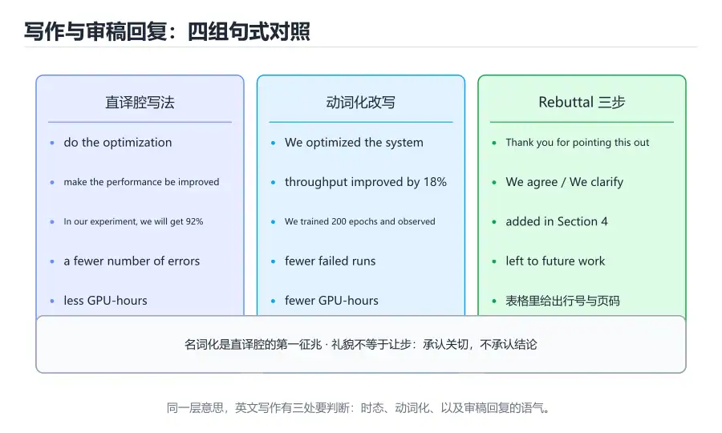

# 英文论文写作与审稿回复



> 内容更新时间：2026-10-06 · 学习阶段：进阶 · 预计用时：45 分钟

## 本节知识框架

**课程定位**：所属分类 `cs_english`（计算机专业英语），本课为第 7 门 · 学习阶段 进阶 · 建议用时 45 分钟。

先看同一层意思的两种写法：

> **初稿**：In our experiment, we will do the optimization of the system and make the performance be improved by 18 percent.
> **改后**：We optimized the system and improved throughput by 18% on the same workload.

两句话的字数几乎相同，差别全在动词。初稿有三处典型痕迹：`will` 把已经做完的实验写成了将来；`do the optimization of` 是把中文「进行优化」逐字搬过来，真正的动作 optimization 被关在名词里；`make the performance be improved` 拖出 make + 宾语 + be + 过去分词的被动尾巴。改后每件事都由一个及物动词承担（optimized、improved），时态落在过去，比较对象与口径（same workload）留在句子里。

第 6 课讲的是怎么读别人的英文，本课把这批能力反转成产出：**先判断句子的任务（陈述事实、报告动作、给出主张、回应质疑），再选时态与动词**。配图把最常见的四类直译腔与地道写法并列，并给出 rebuttal 的三步句式，写作时逐条对照即可。

**复习清单**

- [ ] 能按「一次性动作 / 图表文本 / 普适规律」三类判断时态
- [ ] 能把三句名词化直译腔改写成动词主导的英文
- [ ] 能写出四种 related work 引用句式并区分引用动词的语气差别
- [ ] 能解释 that 与 which 在限定与非限定从句里的分工
- [ ] 能说出 affect 与 effect、fewer 与 less 各自的正确用法
- [ ] 能用 acknowledge、clarify、evidence 三步写出一条审稿回复
- [ ] 能分辨礼貌句与让步句：We agree 与 We respectfully disagree 各自适用场景

## 核心概念定义

| 术语 | 一句话说明 |
| --- | --- |
| 时态分工 | 实验动作一般过去时，图表与文本内容一般现在时，普适结论一般现在时，本文工作可用现在完成时 |
| 名词化 | do the optimization、make an improvement 这类「动词壳 + 名词核」结构，是直译腔的第一征兆 |
| 动词化改写 | 把名词核还原成动词：optimize、improve、reduce，句子立刻变短且主语清楚 |
| 引用动词 | propose、show、report、claim、note、argue 六档，语气从陈述到质疑依次增强 |
| 缺口句 | gap sentence：However, few studies ... / remains unclear，把前人工作与自己位置分开 |
| 限定从句 | that 引导、不可删、不加逗号，用来限定是哪一个；非限定补充信息用 which 加逗号 |
| 让步句 | While / Although 开头，先承认成本或不足，主句再给出证据，是礼貌而坚定的主力句式 |
| acknowledge | rebuttal 第一步：复述对方关切并致谢，不评判意见对错 |
| clarify | rebuttal 第二步：说明原意或范围，常用 We clarify that / We meant ... rather than ... |
| evidence | rebuttal 第三步：给行号、图表号、新实验数字，让回应可核查 |
| 语气降级 | It seems / we suggest 用于证据不足处，避免把推测写成结论 |
| 易混词 | affect 动词、effect 名词；less 配不可数、fewer 配可数复数 |

## 原理与运行机制

### 一、时态的四条分界线

第一条：**你做过的一次性动作，用一般过去时**。`We trained the model for 200 epochs and observed a sharp drop after warmup.` 训练只发生一次，时间是投稿前的那段区间。第二条：**图表与正文文本自身，用一般现在时**。`Table 2 reports the ablation results.`、`Figure 4 shows that ...`——图每次翻开都在，所以是现在时；写成 `Table 2 reported` 会被读成「那张旧表」。第三条：**普适规律与事实，用一般现在时**。`Dropout reduces overfitting on small datasets.` 第四条：**从过去持续到现在的研究状态，用现在完成时**。`Several approaches have been proposed to shorten the training schedule.` 注意别用 `will` 描述自己的已完成实验，`we will show` 只适合预告下一节（`In Section 5, we will show ...`），这是审稿人最容易标红的时态错误。

被动语态不是禁忌，但主语必须是动作的真正承受者。`The model was trained on 1.2M pairs.` 合格；`It is considered by us that ...` 属于把施事者藏起来，改成 `We consider ...` 更清楚。

### 二、名词化到动词化的机械步骤

改写口诀是「删壳留核」：找出 `do / make / have / take / give / perform` 加 `an / the` 加名词的结构，把名词变成动词。

| 直译腔写法 | 动词化改写 | 说明 |
| --- | --- | --- |
| do the optimization of the system | optimize the system | 「进行」是中文的动词壳 |
| make the performance be improved | improve performance | 顺带删掉 make ... be 的尾巴 |
| have the responsibility of maintaining the pipeline | maintain the pipeline | 简历与文档同样适用 |
| take a closer look at the error distribution | examine the error distribution | 短语动词换成一个书面动词 |
| give an explanation for the gap | explain the gap | 名词 explanation 还原为 explain |

第二层痕迹是**多余限定**：`the problem of memory` 写成 `memory`；`in order to` 在句首可留，句中多半能缩成 `to`；`which is used for storing` 缩成 `to store` 或 `for storing`。第三层是**中式连接词**：`Besides, ...` 句首在学术英文里更常见 `In addition,` 或 `Moreover,`；`On the other hand` 必须与 `on the one hand` 成对，或确实表达对照，否则换成 `By contrast,`。

### 三、related work 的四种引用句式

同一条前人工作，可以写成四种形状：

1. 作者主语：`Vaswani et al. proposed the Transformer, which removes recurrence entirely.`
2. 方法主语：`The Transformer was first applied to machine translation and later to other tasks.`
3. 现在完成时综述：`Subsequent studies have extended this line of work to long-context settings.`
4. 缺口句收尾：`However, none of these approaches report results under a fixed parameter budget.`

引用动词带语气：`propose / present / introduce` 中性陈述贡献；`show / demonstrate` 承认对方有证据；`claim / argue` 表示作者不完全接受该结论；`note / observe` 用来引述一个事实性观察。段落的收尾一定要落在第 4 种缺口句上，否则 related work 只是清单，读者找不到本文位置。漏斗形的推进顺序是：源头工作 → 延伸工作 → 缺口 → 本文位置，回指词（these approaches、this setting、the same budget）必须出现在被指代内容之后。

### 四、六组高频易混词

`affect`（动词，影响）与 `effect`（名词，效果；动词义「实现」极少用）；`less` 配不可数（less memory、less time），`fewer` 配可数复数（fewer failed runs、fewer parameters），`a fewer number of` 属于把比较级包进名词，应简化为 `fewer`；`that` 引导限定性从句、不加逗号，`which` 引导非限定补充、前面加逗号，且 `which` 不能替代限定用法；`since` 既可表时间又可表原因，因果句里若可能歧义就写 `because`；`compose / comprise`：`The model comprises three blocks` 或 `Three blocks compose the model`，被动 `is composed of` 最常见；`data` 在正式科技英文里按复数处理（`the data are consistent`），单数读法虽通行但审稿人可能标注。

## 典型应用场景

### 场景一：摘要六句骨架

```text
1  Task and setting ......... Sequence transduction has been widely studied ...
2  Gap ...................... However, these models scale quadratically with length.
3  Our idea ................. We therefore propose a module that replaces recurrence with attention.
4  How it works ............. The module consists of two sublayers and a residual connection.
5  Result with numbers ...... On WMT 2014 it improves BLEU by 2.0 while training 8x faster.
6  Take-away ................ Beyond translation, the design applies to parsing tasks.
```

第 2、5 句是审稿人打分时最先看的两句：缺口要具体（不要写 `few works have studied it`），结果要带口径（数据集、指标、比较对象、倍数）。

### 场景二：rebuttal 三步

```text
R1. The claimed speedup is not reproducible; the baselines were not tuned.

We thank the reviewer for this point, which also raised a concern in R2 (acknowledge).
We clarify that all baselines use the hyper-parameters reported in their original
papers, and we never claimed a wall-clock speedup (clarify, not "we disagree").
We have added tuning results in Appendix C, line 412, where our model still leads by
1.8 BLEU with 3 seeds reported as mean and standard deviation (evidence).
For the wall-clock question, we now report it as future work in Section 6.
```

三条纪律：**编号与意见编号一一对应**；**每个主张指向正文位置**（Section / line / table）；**做不到的事明确写进 Limitations**，沉默会被读成无视。语气上，`We respectfully disagree` 只在事实性误读时使用，且必须紧跟证据；把 `you are wrong` 换成 `the reviewer seems to have read ... ; we meant ...`，把人对人的否定转成对文本的澄清。

### 场景三：cover letter 与结论段的礼貌句

致谢与让步的常用搭配：`We thank all reviewers for their detailed and constructive comments.`、`The suggestion on X improved the presentation of Section 3.`、`While the proposed experiment would require re-running all baselines, we have added the requested analysis in Appendix B.`、`We agree that the claim was too strong and have softened it in the revised abstract.`。结尾段的克制同样重要：`Our results suggest that ...` 比 `Our results prove that ...` 更常见，`within the setting studied here` 这类限定语是避免过度声明的最低成本手段。

## 代码/协议/SQL 示例

### 一段 LaTeX 初稿与它的修订

```latex
% before revision
In our experiment, we will do the optimization of the system and make the
performance be improved by 18 percent. Besides, less GPU-hours are required.

% after revision
We optimized the system and improved throughput by 18\% on the same workload,
which also reduced GPU-hours by 1.4$\times$.
```

修订后的句子把三个动作交给三个动词（optimized、improved、reduced），`which` 从句带逗号补充非限定信息，数字用 `\%` 与 `$\times$` 保持排版一致。LaTeX 里连字符与破折号另有规矩：复合定语用 `-`（state-of-the-art），插入语用 `---`，别把中文破折号直接搬进正文。

### 用命令行自查英文痕迹

```bash
$ detex draft.tex | aspell --lang=en --list | sort -f | uniq -ci | sort -rn | head
$ rg -n "in order to|is used for|we will |\.which|very " draft.tex
$ rg -c "Table~|Figure~|Section~" draft.tex
```

第一条把正文交给拼写检查器，只列出未登记词，用来发现自造缩写与不一致拼写（`behaviour` 与 `behavior` 混用）；第二条是短语自查：`in order to`、`is used for`、描述已完成实验的 `we will`、错误的 `which` 前缀点号；第三条数交叉引用是否都用了带硬空格的 `~` 形式。自查清单每次修订后跑一遍，比全文重读省力。

## 时间/空间复杂度或性能分析

### 写作迭代成本按「改动层级」估算

词级修订（`speedup` 换成 `latency reduction`）改一句；口径级修订（补 `over 3 seeds`）要同步图、表、正文与摘要，通常 4 处；主张级修订（`we show` 降级为 `we suggest`）会牵动结论段与 cover letter 的语气一致性，风险最高。合理流程是把这三层分开处理：先跑词级与语法自查，再统一口径，最后校准主张强度。

### rebuttal 的时间预算

会议给作者的回应窗口通常只有数天，逐条重做实验不现实。有效顺序是按「性价比」排：能用文字澄清的先行（成本分钟级），能用已有数据补一句解释的其次（小时级），需要新实验的只挑审稿人最在意的一条做（天级），其余明确写进 Limitations。写作时给每条回复控制在 80~150 词，超出的内容放进正文附录，而不是塞进回复本身。

### 一致性检查的线性成本

术语表、符号表与缩写表是修订期最便宜的保险。把全文出现三次以上的自造缩写登记一次，之后每次替换都是常数时间；不做登记，同一个概念在正文里出现三种写法，审稿人的第一条意见往往就是 terminology is inconsistent。

## 常见误区与易错点

| 序号 | 容易踩的做法 | 正确的判断 |
| --- | --- | --- |
| 1 | 用 we will show 描述已经做完的实验 | 已完成动作用过去时，will 只用于预告章节安排 |
| 2 | Table 2 reported the results | 图表与文本内容用一般现在时 |
| 3 | do the improvement / take an optimization action | 名词壳压住动词，改成 improve、optimize |
| 4 | make the accuracy be improved | make 后接宾语再加被动尾巴，直接写 improve accuracy |
| 5 | less parameters | 可数复数用 fewer parameters |
| 6 | The model, that uses attention, is fast. | 非限定从句用 which，that 不带逗号 |
| 7 | Besides, 放在句首当「而且」 | 学术英文更常用 In addition / Moreover |
| 8 | rebuttal 里写 The reviewer is wrong | 改成对文本的澄清：we meant ... rather than ... |
| 9 | 回复里承诺修改却不给位置 | 每条都要指到 Section、line 或 Table |
| 10 | 通篇 Our results prove that ... | 证据不足时用 suggest / indicate，避免过度声明 |

## 与其他知识点的关系

### 分类内的上下游

本课把第 6 课 `cs_english_ai_ml` 的段落功能识别反转为写作骨架：那边认出 gap sentence 与 evidence sentence，这边负责把它们写出来；第 5 课 `cs_english_db_bigdata` 总结的「机制 + 代价」句式（`This typically involves ..., making ... a costly operation`）在方法段与结果段同样适用；第 4 课 `cs_english_network_web` 里 must、should、may 的强度分级，可以直接迁移到论文里 `we must` 与 `we should` 的语气选择；第 8 课 `cs_english_docs_interview` 把书面英文进一步扩展到仓库文档与口语表达，时态规则换成祈使句。

### 与技术类课程的对应

`ai` 分类里的论文与实验类课程提供内容，本课提供表达规范；`se` 分类的技术写作课程讲的是面向团队与用户的中文与英文写作，本课聚焦学术评审语境下的一套句式。两条能力线合起来才能把「实验做出来了」变成「审稿人相信你做出来了」。

## 自测题与参考答案

下面 6 道题与「考点精讲」是同一批数据：题干、选项原文、答案字母（A 对应第 1 个选项）完全一致。

### 题目 1（单选题）

关于论文里实验描述与普适结论的时态分工，下列说法正确的是哪一项？

1. 实验过程与普遍事实都写过去时，因为论文记录的都是已经做完的工作
2. 全文统一用现在完成时，既能表达过去又能衔接现在，不会出时态错误
3. 实验过程用一般过去时，图表与普适结论用一般现在时，如 Table 2 shows
4. 实验过程用一般现在时，因为读者读到那句话时实验正在被重演

**参考答案**：C

本题正确项是「实验过程用一般过去时，图表与普适结论用一般现在时，如 Table 2 shows」。判断标准是这件事是否只在你那次运行里发生：We trained the model for 200 epochs 是一次性动作，用过去时；而 Table 2 shows a clear gap、Dropout reduces overfitting 表达的是文本与规律本身，读者每次翻开都在，用现在时。干扰项「实验过程与普遍事实都写过去时，因为论文记录的都是已经做完的工作」把两类句子压成一类，审稿人会直接写成语不一致的意见。干扰项「实验过程用一般现在时，因为读者读到那句话时实验正在被重演」把阅读时刻误当成实验时刻，只有描述程序行为时才这样用。

### 题目 2（单选题）

把「我们对系统进行了优化，使性能得到了提升」写成英文，下列哪一句最接近地道表达？

1. We have done the optimization of the system, which makes the performance be improved.
2. The optimization to the system is done by us, so the performance has the improvement.
3. In order to improve the performance, the system was taken an optimization action.
4. We optimized the system and improved throughput by 18 percent on the same workload.

**参考答案**：D

本题正确项是「We optimized the system and improved throughput by 18 percent on the same workload.」。中文习惯用「进行 + 名词」把动作包起来，英文更常用单个及物动词承担动作，do the optimization、take an optimization action 这类写法是名词化的直译痕迹，第一句还额外拖出 make ... be improved 的被动尾巴。把性能提升落到可测量的 throughput 上并给出数字，也是英文论文的通行做法。干扰项「In order to improve the performance, the system was taken an optimization action.」里 the system 不能 take action，施事者错位；干扰项「We have done the optimization of the system, which makes the performance be improved.」虽然语法能过，但两层名词化加一层被动，读起来像在绕路。

### 题目 3（编程题）

下面这段投稿文本里有三处用词问题，关于错在哪里以及怎么改，下列判断正确的是哪一项？

```latex
\textbf{Results.} The proposed method effects the training time only slightly,
because it requires less GPU-hours and produces a fewer number of failed runs.
```

1. effects 用得没错，它在此处作名词；真正的问题只是 less 与 fewer 语义重复
2. 三处都属于拼写问题，把 GPU-hours 改成 gpu_hours 之后句子就完全通顺了
3. effects 应为 affects，GPU-hours 可数故 less 应改 fewer，a fewer number of 应简化
4. 句子没有用词错误，只需把加粗的 Results 改成 Result 以与其他小节标题一致

**参考答案**：C

本题正确项是「effects 应为 affects，GPU-hours 可数故 less 应改 fewer，a fewer number of 应简化」。affect 是动词「影响」，effect 作名词才是「效果」，直译「影响」时最容易顺手写错；less 配不可数（less memory），fewer 配可数复数（fewer failed runs），GPU-hours 有明确复数形式，只能用 fewer；a fewer number of 把比较级包进名词短语，英文写作惯例是砍成 fewer。干扰项「effects 用得没错，它在此处作名词；真正的问题只是 less 与 fewer 语义重复」漏掉了动词位置的要求，此处紧跟主语需要谓语动词。干扰项「三处都属于拼写问题，把 GPU-hours 改成 gpu_hours 之后句子就完全通顺了」把用词错误说成大小写问题，改完仍然不通。

### 题目 4（多选题）

关于 rebuttal（审稿回复）的写法，下列哪些做法符合通行惯例？（多选）

1. 先用一句话复述审稿人的关切并致谢，再分条作答，编号与意见编号一一对应
2. 对无法补做的实验直接沉默，避免在回复里承认任何做不到的事情
3. 认同的部分写 We agree and have revised，需要解释的部分写 We clarify that
4. 每条修改都指出落在正文的位置，例如 revised text in Section 4, line 213

**参考答案**：A、C、D

本题要同时选中「先用一句话复述审稿人的关切并致谢，再分条作答，编号与意见编号一一对应」、「认同的部分写 We agree and have revised，需要解释的部分写 We clarify that」和「每条修改都指出落在正文的位置，例如 revised text in Section 4, line 213」三条。rebuttal 的三步是 acknowledge、clarify、evidence：先承认对方看到了什么，再说明自己的原意或取舍，最后给行号、图表号或新实验数字作为证据。干扰项「对无法补做的实验直接沉默，避免在回复里承认任何做不到的事情」是最危险的做法，沉默会被理解成无视意见，正确写法是明确写进 Limitations 并说明留给后续工作。

### 题目 5（排序题）

把 related work 段的四句英文按从领域现状收敛到本文位置的正常顺序排列，正确的是哪一项？

1. Smith et al. extended this line of work by introducing a sparse attention mask.
2. Attention mechanisms were first proposed to align source and target tokens.
3. None of these approaches, however, report results under a fixed parameter budget.
4. Our study revisits this setting and isolates the effect of the budget from the mask.

**参考答案**：B → A → C → D

related work 的段落形状是一只漏斗：先给源头（were first proposed），再给延伸（extended this line of work），然后用 None of these 或 However little attention has been paid 指出缺口，最后一句把自己的工作挂到缺口上（revisits、in contrast）。第三句的 however 与第四句的 this setting 都是回指线索，它们必须出现在被指代内容之后，因此不可能放在段首。按这个顺序读，可以在两分钟内判断一篇论文的 related work 是否真的把本文位置说清楚了。

### 题目 6（填空题）

在空格处填入一个表示「尽管」的英文让步连词，使这句审稿回复成立：________ the suggested experiment would require re-running all baselines, we have added the requested analysis in Appendix B.（首字母大写）

**参考答案**：While

本题正确项是「While」。While 在句首作让步连词时意思是「尽管」，与 Although、Though 互换，比 but 更适合学术文体，因为它把让步放在主句之前，语气更克制；Although 更正式，Though 稍口语。要注意 While 还有「当……时」的时间用法，判别办法是看它能否被 Although 替换：能替换就是让步用法。这一句式在 rebuttal 里专门用于承认成本后再给证据，属于礼貌而坚定的典型骨架。

## 考点精讲

每条先给答案字母与正确项原文，再复述判断依据，字段内容与题库完全一致。

### 考点 1（单选题 · 时态分工）

- **题目**：关于论文里实验描述与普适结论的时态分工，下列说法正确的是哪一项？
- **答案**：C
- **正确项**：实验过程用一般过去时，图表与普适结论用一般现在时，如 Table 2 shows
- **判断依据**：本题正确项是「实验过程用一般过去时，图表与普适结论用一般现在时，如 Table 2 shows」。判断标准是这件事是否只在你那次运行里发生：We trained the model for 200 epochs 是一次性动作，用过去时；而 Table 2 shows a clear gap、Dropout reduces overfitting 表达的是文本与规律本身，读者每次翻开都在，用现在时。干扰项「实验过程与普遍事实都写过去时，因为论文记录的都是已经做完的工作」把两类句子压成一类，审稿人会直接写成语不一致的意见。干扰项「实验过程用一般现在时，因为读者读到那句话时实验正在被重演」把阅读时刻误当成实验时刻，只有描述程序行为时才这样用。

### 考点 2（单选题 · 动词化改写）

- **题目**：把「我们对系统进行了优化，使性能得到了提升」写成英文，下列哪一句最接近地道表达？
- **答案**：D
- **正确项**：We optimized the system and improved throughput by 18 percent on the same workload.
- **判断依据**：本题正确项是「We optimized the system and improved throughput by 18 percent on the same workload.」。中文习惯用「进行 + 名词」把动作包起来，英文更常用单个及物动词承担动作，do the optimization、take an optimization action 这类写法是名词化的直译痕迹，第一句还额外拖出 make ... be improved 的被动尾巴。把性能提升落到可测量的 throughput 上并给出数字，也是英文论文的通行做法。干扰项「In order to improve the performance, the system was taken an optimization action.」里 the system 不能 take action，施事者错位；干扰项「We have done the optimization of the system, which makes the performance be improved.」虽然语法能过，但两层名词化加一层被动，读起来像在绕路。

### 考点 3（编程题 · 易混词）

- **题目**：下面这段投稿文本里有三处用词问题，关于错在哪里以及怎么改，下列判断正确的是哪一项？
- **答案**：C
- **正确项**：effects 应为 affects，GPU-hours 可数故 less 应改 fewer，a fewer number of 应简化
- **判断依据**：本题正确项是「effects 应为 affects，GPU-hours 可数故 less 应改 fewer，a fewer number of 应简化」。affect 是动词「影响」，effect 作名词才是「效果」，直译「影响」时最容易顺手写错；less 配不可数（less memory），fewer 配可数复数（fewer failed runs），GPU-hours 有明确复数形式，只能用 fewer；a fewer number of 把比较级包进名词短语，英文写作惯例是砍成 fewer。干扰项「effects 用得没错，它在此处作名词；真正的问题只是 less 与 fewer 语义重复」漏掉了动词位置的要求，此处紧跟主语需要谓语动词。干扰项「三处都属于拼写问题，把 GPU-hours 改成 gpu_hours 之后句子就完全通顺了」把用词错误说成大小写问题，改完仍然不通。

### 考点 4（多选题 · 审稿回复）

- **题目**：关于 rebuttal（审稿回复）的写法，下列哪些做法符合通行惯例？（多选）
- **答案**：A、C、D
- **正确项**：先用一句话复述审稿人的关切并致谢，再分条作答，编号与意见编号一一对应；认同的部分写 We agree and have revised，需要解释的部分写 We clarify that；每条修改都指出落在正文的位置，例如 revised text in Section 4, line 213
- **判断依据**：本题要同时选中「先用一句话复述审稿人的关切并致谢，再分条作答，编号与意见编号一一对应」、「认同的部分写 We agree and have revised，需要解释的部分写 We clarify that」和「每条修改都指出落在正文的位置，例如 revised text in Section 4, line 213」三条。rebuttal 的三步是 acknowledge、clarify、evidence：先承认对方看到了什么，再说明自己的原意或取舍，最后给行号、图表号或新实验数字作为证据。干扰项「对无法补做的实验直接沉默，避免在回复里承认任何做不到的事情」是最危险的做法，沉默会被理解成无视意见，正确写法是明确写进 Limitations 并说明留给后续工作。

### 考点 5（排序题 · 相关工作段）

- **题目**：把 related work 段的四句英文按从领域现状收敛到本文位置的正常顺序排列，正确的是哪一项？
- **答案**：B、A、C、D
- **正确项**：Attention mechanisms were first proposed to align source and target tokens. → Smith et al. extended this line of work by introducing a sparse attention mask. → None of these approaches, however, report results under a fixed parameter budget. → Our study revisits this setting and isolates the effect of the budget from the mask.
- **判断依据**：related work 的段落形状是一只漏斗：先给源头（were first proposed），再给延伸（extended this line of work），然后用 None of these 或 However little attention has been paid 指出缺口，最后一句把自己的工作挂到缺口上（revisits、in contrast）。第三句的 however 与第四句的 this setting 都是回指线索，它们必须出现在被指代内容之后，因此不可能放在段首。按这个顺序读，可以在两分钟内判断一篇论文的 related work 是否真的把本文位置说清楚了。

### 考点 6（填空题 · 让步连词）

- **题目**：在空格处填入一个表示「尽管」的英文让步连词，使这句审稿回复成立：________ the suggested experiment would require re-running all baselines, we have added the requested analysis in Appendix B.（首字母大写）
- **答案**：While
- **正确项**：While（Although、Though 同义）
- **判断依据**：本题正确项是「While」。While 在句首作让步连词时意思是「尽管」，与 Although、Though 互换，比 but 更适合学术文体，因为它把让步放在主句之前，语气更克制；Although 更正式，Though 稍口语。要注意 While 还有「当……时」的时间用法，判别办法是看它能否被 Although 替换：能替换就是让步用法。这一句式在 rebuttal 里专门用于承认成本后再给证据，属于礼貌而坚定的典型骨架。

## 术语速查

| 术语 | 一句话说明 |
| --- | --- |
| simple past in experiments | 描述一次性实验动作用一般过去时：we measured、we observed |
| present tense for artifacts | 图表、正文与普适规律用一般现在时：Table 2 shows、dropout reduces |
| present perfect for the field | 研究状态用现在完成时：several approaches have been proposed |
| nominalization | 名词化，do/make/take 加抽象名词，英文写作要求还原成动词 |
| agent-first sentence | 以 we 作主语的主动句，比 it is considered that 更清楚 |
| gap sentence | 缺口句，However few studies ... / remains unclear，related work 段必须落在这一句 |
| citation verbs | 引用动词六档：propose、report、show、note、argue、claim，语气依次变强 |
| affect / effect | 前者动词「影响」，后者名词「效果」，作动词的 effect 意为「实现」，很少用 |
| fewer / less | fewer 配可数复数，less 配不可数，a smaller number of 是 fewer 的书面替代 |
| that / which | that 引导限定从句不带逗号，which 引导非限定补充必须带逗号 |
| data is / data are | 正式科技英文按复数处理：the data are consistent |
| acknowledge | 回复第一步：复述关切并致谢，不评判对错 |
| clarify | 回复第二步：说明原意与范围，把人对人的否定转成对文本的解释 |
| evidence | 回复第三步：给 Section、line、Table 或新数字，让主张可核查 |
| respectfully disagree | 只在事实性误读时使用，且必须紧跟证据与出处 |
| limitation statement | 做不到的事写进 Limitations，比沉默更安全 |

## 参考资料与复核

- 复核范围：LaTeX 初稿与修订句、rebuttal 三步句式、引用动词语气分级、易混词搭配逐条复核；示例命令行工具名称与用途核对。
- 来源性质：会议评审指南与预印本原文属一手语料；句式归纳与自查命令为整理者总结。

| 参考资料 | 本课用途 |
| --- | --- |
| [ACL Rolling Review: Reviewer Tutorial](https://aclrollingreview.org/reviewertutorial) | 审稿意见分类与作者回复惯例的社区规范出处 |
| [arXiv Help: Submitting a Paper](https://arxiv.org/help/submit) | 摘要与正文的排版、语言要求与提交流程 |
| [arXiv 1810.04805: BERT](https://arxiv.org/abs/1810.04805) | 摘要六拍与缺口句、结果句的真实范例文本 |
| [RFC 2119: Key words for use in RFCs](https://www.rfc-editor.org/rfc/rfc2119) | must、should、may 强度分级，用于校准论文里的语气动词 |

- 最后复核：2026-10-04
- 下次复核：2027-03-24

## 内容元数据

- 内容版本：v2.0
- 最后更新：2026-10-06
- 学习阶段：进阶
- 预计用时：45 分钟
- 分类归属：`cs_english`（计算机专业英语），本课为第 7 门
- 适用环境：通用开发环境与 LaTeX 写作流程；本课聚焦投稿文本、相关工作段与审稿回复的英文写法。
- 内容来源：内置结构化课程与会议评审指南、预印本原文复核整理
- 相关主题：tense selection, de-nominalization, rebuttal structure
- 质量版本：P0 测验标准 + P1 覆盖扩展 + P2 体验补全
