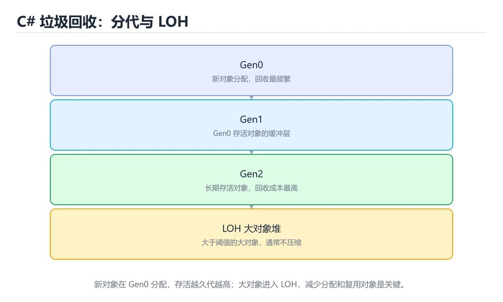
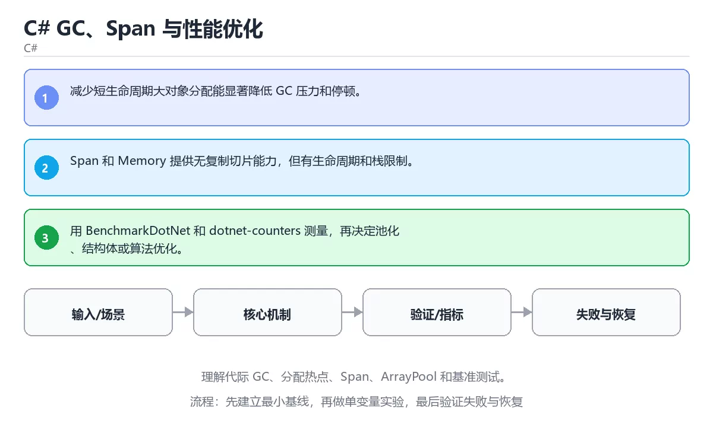

# C# GC、Span 与性能优化

> 内容更新时间：2026-10-06 · 学习阶段：高级 · 预计用时：25 分钟





## 本节知识框架

**课程定位**：所属分类 `csharp`（C#），课程主题 `C# GC、Span 与性能优化`，学习阶段 高级，建议用时 45 分钟。

本课主线：理解代际 GC、分配热点、Span、ArrayPool 和基准测试。

**学完本课应当能够**
- 说清 `GC` 与 `BenchmarkDotNet` 的含义与区别，并各举一个正例和一个反例。
- 用本课示例验证 `分代回收` 的行为，记录输入、输出与失败条件。
- 遇到「热点路径频繁分配」这类问题时，能说出触发条件与修复顺序。

### 复习清单

- [ ] 能不看正文复述本课核心术语，并指出一个边界或反例。
- [ ] 能运行或推演本课示例，记录输入、输出与失败现象。
- [ ] 能完成一次自测，并把错题对照错误表定位原因。

## 核心概念定义

| 术语 | 操作性定义 | 常见边界与风险 |
| --- | --- | --- |
| GC | 垃圾回收器：自动回收不可达对象，按代回收；频繁分配与大对象会推高回收开销。 | 易错：GC 压力大，延迟抖动明显；正确做法是用 Span、ArrayPool 与结构体减少临时分配。 |
| BenchmarkDotNet | 用 BenchmarkDotNet 和 dotnet-counters 测量，再决定池化、结构体或算法优化。 | 单次计时说明不了问题：要固定输入记录基线，再按差值与波动范围判断，结论才站得住。 |
| 分代回收 | .NET GC 按对象存活时间分成 0、1、2 代，优先回收短命对象，减少全堆扫描。 | 前提是新对象确实很快死亡：大量对象被长期持有时，省下的全堆扫描又会补回来，频繁分配仍让停顿变明显。 |
| 大对象堆 | 大于 85 KB 的对象单独存放且默认不压缩，容易产生碎片并抬高回收成本。 | 易错：大对象进入大对象堆后内存长期不降；正确做法是复用缓冲区，避免频繁创建大数组。 |

## 原理与运行机制

### 机制总览

**教材衔接：核心知识**

### 1. 减少短生命周期大对象分配能显著降低 GC 压力和停顿。

- 关键做法：先让 GC 的最小示例可复现，再加入并发或规模条件。
- 验证标准：WriteLine 的输出能被他人复现，边界输入有对应用例。

### 2. Span 和 Memory 提供无复制切片能力，但有生命周期和栈限制。

把这条结论放回「C# GC、Span 与性能优化」的完整流程里展开：

- 正文依据：能用自己的话解释：减少短生命周期大对象分配能显著降低 GC 压力和停顿。
- 落地检查：把「2. Span 和 Memory 提供无复制切片能力，但有生命周期和栈限制。」改写成一条可执行的核对项，逐条验证输入、超时与失败路径。

### 3. 用 BenchmarkDotNet 和 dotnet-counters 测量，再决定池化、结构体或算法优化。

把这条结论放回「C# GC、Span 与性能优化」的完整流程里展开：

- 正文依据：能用自己的话解释：Span 和 Memory 提供无复制切片能力，但有生命周期和栈限制。
- 落地检查：把「3. 用 BenchmarkDotNet 和 dotnet-counters 测量，再决定池化、结构体或算法优化。」改写成一条可执行的核对项，逐条验证输入、超时与失败路径。

**教材衔接：关键流程**

**教材衔接：实践路径**

**教材衔接：版本与时效**

- C# 版本随 SDK 演进，升级前把 Span 的兼容性纳入检查清单。
- 升级重点在语法与裁剪行为；先为 Span 补一组回归用例。
- 升级前确认 GC 的兼容范围，把不可回退的改动单独拆成一次提交。
- 官方说明：https://learn.microsoft.com/dotnet/core/whats-new/

## 典型应用场景

**课程内置实验入口**：`sandbox:csharp`，用于动手验证《C# GC、Span 与性能优化》的机制；实验结论不替代概念定义与复杂度分析。

**教材衔接：深度拓展与实战**

这一节把「C# GC、Span 与性能优化」正文里的定义、代码和失败模式串成一条可操作的复习路线。

### 工程检查表

- [ ] 能否用自己的话说明C# GC、Span 与性能优化解决什么问题，以及它不负责什么？
- [ ] 能否说明 GC 的正常输出，以及失败时留下的错误信息？
- [ ] 能否解释本课关键词在真实项目中的边界与取舍？
- [ ] 能否把 GC 的方法迁移到相近问题，并说明需要改哪一步？

### 最小验证场景

- 准备：保留 `text` 示例的原始输入，先记录 `C# GC、Span 与性能优化` 的基线输出和完整运行命令。
- 观察：先核对 调用了 `WriteLine()`，再改变一个与 `GC` 相关的条件。
- 判定：新结果与 `C# GC、Span 与性能优化` 的基线不同不等于错误；只有当差异破坏了 `GC` 的定义或错误表中的约束，才判定为失败。

### 选择与边界

- 使用 `GC` 时，先满足它的定义：垃圾回收器：自动回收不可达对象，按代回收；频繁分配与大对象会推高回收开销；易错：GC 压力大，延迟抖动明显；正确做法是用 Span、ArrayPool 与结构体减少临时分配。
- 使用 `BenchmarkDotNet` 时，先满足它的定义：用 BenchmarkDotNet 和 dotnet-counters 测量，再决定池化、结构体或算法优化。
- 使用 `分代回收` 时，先满足它的定义：.NET GC 按对象存活时间分成 0、1、2 代，优先回收短命对象，减少全堆扫描；索引命中与数据分布决定实际开销，判断前先看执行计划而不是只看结果是否正确。
- 使用 `大对象堆` 时，先满足它的定义：大于 85 KB 的对象单独存放且默认不压缩，容易产生碎片并抬高回收成本；易错：大对象进入大对象堆后内存长期不降；正确做法是复用缓冲区，避免频繁创建大数组。

## 代码/协议/SQL 示例

### 最小可验证示例

**教材衔接：最小可运行示例**

先用下面的示例确认 GC 的基线，再只改一个与 Span 相关的值：

```csharp
Span<int> values = stackalloc int[4];
for (int i = 0; i < values.Length; i++)
{
    values[i] = i * i;
}
Console.WriteLine(string.Join(",", values.ToArray()));
```

**教材衔接：预期输出**

```text
0,1,4,9
```

## 时间/空间复杂度或性能分析

**性能关注点（C# GC、Span 与性能优化）**：GC 与异步调度影响开销：记录吞吐、延迟与分配速率。

**测量方法**：以 `C# GC、Span 与性能优化` 的 `GC` 场景为对象，固定输入跑一遍记录基线，再把规模或并发度提高一个数量级复测；两次结果的差值与波动范围才是结论依据。

## 常见误区与易错点

| 容易写错的做法 | 实际现象 | 原因与正确做法 |
| --- | --- | --- |
| 热点路径频繁分配 | GC 压力大，延迟抖动明显。 | 用 Span、ArrayPool 与结构体减少临时分配。 |
| 以为对象会立刻回收 | 大对象进入大对象堆后内存长期不降。 | 复用缓冲区，避免频繁创建大数组。 |
| 用强制回收解决内存问题 | 全暂停拖慢吞吐，掩盖真实原因。 | 先看分配与回收数据，再调整对象生命周期与 GC 配置。 |

### 现场 1：热点路径频繁分配

**症状**：GC 压力大，延迟抖动明显。

**根因与修复**：用 Span、ArrayPool 与结构体减少临时分配。

**自检**：在本课示例里复现「热点路径频繁分配」，改成用 Span、ArrayPool 与结构体减少临时分配后重跑；如果症状消失且失败路径按预期变化，说明定位正确。

### 现场 2：以为对象会立刻回收

**症状**：大对象进入大对象堆后内存长期不降。

**根因与修复**：复用缓冲区，避免频繁创建大数组。

**自检**：在本课示例里复现「以为对象会立刻回收」，改成复用缓冲区，避免频繁创建大数组后重跑；如果症状消失且失败路径按预期变化，说明定位正确。

### 现场 3：用强制回收解决内存问题

**症状**：全暂停拖慢吞吐，掩盖真实原因。

**根因与修复**：先看分配与回收数据，再调整对象生命周期与 GC 配置。

**自检**：在本课示例里复现「用强制回收解决内存问题」，改成先看分配与回收数据，再调整对象生命周期与 GC 配置后重跑；如果症状消失且失败路径按预期变化，说明定位正确。

## 与其他知识点的关系

| 关系 | 课程 | 为什么 |
| --- | --- | --- |
| 先修 | 《C# 异步流与取消》 | 本课会直接使用它的概念或操作前提。 |
| 关联 | 《C# 与 .NET 第一个程序》 | 用于横向比较或把本课结论迁移到相邻主题。 |
| 前置顺序 | 《C# 异步流与取消》 | 同分类中安排在本课之前，建议先完成其自测。 |

**教材衔接：复习与迁移**

## 自测题与参考答案

> 先独立作答，再对照参考答案；答案都能在本课正文、术语表或错误表里找到依据。

### 自测 1（概念复述）

不看正文，写出 `GC` 的操作性定义，并说明它与 `BenchmarkDotNet` 的区别。

**参考答案**：垃圾回收器：自动回收不可达对象，按代回收；频繁分配与大对象会推高回收开销。

`BenchmarkDotNet` 的定位是：用 BenchmarkDotNet 和 dotnet-counters 测量，再决定池化、结构体或算法优化；两者的差别要从适用对象与失败模式上说明。

### 自测 2（排错）

本课错误表记录了「热点路径频繁分配」这类做法。请写出它会出现的现象、根因，以及修复顺序。

**参考答案**：现象是GC 压力大，延迟抖动明显；正确做法是用 Span、ArrayPool 与结构体减少临时分配。修复时先复现现象并保留证据，再改动一处假设重跑，确认现象消失。

### 自测 3（动手验证）

运行本课的 `text` 示例，改动其中一个输入后重新运行，记录输出与错误信息。

**参考答案**：正常输入下 `text` 示例应当复现正文给出的结果；改动输入后，如果结果改变或报错，先核对它是否满足 `C# GC、Span 与性能优化` 中`GC` 的适用范围，再检查错误表里是否有同类现象。

### 自测 4（代码阅读）

阅读本课开头的 `text` 示例，说明它体现了`GC` 的哪一条性质，并指出改动哪个输入会让这条性质不再成立。

**参考答案**：`GC` 的定义是 垃圾回收器：自动回收不可达对象，按代回收，频繁分配与大对象会推高回收开销，示例正是在实现这条定义。改动与 `GC` 有关的一个输入后，如果结果不再符合 `C# GC、Span 与性能优化` 的正文描述，就说明该性质只在当前前提成立。

### 自测 5（迁移）

把 `C# GC、Span 与性能优化` 的方法迁移到自己的项目：围绕 `GC` 写出一个与错误表同类的风险点，并说明触发条件和检验方式。

**参考答案**：例如「用强制回收解决内存问题」，它会导致全暂停拖慢吞吐，掩盖真实原因；检验方式是按先看分配与回收数据，再调整对象生命周期与 GC 配置改一处再复现，确认现象消失且没有引入新的失败分支。

### 自测 6（对比）

用一个表格对比 `GC` 与 `BenchmarkDotNet`：各写一行适用场景、一行失败表现。

**参考答案**：`GC` 的定义是垃圾回收器：自动回收不可达对象，按代回收；频繁分配与大对象会推高回收开销；`BenchmarkDotNet` 的定义是用 BenchmarkDotNet 和 dotnet-counters 测量，再决定池化、结构体或算法优化。两者的失败表现分别对应本课错误表里与本术语相关的行。

### 自测 7（排错顺序）

面对「热点路径频繁分配」引发的问题，请把“复现 GC 压力大，延迟抖动明显 → 保留证据 → 用 Span、ArrayPool 与结构体减少临时分配 → 回归验证”四步写成可执行的检查清单。

**参考答案**：第一步按GC 压力大，延迟抖动明显复现；第二步记录输入、版本与完整报错；第三步按用 Span、ArrayPool 与结构体减少临时分配只改一处；第四步重跑并确认失败路径也按预期变化。

### 自测 8（边界判断）

针对 `大对象堆`，分别写出“可以使用”的条件和“结论不再成立”的条件。

**参考答案**：易错：大对象进入大对象堆后内存长期不降；正确做法是复用缓冲区，避免频繁创建大数组。 同时要把 `大对象堆` 的定义 大于 85 KB 的对象单独存放且默认不压缩，容易产生碎片并抬高回收成本 与实际输入逐项对照。

### 自测 9（机制重建）

不看正文，按输入、转换、输出、验证四段重建 `GC` → `BenchmarkDotNet` → `分代回收` → `大对象堆` 的作用链。

**参考答案**：起点是 `GC` 的定义 垃圾回收器：自动回收不可达对象，按代回收；频繁分配与大对象会推高回收开销；中间每一步都保留可观察状态；终点由 `大对象堆` 检查，失败时回到错误表定位第一个偏离定义的步骤。

### 自测 10（综合排错）

在 `C# GC、Span 与性能优化` 中，现象是 全暂停拖慢吞吐，掩盖真实原因。请围绕 用强制回收解决内存问题 写出最小复现、关键证据、修复动作和回归验证，并说明为什么不能只凭一次运行下结论。

**参考答案**：先复现 用强制回收解决内存问题，记录输入与完整错误；再按 先看分配与回收数据，再调整对象生命周期与 GC 配置 只改一处。回归时同时跑正常路径和边界路径，只有两次结果都可解释，才把修复视为完成。

### 自测 11（一分钟复述）

用每分钟约 200 字的速度复述 `C# GC、Span 与性能优化`：先给主问题，再按顺序说出 `GC`、`BenchmarkDotNet`、`分代回收`、`大对象堆`，最后给一个失败案例。

**自评标准**：主问题必须对应 理解代际 GC、分配热点、Span、ArrayPool 和基准测试；每个术语都要能接上一句定义或边界；失败案例必须写成可观察现象，不能用“可能有风险”代替证据。

## 术语速查

| 术语 | 一句话说明 |
| --- | --- |
| `GC` | 垃圾回收器：自动回收不可达对象，按代回收；频繁分配与大对象会推高回收开销。 |
| `BenchmarkDotNet` | 用 BenchmarkDotNet 和 dotnet-counters 测量，再决定池化、结构体或算法优化。 |
| `分代回收` | .NET GC 按对象存活时间分成 0、1、2 代，优先回收短命对象，减少全堆扫描。 |
| `大对象堆` | 大于 85 KB 的对象单独存放且默认不压缩，容易产生碎片并抬高回收成本。 |

**术语关系**：`GC`（垃圾回收器：自动回收不可达对象） → `BenchmarkDotNet`（用 BenchmarkDotNet 和 dotnet-counters 测量，再决定池化、结构体或算法优化） → `分代回收`（.NET GC 按对象存活时间分成 0、1、2 代） → `大对象堆`（大于 85 KB 的对象单独存放且默认不压缩）。

## 考点精讲

`C# GC、Span 与性能优化` 的题库有 6 道题，下面逐题给出题干、正确项与判断依据：先自己作答，再核对正确项，最后回到正文对应小节复核。

### 考点 1：第 1 题

- **题目**：在 `C# GC、Span 与性能优化` 里，与 `GC` 有关的说法中，哪一项最符合理解代际 GC、分配热点、Span、ArrayPool 和基准测试？
- **正确项**：减少短生命周期大对象分配能显著降低 GC 压力和停顿。
- **判断依据**：本题正确项是「减少短生命周期大对象分配能显著降低 GC 压力和停顿」。术语 GC（C# GC、Span 与性能优化）：垃圾回收器：自动回收不可达对象，按代回收，频繁分配与大对象会推高回收开销，本题取「减少短生命周期大对象分配能显著降低 GC 压力和停顿」这条。易错点是热点路径频繁分配，会造成GC 压力大，延迟抖动明显，改法是用 Span、ArrayPool 与结构体减少临时分配。

### 考点 2：第 2 题

- **题目**：在 `C# GC、Span 与性能优化` 里，与 `GC` 有关的说法中，哪一项最符合理解代际 GC、分配热点、Span、ArrayPool 和基准测试？（C# GC、Span 与性能优化·C# 第 2 题）
- **正确项**：Span 和 Memory 提供无复制切片能力，但有生命周期和栈限制。
- **判断依据**：本题正确项是「Span 和 Memory 提供无复制切片能力，但有生命周期和栈限制」。术语 GC（C# GC、Span 与性能优化）：垃圾回收器：自动回收不可达对象，按代回收，频繁分配与大对象会推高回收开销，本题取「Span 和 Memory 提供无复制切片能力，但有生命周期和栈限制」这条。易错点是以为对象会立刻回收，会造成大对象进入大对象堆后内存长期不降，改法是复用缓冲区，避免频繁创建大数组。

### 考点 3：第 3 题

- **题目**：代码语言为 `csharp`，选自 `C# GC、Span 与性能优化` 的 `GC` 部分。课程问题为理解代际 GC、分配热点、Span、ArrayPool 和基准测试。哪一项描述与代码一致？
- **正确项**：调用了 `ToArray()`
- **判断依据**：本题正确项是「调用了 `ToArray()`」。术语 GC（C# GC、Span 与性能优化）：垃圾回收器：自动回收不可达对象，按代回收，频繁分配与大对象会推高回收开销，本题取「调用了 `ToArray()`」这条。易错点是用强制回收解决内存问题，会造成全暂停拖慢吞吐，掩盖真实原因，改法是先看分配与回收数据，再调整对象生命周期与 GC 配置。本题干扰项「调用了 `CartModel()`」不成立：展示代码里找不到 `CartModel()`。

### 考点 4：第 4 题

- **题目**：`C# GC、Span 与性能优化` 的主线是：理解代际 GC、分配热点、Span、ArrayPool 和基准测试。下面哪一项与这条主线一致？
- **正确项**：理解代际 GC、分配热点、Span、ArrayPool 和基准测试。
- **判断依据**：本题正确项是「理解代际 GC、分配热点、Span、ArrayPool 和基准测试」。术语 GC（C# GC、Span 与性能优化）：垃圾回收器：自动回收不可达对象，按代回收，频繁分配与大对象会推高回收开销，本题取「理解代际 GC、分配热点、Span、ArrayPool 和基准测试」这条。易错点是热点路径频繁分配，会造成GC 压力大，延迟抖动明显，改法是用 Span、ArrayPool 与结构体减少临时分配。

### 考点 5：第 5 题

- **题目**：课程 `理解代际 GC、分配热点、Span、ArrayPool 和基准测试。`。在 `C# GC、Span 与性能优化` 里，`GC`、`BenchmarkDotNet` 与下面哪些选项属于同一层概念？（多选）
- **正确项**：GC；Span
- **判断依据**：按《C# GC、Span 与性能优化》的正文口径，本题要同时选中「GC」、「Span」，漏掉任一项都算没答全。术语 GC（C# GC、Span 与性能优化）：垃圾回收器：自动回收不可达对象，按代回收，频繁分配与大对象会推高回收开销。易错点是以为对象会立刻回收，会造成大对象进入大对象堆后内存长期不降，改法是复用缓冲区，避免频繁创建大数组。

### 考点 6：第 6 题

- **题目**：下面几项都与 `GC` 有关，请按 `C# GC、Span 与性能优化` 的正文顺序排列；该课主线是理解代际 GC、分配热点、Span、ArrayPool 和基准测试。
- **正确项**：核心知识 → 关键流程 → 实践路径 → 常见误区
- **判断依据**：按《C# GC、Span 与性能优化》正文的先后，本题顺序是「核心知识」 → 「关键流程」 → 「实践路径」 → 「常见误区」。术语「GC」在本课里的界定是垃圾回收器：自动回收不可达对象，按代回收，频繁分配与大对象会推高回收开销，题干问的就是这一条。常见错法是热点路径频繁分配，其后果是GC 压力大，延迟抖动明显。正确做法是用 Span、ArrayPool 与结构体减少临时分配。

### 考点 7：`GC`

- **要点**：垃圾回收器：自动回收不可达对象，按代回收；频繁分配与大对象会推高回收开销。
- **GC 的边界**：易错：GC 压力大，延迟抖动明显；正确做法是用 Span、ArrayPool 与结构体减少临时分配。

### 考点 8：`BenchmarkDotNet`

- **要点**：用 BenchmarkDotNet 和 dotnet-counters 测量，再决定池化、结构体或算法优化。

### 考点 9：`分代回收`

- **要点**：.NET GC 按对象存活时间分成 0、1、2 代，优先回收短命对象，减少全堆扫描。
- **分代回收 的边界**：索引命中与数据分布决定实际开销，判断前先看执行计划而不是只看结果是否正确。

### 考点 10：`大对象堆`

- **要点**：大于 85 KB 的对象单独存放且默认不压缩，容易产生碎片并抬高回收成本。
- **大对象堆 的边界**：易错：大对象进入大对象堆后内存长期不降；正确做法是复用缓冲区，避免频繁创建大数组。

### 考点 11：排错——热点路径频繁分配

- **现象**：GC 压力大，延迟抖动明显。
- **处理**：用 Span、ArrayPool 与结构体减少临时分配。

### 考点 12：排错——以为对象会立刻回收

- **现象**：大对象进入大对象堆后内存长期不降。
- **处理**：复用缓冲区，避免频繁创建大数组。

### 考点 13：综合辨析——`GC` 与 `大对象堆`

- **辨析点**：`GC` 的定义是 垃圾回收器：自动回收不可达对象，按代回收；频繁分配与大对象会推高回收开销；`大对象堆` 的定义是 大于 85 KB 的对象单独存放且默认不压缩，容易产生碎片并抬高回收成本。
- **答题要求**：面对 `C# GC、Span 与性能优化` 的题目，先判断描述的是 `GC` 还是 `大对象堆`，再归到对应定义，最后写出一个会让该定义失效的边界输入。

### 考点 14：排错评分点

- **现象分**：能写出 GC 压力大，延迟抖动明显，而不是只写“程序有错”。
- **证据分**：保留触发 热点路径频繁分配 的输入、版本和错误原文。
- **修复分**：按 用 Span、ArrayPool 与结构体减少临时分配 只改一处，并同时回归正常路径与边界路径。

## 内容元数据

- 内容版本：v2.0
- 最后更新：2026-10-06
- 学习阶段：高级
- 适用环境：.NET 9 / C# 13；本课聚焦 GC。
- 内容来源：内置结构化课程与工程实践整理
- 相关主题：GC、Span、ArrayPool、BenchmarkDotNet
- 质量版本：P0 测验标准 + P1 覆盖扩展 + P2 体验补全

## 参考资料与复核

- 最后复核：2026-10-04
- 下次复核：2027-03-10
- 复核范围：版本兼容、API 行为、安全建议与工程实践
- 来源性质：官方文档、标准或权威教材；本课核对关键词：GC、Span、ArrayPool、BenchmarkDotNet。

| 参考资料 | 本课用途 |
| --- | --- |
| [.NET GC 文档](https://learn.microsoft.com/dotnet/standard/garbage-collection/) | 垃圾回收与内存 |
| [C# 指南](https://learn.microsoft.com/dotnet/csharp/) | 语言语法与类型系统 |
| [EF Core 文档](https://learn.microsoft.com/ef/core/) | ORM、迁移与并发 |

| [本课术语索引：C# GC、Span 与性能优化](#核心概念定义) | 按本课输入、术语边界和错误表现逐项核对 |
> 「C# GC、Span 与性能优化」的链接用于离线阅读后的延伸核对；App 不会自动联网。