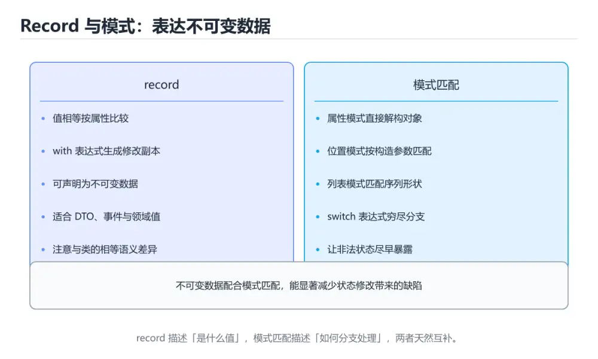
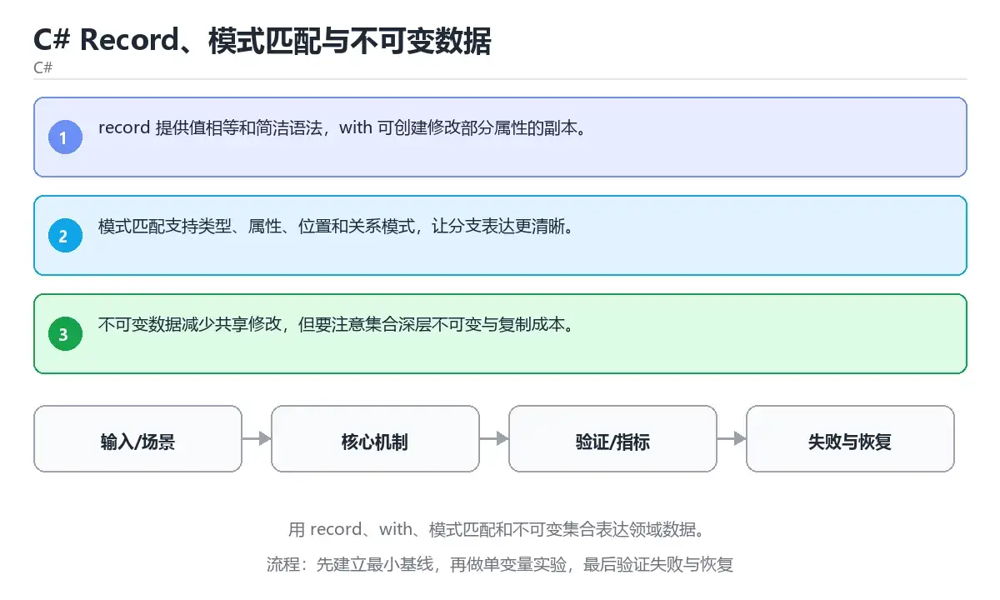

# C# Record、模式匹配与不可变数据

> 内容更新时间：2026-10-06 · 学习阶段：高级 · 预计用时：35 分钟





## 本节知识框架

**课程定位**：所属分类 `csharp`（C#），课程主题 `C# Record、模式匹配与不可变数据`，学习阶段 高级，建议用时 35 分钟。

本课主线：用 record、with、模式匹配和不可变集合表达领域数据。

**学完本课应当能够**
- 说清 `record` 与 `模式匹配` 的含义与区别，并各举一个正例和一个反例。
- 用本课示例验证 `不可变` 的行为，记录输入、输出与失败条件。
- 遇到「给 record 加可变属性」这类问题时，能说出触发条件与修复顺序。

### 复习清单

- [ ] 能讲清 record 与 模式匹配 的分工，并指出其中一个前提失效的边界。
- [ ] 能跑通 record 的最小示例，记录一组正常输出和一组失败输出。
- [ ] 能完成一次自测，并把错题对照错误表定位原因。

## 核心概念定义

| 术语 | 操作性定义 | 常见边界与风险 |
| --- | --- | --- |
| record | 编译器自动生成值相等、`ToString`、`Deconstruct` 与 `with` 支持的类型，主构造函数参数默认是 init-only 属性。 | 值对象适合；需要稳定身份与生命周期管理的实体不要用 record，值语义会与标识语义冲突。 |
| 模式匹配 | 用 `switch` 表达式或 `is` 模式按类型、属性、位置、关系和列表结构分支并提取变量。 | 分支要从具体到宽泛；宽泛分支会截胡后面的具体分支，非穷尽 switch 只给编译警告，不是错误。 |
| 不可变 | 对象创建后状态不再改变，修改通过 `with` 或集合操作生成新实例。 | 默认只是浅不可变：引用类型属性仍被共享，集合内容仍可能被改，需要 `ImmutableArray`、`FrozenDictionary` 等结构。 |
| with | record 的复制表达式，生成浅拷贝并覆盖指定属性，原实例保持不变。 | 浅拷贝只复制引用，嵌套对象被修改时新旧实例一起变；高频 with 会带来额外分配。 |

## 原理与运行机制

### record 的编译产物

写下 `record Point(int X, int Y)`，编译器会生成：

- 主构造函数与两个 `init`-only 属性 `X`、`Y`；
- 逐字段比较的 `Equals`、`GetHashCode`，以及 `==`、`!=` 运算符；
- 带属性名的 `ToString`，输出形如 `Point { X = 2, Y = 3 }`；
- `Deconstruct(out int X, out int Y)`，供位置模式使用；
- 一个受保护的拷贝构造函数和 `<Clone>$` 方法，`with` 表达式靠它复制。

`record class` 可以有继承，但相等性要求运行时类型一致；`record struct` 没有继承，适合字段少、生命周期短的值。默认的 `record` 属性是 `init`-only，想真正不可变就不该再给它们加 `set`。

### 值相等与哈希的约束

`new Point(2, 3) == new Point(2, 3)` 为 `true`，但两者不是同一个对象。值相等意味着：

- 放进 `HashSet`、`Dictionary` 后，字段不能再变；一旦可变，哈希值改变，集合按旧哈希找不到元素。
- 用 `with` 生成新实例而不是就地赋值，才能保持"旧值不动、新值独立"。
- 属性是引用类型（如 `List<int>`）时，两个 record 可以比较相等，之后共享的列表被修改，相等关系又悄悄改变。

如果字段很多、相等比较在热路径上，record 的逐字段比较和哈希计算会成为成本，需要实测后再决定是否缓存或改用其他结构。

### 模式匹配的形态与顺序

C# 常见模式：

| 模式 | 示例 | 说明 |
| --- | --- | --- |
| 类型 | `Circle c` | 判断运行时类型并绑定变量 |
| 属性 | `{ Radius: > 0 }` | 读取属性后做关系判断 |
| 位置 | `(0, 0)` | 调用 `Deconstruct` 提取字段 |
| 关系与逻辑 | `<= 0`、`> 0 and < 10` | 组合数值约束 |
| 列表 | `[1, .., 3]` | 匹配序列首尾与任意中段 |

`switch` 表达式自上而下匹配，第一个命中的分支生效，所以顺序必须从具体到宽泛。编译器只对明显不穷尽的 switch 给 CS8509 警告，不会阻止运行；`_` 是兜底分支，`null` 不会匹配类型模式，需要单独处理。

### 不可变与持久化数据结构

`init`-only 属性和 `readonly` 字段只能挡住属性重新赋值，挡不住集合内容修改。要真正不可变，需要换成持久化集合：

- `ImmutableArray<T>`：底层是数组，`Add` 复制整个数组，适合元素少、读多写少的场景。
- `ImmutableList<T>`：平衡树实现，`Add` 是 O(log n)，新旧版本共享大部分节点。
- `FrozenDictionary<TKey, TValue>`：一次性构建、之后只读，查询比 `Dictionary` 更快，适合启动时定型的配置。

`IReadOnlyList<T>` 只是接口视图，持有者仍可能把底层 `List<T>` 转型后修改，不能当作不可变保证。

### with 的浅拷贝成本

`with` 先调用拷贝构造函数复制所有字段，再对指定属性赋值，所以每次都会产生一个新对象。复制是浅的：

- 值类型字段逐位复制；
- 引用类型字段只复制引用，新旧实例指向同一个列表或子对象；
- 要改嵌套 record，需要逐层 `with`，例如 `order with { Address = order.Address with { City = "上海" } }`。

`record struct` 的 `with` 在栈上复制，不产生堆分配；`record class` 的 `with` 每次分配一个对象，高频更新要评估 GC 压力。

### 版本与升级

record 从 C# 9 开始，列表模式从 C# 11 开始。升级 SDK 前先用现有测试覆盖相等性、模式匹配顺序和序列化行为，再对照官方发布说明检查新语法与破坏性变更。

## 典型应用场景

**课程内置实验入口**：`sandbox:csharp`，用于动手验证《C# Record、模式匹配与不可变数据》的机制；实验结论不替代概念定义与复杂度分析。

### 五类真实场景

| 场景 | 写法 | 关键点 |
| --- | --- | --- |
| API 请求与响应 DTO | `record CreateUser(string Name, int Age)` | 按值比较，测试断言与日志输出都更直观 |
| 领域值对象 | `readonly record struct Money(decimal Amount, string Currency)` | 没有身份、金额与币种一起比较，栈上分配 |
| 判别联合 | `abstract record Shape` + `Circle`/`Rectangle` + `switch` | 新增子类型时，非穷尽 switch 会给出警告 |
| UI 状态快照 | `record AppState(...)` + `with` | 每次更新生成新状态，便于比较、撤销与回放 |
| 配置快照 | `record Settings(...)` + `ImmutableDictionary` | 发布后下游无法修改共享配置 |

### 建模步骤

1. 先判断值对象还是实体：有唯一 ID、需要跟踪生命周期的是实体，用 class；按字段比较的是值对象，用 record。
2. 选择 `record class` 或 `record struct`：字段少、生命周期短、复制频繁时优先 `readonly record struct`。
3. 集合属性改成 `ImmutableArray<T>`、`ImmutableList<T>` 或 `FrozenDictionary<TKey,TValue>`，不要只暴露 `IReadOnlyList<T>`。
4. 用 `switch` 表达式把分支从具体写到宽泛，并保留 `_` 或异常分支，避免新增类型时静默走错路径。
5. 测试三件事：值相等、`with` 的深浅拷贝、模式顺序改变后的分支结果。

### 最小验证场景

- 准备：运行代码示例，记录 `Point` 输出、`circle area`、`bigger area`、`equal`、`tags` 五行基线。
- 观察：给 `Point` 的 `X` 加 `set`，把它放进 `HashSet` 后修改 `X`，再调用 `Contains`；把 `Circle` 的属性分支移到宽泛分支之后，观察哪个分支先命中。
- 判定：五行基线必须完全一致；改动后若 `Contains` 返回 `false` 或宽泛分支截胡，说明不可变或模式顺序被破坏。
- 失败信号：`with` 后旧实例也跟着变、相同字段的两个对象比较为 `false`、新增子类型没有触发警告。

### 选择与边界

- `record` 适合值对象与消息；需要唯一标识、可变生命周期的实体用 class。
- `模式匹配` 要先具体后宽泛，并用 `_` 或显式异常兜底；编译器警告不能当作可忽略的提示。
- `不可变` 默认只到属性层，集合与嵌套对象要单独处理，持久化集合有复制与内存成本。
- `with` 是浅拷贝，改嵌套字段要逐层复制，高频更新要评估分配与 GC 压力。

## 代码/协议/SQL 示例

### 最小可验证示例

**教材衔接：最小可运行示例**

下面的代码同时演示值相等、位置模式、属性模式、`with` 与不可变集合，先原样运行，再按小节说明改一处：

```csharp
using System;
using System.Collections.Immutable;

public abstract record Shape;
public sealed record Circle(double Radius) : Shape;
public sealed record Rectangle(double Width, double Height) : Shape;

public record Point(int X, int Y);

public static class Program
{
    public static double Area(Shape shape) => shape switch
    {
        Circle { Radius: <= 0 } => throw new ArgumentOutOfRangeException(nameof(shape)),
        Circle c => Math.PI * c.Radius * c.Radius,
        Rectangle { Width: var w, Height: var h } when w > 0 && h > 0 => w * h,
        Rectangle => throw new ArgumentOutOfRangeException(nameof(shape)),
        _ => throw new ArgumentException("unknown shape", nameof(shape)),
    };

    public static void Main()
    {
        var point = new Point(2, 3);
        var label = point switch
        {
            (0, 0) => "origin",
            (_, 0) => "x-axis",
            _ => "plane",
        };
        Console.WriteLine($"{point} -> {label}");

        var circle = new Circle(2);
        Console.WriteLine($"circle area={Area(circle):F2}");
        var bigger = circle with { Radius = 3 };
        Console.WriteLine($"bigger area={Area(bigger):F2}");
        Console.WriteLine($"equal={circle == new Circle(2)}");

        var tags = ImmutableArray.Create("a", "b");
        var updated = tags.Add("c");
        Console.WriteLine($"tags={string.Join(",", tags)} updated={string.Join(",", updated)}");
    }
}
```

**教材衔接：预期输出**

```text
Point { X = 2, Y = 3 } -> plane
circle area=12.57
bigger area=28.27
equal=True
tags=a,b updated=a,b,c
```

`Point` 的 `(0, 0)`、`(_, 0)` 是位置模式，编译器调用 `Deconstruct` 提取两个字段；`with` 生成新实例，所以 `circle` 仍是半径 2，`bigger` 是半径 3；`equal=True` 来自逐字段值相等；`ImmutableArray.Add` 返回新数组，原 `tags` 保持 `a,b`。

### 只改一个值：触发守卫分支

把 `new Circle(2)` 改成 `new Circle(0)`，`Area` 会命中 `Circle { Radius: <= 0 }` 并抛 `ArgumentOutOfRangeException`；把 `(0, 0)` 分支改成 `(_, _)`，所有点都会输出 `origin`，说明分支顺序和具体程度直接决定结果。两种改动都不影响 `Point` 的值相等语义。

## 时间/空间复杂度或性能分析

**record 的相等成本**：`Equals` 与 `GetHashCode` 按字段逐个计算，字段数为 f 时是 O(f)。相等比较在 `Dictionary`、`HashSet` 和 LINQ 去重里是高频操作，字段很多的 record 要考虑是否值得。

**模式匹配的成本**：类型模式是一次类型检查加一次变量绑定，属性模式会调用对应 getter；`switch` 自上而下执行，宽泛分支放在前面会让后面的具体分支永远走不到，同时浪费判断。列表模式还要检查长度与切片边界。

**with 与不可变集合的分配**：`record class` 的每次 `with` 分配一个新对象并复制所有字段，引用字段只复制指针；`record struct` 的 `with` 在栈上复制。`ImmutableArray.Add` 是 O(n) 复制，`ImmutableList.Add` 是 O(log n) 并共享大部分节点，`FrozenDictionary` 构建一次后查询接近 O(1)。

**测量方法**：用 BenchmarkDotNet 固定输入测相等比较、模式分支与 `with` 的吞吐，用 `GC.GetAllocatedBytesForCurrentThread()` 记录分配量，再把字段数或集合规模提高一个数量级复测，比较 P99 与分配而不是只看平均值。

## 常见误区与易错点

| 容易写错的做法 | 实际现象 | 原因与正确做法 |
| --- | --- | --- |
| 给 record 加可变属性 | 值语义被破坏，比较结果不符合预期。 | 保持不可变，修改时用 with 生成新实例。 |
| 模式匹配顺序写反 | 前面的宽泛模式吞掉后面的具体分支。 | 从具体到宽泛排列，并做穷尽性检查。 |
| 把 record 当实体到处传 | 值语义与标识语义混淆。 | 值对象用 record，需要唯一标识的实体用 class。 |
| 可变 record 放进 HashSet 后改属性 | 哈希值变化，`Contains` 和 `Remove` 找不到元素 | 属性设为 init-only，修改走 `with` 生成新实例。 |
| with 之后直接改嵌套集合 | 新旧实例共享同一个列表，旧快照被污染 | 嵌套对象也保持不可变，或改用 `ImmutableArray`。 |
| switch 缺少兜底分支 | 新增子类型后静默返回错误值 | 保留 `_` 或显式异常分支，并打开穷尽性警告。 |

### 现场 1：给 record 加可变属性

**症状**：值语义被破坏，比较结果不符合预期。

**根因与修复**：保持不可变，修改时用 with 生成新实例。

**自检**：在本课示例里复现「给 record 加可变属性」，改成保持不可变，修改时用 with 生成新实例后重跑；如果症状消失且失败路径按预期变化，说明定位正确。

### 现场 2：模式匹配顺序写反

**症状**：前面的宽泛模式吞掉后面的具体分支。

**根因与修复**：从具体到宽泛排列，并做穷尽性检查。

**自检**：在本课示例里复现「模式匹配顺序写反」，改成从具体到宽泛排列，并做穷尽性检查后重跑；如果症状消失且失败路径按预期变化，说明定位正确。

### 现场 3：把 record 当实体到处传

**症状**：值语义与标识语义混淆。

**根因与修复**：值对象用 record，需要唯一标识的实体用 class。

**自检**：在本课示例里复现「把 record 当实体到处传」，改成值对象用 record，需要唯一标识的实体用 class后重跑；如果症状消失且失败路径按预期变化，说明定位正确。

### 现场 4：HashSet 里的 record 突然找不到了

**症状**：把 `Point` 放进 `HashSet` 后修改 `X`，再用同一个对象查询 `Contains` 返回 `false`。

**根因与修复**：`record` 的哈希基于字段，修改字段后哈希桶位置变了，集合按旧哈希找不到它。修复是把 `X`、`Y` 设为 init-only，修改时用 `with` 生成新对象，并重新加入集合。

### 现场 5：旧快照被 with 的新对象改坏

**症状**：用 `with` 复制订单快照后，旧快照里的商品列表也跟着变了。

**根因与修复**：`with` 是浅拷贝，两个 record 共享同一个 `List<Item>`。修复是把集合换成 `ImmutableArray<Item>`，或在复制时显式创建新集合并用嵌套 `with` 更新。

## 与其他知识点的关系

| 关系 | 课程 | 为什么 |
| --- | --- | --- |
| 先修 | 《C# 类、属性与对象》 | 属性、构造函数与对象初始化器是理解 record 主构造函数的前提。 |
| 先修 | 《C# 继承、接口与多态》 | 抽象 record 与判别联合依赖继承与类型判断。 |
| 关联 | 《C# 集合、委托与 LINQ》 | 值相等直接影响去重、分组与字典键行为。 |
| 后续 | 《C# GC、Span 与性能优化》 | `with` 与不可变集合的分配需要结合 GC 与内存布局评估。 |

## 自测题与参考答案

> 先独立作答，再对照参考答案；答案都能在本课正文、术语表或错误表里找到依据。

### 自测 1（概念复述）

不看正文，写出 `record` 的操作性定义，并说明它与 `模式匹配` 的区别。

**参考答案**：C# 中主要用于表示不可变数据并自动生成值相等语义的类型。

`模式匹配` 的定位是：按值、类型或结构选择分支并提取其中字段；两者的差别要从适用对象与失败模式上说明。

### 自测 2（排错）

本课错误表记录了「给 record 加可变属性」这类做法。请写出它会出现的现象、根因，以及修复顺序。

**参考答案**：现象是值语义被破坏，比较结果不符合预期；正确做法是保持不可变，修改时用 with 生成新实例。修复时先复现现象并保留证据，再改动一处假设重跑，确认现象消失。

### 自测 3（动手验证）

运行本课的 C# 示例，把 `new Circle(2)` 改成 `new Circle(0)`，记录第一条异常信息；再把 `(0, 0)` 分支改成 `(_, _)`，记录 `Point` 那行的变化。

**参考答案**：`new Circle(0)` 命中 `Circle { Radius: <= 0 }`，抛出 `ArgumentOutOfRangeException`（参数名 `shape`）；`(_, _)` 是最宽的位置模式，所有点都会输出 `origin`，说明具体分支必须排在宽泛分支之前。

### 自测 4（代码阅读）

阅读本课的 `Area` 方法，说明它如何区分 `Circle` 与 `Rectangle`，并指出新增 `Triangle` 子类型时会发生什么。

**参考答案**：`Area` 先用类型模式匹配 `Circle`，再在 `Circle` 内用属性模式检查 `Radius <= 0`；`Rectangle` 用属性模式提取宽高并加 `when` 守卫。当前 `_` 分支会接住 `Triangle` 并在运行时抛 `ArgumentException`；如果删掉 `_`，编译器会对非穷尽 switch 给出 CS8509 警告。

### 自测 5（迁移）

把 `C# Record、模式匹配与不可变数据` 的方法迁移到自己的项目：围绕 `record` 写出一个与错误表同类的风险点，并说明触发条件和检验方式。

**参考答案**：例如「把 record 当实体到处传」，它会导致值语义与标识语义混淆；检验方式是按值对象用 record，需要唯一标识的实体用 class改一处再复现，确认现象消失且没有引入新的失败分支。

### 自测 6（对比）

用一个表格对比 `record` 与 `模式匹配`：各写一行适用场景、一行失败表现。

**参考答案**：`record` 的定义是C# 中主要用于表示不可变数据并自动生成值相等语义的类型；`模式匹配` 的定义是按值、类型或结构选择分支并提取其中字段。两者的失败表现分别对应本课错误表里与本术语相关的行。

### 自测 7（排错顺序）

面对「给 record 加可变属性」引发的问题，请把“复现 值语义被破坏，比较结果不符合预期 → 保留证据 → 保持不可变，修改时用 with 生成新实例 → 回归验证”四步写成可执行的检查清单。

**参考答案**：第一步按值语义被破坏，比较结果不符合预期复现；第二步记录输入、版本与完整报错；第三步按保持不可变，修改时用 with 生成新实例只改一处；第四步重跑并确认失败路径也按预期变化。

### 自测 8（边界判断）

针对 `with`，分别写出“可以使用”的条件和“结论不再成立”的条件。

**参考答案**：可以使用：只需要改顶层属性，且引用类型字段本身不可变（或不会被外部修改），`with` 能安全地生成独立新实例。不再成立：属性是可变集合或嵌套可变对象时，`with` 的浅拷贝让新旧实例共享同一份内容，修改嵌套数据会同时污染两者；此时要改用持久化集合或逐层 `with`。

### 自测 9（机制重建）

不看正文，按输入、转换、输出、验证四段重建 `record` → `模式匹配` → `不可变` → `with` 的作用链。

**参考答案**：起点是 `record`：编译器生成 init-only 属性、逐字段相等和拷贝构造；`模式匹配` 读取这些字段，按类型、属性或位置选择分支；`不可变` 保证字段不原地修改；终点是 `with`：通过拷贝构造生成新实例、覆盖指定属性，旧实例保持不变。任何一步破坏了字段或生命周期约束，都回到错误表定位第一个偏离定义的步骤。

### 自测 10（综合排错）

在 `C# Record、模式匹配与不可变数据` 中，现象是 值语义与标识语义混淆。请围绕 把 record 当实体到处传 写出最小复现、关键证据、修复动作和回归验证，并说明为什么不能只凭一次运行下结论。

**参考答案**：先复现 把 record 当实体到处传，记录输入与完整错误；再按 值对象用 record，需要唯一标识的实体用 class 只改一处。回归时同时跑正常路径和边界路径，只有两次结果都可解释，才把修复视为完成。

### 自测 11（一分钟复述）

用每分钟约 200 字的速度复述 `C# Record、模式匹配与不可变数据`：先给主问题，再按顺序说出 `record`、`模式匹配`、`不可变`、`with`，最后给一个失败案例。

**自评标准**：主问题必须对应 用 record、with、模式匹配和不可变集合表达领域数据；每个术语都要能接上一句定义或边界；失败案例必须写成可观察现象，不能用“可能有风险”代替证据。

## 术语速查

| 术语 | 一句话说明 |
| --- | --- |
| `record` | 自动生成值相等、`ToString`、`Deconstruct` 与 `with` 支持的类型。 |
| `record struct` | 值类型的 record，复制在栈上，没有继承与引用身份。 |
| `模式匹配` | 按类型、属性、位置、关系或列表结构选择分支并提取变量。 |
| `属性模式` | 用 `{ Radius: > 0 }` 形式读取属性并附加约束。 |
| `位置模式` | 调用 `Deconstruct` 按位置解构对象。 |
| `不可变` | 对象创建后状态不再改变，修改通过复制生成新实例。 |
| `init-only` | 只能在对象初始化阶段赋值的属性，之后不可修改。 |
| `with` | record 的复制表达式，生成浅拷贝并覆盖指定属性。 |
| `结构共享` | 持久化集合在复制时复用未修改的子树，降低复制成本。 |
| `穷尽性` | switch 覆盖所有可能输入；缺失分支时编译器给出 CS8509 警告。 |

**术语关系**：`record`（生成值相等与拷贝构造） → `init-only`（冻结字段） → `不可变`（状态不可原地修改） → `with`（浅拷贝生成新实例） → `模式匹配`（读取字段并分支） → 属性与位置模式（提取字段） → `record struct`（栈上值类型变体） → 结构共享与穷尽性（复制成本与分支完整性约束）。

## 考点精讲

`C# Record、模式匹配与不可变数据` 的题库有 6 道题，下面逐题给出题干、正确项与判断依据：先自己作答，再核对正确项，最后回到正文对应小节复核。

### 考点 1：第 1 题

- **题目**：在 `C# Record、模式匹配与不可变数据` 里，与 `record` 有关的说法中，哪一项最符合用 record、with、模式匹配和不可变集合表达领域数据？
- **正确项**：record 提供值相等和简洁语法，with 可创建修改部分属性的副本。
- **判断依据**：本题正确项是「record 提供值相等和简洁语法，with 可创建修改部分属性的副本」。术语 record（C# Record、模式匹配与不可变数据）：C# 中主要用于表示不可变数据并自动生成值相等语义的类型，本题取「record 提供值相等和简洁语法，with 可创建修改部分属性的副本」这条。易错点是给 record 加可变属性，会造成值语义被破坏，比较结果不符合预期，改法是保持不可变，修改时用 with 生成新实例。

### 考点 2：第 2 题

- **题目**：在 `C# Record、模式匹配与不可变数据` 里，与 `record` 有关的说法中，哪一项最符合用 record、with、模式匹配和不可变集合表达领域数据？（C# Record、模式匹配与不可变数据·C# 第 2 题）
- **正确项**：模式匹配支持类型、属性、位置和关系模式，让分支表达更清晰。
- **判断依据**：本题正确项是「模式匹配支持类型、属性、位置和关系模式，让分支表达更清晰」。术语 record（C# Record、模式匹配与不可变数据）：C# 中主要用于表示不可变数据并自动生成值相等语义的类型，本题取「模式匹配支持类型、属性、位置和关系模式，让分支表达更清晰」这条。易错点是模式匹配顺序写反，会造成前面的宽泛模式吞掉后面的具体分支，改法是从具体到宽泛排列，并做穷尽性检查。

### 考点 3：第 3 题

- **题目**：`C# Record、模式匹配与不可变数据` 的示例代码用于验证 `record`，其背景是用 record、with、模式匹配和不可变集合表达领域数据。代码的真实内容是下面哪一项？
- **正确项**：调用了 `Point()`
- **判断依据**：按《C# Record、模式匹配与不可变数据》的正文口径，本题正确项是「调用了 `Point()`」。术语「record」在本课里的界定是C# 中主要用于表示不可变数据并自动生成值相等语义的类型，题干问的就是这一条。常见错法是给 record 加可变属性，其后果是值语义被破坏，比较结果不符合预期。正确做法是保持不可变，修改时用 with 生成新实例。

### 考点 4：第 4 题

- **题目**：`C# Record、模式匹配与不可变数据` 的主线是：用 record、with、模式匹配和不可变集合表达领域数据。下面哪一项与这条主线一致？
- **正确项**：用 record、with、模式匹配和不可变集合表达领域数据。
- **判断依据**：本题正确项是「用 record、with、模式匹配和不可变集合表达领域数据」。术语 record（C# Record、模式匹配与不可变数据）：C# 中主要用于表示不可变数据并自动生成值相等语义的类型，本题取「用 record、with、模式匹配和不可变集合表达领域数据」这条。易错点是给 record 加可变属性，会造成值语义被破坏，比较结果不符合预期，改法是保持不可变，修改时用 with 生成新实例。

### 考点 5：第 5 题

- **题目**：课程 `用 record、with、模式匹配和不可变集合表达领域数据。`。在 `C# Record、模式匹配与不可变数据` 里，`record`、`模式匹配` 与下面哪些选项属于同一层概念？（多选）
- **正确项**：record；模式匹配
- **判断依据**：按《C# Record、模式匹配与不可变数据》的正文口径，本题要同时选中「record」、「模式匹配」，漏掉任一项都算没答全。术语「record」在本课里的界定是C# 中主要用于表示不可变数据并自动生成值相等语义的类型，题干问的就是这一条。常见错法是给 record 加可变属性，其后果是值语义被破坏，比较结果不符合预期。正确做法是保持不可变，修改时用 with 生成新实例。

### 考点 6：第 6 题

- **题目**：下面几项都与 `record` 有关，请按 `C# Record、模式匹配与不可变数据` 的正文顺序排列；该课主线是用 record、with、模式匹配和不可变集合表达领域数据。
- **正确项**：模式匹配 → 不可变 → record → with
- **判断依据**：按《C# Record、模式匹配与不可变数据》正文首次出现的先后，本题顺序是「模式匹配」 → 「不可变」 → 「record」 → 「with」。术语「record」在本课里的界定是C# 中主要用于表示不可变数据并自动生成值相等语义的类型，题干问的就是这一条。常见错法是给 record 加可变属性，其后果是值语义被破坏，比较结果不符合预期。正确做法是保持不可变，修改时用 with 生成新实例。

## 内容元数据

- 内容版本：v2.0
- 最后更新：2026-10-06
- 学习阶段：高级
- 适用环境：.NET 9 / C# 13；本课聚焦 record。
- 内容来源：内置结构化课程与工程实践整理
- 相关主题：record、模式匹配、不可变、with
- 质量版本：P0 测验标准 + P1 覆盖扩展 + P2 体验补全

## 参考资料与复核

- 最后复核：2026-10-04
- 下次复核：2027-03-10
- 复核范围：版本兼容、API 行为、安全建议与工程实践
- 来源性质：官方文档、标准或权威教材；本课核对关键词：record、模式匹配、不可变、with。

| 参考资料 | 本课用途 |
| --- | --- |
| [C# 指南](https://learn.microsoft.com/dotnet/csharp/) | 语言语法与类型系统 |
| [Blazor 文档](https://learn.microsoft.com/aspnet/core/blazor/) | 组件、状态与交互 |
| [dotnet CLI](https://learn.microsoft.com/dotnet/core/tools/) | 构建、运行与发布命令 |

| [本课术语索引：C# Record、模式匹配与不可变数据](#核心概念定义) | 按本课输入、术语边界和错误表现逐项核对 |
> 「C# Record、模式匹配与不可变数据」的链接用于离线阅读后的延伸核对；App 不会自动联网。