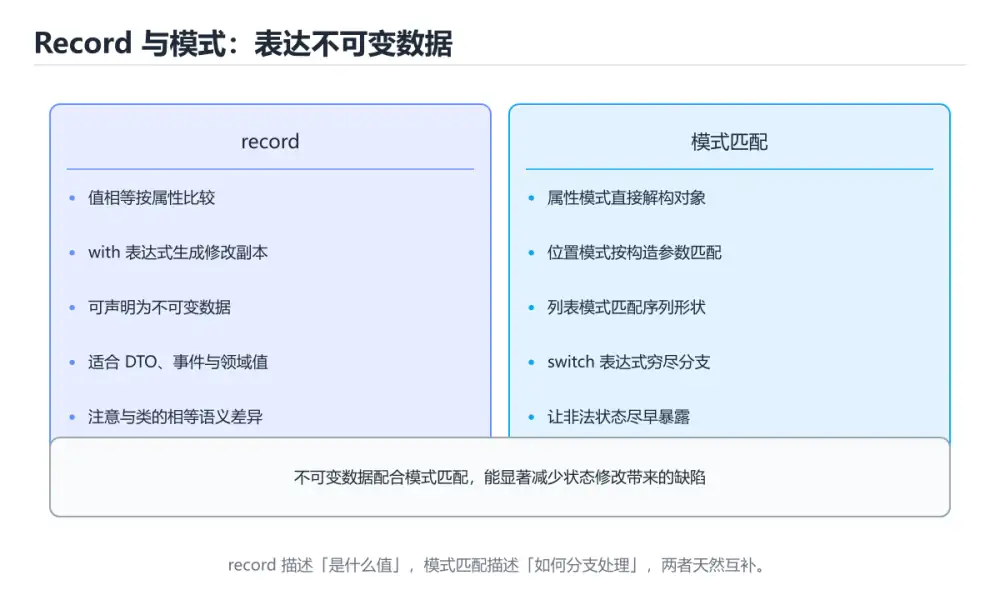
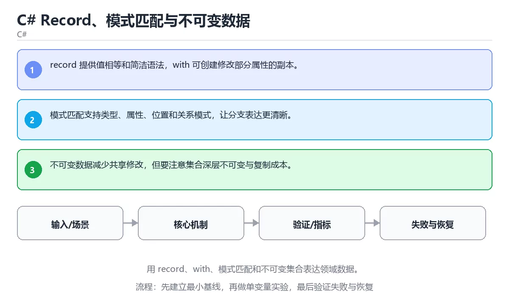

# C# Record、模式匹配与不可变数据

> 内容更新时间：2026-10-06 · 学习阶段：高级 · 预计用时：25 分钟





## 本节知识框架

**课程定位**：所属分类 `csharp`（C#），课程主题 `C# Record、模式匹配与不可变数据`，学习阶段 高级，建议用时 40 分钟。

本课主线：用 record、with、模式匹配和不可变集合表达领域数据。

**学完本课应当能够**
- 说清 `record` 与 `模式匹配` 的含义与区别，并各举一个正例和一个反例。
- 用本课示例验证 `不可变` 的行为，记录输入、输出与失败条件。
- 遇到「给 record 加可变属性」这类问题时，能说出触发条件与修复顺序。

### 复习清单

- [ ] 能不看正文复述本课核心术语，并指出一个边界或反例。
- [ ] 能运行或推演本课示例，记录输入、输出与失败现象。
- [ ] 能完成一次自测，并把错题对照错误表定位原因。

## 核心概念定义

| 术语 | 操作性定义 | 常见边界与风险 |
| --- | --- | --- |
| record | C# 中主要用于表示不可变数据并自动生成值相等语义的类型。 | 易错：值语义被破坏，比较结果不符合预期；正确做法是保持不可变，修改时用 with 生成新实例。 |
| 模式匹配 | 按值、类型或结构选择分支并提取其中字段。 | 易错：前面的宽泛模式吞掉后面的具体分支；正确做法是从具体到宽泛排列，并做穷尽性检查。 |
| 不可变 | 结合record、模式匹配、不可变、with，写出一个真实项目中的使用场景。 | 易错：值语义被破坏，比较结果不符合预期；正确做法是保持不可变，修改时用 with 生成新实例。 |
| with | record 的复制表达式：基于已有实例生成新对象并只改指定属性，体现不可变数据写法。 | 易错：值语义被破坏，比较结果不符合预期；正确做法是保持不可变，修改时用 with 生成新实例。 |

## 原理与运行机制

### 机制总览

**教材衔接：核心知识**

### 1. record 提供值相等和简洁语法，with 可创建修改部分属性的副本。

- 关键做法：先用 WriteLine 建立 record 的基线，再逐步加入边界与失败条件。
- 验证标准：WriteLine 的输出能被他人复现，边界输入有对应用例。

### 2. 模式匹配支持类型、属性、位置和关系模式，让分支表达更清晰。

把这条结论放回「C# Record、模式匹配与不可变数据」的完整流程里展开：

- 正文依据：能用自己的话解释：record 提供值相等和简洁语法，with 可创建修改部分属性的副本。
- 落地检查：把「2. 模式匹配支持类型、属性、位置和关系模式，让分支表达更清晰。」改写成一条可执行的核对项，逐条验证输入、超时与失败路径。

### 3. 不可变数据减少共享修改，但要注意集合深层不可变与复制成本。

把这条结论放回「C# Record、模式匹配与不可变数据」的完整流程里展开：

- 正文依据：能用自己的话解释：模式匹配支持类型、属性、位置和关系模式，让分支表达更清晰。
- 落地检查：把「3. 不可变数据减少共享修改，但要注意集合深层不可变与复制成本。」改写成一条可执行的核对项，逐条验证输入、超时与失败路径。

**教材衔接：关键流程**

**教材衔接：实践路径**

**教材衔接：版本与时效**

- C# 版本随 SDK 演进，升级前把 模式匹配 的兼容性纳入检查清单。
- 主构造函数与集合表达式会影响 record 的写法，升级时先小范围替换。
- 升级「C# Record、模式匹配与不可变数据」涉及的依赖前，先用 WriteLine 复现当前行为，再逐项核对版本说明与破坏性变更。
- 官方说明：https://learn.microsoft.com/dotnet/core/whats-new/

## 典型应用场景

**课程内置实验入口**：`sandbox:csharp`，用于动手验证《C# Record、模式匹配与不可变数据》的机制；实验结论不替代概念定义与复杂度分析。

**教材衔接：深度拓展与实战**

这一节把 record 的结论、WriteLine 的示例与反例整理成可执行的复习步骤。

### 工程检查表

- [ ] 能否用自己的话说明C# Record、模式匹配与不可变数据解决什么问题，以及它不负责什么？
- [ ] 能否指出 WriteLine 最小示例的输入、输出和一条失败路径？
- [ ] 能否解释本课关键词在真实项目中的边界与取舍？
- [ ] 换一个输入后，WriteLine 的判断依据是否仍然成立？

### 最小验证场景

- 准备：保留 `text` 示例的原始输入，先记录 `C# Record、模式匹配与不可变数据` 的基线输出和完整运行命令。
- 观察：先核对 调用了 `Point()`，再改变一个与 `record` 相关的条件。
- 判定：新结果与 `C# Record、模式匹配与不可变数据` 的基线不同不等于错误；只有当差异破坏了 `record` 的定义或错误表中的约束，才判定为失败。

### 选择与边界

- 使用 `record` 时，先满足它的定义：C# 中主要用于表示不可变数据并自动生成值相等语义的类型；易错：值语义被破坏，比较结果不符合预期；正确做法是保持不可变，修改时用 with 生成新实例。
- 使用 `模式匹配` 时，先满足它的定义：按值、类型或结构选择分支并提取其中字段；易错：前面的宽泛模式吞掉后面的具体分支；正确做法是从具体到宽泛排列，并做穷尽性检查。
- 使用 `不可变` 时，先满足它的定义：结合record、模式匹配、不可变、with，写出一个真实项目中的使用场景；易错：值语义被破坏，比较结果不符合预期；正确做法是保持不可变，修改时用 with 生成新实例。
- 使用 `with` 时，先满足它的定义：record 的复制表达式：基于已有实例生成新对象并只改指定属性，体现不可变数据写法；易错：值语义被破坏，比较结果不符合预期；正确做法是保持不可变，修改时用 with 生成新实例。

## 代码/协议/SQL 示例

### 最小可验证示例

**教材衔接：最小可运行示例**

下面这段代码演示 record 的最小路径，先原样运行，再按注释改一处：

```csharp
record Point(int X, int Y);

var point = new Point(2, 3);
var label = point switch
{
    (0, 0) => "origin",
    (_, 0) => "x-axis",
    _ => "plane",
};
Console.WriteLine($"{point} -> {label}");
```

**教材衔接：预期输出**

```text
Point { X = 2, Y = 3 } -> plane
```

## 时间/空间复杂度或性能分析

**性能关注点（C# Record、模式匹配与不可变数据）**：GC 与异步调度影响开销：记录吞吐、延迟与分配速率。

**测量方法**：以 `C# Record、模式匹配与不可变数据` 的 `record` 场景为对象，固定输入跑一遍记录基线，再把规模或并发度提高一个数量级复测；两次结果的差值与波动范围才是结论依据。

## 常见误区与易错点

| 容易写错的做法 | 实际现象 | 原因与正确做法 |
| --- | --- | --- |
| 给 record 加可变属性 | 值语义被破坏，比较结果不符合预期。 | 保持不可变，修改时用 with 生成新实例。 |
| 模式匹配顺序写反 | 前面的宽泛模式吞掉后面的具体分支。 | 从具体到宽泛排列，并做穷尽性检查。 |
| 把 record 当实体到处传 | 值语义与标识语义混淆。 | 值对象用 record，需要唯一标识的实体用 class。 |

### 现场 1：给 record 加可变属性

**症状**：值语义被破坏，比较结果不符合预期。

**根因与修复**：保持不可变，修改时用 with 生成新实例。

**自检**：在本课示例里复现「给 record 加可变属性」，改成保持不可变，修改时用 with 生成新实例后重跑；如果症状消失且失败路径按预期变化，说明定位正确。

### 现场 2：模式匹配顺序写反

**症状**：前面的宽泛模式吞掉后面的具体分支。

**根因与修复**：从具体到宽泛排列，并做穷尽性检查。

**自检**：在本课示例里复现「模式匹配顺序写反」，改成从具体到宽泛排列，并做穷尽性检查后重跑；如果症状消失且失败路径按预期变化，说明定位正确。

### 现场 3：把 record 当实体到处传

**症状**：值语义与标识语义混淆。

**根因与修复**：值对象用 record，需要唯一标识的实体用 class。

**自检**：在本课示例里复现「把 record 当实体到处传」，改成值对象用 record，需要唯一标识的实体用 class后重跑；如果症状消失且失败路径按预期变化，说明定位正确。

## 与其他知识点的关系

**教材衔接：复习与迁移**

## 自测题与参考答案

> 先独立作答，再对照参考答案；答案都能在本课正文、术语表或错误表里找到依据。

### 自测 1（概念复述）

不看正文，写出 `record` 的操作性定义，并说明它与 `模式匹配` 的区别。

**参考答案**：C# 中主要用于表示不可变数据并自动生成值相等语义的类型。

`模式匹配` 的定位是：按值、类型或结构选择分支并提取其中字段；两者的差别要从适用对象与失败模式上说明。

### 自测 2（排错）

本课错误表记录了「给 record 加可变属性」这类做法。请写出它会出现的现象、根因，以及修复顺序。

**参考答案**：现象是值语义被破坏，比较结果不符合预期；正确做法是保持不可变，修改时用 with 生成新实例。修复时先复现现象并保留证据，再改动一处假设重跑，确认现象消失。

### 自测 3（动手验证）

运行本课的 `text` 示例，改动其中一个输入后重新运行，记录输出与错误信息。

**参考答案**：正常输入下 `text` 示例应当复现正文给出的结果；改动输入后，如果结果改变或报错，先核对它是否满足 `C# Record、模式匹配与不可变数据` 中`record` 的适用范围，再检查错误表里是否有同类现象。

### 自测 4（代码阅读）

阅读本课开头的 `text` 示例，说明它体现了`record` 的哪一条性质，并指出改动哪个输入会让这条性质不再成立。

**参考答案**：`record` 的定义是 C# 中主要用于表示不可变数据并自动生成值相等语义的类型，示例正是在实现这条定义。改动与 `record` 有关的一个输入后，如果结果不再符合 `C# Record、模式匹配与不可变数据` 的正文描述，就说明该性质只在当前前提成立。

### 自测 5（迁移）

把 `C# Record、模式匹配与不可变数据` 的方法迁移到自己的项目：围绕 `record` 写出一个与错误表同类的风险点，并说明触发条件和检验方式。

**参考答案**：例如「把 record 当实体到处传」，它会导致值语义与标识语义混淆；检验方式是按值对象用 record，需要唯一标识的实体用 class改一处再复现，确认现象消失且没有引入新的失败分支。

### 自测 6（对比）

用一个表格对比 `record` 与 `模式匹配`：各写一行适用场景、一行失败表现。

**参考答案**：`record` 的定义是C# 中主要用于表示不可变数据并自动生成值相等语义的类型；`模式匹配` 的定义是按值、类型或结构选择分支并提取其中字段。两者的失败表现分别对应本课错误表里与本术语相关的行。

### 自测 7（排错顺序）

面对「给 record 加可变属性」引发的问题，请把“复现 值语义被破坏，比较结果不符合预期 → 保留证据 → 保持不可变，修改时用 with 生成新实例 → 回归验证”四步写成可执行的检查清单。

**参考答案**：第一步按值语义被破坏，比较结果不符合预期复现；第二步记录输入、版本与完整报错；第三步按保持不可变，修改时用 with 生成新实例只改一处；第四步重跑并确认失败路径也按预期变化。

### 自测 8（边界判断）

针对 `with`，分别写出“可以使用”的条件和“结论不再成立”的条件。

**参考答案**：易错：值语义被破坏，比较结果不符合预期；正确做法是保持不可变，修改时用 with 生成新实例。 同时要把 `with` 的定义 record 的复制表达式：基于已有实例生成新对象并只改指定属性，体现不可变数据写法 与实际输入逐项对照。

### 自测 9（机制重建）

不看正文，按输入、转换、输出、验证四段重建 `record` → `模式匹配` → `不可变` → `with` 的作用链。

**参考答案**：起点是 `record` 的定义 C# 中主要用于表示不可变数据并自动生成值相等语义的类型；中间每一步都保留可观察状态；终点由 `with` 检查，失败时回到错误表定位第一个偏离定义的步骤。

### 自测 10（综合排错）

在 `C# Record、模式匹配与不可变数据` 中，现象是 值语义与标识语义混淆。请围绕 把 record 当实体到处传 写出最小复现、关键证据、修复动作和回归验证，并说明为什么不能只凭一次运行下结论。

**参考答案**：先复现 把 record 当实体到处传，记录输入与完整错误；再按 值对象用 record，需要唯一标识的实体用 class 只改一处。回归时同时跑正常路径和边界路径，只有两次结果都可解释，才把修复视为完成。

### 自测 11（一分钟复述）

用每分钟约 200 字的速度复述 `C# Record、模式匹配与不可变数据`：先给主问题，再按顺序说出 `record`、`模式匹配`、`不可变`、`with`，最后给一个失败案例。

**自评标准**：主问题必须对应 用 record、with、模式匹配和不可变集合表达领域数据；每个术语都要能接上一句定义或边界；失败案例必须写成可观察现象，不能用“可能有风险”代替证据。

## 术语速查

| 术语 | 一句话说明 |
| --- | --- |
| `record` | C# 中主要用于表示不可变数据并自动生成值相等语义的类型。 |
| `模式匹配` | 按值、类型或结构选择分支并提取其中字段。 |
| `不可变` | 结合record、模式匹配、不可变、with，写出一个真实项目中的使用场景。 |
| `with` | record 的复制表达式：基于已有实例生成新对象并只改指定属性，体现不可变数据写法。 |

**术语关系**：`record`（C# 中主要用于表示不可变数据并自动生成值相等语义的类型） → `模式匹配`（按值、类型或结构选择分支并提取其中字段） → `不可变`（结合record、模式匹配、不可变、with） → `with`（record 的复制表达式：基于已有实例生成新对象并只改指定属性）。

## 考点精讲

`C# Record、模式匹配与不可变数据` 的题库有 6 道题，下面逐题给出题干、正确项与判断依据：先自己作答，再核对正确项，最后回到正文对应小节复核。

### 考点 1：第 1 题

- **题目**：在 `C# Record、模式匹配与不可变数据` 里，与 `record` 有关的说法中，哪一项最符合用 record、with、模式匹配和不可变集合表达领域数据。？
- **正确项**：record 提供值相等和简洁语法，with 可创建修改部分属性的副本。
- **判断依据**：本题正确项是「record 提供值相等和简洁语法，with 可创建修改部分属性的副本」。术语 record（C# Record、模式匹配与不可变数据）：C# 中主要用于表示不可变数据并自动生成值相等语义的类型，本题取「record 提供值相等和简洁语法，with 可创建修改部分属性的副本」这条。易错点是给 record 加可变属性，会造成值语义被破坏，比较结果不符合预期，改法是保持不可变，修改时用 with 生成新实例。

### 考点 2：第 2 题

- **题目**：在 `C# Record、模式匹配与不可变数据` 里，与 `record` 有关的说法中，哪一项最符合用 record、with、模式匹配和不可变集合表达领域数据。？（C# Record、模式匹配与不可变数据·C# 第 2 题）
- **正确项**：模式匹配支持类型、属性、位置和关系模式，让分支表达更清晰。
- **判断依据**：本题正确项是「模式匹配支持类型、属性、位置和关系模式，让分支表达更清晰」。术语 record（C# Record、模式匹配与不可变数据）：C# 中主要用于表示不可变数据并自动生成值相等语义的类型，本题取「模式匹配支持类型、属性、位置和关系模式，让分支表达更清晰」这条。易错点是模式匹配顺序写反，会造成前面的宽泛模式吞掉后面的具体分支，改法是从具体到宽泛排列，并做穷尽性检查。

### 考点 3：第 3 题

- **题目**：`C# Record、模式匹配与不可变数据` 的示例代码用于验证 `record`，其背景是用 record、with、模式匹配和不可变集合表达领域数据。代码的真实内容是下面哪一项？
- **正确项**：调用了 `Point()`
- **判断依据**：按《C# Record、模式匹配与不可变数据》的正文口径，本题正确项是「调用了 `Point()`」。术语「record」在本课里的界定是C# 中主要用于表示不可变数据并自动生成值相等语义的类型，题干问的就是这一条。常见错法是给 record 加可变属性，其后果是值语义被破坏，比较结果不符合预期。正确做法是保持不可变，修改时用 with 生成新实例。

### 考点 4：第 4 题

- **题目**：`C# Record、模式匹配与不可变数据` 的主线是：用 record、with、模式匹配和不可变集合表达领域数据。下面哪一项与这条主线一致？
- **正确项**：用 record、with、模式匹配和不可变集合表达领域数据。
- **判断依据**：本题正确项是「用 record、with、模式匹配和不可变集合表达领域数据」。术语 record（C# Record、模式匹配与不可变数据）：C# 中主要用于表示不可变数据并自动生成值相等语义的类型，本题取「用 record、with、模式匹配和不可变集合表达领域数据」这条。易错点是给 record 加可变属性，会造成值语义被破坏，比较结果不符合预期，改法是保持不可变，修改时用 with 生成新实例。

### 考点 5：第 5 题

- **题目**：课程 `用 record、with、模式匹配和不可变集合表达领域数据。`。在 `C# Record、模式匹配与不可变数据` 里，`record`、`模式匹配` 与下面哪些选项属于同一层概念？（多选）
- **正确项**：record；模式匹配
- **判断依据**：按《C# Record、模式匹配与不可变数据》的正文口径，本题要同时选中「record」、「模式匹配」，漏掉任一项都算没答全。术语「record」在本课里的界定是C# 中主要用于表示不可变数据并自动生成值相等语义的类型，题干问的就是这一条。常见错法是给 record 加可变属性，其后果是值语义被破坏，比较结果不符合预期。正确做法是保持不可变，修改时用 with 生成新实例。

### 考点 6：第 6 题

- **题目**：下面几项都与 `record` 有关，请按 `C# Record、模式匹配与不可变数据` 的正文顺序排列；该课主线是用 record、with、模式匹配和不可变集合表达领域数据。
- **正确项**：核心知识 → 关键流程 → 实践路径 → 常见误区
- **判断依据**：按《C# Record、模式匹配与不可变数据》正文的先后，本题顺序是「核心知识」 → 「关键流程」 → 「实践路径」 → 「常见误区」。术语「record」在本课里的界定是C# 中主要用于表示不可变数据并自动生成值相等语义的类型，题干问的就是这一条。常见错法是给 record 加可变属性，其后果是值语义被破坏，比较结果不符合预期。正确做法是保持不可变，修改时用 with 生成新实例。

### 考点 7：`record`

- **要点**：C# 中主要用于表示不可变数据并自动生成值相等语义的类型。
- **record 的边界**：易错：值语义被破坏，比较结果不符合预期；正确做法是保持不可变，修改时用 with 生成新实例。

### 考点 8：`模式匹配`

- **要点**：按值、类型或结构选择分支并提取其中字段。
- **模式匹配 的边界**：易错：前面的宽泛模式吞掉后面的具体分支；正确做法是从具体到宽泛排列，并做穷尽性检查。

### 考点 9：`不可变`

- **要点**：结合record、模式匹配、不可变、with，写出一个真实项目中的使用场景。
- **不可变 的边界**：易错：值语义被破坏，比较结果不符合预期；正确做法是保持不可变，修改时用 with 生成新实例。

### 考点 10：`with`

- **要点**：record 的复制表达式：基于已有实例生成新对象并只改指定属性，体现不可变数据写法。
- **with 的边界**：易错：值语义被破坏，比较结果不符合预期；正确做法是保持不可变，修改时用 with 生成新实例。

### 考点 11：排错——给 record 加可变属性

- **现象**：值语义被破坏，比较结果不符合预期。
- **处理**：保持不可变，修改时用 with 生成新实例。

### 考点 12：排错——模式匹配顺序写反

- **现象**：前面的宽泛模式吞掉后面的具体分支。
- **处理**：从具体到宽泛排列，并做穷尽性检查。

### 考点 13：综合辨析——`record` 与 `with`

- **辨析点**：`record` 的定义是 C# 中主要用于表示不可变数据并自动生成值相等语义的类型；`with` 的定义是 record 的复制表达式：基于已有实例生成新对象并只改指定属性，体现不可变数据写法。
- **答题要求**：面对 `C# Record、模式匹配与不可变数据` 的题目，先判断描述的是 `record` 还是 `with`，再归到对应定义，最后写出一个会让该定义失效的边界输入。

### 考点 14：排错评分点

- **现象分**：能写出 值语义被破坏，比较结果不符合预期，而不是只写“程序有错”。
- **证据分**：保留触发 给 record 加可变属性 的输入、版本和错误原文。
- **修复分**：按 保持不可变，修改时用 with 生成新实例 只改一处，并同时回归正常路径与边界路径。

## 内容元数据

- 内容版本：v2.0
- 最后更新：2026-10-06
- 学习阶段：高级
- 适用环境：.NET 9 / C# 13；本课聚焦 record。
- 内容来源：内置结构化课程与工程实践整理
- 相关主题：record、模式匹配、不可变、with
- 质量版本：P0 测验标准 + P1 覆盖扩展 + P2 体验补全

## 参考资料与复核

- 最后复核：2026-10-04
- 下次复核：2027-03-10
- 复核范围：版本兼容、API 行为、安全建议与工程实践
- 来源性质：官方文档、标准或权威教材；本课核对关键词：record、模式匹配、不可变、with。

| 参考资料 | 本课用途 |
| --- | --- |
| [C# 指南](https://learn.microsoft.com/dotnet/csharp/) | 语言语法与类型系统 |
| [Blazor 文档](https://learn.microsoft.com/aspnet/core/blazor/) | 组件、状态与交互 |
| [dotnet CLI](https://learn.microsoft.com/dotnet/core/tools/) | 构建、运行与发布命令 |

| [本课术语索引：C# Record、模式匹配与不可变数据](#核心概念定义) | 按本课输入、术语边界和错误表现逐项核对 |
> 「C# Record、模式匹配与不可变数据」的链接用于离线阅读后的延伸核对；App 不会自动联网。