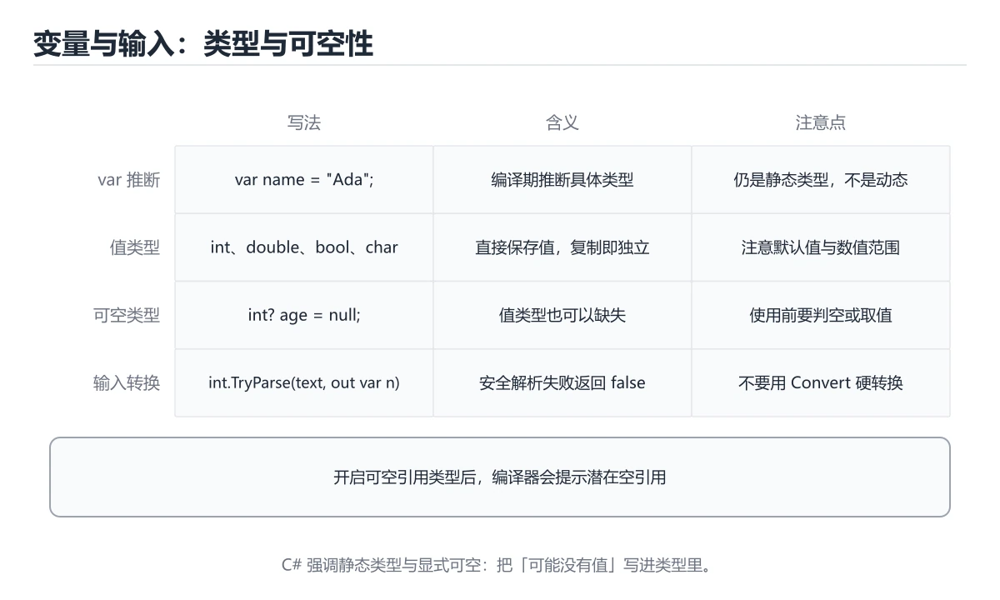
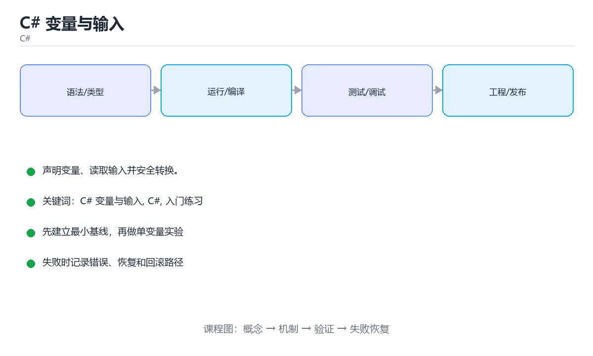

# C# 变量与输入

> 内容更新时间：2026-10-06 · 学习阶段：入门 · 预计用时：30 分钟





## 本节知识框架

**课程定位**：所属分类 `csharp`（C#），课程主题 `C# 变量与输入`，学习阶段 入门，建议用时 40 分钟。

本课主线：声明变量、读取输入并安全转换。

**学完本课应当能够**
- 说清 `强类型` 与 `var 与显式类型` 的含义与区别，并各举一个正例和一个反例。
- 用本课示例验证 `Console.ReadLine` 的行为，记录输入、输出与失败条件。
- 遇到「读取输入不做类型转换」这类问题时，能说出触发条件与修复顺序。

### 复习清单

- [ ] 能不看正文复述本课核心术语，并指出一个边界或反例。
- [ ] 能运行或推演本课示例，记录输入、输出与失败现象。
- [ ] 能完成一次自测，并把错题对照错误表定位原因。

## 核心概念定义

| 术语 | 操作性定义 | 常见边界与风险 |
| --- | --- | --- |
| 强类型 | 变量类型在编译期确定，类型不匹配不能通过编译。 | 易错：`强类型` 让类型不符当场编译失败，却挡不住合法类型里的非法值；`Console.ReadLine` 读回的字符串编译合法，仍要 TryParse 校验。 |
| var 与显式类型 | var 让编译器推断类型，类型本身仍然是静态的。 | 易错：`var` 按初始值推断后类型就固定，不是动态类型；换不兼容的值再赋会编译报错，声明时也不能省初始值。 |
| Console.ReadLine | 从标准输入读一行，返回 string?，可能为 null。 | 易错：把返回值当普通字符串直接用；它是 string?，读到空值时后面每一次访问都得先判空。 |
| 类型转换 | 用 int.Parse 或 int.TryParse 把字符串转成数字，后者不会抛异常。 | 易错：`int.Parse` 碰到非数字串直接抛 `FormatException`；改用 `int.TryParse` 并接住返回 false 的分支，别让异常打断计算。 |
| 程序集 | 程序集是部署和版本控制的基本单位，包含类型、方法和资源 | 易错：别把命名空间当文件夹、把程序集当源码目录；程序集是部署与版本单位、打包类型和资源，命名空间只组织名字不决定文件位置。 |
| 类型 | 结构体、枚举和大多数基元类型是值类型，赋值时复制内容；类、数组、委托和字符串是引用类型，赋值时复制引用 | 易错：值类型（struct）赋值复制内容、引用类型（class）赋值复制引用，改一个对象会牵动另一处；struct 频繁装箱才有额外分配成本。 |
| 核心结论 | C# 是强类型语言，变量先声明类型再使用；Console.ReadLine 返回字符串，要参与计算必须先转换。 | 易错：`Console.ReadLine` 只给字符串，先声明的类型编译期不会替你转换；参与算术前必须显式 TryParse，合法类型仍可能装着脏值。 |
| 最少要写的代码 | `using System;` | 这一行只是把 System 引进来好让 Console 可用；漏掉它是编译不过，跟运行期输入合不合法无关。 |
| 正确做法 | 输入「小明」后回车，name 得到「小明」。 | name 拿到的是字符串，能打印不等于能计算；下一步要参与算术就得先转换并处理失败分支。 |
| 最常见的错误 | 直接对 ReadLine 的结果做算术：它是字符串，编译器直接报错。 | 易错：`ReadLine() + 1` 这类字符串参与算术 C# 编译期就拦下；这跟运行期值合不合法是两码事，转成数字后仍要靠 TryParse 兜住脏输入。 |
| 出错先查什么 | 先读第一条报错信息，再回到最小示例只改一个地方 | 实验三要求先预测报错位置再实际运行；一次只改一处，预测与实际的差异才当得了考点。 |
| 怎么确认学会了 | 把年龄换成身高，用 double.Parse 并保留一位小数。 | 只把数字换成身高还不够：不指定格式，输出会随区域设置变化，一位小数要显式写出格式。 |
| 和别的知识点的关系 | 本课打下的语法与思维方式会被后面每一课反复用到 | 值类型复制内容、引用类型复制引用这套语义到集合与 LINQ 一节还会用到，装箱成本那时才量得出来。 |
| 接下来做什么 | 合上教程，凭记忆把上面的最小代码重写一遍再运行 | 默写出的代码要用 dotnet run 跑一遍才算数；先确认 SDK 版本与项目文件一致，否则报错跟本课无关。 |

## 原理与运行机制

### 机制总览

| 阶段 | 关注对象 | 失败时应检查 |
| --- | --- | --- |
| 输入 | 强类型 | 类型、范围、编码、版本或前置状态是否满足定义。 |
| 处理 | var 与显式类型 | 顺序、可见性、锁、路由、事务或调度规则是否被破坏。 |
| 输出 | Console.ReadLine | 结果是否可复现，错误是否被正确传播而不是被吞掉。 |

**教材衔接：一句话入门**

声明变量、读取输入并安全转换。

**教材衔接：C# 与 .NET 基础机制速览**

### 编译、CLR 与程序集

C# 代码先编译成中间语言和元数据，运行时由 CLR 通过即时编译或提前编译转换为机器码。程序集是部署和版本控制的基本单位，包含类型、方法和资源。命名空间只负责组织名字，不决定物理文件位置。`dotnet new` 创建项目，`dotnet build` 编译，`dotnet run` 运行，`dotnet test` 执行测试，理解工具链能快速定位“编译失败”和“运行失败”。

### 类型、值与引用

C# 类型分为值类型和引用类型。结构体、枚举和大多数基元类型是值类型，赋值时复制内容；类、数组、委托和字符串是引用类型，赋值时复制引用。装箱把值类型转成对象，拆箱再转回来，频繁发生会增加分配和复制成本。`var` 只是让编译器推断类型，不会变成动态类型；`dynamic` 才把类型检查推迟到运行时。

### 方法、重载与参数

方法可以有重载、可选参数、命名参数、`params` 可变参数和扩展方法。重载根据参数列表选择，返回类型不参与。`ref`、`out`、`in` 控制参数的传递方式：`ref` 可读可写，`out` 必须在方法内赋值，`in` 只读引用。局部函数和 lambda 可以捕获外部变量，但要注意闭包生命周期和循环变量捕获。异步方法返回 `Task` 或 `Task<T>`，调用方通常使用 `await`。

### 集合、LINQ 与可空性

`List<T>`、`Dictionary<TKey,TValue>`、`HashSet<T>` 是最常用的泛型集合。LINQ 提供筛选、投影、分组、连接和聚合，延迟执行意味着查询只有在枚举时才真正运行；重复枚举可能重复计算或看到数据变化。可空引用类型在编译期提示可能的 null，公共方法仍要校验参数，边界层要把外部数据转换成有效对象。

### 资源管理与并发

实现 `IDisposable` 的对象应使用 `using` 或 `await using` 及时释放文件句柄、连接和锁。异常只用于异常情况，不要用异常处理正常分支。异步代码不要阻塞等待 `.Result` 或 `.Wait()`，否则可能造成线程池饥饿和死锁。并发集合、`lock`、`SemaphoreSlim` 和 `Channel` 各有适用场景，选择时要看清读写比例、公平性和取消需求。

**教材衔接：版本与时效**

- .NET 10 是当前 LTS 主线，C# 变量与输入 的可用语法取决于 SDK 版本。
- 升级重点在语法与裁剪行为；先为 C# 补一组回归用例。
- 升级「C# 变量与输入」涉及的依赖前，先用 WriteLine 复现当前行为，再逐项核对版本说明与破坏性变更。
- 官方说明：https://learn.microsoft.com/dotnet/core/whats-new/

## 典型应用场景

**课程内置实验入口**：`sandbox:csharp`，用于动手验证《C# 变量与输入》的机制；实验结论不替代概念定义与复杂度分析。

**教材衔接：代码实验：把示例跑成证据**

### 实验一：建立基线

```csharp
var name = "Ada";
int year = 1815;
Console.WriteLine($"{name} born in {year}");
```

### 实验二：只改一个输入

沿用「C# 变量与输入」的最小示例做一次单变量实验：

做完后用一句话写出「C# 变量与输入」的结论：输入怎么变，结果才怎么变。

### 实验三：制造一个可控错误

把 WriteLine 的一个参数换成不兼容的类型，先预测报错位置再实际运行；预测与实际的差异就是本课的考点。

### 实验四：用三句话复述

1. C# 变量与输入 的输入是什么，哪些取值合法，哪些属于边界或非法范围？
2. 在 代码实验：把示例跑成证据 里，C# 的状态是在什么条件下被改变的？
3. 输出如何验证，失败时第一条可观察证据是什么？

- **读取输入不做类型转换**：典型现象是直接参与计算时抛格式异常；正确做法是用 TryParse 并处理失败分支。
- **用 double 处理金额**：典型现象是精度误差在多次运算后累积；正确做法是金额用 decimal 或整数最小单位。
- **字符串插值不指定格式**：典型现象是输出随区域设置变化；正确做法是显式指定格式与区域设置。

### 最小验证场景

- 准备：保留 `csharp` 示例的原始输入，先记录 `C# 变量与输入` 的基线输出和完整运行命令。
- 观察：先核对 调用了 `Main()`，再改变一个与 `强类型` 相关的条件。
- 判定：新结果与 `C# 变量与输入` 的基线不同不等于错误；只有当差异破坏了 `强类型` 的定义或错误表中的约束，才判定为失败。

### 选择与边界

- 使用 `强类型` 时，变量类型在编译期确定，类型不匹配不能通过编译；静态检查只在编译期成立，运行期输入仍需校验。
- 使用 `var 与显式类型` 时，var 让编译器推断类型，类型本身仍然是静态的；静态检查只在编译期成立，运行期输入仍需校验。
- 使用 `Console.ReadLine` 时，从标准输入读一行，返回 string?，可能为 null。
- 使用 `类型转换` 时，用 int.Parse 或 int.TryParse 把字符串转成数字，后者不会抛异常；易错：直接参与计算时抛格式异常；正确做法是用 TryParse 并处理失败分支。
- 使用 `程序集` 时，程序集是部署和版本控制的基本单位，包含类型、方法和资源；不同版本与依赖组合的行为可能不同，升级或换环境前要按官方变更说明重新验证。

## 代码/协议/SQL 示例

### 最小可验证示例

**教材衔接：最小示例**

**教材衔接：预期输出**

```text
Ada born in 1815
```

**运行方式**：运行 `C# 变量与输入` 的示例时，用 `dotnet run` 运行；先确认 SDK 版本与项目文件一致。

## 时间/空间复杂度或性能分析

**性能关注点（C# 变量与输入）**：GC 与异步调度影响开销：记录吞吐、延迟与分配速率。

**本课特有开销（C# 变量与输入 · C# 变量与输入）**：小文件看元数据开销，大文件看吞吐，两者要分别测量。

**测量方法**：以 `C# 变量与输入` 的 `C# 变量与输入` 场景为对象，固定输入跑一遍记录基线，再把规模或并发度提高一个数量级复测；两次结果的差值与波动范围才是结论依据。

## 常见误区与易错点

| 容易写错的做法 | 实际现象 | 原因与正确做法 |
| --- | --- | --- |
| 读取输入不做类型转换 | 直接参与计算时抛格式异常。 | 用 TryParse 并处理失败分支。 |
| 用 double 处理金额 | 精度误差在多次运算后累积。 | 金额用 decimal 或整数最小单位。 |
| 字符串插值不指定格式 | 输出随区域设置变化。 | 显式指定格式与区域设置。 |

### 现场 1：读取输入不做类型转换

**症状**：直接参与计算时抛格式异常。

**根因与修复**：用 TryParse 并处理失败分支。

**自检**：在本课示例里复现「读取输入不做类型转换」，改成用 TryParse 并处理失败分支后重跑；如果症状消失且失败路径按预期变化，说明定位正确。

### 现场 2：用 double 处理金额

**症状**：精度误差在多次运算后累积。

**根因与修复**：金额用 decimal 或整数最小单位。

**自检**：在本课示例里复现「用 double 处理金额」，改成金额用 decimal 或整数最小单位后重跑；如果症状消失且失败路径按预期变化，说明定位正确。

### 现场 3：字符串插值不指定格式

**症状**：输出随区域设置变化。

**根因与修复**：显式指定格式与区域设置。

**自检**：在本课示例里复现「字符串插值不指定格式」，改成显式指定格式与区域设置后重跑；如果症状消失且失败路径按预期变化，说明定位正确。

## 与其他知识点的关系

**教材衔接：复习与迁移**

## 自测题与参考答案

> 先独立作答，再对照参考答案；答案都能在本课正文、术语表或错误表里找到依据。

### 自测 1（概念复述）

不看正文，写出 `强类型` 的操作性定义，并说明它与 `var 与显式类型` 的区别。

**参考答案**：变量类型在编译期确定，类型不匹配不能通过编译。

`var 与显式类型` 的定位是：var 让编译器推断类型，类型本身仍然是静态的；两者的差别要从适用对象与失败模式上说明。

### 自测 2（排错）

本课错误表记录了「读取输入不做类型转换」这类做法。请写出它会出现的现象、根因，以及修复顺序。

**参考答案**：现象是直接参与计算时抛格式异常；正确做法是用 TryParse 并处理失败分支。修复时先复现现象并保留证据，再改动一处假设重跑，确认现象消失。

### 自测 3（动手验证）

运行本课的 `csharp` 示例，把其中的 `"请输入名字："` 换成一个边界值后重新运行，记录输出与错误信息。

**参考答案**：正常输入下 `csharp` 示例应当复现正文给出的结果；把 `"请输入名字："` 换成边界值后，如果结果改变或报错，先核对它是否满足 `C# 变量与输入` 中`强类型` 的适用范围，再检查错误表里是否有同类现象。

### 自测 4（代码阅读）

阅读本课开头的 `csharp` 示例，说明它体现了`强类型` 的哪一条性质，并指出改动哪个输入会让这条性质不再成立。

**参考答案**：`强类型` 的定义是 变量类型在编译期确定，类型不匹配不能通过编译，示例正是在实现这条定义。改动与 `强类型` 有关的一个输入后，如果结果不再符合 `C# 变量与输入` 的正文描述，就说明该性质只在当前前提成立。

### 自测 5（迁移）

把 `C# 变量与输入` 的方法迁移到自己的项目：围绕 `强类型` 写出一个与错误表同类的风险点，并说明触发条件和检验方式。

**参考答案**：例如「字符串插值不指定格式」，它会导致输出随区域设置变化；检验方式是按显式指定格式与区域设置改一处再复现，确认现象消失且没有引入新的失败分支。

### 自测 6（对比）

用一个表格对比 `强类型` 与 `var 与显式类型`：各写一行适用场景、一行失败表现。

**参考答案**：`强类型` 的定义是变量类型在编译期确定，类型不匹配不能通过编译；`var 与显式类型` 的定义是var 让编译器推断类型，类型本身仍然是静态的。两者的失败表现分别对应本课错误表里与本术语相关的行。

### 自测 7（排错顺序）

面对「读取输入不做类型转换」引发的问题，请把“复现 直接参与计算时抛格式异常 → 保留证据 → 用 TryParse 并处理失败分支 → 回归验证”四步写成可执行的检查清单。

**参考答案**：第一步按直接参与计算时抛格式异常复现；第二步记录输入、版本与完整报错；第三步按用 TryParse 并处理失败分支只改一处；第四步重跑并确认失败路径也按预期变化。

### 自测 8（边界判断）

针对 `类型`，分别写出“可以使用”的条件和“结论不再成立”的条件。

**参考答案**：易错：直接参与计算时抛格式异常；正确做法是用 TryParse 并处理失败分支。 同时要把 `类型` 的定义 结构体、枚举和大多数基元类型是值类型，赋值时复制内容；类、数组、委托和字符串是引用类型，赋值时复制引用 与实际输入逐项对照。

### 自测 9（机制重建）

不看正文，按输入、转换、输出、验证四段重建 `强类型` → `var 与显式类型` → `Console.ReadLine` → `类型转换` 的作用链。

**参考答案**：起点是 `强类型` 的定义 变量类型在编译期确定，类型不匹配不能通过编译；中间每一步都保留可观察状态；终点由 `类型` 检查，失败时回到错误表定位第一个偏离定义的步骤。

### 自测 10（综合排错）

在 `C# 变量与输入` 中，现象是 输出随区域设置变化。请围绕 字符串插值不指定格式 写出最小复现、关键证据、修复动作和回归验证，并说明为什么不能只凭一次运行下结论。

**参考答案**：先复现 字符串插值不指定格式，记录输入与完整错误；再按 显式指定格式与区域设置 只改一处。回归时同时跑正常路径和边界路径，只有两次结果都可解释，才把修复视为完成。

### 自测 11（一分钟复述）

用每分钟约 200 字的速度复述 `C# 变量与输入`：先给主问题，再按顺序说出 `强类型`、`var 与显式类型`、`Console.ReadLine`、`类型转换`，最后给一个失败案例。

**自评标准**：主问题必须对应 声明变量、读取输入并安全转换；每个术语都要能接上一句定义或边界；失败案例必须写成可观察现象，不能用“可能有风险”代替证据。

## 术语速查

| 术语 | 一句话说明 |
| --- | --- |
| `强类型` | 变量类型在编译期确定，类型不匹配不能通过编译。 |
| `var 与显式类型` | var 让编译器推断类型，类型本身仍然是静态的。 |
| `Console.ReadLine` | 从标准输入读一行，返回 string?，可能为 null。 |
| `类型转换` | 用 int.Parse 或 int.TryParse 把字符串转成数字，后者不会抛异常。 |
| `程序集` | 程序集是部署和版本控制的基本单位，包含类型、方法和资源。 |
| `类型` | 结构体、枚举和大多数基元类型是值类型，赋值时复制内容；类、数组、委托和字符串是引用类型，赋值时复制引用。 |

**术语关系**：`强类型`（变量类型在编译期确定） → `var 与显式类型`（var 让编译器推断类型） → `Console.ReadLine`（从标准输入读一行） → `类型转换`（用 int.Parse 或 int.TryParse 把字符串转成数字）。

## 考点精讲

`C# 变量与输入` 的题库有 5 道题，下面逐题给出题干、正确项与判断依据：先自己作答，再核对正确项，最后回到正文对应小节复核。

### 考点 1：第 1 题

- **题目**：围绕“C# 变量与输入”中的 C# 变量与输入、C#、入门练习，下列哪两项是本课强调的实践判断？
- **正确项**：学习 C# 变量与输入 时要同时说明输入、输出和失败路径，不能只看正常流程；验证 C# 时要固定版本并覆盖边界输入，结论才可复现
- **判断依据**：按《C# 变量与输入》的正文口径，本题要同时选中「学习 C# 变量与输入 时要同时说明输入、输出和失败路径，不能只看正常流程」、「验证 C# 时要固定版本并覆盖边界输入，结论才可复现」，漏掉任一项都算没答全。术语 强类型（C# 变量与输入）：变量类型在编译期确定，类型不匹配不能通过编译。易错点是读取输入不做类型转换，会造成直接参与计算时抛格式异常，改法是用 TryParse 并处理失败分支。

### 考点 2：第 2 题

- **题目**：把用户输入的文本转换成整数，较安全的做法是？
- **正确项**：使用 int.TryParse，并检查返回值判断是否成功
- **判断依据**：本题正确项是「使用 int.TryParse，并检查返回值判断是否成功」。术语 强类型（C# 变量与输入）：变量类型在编译期确定，类型不匹配不能通过编译，本题取「使用 int.TryParse，并检查返回值判断是否成功」这条。易错点是用 double 处理金额，会造成精度误差在多次运算后累积，改法是金额用 decimal 或整数最小单位。

### 考点 3：第 3 题

- **题目**：字符串插值 $"{name} born in {year}" 的特点是？
- **正确项**：在字符串中直接嵌入表达式，运行时求值并格式化
- **判断依据**：本题正确项是「在字符串中直接嵌入表达式，运行时求值并格式化」。术语 强类型（C# 变量与输入）：变量类型在编译期确定，类型不匹配不能通过编译，本题取「在字符串中直接嵌入表达式，运行时求值并格式化」这条。易错点是字符串插值不指定格式，会造成输出随区域设置变化，改法是显式指定格式与区域设置。

### 考点 4：第 4 题

- **题目**：填空：补齐下面这段术语说明中的空缺。课程 `声明变量、读取输入并安全转换。`，这段说明是：`____`：var 让编译器推断类型，类型本身仍然是静态的。空缺处应填哪个术语？
- **正确项**：var 与显式类型
- **判断依据**：正确项：「var 与显式类型」。涉及术语 var 与显式类型：var 让编译器推断类型，类型本身仍然是静态的。易错点：读取输入不做类型转换会造成直接参与计算时抛格式异常。正确做法：用 TryParse 并处理失败分支。判断时先确认输入和适用范围，对照 `C# 变量与输入`、`C#`、`入门练习` 复现一次，最后把错误表现与正确做法逐项对照。

### 考点 5：第 5 题

- **题目**：`C# 变量与输入` 的示例代码服务于“声明变量、读取输入并安全转换。”哪一条判断是正确的？
- **正确项**：编译器根据初始化表达式推断类型，之后不再改变
- **判断依据**：本题正确项是「编译器根据初始化表达式推断类型，之后不再改变」。术语 类型（C# 变量与输入）：结构体、枚举和大多数基元类型是值类型，赋值时复制内容，类、数组、委托和字符串是引用类型，赋值时复制引用，本题取「编译器根据初始化表达式推断类型，之后不再改变」这条。易错点是用 double 处理金额，会造成精度误差在多次运算后累积，改法是金额用 decimal 或整数最小单位。

### 考点 6：`强类型`

- **要点**：变量类型在编译期确定，类型不匹配不能通过编译。
- **强类型 的边界**：静态检查只在编译期成立，运行期输入仍需校验。

### 考点 7：`var 与显式类型`

- **要点**：var 让编译器推断类型，类型本身仍然是静态的。
- **var 与显式类型 的边界**：静态检查只在编译期成立，运行期输入仍需校验。

### 考点 8：`Console.ReadLine`

- **要点**：从标准输入读一行，返回 string?，可能为 null。

### 考点 9：`类型转换`

- **要点**：用 int.Parse 或 int.TryParse 把字符串转成数字，后者不会抛异常。
- **类型转换 的边界**：易错：直接参与计算时抛格式异常；正确做法是用 TryParse 并处理失败分支。

### 考点 10：`程序集`

- **要点**：程序集是部署和版本控制的基本单位，包含类型、方法和资源
- **程序集 的边界**：不同版本与依赖组合的行为可能不同，升级或换环境前要按官方变更说明重新验证。

### 考点 11：`类型`

- **要点**：结构体、枚举和大多数基元类型是值类型，赋值时复制内容；类、数组、委托和字符串是引用类型，赋值时复制引用
- **类型 的边界**：易错：直接参与计算时抛格式异常；正确做法是用 TryParse 并处理失败分支。

### 考点 12：排错——读取输入不做类型转换

- **现象**：直接参与计算时抛格式异常。
- **处理**：用 TryParse 并处理失败分支。

### 考点 13：排错——用 double 处理金额

- **现象**：精度误差在多次运算后累积。
- **处理**：金额用 decimal 或整数最小单位。

### 考点 14：综合辨析——`强类型` 与 `类型`

- **辨析点**：`强类型` 的定义是 变量类型在编译期确定，类型不匹配不能通过编译；`类型` 的定义是 结构体、枚举和大多数基元类型是值类型，赋值时复制内容；类、数组、委托和字符串是引用类型，赋值时复制引用。
- **答题要求**：面对 `C# 变量与输入` 的题目，先判断描述的是 `强类型` 还是 `类型`，再归到对应定义，最后写出一个会让该定义失效的边界输入。

### 考点 15：排错评分点

- **现象分**：能写出 直接参与计算时抛格式异常，而不是只写“程序有错”。
- **证据分**：保留触发 读取输入不做类型转换 的输入、版本和错误原文。
- **修复分**：按 用 TryParse 并处理失败分支 只改一处，并同时回归正常路径与边界路径。

## 内容元数据

- 内容版本：v2.0
- 最后更新：2026-10-06
- 学习阶段：入门
- 适用环境：.NET 9 / C# 13
；本课聚焦 C# 变量与输入。
- 内容来源：内置结构化课程与工程实践整理
- 相关主题：C# 变量与输入、C#、入门练习
- 质量版本：P0 测验标准 + P1 覆盖扩展 + P2 体验补全

## 参考资料与复核

- 最后复核：2026-10-04
- 下次复核：2027-03-10
- 复核范围：版本兼容、API 行为、安全建议与工程实践
- 来源性质：官方文档、标准或权威教材；本课核对关键词：C# 变量与输入、C#、入门练习。

| 参考资料 | 本课用途 |
| --- | --- |
| [C# 指南](https://learn.microsoft.com/dotnet/csharp/) | 语言语法与类型系统 |
| [.NET 测试文档](https://learn.microsoft.com/dotnet/core/testing/) | 单元测试与集成测试 |
| [ASP.NET Core 文档](https://learn.microsoft.com/aspnet/core/) | Web API 与中间件 |

| [本课术语索引：C# 变量与输入](#核心概念定义) | 按本课输入、术语边界和错误表现逐项核对 |
> 「C# 变量与输入」的链接用于离线阅读后的延伸核对；App 不会自动联网。