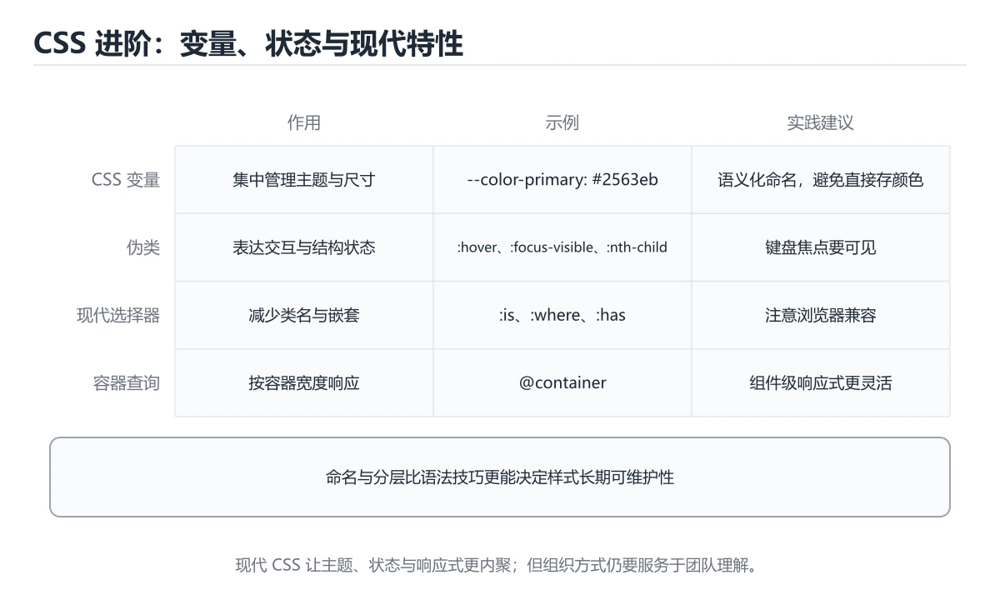
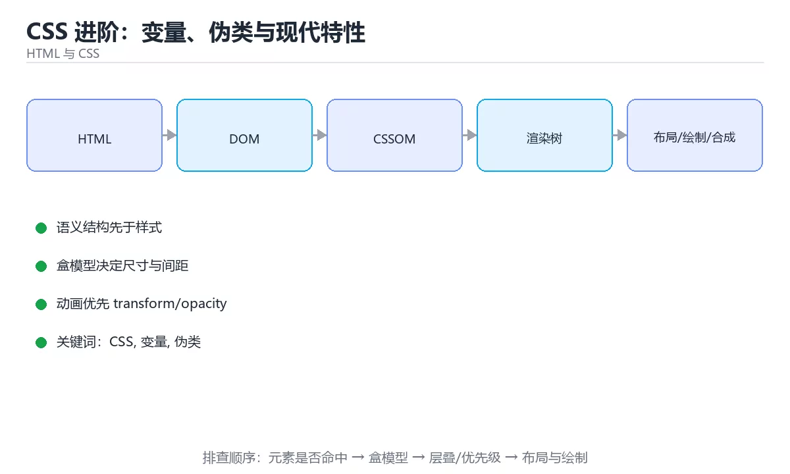

# CSS 进阶：变量、伪类与现代特性

> 内容更新时间：2026-10-06 · 学习阶段：进阶 · 预计用时：35 分钟





## 本节知识框架

**课程定位**：所属分类 `html_css`（HTML 与 CSS），课程主题 `CSS 进阶：变量、伪类与现代特性`，学习阶段 进阶，建议用时 40 分钟。

本课主线：CSS 变量做主题、伪类状态、现代特性与命名组织。

**学完本课应当能够**
- 说清 `CSS` 与 `变量` 的含义与区别，并各举一个正例和一个反例。
- 用本课示例验证 `伪类` 的行为，记录输入、输出与失败条件。
- 遇到「到处用 `!important`」这类问题时，能说出触发条件与修复顺序。

### 复习清单

- [ ] 能不看正文复述本课核心术语，并指出一个边界或反例。
- [ ] 能运行或推演本课示例，记录输入、输出与失败现象。
- [ ] 能完成一次自测，并把错题对照错误表定位原因。

## 核心概念定义

| 术语 | 操作性定义 | 常见边界与风险 |
| --- | --- | --- |
| CSS | BEM（blockelement--modifier）语法显式，适合多人协作；原子化 CSS（Tailwind）把样式写在标记上，减少命名负担但需要构建工具。 | 只在「BEM（blockelement--modifier）语法显式，适合多人协作；原子化 CSS（Tailwind）把样式写在标记上，减少命名负担但需要构建工具」这一前提下成立，换输入或换环境要重新验证。 |
| 变量 | CSS 自定义属性（如 --brand），可继承与运行时覆盖，配合 var() 使用，是主题切换的基础。 | 易错：取不到值；正确做法是全局放 `:root`。 |
| 伪类 | CSS 中描述元素状态或位置的选择器，如 hover、focus、first-child。 | 缓存与状态残留会让结果过期，先明确失效策略再判断正确性。 |
| 嵌套 | 一个结构或作用域包含另一个同类结构，需要注意层级、可读性和作用域边界。 | 只在「一个结构或作用域包含另一个同类结构，需要注意层级、可读性和作用域边界」这一前提下成立，换输入或换环境要重新验证。 |
| 容器查询 | 按父容器尺寸而非视口决定样式，用 @container 写规则，让组件在不同容器里自适应。 | 易错：不生效；正确做法是父级加 `container-type: inline-size`。 |
| 定义令牌 | 在 :root 下集中声明，命名用语义（--color-primary 而非 --blue） | 只在「在 :root 下集中声明，命名用语义（--color-primary 而非 --blue）」这一前提下成立，换输入或换环境要重新验证。 |
| 局部覆盖 | 在组件作用域重定义同名变量，实现局部定制 | 只在「在组件作用域重定义同名变量，实现局部定制」这一前提下成立，换输入或换环境要重新验证。 |
| 深色模式 | 用 prefers-color-scheme 媒体查询或给根元素加 data-theme 属性 | 易错：对比度不足；正确做法是同时调整文字、边框与状态色。 |
| 带默认值 | var(--x, fallback) 保证变量缺失时不崩样式 | 只在「var(--x, fallback) 保证变量缺失时不崩样式」这一前提下成立，换输入或换环境要重新验证。 |
| 与 JS 交互 | 用 style.setProperty 动态改变量值，避免大量改样式 | 只在「用 style.setProperty 动态改变量值，避免大量改样式」这一前提下成立，换输入或换环境要重新验证。 |
| 主题色 | 定义在 `:root`，组件只引用变量 | 越界、悬垂引用与释放顺序会破坏结论，必须在边界输入下复验。 |
| 组件局部变量 | 定义在组件选择器上，可被覆盖 | 只在「定义在组件选择器上，可被覆盖」这一前提下成立，换输入或换环境要重新验证。 |
| 变量兜底 | `var(--brand, #2563eb)` | 易错：值未定义时样式崩；正确做法是`var(--x, fallback)`。 |
| 覆盖顺序 | 用 `@layer` 声明层顺序 | 只在「用 `@layer` 声明层顺序」这一前提下成立，换输入或换环境要重新验证。 |
| 降低特异性 | 用 `:where()` 包裹 | 只在「用 `:where()` 包裹」这一前提下成立，换输入或换环境要重新验证。 |
| 深色模式 | `prefers-color-scheme` 覆盖变量 | 易错：对比度不足；正确做法是同时调整文字、边框与状态色。 |
| 用户主题切换 | 通过 `data-theme` 属性覆盖变量 | 只在「通过 `data-theme` 属性覆盖变量」这一前提下成立，换输入或换环境要重新验证。 |

## 原理与运行机制

### 机制总览

**教材衔接：过渡与动画**

`transition: transform .2s ease, opacity .2s ease` 覆盖属性、时长与缓动；`@keyframes` 定义多阶段动画；缓动优先用 `ease-out`（进入）与 `ease-in`（离开）。避免对 `width/height/top/left` 做动画（触发回流），改用 `transform`。

**教材衔接：现代 CSS 特性**

| 特性 | 作用 |
| --- | --- |
| 嵌套（nesting） | 原生支持 `.card { & .title { } }` |
| `@container` | 组件按自身宽度响应，而非视口 |
| `:is()` / `:where()` | 简化选择器并控制特异性 |
| `color-mix()` / `oklch()` | 颜色混合与感知均匀色彩空间 |
| `aspect-ratio` | 固定宽高比，替代 padding hack |
| `gap` | Flex 与 Grid 通用间距 |

**教材衔接：命名与组织**

BEM（block__element--modifier）语法显式，适合多人协作；原子化 CSS（Tailwind）把样式写在标记上，减少命名负担但需要构建工具。无论哪种，关键是**避免深层嵌套与全局副作用**。

## 典型应用场景

**教材衔接：伪类与伪元素实战**

`:focus-visible` 只在键盘聚焦时显示描边（鼠标点击不显示），是兼顾可访问性与美观的标准做法；`:nth-child(2n)` 做斑马纹；`:has()` 让父元素根据子元素状态变化（如"输入框有值时高亮标签"）；`::before/::after` 配合 content 实现装饰与提示。

- **到处用 `!important`**：典型现象是无法维护；正确做法是用 `@layer` 与 `:where()`。
- **变量定义在组件内却期望全局**：典型现象是取不到值；正确做法是全局放 `:root`。
- **忘记变量兜底**：典型现象是值未定义时样式崩；正确做法是`var(--x, fallback)`。
- **用 `:has()` 做重逻辑**：典型现象是性能与兼容问题；正确做法是用于局部状态样式，注意浏览器支持。

### 最小验证场景

- 准备：保留 `text` 示例的原始输入，先记录 `CSS 进阶：变量、伪类与现代特性` 的基线输出和完整运行命令。
- 观察：先核对 调用了 `var()`，再改变一个与 `CSS` 相关的条件。
- 判定：新结果与 `CSS 进阶：变量、伪类与现代特性` 的基线不同不等于错误；只有当差异破坏了 `CSS` 的定义或错误表中的约束，才判定为失败。

### 选择与边界

- 使用 `CSS` 时，先满足它的定义：BEM（blockelement--modifier）语法显式，适合多人协作；原子化 CSS（Tailwind）把样式写在标记上，减少命名负担但需要构建工具；只在「BEM（blockelement--modifier）语法显式，适合多人协作；原子化 CSS（Tailwind）把样式写在标记上，减少命名负担但需要构建工具」这一前提下成立，换输入或换环境要重新验证。
- 使用 `变量` 时，先满足它的定义：CSS 自定义属性（如 --brand），可继承与运行时覆盖，配合 var() 使用，是主题切换的基础；易错：取不到值；正确做法是全局放 `:root`。
- 使用 `伪类` 时，先满足它的定义：CSS 中描述元素状态或位置的选择器，如 hover、focus、first-child；缓存与状态残留会让结果过期，先明确失效策略再判断正确性。
- 使用 `嵌套` 时，先满足它的定义：一个结构或作用域包含另一个同类结构，需要注意层级、可读性和作用域边界；只在「一个结构或作用域包含另一个同类结构，需要注意层级、可读性和作用域边界」这一前提下成立，换输入或换环境要重新验证。
- 使用 `容器查询` 时，先满足它的定义：按父容器尺寸而非视口决定样式，用 @container 写规则，让组件在不同容器里自适应；易错：不生效；正确做法是父级加 `container-type: inline-size`。

## 代码/协议/SQL 示例

### 最小可验证示例

```text
:root { --brand: #6c8ff8; --radius: 6px; }
.card { background: var(--brand); border-radius: var(--radius); }
@media (prefers-color-scheme: dark) { :root { --brand: #93b4ff; } }
```

**教材衔接：现代特性速查**

| 特性 | 作用 | 示例 |
| --- | --- | --- |
| 自定义属性 | 主题变量与运行时切换 | `--brand: #2563eb` |
| `:is()` / `:where()` | 简化选择器，`where` 零特异性 | `:is(h1, h2, h3)` |
| `:has()` | 父级按子元素状态匹配 | `.card:has(img)` |
| `:focus-visible` | 键盘聚焦才显示样式 | 焦点可访问性 |
| `@layer` | 显式层叠顺序 | 第三方与自有样式分层 |
| `clamp()` | 弹性取值 | 流体字号 |
| `color-mix()` | 颜色混合 | 生成悬停色 |
| 容器查询 | 组件按自身宽度适配 | `@container (min-width: 30rem)` |
| 逻辑属性 | 支持书写方向 | `margin-inline`、`padding-block` |
| `scroll-snap` | 滚动吸附 | 轮播与长图 |

```css
/* 主题变量：一套变量支持浅色与深色 */
:root {
  --brand: #2563eb;
  --surface: #ffffff;
  --text: #111827;
  --radius: 8px;
  --space: clamp(0.75rem, 2vw, 1.5rem);
}

@media (prefers-color-scheme: dark) {
  :root {
    --brand: #60a5fa;
    --surface: #0f172a;
    --text: #e5e7eb;
  }
}

/* 用层管理优先级：重置 < 基础 < 组件 < 工具类 */
@layer reset, base, components, utilities;

@layer components {
  .card {
    background: var(--surface);
    color: var(--text);
    border-radius: var(--radius);
    padding: var(--space);
    transition: transform 160ms ease;
  }

  .card:hover {
    transform: translateY(-2px);
  }

  /* 只在包含图片时加额外内边距：父级选择更精准 */
  .card:has(img) {
    padding: 0;
  }
}

/* 容器查询：组件按自身可用宽度切换布局 */
@container (min-width: 30rem) {
  .card-body {
    display: grid;
    grid-template-columns: 1fr 1fr;
    gap: var(--space);
  }
}

/* 键盘聚焦可见，鼠标点击不显示描边 */
.card:focus-visible {
  outline: 2px solid var(--brand);
  outline-offset: 2px;
}
```

## 时间/空间复杂度或性能分析

**性能关注点（CSS 进阶：变量、伪类与现代特性）**：浏览器渲染是关键路径：关注首屏时间、重排与重绘次数、资源体积。

**测量方法**：以 `CSS 进阶：变量、伪类与现代特性` 的 `CSS` 场景为对象，固定输入跑一遍记录基线，再把规模或并发度提高一个数量级复测；两次结果的差值与波动范围才是结论依据。

## 常见误区与易错点

| 容易写错的做法 | 实际现象 | 原因与正确做法 |
| --- | --- | --- |
| 到处用 `!important` | 无法维护 | 用 `@layer` 与 `:where()` |
| 变量定义在组件内却期望全局 | 取不到值 | 全局放 `:root` |
| 忘记变量兜底 | 值未定义时样式崩 | `var(--x, fallback)` |
| 用 `:has()` 做重逻辑 | 性能与兼容问题 | 用于局部状态样式，注意浏览器支持 |
| 深色模式只改背景 | 对比度不足 | 同时调整文字、边框与状态色 |
| 容器查询未声明容器 | 不生效 | 父级加 `container-type: inline-size` |
| 用 `px` 写所有间距 | 不随字号缩放 | 与 `rem`/`clamp` 混用 |
| 忽略颜色对比度 | 无障碍不达标 | 正文对比度至少 4.5:1 |
| 依赖最新特性不做回退 | 老浏览器布局崩 | 用 `@supports` 或渐进增强 |
| 变量命名混乱 | 难以维护 | 用统一的语义命名 |
| 用 :has() 做重逻辑 | 性能与兼容问题。 | 用于局部状态样式，注意浏览器支持。 |
| 用 px 写所有间距 | 不随字号缩放。 | 与 rem/clamp 混用。 |

### 现场 1：到处用 `!important`

**症状**：无法维护。

**根因与修复**：用 `@layer` 与 `:where()`。

**自检**：在本课示例里复现「到处用 `!important`」，改成用 `@layer` 与 `:where()`后重跑；如果症状消失且失败路径按预期变化，说明定位正确。

### 现场 2：变量定义在组件内却期望全局

**症状**：取不到值。

**根因与修复**：全局放 `:root`。

**自检**：在本课示例里复现「变量定义在组件内却期望全局」，改成全局放 `:root`后重跑；如果症状消失且失败路径按预期变化，说明定位正确。

### 现场 3：忘记变量兜底

**症状**：值未定义时样式崩。

**根因与修复**：`var(--x, fallback)`。

**自检**：在本课示例里复现「忘记变量兜底」，改成`var(--x, fallback)`后重跑；如果症状消失且失败路径按预期变化，说明定位正确。

### 现场 4：用 `:has()` 做重逻辑

**症状**：性能与兼容问题。

**根因与修复**：用于局部状态样式，注意浏览器支持。

**自检**：在本课示例里复现「用 `:has()` 做重逻辑」，改成用于局部状态样式，注意浏览器支持后重跑；如果症状消失且失败路径按预期变化，说明定位正确。

### 现场 5：深色模式只改背景

**症状**：对比度不足。

**根因与修复**：同时调整文字、边框与状态色。

**自检**：在本课示例里复现「深色模式只改背景」，改成同时调整文字、边框与状态色后重跑；如果症状消失且失败路径按预期变化，说明定位正确。

### 现场 6：容器查询未声明容器

**症状**：不生效。

**根因与修复**：父级加 `container-type: inline-size`。

**自检**：在本课示例里复现「容器查询未声明容器」，改成父级加 `container-type: inline-size`后重跑；如果症状消失且失败路径按预期变化，说明定位正确。

### 现场 7：用 `px` 写所有间距

**症状**：不随字号缩放。

**根因与修复**：与 `rem`/`clamp` 混用。

**自检**：在本课示例里复现「用 `px` 写所有间距」，改成与 `rem`/`clamp` 混用后重跑；如果症状消失且失败路径按预期变化，说明定位正确。

### 现场 8：忽略颜色对比度

**症状**：无障碍不达标。

**根因与修复**：正文对比度至少 4.5:1。

**自检**：在本课示例里复现「忽略颜色对比度」，改成正文对比度至少 4.5:1后重跑；如果症状消失且失败路径按预期变化，说明定位正确。

### 现场 9：依赖最新特性不做回退

**症状**：老浏览器布局崩。

**根因与修复**：用 `@supports` 或渐进增强。

**自检**：在本课示例里复现「依赖最新特性不做回退」，改成用 `@supports` 或渐进增强后重跑；如果症状消失且失败路径按预期变化，说明定位正确。

## 与其他知识点的关系

**教材衔接：复习与迁移**

### 测验回顾

`____: transform 160ms ease;`
   - 依据：在「CSS 进阶：变量、伪类与现代特性」里，transition。「CSS 进阶：变量、伪类与现代特性」要求先交代CSS、变量、伪类的前提再下结论，所以“transition”只在题干“CSS 进阶”给定的条件下成立。把“transition”代回「CSS 进阶：变量、伪类与现代特性」里“CSS 进阶”的例子核对，条件一旦改变，结论就要用CSS、变量、伪类重新推导。

## 自测题与参考答案

> 先独立作答，再对照参考答案；答案都能在本课正文、术语表或错误表里找到依据。

### 自测 1（概念复述）

不看正文，写出 `CSS` 的操作性定义，并说明它与 `变量` 的区别。

**参考答案**：BEM（blockelement--modifier）语法显式，适合多人协作；原子化 CSS（Tailwind）把样式写在标记上，减少命名负担但需要构建工具。

`变量` 的定位是：CSS 自定义属性（如 --brand），可继承与运行时覆盖，配合 var() 使用，是主题切换的基础；两者的差别要从适用对象与失败模式上说明。

### 自测 2（排错）

本课错误表记录了「到处用 `!important`」这类做法。请写出它会出现的现象、根因，以及修复顺序。

**参考答案**：现象是无法维护；正确做法是用 `@layer` 与 `:where()`。修复时先复现现象并保留证据，再改动一处假设重跑，确认现象消失。

### 自测 3（动手验证）

运行本课的 `text` 示例，改动其中一个输入后重新运行，记录输出与错误信息。

**参考答案**：正常输入下 `text` 示例应当复现正文给出的结果；改动输入后，如果结果改变或报错，先核对它是否满足 `CSS 进阶：变量、伪类与现代特性` 中`CSS` 的适用范围，再检查错误表里是否有同类现象。

### 自测 4（代码阅读）

阅读本课开头的 `text` 示例，说明它体现了`CSS` 的哪一条性质，并指出改动哪个输入会让这条性质不再成立。

**参考答案**：`CSS` 的定义是 BEM（blockelement--modifier）语法显式，适合多人协作，原子化 CSS（Tailwind）把样式写在标记上，减少命名负担但需要构建工具，示例正是在实现这条定义。改动与 `CSS` 有关的一个输入后，如果结果不再符合 `CSS 进阶：变量、伪类与现代特性` 的正文描述，就说明该性质只在当前前提成立。

### 自测 5（迁移）

把 `CSS 进阶：变量、伪类与现代特性` 的方法迁移到自己的项目：围绕 `CSS` 写出一个与错误表同类的风险点，并说明触发条件和检验方式。

**参考答案**：例如「用 px 写所有间距」，它会导致不随字号缩放；检验方式是按与 rem/clamp 混用改一处再复现，确认现象消失且没有引入新的失败分支。

### 自测 6（对比）

用一个表格对比 `CSS` 与 `变量`：各写一行适用场景、一行失败表现。

**参考答案**：`CSS` 的定义是BEM（blockelement--modifier）语法显式，适合多人协作；原子化 CSS（Tailwind）把样式写在标记上，减少命名负担但需要构建工具；`变量` 的定义是CSS 自定义属性（如 --brand），可继承与运行时覆盖，配合 var() 使用，是主题切换的基础。两者的失败表现分别对应本课错误表里与本术语相关的行。

### 自测 7（排错顺序）

面对「到处用 `!important`」引发的问题，请把“复现 无法维护 → 保留证据 → 用 `@layer` 与 `:where()` → 回归验证”四步写成可执行的检查清单。

**参考答案**：第一步按无法维护复现；第二步记录输入、版本与完整报错；第三步按用 `@layer` 与 `:where()`只改一处；第四步重跑并确认失败路径也按预期变化。

### 自测 8（边界判断）

针对 `容器查询`，分别写出“可以使用”的条件和“结论不再成立”的条件。

**参考答案**：易错：不生效；正确做法是父级加 `container-type: inline-size`。 同时要把 `容器查询` 的定义 按父容器尺寸而非视口决定样式，用 @container 写规则，让组件在不同容器里自适应 与实际输入逐项对照。

### 自测 9（机制重建）

不看正文，按输入、转换、输出、验证四段重建 `CSS` → `变量` → `伪类` → `嵌套` 的作用链。

**参考答案**：起点是 `CSS` 的定义 BEM（blockelement--modifier）语法显式，适合多人协作；原子化 CSS（Tailwind）把样式写在标记上，减少命名负担但需要构建工具；中间每一步都保留可观察状态；终点由 `容器查询` 检查，失败时回到错误表定位第一个偏离定义的步骤。

### 自测 10（综合排错）

在 `CSS 进阶：变量、伪类与现代特性` 中，现象是 不随字号缩放。请围绕 用 px 写所有间距 写出最小复现、关键证据、修复动作和回归验证，并说明为什么不能只凭一次运行下结论。

**参考答案**：先复现 用 px 写所有间距，记录输入与完整错误；再按 与 rem/clamp 混用 只改一处。回归时同时跑正常路径和边界路径，只有两次结果都可解释，才把修复视为完成。

### 自测 11（一分钟复述）

用每分钟约 200 字的速度复述 `CSS 进阶：变量、伪类与现代特性`：先给主问题，再按顺序说出 `CSS`、`变量`、`伪类`、`嵌套`，最后给一个失败案例。

**自评标准**：主问题必须对应 CSS 变量做主题、伪类状态、现代特性与命名组织；每个术语都要能接上一句定义或边界；失败案例必须写成可观察现象，不能用“可能有风险”代替证据。

## 术语速查

| 术语 | 一句话说明 |
| --- | --- |
| `CSS` | BEM（blockelement--modifier）语法显式，适合多人协作；原子化 CSS（Tailwind）把样式写在标记上，减少命名负担但需要构建工具。 |
| `变量` | CSS 自定义属性（如 --brand），可继承与运行时覆盖，配合 var() 使用，是主题切换的基础。 |
| `伪类` | CSS 中描述元素状态或位置的选择器，如 hover、focus、first-child。 |
| `嵌套` | 一个结构或作用域包含另一个同类结构，需要注意层级、可读性和作用域边界。 |
| `容器查询` | 按父容器尺寸而非视口决定样式，用 @container 写规则，让组件在不同容器里自适应。 |

**术语关系**：`CSS`（BEM（blockelement--modifier）语法显式） → `变量`（CSS 自定义属性（如 --brand）） → `伪类`（CSS 中描述元素状态或位置的选择器） → `嵌套`（一个结构或作用域包含另一个同类结构）。

## 考点精讲

`CSS 进阶：变量、伪类与现代特性` 的题库有 6 道题，下面逐题给出题干、正确项与判断依据：先自己作答，再核对正确项，最后回到正文对应小节复核。

### 考点 1：第 1 题

- **题目**：`CSS 进阶：变量、伪类与现代特性` 的示例代码用于验证 `CSS`，其背景是CSS 变量做主题、伪类状态、现代特性与命名组织。代码的真实内容是下面哪一项？
- **正确项**：调用了 `media()`
- **判断依据**：本题正确项是调用了 `media()`。术语 CSS（CSS 进阶：变量、伪类与现代特性）：BEM（blockelement--modifier）语法显式，适合多人协作，原子化 CSS（Tailwind）把样式写在标记上，减少命名负担但需要构建工具，本题取调用了 `media()`这条。易错点是到处用 `!important`，会造成无法维护，改法是用 `@layer` 与 `:where()`。本题干扰项「调用了 `get()`」不成立：展示代码里找不到 `get()`。

### 考点 2：第 2 题

- **题目**：CSS 变量最核心的价值是？
- **正确项**：集中管理设计令牌并支持主题切换
- **判断依据**：本题正确项是集中管理设计令牌并支持主题切换。术语 CSS（CSS 进阶：变量、伪类与现代特性）：BEM（blockelement--modifier）语法显式，适合多人协作，原子化 CSS（Tailwind）把样式写在标记上，减少命名负担但需要构建工具，本题取集中管理设计令牌并支持主题切换这条。易错点是变量定义在组件内却期望全局，会造成取不到值，改法是全局放 `:root`。

### 考点 3：第 3 题

- **题目**：围绕“CSS 进阶：变量、伪类与现代特性”中的 CSS、变量、伪类，下列哪两项是本课强调的实践判断？
- **正确项**：学习 CSS 时要同时说明输入、输出和失败路径，不能只看正常流程；验证 变量 时要固定版本并覆盖边界输入，结论才可复现
- **判断依据**：本题正确项是学习 CSS 时要同时说明输入、输出和失败路径，不能只看正常流程。术语 CSS（CSS 进阶：变量、伪类与现代特性）：BEM（blockelement--modifier）语法显式，适合多人协作，原子化 CSS（Tailwind）把样式写在标记上，减少命名负担但需要构建工具，本题取学习 CSS 时要同时说明输入、输出和失败路径，不能只看正常流程这条。易错点是忘记变量兜底，会造成值未定义时样式崩，改法是`var(--x, fallback)`。

### 考点 4：第 4 题

- **题目**：@layer 的主要作用是？
- **正确项**：显式声明样式层叠顺序
- **判断依据**：本题正确项是显式声明样式层叠顺序。术语 CSS（CSS 进阶：变量、伪类与现代特性）：BEM（blockelement--modifier）语法显式，适合多人协作，原子化 CSS（Tailwind）把样式写在标记上，减少命名负担但需要构建工具，本题取显式声明样式层叠顺序这条。易错点是用 `:has()` 做重逻辑，会造成性能与兼容问题，改法是用于局部状态样式，注意浏览器支持。

### 考点 5：第 5 题

- **题目**：clamp(1rem, 2.5vw, 2rem) 的含义是？
- **正确项**：在 1rem 与 2rem 之间按 2.5vw 弹性取值
- **判断依据**：本题正确项是在 1rem 与 2rem 之间按 2.5vw 弹性取值。术语 CSS（CSS 进阶：变量、伪类与现代特性）：BEM（blockelement--modifier）语法显式，适合多人协作，原子化 CSS（Tailwind）把样式写在标记上，减少命名负担但需要构建工具，本题取在 1rem 与 2rem 之间按 2.5vw 弹性取值这条。易错点是深色模式只改背景，会造成对比度不足，改法是同时调整文字、边框与状态色。

### 考点 6：第 6 题

- **题目**：填空：补齐下面这段术语说明中的空缺。课程 `CSS 变量做主题、伪类状态、现代特性与命名组织。`，这段说明是：`____`：一个结构或作用域包含另一个同类结构，需要注意层级、可读性和作用域边界。空缺处应填哪个术语？
- **正确项**：嵌套
- **判断依据**：《CSS 进阶：变量、伪类与现代特性》这题的填空口径是「嵌套」，正文写法与其中任一项一致即可。术语「CSS」在本课里的界定是BEM（blockelement--modifier）语法显式，适合多人协作，原子化 CSS（Tailwind）把样式写在标记上，减少命名负担但需要构建工具，题干「填空：补齐下面这段术语说明中的空缺，课程 `CSS 变量做主题、伪类」问的就是这一条。常见错法是到处用 `!important`，其后果是无法维护。正确做法是用 `@layer` 与 `:where()`。

### 考点 7：`CSS`

- **要点**：BEM（blockelement--modifier）语法显式，适合多人协作；原子化 CSS（Tailwind）把样式写在标记上，减少命名负担但需要构建工具。
- **CSS 的边界**：只在「BEM（blockelement--modifier）语法显式，适合多人协作；原子化 CSS（Tailwind）把样式写在标记上，减少命名负担但需要构建工具」这一前提下成立，换输入或换环境要重新验证。

### 考点 8：`变量`

- **要点**：CSS 自定义属性（如 --brand），可继承与运行时覆盖，配合 var() 使用，是主题切换的基础。
- **变量 的边界**：易错：取不到值；正确做法是全局放 `:root`。

### 考点 9：`伪类`

- **要点**：CSS 中描述元素状态或位置的选择器，如 hover、focus、first-child。
- **伪类 的边界**：缓存与状态残留会让结果过期，先明确失效策略再判断正确性。

### 考点 10：`嵌套`

- **要点**：一个结构或作用域包含另一个同类结构，需要注意层级、可读性和作用域边界。
- **嵌套 的边界**：只在「一个结构或作用域包含另一个同类结构，需要注意层级、可读性和作用域边界」这一前提下成立，换输入或换环境要重新验证。

### 考点 11：`容器查询`

- **要点**：按父容器尺寸而非视口决定样式，用 @container 写规则，让组件在不同容器里自适应。
- **容器查询 的边界**：易错：不生效；正确做法是父级加 `container-type: inline-size`。

### 考点 12：排错——到处用 `!important`

- **现象**：无法维护。
- **处理**：用 `@layer` 与 `:where()`。

### 考点 13：排错——变量定义在组件内却期望全局

- **现象**：取不到值。
- **处理**：全局放 `:root`。

### 考点 14：综合辨析——`CSS` 与 `容器查询`

- **辨析点**：`CSS` 的定义是 BEM（blockelement--modifier）语法显式，适合多人协作；原子化 CSS（Tailwind）把样式写在标记上，减少命名负担但需要构建工具；`容器查询` 的定义是 按父容器尺寸而非视口决定样式，用 @container 写规则，让组件在不同容器里自适应。
- **答题要求**：面对 `CSS 进阶：变量、伪类与现代特性` 的题目，先判断描述的是 `CSS` 还是 `容器查询`，再归到对应定义，最后写出一个会让该定义失效的边界输入。

### 考点 15：排错评分点

- **现象分**：能写出 无法维护，而不是只写“程序有错”。
- **证据分**：保留触发 到处用 `!important` 的输入、版本和错误原文。
- **修复分**：按 用 `@layer` 与 `:where()` 只改一处，并同时回归正常路径与边界路径。

## 内容元数据

- 内容版本：v2.0
- 最后更新：2026-10-06
- 学习阶段：进阶
- 适用环境：现代浏览器（Chrome/Firefox/Safari）；本课聚焦 CSS。
- 内容来源：内置结构化课程与工程实践整理
- 相关主题：CSS、变量、伪类、嵌套、容器查询
- 质量版本：P0 测验标准 + P1 覆盖扩展 + P2 体验补全

## 参考资料与复核

- 最后复核：2026-10-04
- 下次复核：2027-08-17
- 复核范围：版本兼容、API 行为、安全建议与工程实践
- 来源性质：官方文档、标准或权威教材；本课核对关键词：CSS、变量、伪类、嵌套、容器查询。

| 参考资料 | 本课用途 |
| --- | --- |
| [MDN 无障碍](https://developer.mozilla.org/docs/Web/Accessibility) | 可访问性与语义 |
| [MDN CSS](https://developer.mozilla.org/docs/Web/CSS) | CSS 布局、选择器与动画 |
| [W3C Web 标准](https://www.w3.org/TR/) | HTML、CSS 与 Web 标准 |

| [本课术语索引：CSS 进阶：变量、伪类与现代特性](#核心概念定义) | 按本课输入、术语边界和错误表现逐项核对 |
> 「CSS 进阶：变量、伪类与现代特性」的链接用于离线阅读后的延伸核对；App 不会自动联网。