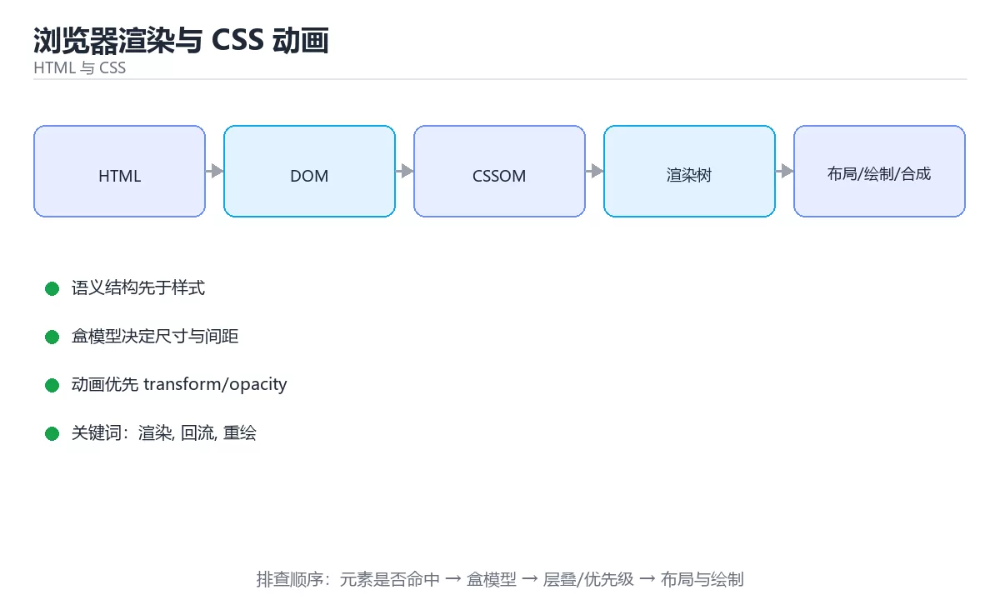
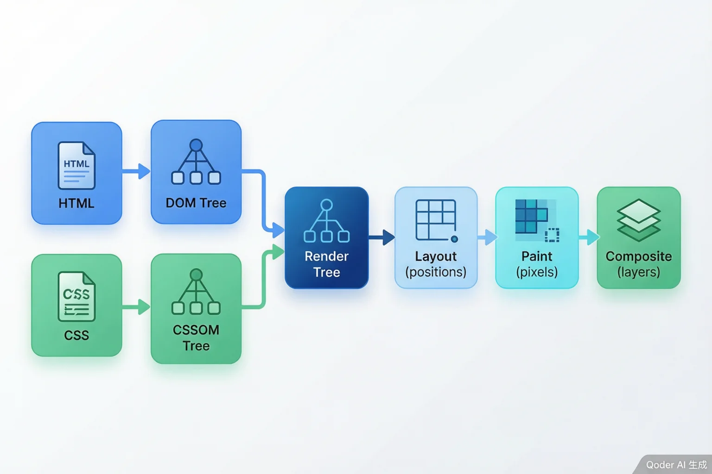

# 浏览器渲染与 CSS 动画

> 内容更新时间：2026-10-06 · 学习阶段：入门 · 预计用时：45 分钟

你有没有想过为什么有些网页动画流畅得像丝滑一样，而有些网页却卡得像老牛拉破车？这背后其实隐藏着浏览器渲染的秘密！今天我们就来揭开浏览器渲染与 CSS 动画的神秘面纱，让你也能写出流畅的网页动画。



## 本节知识框架

**课程定位**：所属分类 `html_css`（HTML 与 CSS），课程主题 `浏览器渲染与 CSS 动画`，学习阶段 入门，建议用时 45 分钟。

本课主线：关键渲染路径、回流与重绘、动画方式与性能指标。

**学完本课应当能够**
- 理解 `渲染` 与 `动画` 的基本概念，并能区分它们的作用
- 说出为什么有些动画会卡顿，以及如何避免这些问题
- 遇到「布局偏移（CLS）」这类问题时，知道如何解决

### 复习清单

- [ ] 能不看正文复述本课核心概念，并说出实际应用场景。
- [ ] 能理解本课的动画示例，知道如何使用。
- [ ] 能完成一次自测，了解自己的掌握情况。

## 核心概念定义

| 术语 | 操作性定义 | 常见边界与风险 |
| --- | --- | --- |
| 渲染 | 浏览器把 HTML/CSS 转成屏幕上可见像素的过程，动画性能取决于是否触发重排、重绘或合成。 | 小规模元素动画流畅，但大量元素同时动画可能导致卡顿，需要重新评估性能策略。 |
| 回流（重排） | 浏览器重新计算元素位置和大小的过程，比如改变宽度、高度、位置等，这是最耗性能的操作。 | 每次改变元素几何属性都会触发，连续多次改变会严重影响性能。 |
| 重绘 | 浏览器重新绘制元素外观的过程，比如改变颜色、背景等，但不影响元素的位置和大小。 | 比回流快，但频繁重绘仍会影响性能。 |
| 动画 | 用 transition 或 @keyframes 描述属性随时间变化；只动 transform 与 opacity 才能留在合成层，获得最佳性能。 | 易错：使用 left/top/width 等属性做动画会触发回流；正确做法是使用 transform 和 opacity。 |
| 合成 | 浏览器将页面的不同层组合成最终图像的过程，通常使用 GPU 加速，性能最好。 | 只有特定属性（如 transform 和 opacity）能触发合成。 |

## 原理与运行机制

### 机制总览

**教材衔接：浏览器渲染过程**

想象一下浏览器就像一个画家，它需要经过几个步骤才能完成一幅画：

1. **解析 HTML 建 DOM**：读取 HTML 文档，创建文档对象模型（DOM 树）
2. **样式计算**：读取 CSS，确定每个元素的样式规则
3. **布局（Reflow）**：计算每个元素在页面上的确切位置和大小
4. **绘制（Paint）**：将元素绘制到屏幕上的具体像素
5. **合成（Composite）**：将不同图层合并成最终显示的图像

其中，布局和绘制是最耗性能的步骤。

| 阶段 | 触发条件 | 性能代价 |
| --- | --- | --- |
| 解析 HTML 建 DOM | 首次加载或结构变化 | 高 |
| 样式计算 | 选择器匹配、变量变化 | 中 |
| 布局（Reflow） | 几何属性变化（宽高、位置等） | 高，需要重新计算布局 |
| 绘制（Paint） | 颜色、阴影、背景变化 | 中 |
| 合成（Composite） | transform / opacity 变化 | 低，可走 GPU 加速 |



**教材衔接：动画性能优化**

| 属性类型 | 性能 | 原因 |
| --- | --- | --- |
| transform / opacity | 最好 | 只触发合成，走 GPU 加速 |
| 位置、尺寸（left, top, width, height） | 较差 | 触发回流和重绘 |
| 颜色、背景 | 中等 | 只触发重绘 |

**教材衔接：动画实现方式**

| 方式 | 特点 | 适用场景 |
| --- | --- | --- |
| CSS transition | 简单的状态切换动画，性能好 | 按钮悬停、菜单展开等 |
| CSS animation + @keyframes | 复杂的多阶段动画，性能好 | 页面入场、图标动画等 |
| JavaScript 动画 | 灵活控制，但性能较差 | 需要复杂逻辑控制的动画 |

要点：优先使用 transform 和 opacity 做动画，避免使用 left、top、width、height 等会触发回流的属性。

## 典型应用场景

- **流畅的按钮悬停效果**：使用 transform 做按钮的悬停动画，避免页面抖动。
- **卡片翻转动画**：使用 transform 和 opacity 实现卡片的翻转效果，性能良好。
- **页面入场动画**：使用 transform 实现元素的滑入效果，不会影响页面布局。
- **布局偏移（CLS）**：典型现象是图片、广告、字体加载后尺寸变化；正确做法是预留宽高、`aspect-ratio`、`font-display`。

### 最小验证场景

- 准备：创建一个简单的 div 元素，准备测试不同的动画方式。
- 观察：先使用 transform 做动画，再使用 left 属性做动画，比较性能差异。
- 判定：transform 动画应该更加流畅，不会触发回流。

### 选择与边界

- 使用 `transform` 时，先满足它的优势：不触发回流和重绘，利用 GPU 加速；这种优化在大多数现代浏览器中有效。
- 使用 `opacity` 时，先满足它的优势：只触发合成，性能优异；适用于淡入淡出效果。
- 使用 `left/top/width/height` 时，先了解它们的缺点：会触发回流，性能较差；尽量避免在动画中使用。

## 代码/协议/SQL 示例

### 最小可验证示例

```text
HTML → DOM 树；CSS → CSSOM 树 → 合成渲染树 → 布局(Layout) → 绘制(Paint) → 合成(Composite)
```

**教材衔接：关键渲染路径**

浏览器渲染把 HTML/CSS 转成像素，动画性能取决于是否触发重排、重绘或合成。

**教材衔接：动画方式速查**

| 方式 | 性能 | 适用场景 |
| --- | --- | --- |
| CSS 过渡与动画 | 高（可走合成） | 大多数交互动画 |
| Web Animations API | 高 | 需要 JS 控制的动画 |
| JS 改样式逐帧 | 低 | 尽量不用 |
| `requestAnimationFrame` | 中 | 需要逐帧计算的场景 |

```css
/* 推荐：只动画 transform 与 opacity - 性能最佳 */
.card {
  transition: transform 200ms ease, box-shadow 200ms ease;
}

.card:hover {
  transform: translateY(-4px);
  box-shadow: 0 4px 8px rgba(0,0,0,0.1);
}

/* 入场动画：避免使用 top/left/margin */
@keyframes slide-in {
  from {
    opacity: 0;
    transform: translateY(12px);
  }
  to {
    opacity: 1;
    transform: translateY(0);
  }
}

.list-item {
  animation: slide-in 220ms ease-out both;
}

/* 避免：这些属性会触发回流 */
.bad-animation {
  transition: left 200ms ease, width 200ms ease; /* 触发回流，性能差 */
}

.bad-animation:hover {
  left: 10px;
  width: 200px;
}

/* 尊重用户的减少动效偏好 */
@media (prefers-reduced-motion: reduce) {
  *,
  *::before,
  *::after {
    animation-duration: 0.01ms !important;
    animation-iteration-count: 1 !important;
    transition-duration: 0.01ms !important;
  }
}
```

**教材衔接：深入理解浏览器渲染与 CSS 动画**

前面我们了解了基本概念。现在我们来看浏览器渲染的具体流程和如何优化动画性能。

### 一、核心模型

浏览器渲染把 HTML/CSS 转成像素，动画性能取决于是否触发重排、重绘或合成。优先使用 transform 和 opacity，避免在动画中频繁读写布局属性。

```text
HTML 解析 → DOM → CSSOM → 渲染树 → 布局 → 绘制 → 合成 → 屏幕
```

### 二、关键机制拆解

1. 布局计算元素几何位置，改变宽高、边距、字体等会触发布局（回流）。
2. 绘制填充像素，改变颜色、阴影和背景会触发重绘。
3. 合成把图层交给 GPU 合并，transform 和 opacity 通常只触发合成，性能最好。
4. requestAnimationFrame 与浏览器刷新同步，适合逐帧动画。
5. 动画要尊重 prefers-reduced-motion，为敏感用户提供减少动态效果。

### 三、对照表：容易混淆的动画方式

| 动画属性 | 触发 | 性能 |
| --- | --- | --- |
| transform / opacity | 合成（GPU 加速） | 最好 |
| left / top / right / bottom | 回流（重新布局） | 最差 |
| color / background | 重绘 | 中等 |
| width / height / margin / padding | 回流（重新布局） | 最差 |

### 四、工作示例

实现元素移动时使用 `transform: translateX()`，而不是修改 `left`。前者通常走合成层，利用 GPU 加速，后者每帧触发布局和绘制，容易造成卡顿。

### 五、常见误区与失效边界

| 错误做法 | 后果 | 正确做法 |
| --- | --- | --- |
| 动画 width/left/top | 每帧重排，卡顿明显 | 改用 transform 和 opacity |
| 不考虑无障碍需求 | 用户可能感到不适 | 用 `prefers-reduced-motion` 尊重用户偏好 |
| 忽略低端设备 | 桌面流畅、手机卡顿 | 在真实设备上测试动画性能 |

### 六、场景推演

假设你需要做一个卡片悬停效果，当鼠标悬停时卡片向上移动并添加阴影。正确的做法是使用 transform，而不是改变 top 值：

错误做法：
```css
.card:hover {
  top: -4px; /* 触发回流 */
}
```

正确做法：
```css
.card:hover {
  transform: translateY(-4px); /* 只触发合成 */
}
```

### 七、自测问答

**Q1：为什么 transform 动画比 left 动画更流畅？**

A: transform 通常只触发合成，利用 GPU 加速，而 left 会触发布局（回流），需要重新计算元素位置，性能消耗大得多。

**Q2：什么是回流和重绘？**

A: 回流（重排）是重新计算元素位置和大小，重绘是重新绘制元素外观。回流比重绘更消耗性能。

**Q3：哪些 CSS 属性适合做动画？**

A: transform 和 opacity 最适合，因为它们只触发合成，性能最好。

**Q4：为什么要考虑无障碍需求？**

A: 部分用户对动态效果敏感，使用 `prefers-reduced-motion` 可以为他们提供更舒适的浏览体验。

### 八、小项目：实现流畅的动画效果

尝试实现同一个移动动画的两种版本：一种使用 left 属性，另一种使用 transform，然后对比它们的性能表现。

### 九、适用边界

动画优化主要改善浏览器的渲染性能，但不能解决 DOM 结构过于复杂或 JavaScript 执行时间过长的问题。复杂的页面仍需先优化结构和脚本。

### 十、完成检查清单

- [ ] 理解浏览器渲染的基本流程
- [ ] 能区分回流、重绘和合成
- [ ] 会使用 transform 和 opacity 做动画
- [ ] 会考虑无障碍需求

### 十一、复习顺序

1. 不看资料说清楚「浏览器渲染与 CSS 动画」的核心概念，举一个流畅动画的例子。
2. 逐行解释回流、重绘、合成的区别，每个概念补一个实际应用场景。
3. 跟着示例做一遍，体验不同动画方式的性能差异。
4. 用自测问答检查理解程度。

> 复习不是重读一遍，而是离开原文重新产出：复述、应用、验证。

## 时间/空间复杂度或性能分析

关键性能指标包括首次内容绘制 FCP、最大内容绘制 LCP（< 2.5s）、首次输入延迟 INP（< 200ms）、累积布局偏移 CLS（< 0.1）。使用这些指标衡量动画对用户体验的影响。

**测量方法**：以 `浏览器渲染与 CSS 动画` 的 `动画` 场景为对象，先记录使用 transform 的基线性能，再测试使用 left 属性的性能，比较两者差异。

### 需要关注的性能指标

- `浏览器渲染与 CSS 动画` 的 `动画`：关注帧率是否稳定在 60fps，是否有卡顿现象。
- `浏览器渲染与 CSS 动画` 的 `回流`：关注是否频繁触发，影响页面流畅度。
- `浏览器渲染与 CSS 动画` 的 `重绘`：关注是否在必要时触发，避免不必要的重绘。

## 常见误区与易错点

| 容易犯错的做法 | 实际现象 | 原因与正确做法 |
| --- | --- | --- |
| 布局偏移（CLS） | 图片、广告、字体加载后尺寸变化 | 预留宽高、`aspect-ratio`、`font-display` |
| 图片抖动 | 未设置尺寸 | 写 `width`/`height` 或用 `aspect-ratio` |
| 字体闪烁 | 字体文件较晚加载 | `font-display: swap` 并预加载关键字体 |
| 滚动条跳动 | 内容高度变化 | 预留占位或固定容器高度 |
| 动画 left/top/width/height | 每帧重排，卡顿明显 | 改用 transform 和 opacity |
| 用 `top`/`left` 做动画 | 每帧触发布局，掉帧 | 改用 `transform` |
| 用 `margin` 做位移动画 | 触发布局 | 用 `transform: translate` |
| 图片不设尺寸 | 布局偏移 | 预留宽高或用 `aspect-ratio` |
| 动画不尊重减少动效 | 部分用户感到不适 | 用 `prefers-reduced-motion` |

### 现场 1：布局偏移（CLS）

**症状**：图片、广告、字体加载后尺寸变化，导致页面内容突然跳动。

**根因与修复**：预留宽高、`aspect-ratio`、`font-display`。

**自检**：在项目中确保所有媒体元素都有预设尺寸，使用 aspect-ratio 保持比例。

### 现场 2：动画性能差

**症状**：动画卡顿、掉帧。

**根因与修复**：避免使用会触发回流的属性，改用 transform 和 opacity。

**自检**：检查动画使用的 CSS 属性，确保使用的是性能友好的属性。

### 现场 3：忽略无障碍需求

**症状**：动画可能让用户感到不适。

**根因与修复**：使用 `prefers-reduced-motion` 尊重用户偏好。

**自检**：在项目中添加媒体查询，检测用户是否开启了减少动效选项。

## 与其他知识点的关系

**教材衔接：属性代价对照**

| 属性 | 触发回流 | 触发重绘 | 只触发合成 |
| --- | --- | --- | --- |
| `width`、`height`、`margin`、`top`、`left` | 是 | 是 | 否 |
| `color`、`background-color`、`box-shadow` | 否 | 是 | 否 |
| `transform`、`opacity` | 否 | 否 | 是 |
| `visibility` | 否 | 否 | 是（部分） |

- **先修**：`CSS 布局：Flex、Grid 与响应式`。本课在此基础上进一步优化页面性能。
- **相关或后续**：`CSS 进阶：变量、伪类与现代特性`。本课的性能优化技巧将在这些课程中继续使用。

### 先修与后续知识接口

- `CSS 布局：Flex、Grid 与响应式`：两者通过本分类的学习顺序衔接，阅读时重点比较各自对页面性能的影响。
- `CSS 进阶：变量、伪类与现代特性`：两者通过本分类的学习顺序衔接，阅读时重点比较各自的性能考虑。

### 容易混淆的概念

- `回流` 与 `重绘`：回流是重新计算元素位置和大小，重绘是重新绘制外观。回流比重绘更消耗性能。
- `合成` 与 `重绘`：合成利用 GPU 加速，性能最好；重绘只更新像素，比回流快但不如合成。

## 自测题与参考答案

> 先独立作答，再对照参考答案；答案都能在本课正文、术语表或错误表里找到依据。

### 自测 1（概念复述）

不看正文，说出 `动画` 的核心原则，并说明为什么某些属性动画更流畅。

**参考答案**：使用 transition 或 @keyframes 描述属性随时间变化；只动 transform 与 opacity 才能留在合成层，获得最佳性能。因为 transform 和 opacity 只触发合成，利用 GPU 加速，而 left、top、width 等属性会触发布局和重绘。

### 自测 2（排错）

本课提到「布局偏移（CLS）」这类问题。请说出它会出现的现象、根因，以及修复方法。

**参考答案**：现象是图片、广告、字体加载后尺寸变化，导致页面内容跳动；根因是没有预设元素尺寸；修复方法是预留宽高、使用 `aspect-ratio`、`font-display`。

### 自测 3（动手验证）

思考一下，如果要实现一个按钮点击后轻微放大又恢复的效果，应该使用哪种 CSS 属性？

**参考答案**：使用 transform: scale()，因为 scale 只触发合成，性能最好，不会导致页面布局变化。

### 自测 4（代码阅读）

查看本课的 CSS 示例，说明为什么使用 transform 而不是 left 做动画。

**参考答案**：transform 只触发合成，利用 GPU 加速，性能最佳；而 left 会触发布局（回流），性能较差。

### 自测 5（迁移）

把你学到的动画优化知识应用到自己的项目：如何让页面中的某个元素的移动动画更流畅？

**参考答案**：使用 transform: translateX/Y() 替代 left/right/top/bottom，这样只触发合成，性能更好。

## 术语速查

| 术语 | 一句话说明 |
| --- | --- |
| `渲染` | 浏览器把 HTML/CSS 转成屏幕上可见像素的过程。 |
| `回流` | 重新计算元素位置和大小的过程，非常消耗性能。 |
| `重绘` | 重新绘制元素外观的过程，比如颜色、背景等。 |
| `动画` | 用 transition 或 @keyframes 描述属性随时间变化；只动 transform 与 opacity 性能最佳。 |
| `合成` | 浏览器将页面的不同层组合成最终图像的过程，通常使用 GPU 加速。 |

**术语关系**：`渲染`（浏览器工作流程） → `回流`（计算位置大小） → `重绘`（绘制外观） → `动画`（流畅的视觉过渡）。

## 考点精讲

`浏览器渲染与 CSS 动画` 的题库有 6 道题，下面逐题给出题干、正确项与判断依据：先自己作答，再核对正确项，最后回到正文对应小节复核。

### 考点 1：第 1 题

- **题目**：围绕“浏览器渲染与 CSS 动画”中的 渲染、回流、重绘，下列哪两项是本课强调的实践判断？
- **正确项**：验证 回流 时要固定版本并覆盖边界输入，结论才可复现；学习 渲染 时要同时说明输入、输出和失败路径，不能只看正常流程
- **判断依据**：这道题落在术语 `渲染` 上：浏览器渲染把 HTML/CSS 转成像素，动画性能取决于是否触发重排、重绘或合成。复习时把 `渲染` 的定义、适用边界和一个反例一起说清楚，再回到「核心概念定义」核对原文。

### 考点 2：第 2 题

- **题目**：`浏览器渲染与 CSS 动画` 的示例代码用于验证 `defer`，其背景是关键渲染路径、回流与重绘、动画方式与性能指标。代码的真实内容是下面哪一项？
- **正确项**：调用了 `media()`
- **判断依据**：这道题落在术语 `defer` 上：JS 若在解析中同步执行会阻塞渲染，因此脚本用 `defer`/`async`，关键 CSS 内联，非关键资源懒加载。复习时把 `defer` 的定义、适用边界和一个反例一起说清楚，再回到「核心概念定义」核对原文。

### 考点 3：第 3 题

- **题目**：让脚本不阻塞 HTML 解析，应使用？
- **正确项**：defer 或 async
- **判断依据**：这道题落在术语 `defer` 上：JS 若在解析中同步执行会阻塞渲染，因此脚本用 `defer`/`async`，关键 CSS 内联，非关键资源懒加载。复习时把 `defer` 的定义、适用边界和一个反例一起说清楚，再回到「核心概念定义」核对原文。

### 考点 4：第 4 题

- **题目**：用 transform 和 opacity 做动画性能更好的原因是？
- **正确项**：只需合成层处理，通常不触发布局与重绘
- **判断依据**：这道题落在术语 `transform` 上：优化原则：批量修改 DOM（用 DocumentFragment 或一次性改 class）、避免在循环里读写布局属性（强制同步布局）、动画优先用 `transform` 与 `opacity`。复习时把 `transform` 的定义、适用边界和一个反例一起说清楚，再回到「核心概念定义」核对原文。

### 考点 5：第 5 题

- **题目**：will-change 使用不当的主要风险是？
- **正确项**：滥用会创建大量合成层
- **判断依据**：这道题检验本课主问题：关键渲染路径、回流与重绘、动画方式与性能指标。复习时先复述本课主问题，再举一个会让结论失效的输入。

### 考点 6：第 6 题

- **题目**：填空：补齐下面这段术语说明中的空缺。课程 `关键渲染路径、回流与重绘、动画方式与性能指标。`，这段说明是：浏览器`____`把 HTML/CSS 转成像素，动画性能取决于是否触发重排、重绘或合成。空缺处应填哪个术语？
- **正确项**：渲染
- **判断依据**：这道题落在术语 `渲染` 上：浏览器渲染把 HTML/CSS 转成像素，动画性能取决于是否触发重排、重绘或合成。复习时把 `渲染` 的定义、适用边界和一个反例一起说清楚，再回到「核心概念定义」核对原文。

### 考点 7：`defer`

- **要点**：JS 若在解析中同步执行会阻塞渲染，因此脚本用 `defer`/`async`，关键 CSS 内联，非关键资源懒加载。
- **defer 的边界**：只在「JS 若在解析中同步执行会阻塞渲染，因此脚本用 `defer`/`async`，关键 CSS 内联，非关键资源懒加载」这一前提下成立，换输入或换环境要重新验证。

### 考点 8：`transform`

- **要点**：优化原则：批量修改 DOM（用 DocumentFragment 或一次性改 class）、避免在循环里读写布局属性（强制同步布局）、动画优先用 `transform` 与 `opacity`。
- **transform 的边界**：易错：每帧重排；正确做法是改用 transform 和 opacity。

### 考点 9：`渲染`

- **要点**：浏览器渲染把 HTML/CSS 转成像素，动画性能取决于是否触发重排、重绘或合成。
- **渲染 的边界**：结论随输入规模变化，小规模成立不代表大规模成立，需要重新测量。

### 考点 10：`动画`

- **要点**：用 transition 或 @keyframes 描述属性随时间变化；只动 transform 与 opacity 才能留在合成层。
- **动画 的边界**：易错：每帧重排；正确做法是改用 transform 和 opacity。

### 考点 11：排错——布局偏移（CLS）

- **现象**：图片、广告、字体加载后尺寸变化。
- **处理**：预留宽高、`aspect-ratio`、`font-display`。

### 考点 12：排错——图片抖动

- **现象**：未设置尺寸。
- **处理**：写 `width`/`height` 或用 `aspect-ratio`。

### 考点 13：综合辨析——`defer` 与 `动画`

- **辨析点**：`defer` 的定义是 JS 若在解析中同步执行会阻塞渲染，因此脚本用 `defer`/`async`，关键 CSS 内联，非关键资源懒加载；`动画` 的定义是 用 transition 或 @keyframes 描述属性随时间变化；只动 transform 与 opacity 才能留在合成层。
- **答题要求**：面对 `浏览器渲染与 CSS 动画` 的题目，先判断描述的是 `defer` 还是 `动画`，再归到对应定义，最后写出一个会让该定义失效的边界输入。

### 考点 14：排错评分点

- **现象分**：能写出 图片、广告、字体加载后尺寸变化，而不是只写"程序有错"。
- **证据分**：保留触发 布局偏移（CLS） 的输入、版本和错误原文。
- **修复分**：按 预留宽高、`aspect-ratio`、`font-display` 只改一处，并同时回归正常路径与边界路径。

## 内容元数据

- 内容版本：v2.0
- 最后更新：2026-10-06
- 学习阶段：入门
- 适用环境：现代浏览器（Chrome/Firefox/Safari）
；本课聚焦 渲染。
- 内容来源：内置结构化课程与工程实践整理
- 相关主题：渲染、回流、重绘、动画、LCP、CLS
- 质量版本：P0 测验标准 + P1 覆盖扩展 + P2 体验补全

## 参考资料与复核

- [本课资料锚点 css_render_animation](https://zh.wikipedia.org/w/index.php?search=css_render_animation)

- 最后复核：2026-10-04
- 下次复核：2027-08-17
- 复核范围：版本兼容、API 行为、安全建议与工程实践
- 来源性质：官方文档、标准或权威教材；本课核对关键词：渲染、回流、重绘、动画、LCP、CLS。

| 参考资料 | 本课用途 |
| --- | --- |
| [MDN CSS](https://developer.mozilla.org/docs/Web/CSS) | CSS 布局、选择器与动画 |
| [web.dev 学习平台](https://web.dev/learn/) | 现代 Web 性能与最佳实践 |
| [MDN 无障碍](https://developer.mozilla.org/docs/Web/Accessibility) | 可访问性与语义 |

| [本课术语索引：浏览器渲染与 CSS 动画](#核心概念定义) | 按本课输入、术语边界和错误表现逐项核对 |
> 「浏览器渲染与 CSS 动画」的链接用于离线阅读后的延伸核对；App 不会自动联网。