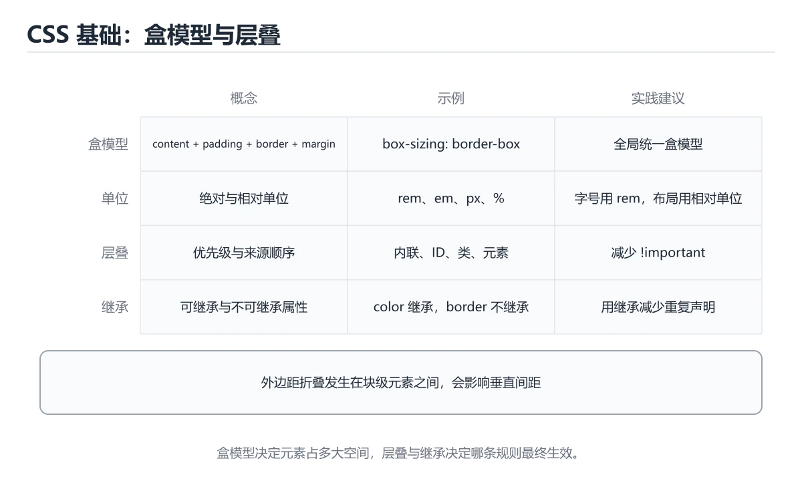
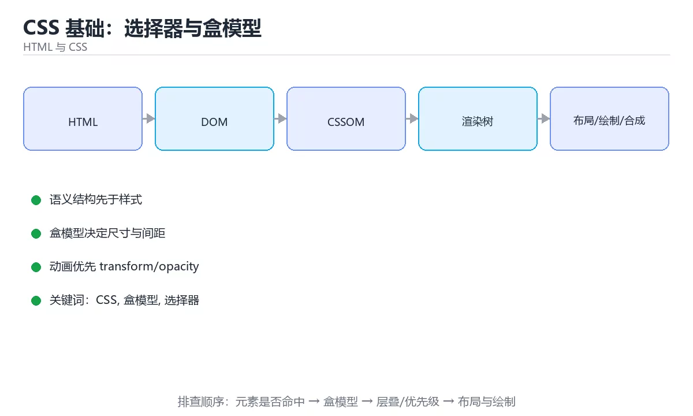

# CSS 基础：选择器与盒模型

> 内容更新时间：2026-10-06 · 学习阶段：入门 · 预计用时：35 分钟





## 本节知识框架

今天的目标很简单：**搞懂 CSS 怎么找到元素、怎么计算大小、怎么决定哪条样式生效。**

学完这一课，你会：
- 知道 CSS 是什么、选择器怎么定位元素
- 理解盒模型的四层结构：内容、内边距、边框、外边距
- 会用常见的 CSS 单位（px、rem、em、%、vw/vh）
- 搞清层叠和继承的规则，不再怕"样式不生效"

**先修与衔接**：本课是「HTML 与 CSS」分类的第 3 课。先修内容：《HTML 基础与语义化》。下一课：《CSS 布局：Flex、Grid 与响应式》。

### 复习清单

- [ ] 能说出盒模型的四层结构，并解释 `box-sizing: border-box` 的作用
- [ ] 能区分 `rem`、`em`、`px`、`vw/vh` 各自相对什么计算
- [ ] 能计算两个选择器的特异性，判断哪条规则最终生效

## 核心概念定义

先认识几个核心名词，后面每一课都会用到：

| 术语 | 一句话说明 |
| --- | --- |
| CSS | 层叠样式表，用来告诉浏览器"元素长什么样"——颜色、大小、位置、排列方式全靠它。 |
| 选择器 | 一种表达式，用来"找到"页面上的 HTML 元素，然后给它加样式。比如 `.card` 找到所有 class 为 card 的元素。 |
| 盒模型 | 每个 HTML 元素都被当作一个矩形盒子，由内容（content）、内边距（padding）、边框（border）、外边距（margin）四层组成。 |
| 层叠 | 当多条 CSS 规则同时作用于一个元素时，浏览器根据来源、特异性和书写顺序来决定哪条规则最终生效。 |
| 特异性 | 选择器的"权重值"，用 (a, b, c) 表示。ID 数量越多权重越高，类名越多权重越高，相同时后写的赢。 |
| 继承 | 某些 CSS 属性（如 color、font-size）会自动从父元素传给子元素；而 width、margin 这类属性不会继承。 |

## 原理与运行机制

### CSS 是怎么工作的

```text
浏览器拿到 HTML
    ↓
把每个标签变成 DOM 节点（一棵树）
    ↓
读取 CSS，用选择器匹配节点
    ↓
按层叠规则决定每个节点最终样式
    ↓
用盒模型计算大小和位置，画到屏幕上
```

整个过程就像装修房子：HTML 是毛坯房的格局，CSS 是装修方案，浏览器是施工队。选择器告诉施工队"哪个房间刷什么颜色"，盒模型告诉它"这面墙占多大地方"。

### 引入方式与优先级

CSS 有三种写法，优先级从高到低：

1. **行内样式**（写在 `style` 属性里）—— 优先级最高，但不推荐大量使用
2. **内部样式表**（写在 `<style>` 标签里）
3. **外部样式表**（用 `<link>` 引入 `.css` 文件）—— 最推荐，方便维护和复用

实际项目中，我们几乎都用外部样式表，配合类选择器来写样式。

### 选择器：怎么精准找到元素

| 选择器类型 | 示例 | 说明 |
| --- | --- | --- |
| 类选择器 | `.card` | 最常用，找到 class="card" 的元素 |
| ID 选择器 | `#app` | 找到 id="app" 的唯一元素，权重很高 |
| 属性选择器 | `input[type="text"]` | 找到有特定属性的元素 |
| 伪类 | `:hover`、`:focus-visible` | 元素处于某种状态时匹配 |
| 伪元素 | `::before`、`::after` | 在元素内容前后插入虚拟元素 |
| 后代组合 | `.card .title` | 找到 .card 内部所有的 .title |
| 子代组合 | `.card > .title` | 只找 .card 的直接子元素 .title |

**实践建议**：日常写样式，优先用类选择器（`.card`），保持特异性扁平。避免用 ID 选择器和多层嵌套，否则后面想覆盖样式时会被迫用 `!important`。

### 选择器特异性怎么算

特异性用四位数字 (a, b, c, d) 表示：

| 选择器 | 特异性 | 说明 |
| --- | --- | --- |
| 行内样式 `style=""` | 1,0,0,0 | 最高（除了 `!important`） |
| `#id` | 0,1,0,0 | ID 选择器，尽量少用 |
| `.class`、`[attr]`、`:hover` | 0,0,1,0 | 日常主力 |
| `div`、`::before` | 0,0,0,1 | 标签和伪元素，权重低 |
| `*`、组合器 | 0,0,0,0 | 没有特异性 |

逐位比较，大者胜。比如 `#app .card`（1,1,0）一定赢 `.page .card`（0,2,0），因为第一位 1 > 0。

### 盒模型：每个元素都是一个盒子

```text
┌─────────────────────────────── margin ──────────────────────────────┐
│  ┌──────────────────────── border ────────────────────────────┐    │
│  │  ┌──────────────── padding ────────────────────────┐       │    │
│  │  │  ┌──────────── content ──────────────┐          │       │    │
│  │  │  │                                   │          │       │    │
│  │  │  │         你写的文字、图片           │          │       │    │
│  │  │  │                                   │          │       │    │
│  │  │  └───────────────────────────────────┘          │       │    │
│  │  └─────────────────────────────────────────────────┘       │    │
│  └────────────────────────────────────────────────────────────┘    │
└────────────────────────────────────────────────────────────────────┘
```

- **content**：元素的实际内容区域，你设置的 `width` 和 `height` 默认就是控制它
- **padding**：内容和边框之间的空间，背景色会延伸到 padding 区域
- **border**：元素的边框线
- **margin**：元素和其他元素之间的外部空间

### 两种盒模型计算方式

**content-box（默认）**：`width` 只管内容宽度。如果你设了 `width: 200px; padding: 20px; border: 2px solid;`，实际占据的宽度 = 200 + 20×2 + 2×2 = **244px**。这就是为什么经常"宽度超出预期"。

**border-box（推荐）**：`width` 包含 padding 和 border。设了 `width: 200px`，不管 padding 和 border 是多少，总宽度就是 **200px**。浏览器会自动缩小内容区域来腾出空间。

```css
/* 全局开启 border-box，一劳永逸 */
*,
*::before,
*::after {
  box-sizing: border-box;
}
```

### 单位：量度 CSS 的尺子

| 单位 | 类型 | 说明 |
| --- | --- | --- |
| `px` | 绝对 | 像素，最基础的单位。缺点是用户放大字号时无效 |
| `rem` | 相对 | 相对根元素（`<html>`）的字号。推荐用于字号和间距 |
| `em` | 相对 | 相对当前元素的字号。嵌套时会累乘，容易失控 |
| `%` | 相对 | 相对父元素的对应尺寸 |
| `vw` / `vh` | 相对 | 相对视口宽度/高度的 1%。注意移动端地址栏会导致 vh 跳动 |
| `ch` | 相对 | 相对当前字体中"0"字符的宽度，适合控制文本行宽 |

**经验法则**：字号和间距用 `rem`；行高用无单位数值（如 `line-height: 1.5`）；视口相关尺寸用 `vw/vh` 或 `dvh`；只有边框和发丝线用 `px`。

### 层叠与继承

当多条规则冲突时，浏览器按这个顺序决定谁赢：

1. **来源与重要性**：用户 `!important` > 作者 `!important` > 普通规则
2. **层（`@layer`）**：后声明的层优先
3. **特异性**：高者优先
4. **出现顺序**：同特异性时后出现的赢

可继承的属性（`color`、`font-*`、`line-height`、`visibility`）会自动传给子元素；不可继承的属性（`width`、`margin`、`padding`、`border`）不会。

## 典型应用场景

- **页面布局**：用盒模型控制每个元素的大小和间距，配合 Flex 或 Grid 排列
- **主题切换**：用 CSS 变量集中管理颜色、间距、圆角，一键切换亮色/暗色
- **响应式设计**：用 `rem`、`vw/vh`、`clamp()` 让字号和布局随屏幕自适应
- **表单美化**：用选择器精准定位输入框、按钮的不同状态（`:focus`、`:hover`、`:disabled`）
- **无障碍优化**：用 `:focus-visible` 让键盘用户看到焦点样式，鼠标用户不受干扰

### 一个实际的小例子

假设你要做一个卡片组件：

```css
.card {
  width: 300px;
  padding: 16px;
  border: 1px solid #e5e7eb;
  border-radius: 8px;
  margin-bottom: 16px;
}
```

如果全局设了 `box-sizing: border-box`，这张卡片的总宽度就是 300px（包含 padding 和 border）。否则总宽度会变成 300 + 16×2 + 1×2 = **334px**，可能超出你设计的列宽。

## 代码/协议/SQL 示例

### 最小可验证示例

```css
*, *::before, *::after { box-sizing: border-box; }
```

### 完整示例：现代 CSS 基础重置

```css
/* 现代基础重置：统一盒模型并尊重系统字号 */
*,
*::before,
*::after {
  box-sizing: border-box;
}

html {
  font-size: 100%;          /* 尊重用户浏览器设置 */
  line-height: 1.5;
  -webkit-text-size-adjust: 100%;
}

body {
  margin: 0;
  font-family: system-ui, -apple-system, "Segoe UI", sans-serif;
  color: #1f2937;
  background: #ffffff;
}

img,
svg,
video {
  max-width: 100%;
  height: auto;
  display: block;
}

/* 用 clamp 做流体排版，避免正文字号随视口无限放大 */
article {
  max-width: 68ch;
  margin-inline: auto;
  padding-inline: clamp(1rem, 4vw, 2.5rem);
}

h1 {
  font-size: clamp(1.75rem, 1.2rem + 2vw, 2.75rem);
  line-height: 1.25;
}

/* 焦点可见：鼠标点击不显示，键盘操作必须显示 */
button:focus-visible,
a:focus-visible {
  outline: 2px solid #2563eb;
  outline-offset: 2px;
}
```

逐行解释：

- `box-sizing: border-box`：让 width 包含 padding 和 border，避免宽度意外膨胀
- `font-size: 100%`：不强制覆盖用户的浏览器字号设置，对无障碍友好
- `"Segoe UI"`：Windows 系统字体，放在 `font-family` 里作为兜底
- `clamp(1rem, 4vw, 2.5rem)`：流体间距，最小 1rem、理想 4vw、最大 2.5rem
- `:focus-visible`：只在键盘导航时显示焦点轮廓，鼠标点击时不显示

### 对应的 HTML 结构

```html
<!DOCTYPE html>
<html lang="zh-CN">
<head>
  <meta charset="utf-8">
  <meta name="viewport" content="width=device-width, initial-scale=1">
  <title>CSS 基础示例</title>
  <link rel="stylesheet" href="style.css">
</head>
<body>
  <article>
    <h1>你好，CSS</h1>
    <p>这是一个使用盒模型和流体排版的示例页面。</p>
    <button>点击试试</button>
  </article>
</body>
</html>
```

### 动手练一练

- 把 `box-sizing: border-box` 那三行注释掉，观察卡片宽度是否变化
- 把 `font-size: 100%` 改成 `font-size: 62.5%`，看看 rem 的值怎么变——然后在浏览器里放大字号，确认是否生效
- 给 `.card` 加一个 `margin-top: 20px`，再给相邻的下一个元素加 `margin-bottom: 20px`，观察垂直方向是否出现 40px 的间距（提示：会发生 margin 塌陷）

## 时间/空间复杂度或性能分析

CSS 本身不涉及算法复杂度，但写得不好会影响页面性能：

- **选择器越简单越好**：浏览器从右向左匹配选择器。`.page .card .title` 比 `.title` 慢，因为浏览器要先找所有 `.title`，再检查祖先。不过现代浏览器已经非常快，日常写两三层嵌套完全不用担心。
- **避免频繁触发重排**：修改 `width`、`height`、`margin` 等属性会让浏览器重新计算布局（重排），比只改 `color`、`opacity`（只需重绘）更耗时。动画优先用 `transform` 和 `opacity`。
- **CSS 文件体积**：把不需要的样式删掉，用工具压缩（minify）。首屏加载的 CSS 越多，页面白屏时间越长。
- **`@layer` 和 `@container`**：现代特性会增加浏览器的解析负担，但在合理规模下影响可以忽略。

记住一句话：**先让样式写对，再让它跑快。** 遇到性能问题时用 DevTools 的 Performance 面板实测，不要凭感觉优化。

## 常见误区与易错点

| 错误 | 现象 | 修法 |
| --- | --- | --- |
| 不设 `box-sizing` | 宽度计算总是超出预期，加了 padding 后元素变宽 | 全局设 `border-box` |
| 用 `!important` 解决覆盖 | 特异性战争，越加越多，最后谁也覆盖不了谁 | 降低特异性或用 `@layer` |
| 用 `px` 设所有字号 | 用户在浏览器里放大字号无效，影响可访问性 | 用 `rem` 与系统字号 |
| 给 `html` 设固定 `font-size: 62.5%` | 影响可访问性，覆盖用户偏好 | 用 `100%` 并按需换算 |
| 用 `em` 层层嵌套 | 字号被累乘放大，嵌套越深越大 | 改用 `rem` |
| 忘记移动端图片自适应 | 图片溢出容器，出现横向滚动条 | 全局 `max-width: 100%` |
| 用 `height: 100vh` 做移动端满屏 | 地址栏收缩/展开导致页面跳动 | 用 `100dvh` 或 `min-height` |
| 去掉 `outline` | 键盘用户看不到焦点在哪，无法操作 | 用 `:focus-visible` 自定义焦点样式 |
| 依赖元素选择器如 `div > p` | HTML 结构一变，全站样式崩 | 用类名 `.card-text` |
| 内联样式写业务样式 | 无法复用、无法覆盖、无法缓存 | 交给外部样式表和类选择器 |

### margin 塌陷：垂直间距没有你想象的那么大

相邻的两个块级元素，上面的 `margin-bottom: 20px` 和下面的 `margin-top: 30px` 不会叠加成 50px，而是合并成 **30px**（取较大值）。这不是 bug，是 CSS 的设计。如果想避免，可以给父元素加 `overflow: hidden`，或者用 padding 代替 margin。

## 与其他知识点的关系

本课学到的东西会被后面每一课反复用到：

- **下一课《CSS 布局：Flex、Grid 与响应式》**：Flex 和 Grid 都是在盒模型基础上排列元素。不理解盒模型，就搞不清 Flex 子项为什么会被压缩。
- **《CSS 进阶：变量、伪类与现代特性》**：CSS 变量、`@layer`、容器查询等现代特性，都建立在选择器和层叠规则之上。
- **《HTML 基础与语义化》**：本课的前修。语义化标签决定了选择器怎么写——`<nav>` 比 `<div class="nav">` 更简洁。

最容易混淆的两组概念：
- **`rem` vs `em`**：`rem` 永远相对根元素字号，不会累乘；`em` 相对当前元素字号，嵌套时会一层层放大。日常用 `rem` 更安全。
- **`content-box` vs `border-box`**：前者 width 只管内容，后者 width 包含 padding 和 border。推荐全局用 `border-box`。

## 自测题与参考答案

> 先独立作答，再对照答案。

### 自测 1

`box-sizing: border-box` 的作用是什么？

**答案**：让 `width` 和 `height` 包含 padding 和 border。设了 `width: 200px` 后，不管 padding 和 border 是多少，元素总宽度就是 200px，浏览器自动缩小内容区域。

### 自测 2

`rem` 相对什么计算？

**答案**：相对根元素（`<html>`）的字号。如果 `<html>` 的 `font-size` 是 16px，那么 `1rem = 16px`，`1.5rem = 24px`。

### 自测 3

`.card .title` 和 `#app .card` 哪个特异性更高？

**答案**：`#app .card`（1,1,0）更高。因为 ID 选择器贡献了第一位的 1，而 `.card .title`（0,2,0）第一位是 0。逐位比较，1 > 0，所以 `#app .card` 赢。

### 自测 4

`margin: 10px 20px` 表示什么？

**答案**：上下 10px、左右 20px。两个值的简写规则是：第一个值管上下，第二个值管左右。

### 自测 5

下面哪组属性默认会被子元素继承？

**答案**：`color`、`font-size`。可继承的属性主要是文本相关的：颜色、字号、字体、行高。而 `width`、`margin`、`padding`、`border` 不会继承。

## 考点精讲

`CSS 基础：选择器与盒模型` 的题库有 6 道题，下面逐题给出题干、正确项与判断依据：先自己作答，再核对正确项，最后回到正文对应小节复核。

### 考点 1：第 1 题

- **题目**：围绕“CSS 基础：选择器与盒模型”中的 CSS、盒模型、选择器，下列哪两项是本课强调的实践判断？ A. 把 盒模型 的单次运行结果当成所有版本和规模都成立 B. 学习 CSS 时要同时说明输入、输出和失败路径，不能只看正常流程 C. 只要 CSS 的常规示例通过，就可以跳过边界与异常路径 D. 验证 盒模型 时要固定版本并覆盖边界输入，结论才可复现 Ans: BD
- **正确项**：BD
- **判断依据**：这道题检验你是否理解学习 CSS 不能只看"正常情况"。B 强调要同时关注输入、输出和失败路径——比如不设 `box-sizing` 时会发生什么；D 强调验证盒模型时要固定浏览器版本并覆盖边界输入（如极窄视口、超大字号），结论才可复现。A 和 C 都是常见的学习误区。

### 考点 2：第 2 题

- **题目**：rem 相对什么计算？ A. 根元素字号 B. 视口宽度 C. 自身字号 D. 父元素字号 Ans: A
- **正确项**：A
- **判断依据**：`rem` 是 root em 的缩写，永远相对根元素（`<html>`）的字号计算。如果 `<html>` 的 `font-size` 是 16px，那么 `1rem = 16px`。相对父元素字号的是 `em`，相对视口宽度的是 `vw`。

### 考点 3：第 3 题

- **题目**：阅读 `CSS 基础：选择器与盒模型` 的 `CSS` 示例。它服务于选择器与特异性、盒模型、单位与层叠继承。代码中实际包含下列哪一项？ A. 出现字面量 `Segoe UI` B. 出现字面量 `{user_id}:{request_id}` C. 出现字面量 `$WORK_DIR` D. 出现字面量 `不及格` Ans: A
- **正确项**：A
- **判断依据**：在完整示例的 `body` 规则中，`font-family` 属性包含了 `"Segoe UI"`，这是 Windows 系统字体。其他三个选项（`{user_id}:{request_id}`、`$WORK_DIR`、`不及格`）都不在本课 CSS 示例中出现。

### 考点 4：第 4 题

- **题目**：margin: 10px 20px 表示？ A. 左右 10px、上下 20px B. 四边都是 15px C. 上下 10px、左右 20px D. 上 10px、左右 20px、下 0 Ans: C
- **正确项**：C
- **判断依据**：`margin` 给两个值时，第一个值管上下，第二个值管左右。所以 `10px 20px` = 上下 10px、左右 20px。记忆技巧：想象成"水平方向（左右）的值写在后面"。

### 考点 5：第 5 题

- **题目**：下面哪组属性默认会被子元素继承？ A. width、height B. color、font-size C. margin、padding D. border、background Ans: B
- **正确项**：B
- **判断依据**：CSS 中可继承的属性主要是文本相关的：`color`、`font-size`、`font-family`、`line-height`、`visibility` 等。布局相关属性（`width`、`margin`、`padding`、`border`、`background`）默认不继承，需要显式设置。

### 考点 6：第 6 题

- **题目**：下面几项都与 `CSS` 有关，请按 `CSS 基础：选择器与盒模型` 的正文顺序排列；该课主线是选择器与特异性、盒模型、单位与层叠继承。 A. 引入方式与优先级 B. 选择器 C. 盒模型 D. 单位与颜色 Ans: ABCD
- **正确项**：ABCD
- **判断依据**：按正文讲解顺序：先介绍 CSS 的引入方式与优先级（怎么把 CSS 加到页面），再讲选择器（怎么找到元素），接着讲盒模型（元素占多大地方），最后讲单位与颜色（怎么量化尺寸和设置颜色）。这个顺序是从"怎么加样式"到"加给谁"到"占多大"到"怎么量"的递进。

## 术语速查

| 术语 | 一句话说明 |
| --- | --- |
| `CSS` | 层叠样式表，控制网页元素的颜色、大小、位置 |
| `选择器` | 用来匹配 HTML 元素的表达式，决定样式加给谁 |
| `盒模型` | 每个元素 = 内容 + padding + border + margin 四层 |
| `层叠` | 多条规则冲突时，按来源、特异性和顺序决定谁生效 |
| `特异性` | 选择器的权重值 (a,b,c,d)，逐位比较，大者胜 |
| `rem` | 相对根元素字号的单位，推荐用于字号和间距 |
| `em` | 相对当前元素字号的单位，嵌套时会累乘 |
| `border-box` | 让 width 包含 padding 和 border 的盒模型模式 |

## 内容元数据

- 内容版本：v2.0
- 最后更新：2026-10-06
- 学习阶段：入门
- 适用环境：现代浏览器（Chrome/Firefox/Safari/Edge）；本课聚焦 CSS 选择器、盒模型、单位与层叠。
- 内容来源：内置结构化课程与工程实践整理
- 相关主题：CSS、盒模型、选择器、层叠、单位

## 参考资料与复核

- [本课资料锚点 css_basics](https://zh.wikipedia.org/w/index.php?search=css_basics)

- 最后复核：2026-10-04
- 下次复核：2027-08-17

| 参考资料 | 本课用途 |
| --- | --- |
| [MDN CSS 参考文档](https://developer.mozilla.org/docs/Web/CSS) | CSS 属性、选择器和盒模型的权威参考 |
| [MDN CSS 选择器](https://developer.mozilla.org/docs/Web/CSS/CSS_selectors) | 选择器语法和特异性计算详解 |
| [CSS Tricks: Box Sizing](https://css-tricks.com/box-sizing/) | box-sizing 的实用指南和浏览器兼容说明 |
| [W3C CSS Cascading and Inheritance](https://www.w3.org/TR/css-cascade-5/) | 层叠与继承的官方规范 |
