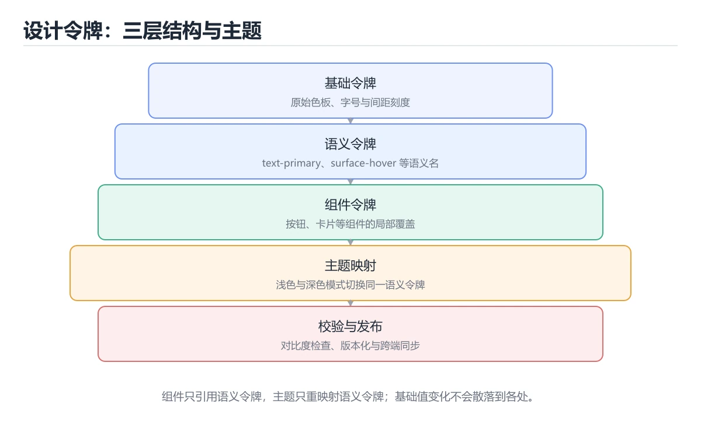
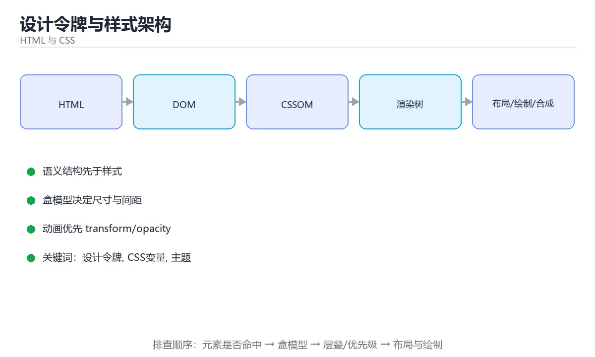

# 设计令牌与样式架构

> 内容更新时间：2026-10-06 · 学习阶段：进阶 · 预计用时：30 分钟





## 本节知识框架

**课程定位**：所属分类 `html_css`（HTML 与 CSS），课程主题 `设计令牌与样式架构`，学习阶段 advanced，建议用时 45 分钟。

本课主线：令牌三层结构、命名约定与对比度自动校验。

**学完本课应当能够**
- 说清什么是设计令牌，为什么不能直接在组件里写死颜色值
- 理解原始令牌、语义令牌、组件令牌这三层各自负责什么
- 遇到换主题要改几十个文件的问题时，知道怎么用语义层映射来解决

### 复习清单

- [ ] 能不看正文说出原始令牌、语义令牌、组件令牌分别是什么
- [ ] 能解释为什么深色模式只需要改语义层的映射，不用动组件代码
- [ ] 能完成一次自测，并把错题对照错误表定位原因

## 核心概念定义

| 术语 | 一句话说明 |
| --- | --- |
| 设计令牌 | 把颜色、间距、字体等设计决策命名为可复用变量的系统 |
| 原始令牌 | 与业务无关的基础色阶和尺寸刻度，只描述可用的原子值 |
| 语义令牌 | 表达用途的令牌，如主色或表面色，主题切换时映射到不同原始令牌 |
| 组件令牌 | 只服务某个组件内部结构的变量，如按钮内边距或卡片圆角 |

## 原理与运行机制

### 为什么要用设计令牌

想象一下这个场景：你的产品突然要换个品牌色，从蓝色改成紫色。如果每个组件的 CSS 文件里都直接写了 #3b82f6 这样的颜色值，你得打开几十个文件逐个替换，不仅麻烦还容易漏掉。

设计令牌就是为了解决这个问题。它把颜色、间距、字号这些设计决策抽成命名变量，让设计和代码共享同一套事实来源。改一处，全站一致，还能被工具自动校验。

### 三层令牌怎么分工

设计令牌分成三层，每层有明确的职责：

**第一层：原始令牌（Raw Tokens）**

这是最基础的调色板和尺寸刻度，跟具体业务没关系。比如：

```css
:root {
  --blue-500: #3b82f6;
  --blue-600: #2563eb;
  --gray-100: #f1f5f9;
  --gray-900: #0f172a;
  --white: #ffffff;
  --space-4: 1rem;
  --radius-md: 8px;
}
```

原始令牌就像颜料盒里的各种颜色，告诉你有哪些可用，但不告诉你在哪里用。

**第二层：语义令牌（Semantic Tokens）**

这一层表达用途，比如哪个颜色是主色、哪个是背景色。切换主题时，只需要改这一层的映射：

```css
:root {
  --color-primary: var(--blue-600);
  --color-surface: var(--white);
  --color-text: var(--gray-900);
}

@media (prefers-color-scheme: dark) {
  :root {
    --color-surface: #0b1220;
    --color-text: #e5e7eb;
  }
}
```

注意看，深色模式下我们只改了语义层的映射，组件代码完全不用动。这就是语义层的价值。

**第三层：组件令牌（Component Tokens）**

这一层只服务某个组件的内部结构，比如按钮的内边距、卡片的圆角：

```css
.btn {
  --button-padding-x: var(--space-4);
  --button-padding-y: var(--space-2);

  padding: var(--button-padding-y) var(--button-padding-x);
  border-radius: var(--radius-md);
  background: var(--color-primary);
  color: var(--white);
}
```

组件只引用语义令牌，不直接碰原始令牌。这样换肤时只需要改语义层那一处映射。

### var() 的取值链与兜底

映射之所以能生效，靠的是自定义属性的继承规则：浏览器先看当前元素声明过没有，没有就沿祖先链往上找，最后落到 :root，整条链都没命中才会用 var() 的第二个参数兜底。

```css
.btn {
  background: var(--color-primary, var(--brand-default, #2563eb));
}
```

一个常见的坑：未注册的自定义属性接受任意 token 序列，所以 --color-primary: 20px 这种写错的值不会触发兜底。浏览器把 20px 代入后判定整条 background 无效，最终按初始值算成透明，而不是回退到 #2563eb。排查「变量写了却不生效」时，先确认属性有没有注册。

```css
@property --radius-scale {
  syntax: "<number>";
  initial-value: 1;
  inherits: true;
}
```

注册后令牌就有了类型与初始值，没声明时按 initial-value 计算，还能参与动画插值；没注册的自定义属性只能在离散值之间跳变，做过渡时要格外注意。

### 命名约定速查

好的命名能让别人一眼看懂变量的用途：

| 类别 | 命名模式 | 示例 |
| --- | --- | --- |
| 颜色 | --color-{用途} | --color-danger |
| 背景 | --color-surface / --color-bg | --color-bg-raised |
| 间距 | --space-{刻度} | --space-4 |
| 字号 | --font-size-{尺寸} | --font-size-lg |
| 圆角 | --radius-{尺寸} | --radius-md |
| 层级 | --z-{用途} | --z-modal、--z-toast |
| 动效 | --duration-{速度} / --ease-{类型} | --duration-fast |

关键原则：**按用途命名，不要按外观命名**。比如用 --color-primary 而不是 --blue，这样换品牌色后名字不会失去意义。

### 与设计工具协作

设计侧用 Figma 等工具维护一套颜色值，代码侧如果也单独维护一套，时间一长两边就会不一致。正确的做法是共享同一份令牌 JSON 文件，构建时自动生成 CSS 变量和多端常量（Flutter、Android、iOS 都能用），确保设计和代码始终同步。

### 对比度自动校验

深色模式下文字看不清？这是因为前景色和背景色的对比度不够。WCAG 标准要求正文对比度至少达到 4.5:1，大字号至少 3:1。可以用工具自动检查：

```python
def validate_contrast(foreground: str, background: str) -> float:
    """对比度检查：正文需达到 4.5:1，大字号需 3:1。"""
    def luminance(hex_color: str) -> float:
        raw = hex_color.lstrip("#")
        channels = [int(raw[i:i + 2], 16) / 255 for i in (0, 2, 4)]
        adjusted = [(c / 12.92 if c <= 0.03928 else ((c + 0.055) / 1.055) ** 2.4)
                    for c in channels]
        return 0.2126 * adjusted[0] + 0.7152 * adjusted[1] + 0.0722 * adjusted[2]

    l1, l2 = luminance(foreground), luminance(background)
    lighter, darker = max(l1, l2), min(l1, l2)
    return round((lighter + 0.05) / (darker + 0.05), 2)

print(validate_contrast("#0f172a", "#ffffff"))  # 深色文字在白色背景上
print(validate_contrast("#94a3b8", "#ffffff"))  # 浅灰色文字在白色背景上
```

运行结果会显示对比度数值，低于标准的组合需要调整颜色。

## 典型应用场景

### 场景 1：组件里写死颜色值

**现象**：换主题要改几十个文件，每个文件都要搜索替换颜色值。

**正确做法**：组件只引用语义令牌，比如 background: var(--color-primary)，而不是 background: #3b82f6。

### 场景 2：只有原始令牌没有语义层

**现象**：深色模式下要逐条覆盖每个颜色变量，工作量巨大。

**正确做法**：增加语义层做映射，深色模式只改语义层的映射关系。

### 场景 3：令牌命名按外观

**现象**：用了 --blue 这种名字，换品牌色成紫色后，名字就失去意义了。

**正确做法**：按用途命名，用 --color-primary 这种表达意图的名字。

### 场景 4：令牌层级混用

**现象**：组件直接引用原始令牌，比如 background: var(--blue-600)，导致换肤时要改组件代码。

**正确做法**：约定组件只引用语义令牌，语义令牌再引用原始令牌。

### 场景 5：设计侧与代码侧各维护一套

**现象**：设计师改了 Figma 里的颜色，但代码没跟上，上线后颜色和稿子对不上。

**正确做法**：共享令牌 JSON 并自动生成，确保两边始终一致。

### 场景 6：忘记对比度校验

**现象**：深色模式下文字看不清，用户抱怨可读性差。

**正确做法**：自动化检查对比度，构建时拦截不达标的颜色组合。

### 场景 7：令牌数量爆炸

**现象**：定义了上百个颜色变量，没人知道该用哪个。

**正确做法**：保持刻度收敛，定期合并相近的值，比如 space 只用 4、8、16、24、32 这几个档位。

## 代码/协议/SQL 示例

下面是一个完整的最小可验证示例，展示三层令牌如何配合工作：

```css
:root {
  /* 1. 原始令牌：完整色阶与刻度 */
  --blue-500: #3b82f6;
  --blue-600: #2563eb;
  --gray-100: #f1f5f9;
  --gray-900: #0f172a;
  --white: #ffffff;

  --space-1: 0.25rem;
  --space-2: 0.5rem;
  --space-4: 1rem;
  --space-6: 1.5rem;

  --radius-sm: 4px;
  --radius-md: 8px;
  --font-size-sm: 0.875rem;
  --font-size-md: 1rem;
  --font-size-lg: 1.25rem;

  /* 2. 语义令牌：表达用途 */
  --color-primary: var(--blue-600);
  --color-primary-hover: var(--blue-500);
  --color-surface: var(--white);
  --color-text: var(--gray-900);
  --color-muted: var(--gray-100);
  --space-inline: var(--space-4);
}

@media (prefers-color-scheme: dark) {
  :root {
    /* 只改映射，不改组件 */
    --color-surface: #0b1220;
    --color-text: #e5e7eb;
    --color-muted: #1e293b;
  }
}

/* 3. 组件令牌：组件内部细节 */
.btn {
  --button-padding-x: var(--space-4);
  --button-padding-y: var(--space-2);

  display: inline-flex;
  gap: var(--space-2);
  padding: var(--button-padding-y) var(--button-padding-x);
  border-radius: var(--radius-md);
  background: var(--color-primary);
  color: var(--white);
  font-size: var(--font-size-md);
  transition: background 160ms ease;
}

.btn:hover {
  background: var(--color-primary-hover);
}
```

再看一个 Python 示例，展示如何从 JSON 令牌定义生成 CSS 变量：

```python
import json

TOKENS = {
    "color": {
        "primary": "#2563eb",
        "surface": "#ffffff",
        "text": "#0f172a",
    },
    "space": {"sm": "0.5rem", "md": "1rem", "lg": "1.5rem"},
    "radius": {"sm": "4px", "md": "8px"},
}

def flatten(prefix: str, node: dict) -> list:
    """把嵌套令牌拍平成 CSS 变量列表，便于生成样式表。"""
    items = []
    for key, value in node.items():
        name = f"{prefix}-{key}" if prefix else key
        if isinstance(value, dict):
            items.extend(flatten(name, value))
        else:
            items.append((name, value))
    return items

def to_css(tokens: dict) -> str:
    lines = [":root {"]
    for name, value in flatten("", tokens):
        lines.append(f"  --{name}: {value};")
    lines.append("}")
    return "\n".join(lines)

print(to_css(TOKENS))
```

运行这段代码会输出：

```text
:root {
  --color-primary: #2563eb;
  --color-surface: #ffffff;
  --color-text: #0f172a;
  --space-sm: 0.5rem;
  --space-md: 1rem;
  --space-lg: 1.5rem;
  --radius-sm: 4px;
  --radius-md: 8px;
}
```

## 时间/空间复杂度或性能分析

使用 CSS 变量本身几乎没有性能开销。浏览器在解析样式时会查找变量引用，这个过程非常快。真正需要注意的是：

**首屏加载**：如果令牌定义太多，生成的 CSS 文件体积会变大。建议保持刻度收敛，只定义真正需要的值。

**重绘次数**：切换主题时，如果只是改变量值而不改动 DOM 结构，浏览器只需要重绘不需要重排，性能影响很小。

**维护成本**：令牌系统的最大收益不在运行时性能，而在开发效率。改一处颜色，全站生效，这才是核心价值。

## 常见误区与易错点

| 错误 | 现象 | 修法 |
| --- | --- | --- |
| 组件里写死颜色值 | 换主题要改几十个文件 | 组件只引用语义令牌 |
| 只有原始令牌没有语义层 | 深色模式要逐条覆盖 | 增加语义层做映射 |
| 令牌命名按外观（--blue） | 换品牌色后名字含义错乱 | 按用途命名（--color-primary） |
| 令牌层级混用 | 组件直接引用原始令牌 | 约定组件只引用语义令牌 |
| 设计侧与代码侧各维护一套 | 数值逐渐不一致 | 共享令牌 JSON 并自动生成 |
| 忘记对比度校验 | 深色模式下文字看不清 | 自动化检查对比度 |
| 令牌数量爆炸 | 无人知道该用哪个 | 保持刻度收敛，定期合并 |

## 与其他知识点的关系

| 关系 | 课程 | 为什么 |
| --- | --- | --- |
| 关联 | 《可访问性与 ARIA 实战》 | 对比度校验是可访问性的重要部分 |
| 前置顺序 | 《CSS 进阶：变量、伪类与现代特性》 | 需要先理解 CSS 变量的基本用法 |
| 后续顺序 | 《可访问性与 ARIA 实战》 | 会继续使用本课的对比度概念 |

设计令牌不是孤立的概念，它和可访问性、响应式设计、组件库建设都紧密相关。学好这一课，后面的内容会顺很多。

## 自测题与参考答案

> 先独立作答，再对照参考答案；答案都能在本课正文、术语表或错误表里找到依据。

### 自测 1（概念复述）

不看正文，写出设计令牌的操作性定义，并说明它与原始令牌的区别。

**参考答案**：设计令牌是把颜色、间距、字体等设计决策命名为可复用变量的系统。原始令牌是与业务无关的基础色阶和尺寸刻度，只描述可用的原子值。两者的差别在于：设计令牌是整个系统，原始令牌是系统里的第一层基础数据。

### 自测 2（排错）

本课错误表记录了「组件里写死颜色值」这类做法。请写出它会出现的现象、根因，以及修复顺序。

**参考答案**：现象是换主题要改几十个文件；根因是组件没有引用语义令牌，而是直接写了颜色值。修复时先把硬编码颜色改成引用语义令牌，比如把 background: #3b82f6 改成 background: var(--color-primary)。

### 自测 3（动手验证）

运行本课的 Python 示例，把其中的 "color" 换成一个边界值后重新运行，记录输出与错误信息。

**参考答案**：正常输入下 Python 示例应当生成正确的 CSS 变量列表；如果把颜色值换成无效格式（比如 "not-a-color"），生成的 CSS 虽然语法上没问题，但浏览器无法解析这个颜色，需要在构建时加入校验步骤。

### 自测 4（代码阅读）

阅读本课开头的 CSS 示例，说明它体现了设计令牌的哪一条性质，并指出改动哪个输入会让这条性质不再成立。

**参考答案**：示例体现了「组件只引用语义令牌」这条性质。如果把 .btn 里的 background: var(--color-primary) 改成 background: var(--blue-600)，就直接引用了原始令牌，换肤时就要改组件代码，破坏了分层原则。

### 自测 5（迁移）

把设计令牌的方法迁移到自己的项目：围绕「令牌命名按外观」写出一个风险点，并说明触发条件和检验方式。

**参考答案**：比如项目中用了 --red-500 表示错误色，后来品牌升级把错误色改成橙色，这时候 --red-500 这个名字就失去意义了。检验方式是检查所有颜色变量名是否按用途命名，比如应该叫 --color-error 而不是 --red-500。

### 自测 6（对比）

用一个表格对比原始令牌与语义令牌：各写一行适用场景、一行失败表现。

**参考答案**：原始令牌适用于定义基础调色板和尺寸刻度，失败表现是深色模式要逐条覆盖；语义令牌适用于表达用途并支持主题切换，失败表现是如果组件直接引用原始令牌，换主题还是要改组件代码。

## 考点精讲

1. 设计令牌分三层时，组件应该引用哪一层？ A. 任意一层都可以 B. 三层都不用，直接写死 C. 原始令牌，直接写色值最直观 D. 语义令牌 Ans: D
2. 深色模式在令牌体系里应该怎么实现？ A. 让用户手动改每个颜色 B. 用滤镜整体反色 C. 只改语义层的映射，组件代码不动 D. 每个组件写一套深色样式 Ans: C
3. 围绕“设计令牌与样式架构”中的 设计令牌、CSS变量、主题，下列哪两项是本课强调的实践判断？ A. 只要 设计令牌 的常规示例通过，就可以跳过边界与异常路径 B. 验证 CSS变量 时要固定版本并覆盖边界输入，结论才可复现 C. 把 CSS变量 的单次运行结果当成所有版本和规模都成立 D. 学习 设计令牌 时要同时说明输入、输出和失败路径，不能只看正常流程 Ans: BD
4. 阅读这段设计令牌定义，下面哪项判断是正确的？ A. 组件里直接写 #3b82f6 更好，引用变量只会让样式更难读 B. 三层令牌只是命名习惯，切换主题时仍要逐个组件替换颜色 C. 原始令牌提供取值，语义令牌表达用途，组件只消费语义令牌，换肤时只改一处映射 D. 语义令牌必须写在组件样式文件里，放在 :root 作用域会失效 Ans: C
5. 设计侧与代码侧各维护一套颜色值会带来什么问题？ A. 数值逐渐不一致 B. 会增加编译时间 C. 会让页面变慢 D. 没有影响 Ans: A
6. 填空：补齐下面这段术语说明中的空缺。课程 `令牌三层结构、命名约定与对比度自动校验。`，这段说明是：`____`：与业务无关的基础色阶和尺寸刻度，只描述可用的原始值。空缺处应填哪个术语？

## 术语速查

| 术语 | 一句话说明 |
| --- | --- |
| 设计令牌 | 把颜色、间距、字体等设计决策命名为可复用变量的系统 |
| 原始令牌 | 与业务无关的基础色阶和尺寸刻度，只描述可用的原子值 |
| 语义令牌 | 表达用途的令牌，如主色或表面色，主题切换时映射到不同原始令牌 |
| 组件令牌 | 只服务某个组件内部结构的变量，如按钮内边距或卡片圆角 |

## 内容元数据

- 内容版本：v2.0
- 最后更新：2026-10-06
- 学习阶段：进阶
- 适用环境：现代浏览器（Chrome/Firefox/Safari/Edge）
- 内容来源：内置结构化课程与工程实践整理
- 相关主题：设计令牌、CSS变量、主题、设计系统、对比度
- 质量版本：P0 测验标准 + P1 覆盖扩展 + P2 体验补全

## 参考资料与复核

- 最后复核：2026-10-04
- 下次复核：2027-08-17
- 复核范围：版本兼容、API 行为、安全建议与工程实践

| 参考资料 | 本课用途 |
| --- | --- |
| [MDN CSS Custom Properties](https://developer.mozilla.org/docs/Web/CSS/Using_CSS_custom_properties) | CSS 变量的定义和使用方法 |
| [Design Tokens Community Group](https://design-tokens.github.io/community-group/) | 设计令牌的标准和社区最佳实践 |
| [WCAG Contrast Requirements](https://www.w3.org/WAI/WCAG21/Understanding/contrast-minimum.html) | 对比度要求的官方标准 |
