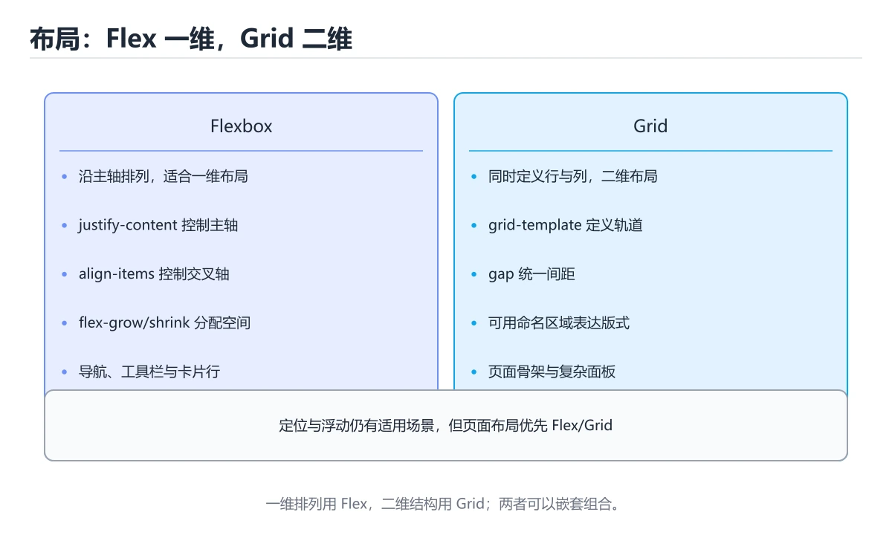
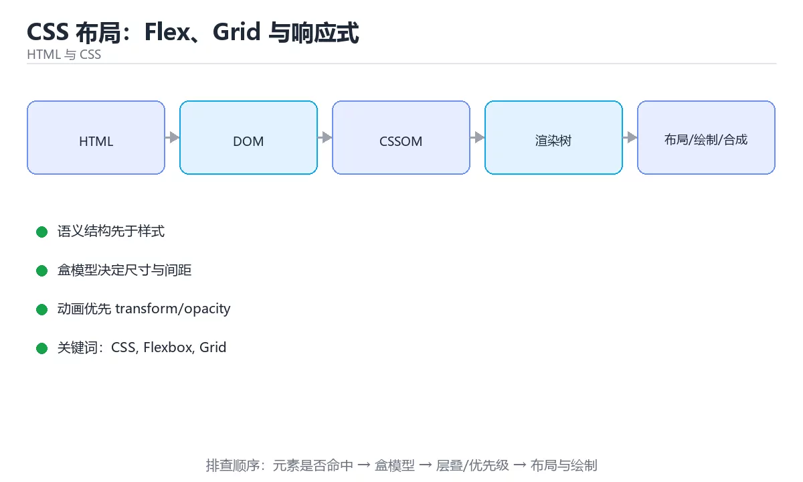

# CSS 布局：Flex、Grid 与响应式

> 内容更新时间：2026-10-06 · 学习阶段：入门 · 预计用时：40 分钟





## 本节知识框架

学 CSS 布局最头疼的事，就是元素放上去之后不听话——想让它居中偏了，想让它排成一排结果全挤在一起。这节课就是帮你解决这些问题的。

一句话概括本课主线：**一维用 Flex，二维用 Grid，悬浮用定位，适配用响应式**。

学完之后你会做到：
- 看到"导航栏、按钮组"这类需求，秒想到 Flexbox
- 看到"卡片墙、整页骨架"这类需求，秒想到 Grid
- 知道怎么用 `@media` 让页面在手机和大屏上都好看
- 遇到"子元素撑破父容器"这种经典坑，知道怎么排查

**复习清单**

- [ ] 能说出 Flexbox 和 Grid 各自适用的场景，并各举一个例子
- [ ] 能解释为什么 Flex 子项需要加 `min-width: 0` 才能正确收缩
- [ ] 能用 `outline: 1px solid red` 调试布局问题，并说出 outline 和 border 的区别

先修内容：《CSS 基础：选择器与盒模型》。如果你还不太清楚 `display`、`margin`、`padding` 是什么，建议先去补一下。后续衔接：《浏览器渲染与 CSS 动画》。

## 核心概念定义

别被术语吓到，其实就四个东西：

| 术语 | 大白话解释 | 什么时候会踩坑 |
| --- | --- | --- |
| CSS 布局 | 就是决定页面上元素怎么摆放的规则。一维用 Flex、二维用 Grid、悬浮用定位、适配用响应式，配合 gap 和 CSS 变量，现代 CSS 已经很少需要 hack 了。 | 不同浏览器对某些属性的支持程度不一样，要在真实浏览器里验证才算数。 |
| Flexbox | CSS 的一维布局工具。想象一条线（横的或竖的），Flex 帮你把线上的元素排列整齐、分配空间。 | 子元素内容太长会撑破容器，需要加 `min-width: 0` 才能正确收缩。 |
| Grid | CSS 的二维布局工具。想象一个表格，你可以精确控制行和列。 | 如果子元素用了 float 又没清除，会导致高度塌陷。用 Grid 或 Flex 替代 float 就行。 |
| 定位 | 让元素脱离正常文档流，精确地放在你想要的位置。 | `z-index` 只对定位元素生效；父级若用 `transform` 或 `opacity` 创建了层叠上下文，子级的 `z-index` 就跑不出去。 |

## 原理与运行机制

### Flexbox：一维布局的好帮手

导航栏、按钮组、工具栏……这些场景有个共同特点：元素只需要沿着一个方向排列（横着或竖着）。这就是 Flexbox 的主场。

用起来很简单，给父容器加一句 `display: flex`，里面的子元素就自动排成一行了。然后通过几个属性微调：

| 属性 | 干什么用的 |
| --- | --- |
| `display: flex` | 开启弹性布局，子元素自动排成一行 |
| `flex-direction` | 决定主轴方向——`row` 是横排，`column` 是竖排 |
| `justify-content` | 主轴上怎么对齐。`center` 居中，`space-between` 两端对齐 |
| `align-items` | 交叉轴上怎么对齐 |
| `flex: 1` | 让子元素按比例瓜分剩余空间 |
| `gap` | 设置子元素之间的间距，不用再给每个元素加 margin 了 |

举个例子，导航栏左边是标题、右边是按钮，中间自动撑开：

```css
.toolbar {
  display: flex;
  align-items: center;
  gap: 0.75rem;
}

.toolbar .title {
  flex: 1;
  min-width: 0;
  overflow: hidden;
  text-overflow: ellipsis;
  white-space: nowrap;
}
```

这里有个关键细节：`min-width: 0`。Flex 子元素默认 `min-width: auto`，意味着它不会被压缩到比内容还小。如果标题文字特别长，就会把容器撑破。加上 `min-width: 0` 之后，文字就能正常截断了。

### Grid：二维布局的大杀器

当你需要同时控制行和列的时候，Flex 就不够用了。比如你想做一个卡片墙，或者整个页面的骨架（侧栏 + 主内容），这时候该上 Grid 了。

Grid 最厉害的一行代码：

```css
.cards {
  display: grid;
  gap: 1rem;
  grid-template-columns: repeat(auto-fit, minmax(240px, 1fr));
}
```

这一行就实现了：卡片最少 240px 宽，容器能放几列就放几列，放不下就自动换行。不需要写任何媒体查询。

再比如侧栏 + 主内容的经典布局：

```css
.layout {
  display: grid;
  gap: 1.5rem;
  grid-template-columns: 1fr;
}

@media (min-width: 900px) {
  .layout {
    grid-template-columns: minmax(220px, 280px) 1fr;
    align-items: start;
  }
}
```

小屏时单列堆叠，大屏时左边侧栏、右边主内容。`minmax(220px, 280px)` 让侧栏宽度在 220 到 280 之间弹性变化。

### 定位与层叠上下文

有些元素需要"浮"在其他元素上面——比如悬浮按钮、角标、吸顶导航。这时候就该用 `position` 属性了。

| 值 | 参照物 | 典型用途 |
| --- | --- | --- |
| `static` | 正常流 | 默认值，元素待在原位 |
| `relative` | 自身原来的位置 | 微调位置，或者给子元素的 `absolute` 当参照物 |
| `absolute` | 最近的非 static 祖先 | 角标、下拉菜单 |
| `fixed` | 浏览器视口 | 悬浮按钮、回到顶部 |
| `sticky` | 最近的滚动容器 | 吸顶导航栏 |

```css
.toolbar {
  position: sticky;
  top: 0;
  z-index: 10;
  background: #ffffff;
}

.badge {
  position: absolute;
  top: 8px;
  right: 8px;
}
```

关于 `z-index`：它只对定位元素（非 static）有效。而且如果父元素创建了层叠上下文（比如加了 `transform`、`opacity < 1`、`filter`），子元素的 `z-index` 就只能在这个上下文里比较，跑不出去。

### 响应式布局

响应式的核心思想：**先给最小的屏幕写样式，然后随着屏幕变大逐步增强**。这就是"移动优先"。

```css
/* 基础样式：手机端的单列布局 */
.container {
  padding: 1rem;
}

/* 平板及以上：两列 */
@media (min-width: 768px) {
  .container {
    padding: 2rem;
  }
}
```

除了媒体查询，还有几个好用的工具：

- `clamp(1rem, 2.5vw, 1.5rem)` —— 字号随视口宽度平滑缩放，不用写断点
- `@container` —— 容器查询，让组件按自身容器宽度适配，而不是按整个视口
- `auto-fit` / `auto-fill` —— Grid 自动决定列数
- `min()` / `max()` —— 限制宽度的上限和下限

```text
移动优先的口诀：
1. 先写单列基础样式
2. 用 min-width 断点逐步增强
3. 优先用流式单位（%、fr、clamp）而不是写死像素
4. 用容器查询处理组件级别的适配
```

### 布局选择速查表

| 你想做什么 | 首选方案 | 关键属性 |
| --- | --- | --- |
| 导航栏、按钮组（一维排列） | Flex | `display: flex`、`gap`、`justify-content` |
| 卡片墙、整页骨架（二维网格） | Grid | `grid-template-columns`、`gap` |
| 居中一个元素 | Flex 或 Grid 都行 | `place-items: center` |
| 侧栏 + 主内容 | Grid | `grid-template-columns: 260px 1fr` |
| 自动响应式卡片 | Grid | `repeat(auto-fit, minmax(240px, 1fr))` |
| 竖向铺满剩余空间 | Flex | `flex-direction: column`、`flex: 1` |

### 布局问题的排查方法

遇到布局问题别慌，按这个表对号入座：

| 你看到的现象 | 通常是什么原因 | 怎么修 |
| --- | --- | --- |
| 子元素溢出父容器 | 子元素有固定宽度或内容太长 | 给 Flex 子项加 `min-width: 0`，或用 `overflow-wrap` 断词 |
| 父容器高度变成 0 | 子元素用了 float 没清除 | 用 Grid/Flex 替代 float，或给父元素加 `display: flow-root` |
| 手机端出现横向滚动条 | 有固定宽度、用了 `100vw` 或负边距 | 用 `max-width: 100%`，用 padding 代替负边距 |
| 元素被别的元素遮挡 | `z-index` 不生效，因为父级创建了层叠上下文 | 调整层级关系，避免在父级用 `transform` 或 `opacity` |
| `sticky` 吸顶不生效 | 祖先元素有 `overflow: hidden`，或者没设置 `top` | 去掉祖先的 overflow，设置 `top` 或 `bottom` |

调试小技巧：用 `outline: 1px solid red` 给元素画个框。跟 `border` 不一样的是，`outline` 不占空间，不会影响布局本身。浏览器 DevTools 的 Flex/Grid 面板也很好用，能直接看到对齐线和间距。

## 典型应用场景

学完 CSS 布局，实际什么时候用什么呢？来看几个常见场景：

- **响应式网页**：用 Grid 的 `grid-template-columns: repeat(auto-fit, minmax(250px, 1fr))` 让卡片列表自动适配屏幕宽度，不需要写媒体查询就能从三列变成两列再变成一列。
- **圣杯布局**：页面分成头部、三列主体、底部。用 Grid 定义 `grid-template-areas` 可以直观地描述每个区域的位置，比 float 方案清晰得多。
- **居中一个元素**：Flex 的 `justify-content: center` 加 `align-items: center` 是最简单的水平垂直居中方案。Grid 的 `place-items: center` 一行搞定。
- **导航栏**：用 Flex 的 `justify-content: space-between` 让 logo 靠左、菜单靠右，中间自动留白。菜单项用 `gap` 控制间距。
- **表单布局**：标签和输入框用 Grid 的两列布局，`grid-template-columns: auto 1fr` 让标签列自动宽度、输入框列占满剩余空间。
- **移动端底部固定栏**：用 Flex 的 `margin-top: auto` 把某个元素推到底部，或者用 `position: sticky` 让导航栏在滚动时固定在顶部。

## 代码/协议/SQL 示例

下面是一个完整的最小示例，把本课讲到的几个核心用法都放在一起了：

```css
/* ===== 侧栏布局：小屏堆叠，大屏两列 ===== */
.layout {
  display: grid;
  gap: 1.5rem;
  grid-template-columns: 1fr;
}

@media (min-width: 900px) {
  .layout {
    grid-template-columns: minmax(220px, 280px) 1fr;
    align-items: start;
  }
}

/* ===== 卡片墙：自动决定列数，最小 240px ===== */
.cards {
  display: grid;
  gap: 1rem;
  grid-template-columns: repeat(auto-fit, minmax(240px, 1fr));
}

/* ===== 导航栏：左标题右按钮，中间自动撑开 ===== */
.toolbar {
  display: flex;
  align-items: center;
  gap: 0.75rem;
}

.toolbar .title {
  flex: 1;
  min-width: 0;
  overflow: hidden;
  text-overflow: ellipsis;
  white-space: nowrap;
}

/* ===== 固定宽高比的媒体容器 ===== */
.thumb {
  aspect-ratio: 16 / 9;
  overflow: hidden;
  border-radius: 8px;
}

.thumb img {
  width: 100%;
  height: 100%;
  object-fit: cover;
}
```

再看一个对比示例，帮你分清 Flex 和 Grid 各自适合什么场景：

```css
/* Flex：一维排列，适合导航栏 */
.row {
  display: flex;
  gap: 12px;
  align-items: center;
}

/* Grid：二维网格，适合卡片墙 */
.grid {
  display: grid;
  grid-template-columns: repeat(auto-fit, minmax(180px, 1fr));
  gap: 16px;
}
```

别忘了 `box-sizing: border-box`，这是布局可预测的前提：

```css
.card {
  box-sizing: border-box;
  width: 100%;
  padding: 16px;
  border: 1px solid #d0d7de;
}
```

默认的 `content-box` 会让 `width` 再加上 padding 和 border，结果就是撑破父容器。`border-box` 把 padding 和 border 算进 width 里，宽度就是宽度，不会多出额外的像素。

示例中值得注意的几个函数调用：调用了 `media()` 实现响应式断点，调用了 `minmax()` 设定弹性范围，调用了 `repeat()` 自动重复列定义。这三个配合在一起，就是现代 CSS 响应式布局的核心套路。

## 时间/空间复杂度或性能分析

CSS 布局的性能关注点其实就一个：**别让浏览器干太多重活**。

浏览器渲染页面的时候，每次你改了布局相关的属性（比如宽度、高度、位置），它都要重新计算其他元素的位置，这叫"重排"。重排是最贵的操作之一。

做动画的时候，优先修改 `transform` 和 `opacity`。这两个属性不会触发布局重排，浏览器可以用 GPU 加速，跑起来很流畅。如果你去动画 `width`、`height`、`top`、`left`，每一帧都要重新计算布局，页面就会卡顿。

```css
/* 好的做法：用 transform 移动元素 */
.box {
  transition: transform 0.3s ease;
}
.box:hover {
  transform: translateY(-4px);
}

/* 不好的做法：用 top/left 移动元素 */
.box:hover {
  top: -4px;  /* 会触发布局重排，性能差 */
}
```

测量方法也很简单：先用 DevTools 的 Performance 面板记录基线，然后对比改动前后的帧率和重排次数。只看代码行数猜不出来性能好坏，必须实际测量。

## 常见误区与易错点

| 容易犯的错 | 实际现象 | 怎么修 |
| --- | --- | --- |
| Flex 子项文字溢出 | 文字把容器撑破了 | 加 `min-width: 0`，让 Flex 子项可以正常收缩 |
| 父容器高度变 0 | float 子元素没有撑起父容器 | 用 Flex/Grid 替代 float，或加 `display: flow-root` |
| 手机端出现横向滚动条 | 有固定宽度或用了 `100vw` | 用 `max-width: 100%`，用 padding 替代负 margin |
| `z-index` 不生效 | 父级有 `transform` 创建了层叠上下文 | 调整层级关系，不要在父级用 `transform` |
| `sticky` 不生效 | 祖先有 `overflow: hidden` 或没设 `top` | 去掉祖先 overflow，设置 `top` |
| 用 `vh` 做移动端满屏 | 浏览器地址栏导致高度跳动 | 用 `dvh` 或 `svh` 单位 |
| 忽略安全区域 | 内容被刘海屏遮挡 | 用 `env(safe-area-inset-*)` |
| 用 margin 控制 Flex/Grid 间距 | 首尾元素会多出多余的间距 | 用 `gap` 属性，它只作用于项目之间 |

### 现场 1：子元素溢出父容器

**症状**：Flex 容器里的文字特别长，把容器撑破了。

**原因**：Flex 子项默认 `min-width: auto`，不会收缩到比内容更小。

**修复**：给子项加 `min-width: 0`，或者用 `overflow-wrap: break-word` 让长文本断行。

```css
.flex-child {
  min-width: 0;           /* 关键：允许收缩 */
  overflow-wrap: break-word;
}
```

### 现场 2：高度塌陷

**症状**：父容器高度变成 0，里面的内容"掉"出来了。

**原因**：子元素用了 `float`，而 float 元素不参与父容器的高度计算。

**修复**：用 Flex 或 Grid 替代 float（推荐），或者给父元素加 `display: flow-root`。

### 现场 3：移动端横向滚动条

**症状**：手机上页面可以左右滑动，出现了不该有的横向滚动条。

**原因**：某个元素有固定宽度超过了视口，或者用了 `100vw`（没算滚动条宽度），或者用了负 margin。

**修复**：用 `max-width: 100%` 限制宽度，用 padding 替代负 margin。

### 现场 4：sticky 吸顶不生效

**症状**：加了 `position: sticky` 和 `top: 0`，但元素就是不吸顶。

**原因**：通常是祖先元素有 `overflow: hidden`（或 `auto`、`scroll`），或者没有设置 `top` 值。

**修复**：去掉祖先的 overflow 限制，确保设置了 `top` 或 `bottom`。

## 与其他知识点的关系

CSS 布局不是孤立的，它跟很多知识点互相衔接：

- **盒模型**：`box-sizing: border-box` 是布局可预测的前提。如果不设这个，padding 和 border 会偷偷增加元素的实际宽度。
- **浏览器渲染**：理解了浏览器的渲染流程（样式计算 -> 布局 -> 绘制 -> 合成），你就知道为什么 `transform` 和 `opacity` 做动画最流畅。
- **CSS 变量**：用 `var(--spacing)` 统一管理间距，改一处全局生效，比到处写死像素好维护得多。

容易混淆的概念：
- **Flexbox vs Grid**：Flex 是一维的（只管一行或一列），Grid 是二维的（同时管行和列）。如果你只需要一个方向排列，用 Flex；如果需要行列同时对齐，用 Grid。
- **`position: relative` vs `absolute`**：`relative` 是相对自己原来的位置偏移，元素原来占的空间还在；`absolute` 是完全脱离文档流，相对最近的定位祖先定位。

## 自测题与参考答案

先自己做一遍，再看答案。

### 自测 1

**题目**：不用看正文，用自己的话说说 Flexbox 是什么，它适合什么场景。

**参考答案**：Flexbox 是 CSS 的一维布局模型，沿着一条轴（横的或竖的）分配空间并控制对齐。适合导航栏、按钮组、工具栏这类一维排列的场景。

### 自测 2

**题目**：Flex 子项里的文字把容器撑破了，怎么修？

**参考答案**：给子项加 `min-width: 0`，让它能正常收缩。或者加 `overflow-wrap: break-word` 让长文本断行。

### 自测 3

**题目**：写出一行 CSS，实现响应式卡片网格（卡片最少 240px 宽，自动决定列数）。

**参考答案**：`grid-template-columns: repeat(auto-fit, minmax(240px, 1fr));`

### 自测 4

**题目**：做动画时应该优先修改哪些属性？为什么？

**参考答案**：优先修改 `transform` 和 `opacity`。因为它们不会触发布局重排，浏览器可以用 GPU 加速，动画更流畅。如果改 `width`、`height`、`top`、`left`，每一帧都要重新计算布局。

### 自测 5

**题目**：`gap` 属性相比用 `margin` 控制间距有什么好处？

**参考答案**：`gap` 只作用于项目之间，不会在第一个元素前面和最后一个元素后面多出多余的间距。用 margin 的话，首尾元素需要额外处理。

## 术语速查

| 术语 | 一句话说明 |
| --- | --- |
| CSS 布局 | 决定页面元素怎么摆放的规则体系。一维 Flex、二维 Grid、悬浮定位、响应式适配。 |
| Flexbox | 一维布局模型，沿主轴排列元素、分配空间、控制对齐。 |
| Grid | 二维布局模型，同时控制行和列，适合复杂网格和页面骨架。 |
| 定位 | 用 `position` 属性让元素脱离正常文档流，精确放置。 |
| 响应式 | 让页面在不同屏幕尺寸下都好看、好用的技术集合。 |
| gap | Flex/Grid 中设置子项间距的属性，只作用于项目之间。 |
| 层叠上下文 | 决定 `z-index` 比较范围的环境，由 `transform`、`opacity < 1`、`filter` 等创建。 |

## 考点精讲

本课题库有 6 道题，下面逐题给出题干、正确项与判断依据。先自己作答，再核对答案，最后回到正文对应小节复核。

### 考点 1

- **题目**：导航栏、按钮组这类一维排列优先用？ A. float B. table C. 绝对定位 D. Flexbox
- **正确项**：D. Flexbox
- **判断依据**：Flexbox 是 CSS 一维布局模型，专门处理沿一条轴排列元素的场景。导航栏、按钮组都是典型的一维排列，用 Flex 最自然。float 和 table 是老方案，绝对定位不适合排列多个元素。

### 考点 2

- **题目**：围绕“CSS 布局：Flex、Grid 与响应式”中的 CSS、Flexbox、Grid，下列哪两项是本课强调的实践判断？ A. 学习 CSS 时要同时说明输入、输出和失败路径，不能只看正常流程 B. 只要 CSS 的常规示例通过，就可以跳过边界与异常路径 C. 验证 Flexbox 时要固定版本并覆盖边界输入，结论才可复现 D. 把 Flexbox 的单次运行结果当成所有版本和规模都成立
- **正确项**：A C
- **判断依据**：A 强调学习 CSS 不能只看"正常情况能跑"，还要知道输入是什么、输出是什么、什么情况下会失败。C 强调验证时要固定浏览器版本、覆盖边界输入（比如超长文本、空内容），这样结论才能复现。B 和 D 正好是反面——跳过边界测试和以偏概全都是常见错误。

### 考点 3

- **题目**：做动画时应优先修改哪些属性？ A. width 和 height 这类会触发布局的属性 B. top 和 left C. transform 和 opacity D. margin
- **正确项**：C. transform 和 opacity
- **判断依据**：`transform` 和 `opacity` 不会触发布局重排（reflow），浏览器可以把它们交给 GPU 处理，动画流畅。改 `width`、`height`、`top`、`left`、`margin` 都会触发重排，每一帧都要重新计算布局，性能差。

### 考点 4

- **题目**：`CSS 布局：Flex、Grid 与响应式` 的示例代码用于验证 `CSS`，其背景是一维 Flex、二维 Grid、定位与移动优先响应式。代码的真实内容是下面哪一项？ A. 调用了 `some()` B. 调用了 `media()` C. 调用了 `MultiModalChunk()` D. 调用了 `urandom()`
- **正确项**：B. 调用了 `media()`
- **判断依据**：本课示例中使用了 `@media (min-width: 900px)` 实现响应式断点，这就是调用了 `media()`。`some()`、`MultiModalChunk()`、`urandom()` 都不是 CSS 中的函数。

### 考点 5

- **题目**：Flex/Grid 中 gap 相比用 margin 控制间距的优势是？ A. 只作用于项目之间 B. 能替代 padding C. 会自动换行 D. 能改变元素层级
- **正确项**：A. 只作用于项目之间
- **判断依据**：`gap` 只在 Flex/Grid 子项之间产生间距，不会在第一个子项前面和最后一个子项后面多出空白。用 `margin` 的话，每个子项前后都有间距，首尾需要额外用 `:first-child` / `:last-child` 去掉多余间距。

### 考点 6

- **题目**：下面几项都与 `CSS` 有关，请按 `CSS 布局：Flex、Grid 与响应式` 的正文顺序排列；该课主线是一维 Flex、二维 Grid、定位与移动优先响应式。 A. Flexbox：一维布局 B. Grid：二维布局 C. 定位与层叠上下文 D. 响应式
- **正确项**：A B C D
- **判断依据**：本课正文的讲解顺序就是：先讲 Flexbox（一维布局），再讲 Grid（二维布局），然后讲定位与层叠上下文，最后讲响应式。这个顺序也是从简单到复杂、从一维到二维再到时间维度的递进。

## 内容元数据

- 内容版本：v2.0
- 最后更新：2026-10-06
- 学习阶段：入门
- 适用环境：现代浏览器（Chrome/Firefox/Safari/Edge）；本课聚焦 CSS 布局。
- 内容来源：内置结构化课程与工程实践整理
- 相关主题：CSS、Flexbox、Grid、响应式、定位

## 参考资料与复核

- 最后复核：2026-10-04
- 下次复核：2027-08-17
- 复核范围：版本兼容、API 行为、安全建议与工程实践
- 来源性质：官方文档、标准或权威教材；本课核对关键词：CSS、Flexbox、Grid、响应式、定位。

| 参考资料 | 本课用途 |
| --- | --- |
| [MDN CSS 布局](https://developer.mozilla.org/docs/Web/CSS/CSS_Flexible_Box_Layout) | Flexbox 布局完整参考 |
| [MDN CSS Grid](https://developer.mozilla.org/docs/Web/CSS/CSS_Grid_Layout) | Grid 布局完整参考 |
| [MDN 响应式设计](https://developer.mozilla.org/docs/Learn/CSS/CSS_layout/Responsive_Design) | 响应式布局与媒体查询 |
