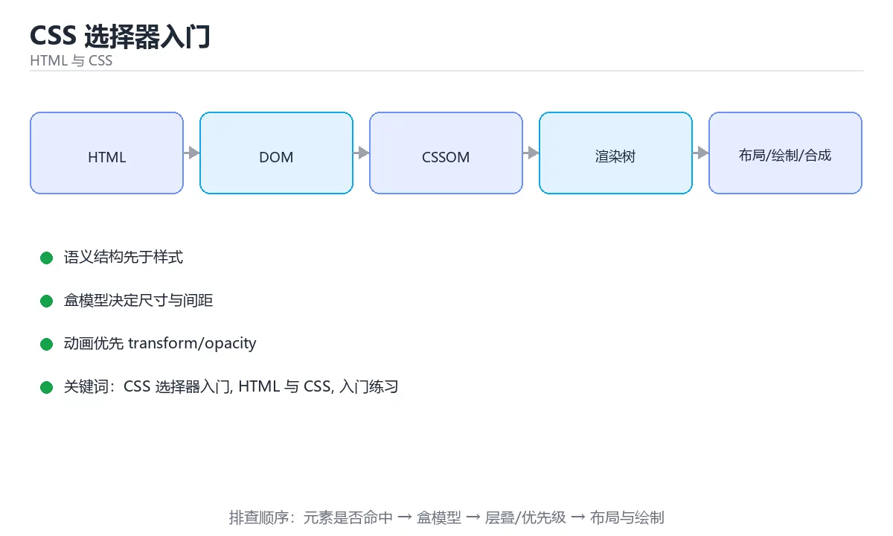
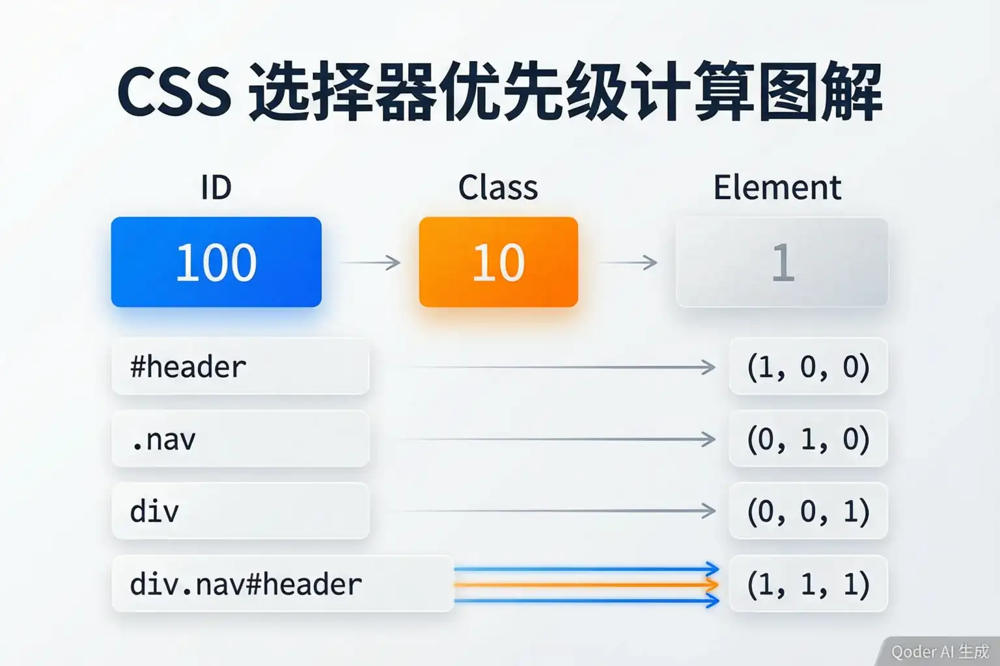

# CSS 选择器入门

> 内容更新时间：2026-10-06 · 学习阶段：基础 · 预计用时：45 分钟



## 本节知识框架

你可能已经写过 HTML 页面，知道怎么用标签把内容组织起来。但你会发现，光有标签还不够——网页看起来光秃秃的，没有颜色、没有排版、没有层次。这时候就需要 CSS 出场了。

CSS 的全称是 Cascading Style Sheets（层叠样式表），它的作用就是给 HTML 穿上"衣服"。而 CSS 选择器，就是告诉浏览器"这条样式规则到底要作用在哪些元素上"的工具。

本课的主线很简单：**用元素、类、ID 和组合选择器定位样式**。学完之后你应该能够：

- 说清楚选择器是什么，能区分类选择器和 ID 选择器的用法。
- 用伪类描述元素的交互状态，比如鼠标悬停、获得焦点。
- 理解盒模型，知道内容、内边距、边框、外边距是怎么影响元素大小的。
- 遇到样式冲突时，能判断优先级并合理调整。

**复习清单**

- [ ] 能说出类选择器和 ID 选择器的区别，并解释为什么 ID 选择器优先级更高
- [ ] 能用 `:hover`、`:focus`、`:nth-child()` 写出交互状态样式
- [ ] 能计算选择器优先级（特异性），并说出 `!important` 的使用场景和危害

先修内容：《HTML 标签入门》。如果你已经知道标签和属性的基本概念，就可以直接开始了。

## 原理与运行机制

### 浏览器怎么找到匹配的元素？

想象你在一个大型图书馆里找书。浏览器做选择器匹配时，干的也是类似的事——它拿着一份"寻书清单"（你的 CSS 规则），在图书馆里逐个书架（DOM 树）检查每本书（HTML 元素）是否符合条件。

关键点是：**浏览器从右向左匹配**。

比如选择器 `.nav > li a`，浏览器的处理顺序是：

```text
1. 先找到页面上所有的 <a> 元素
2. 检查每个 <a> 的父元素是否是 <li>
3. 再检查这个 <li> 的父元素是否有 .nav 类
4. 全部符合的 <a> 才会被应用样式
```

为什么从右向左？因为大多数时候，最右边的选择器（称为"关键选择器"）能过滤掉大部分元素。比如 `a` 标签通常比 `.nav` 容器少得多，先找 `a` 效率更高。

### 优先级是怎么算的？

当多条规则作用在同一个元素上时，浏览器用优先级来决定哪条规则生效。优先级像一个四位数的计分卡：

```text
内联样式      千位    style="..."         计 1000
ID 选择器     百位    #header             计 100
类/伪类/属性  十位    .btn, :hover, [type] 计 10
标签/伪元素   个位    p, div, ::before    计 1
通配符        不计    *                   计 0
```

比如：
- `#nav .item a` = 100 + 10 + 1 = 111
- `.nav .item a` = 10 + 10 + 1 = 21
- `nav item a` = 1 + 1 + 1 = 3

分数高的规则生效。分数相同时，后写的规则覆盖先写的。



### 盒模型怎么计算元素大小？

每个 HTML 元素都是一个矩形盒子，从内到外依次是：

```text
┌─────────────────────────────┐
│         外边距 (margin)       │
│  ┌───────────────────────┐  │
│  │     边框 (border)      │  │
│  │  ┌─────────────────┐  │  │
│  │  │  内边距 (padding) │  │  │
│  │  │  ┌───────────┐  │  │  │
│  │  │  │  内容区    │  │  │  │
│  │  │  │ (content)  │  │  │  │
│  │  │  └───────────┘  │  │  │
│  │  └─────────────────┘  │  │
│  └───────────────────────┘  │
└─────────────────────────────┘
```

元素的总宽度 = 内容宽度 + 左右内边距 + 左右边框 + 左右外边距。

默认情况下，你设置的 `width` 只是内容区的宽度。如果加上 `box-sizing: border-box`，`width` 就包含内容、内边距和边框，计算起来更直观。

## 核心概念定义

先快速认识几个核心术语，后面会反复用到：

| 术语 | 一句话说明 |
| --- | --- |
| CSS 选择器 | 一条 CSS 规则里用来指定"样式作用在哪些 HTML 元素上"的部分 |
| 元素选择器 | 直接写标签名（如 `p`、`h1`），匹配该类型的所有元素 |
| 类选择器 | 以点号开头（如 `.btn`），匹配 class 属性包含该名称的所有元素 |
| ID 选择器 | 以井号开头（如 `#header`），匹配 id 属性等于该名称的唯一元素 |
| 伪类 | 以冒号开头（如 `:hover`），描述元素的特殊状态或位置 |
| 盒模型 | 每个元素都是一个矩形盒子，由内容区、内边距、边框、外边距四层组成 |
| 优先级 | 当多条规则冲突时，浏览器用来决定哪条规则生效的计分机制 |

## 什么是 CSS 选择器

想象一下，你有一屋子人，你想让"所有穿红衣服的人站左边"。CSS 选择器干的就是这件事——从一堆 HTML 元素里，把符合某个条件的那些挑出来，然后给它们加上样式。

一条 CSS 规则长这样：

```css
.notice {
  color: #0b57d0;
}
```

这里 `.notice` 就是选择器，`color: #0b57d0` 是要应用的样式。浏览器看到这条规则后，会去页面上找所有 class 属性里包含 `notice` 的元素，然后把它们的文字颜色改成蓝色。

选择器的写法有很多种，从最简单的标签名，到更精确的类名、ID、组合方式，再到描述状态的伪类。下面一个一个来说。

## 元素选择器：从标签名开始

最基础的选择器就是直接写标签名。比如你想让页面上所有段落都变大一点：

```css
p {
  font-size: 18px;
}
```

这个 `p` 就是元素选择器，它会命中页面里每一个 `<p>` 标签。类似的，`h1` 会命中所有一级标题，`div` 会命中所有 div 容器。

元素选择器适合给某一类标签统一设置基础样式，比如全局的字体、行高、颜色。但它不够精确——如果你只想让某一个段落变蓝，光靠 `p` 就不够了，你需要更具体的选择器。

## 类选择器与 ID 选择器

类选择器用 `.类名` 来匹配元素。只要元素的 class 属性里包含这个名字，就会被命中。比如：

```css
.notice {
  color: #0b57d0;
  font-weight: 600;
}
```

```html
<p class="notice">保存成功</p>
<p class="notice">操作完成</p>
```

这两个段落都会变成蓝色加粗文字。类选择器最大的特点就是**可以复用**——同一个类名可以挂在很多个元素上，适合描述"同一类"样式。

ID 选择器用 `#id名` 来匹配元素，比如：

```css
#header {
  background-color: #f0f0f0;
}
```

ID 选择器和类选择器的关键区别在于：ID 在页面里应当是唯一的。一个页面不应该有两个 `id="header"` 的元素。所以 ID 选择器通常用来定位页面中某个特定的区域，比如页头、页脚、主内容区。

简单记一下：类选择器像"小组名"，一个名字可以对应多个人；ID 选择器像"身份证号"，一个号码只对应一个人。

## 组合选择器：后代与子元素

有时候你需要更精确地定位。比如你只想修改某个容器内部的链接样式，而不影响其他地方的链接：

```css
.sidebar a {
  color: #0b57d0;
}
```

`.sidebar a` 是后代选择器，它会命中 class 为 `sidebar` 的元素里面所有的 `<a>` 标签，不管嵌套了多少层。

如果你想更严格一点，只命中直接子元素，可以用子选择器 `>`：

```css
.sidebar > a {
  color: #0b57d0;
}
```

这样只会命中 `.sidebar` 的直接子元素里的 `<a>`，嵌套更深的那些不会被选中。

组合选择器让你可以根据页面的结构关系来精确定位样式，而不需要给每个元素都加一个类名。

## 伪类选择器：描述元素状态

有些样式不是写在 HTML 里的，而是浏览器根据用户的操作动态触发的。比如鼠标悬停时链接变色、输入框获得焦点时边框高亮。这时候就需要伪类选择器。

```css
a:hover {
  color: red;
}

input:focus {
  border-color: #0b57d0;
}

li:first-child {
  font-weight: bold;
}
```

`:hover` 表示鼠标悬停的状态，`:focus` 表示获得焦点的状态，`:first-child` 表示父元素里的第一个子元素。

伪类选择器描述的是元素的"状态"，它不需要你手动在 HTML 里写 class。浏览器会自动判断元素当前处于什么状态，然后应用对应的样式。

需要注意的是，移动端没有可靠的悬停状态，所以不能把关键操作只放在 `:hover` 里。另外，焦点样式不要随便用 `outline: none` 移除，除非你提供了同样清晰的替代方案——键盘用户需要看到焦点在哪里。

## 选择器优先级：谁说了算

当多条规则同时命中一个元素时，浏览器需要决定用哪一条。这就是优先级（Specificity）的问题。

优先级从高到低排列：

1. **行内样式**（写在元素的 `style` 属性里）—— 最高
2. **ID 选择器**（`#header`）
3. **类选择器、属性选择器、伪类**（`.notice`、`[type="email"]`、`:hover`）
4. **元素选择器、伪元素**（`p`、`div`、`::before`）—— 最低

举个例子：

```css
p { color: black; }           /* 元素选择器，优先级最低 */
.notice { color: blue; }      /* 类选择器，优先级更高 */
#main { color: green; }       /* ID 选择器，优先级更高 */
/* <p id="main" class="notice" style="color: red;">文字是红色的 */
```

如果优先级相同，就按书写顺序来——后写的覆盖先写的。

`!important` 可以提升声明的优先级，但它不是解决冲突的好办法。滥用 `!important` 会让样式变得很难调试。正确的做法是调整选择器结构和书写顺序，而不是不断叠加权重。

## 盒模型：元素占位的秘密

每个 HTML 元素在页面上都占据一个"盒子"。这个盒子由四层组成，从内到外依次是：

1. **内容（Content）**：文字、图片等实际内容占据的区域。
2. **内边距（Padding）**：内容和边框之间的空白。
3. **边框（Border）**：盒子的边缘线。
4. **外边距（Margin）**：盒子和相邻元素之间的空白。

这四层共同决定了元素在页面上实际占多大的位置。比如你设置了一个元素的宽度是 200px，又加了 20px 的内边距和 1px 的边框，那它实际占据的宽度是 200 + 20×2 + 1×2 = 242px（在默认的 `content-box` 模式下）。

```css
.box {
  width: 200px;
  padding: 20px;
  border: 1px solid #ccc;
  margin: 10px;
}
```

理解盒模型对布局非常重要。很多时候样式"看起来不对劲"，其实就是内边距或外边距没算对。

## 代码/协议/SQL 示例

### 最小示例

我们来看一个最简单的完整例子：

```html
<style>
  .notice {
    color: #0b57d0;
    font-weight: 600;
  }
</style>
<p class="notice">保存成功</p>
```

浏览器渲染结果：这段文字会变成蓝色加粗的效果，因为 `.notice` 这个类选择器命中了 `<p class="notice">` 这个段落。

### 稍微复杂一点的例子

```html
<style>
  /* 元素选择器：所有段落的基础样式 */
  p {
    font-size: 16px;
    line-height: 1.6;
  }

  /* 类选择器：告警提示 */
  .notice {
    color: #0b57d0;
    font-weight: 600;
  }

  /* ID 选择器：主内容区 */
  #main {
    max-width: 800px;
    margin: 0 auto;
  }

  /* 后代选择器：主内容区里的链接 */
  #main a {
    color: #0b57d0;
    text-decoration: none;
  }

  /* 伪类：链接悬停效果 */
  #main a:hover {
    text-decoration: underline;
  }
</style>

<div id="main">
  <p>这是一段普通文字。</p>
  <p class="notice">保存成功</p>
  <p>更多内容请 <a href="#">查看详情</a>。</p>
</div>
```

在这个例子里，你可以看到不同选择器是怎么配合工作的：元素选择器设定基础样式，类选择器给特定类型的元素加上醒目的效果，ID 选择器定位页面区域，后代选择器限制样式的作用范围，伪类处理交互状态。

### 预期输出

```text
浏览器渲染结果：
- 普通段落：16px 字号、1.6 行高的黑色文字
- "保存成功"：蓝色加粗文字（类选择器 .notice 命中）
- "查看详情"：蓝色无下划线链接，鼠标悬停时出现下划线
```

## 典型应用场景

学完选择器，实际什么时候用什么呢？来看几个常见场景：

- **全局基础样式**：用元素选择器给所有 `p`、`h1`、`a` 标签设置统一的字体、颜色、行高，建立页面的基础视觉风格。
- **模块化组件**：用类选择器给按钮、卡片、导航项等可复用组件定义样式，比如 `.btn-primary`、`.card`。同一个类可以用在页面各处。
- **唯一页面区域**：用 ID 选择器标记页面里独一无二的区域，比如 `#header`、`#main-content`、`#footer`，配合锚点跳转使用。
- **交互状态反馈**：用伪类描述用户的交互行为，比如 `a:hover` 鼠标悬停变色、`input:focus` 获得焦点时高亮边框、`button:disabled` 禁用状态灰显。
- **精准定位嵌套元素**：用组合选择器定位特定上下文里的元素，比如 `.nav > li` 只选导航的直接子项，`.article p` 选文章里的所有段落。

## 时间/空间复杂度或性能分析

选择器的性能影响主要体现在浏览器的样式计算上。现代浏览器对选择器的匹配速度已经优化得很好，但理解基本原则仍然有帮助。

**选择器匹配效率**

浏览器从右向左解析选择器。比如 `.nav > li a`，浏览器先找到所有 `a` 元素，再检查它们的父元素是否是 `li`，再检查 `li` 的父元素是否有 `.nav` 类。

- **标签选择器**（`p`、`div`）：最快，直接按标签名索引
- **类选择器**（`.btn`）：很快，按类名索引
- **ID 选择器**（`#header`）：最快，ID 唯一且索引直接
- **属性选择器**（`[type="text"]`）：较慢，需要遍历检查属性值
- **伪类选择器**（`:hover`、`:first-child`）：中等，需要计算元素状态或位置

**实际建议**

- 避免过深的嵌套：`.a .b .c .d .e` 这种五级嵌套会让浏览器做大量回溯检查
- 优先用类选择器：`.btn` 比 `div.button` 更高效，因为少了一层标签检查
- 不要用通配符做复杂组合：`* > * > *` 会让浏览器检查所有元素的所有子元素
- 样式表大小比选择器复杂度更影响性能：1000 条简单规则比 100 条复杂规则更慢

对于绝大多数网页，选择器性能不是瓶颈。真正影响速度的是样式表总体积、DOM 节点数量和重排重绘次数。

## 常见误区与易错点

| 容易写错的做法 | 实际现象 | 原因与正确做法 |
| --- | --- | --- |
| 选择器写得过于具体 | 后续样式无法覆盖，只能不断加权重 | 控制嵌套层级，优先使用类选择器 |
| 靠最高优先级声明覆盖样式 | 样式失控，难以维护 | 整理优先级或使用层叠层组织顺序 |
| 依赖标签与位置定位元素 | 结构调整后样式全部失效 | 用稳定的语义类名定位元素 |

### 误区 1：选择器写得过于具体

新手经常会写出这样的选择器：

```css
div.container ul.sidebar li a.link {
  color: red;
}
```

看起来非常精确，但问题是：如果你后来想改链接颜色，就得写一条更长的选择器才能覆盖它。这就是"选择器写得过于具体"的典型现象——后续样式无法覆盖，只能不断加权重。

正确做法是控制嵌套层级，优先使用类选择器：

```css
.sidebar-link {
  color: red;
}
```

简单、好覆盖、好复用。

### 误区 2：靠最高优先级声明覆盖样式

有些人遇到样式冲突就加 `!important`：

```css
.title { color: red !important; }
.subtitle { color: blue !important; }
```

满屏都是 `!important`，最后样式完全失控，难以维护。正确做法是整理优先级或使用层叠层（`@layer`）组织顺序，让样式规则各就各位。

### 误区 3：依赖标签与位置定位元素

```css
div > p:nth-child(3) {
  font-weight: bold;
}
```

这种写法依赖 HTML 的结构顺序。一旦你调整了标签的顺序或者在中间插入了新元素，样式就会全部失效。正确做法是用稳定的语义类名定位元素，比如给那个段落加一个 `class="highlight"`。

## 与其他知识点的关系

CSS 选择器不是孤立存在的，它和很多概念紧密相关：

- **HTML 标签与属性**：选择器依赖标签名和 class、id 等属性来定位元素。如果你不熟悉 HTML 的基本结构，建议先看看《HTML 标签入门》。
- **盒模型**：选择器决定了样式作用在哪个元素上，而盒模型决定了这个元素在页面上占多大地方。两者配合才能实现精确的布局。
- **伪类与交互**：伪类选择器（`:hover`、`:focus` 等）让页面能够响应用户操作，这是从静态样式走向交互设计的关键一步。
- **布局系统**：Flexbox 和 Grid 是布局工具，但你需要选择器来指定哪些元素使用哪种布局方式。

容易混淆的概念：

- **类选择器 vs ID 选择器**：类选择器可以复用，ID 选择器应当唯一。如果你不确定用哪个，默认选类选择器。
- **后代选择器 vs 子选择器**：后代选择器（空格）匹配任意层级，子选择器（`>`）只匹配直接子元素。搞清楚嵌套关系再选。

## 自测题与参考答案

先独立作答，再对照参考答案。答案都能在本课正文里找到依据。

### 自测 1

不看正文，写出选择器的定义，并举一个类选择器和一个 ID 选择器的例子。

**参考答案**：选择器是 CSS 中用来指定样式作用于哪些元素的模式。类选择器如 `.notice` 可以复用于多个元素；ID 选择器如 `#header` 在页面里应当唯一。

### 自测 2

写出优先级从高到低的顺序。

**参考答案**：行内样式 > ID 选择器 > 类选择器 > 元素选择器。

### 自测 3

运行本课的最小示例，把 `"notice"` 换成 `"alert"` 后重新运行，观察输出变化。

**参考答案**：换成 `"alert"` 后，如果 CSS 里仍然是 `.notice`，段落不会变成蓝色加粗，因为类选择器没有命中。需要把 CSS 也改成 `.alert` 才能恢复效果。

### 自测 4

阅读最小示例，说明它体现了选择器的哪一条性质。

**参考答案**：体现了类选择器通过 class 属性匹配元素的性质。`.notice` 会命中所有 class 包含 `notice` 的元素，而不是只命中某一个。

## 考点精讲

本课的题库有 6 道题，下面逐题给出题干、选项和正确答案。建议先自己作答，再核对。

### 考点 1

样式规则 .notice { color: #0b57d0; } 会命中哪些元素？

A. 所有直接子元素，不论其属性是什么
B. 所有 class 属性包含 notice 的元素
C. 所有 id 属性等于 notice 的元素
D. 所有标签名为 notice 的元素

**正确答案：B**

`.notice` 是类选择器，它匹配的是 class 属性中包含 `notice` 的所有元素。不关心标签名是什么，也不关心 id 属性。

### 考点 2

下列写法的优先级从高到低排列，正确的是？

A. 行内样式、id 选择器、类选择器、元素选择器
B. 三者优先级完全相同，由书写顺序决定
C. 元素选择器、类选择器、id 选择器、行内样式
D. 类选择器、id 选择器、行内样式、元素选择器

**正确答案：A**

优先级从高到低是：行内样式（style 属性）> ID 选择器 > 类选择器 > 元素选择器。这是 CSS 级联规则的核心知识。

### 考点 3

代码语言为 `html`，选自 `CSS 选择器入门` 的 `选择器（Selector）` 部分。课程问题为用元素、类、ID 和组合选择器定位样式。哪一项描述与代码一致？

A. 出现字面量 top
B. 出现字面量 notice
C. 出现字面量 告警审计：找出无效告警与噪声来源。
D. 出现字面量 $TMP_FILE

**正确答案：B**

本课的最小示例中使用了 `.notice` 类选择器和 `class="notice"`，所以代码里出现了字面量 `notice`。

### 考点 4

本课最小示例把「保存成功」渲染成什么效果？

A. 红色斜体的文字，因为浏览器默认样式生效
B. 普通黑色文字，因为样式没有正确关联
C. 带下划线的蓝色链接文字，点击后跳转
D. 蓝色加粗的文字，因为类选择器命中了该段落

**正确答案：D**

最小示例中 `.notice { color: #0b57d0; font-weight: 600; }` 命中了 `<p class="notice">保存成功</p>`，所以渲染为蓝色加粗的文字。

### 考点 5

填空：补齐下面这段术语说明中的空缺。课程 `用元素、类、ID 和组合选择器定位样式。`，这段说明是：`____`：内容、内边距、边框、外边距四层共同决定元素的占位大小。空缺处应填哪个术语？

**正确答案：盒模型**

盒模型（Box Model）是指内容、内边距、边框、外边距四层共同决定元素占位大小的概念。

### 考点 6

关于 `选择器（Selector）`，下列哪些说法与 `CSS 选择器入门` 的正文一致？判断时以用元素、类、ID 和组合选择器定位样式。为主线。（多选）

A. 所有 class 属性包含 notice 的元素
B. 所有标签名为 notice 的元素
C. 所有 id 属性等于 notice 的元素
D. 行内样式、id 选择器、类选择器、元素选择器

**正确答案：AD**

A 正确——`.notice` 是类选择器，命中所有 class 包含 notice 的元素。D 正确——优先级从高到低确实是行内样式、id 选择器、类选择器、元素选择器。B 和 C 错误，因为 `.notice` 不匹配标签名也不匹配 id 属性。

## 术语速查

| 术语 | 一句话说明 |
| --- | --- |
| 选择器（Selector） | CSS 里用来指定"这条样式规则作用在哪些 HTML 元素上"的语法 |
| 类选择器（.class） | 以点号开头，匹配所有 class 属性包含该名称的元素，可复用 |
| ID 选择器（#id） | 以井号开头，匹配 id 属性等于该名称的唯一元素 |
| 伪类（:hover） | 描述元素的特殊状态，比如鼠标悬停、获得焦点、第一个子元素等 |
| 盒模型 | 每个 HTML 元素都是一个盒子，由内容、内边距、边框、外边距四层组成 |
| 优先级（Specificity） | 当多条规则冲突时，浏览器用来决定哪条规则生效的计分规则 |

## 内容元数据

- 内容版本：v2.0
- 最后更新：2026-10-06
- 学习阶段：基础
- 适用环境：现代浏览器（Chrome/Firefox/Safari/Edge）
- 内容来源：内置结构化课程与工程实践整理
- 相关主题：CSS 选择器入门、HTML 与 CSS、入门练习

## 参考资料与复核

- 最后复核：2026-10-04
- 下次复核：2027-08-17
- 复核范围：CSS 选择器语法、优先级规则、盒模型行为、浏览器兼容性

| 参考资料 | 本课用途 |
| --- | --- |
| [MDN CSS 选择器参考](https://developer.mozilla.org/docs/Web/CSS/CSS_selectors) | 所有选择器类型的完整语法与示例 |
| [MDN 层叠与继承](https://developer.mozilla.org/docs/Learn/CSS/Building_blocks/Cascade_layers) | 优先级、级联、继承的详细规则 |
| [MDN 盒模型](https://developer.mozilla.org/docs/Learn/CSS/Building_blocks/The_box_model) | 盒模型各层的计算方式与 box-sizing |
