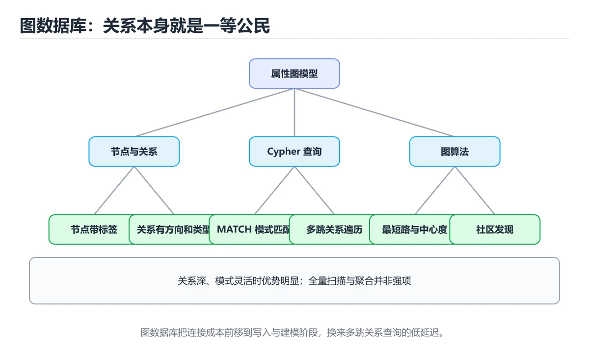
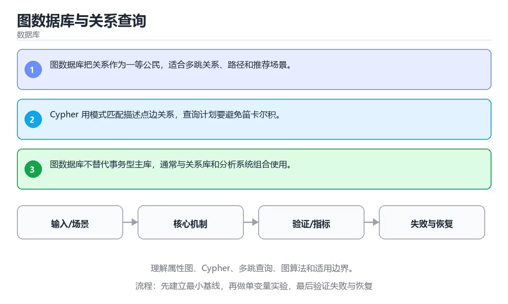

# 图数据库与关系查询

> 内容更新时间：2026-10-06 · 学习阶段：高级 · 预计用时：25 分钟





## 本节知识框架

**课程定位**：所属分类 `database`（数据库），课程主题 `图数据库与关系查询`，学习阶段 高级，建议用时 45 分钟。

本课主线：理解属性图、Cypher、多跳查询、图算法和适用边界。

**学完本课应当能够**
- 说清 `图数据库` 与 `Cypher` 的含义与区别，并各举一个正例和一个反例。
- 用本课示例验证 `多跳` 的行为，记录输入、输出与失败条件。
- 遇到「把图查询当多表连接」这类问题时，能说出触发条件与修复顺序。

### 复习清单

- [ ] 能不看正文复述本课核心术语，并指出一个边界或反例。
- [ ] 能运行或推演本课示例，记录输入、输出与失败现象。
- [ ] 能完成一次自测，并把错题对照错误表定位原因。

## 核心概念定义

| 术语 | 操作性定义 | 常见边界与风险 |
| --- | --- | --- |
| 图数据库 | 图数据库把关系作为一等公民，适合多跳关系、路径和推荐场景。 | 易错：多跳查询性能急剧下降；正确做法是按图模型建模，使用图数据库的多跳与路径语义。 |
| Cypher | 图数据库的声明式查询语言，用 (节点)-[关系]->(节点) 的图形语法描述模式匹配。 | 索引命中与数据分布决定实际开销，判断前先看执行计划而不是只看结果是否正确。 |
| 多跳 | 按“图数据库与关系查询”中 图数据库、Cypher、多跳 的实践顺序，把四个步骤排成从准备到复盘的合理顺序。 | 易错：多跳查询性能急剧下降；正确做法是按图模型建模，使用图数据库的多跳与路径语义。 |
| 关系 | 关系数据库中由行和列组成的表，以及表之间通过键建立的关联。 | 易错：查询语义含糊，结果不可解释；正确做法是为边定义类型与方向，并写清允许的路径模式。 |

## 原理与运行机制

### 机制总览

**教材衔接：核心知识**

### 1. 图数据库把关系作为一等公民，适合多跳关系、路径和推荐场景。

- 关键做法：先用 RECURSIVE 建立 图数据库 的基线，再逐步加入边界与失败条件。
- 验证标准：RECURSIVE 的输出能被他人复现，边界输入有对应用例。

### 2. Cypher 用模式匹配描述点边关系，查询计划要避免笛卡尔积。

把这条结论放回「图数据库与关系查询」的完整流程里展开：

- 正文依据：能用自己的话解释：图数据库把关系作为一等公民，适合多跳关系、路径和推荐场景。
- 落地检查：把「2. Cypher 用模式匹配描述点边关系，查询计划要避免笛卡尔积。」改写成一条可执行的核对项，逐条验证输入、超时与失败路径。

### 3. 图数据库不替代事务型主库，通常与关系库和分析系统组合使用。

把这条结论放回「图数据库与关系查询」的完整流程里展开：

- 正文依据：能用自己的话解释：Cypher 用模式匹配描述点边关系，查询计划要避免笛卡尔积。
- 落地检查：把「3. 图数据库不替代事务型主库，通常与关系库和分析系统组合使用。」改写成一条可执行的核对项，逐条验证输入、超时与失败路径。

**教材衔接：关键流程**

**教材衔接：实践路径**

**教材衔接：验证步骤**

## 典型应用场景

**教材衔接：深度拓展与实战**

这一节把 图数据库 的定义、RECURSIVE 的代码与常见失败串成一条复习路线。

### 边界条件与常见反例

「图数据库与关系查询」的边界不只包括最大最小值，还要覆盖空、重复和失败：

### 工程检查表

- [ ] 能否用自己的话说明图数据库与关系查询解决什么问题，以及它不负责什么？
- [ ] 能否用「图数据库与关系查询」的最小示例复现一次失败并解释原因？
- [ ] 能否解释本课关键词在真实项目中的边界与取舍？
- [ ] 能否把 图数据库 的方法迁移到相近问题，并说明需要改哪一步？

### 最小验证场景

- 准备：保留 `text` 示例的原始输入，先记录 `图数据库与关系查询` 的基线输出和完整运行命令。
- 观察：先核对 调用了 `edges()`，再改变一个与 `图数据库` 相关的条件。
- 判定：新结果与 `图数据库与关系查询` 的基线不同不等于错误；只有当差异破坏了 `图数据库` 的定义或错误表中的约束，才判定为失败。

### 选择与边界

- 使用 `图数据库` 时，先满足它的定义：图数据库把关系作为一等公民，适合多跳关系、路径和推荐场景；易错：多跳查询性能急剧下降；正确做法是按图模型建模，使用图数据库的多跳与路径语义。
- 使用 `Cypher` 时，先满足它的定义：图数据库的声明式查询语言，用 (节点)-[关系]->(节点) 的图形语法描述模式匹配；索引命中与数据分布决定实际开销，判断前先看执行计划而不是只看结果是否正确。
- 使用 `多跳` 时，先满足它的定义：按“图数据库与关系查询”中 图数据库、Cypher、多跳 的实践顺序，把四个步骤排成从准备到复盘的合理顺序；易错：多跳查询性能急剧下降；正确做法是按图模型建模，使用图数据库的多跳与路径语义。
- 使用 `关系` 时，先满足它的定义：关系数据库中由行和列组成的表，以及表之间通过键建立的关联；易错：查询语义含糊，结果不可解释；正确做法是为边定义类型与方向，并写清允许的路径模式。

## 代码/协议/SQL 示例

### 最小可验证示例

**教材衔接：最小可运行示例**

先用下面的示例确认 图数据库 的基线，再只改一个与 Cypher 相关的值：

```sql
WITH RECURSIVE edges(src, dst) AS (
  VALUES ('a', 'b'), ('b', 'c'), ('c', 'd')
), walk(node, depth) AS (
  SELECT 'a', 0
  UNION ALL
  SELECT edges.dst, walk.depth + 1
  FROM edges
  JOIN walk ON edges.src = walk.node
)
SELECT node, depth FROM walk ORDER BY depth;
```

**教材衔接：预期输出**

```text
node | depth
a    |     0
b    |     1
c    |     2
d    |     3
```

## 时间/空间复杂度或性能分析

**性能关注点（图数据库与关系查询）**：扫描行数与索引命中决定开销：记录查询耗时、执行计划与锁等待。

**本课特有开销（图数据库与关系查询 · 图数据库）**：长事务会放大锁等待，记录事务持续时间与锁冲突次数。

**测量方法**：以 `图数据库与关系查询` 的 `图数据库` 场景为对象，固定输入跑一遍记录基线，再把规模或并发度提高一个数量级复测；两次结果的差值与波动范围才是结论依据。

## 常见误区与易错点

| 容易写错的做法 | 实际现象 | 原因与正确做法 |
| --- | --- | --- |
| 把图查询当多表连接 | 多跳查询性能急剧下降。 | 按图模型建模，使用图数据库的多跳与路径语义。 |
| 关系没有方向与类型 | 查询语义含糊，结果不可解释。 | 为边定义类型与方向，并写清允许的路径模式。 |
| 入口属性没有索引 | 每次查询都全表扫描。 | 为高频入口属性建立索引并观察命中情况。 |

### 现场 1：把图查询当多表连接

**症状**：多跳查询性能急剧下降。

**根因与修复**：按图模型建模，使用图数据库的多跳与路径语义。

**自检**：在本课示例里复现「把图查询当多表连接」，改成按图模型建模，使用图数据库的多跳与路径语义后重跑；如果症状消失且失败路径按预期变化，说明定位正确。

### 现场 2：关系没有方向与类型

**症状**：查询语义含糊，结果不可解释。

**根因与修复**：为边定义类型与方向，并写清允许的路径模式。

**自检**：在本课示例里复现「关系没有方向与类型」，改成为边定义类型与方向，并写清允许的路径模式后重跑；如果症状消失且失败路径按预期变化，说明定位正确。

### 现场 3：入口属性没有索引

**症状**：每次查询都全表扫描。

**根因与修复**：为高频入口属性建立索引并观察命中情况。

**自检**：在本课示例里复现「入口属性没有索引」，改成为高频入口属性建立索引并观察命中情况后重跑；如果症状消失且失败路径按预期变化，说明定位正确。

## 与其他知识点的关系

| 关系 | 课程 | 为什么 |
| --- | --- | --- |
| 先修 | 《PostgreSQL 深入实践》 | 本课会直接使用它的概念或操作前提。 |
| 关联 | 《时序数据库与监控数据》 | 用于横向比较或把本课结论迁移到相邻主题。 |
| 前置顺序 | 《实时数仓：从 Kafka 到 Flink》 | 同分类中安排在本课之前，建议先完成其自测。 |
| 后续顺序 | 《时序数据库与监控数据》 | 同分类中安排在本课之后，会继续使用本课术语。 |

**教材衔接：复习与迁移**

## 自测题与参考答案

> 先独立作答，再对照参考答案；答案都能在本课正文、术语表或错误表里找到依据。

### 自测 1（概念复述）

不看正文，写出 `图数据库` 的操作性定义，并说明它与 `Cypher` 的区别。

**参考答案**：图数据库把关系作为一等公民，适合多跳关系、路径和推荐场景。

`Cypher` 的定位是：图数据库的声明式查询语言，用 (节点)-[关系]->(节点) 的图形语法描述模式匹配；两者的差别要从适用对象与失败模式上说明。

### 自测 2（排错）

本课错误表记录了「把图查询当多表连接」这类做法。请写出它会出现的现象、根因，以及修复顺序。

**参考答案**：现象是多跳查询性能急剧下降；正确做法是按图模型建模，使用图数据库的多跳与路径语义。修复时先复现现象并保留证据，再改动一处假设重跑，确认现象消失。

### 自测 3（动手验证）

运行本课的 `text` 示例，改动其中一个输入后重新运行，记录输出与错误信息。

**参考答案**：正常输入下 `text` 示例应当复现正文给出的结果；改动输入后，如果结果改变或报错，先核对它是否满足 `图数据库与关系查询` 中`图数据库` 的适用范围，再检查错误表里是否有同类现象。

### 自测 4（代码阅读）

阅读本课开头的 `text` 示例，说明它体现了`图数据库` 的哪一条性质，并指出改动哪个输入会让这条性质不再成立。

**参考答案**：`图数据库` 的定义是 图数据库把关系作为一等公民，适合多跳关系、路径和推荐场景，示例正是在实现这条定义。改动与 `图数据库` 有关的一个输入后，如果结果不再符合 `图数据库与关系查询` 的正文描述，就说明该性质只在当前前提成立。

### 自测 5（迁移）

把 `图数据库与关系查询` 的方法迁移到自己的项目：围绕 `图数据库` 写出一个与错误表同类的风险点，并说明触发条件和检验方式。

**参考答案**：例如「入口属性没有索引」，它会导致每次查询都全表扫描；检验方式是按为高频入口属性建立索引并观察命中情况改一处再复现，确认现象消失且没有引入新的失败分支。

### 自测 6（对比）

用一个表格对比 `图数据库` 与 `Cypher`：各写一行适用场景、一行失败表现。

**参考答案**：`图数据库` 的定义是图数据库把关系作为一等公民，适合多跳关系、路径和推荐场景；`Cypher` 的定义是图数据库的声明式查询语言，用 (节点)-[关系]->(节点) 的图形语法描述模式匹配。两者的失败表现分别对应本课错误表里与本术语相关的行。

### 自测 7（排错顺序）

面对「把图查询当多表连接」引发的问题，请把“复现 多跳查询性能急剧下降 → 保留证据 → 按图模型建模，使用图数据库的多跳与路径语义 → 回归验证”四步写成可执行的检查清单。

**参考答案**：第一步按多跳查询性能急剧下降复现；第二步记录输入、版本与完整报错；第三步按图模型建模，使用图数据库的多跳与路径语义只改一处；第四步重跑并确认失败路径也按预期变化。

### 自测 8（边界判断）

针对 `关系`，分别写出“可以使用”的条件和“结论不再成立”的条件。

**参考答案**：易错：查询语义含糊，结果不可解释；正确做法是为边定义类型与方向，并写清允许的路径模式。 同时要把 `关系` 的定义 关系数据库中由行和列组成的表，以及表之间通过键建立的关联 与实际输入逐项对照。

### 自测 9（机制重建）

不看正文，按输入、转换、输出、验证四段重建 `图数据库` → `Cypher` → `多跳` → `关系` 的作用链。

**参考答案**：起点是 `图数据库` 的定义 图数据库把关系作为一等公民，适合多跳关系、路径和推荐场景；中间每一步都保留可观察状态；终点由 `关系` 检查，失败时回到错误表定位第一个偏离定义的步骤。

### 自测 10（综合排错）

在 `图数据库与关系查询` 中，现象是 每次查询都全表扫描。请围绕 入口属性没有索引 写出最小复现、关键证据、修复动作和回归验证，并说明为什么不能只凭一次运行下结论。

**参考答案**：先复现 入口属性没有索引，记录输入与完整错误；再按 为高频入口属性建立索引并观察命中情况 只改一处。回归时同时跑正常路径和边界路径，只有两次结果都可解释，才把修复视为完成。

### 自测 11（一分钟复述）

用每分钟约 200 字的速度复述 `图数据库与关系查询`：先给主问题，再按顺序说出 `图数据库`、`Cypher`、`多跳`、`关系`，最后给一个失败案例。

**自评标准**：主问题必须对应 理解属性图、Cypher、多跳查询、图算法和适用边界；每个术语都要能接上一句定义或边界；失败案例必须写成可观察现象，不能用“可能有风险”代替证据。

## 延伸阅读

想更直观地理解本课概念？推荐参阅以下图解专题：

- [图解 B+ 树与数据库索引](visual_btree_index.md)

## 术语速查

| 术语 | 一句话说明 |
| --- | --- |
| `图数据库` | 图数据库把关系作为一等公民，适合多跳关系、路径和推荐场景。 |
| `Cypher` | 图数据库的声明式查询语言，用 (节点)-[关系]->(节点) 的图形语法描述模式匹配。 |
| `多跳` | 按“图数据库与关系查询”中 图数据库、Cypher、多跳 的实践顺序，把四个步骤排成从准备到复盘的合理顺序。 |
| `关系` | 关系数据库中由行和列组成的表，以及表之间通过键建立的关联。 |

**术语关系**：`图数据库`（图数据库把关系作为一等公民） → `Cypher`（图数据库的声明式查询语言） → `多跳`（按“图数据库与关系查询”中 图数据库、Cypher、多跳 的实践顺序） → `关系`（关系数据库中由行和列组成的表）。

## 考点精讲

`图数据库与关系查询` 的题库有 6 道题，下面逐题给出题干、正确项与判断依据：先自己作答，再核对正确项，最后回到正文对应小节复核。

### 考点 1：第 1 题

- **题目**：按“图数据库与关系查询”中 图数据库、Cypher、多跳 的实践顺序，把四个步骤排成从准备到复盘的合理顺序。
- **正确项**：先明确 图数据库 的输入、输出与约束 → 写出最小示例并核对 Cypher 的基线结果 → 只改一个变量，记录边界与失败路径的变化 → 固定版本与证据，把“图数据库与关系查询”的结论写成可复现记录
- **判断依据**：按《图数据库与关系查询》正文的先后，本题顺序是「先明确 图数据库 的输入、输出与约束」 → 「写出最小示例并核对 Cypher 的基线结果」 → 「只改一个变量，记录边界与失败路径的变化」 → 「固定版本与证据，把“图数据库与关系查询”的结论写成可复现记录」。术语 图数据库（图数据库与关系查询）：图数据库把关系作为一等公民，适合多跳关系、路径和推荐场景。易错点是把图查询当多表连接会造成多跳查询性能急剧下降，改法是按图模型建模，使用图数据库的多跳与路径语义。

### 考点 2：第 2 题

- **题目**：在 `图数据库与关系查询` 里，与 `图数据库` 有关的说法中，哪一项最符合理解属性图、Cypher、多跳查询、图算法和适用边界？
- **正确项**：Cypher 用模式匹配描述点边关系，查询计划要避免笛卡尔积。
- **判断依据**：本题正确项是「Cypher 用模式匹配描述点边关系，查询计划要避免笛卡尔积」。术语 图数据库（图数据库与关系查询）：图数据库把关系作为一等公民，适合多跳关系、路径和推荐场景，本题取「Cypher 用模式匹配描述点边关系，查询计划要避免笛卡尔积」这条。易错点是关系没有方向与类型，会造成查询语义含糊，结果不可解释，改法是为边定义类型与方向，并写清允许的路径模式。

### 考点 3：第 3 题

- **题目**：在 `图数据库与关系查询` 里，与 `图数据库` 有关的说法中，哪一项最符合理解属性图、Cypher、多跳查询、图算法和适用边界？（图数据库与关系查询·数据库 第 3 题）
- **正确项**：图数据库不替代事务型主库，通常与关系库和分析系统组合使用。
- **判断依据**：本题正确项是「图数据库不替代事务型主库，通常与关系库和分析系统组合使用」。术语 图数据库（图数据库与关系查询）：图数据库把关系作为一等公民，适合多跳关系、路径和推荐场景，本题取「图数据库不替代事务型主库，通常与关系库和分析系统组合使用」这条。易错点是入口属性没有索引，会造成每次查询都全表扫描，改法是为高频入口属性建立索引并观察命中情况。

### 考点 4：第 4 题

- **题目**：`图数据库与关系查询` 的主线是：理解属性图、Cypher、多跳查询、图算法和适用边界。下面哪一项与这条主线一致？
- **正确项**：理解属性图、Cypher、多跳查询、图算法和适用边界。
- **判断依据**：本题正确项是「理解属性图、Cypher、多跳查询、图算法和适用边界」。术语 图数据库（图数据库与关系查询）：图数据库把关系作为一等公民，适合多跳关系、路径和推荐场景，本题取「理解属性图、Cypher、多跳查询、图算法和适用边界」这条。易错点是把图查询当多表连接，会造成多跳查询性能急剧下降，改法是按图模型建模，使用图数据库的多跳与路径语义。

### 考点 5：第 5 题

- **题目**：课程 `理解属性图、Cypher、多跳查询、图算法和适用边界。`。在 `图数据库与关系查询` 里，`图数据库`、`Cypher` 与下面哪些选项属于同一层概念？（多选）
- **正确项**：图数据库；Cypher
- **判断依据**：按《图数据库与关系查询》的正文口径，本题要同时选中「图数据库」、「Cypher」，漏掉任一项都算没答全。术语 图数据库（图数据库与关系查询）：图数据库把关系作为一等公民，适合多跳关系、路径和推荐场景。易错点是把图查询当多表连接会造成多跳查询性能急剧下降，改法是按图模型建模，使用图数据库的多跳与路径语义。

### 考点 6：第 6 题

- **题目**：结合 `图数据库与关系查询` 中围绕 `图数据库` 的代码，哪一项说法与“理解属性图、Cypher、多跳查询、图算法和适用边界。”一致？
- **正确项**：图数据库把关系作为一等公民，适合多跳关系、路径和推荐场景。
- **判断依据**：本题正确项是「图数据库把关系作为一等公民，适合多跳关系、路径和推荐场景」。术语 图数据库（图数据库与关系查询）：图数据库把关系作为一等公民，适合多跳关系、路径和推荐场景，本题取「图数据库把关系作为一等公民，适合多跳关系、路径和推荐场景」这条。易错点是入口属性没有索引，会造成每次查询都全表扫描，改法是为高频入口属性建立索引并观察命中情况。

### 考点 7：`图数据库`

- **要点**：图数据库把关系作为一等公民，适合多跳关系、路径和推荐场景。
- **图数据库 的边界**：易错：多跳查询性能急剧下降；正确做法是按图模型建模，使用图数据库的多跳与路径语义。

### 考点 8：`Cypher`

- **要点**：图数据库的声明式查询语言，用 (节点)-[关系]->(节点) 的图形语法描述模式匹配。
- **Cypher 的边界**：索引命中与数据分布决定实际开销，判断前先看执行计划而不是只看结果是否正确。

### 考点 9：`多跳`

- **要点**：按“图数据库与关系查询”中 图数据库、Cypher、多跳 的实践顺序，把四个步骤排成从准备到复盘的合理顺序。
- **多跳 的边界**：易错：多跳查询性能急剧下降；正确做法是按图模型建模，使用图数据库的多跳与路径语义。

### 考点 10：`关系`

- **要点**：关系数据库中由行和列组成的表，以及表之间通过键建立的关联。
- **关系 的边界**：易错：查询语义含糊，结果不可解释；正确做法是为边定义类型与方向，并写清允许的路径模式。

### 考点 11：排错——把图查询当多表连接

- **现象**：多跳查询性能急剧下降。
- **处理**：按图模型建模，使用图数据库的多跳与路径语义。

### 考点 12：排错——关系没有方向与类型

- **现象**：查询语义含糊，结果不可解释。
- **处理**：为边定义类型与方向，并写清允许的路径模式。

### 考点 13：综合辨析——`图数据库` 与 `关系`

- **辨析点**：`图数据库` 的定义是 图数据库把关系作为一等公民，适合多跳关系、路径和推荐场景；`关系` 的定义是 关系数据库中由行和列组成的表，以及表之间通过键建立的关联。
- **答题要求**：面对 `图数据库与关系查询` 的题目，先判断描述的是 `图数据库` 还是 `关系`，再归到对应定义，最后写出一个会让该定义失效的边界输入。

### 考点 14：排错评分点

- **现象分**：能写出 多跳查询性能急剧下降，而不是只写“程序有错”。
- **证据分**：保留触发 把图查询当多表连接 的输入、版本和错误原文。
- **修复分**：按 按图模型建模，使用图数据库的多跳与路径语义 只改一处，并同时回归正常路径与边界路径。

## 内容元数据

- 内容版本：v2.0
- 最后更新：2026-10-06
- 学习阶段：高级
- 适用环境：PostgreSQL / MySQL / SQLite 等主流数据库；本课聚焦其中的 图数据库。
- 内容来源：内置结构化课程与工程实践整理
- 相关主题：图数据库、Cypher、多跳、关系
- 质量版本：P0 测验标准 + P1 覆盖扩展 + P2 体验补全

## 参考资料与复核

- 最后复核：2026-10-04
- 下次复核：2027-06-17
- 复核范围：版本兼容、API 行为、安全建议与工程实践
- 来源性质：官方文档、标准或权威教材；本课核对关键词：图数据库、Cypher、多跳、关系。

| 参考资料 | 本课用途 |
| --- | --- |
| [MySQL 文档](https://dev.mysql.com/doc/) | 关系数据库与 InnoDB |
| [PostgreSQL 事务教程](https://www.postgresql.org/docs/current/tutorial-transactions.html) | ACID 与隔离级别 |
| [PostgreSQL 文档](https://www.postgresql.org/docs/) | SQL、索引、事务与并发 |

| [本课术语索引：图数据库与关系查询](#核心概念定义) | 按本课输入、术语边界和错误表现逐项核对 |
> 「图数据库与关系查询」的链接用于离线阅读后的延伸核对；App 不会自动联网。