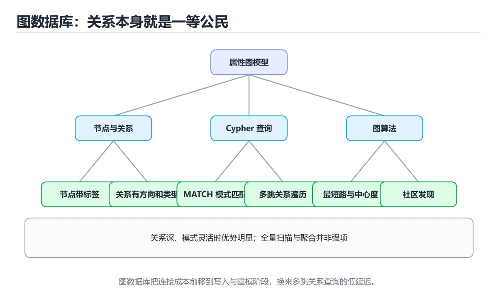
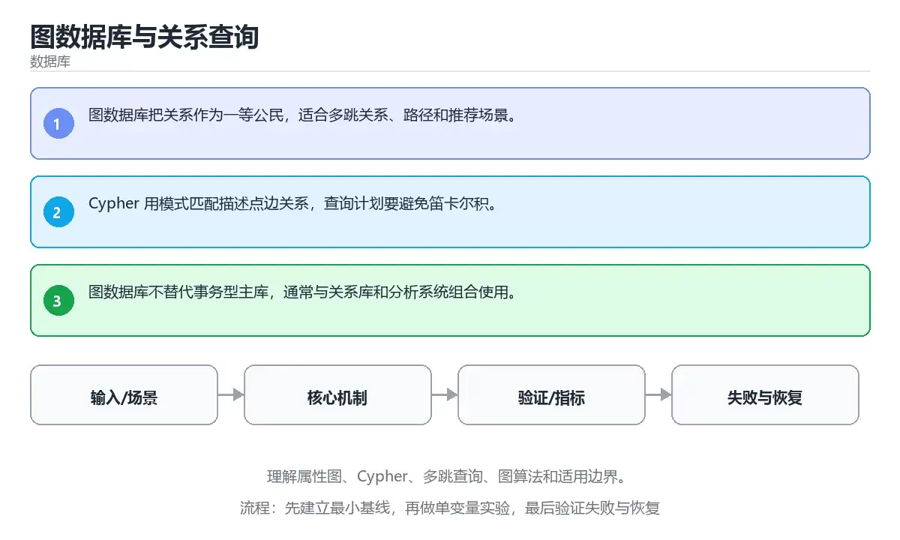

# 图数据库与关系查询

> 内容更新时间：2026-10-06 · 学习阶段：高级 · 预计用时：35 分钟





## 本节知识框架

**课程定位**：所属分类 `database`（数据库），课程主题 `图数据库与关系查询`，学习阶段 高级，建议用时 35 分钟。

本课主线：理解属性图、Cypher、多跳查询、图算法和适用边界。

**学完本课应当能够**
- 说清 `图数据库` 与 `Cypher` 的含义与区别，并各举一个正例和一个反例。
- 用本课示例验证 `多跳` 的行为，记录输入、输出与失败条件。
- 遇到「把图查询当多表连接」这类问题时，能说出触发条件与修复顺序。

### 复习清单

- [ ] 能复述 图数据库 的职责，并给出一个输入越界时的反例。
- [ ] 能用「图数据库与关系查询」的示例复现结果，并说明Cypher出错时输出的第一条信息。
- [ ] 能完成一次自测，并把错题对照错误表定位原因。

## 核心概念定义

| 术语 | 操作性定义 | 常见边界与风险 |
| --- | --- | --- |
| 图数据库 | 图数据库把关系作为一等公民，适合多跳关系、路径和推荐场景。 | 易错：拿它当事务型主库，或用多表连接硬套关系；它只擅长多跳与路径，通常要和关系库、分析系统组合使用。 |
| Cypher | 图数据库的声明式查询语言，用 (节点)-[关系]->(节点) 的图形语法描述模式匹配。 | 模式写松了就退化成笛卡尔积，入口属性没建索引时每次全表扫描；判断开销要看执行计划，不能只看结果对不对。 |
| 多跳 | 从起点沿边逐层扩展、经过多步到达目标节点的查询方式。 | 只限跳数不限边类型与方向时路径数会指数膨胀；要固定路径模式、限制深度，并让入口命中索引。 |
| 关系 | 图中的边：连接两个节点，带方向、类型和属性，是图数据库的一等公民。 | 易错：边没有方向与类型，查询语义含糊；正确做法是为边定义类型与方向，并写清允许的路径模式。 |

## 原理与运行机制

### 属性图：点、边、属性

图数据库常见的模型是**带标签的属性图**（labeled property graph）：

- **节点**（node）：表示实体，带一个或多个标签，例如 `:Person`、`:Company`。
- **关系**（relationship）：连接两个节点，有方向、有类型，例如 `-[:WORKS_AT]->`，也可以带属性（入职时间、权重）。
- **属性**（property）：键值对，挂在节点或关系上。

```text
(Alice:Person)-[:KNOWS {since: 2020}]->(Bob:Person)
(Bob:Person)-[:WORKS_AT]->(Acme:Company)
```

和关系库最大的区别在**存储模型**：关系库把关联放在外键列里，查询时靠连接运算拼回去；原生图数据库把每条边存成指向邻居的物理指针（index-free adjacency），遍历一跳就是顺着指针走到相邻节点，代价与"经过多少条边"相关，而不是与整张表的大小相关。

### 从关系到图：多跳为什么不同

关系库里查"朋友的朋友"要两次 JOIN：

```sql
SELECT f2.friend_id
FROM friend f1
JOIN friend f2 ON f1.friend_id = f2.person_id
WHERE f1.person_id = 1;
```

每增加一跳就多一次 JOIN，中间结果随度数放大；优化器还要在连接顺序、索引和临时表之间做选择。图数据库则把查询写成路径模式：

```cypher
MATCH (me:Person {id: 1})-[:FRIEND]->()-[:FRIEND]->(fof)
RETURN fof.id;
```

执行时从入口节点出发，沿 `FRIEND` 边扩展两次，只触碰真正相连的边。两者的差距不在"图一定更快"，而在于**代价增长方式**：图遍历的代价约等于访问的边数，关系查询的代价还包含连接产生的中间行。

但图查询也会爆炸。设平均度数为 d、跳数为 k，路径数约为 d^k：d=100、k=3 就是一百万条路径。多跳查询必须限定边类型、方向和最大深度。

### Cypher 的执行模型

Cypher 是声明式的：你描述"要找什么样的路径"，规划器决定从哪里开始、按什么顺序展开。

- **入口选择**：`MATCH (p:Person {email: $email})` 若能命中 `:Person(email)` 索引，就从单个节点开始；没有索引则退化为全标签扫描。
- **展开方向**：沿关系类型与方向扩展，尽早用 `WHERE` 过滤，避免先产生大量中间结果。
- **断开模式**：一条 `MATCH` 里两个互不连接的模式会产生**笛卡尔积**，行数是两边结果数相乘，必须用共享变量或分步 `WITH` 连起来。
- **可变长度路径**：`[:KNOWS*1..3]` 要显式给上下界，必要时加 `WHERE` 限制节点或关系属性。
- **执行计划**：`EXPLAIN` 只看计划不执行，`PROFILE` 会实际执行并给出每个算子的行数与 db hits。

看到 `AllNodesScan`、`CartesianProduct`、`VarLengthExpand` 的行数异常，就是该补索引或收紧模式的信号。

### 图算法：从遍历到全局计算

多跳查询是"局部遍历"，图算法则常需要"全局计算"：

- **最短路径**：无权图用 BFS，带权图用 Dijkstra 或 A*。
- **PageRank**：按入链质量迭代计算节点重要性，用于权威性排序。
- **社区发现**：Louvain、标签传播，用于分群与反欺诈团伙识别。
- **相似度与推荐**：共同邻居、Jaccard、三角计数。
- **连通分量**：判断两个节点是否属于同一子图，常用于账号合并。

这些算法通常跑在图计算引擎或"投影子图"上，而不是直接压在主库的在线事务上。全局算法的时间复杂度可能是 O(V+E) 到多轮迭代，数据规模大时要离线跑批。

### 超级节点与建模陷阱

**超级节点**是度数极高的节点，例如明星账号、热门商品、默认网关。一次两跳查询经过它，就要展开上百万条边，延迟瞬间失控。常见处理：

- 给边加类型和时间分区，查询时限定 `-[:FOLLOWS {year: 2026}]->`。
- 把超级节点拆成中间节点，或预计算并缓存结果。
- 对确实需要全量邻居的场景改用离线计算。

另一个陷阱是建模：把双向关系存成两条单向边会让路径计数翻倍；把时间只放在节点上，无法回答"某段时间内是否认识"。边和节点都应承载业务语义。

### 写入、事务与索引

- 创建一条边要同时更新两个端点的邻接结构，写放大比单表插入更明显；批量导入时用批处理事务，避免逐条提交。
- 超级节点上的并发写入容易产生锁竞争，需要控制批次大小。
- 为高频入口属性建索引（如 `CREATE INDEX FOR (p:Person) ON (p.email)`），为业务唯一键加约束。
- 图库通常提供 ACID 事务，但跨多个图或与外部系统的一致性仍要自己保证。

## 典型应用场景

### 适合图库的四个场景

| 场景 | 查询特征 | 例子 | 建模要点 |
| --- | --- | --- | --- |
| 反欺诈 | 多跳路径、环路 | 同设备、同银行卡串联出的账号团伙 | 统一实体 ID，边带时间 |
| 推荐 | 共同邻居、多跳 | 好友的好友买过什么 | 限制跳数与边类型 |
| 知识图谱 | 路径与实体消歧 | 企业股权穿透、人物关系 | 边带来源与置信度 |
| 运维拓扑 | 依赖与影响分析 | 服务 → 主机 → 机房 | 区分方向与实时性 |

### 不适合图库的场景

- 单表 CRUD 与简单外键查询：关系库更成熟，运维成本更低。
- 大范围聚合与报表：列式存储和 OLAP 引擎更合适。
- 全文检索与模糊匹配：搜索引擎更合适。
- 超大规模离线图算法：专用图计算框架更合适。

现实系统通常是组合：关系库做主数据与事务，图库放关系子集做多跳，数仓做聚合，三者通过统一 ID 对齐。

### 最小验证场景

- 准备：建 3 个节点、2 条边，记录一次两跳查询的结果与执行计划。
- 观察：先不建索引跑一次，再建入口索引跑一次，比较 db hits 与耗时。
- 判定：两次结果相同但 db hits 大幅下降，说明索引生效；结果不同则先检查边的方向与类型。
- 失败信号：路径数随跳数指数增长，或计划里出现 `CartesianProduct`，说明模式写得过松。

### 选择与边界

- `图数据库` 适合"关系比实体更重要"的问题；实体很多但关系稀疏时，收益有限。
- `Cypher` 要限定方向、类型与深度，否则规划器只能扩大扫描范围。
- `多跳` 的跳数每加一，代价可能乘以平均度数，必须用业务约束封顶。
- `关系` 要带方向、类型和属性，否则同一张图会被不同查询解释成不同语义。

## 代码/协议/SQL 示例

### 关系库里的多跳：递归 CTE

先看关系库怎么走两跳。下面的递归 CTE 从 `a` 出发，沿有向边逐层扩展，并用深度上限防止环导致无限递归：

```sql
WITH RECURSIVE edges(src, dst) AS (
  VALUES ('a', 'b'), ('b', 'c'), ('c', 'd')
), walk(node, depth) AS (
  SELECT 'a', 0
  UNION ALL
  SELECT edges.dst, walk.depth + 1
  FROM edges
  JOIN walk ON edges.src = walk.node
  WHERE walk.depth < 10
)
SELECT node, depth FROM walk ORDER BY depth;
```

```text
node | depth
a    |     0
b    |     1
c    |     2
d    |     3
```

`WHERE walk.depth < 10` 只是兜底；生产环境还要记录已访问节点（PostgreSQL 可用数组路径），否则有环图会重复输出同一条路径。

### 图库里的同一件事：Cypher 路径模式

在 Neo4j 等图库中，先建点边，再用路径模式查同样的两跳：

```cypher
CREATE (alice:Person {name: 'Alice'})
CREATE (bob:Person {name: 'Bob'})
CREATE (carol:Person {name: 'Carol'})
CREATE (alice)-[:KNOWS {since: 2020}]->(bob)
CREATE (bob)-[:KNOWS {since: 2021}]->(carol);

MATCH path = (a:Person {name: 'Alice'})-[:KNOWS*1..3]->(b:Person)
RETURN b.name AS reachable, length(path) AS hops
ORDER BY hops, reachable;
```

```text
reachable | hops
Bob       |    1
Carol     |    2
```

区别在于：Cypher 只声明"从 Alice 出发，沿 KNOWS 走 1 到 3 跳"，怎么走由规划器决定；`*1..3` 的深度上限是必须写的，否则大图上路径数会按度数指数膨胀。

### 读执行计划

对同一条查询执行 `PROFILE`，关注每个算子的实际行数与 db hits：

```text
Operator           Details                  Rows   DB Hits
NodeIndexSeek      a:Person(name='Alice')     1         2
VarLengthExpand    KNOWS*1..3                 2         4
ProduceResults                                2         0
```

如果第一行变成 `AllNodesScan`，说明入口属性没有索引，查询会扫描全部 `Person` 节点；db hits 会从个位数涨到与节点总数同量级。索引建好后再次 `PROFILE`，对比两次的 db hits，就能证明优化是否真正生效。

## 时间/空间复杂度或性能分析

### 路径数量：多跳的第一成本

设平均出度为 d、跳数为 k，不考虑去重时的路径数约为 d^k：

| 平均出度 | 2 跳 | 3 跳 | 4 跳 |
| --- | --- | --- | --- |
| 10 | 100 | 1,000 | 10,000 |
| 100 | 10,000 | 1,000,000 | 100,000,000 |
| 1,000 | 1,000,000 | 1,000,000,000 | 10^12 |

同一句查询，在社交图上多写一跳，代价可能从毫秒级变成分钟级。工程上用"最大深度 + 边类型 + 时间窗"三个约束把路径数压到可接受范围，并让入口命中索引。

### 遍历成本与连接成本

- **图遍历**：从入口出发访问的边数记为 E_visit，时间大致正比于 E_visit 加结果集大小，与全图规模无关。两跳且平均出度 50 时 E_visit 约 2500；若中间经过一个 500 万度的超级节点，E_visit 立刻变成 500 万。
- **关系连接**：每跳一次 JOIN，数据库要扫描或索引查找匹配行，中间结果可能被物化；三跳以上时优化器容易选错连接顺序。
- **索引查找**：入口属性有索引时是 O(log n) 级别的定位；没有索引则是 O(n) 的全标签扫描。

所以"图库更快"只在**从少量入口做局部遍历**时成立；全图聚合并不占优。

### 超级节点与内存

- 一条边在存储上约占几十字节（端点指针、类型、属性、版本信息），1000 万条边大致是几百 MB 到 1 GB 量级，具体取决于属性数量。
- 超级节点会让单次展开的中间结果暴涨，必须靠边类型、时间分区或预计算拆解。
- 并发查询会同时占用遍历缓冲与结果集内存，容量规划要按"峰值并发 × 单查询中间结果"估算。

### 测量方法

1. 用 `PROFILE` 记录每个算子的 rows 与 db hits，先定位是入口扫描还是展开爆炸。
2. 固定图规模、入口节点和跳数，跑 20 次取 P50/P95，而不是只看一次耗时。
3. 把并发从 1 提到 32，观察 P95 与 db hits 是否出现拐点。
4. 对照实验只改一项：加索引、收紧边类型、限制深度，比较改动前后的计划与延迟。

## 常见误区与易错点

| 容易写错的做法 | 实际现象 | 原因与正确做法 |
| --- | --- | --- |
| 把图查询当多表连接 | 多跳查询性能急剧下降。 | 按图模型建模，使用图数据库的多跳与路径语义。 |
| 关系没有方向与类型 | 查询语义含糊，结果不可解释。 | 为边定义类型与方向，并写清允许的路径模式。 |
| 入口属性没有索引 | 每次查询都全表扫描。 | 为高频入口属性建立索引并观察命中情况。 |
| 可变长度路径不设上限 | 路径数随跳数指数增长，查询超时。 | 显式写 `*1..3`，并限定边类型与方向。 |
| 用图库做全表聚合 | 遍历全部节点与边，延迟不可控。 | 聚合交给列式数仓或预计算。 |
| 忽略超级节点 | 单点展开百万条边，P99 飙升。 | 限定边时间窗、拆分节点或离线计算。 |
| 双向关系存成两条边 | 路径与计数翻倍，结果偏大。 | 用单条有向边表达语义，查询时按方向去重。 |

### 现场 1：把图查询当多表连接

**症状**：多跳查询性能急剧下降。

**根因与修复**：按图模型建模，使用图数据库的多跳与路径语义。

**自检**：在本课示例里复现「把图查询当多表连接」，改成按图模型建模，使用图数据库的多跳与路径语义后重跑；如果症状消失且失败路径按预期变化，说明定位正确。

### 现场 2：关系没有方向与类型

**症状**：查询语义含糊，结果不可解释。

**根因与修复**：为边定义类型与方向，并写清允许的路径模式。

**自检**：在本课示例里复现「关系没有方向与类型」，改成为边定义类型与方向，并写清允许的路径模式后重跑；如果症状消失且失败路径按预期变化，说明定位正确。

### 现场 3：入口属性没有索引

**症状**：每次查询都全表扫描。

**根因与修复**：为高频入口属性建立索引并观察命中情况。

**自检**：在本课示例里复现「入口属性没有索引」，改成为高频入口属性建立索引并观察命中情况后重跑；如果症状消失且失败路径按预期变化，说明定位正确。

## 与其他知识点的关系

| 关系 | 课程 | 为什么 |
| --- | --- | --- |
| 先修 | 《PostgreSQL 深入实践》 | 先用 SQL 连接与索引建立对照基线，才能看出图遍历省在哪。 |
| 关联 | 《时序数据库与监控数据》 | 指标存时序库、拓扑关系存图库，监控系统常把两者组合使用。 |
| 前置顺序 | 《实时数仓：从 Kafka 到 Flink》 | 同分类中安排在本课之前，建议先完成其自测。 |
| 后续顺序 | 《时序数据库与监控数据》 | 同分类中安排在本课之后，会继续使用本课术语。 |

## 自测题与参考答案

> 先独立作答，再对照参考答案；答案都能在本课正文、术语表或错误表里找到依据。

### 自测 1（概念复述）

不看正文，写出 `图数据库` 的操作性定义，并说明它与 `Cypher` 的区别。

**参考答案**：图数据库把关系作为一等公民，适合多跳关系、路径和推荐场景。

`Cypher` 的定位是：图数据库的声明式查询语言，用 (节点)-[关系]->(节点) 的图形语法描述模式匹配；两者的差别要从适用对象与失败模式上说明。

### 自测 2（排错）

本课错误表记录了「把图查询当多表连接」这类做法。请写出它会出现的现象、根因，以及修复顺序。

**参考答案**：现象是多跳查询性能急剧下降；正确做法是按图模型建模，使用图数据库的多跳与路径语义。修复时先复现现象并保留证据，再改动一处假设重跑，确认现象消失。

### 自测 3（动手验证）

运行本课的 `text` 示例，只改 图数据库 的一个输入并比较两次输出，抄下第一条错误信息。

**参考答案**：正常输入下 `text` 示例应当复现正文给出的结果；改动输入后，如果结果改变或报错，先核对它是否满足 `图数据库与关系查询` 中`图数据库` 的适用范围，再检查错误表里是否有同类现象。

### 自测 4（代码阅读）

阅读本课开头的 `text` 示例，说明它体现了`图数据库` 的哪一条性质，并指出改动哪个输入会让这条性质不再成立。

**参考答案**：`图数据库` 的定义是 图数据库把关系作为一等公民，适合多跳关系、路径和推荐场景，示例正是在实现这条定义。改动与 `图数据库` 有关的一个输入后，如果结果不再符合 `图数据库与关系查询` 的正文描述，就说明该性质只在当前前提成立。

### 自测 5（迁移）

把 `图数据库与关系查询` 的方法迁移到自己的项目：围绕 `图数据库` 写出一个与错误表同类的风险点，并说明触发条件和检验方式。

**参考答案**：例如「入口属性没有索引」，它会导致每次查询都全表扫描；检验方式是按为高频入口属性建立索引并观察命中情况改一处再复现，确认现象消失且没有引入新的失败分支。

### 自测 6（对比）

用一个表格对比 `图数据库` 与 `Cypher`：各写一行适用场景、一行失败表现。

**参考答案**：`图数据库` 的定义是图数据库把关系作为一等公民，适合多跳关系、路径和推荐场景；`Cypher` 的定义是图数据库的声明式查询语言，用 (节点)-[关系]->(节点) 的图形语法描述模式匹配。两者的失败表现分别对应本课错误表里与本术语相关的行。

### 自测 7（排错顺序）

面对「把图查询当多表连接」引发的问题，请把“复现 多跳查询性能急剧下降 → 保留证据 → 按图模型建模，使用图数据库的多跳与路径语义 → 回归验证”四步写成可执行的检查清单。

**参考答案**：第一步按多跳查询性能急剧下降复现；第二步记录输入、版本与完整报错；第三步按图模型建模，使用图数据库的多跳与路径语义只改一处；第四步重跑并确认失败路径也按预期变化。

### 自测 8（边界判断）

针对 `关系`，分别写出“可以使用”的条件和“结论不再成立”的条件。

**参考答案**：`关系` 是图中的边，连接两个节点并带方向、类型和属性；边界是边没有方向与类型时查询语义含糊，所以要先定义类型、方向和允许的路径模式，再验证结果。

### 自测 9（机制重建）

不看正文，按输入、转换、输出、验证四段重建 `图数据库` → `Cypher` → `多跳` → `关系` 的作用链。

**参考答案**：起点是 `图数据库` 的定义 图数据库把关系作为一等公民，适合多跳关系、路径和推荐场景；中间每一步都保留可观察状态；终点由 `关系` 检查，失败时回到错误表定位第一个偏离定义的步骤。

### 自测 10（综合排错）

在 `图数据库与关系查询` 中，现象是 每次查询都全表扫描。请围绕 入口属性没有索引 写出最小复现、关键证据、修复动作和回归验证，并说明为什么不能只凭一次运行下结论。

**参考答案**：先复现 入口属性没有索引，记录输入与完整错误；再按 为高频入口属性建立索引并观察命中情况 只改一处。回归时同时跑正常路径和边界路径，只有两次结果都可解释，才把修复视为完成。

### 自测 11（一分钟复述）

用每分钟约 200 字的速度复述 `图数据库与关系查询`：先给主问题，再按顺序说出 `图数据库`、`Cypher`、`多跳`、`关系`，最后给一个失败案例。

**自评标准**：主问题必须对应 理解属性图、Cypher、多跳查询、图算法和适用边界；每个术语都要能接上一句定义或边界；失败案例必须写成可观察现象，不能用“可能有风险”代替证据。

## 延伸阅读

想更直观地理解本课概念？推荐参阅以下图解专题：

- [图解 B+ 树与数据库索引](visual_btree_index.md)

## 术语速查

| 术语 | 一句话说明 |
| --- | --- |
| `图数据库` | 图数据库把关系作为一等公民，适合多跳关系、路径和推荐场景。 |
| `Cypher` | 图数据库的声明式查询语言，用 (节点)-[关系]->(节点) 的图形语法描述模式匹配。 |
| `多跳` | 从起点沿边逐层扩展、经过多步到达目标节点的查询方式。 |
| `关系` | 图中的边：连接两个节点，带方向、类型和属性，是图数据库的一等公民。 |
| `属性图` | 用带标签的节点、带类型的有向边和属性描述数据的图模型。 |
| `索引免费邻接` | 把边存成邻居指针，遍历一跳不需要查全局索引。 |
| `可变长度路径` | 用 `*1..n` 表示允许经过多跳的路径模式。 |
| `超级节点` | 度数极高的节点，展开时会放大中间结果与延迟。 |
| `执行计划` | 查询算子、行数与 db hits 的组合，用于定位扫描与展开成本。 |
| `PageRank` | 按入链质量迭代计算节点重要性的图算法。 |
| `投影子图` | 从主图抽取节点与边构成的计算视图，用于跑全局算法。 |

**术语关系**：`图数据库`（把关系作为一等公民） → `Cypher`（声明式图查询语言） → `多跳`（从起点沿边逐层扩展） → `关系`（带方向、类型和属性的边）。

## 考点精讲

`图数据库与关系查询` 的题库有 6 道题，下面逐题给出题干、正确项与判断依据：先自己作答，再核对正确项，最后回到正文对应小节复核。

### 考点 1：第 1 题

- **题目**：按“图数据库与关系查询”中 图数据库、Cypher、多跳 的实践顺序，把四个步骤排成从准备到复盘的合理顺序。
- **正确项**：先明确 图数据库 的输入、输出与约束 → 写出最小示例并核对 Cypher 的基线结果 → 只改一个变量，记录边界与失败路径的变化 → 固定版本与证据，把“图数据库与关系查询”的结论写成可复现记录
- **判断依据**：按《图数据库与关系查询》正文的先后，本题顺序是「先明确 图数据库 的输入、输出与约束」 → 「写出最小示例并核对 Cypher 的基线结果」 → 「只改一个变量，记录边界与失败路径的变化」 → 「固定版本与证据，把“图数据库与关系查询”的结论写成可复现记录」。术语 图数据库（图数据库与关系查询）：图数据库把关系作为一等公民，适合多跳关系、路径和推荐场景。易错点是把图查询当多表连接会造成多跳查询性能急剧下降，改法是按图模型建模，使用图数据库的多跳与路径语义。

### 考点 2：第 2 题

- **题目**：在 `图数据库与关系查询` 里，与 `图数据库` 有关的说法中，哪一项最符合理解属性图、Cypher、多跳查询、图算法和适用边界？
- **正确项**：Cypher 用模式匹配描述点边关系，查询计划要避免笛卡尔积。
- **判断依据**：本题正确项是「Cypher 用模式匹配描述点边关系，查询计划要避免笛卡尔积」。术语 图数据库（图数据库与关系查询）：图数据库把关系作为一等公民，适合多跳关系、路径和推荐场景，本题取「Cypher 用模式匹配描述点边关系，查询计划要避免笛卡尔积」这条。易错点是关系没有方向与类型，会造成查询语义含糊，结果不可解释，改法是为边定义类型与方向，并写清允许的路径模式。

### 考点 3：第 3 题

- **题目**：在 `图数据库与关系查询` 里，与 `图数据库` 有关的说法中，哪一项最符合理解属性图、Cypher、多跳查询、图算法和适用边界？（图数据库与关系查询·数据库 第 3 题）
- **正确项**：图数据库不替代事务型主库，通常与关系库和分析系统组合使用。
- **判断依据**：本题正确项是「图数据库不替代事务型主库，通常与关系库和分析系统组合使用」。术语 图数据库（图数据库与关系查询）：图数据库把关系作为一等公民，适合多跳关系、路径和推荐场景，本题取「图数据库不替代事务型主库，通常与关系库和分析系统组合使用」这条。易错点是入口属性没有索引，会造成每次查询都全表扫描，改法是为高频入口属性建立索引并观察命中情况。

### 考点 4：第 4 题

- **题目**：`图数据库与关系查询` 的主线是：理解属性图、Cypher、多跳查询、图算法和适用边界。下面哪一项与这条主线一致？
- **正确项**：理解属性图、Cypher、多跳查询、图算法和适用边界。
- **判断依据**：本题正确项是「理解属性图、Cypher、多跳查询、图算法和适用边界」。术语 图数据库（图数据库与关系查询）：图数据库把关系作为一等公民，适合多跳关系、路径和推荐场景，本题取「理解属性图、Cypher、多跳查询、图算法和适用边界」这条。易错点是把图查询当多表连接，会造成多跳查询性能急剧下降，改法是按图模型建模，使用图数据库的多跳与路径语义。

### 考点 5：第 5 题

- **题目**：课程 `理解属性图、Cypher、多跳查询、图算法和适用边界。`。在 `图数据库与关系查询` 里，`图数据库`、`Cypher` 与下面哪些选项属于同一层概念？（多选）
- **正确项**：图数据库；Cypher
- **判断依据**：按《图数据库与关系查询》的正文口径，本题要同时选中「图数据库」、「Cypher」，漏掉任一项都算没答全。术语 图数据库（图数据库与关系查询）：图数据库把关系作为一等公民，适合多跳关系、路径和推荐场景。易错点是把图查询当多表连接会造成多跳查询性能急剧下降，改法是按图模型建模，使用图数据库的多跳与路径语义。

### 考点 6：第 6 题

- **题目**：结合 `图数据库与关系查询` 中围绕 `图数据库` 的代码，哪一项说法与“理解属性图、Cypher、多跳查询、图算法和适用边界。”一致？
- **正确项**：图数据库把关系作为一等公民，适合多跳关系、路径和推荐场景。
- **判断依据**：本题正确项是「图数据库把关系作为一等公民，适合多跳关系、路径和推荐场景」。术语 图数据库（图数据库与关系查询）：图数据库把关系作为一等公民，适合多跳关系、路径和推荐场景，本题取「图数据库把关系作为一等公民，适合多跳关系、路径和推荐场景」这条。易错点是入口属性没有索引，会造成每次查询都全表扫描，改法是为高频入口属性建立索引并观察命中情况。

## 内容元数据

- 内容版本：v2.0
- 最后更新：2026-10-06
- 学习阶段：高级
- 适用环境：PostgreSQL / MySQL / SQLite 等主流数据库；本课聚焦其中的 图数据库。
- 内容来源：内置结构化课程与工程实践整理
- 相关主题：图数据库、Cypher、多跳、关系
- 质量版本：P0 测验标准 + P1 覆盖扩展 + P2 体验补全

## 参考资料与复核

- 最后复核：2026-10-04
- 下次复核：2027-06-17
- 复核范围：版本兼容、API 行为、安全建议与工程实践
- 来源性质：官方文档、标准或权威教材；本课核对关键词：图数据库、Cypher、多跳、关系。

| 参考资料 | 本课用途 |
| --- | --- |
| [MySQL 文档](https://dev.mysql.com/doc/) | 关系数据库与 InnoDB |
| [PostgreSQL 事务教程](https://www.postgresql.org/docs/current/tutorial-transactions.html) | ACID 与隔离级别 |
| [PostgreSQL 文档](https://www.postgresql.org/docs/) | SQL、索引、事务与并发 |

| [本课术语索引：图数据库与关系查询](#核心概念定义) | 按本课输入、术语边界和错误表现逐项核对 |
> 「图数据库与关系查询」的链接用于离线阅读后的延伸核对；App 不会自动联网。