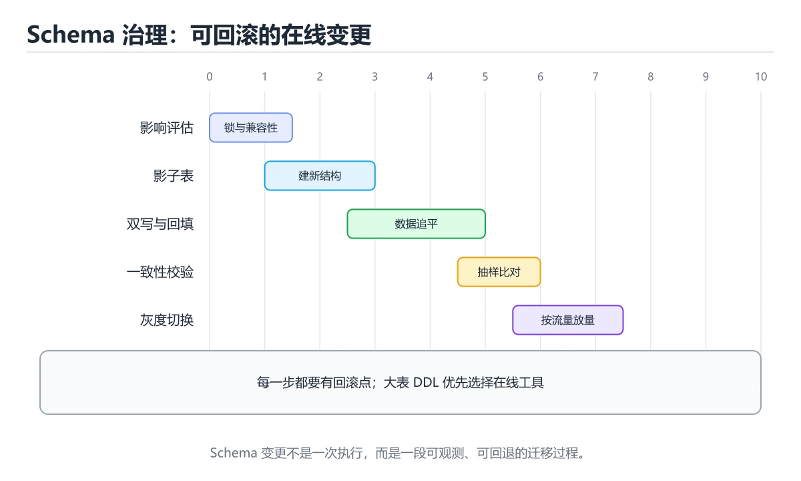
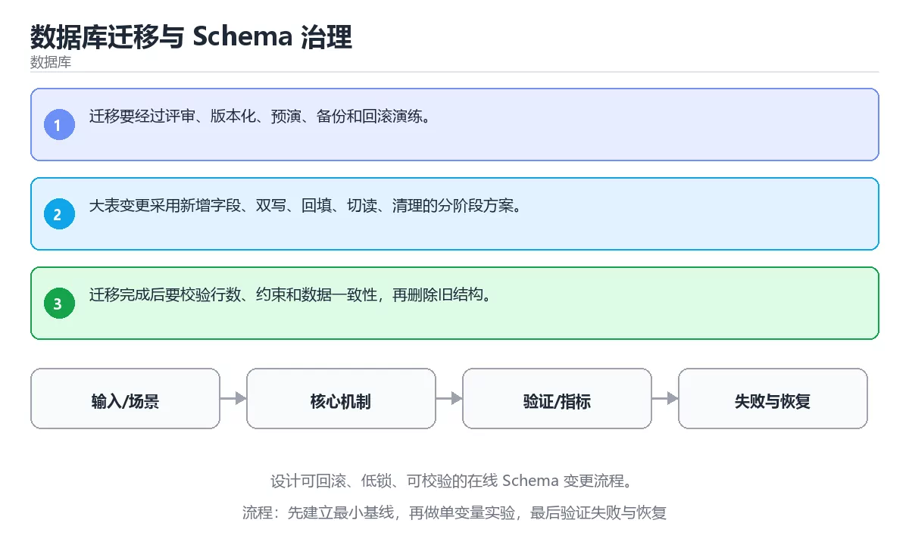

# 数据库迁移与 Schema 治理

> 内容更新时间：2026-10-06 · 学习阶段：高级 · 预计用时：30 分钟





## 本节知识框架

**课程定位**：所属分类 `database`（数据库），课程主题 `数据库迁移与 Schema 治理`，学习阶段 高级，建议用时 40 分钟。

本课主线：设计可回滚、低锁、可校验的在线 Schema 变更流程。

**学完本课应当能够**
- 说清 `迁移` 与 `Schema` 的含义与区别，并各举一个正例和一个反例。
- 用本课示例验证 `回滚` 的行为，记录输入、输出与失败条件。
- 遇到「迁移脚本没法回滚」这类问题时，能说出触发条件与修复顺序。

### 复习清单

- [ ] 能不看正文复述本课核心术语，并指出一个边界或反例。
- [ ] 能运行或推演本课示例，记录输入、输出与失败现象。
- [ ] 能完成一次自测，并把错题对照错误表定位原因。

## 核心概念定义

| 术语 | 操作性定义 | 常见边界与风险 |
| --- | --- | --- |
| 迁移 | 在保持业务目标不变的前提下更换平台、版本、数据结构或实现。 | 迁移要纳入版本控制按序号自动执行，靠人工记忆会致多环境结构不一致，完成后须校验行数与一致性再删旧结构。 |
| Schema | 数据库模式：表、列、类型、约束与索引的集合；变更要走可回滚、低锁的迁移流程。 | 直接 ALTER 线上表会触发长事务锁表、业务超时；变更 Schema 须先加新列双写、切读后再清理旧列。 |
| 回滚 | 按“数据库迁移与 Schema 治理”中 迁移、Schema、回滚 的实践顺序，把四个步骤排成从准备到复盘的合理顺序。 | 回滚脚本或向前修复方案必须随迁移一起提供，脚本没法回滚时发布出问题只能手工救火。 |
| 锁 | 限制同一时刻访问共享资源的同步原语，使用时要明确粒度、顺序和释放路径。 | 锁要明确粒度、顺序和释放路径；在线变更若长事务持锁会锁表使业务超时，须用低锁的分阶段迁移。 |

## 原理与运行机制

### 机制总览

**教材衔接：核心知识**

### 1. 迁移要经过评审、版本化、预演、备份和回滚演练。

- 关键做法：先用 reviewed_at 建立 迁移 的基线，再逐步加入边界与失败条件。
- 验证标准：reviewed_at 的输出能被他人复现，边界输入有对应用例。

### 2. 大表变更采用新增字段、双写、回填、切读、清理的分阶段方案。

把这条结论放回「数据库迁移与 Schema 治理」的完整流程里展开：

- 正文依据：能用自己的话解释：迁移要经过评审、版本化、预演、备份和回滚演练。
- 落地检查：把「2. 大表变更采用新增字段、双写、回填、切读、清理的分阶段方案。」改写成一条可执行的核对项，逐条验证输入、超时与失败路径。

### 3. 迁移完成后要校验行数、约束和数据一致性，再删除旧结构。

把这条结论放回「数据库迁移与 Schema 治理」的完整流程里展开：

- 正文依据：能用自己的话解释：迁移完成后要校验行数、约束和数据一致性，再删除旧结构。
- 落地检查：把「3. 迁移完成后要校验行数、约束和数据一致性，再删除旧结构。」改写成一条可执行的核对项，逐条验证输入、超时与失败路径。

**教材衔接：关键流程**

**教材衔接：实践路径**

**教材衔接：零基础精讲：把数据库迁移与 Schema 治理真正讲透**

### 先建立一个直觉

把数据库看成一本多人同时改写的账本：先定义事实与约束，再考虑索引、并发和恢复，最后才讨论性能。落到本课，「数据库迁移与 Schema 治理」关心的是 迁移 与 Schema 的配合，也就是说这条直觉要在 核心知识 里被具体验证。

本课的摘要可以当作一张地图：设计可回滚、低锁、可校验的在线 Schema 变更流程。

### 逐步拆解

1. 澄清输入与目标。先写清「数据库迁移与 Schema 治理」要解决的问题、合法输入范围和成功标准，再进入后续步骤。
2. 描述处理过程。把「迁移、Schema、回滚、锁」映射到具体步骤，每步都要求能单独验证。
3. 定义输出。明确 迁移 与 Schema 各自的产物，以及失败时留下什么证据。
4. 制造一次Schema的失败输入，确认错误出现在「核心知识」的哪一步，并写下恢复后如何验证状态已回到一致。
5. 用 reviewed_at 构造一个最小反例，证明「数据库迁移与 Schema 治理」的结论有边界。

### 把正文串成一条执行链

- **1. 迁移要经过评审、版本化、预演、备份和回滚演练。**：在「数据库迁移与 Schema 治理」里，「1. 迁移要经过评审、版本化、预演、备份和回滚演练。」这一步要先写清输入与预期，再记录实际结果和差异；结果不符时回到对应小节核对前提。
- **2. 大表变更采用新增字段、双写、回填、切读、清理的分阶段方案。**：在「数据库迁移与 Schema 治理」里，「2. 大表变更采用新增字段、双写、回填、切读、清理的分阶段方案。」这一步要先写清输入与预期，再记录实际结果和差异；结果不符时回到对应小节核对前提。
- **3. 迁移完成后要校验行数、约束和数据一致性，再删除旧结构。**：在「数据库迁移与 Schema 治理」里，「3. 迁移完成后要校验行数、约束和数据一致性，再删除旧结构。」这一步要先写清输入与预期，再记录实际结果和差异；结果不符时回到对应小节核对前提。
- **考点 1：按“数据库迁移与 Schema 治理”中 迁移、Schema、回滚 的实践顺序，把四个步骤排成从准备到复盘的合理顺序。**：先独立作答，再回到本课对应小节核对判断依据；答错时记录是哪一个前提被忽略。
- **考点 2：关于「大表变更采用新增字段、双写、回填、切读、清理的分阶段方案。」，下列说法正确的是？**：先独立作答，再回到本课对应小节核对判断依据；答错时记录是哪一个前提被忽略。
- **考点 3：关于「迁移完成后要校验行数、约束和数据一致性，再删除旧结构。」，下列说法正确的是？**：先独立作答，再回到本课对应小节核对判断依据；答错时记录是哪一个前提被忽略。

### 从测验反推易错点

- 参考判断：迁移要经过评审、版本化、预演、备份和回滚演练。
- 自问：如果去掉题干里的一个限定词，结论还成立吗？

- 参考判断：大表变更采用新增字段、双写、回填、切读、清理的分阶段方案。

- 参考判断：迁移完成后要校验行数、约束和数据一致性，再删除旧结构。

**检查点 4：本课的核心学习目标是什么？**

- 参考判断：设计可回滚、低锁、可校验的在线 Schema 变更流程。

- 参考判断：迁移、Schema

### 工程排错顺序

| 先查什么 | 要得到的证据 | 判断标准 |
| --- | --- | --- |
| 事务边界是否覆盖全部写操作？ | 日志、输入样例、测试或指标 | 能复现并解释，才算定位 |
| 索引是否匹配真实查询与排序？ | 日志、输入样例、测试或指标 | 能复现并解释，才算定位 |
| 迁移是否可回滚、可灰度、可校验？ | 日志、输入样例、测试或指标 | 能复现并解释，才算定位 |
| 锁等待与慢查询是否有观测？ | 日志、输入样例、测试或指标 | 能复现并解释，才算定位 |

### 变式训练

1. 先用一个单文件示例验证 reviewed_at，确认正确性后再引入框架或分布式组件。
2. 把 reviewed_at 的数据量提高一个数量级，观察延迟与内存的变化拐点。
3. 把 Schema 换成失败输入，记录错误信息与恢复动作。
5. 故意跳过 Schema 的检查再运行，比较与正常流程的差异，并说明这个检查挡住的到底是哪一类失败。
6. 把 迁移 的方案切换到低资源设备，重新评估默认参数、超时和降级策略。

### 迁移案例库

围绕 reviewed_at 重复同一套方法，每完成一轮就把差异写进笔记。

#### 迁移案例 1：围绕「迁移」做一次小实验

**验收**：迁移过程要留下 reviewed_at 的可运行记录，并说明Schema在新场景下是否仍然成立。

#### 迁移案例 3：围绕「回滚」做一次小实验

**步骤**：
1. 复述当前方案对「回滚」的假设，写成一句可证伪的话。

#### 迁移案例 4：围绕「锁」做一次小实验

**步骤**：
1. 复述当前方案对「锁」的假设，写成一句可证伪的话。

#### 迁移案例 5：围绕「迁移」做一次小实验

**步骤**：

#### 迁移案例 6：围绕「Schema」做一次小实验

**步骤**：

#### 迁移案例 7：围绕「回滚」做一次小实验

**步骤**：

#### 迁移案例 8：围绕「锁」做一次小实验

**步骤**：

#### 迁移案例 9：围绕「迁移」做一次小实验

**步骤**：

#### 迁移案例 10：围绕「Schema」做一次小实验

**步骤**：

#### 迁移案例 11：围绕「回滚」做一次小实验

**步骤**：

#### 迁移案例 12：围绕「锁」做一次小实验

**步骤**：

#### 迁移案例 13：围绕「迁移」做一次小实验

**步骤**：

#### 迁移案例 14：围绕「Schema」做一次小实验

**步骤**：

#### 迁移案例 15：围绕「回滚」做一次小实验

**步骤**：

#### 迁移案例 16：围绕「锁」做一次小实验

**步骤**：

<!-- p0-depth-v2:end -->

**教材衔接：验证步骤**

## 典型应用场景

- **迁移脚本没法回滚**：典型现象是发布出问题只能手工救火；正确做法是每个迁移提供回滚脚本或明确的向前修复方案。
- **直接改线上表结构**：典型现象是长事务锁表，业务请求超时；正确做法是用兼容迁移：先加新列并双写，切流量后再清理旧列。
- **迁移顺序靠人工记忆**：典型现象是多环境结构不一致；正确做法是迁移纳入版本控制并按序号自动执行。

### 最小验证场景

- 准备：保留 `text` 示例的原始输入，先记录 `数据库迁移与 Schema 治理` 的基线输出和完整运行命令。
- 观察：先核对 出现字面量 `最后复核日期`，再改变一个与 `迁移` 相关的条件。
- 判定：新结果与 `数据库迁移与 Schema 治理` 的基线不同不等于错误；只有当差异破坏了 `迁移` 的定义或错误表中的约束，才判定为失败。

### 选择与边界

- 使用 `迁移` 时，在保持业务目标不变的前提下更换平台、版本、数据结构或实现；易错：发布出问题只能手工救火；正确做法是每个迁移提供回滚脚本或明确的向前修复方案。
- 使用 `Schema` 时，数据库模式：表、列、类型、约束与索引的集合；变更要走可回滚、低锁的迁移流程；共享状态与调度顺序会改变结论，单线程或串行测试通过不等于并发下成立。
- 使用 `回滚` 时，按“数据库迁移与 Schema 治理”中 迁移、Schema、回滚 的实践顺序，把四个步骤排成从准备到复盘的合理顺序；易错：发布出问题只能手工救火；正确做法是每个迁移提供回滚脚本或明确的向前修复方案。
- 使用 `锁` 时，限制同一时刻访问共享资源的同步原语，使用时要明确粒度、顺序和释放路径；共享状态与调度顺序会改变结论，单线程或串行测试通过不等于并发下成立。

## 代码/协议/SQL 示例

### 最小可验证示例

**教材衔接：最小可运行示例**

下面这段代码演示 迁移 的最小路径，先原样运行，再按注释改一处：

```sql
BEGIN;
ALTER TABLE lessons ADD COLUMN reviewed_at date;
COMMENT ON COLUMN lessons.reviewed_at IS '最后复核日期';
COMMIT;
```

**教材衔接：预期输出**

```text
BEGIN
ALTER TABLE
COMMENT
COMMIT
```

## 时间/空间复杂度或性能分析

**性能关注点（数据库迁移与 Schema 治理）**：扫描行数与索引命中决定开销：记录查询耗时、执行计划与锁等待。

**本课特有开销（数据库迁移与 Schema 治理 · 迁移）**：索引能减少扫描行数，但会增加写入与存储开销，需要同时记录读、写两侧代价。

**测量方法**：以 `数据库迁移与 Schema 治理` 的 `迁移` 场景为对象，固定输入跑一遍记录基线，再把规模或并发度提高一个数量级复测；两次结果的差值与波动范围才是结论依据。

## 常见误区与易错点

| 容易写错的做法 | 实际现象 | 原因与正确做法 |
| --- | --- | --- |
| 迁移脚本没法回滚 | 发布出问题只能手工救火。 | 每个迁移提供回滚脚本或明确的向前修复方案。 |
| 直接改线上表结构 | 长事务锁表，业务请求超时。 | 用兼容迁移：先加新列并双写，切流量后再清理旧列。 |
| 迁移顺序靠人工记忆 | 多环境结构不一致。 | 迁移纳入版本控制并按序号自动执行。 |

### 现场 1：迁移脚本没法回滚

**症状**：发布出问题只能手工救火。

**根因与修复**：每个迁移提供回滚脚本或明确的向前修复方案。

**自检**：在本课示例里复现「迁移脚本没法回滚」，改成每个迁移提供回滚脚本或明确的向前修复方案后重跑；如果症状消失且失败路径按预期变化，说明定位正确。

### 现场 2：直接改线上表结构

**症状**：长事务锁表，业务请求超时。

**根因与修复**：用兼容迁移：先加新列并双写，切流量后再清理旧列。

**自检**：在本课示例里复现「直接改线上表结构」，改成用兼容迁移：先加新列并双写，切流量后再清理旧列后重跑；如果症状消失且失败路径按预期变化，说明定位正确。

### 现场 3：迁移顺序靠人工记忆

**症状**：多环境结构不一致。

**根因与修复**：迁移纳入版本控制并按序号自动执行。

**自检**：在本课示例里复现「迁移顺序靠人工记忆」，改成迁移纳入版本控制并按序号自动执行后重跑；如果症状消失且失败路径按预期变化，说明定位正确。

## 与其他知识点的关系

| 关系 | 课程 | 为什么 |
| --- | --- | --- |
| 先修 | 《时序数据库与监控数据》 | 本课会直接使用它的概念或操作前提。 |
| 关联 | 《数据库权限与安全》 | 用于横向比较或把本课结论迁移到相邻主题。 |
| 前置顺序 | 《时序数据库与监控数据》 | 同分类中安排在本课之前，建议先完成其自测。 |
| 后续顺序 | 《数据库权限与安全》 | 同分类中安排在本课之后，会继续使用本课术语。 |

把「数据库迁移与 Schema 治理」放回知识体系时，不只要记住“前面学过什么”，还要说明两个主题在输入、机制、资源边界和失败模式上的差异。这样才能把单课知识迁移到项目、排障和后续课程。

**教材衔接：复习与迁移**

## 自测题与参考答案

> 先独立作答，再对照参考答案；答案都能在本课正文、术语表或错误表里找到依据。

### 自测 1（概念复述）

不看正文，写出 `迁移` 的操作性定义，并说明它与 `Schema` 的区别。

**参考答案**：在保持业务目标不变的前提下更换平台、版本、数据结构或实现。

`Schema` 的定位是：数据库模式：表、列、类型、约束与索引的集合；变更要走可回滚、低锁的迁移流程；两者的差别要从适用对象与失败模式上说明。

### 自测 2（排错）

本课错误表记录了「迁移脚本没法回滚」这类做法。请写出它会出现的现象、根因，以及修复顺序。

**参考答案**：现象是发布出问题只能手工救火；正确做法是每个迁移提供回滚脚本或明确的向前修复方案。修复时先复现现象并保留证据，再改动一处假设重跑，确认现象消失。

### 自测 3（动手验证）

运行本课的 `text` 示例，改动其中一个输入后重新运行，记录输出与错误信息。

**参考答案**：正常输入下 `text` 示例应当复现正文给出的结果；改动输入后，如果结果改变或报错，先核对它是否满足 `数据库迁移与 Schema 治理` 中`迁移` 的适用范围，再检查错误表里是否有同类现象。

### 自测 4（代码阅读）

阅读本课开头的 `text` 示例，说明它体现了`迁移` 的哪一条性质，并指出改动哪个输入会让这条性质不再成立。

**参考答案**：`迁移` 的定义是 在保持业务目标不变的前提下更换平台、版本、数据结构或实现，示例正是在实现这条定义。改动与 `迁移` 有关的一个输入后，如果结果不再符合 `数据库迁移与 Schema 治理` 的正文描述，就说明该性质只在当前前提成立。

### 自测 5（迁移）

把 `数据库迁移与 Schema 治理` 的方法迁移到自己的项目：围绕 `迁移` 写出一个与错误表同类的风险点，并说明触发条件和检验方式。

**参考答案**：例如「迁移顺序靠人工记忆」，它会导致多环境结构不一致；检验方式是按迁移纳入版本控制并按序号自动执行改一处再复现，确认现象消失且没有引入新的失败分支。

### 自测 6（对比）

用一个表格对比 `迁移` 与 `Schema`：各写一行适用场景、一行失败表现。

**参考答案**：`迁移` 的定义是在保持业务目标不变的前提下更换平台、版本、数据结构或实现；`Schema` 的定义是数据库模式：表、列、类型、约束与索引的集合；变更要走可回滚、低锁的迁移流程。两者的失败表现分别对应本课错误表里与本术语相关的行。

### 自测 7（排错顺序）

面对「迁移脚本没法回滚」引发的问题，请把“复现 发布出问题只能手工救火 → 保留证据 → 每个迁移提供回滚脚本或明确的向前修复方案 → 回归验证”四步写成可执行的检查清单。

**参考答案**：第一步按发布出问题只能手工救火复现；第二步记录输入、版本与完整报错；第三步按每个迁移提供回滚脚本或明确的向前修复方案只改一处；第四步重跑并确认失败路径也按预期变化。

### 自测 8（边界判断）

针对 `锁`，分别写出“可以使用”的条件和“结论不再成立”的条件。

**参考答案**：共享状态与调度顺序会改变结论，单线程或串行测试通过不等于并发下成立。 同时要把 `锁` 的定义 限制同一时刻访问共享资源的同步原语，使用时要明确粒度、顺序和释放路径 与实际输入逐项对照。

### 自测 9（机制重建）

不看正文，按输入、转换、输出、验证四段重建 `迁移` → `Schema` → `回滚` → `锁` 的作用链。

**参考答案**：起点是 `迁移` 的定义 在保持业务目标不变的前提下更换平台、版本、数据结构或实现；中间每一步都保留可观察状态；终点由 `锁` 检查，失败时回到错误表定位第一个偏离定义的步骤。

### 自测 10（综合排错）

在 `数据库迁移与 Schema 治理` 中，现象是 多环境结构不一致。请围绕 迁移顺序靠人工记忆 写出最小复现、关键证据、修复动作和回归验证，并说明为什么不能只凭一次运行下结论。

**参考答案**：先复现 迁移顺序靠人工记忆，记录输入与完整错误；再按 迁移纳入版本控制并按序号自动执行 只改一处。回归时同时跑正常路径和边界路径，只有两次结果都可解释，才把修复视为完成。

### 自测 11（一分钟复述）

用每分钟约 200 字的速度复述 `数据库迁移与 Schema 治理`：先给主问题，再按顺序说出 `迁移`、`Schema`、`回滚`、`锁`，最后给一个失败案例。

**自评标准**：主问题必须对应 设计可回滚、低锁、可校验的在线 Schema 变更流程；每个术语都要能接上一句定义或边界；失败案例必须写成可观察现象，不能用“可能有风险”代替证据。

## 术语速查

| 术语 | 一句话说明 |
| --- | --- |
| `迁移` | 在保持业务目标不变的前提下更换平台、版本、数据结构或实现。 |
| `Schema` | 数据库模式：表、列、类型、约束与索引的集合；变更要走可回滚、低锁的迁移流程。 |
| `回滚` | 按“数据库迁移与 Schema 治理”中 迁移、Schema、回滚 的实践顺序，把四个步骤排成从准备到复盘的合理顺序。 |
| `锁` | 限制同一时刻访问共享资源的同步原语，使用时要明确粒度、顺序和释放路径。 |

**术语关系**：`迁移`（在保持业务目标不变的前提下更换平台、版本、数据结构或实现） → `Schema`（数据库模式：表、列、类型、约束与索引的集合） → `回滚`（按“数据库迁移与 Schema 治理”中 迁移、Schema、回滚 的实践顺序） → `锁`（限制同一时刻访问共享资源的同步原语）。

## 考点精讲

`数据库迁移与 Schema 治理` 的题库有 6 道题，下面逐题给出题干、正确项与判断依据：先自己作答，再核对正确项，最后回到正文对应小节复核。

### 考点 1：第 1 题

- **题目**：按“数据库迁移与 Schema 治理”中 迁移、Schema、回滚 的实践顺序，把四个步骤排成从准备到复盘的合理顺序。
- **正确项**：先明确 迁移 的输入、输出与约束 → 写出最小示例并核对 Schema 的基线结果 → 只改一个变量，记录边界与失败路径的变化 → 固定版本与证据，把“数据库迁移与 Schema 治理”的结论写成可复现记录
- **判断依据**：按《数据库迁移与 Schema 治理》正文的先后，本题顺序是「先明确 迁移 的输入、输出与约束」 → 「写出最小示例并核对 Schema 的基线结果」 → 「只改一个变量，记录边界与失败路径的变化」 → 「固定版本与证据，把“数据库迁移与 Schema 治理”的结论写成可复现记录」。术语 迁移（数据库迁移与 Schema 治理）：在保持业务目标不变的前提下更换平台、版本、数据结构或实现。易错点是迁移脚本没法回滚会造成发布出问题只能手工救火，改法是每个迁移提供回滚脚本或明确的向前修复方案。

### 考点 2：第 2 题

- **题目**：在 `数据库迁移与 Schema 治理` 里，与 `迁移` 有关的说法中，哪一项最符合设计可回滚、低锁、可校验的在线 Schema 变更流程？
- **正确项**：大表变更采用新增字段、双写、回填、切读、清理的分阶段方案。
- **判断依据**：本题正确项是「大表变更采用新增字段、双写、回填、切读、清理的分阶段方案」。术语 迁移（数据库迁移与 Schema 治理）：在保持业务目标不变的前提下更换平台、版本、数据结构或实现，本题取「大表变更采用新增字段、双写、回填、切读、清理的分阶段方案」这条。易错点是直接改线上表结构，会造成长事务锁表，业务请求超时，改法是用兼容迁移：先加新列并双写，切流量后再清理旧列。

### 考点 3：第 3 题

- **题目**：在 `数据库迁移与 Schema 治理` 里，与 `迁移` 有关的说法中，哪一项最符合设计可回滚、低锁、可校验的在线 Schema 变更流程？（数据库迁移与 Schema 治理·数据库 第 3 题）
- **正确项**：迁移完成后要校验行数、约束和数据一致性，再删除旧结构。
- **判断依据**：本题正确项是「迁移完成后要校验行数、约束和数据一致性，再删除旧结构」。术语 迁移（数据库迁移与 Schema 治理）：在保持业务目标不变的前提下更换平台、版本、数据结构或实现，本题取「迁移完成后要校验行数、约束和数据一致性，再删除旧结构」这条。易错点是迁移顺序靠人工记忆，会造成多环境结构不一致，改法是迁移纳入版本控制并按序号自动执行。

### 考点 4：第 4 题

- **题目**：`数据库迁移与 Schema 治理` 的主线是：设计可回滚、低锁、可校验的在线 Schema 变更流程。下面哪一项与这条主线一致？
- **正确项**：设计可回滚、低锁、可校验的在线 Schema 变更流程。
- **判断依据**：本题正确项是「设计可回滚、低锁、可校验的在线 Schema 变更流程」。术语 迁移（数据库迁移与 Schema 治理）：在保持业务目标不变的前提下更换平台、版本、数据结构或实现，本题取「设计可回滚、低锁、可校验的在线 Schema 变更流程」这条。易错点是迁移脚本没法回滚，会造成发布出问题只能手工救火，改法是每个迁移提供回滚脚本或明确的向前修复方案。

### 考点 5：第 5 题

- **题目**：课程 `设计可回滚、低锁、可校验的在线 Schema 变更流程。`。在 `数据库迁移与 Schema 治理` 里，`迁移`、`Schema` 与下面哪些选项属于同一层概念？（多选）
- **正确项**：迁移；Schema
- **判断依据**：按《数据库迁移与 Schema 治理》的正文口径，本题要同时选中「迁移」、「Schema」，漏掉任一项都算没答全。术语 迁移（数据库迁移与 Schema 治理）：在保持业务目标不变的前提下更换平台、版本、数据结构或实现。易错点是直接改线上表结构，会造成长事务锁表，业务请求超时，改法是用兼容迁移：先加新列并双写，切流量后再清理旧列。

### 考点 6：第 6 题

- **题目**：结合 `数据库迁移与 Schema 治理` 中围绕 `迁移` 的代码，哪一项说法与“设计可回滚、低锁、可校验的在线 Schema 变更流程。”一致？
- **正确项**：迁移要经过评审、版本化、预演、备份和回滚演练。
- **判断依据**：本题正确项是「迁移要经过评审、版本化、预演、备份和回滚演练」。术语 迁移（数据库迁移与 Schema 治理）：在保持业务目标不变的前提下更换平台、版本、数据结构或实现，本题取「迁移要经过评审、版本化、预演、备份和回滚演练」这条。易错点是迁移顺序靠人工记忆，会造成多环境结构不一致，改法是迁移纳入版本控制并按序号自动执行。

### 考点 7：`迁移`

- **要点**：在保持业务目标不变的前提下更换平台、版本、数据结构或实现。
- **迁移 的边界**：易错：发布出问题只能手工救火；正确做法是每个迁移提供回滚脚本或明确的向前修复方案。

### 考点 8：`Schema`

- **要点**：数据库模式：表、列、类型、约束与索引的集合；变更要走可回滚、低锁的迁移流程。
- **Schema 的边界**：共享状态与调度顺序会改变结论，单线程或串行测试通过不等于并发下成立。

### 考点 9：`回滚`

- **要点**：按“数据库迁移与 Schema 治理”中 迁移、Schema、回滚 的实践顺序，把四个步骤排成从准备到复盘的合理顺序。
- **回滚 的边界**：易错：发布出问题只能手工救火；正确做法是每个迁移提供回滚脚本或明确的向前修复方案。

### 考点 10：`锁`

- **要点**：限制同一时刻访问共享资源的同步原语，使用时要明确粒度、顺序和释放路径。
- **锁 的边界**：共享状态与调度顺序会改变结论，单线程或串行测试通过不等于并发下成立。

### 考点 11：排错——迁移脚本没法回滚

- **现象**：发布出问题只能手工救火。
- **处理**：每个迁移提供回滚脚本或明确的向前修复方案。

### 考点 12：排错——直接改线上表结构

- **现象**：长事务锁表，业务请求超时。
- **处理**：用兼容迁移：先加新列并双写，切流量后再清理旧列。

### 考点 13：综合辨析——`迁移` 与 `锁`

- **辨析点**：`迁移` 的定义是 在保持业务目标不变的前提下更换平台、版本、数据结构或实现；`锁` 的定义是 限制同一时刻访问共享资源的同步原语，使用时要明确粒度、顺序和释放路径。
- **答题要求**：面对 `数据库迁移与 Schema 治理` 的题目，先判断描述的是 `迁移` 还是 `锁`，再归到对应定义，最后写出一个会让该定义失效的边界输入。

### 考点 14：排错评分点

- **现象分**：能写出 发布出问题只能手工救火，而不是只写“程序有错”。
- **证据分**：保留触发 迁移脚本没法回滚 的输入、版本和错误原文。
- **修复分**：按 每个迁移提供回滚脚本或明确的向前修复方案 只改一处，并同时回归正常路径与边界路径。

## 内容元数据

- 内容版本：v2.0
- 最后更新：2026-10-06
- 学习阶段：高级
- 适用环境：PostgreSQL / MySQL / SQLite 等主流数据库；本课聚焦其中的 迁移。
- 内容来源：内置结构化课程与工程实践整理
- 相关主题：迁移、Schema、回滚、锁
- 质量版本：P0 测验标准 + P1 覆盖扩展 + P2 体验补全

## 参考资料与复核

- 最后复核：2026-10-04
- 下次复核：2027-06-17
- 复核范围：版本兼容、API 行为、安全建议与工程实践
- 来源性质：官方文档、标准或权威教材；本课核对关键词：迁移、Schema、回滚、锁。

| 参考资料 | 本课用途 |
| --- | --- |
| [JDBC 事务](https://docs.oracle.com/javase/tutorial/jdbc/basics/transactions.html) | 连接事务与回滚 |
| [MongoDB 文档](https://www.mongodb.com/docs/) | 文档数据库与聚合 |
| [SQLite 文档](https://sqlite.org/docs.html) | 嵌入式 SQL 与事务 |

| [本课术语索引：数据库迁移与 Schema 治理](#核心概念定义) | 按本课输入、术语边界和错误表现逐项核对 |
> 「数据库迁移与 Schema 治理」的链接用于离线阅读后的延伸核对；App 不会自动联网。