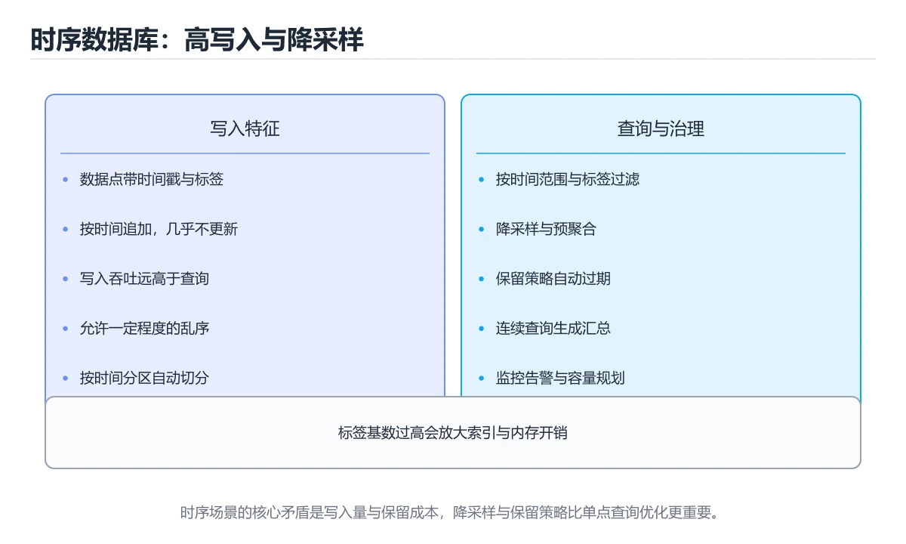
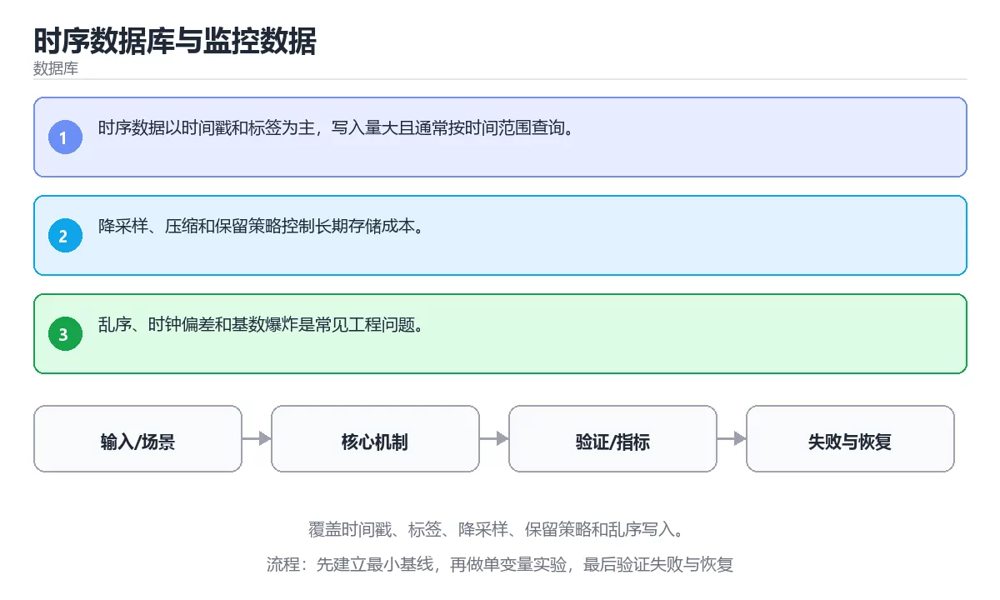

# 时序数据库与监控数据

> 内容更新时间：2026-10-06 · 学习阶段：高级 · 预计用时：30 分钟





## 本节知识框架

**课程定位**：所属分类 `database`（数据库），课程主题 `时序数据库与监控数据`，学习阶段 高级，建议用时 45 分钟。

本课主线：覆盖时间戳、标签、降采样、保留策略和乱序写入。

**学完本课应当能够**
- 说清 `时序数据库` 与 `标签` 的含义与区别，并各举一个正例和一个反例。
- 用本课示例验证 `降采样` 的行为，记录输入、输出与失败条件。
- 遇到「用普通表存高频时序数据」这类问题时，能说出触发条件与修复顺序。

### 复习清单

- [ ] 能不看正文复述本课核心术语，并指出一个边界或反例。
- [ ] 能运行或推演本课示例，记录输入、输出与失败现象。
- [ ] 能完成一次自测，并把错题对照错误表定位原因。

## 核心概念定义

| 术语 | 操作性定义 | 常见边界与风险 |
| --- | --- | --- |
| 时序数据库 | 专门存储按时间到达的数据点，优化时间范围查询、聚合和过期清理。 | 易错：写入与查询都随数据量恶化；正确做法是用时序数据库或分区表，按时间分片并启用压缩。 |
| 标签 | 附加在数据点上的键值维度，用于筛选、聚合和分组，但不应频繁变化。 | 只在「附加在数据点上的键值维度，用于筛选、聚合和分组，但不应频繁变化」这一前提下成立，换输入或换环境要重新验证。 |
| 降采样 | 把高频采样点按时间窗口聚合成低频数据（如 1 秒变 1 分钟），用于长期存储与趋势查询。 | 易错：存储成本无限增长；正确做法是定义原始、分钟、小时多级保留策略。 |
| 保留策略 | 规定数据保存多久、何时归档或删除，并满足审计和合规要求。 | 易错：存储成本无限增长；正确做法是定义原始、分钟、小时多级保留策略。 |

## 原理与运行机制

### 机制总览

**教材衔接：核心知识**

### 1. 时序数据以时间戳和标签为主，写入量大且通常按时间范围查询。

- 关键做法：先用 date_trunc 建立 时序数据库 的基线，再逐步加入边界与失败条件。
- 验证标准：标签 的异常路径有明确错误信息与恢复动作。

### 2. 降采样、压缩和保留策略控制长期存储成本。

把这条结论放回「时序数据库与监控数据」的完整流程里展开：

- 正文依据：能用自己的话解释：时序数据以时间戳和标签为主，写入量大且通常按时间范围查询。
- 落地检查：把「2. 降采样、压缩和保留策略控制长期存储成本。」改写成一条可执行的核对项，逐条验证输入、超时与失败路径。

### 3. 乱序、时钟偏差和基数爆炸是常见工程问题。

把这条结论放回「时序数据库与监控数据」的完整流程里展开：

- 正文依据：能用自己的话解释：降采样、压缩和保留策略控制长期存储成本。
- 落地检查：把「3. 乱序、时钟偏差和基数爆炸是常见工程问题。」改写成一条可执行的核对项，逐条验证输入、超时与失败路径。

**教材衔接：关键流程**

**教材衔接：实践路径**

**教材衔接：零基础精讲：把时序数据库与监控数据真正讲透**

### 先建立一个直觉

把数据库看成一本多人同时改写的账本：先定义事实与约束，再考虑索引、并发和恢复，最后才讨论性能。落到本课，「时序数据库与监控数据」关心的是 时序数据库 与 标签 的配合，也就是说这条直觉要在 核心知识 里被具体验证。

本课的摘要可以当作一张地图：覆盖时间戳、标签、降采样、保留策略和乱序写入。

### 逐步拆解

1. 澄清输入与目标。先写清「时序数据库与监控数据」要解决的问题、合法输入范围和成功标准，再进入后续步骤。
2. 描述处理过程。把「时序数据库、标签、降采样、保留策略」映射到具体步骤，每步都要求能单独验证。
3. 定义输出。明确 时序数据库 与 标签 各自的产物，以及失败时留下什么证据。
4. 制造一次标签的失败输入，确认错误出现在「核心知识」的哪一步，并写下恢复后如何验证状态已回到一致。
5. 把「核心知识」里的最小示例抄成 date_trunc 一行的输入，先手算结果再执行，确认两者一致。

### 把正文串成一条执行链

- **考点 3：关于「乱序、时钟偏差和基数爆炸是常见工程问题。」，下列说法正确的是？**：先独立作答，再回到本课对应小节核对判断依据；答错时记录是哪一个前提被忽略。

### 从测验反推易错点

- 参考判断：时序数据以时间戳和标签为主，写入量大且通常按时间范围查询。
- 自问：如果去掉题干里的一个限定词，结论还成立吗？

- 参考判断：降采样、压缩和保留策略控制长期存储成本。

- 参考判断：乱序、时钟偏差和基数爆炸是常见工程问题。

**检查点 4：本课的核心学习目标是什么？**

- 参考判断：覆盖时间戳、标签、降采样、保留策略和乱序写入。

- 参考判断：TIMESTAMP、timestamp

### 工程排错顺序

| 先查什么 | 要得到的证据 | 判断标准 |
| --- | --- | --- |
| 事务边界是否覆盖全部写操作？ | 日志、输入样例、测试或指标 | 能复现并解释，才算定位 |
| 索引是否匹配真实查询与排序？ | 日志、输入样例、测试或指标 | 能复现并解释，才算定位 |
| 迁移是否可回滚、可灰度、可校验？ | 日志、输入样例、测试或指标 | 能复现并解释，才算定位 |
| 锁等待与慢查询是否有观测？ | 日志、输入样例、测试或指标 | 能复现并解释，才算定位 |

### 变式训练

1. 把 时序数据库 的实现压缩到一个进程内，去掉所有外部依赖后再谈扩展。
2. 把 date_trunc 的数据量提高一个数量级，观察延迟与内存的变化拐点。
3. 让 date_trunc 的外部依赖超时，确认系统能回滚或补偿，而不是留下脏数据。
5. 故意跳过 标签 的检查再运行，比较与正常流程的差异，并说明这个检查挡住的到底是哪一类失败。
6. 把 时序数据库 的方案切换到低资源设备，重新评估默认参数、超时和降级策略。

### 迁移案例库

下面用不同约束重复同一套方法，每轮只改变 时序数据库 的一个取值并记录结论。

#### 迁移案例 1：围绕「时序数据库」做一次小实验

**验收**：结论要能追溯到正文的具体小节与代码位置，并记录标签相关的指标变化。

#### 迁移案例 2：围绕「标签」做一次小实验

**步骤**：
1. 复述当前方案对「标签」的假设，写成一句可证伪的话。

#### 迁移案例 3：围绕「降采样」做一次小实验

**步骤**：
1. 复述当前方案对「降采样」的假设，写成一句可证伪的话。

#### 迁移案例 4：围绕「保留策略」做一次小实验

**步骤**：
1. 复述当前方案对「保留策略」的假设，写成一句可证伪的话。

#### 迁移案例 5：围绕「时序数据库」做一次小实验

**步骤**：

#### 迁移案例 6：围绕「标签」做一次小实验

**步骤**：

#### 迁移案例 7：围绕「降采样」做一次小实验

**步骤**：

#### 迁移案例 8：围绕「保留策略」做一次小实验

**步骤**：

#### 迁移案例 9：围绕「时序数据库」做一次小实验

**步骤**：

#### 迁移案例 10：围绕「标签」做一次小实验

**步骤**：

#### 迁移案例 11：围绕「降采样」做一次小实验

**步骤**：

#### 迁移案例 12：围绕「保留策略」做一次小实验

**步骤**：

#### 迁移案例 13：围绕「时序数据库」做一次小实验

**步骤**：

#### 迁移案例 14：围绕「标签」做一次小实验

**步骤**：

#### 迁移案例 15：围绕「降采样」做一次小实验

**步骤**：

#### 迁移案例 16：围绕「保留策略」做一次小实验

**步骤**：

<!-- p0-depth-v2:end -->

**教材衔接：验证步骤**

## 典型应用场景

**教材衔接：深度拓展与实战**

这一节把「时序数据库与监控数据」正文里的定义、代码和失败模式串成一条可操作的复习路线。

### 边界条件与常见反例

「时序数据库与监控数据」的边界不只包括最大最小值，还要覆盖空、重复和失败：

### 工程检查表

- [ ] 能否用自己的话说明时序数据库与监控数据解决什么问题，以及它不负责什么？
- [ ] 能否说明 时序数据库 的正常输出，以及失败时留下的错误信息？
- [ ] 能否解释本课关键词在真实项目中的边界与取舍？
- [ ] 换一个输入后，date_trunc 的判断依据是否仍然成立？

### 最小验证场景

- 准备：保留 `text` 示例的原始输入，先记录 `时序数据库与监控数据` 的基线输出和完整运行命令。
- 观察：先核对 调用了 `samples()`，再改变一个与 `时序数据库` 相关的条件。
- 判定：新结果与 `时序数据库与监控数据` 的基线不同不等于错误；只有当差异破坏了 `时序数据库` 的定义或错误表中的约束，才判定为失败。

### 选择与边界

- 使用 `时序数据库` 时，先满足它的定义：专门存储按时间到达的数据点，优化时间范围查询、聚合和过期清理；易错：写入与查询都随数据量恶化；正确做法是用时序数据库或分区表，按时间分片并启用压缩。
- 使用 `标签` 时，先满足它的定义：附加在数据点上的键值维度，用于筛选、聚合和分组，但不应频繁变化；只在「附加在数据点上的键值维度，用于筛选、聚合和分组，但不应频繁变化」这一前提下成立，换输入或换环境要重新验证。
- 使用 `降采样` 时，先满足它的定义：把高频采样点按时间窗口聚合成低频数据（如 1 秒变 1 分钟），用于长期存储与趋势查询；易错：存储成本无限增长；正确做法是定义原始、分钟、小时多级保留策略。
- 使用 `保留策略` 时，先满足它的定义：规定数据保存多久、何时归档或删除，并满足审计和合规要求；易错：存储成本无限增长；正确做法是定义原始、分钟、小时多级保留策略。

## 代码/协议/SQL 示例

### 最小可验证示例

**教材衔接：最小可运行示例**

下面示例用于验证 时序数据库 的最小输入、处理和输出。先原样运行，再只修改一个值：

```sql
WITH samples(ts, value) AS (
  VALUES (TIMESTAMP '2026-10-05 10:00', 12.0),
         (TIMESTAMP '2026-10-05 10:05', 15.0),
         (TIMESTAMP '2026-10-05 10:10', 9.0)
)
SELECT date_trunc('hour', ts) AS bucket, avg(value) AS avg_value
FROM samples
GROUP BY bucket;
```

**教材衔接：预期输出**

```text
bucket              | avg_value
2026-10-05 10:00:00 |      12.0
```

## 时间/空间复杂度或性能分析

**性能关注点（时序数据库与监控数据）**：扫描行数与索引命中决定开销：记录查询耗时、执行计划与锁等待。

**测量方法**：以 `时序数据库与监控数据` 的 `时序数据库` 场景为对象，固定输入跑一遍记录基线，再把规模或并发度提高一个数量级复测；两次结果的差值与波动范围才是结论依据。

## 常见误区与易错点

| 容易写错的做法 | 实际现象 | 原因与正确做法 |
| --- | --- | --- |
| 用普通表存高频时序数据 | 写入与查询都随数据量恶化。 | 用时序数据库或分区表，按时间分片并启用压缩。 |
| 没有降采样与保留策略 | 存储成本无限增长。 | 定义原始、分钟、小时多级保留策略。 |
| 查询不带时间范围 | 全表扫描拖垮实例。 | 查询必须带时间过滤，并利用时间索引。 |

### 现场 1：用普通表存高频时序数据

**症状**：写入与查询都随数据量恶化。

**根因与修复**：用时序数据库或分区表，按时间分片并启用压缩。

**自检**：在本课示例里复现「用普通表存高频时序数据」，改成用时序数据库或分区表，按时间分片并启用压缩后重跑；如果症状消失且失败路径按预期变化，说明定位正确。

### 现场 2：没有降采样与保留策略

**症状**：存储成本无限增长。

**根因与修复**：定义原始、分钟、小时多级保留策略。

**自检**：在本课示例里复现「没有降采样与保留策略」，改成定义原始、分钟、小时多级保留策略后重跑；如果症状消失且失败路径按预期变化，说明定位正确。

### 现场 3：查询不带时间范围

**症状**：全表扫描拖垮实例。

**根因与修复**：查询必须带时间过滤，并利用时间索引。

**自检**：在本课示例里复现「查询不带时间范围」，改成查询必须带时间过滤，并利用时间索引后重跑；如果症状消失且失败路径按预期变化，说明定位正确。

## 与其他知识点的关系

**教材衔接：复习与迁移**

## 自测题与参考答案

> 先独立作答，再对照参考答案；答案都能在本课正文、术语表或错误表里找到依据。

### 自测 1（概念复述）

不看正文，写出 `时序数据库` 的操作性定义，并说明它与 `标签` 的区别。

**参考答案**：专门存储按时间到达的数据点，优化时间范围查询、聚合和过期清理。

`标签` 的定位是：附加在数据点上的键值维度，用于筛选、聚合和分组，但不应频繁变化；两者的差别要从适用对象与失败模式上说明。

### 自测 2（排错）

本课错误表记录了「用普通表存高频时序数据」这类做法。请写出它会出现的现象、根因，以及修复顺序。

**参考答案**：现象是写入与查询都随数据量恶化；正确做法是用时序数据库或分区表，按时间分片并启用压缩。修复时先复现现象并保留证据，再改动一处假设重跑，确认现象消失。

### 自测 3（动手验证）

运行本课的 `text` 示例，改动其中一个输入后重新运行，记录输出与错误信息。

**参考答案**：正常输入下 `text` 示例应当复现正文给出的结果；改动输入后，如果结果改变或报错，先核对它是否满足 `时序数据库与监控数据` 中`时序数据库` 的适用范围，再检查错误表里是否有同类现象。

### 自测 4（代码阅读）

阅读本课开头的 `text` 示例，说明它体现了`时序数据库` 的哪一条性质，并指出改动哪个输入会让这条性质不再成立。

**参考答案**：`时序数据库` 的定义是 专门存储按时间到达的数据点，优化时间范围查询、聚合和过期清理，示例正是在实现这条定义。改动与 `时序数据库` 有关的一个输入后，如果结果不再符合 `时序数据库与监控数据` 的正文描述，就说明该性质只在当前前提成立。

### 自测 5（迁移）

把 `时序数据库与监控数据` 的方法迁移到自己的项目：围绕 `时序数据库` 写出一个与错误表同类的风险点，并说明触发条件和检验方式。

**参考答案**：例如「查询不带时间范围」，它会导致全表扫描拖垮实例；检验方式是按查询必须带时间过滤，并利用时间索引改一处再复现，确认现象消失且没有引入新的失败分支。

### 自测 6（对比）

用一个表格对比 `时序数据库` 与 `标签`：各写一行适用场景、一行失败表现。

**参考答案**：`时序数据库` 的定义是专门存储按时间到达的数据点，优化时间范围查询、聚合和过期清理；`标签` 的定义是附加在数据点上的键值维度，用于筛选、聚合和分组，但不应频繁变化。两者的失败表现分别对应本课错误表里与本术语相关的行。

### 自测 7（排错顺序）

面对「用普通表存高频时序数据」引发的问题，请把“复现 写入与查询都随数据量恶化 → 保留证据 → 用时序数据库或分区表，按时间分片并启用压缩 → 回归验证”四步写成可执行的检查清单。

**参考答案**：第一步按写入与查询都随数据量恶化复现；第二步记录输入、版本与完整报错；第三步按用时序数据库或分区表，按时间分片并启用压缩只改一处；第四步重跑并确认失败路径也按预期变化。

### 自测 8（边界判断）

针对 `保留策略`，分别写出“可以使用”的条件和“结论不再成立”的条件。

**参考答案**：易错：存储成本无限增长；正确做法是定义原始、分钟、小时多级保留策略。 同时要把 `保留策略` 的定义 规定数据保存多久、何时归档或删除，并满足审计和合规要求 与实际输入逐项对照。

### 自测 9（机制重建）

不看正文，按输入、转换、输出、验证四段重建 `时序数据库` → `标签` → `降采样` → `保留策略` 的作用链。

**参考答案**：起点是 `时序数据库` 的定义 专门存储按时间到达的数据点，优化时间范围查询、聚合和过期清理；中间每一步都保留可观察状态；终点由 `保留策略` 检查，失败时回到错误表定位第一个偏离定义的步骤。

### 自测 10（综合排错）

在 `时序数据库与监控数据` 中，现象是 全表扫描拖垮实例。请围绕 查询不带时间范围 写出最小复现、关键证据、修复动作和回归验证，并说明为什么不能只凭一次运行下结论。

**参考答案**：先复现 查询不带时间范围，记录输入与完整错误；再按 查询必须带时间过滤，并利用时间索引 只改一处。回归时同时跑正常路径和边界路径，只有两次结果都可解释，才把修复视为完成。

### 自测 11（一分钟复述）

用每分钟约 200 字的速度复述 `时序数据库与监控数据`：先给主问题，再按顺序说出 `时序数据库`、`标签`、`降采样`、`保留策略`，最后给一个失败案例。

**自评标准**：主问题必须对应 覆盖时间戳、标签、降采样、保留策略和乱序写入；每个术语都要能接上一句定义或边界；失败案例必须写成可观察现象，不能用“可能有风险”代替证据。

## 延伸阅读

想更直观地理解本课概念？推荐参阅以下图解专题：

- [图解 B+ 树与数据库索引](visual_btree_index.md)

## 术语速查

| 术语 | 一句话说明 |
| --- | --- |
| `时序数据库` | 专门存储按时间到达的数据点，优化时间范围查询、聚合和过期清理。 |
| `标签` | 附加在数据点上的键值维度，用于筛选、聚合和分组，但不应频繁变化。 |
| `降采样` | 把高频采样点按时间窗口聚合成低频数据（如 1 秒变 1 分钟），用于长期存储与趋势查询。 |
| `保留策略` | 规定数据保存多久、何时归档或删除，并满足审计和合规要求。 |

**术语关系**：`时序数据库`（专门存储按时间到达的数据点） → `标签`（附加在数据点上的键值维度） → `降采样`（把高频采样点按时间窗口聚合成低频数据（如 1 秒变 1 分钟）） → `保留策略`（规定数据保存多久、何时归档或删除）。

## 考点精讲

`时序数据库与监控数据` 的题库有 6 道题，下面逐题给出题干、正确项与判断依据：先自己作答，再核对正确项，最后回到正文对应小节复核。

### 考点 1：第 1 题

- **题目**：在 `时序数据库与监控数据` 里，与 `时序数据库` 有关的说法中，哪一项最符合覆盖时间戳、标签、降采样、保留策略和乱序写入。？
- **正确项**：时序数据以时间戳和标签为主，写入量大且通常按时间范围查询。
- **判断依据**：本题正确项是时序数据以时间戳和标签为主，写入量大且通常按时间范围查询。术语 时序数据库（时序数据库与监控数据）：专门存储按时间到达的数据点，优化时间范围查询、聚合和过期清理，本题取时序数据以时间戳和标签为主，写入量大且通常按时间范围查询这条。易错点是用普通表存高频时序数据，会造成写入与查询都随数据量恶化，改法是用时序数据库或分区表，按时间分片并启用压缩。

### 考点 2：第 2 题

- **题目**：在 `时序数据库与监控数据` 里，与 `时序数据库` 有关的说法中，哪一项最符合覆盖时间戳、标签、降采样、保留策略和乱序写入。？（时序数据库与监控数据·数据库 第 2 题）
- **正确项**：降采样、压缩和保留策略控制长期存储成本。
- **判断依据**：本题正确项是降采样、压缩和保留策略控制长期存储成本。术语 时序数据库（时序数据库与监控数据）：专门存储按时间到达的数据点，优化时间范围查询、聚合和过期清理，本题取降采样、压缩和保留策略控制长期存储成本这条。易错点是没有降采样与保留策略，会造成存储成本无限增长，改法是定义原始、分钟、小时多级保留策略。

### 考点 3：第 3 题

- **题目**：在 `时序数据库与监控数据` 里，与 `时序数据库` 有关的说法中，哪一项最符合覆盖时间戳、标签、降采样、保留策略和乱序写入。？（时序数据库与监控数据·数据库 第 3 题）
- **正确项**：乱序、时钟偏差和基数爆炸是常见工程问题。
- **判断依据**：本题正确项是乱序、时钟偏差和基数爆炸是常见工程问题。术语 时序数据库（时序数据库与监控数据）：专门存储按时间到达的数据点，优化时间范围查询、聚合和过期清理，本题取乱序、时钟偏差和基数爆炸是常见工程问题这条。易错点是查询不带时间范围，会造成全表扫描拖垮实例，改法是查询必须带时间过滤，并利用时间索引。

### 考点 4：第 4 题

- **题目**：围绕“时序数据库与监控数据”中的 时序数据库、标签、降采样，下列哪两项是本课强调的实践判断？
- **正确项**：验证 标签 时要固定版本并覆盖边界输入，结论才可复现；学习 时序数据库 时要同时说明输入、输出和失败路径，不能只看正常流程
- **判断依据**：本题正确项是验证 标签 时要固定版本并覆盖边界输入，结论才可复现。术语 时序数据库（时序数据库与监控数据）：专门存储按时间到达的数据点，优化时间范围查询、聚合和过期清理，本题取验证 标签 时要固定版本并覆盖边界输入，结论才可复现这条。易错点是用普通表存高频时序数据，会造成写入与查询都随数据量恶化，改法是用时序数据库或分区表，按时间分片并启用压缩。

### 考点 5：第 5 题

- **题目**：填空：补齐下面这段术语说明中的空缺。课程 `覆盖时间戳、标签、降采样、保留策略和乱序写入。`，这段说明是：`____`：把高频采样点按时间窗口聚合成低频数据（如 1 秒变 1 分钟），用于长期存储与趋势查询。空缺处应填哪个术语？
- **正确项**：降采样
- **判断依据**：涉及术语 标签：附加在数据点上的键值维度，用于筛选、聚合和分组，但不应频繁变化。易错点：用普通表存高频时序数据会造成写入与查询都随数据量恶化。正确做法：用时序数据库或分区表，按时间分片并启用压缩。判断时先确认输入和适用范围，对照 `时序数据库`、`标签`、`降采样`、`保留策略` 复现一次，最后把错误表现与正确做法逐项对照。

### 考点 6：第 6 题

- **题目**：结合 `时序数据库与监控数据` 中围绕 `时序数据库` 的代码，哪一项说法与“覆盖时间戳、标签、降采样、保留策略和乱序写入。”一致？
- **正确项**：时序数据以时间戳和标签为主，写入量大且通常按时间范围查询。
- **判断依据**：本题正确项是时序数据以时间戳和标签为主，写入量大且通常按时间范围查询。术语 时序数据库（时序数据库与监控数据）：专门存储按时间到达的数据点，优化时间范围查询、聚合和过期清理，本题取时序数据以时间戳和标签为主，写入量大且通常按时间范围查询这条。易错点是查询不带时间范围，会造成全表扫描拖垮实例，改法是查询必须带时间过滤，并利用时间索引。

### 考点 7：`时序数据库`

- **要点**：专门存储按时间到达的数据点，优化时间范围查询、聚合和过期清理。
- **时序数据库 的边界**：易错：写入与查询都随数据量恶化；正确做法是用时序数据库或分区表，按时间分片并启用压缩。

### 考点 8：`标签`

- **要点**：附加在数据点上的键值维度，用于筛选、聚合和分组，但不应频繁变化。
- **标签 的边界**：只在「附加在数据点上的键值维度，用于筛选、聚合和分组，但不应频繁变化」这一前提下成立，换输入或换环境要重新验证。

### 考点 9：`降采样`

- **要点**：把高频采样点按时间窗口聚合成低频数据（如 1 秒变 1 分钟），用于长期存储与趋势查询。
- **降采样 的边界**：易错：存储成本无限增长；正确做法是定义原始、分钟、小时多级保留策略。

### 考点 10：`保留策略`

- **要点**：规定数据保存多久、何时归档或删除，并满足审计和合规要求。
- **保留策略 的边界**：易错：存储成本无限增长；正确做法是定义原始、分钟、小时多级保留策略。

### 考点 11：排错——用普通表存高频时序数据

- **现象**：写入与查询都随数据量恶化。
- **处理**：用时序数据库或分区表，按时间分片并启用压缩。

### 考点 12：排错——没有降采样与保留策略

- **现象**：存储成本无限增长。
- **处理**：定义原始、分钟、小时多级保留策略。

### 考点 13：综合辨析——`时序数据库` 与 `保留策略`

- **辨析点**：`时序数据库` 的定义是 专门存储按时间到达的数据点，优化时间范围查询、聚合和过期清理；`保留策略` 的定义是 规定数据保存多久、何时归档或删除，并满足审计和合规要求。
- **答题要求**：面对 `时序数据库与监控数据` 的题目，先判断描述的是 `时序数据库` 还是 `保留策略`，再归到对应定义，最后写出一个会让该定义失效的边界输入。

### 考点 14：排错评分点

- **现象分**：能写出 写入与查询都随数据量恶化，而不是只写“程序有错”。
- **证据分**：保留触发 用普通表存高频时序数据 的输入、版本和错误原文。
- **修复分**：按 用时序数据库或分区表，按时间分片并启用压缩 只改一处，并同时回归正常路径与边界路径。

## 内容元数据

- 内容版本：v2.0
- 最后更新：2026-10-06
- 学习阶段：高级
- 适用环境：PostgreSQL / MySQL / SQLite 等主流数据库；本课聚焦其中的 时序数据库。
- 内容来源：内置结构化课程与工程实践整理
- 相关主题：时序数据库、标签、降采样、保留策略
- 质量版本：P0 测验标准 + P1 覆盖扩展 + P2 体验补全

## 参考资料与复核

- 最后复核：2026-10-04
- 下次复核：2027-06-17
- 复核范围：版本兼容、API 行为、安全建议与工程实践
- 来源性质：官方文档、标准或权威教材；本课核对关键词：时序数据库、标签、降采样、保留策略。

| 参考资料 | 本课用途 |
| --- | --- |
| [JDBC 事务](https://docs.oracle.com/javase/tutorial/jdbc/basics/transactions.html) | 连接事务与回滚 |
| [MySQL 文档](https://dev.mysql.com/doc/) | 关系数据库与 InnoDB |
| [数据库规范化](https://learn.microsoft.com/office/troubleshoot/access/database-normalization-description) | 范式与表设计 |

| [本课术语索引：时序数据库与监控数据](#核心概念定义) | 按本课输入、术语边界和错误表现逐项核对 |
> 「时序数据库与监控数据」的链接用于离线阅读后的延伸核对；App 不会自动联网。