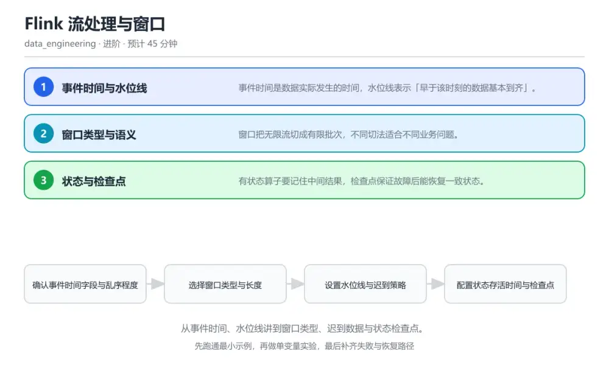
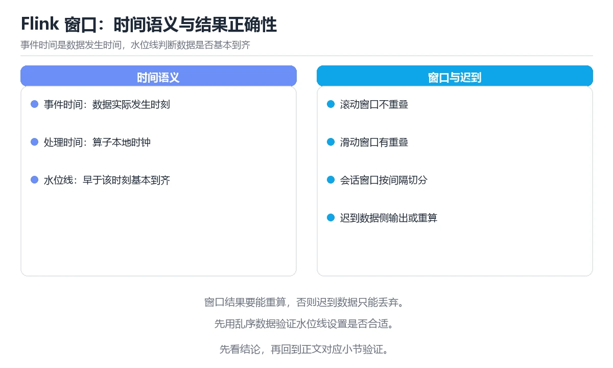

# Flink 流处理与窗口

> 内容更新时间：2026-10-06 · 学习阶段：进阶 · 预计用时：35 分钟

分类：data_engineering。关键词：Flink、事件时间、水位线、窗口、检查点。从事件时间、水位线讲到窗口类型、迟到数据与状态检查点。



## 本节知识框架

**课程定位**：所属分类 `data_engineering`（数据工程），课程主题 `Flink 流处理与窗口`，学习阶段 进阶，建议用时 40 分钟。

本课主线：从事件时间、水位线讲到窗口类型、迟到数据与状态检查点。

**学完本课应当能够**
- 说清 `事件时间` 与 `水位线` 的含义与区别，并各举一个正例和一个反例。
- 用本课示例验证 `滚动窗口` 的行为，记录输入、输出与失败条件。
- 遇到「窗口结果偏小」这类问题时，能说出触发条件与修复顺序。

### 复习清单

- [ ] 能不看正文复述本课核心术语，并指出一个边界或反例。
- [ ] 能运行或推演本课示例，记录输入、输出与失败现象。
- [ ] 能完成一次自测，并把错题对照错误表定位原因。

**本课配图**



## 核心概念定义

| 术语 | 操作性定义 | 常见边界与风险 |
| --- | --- | --- |
| 事件时间 | 事件自身携带的发生时刻，与处理时刻无关。 | 只在「事件自身携带的发生时刻，与处理时刻无关」这一前提下成立，换输入或换环境要重新验证。 |
| 水位线 | 表示某时刻之前数据基本到齐的进度标记。 | 易错：水位线最大延迟设置过小，乱序数据到得晚被丢弃；正确做法是按数据源实测乱序分布调大最大延迟，并把迟到数据走旁路统计而不是静默丢弃。 |
| 滚动窗口 | 长度固定且互不重叠的时间窗口。 | 只在「长度固定且互不重叠的时间窗口」这一前提下成立，换输入或换环境要重新验证。 |
| 允许迟到 | 窗口触发后仍接受一段时间内迟到数据的设置。 | 只在「窗口触发后仍接受一段时间内迟到数据的设置」这一前提下成立，换输入或换环境要重新验证。 |
| 检查点 | 周期性保存状态与位点，用于故障恢复。 | 缓存与状态残留会让结果过期，先明确失效策略再判断正确性。 |
| 窗口 | 窗口长度与步长由业务口径决定并写入指标定义，变更时同步下游说明 | 易错：水位线最大延迟设置过小，乱序数据到得晚被丢弃；正确做法是按数据源实测乱序分布调大最大延迟，并把迟到数据走旁路统计而不是静默丢弃。 |

## 原理与运行机制

### 机制总览

**教材衔接：核心知识**

### 1. 事件时间与水位线

事件时间是数据实际发生的时间，水位线表示「早于该时刻的数据基本到齐」。

算子从事件中提取时间戳并周期产生水位线，水位线推进到一个窗口结束时间时才触发该窗口计算，允许乱序但有限度。

在Flink 流处理与窗口里可以这样验证：在本课示例里让事件乱序到达，观察水位线推进后窗口才输出结果。

边界：水位线设置得过于激进会过早触发窗口，迟到数据只能被丢弃或走旁路。

工程视角：按数据源乱序程度设置最大延迟并监控迟到比例，把它作为流水线健康指标。

### 2. 窗口类型与语义

窗口把无限流切成有限批次，不同切法适合不同业务问题。

滚动窗口不重叠，滑动窗口按步长重叠，会话窗口按活跃间隔切分，计数窗口按条数触发。

在Flink 流处理与窗口里可以这样验证：在本课示例里同一份数据分别用滚动与滑动窗口聚合，对比输出条数与含义差异。

边界：滑动窗口步长过小会让下游输出量成倍放大，形成写放大问题。

工程视角：窗口长度与步长由业务口径决定并写入指标定义，变更时同步下游说明。

### 3. 状态与检查点

有状态算子要记住中间结果，检查点保证故障后能恢复一致状态。

框架周期性把算子状态与数据源位点一起快照，故障后从最近一次检查点恢复并重放，配合幂等写入实现端到端一致性。

在Flink 流处理与窗口里可以这样验证：在本课示例里杀掉任务再恢复，观察聚合结果与位点从检查点继续。

边界：状态无限增长最终会拖垮任务，必须为状态设置存活时间或改用可清理的结构。

工程视角：为每个状态设置存活时间并监控状态大小，检查点间隔在恢复时间与开销间权衡。

**教材衔接：关键流程**

```text
确认事件时间字段与乱序程度 → 选择窗口类型与长度 → 设置水位线与迟到策略 → 配置状态存活时间与检查点 → 验证故障恢复后结果一致
```

1. 确认事件时间字段与乱序程度
2. 选择窗口类型与长度
3. 设置水位线与迟到策略
4. 配置状态存活时间与检查点
5. 验证故障恢复后结果一致

## 典型应用场景

**教材衔接：深度拓展与实战**

### 机制对照表

| 概念 | 解决什么问题 | 关键前提 | 失败信号 |
| --- | --- | --- | --- |
| 事件时间与水位线 | 事件时间是数据实际发生的时间，水位线表示「早于该时刻的数据基本到齐」。 | 水位线设置得过于激进会过早触发窗口，迟到数据只能被丢弃或走旁路。 | 按数据源乱序程度设置最大延迟并监控迟到比例，把它作为流水线健康指标。 |
| 窗口类型与语义 | 窗口把无限流切成有限批次，不同切法适合不同业务问题。 | 滑动窗口步长过小会让下游输出量成倍放大，形成写放大问题。 | 窗口长度与步长由业务口径决定并写入指标定义，变更时同步下游说明。 |
| 状态与检查点 | 有状态算子要记住中间结果，检查点保证故障后能恢复一致状态。 | 状态无限增长最终会拖垮任务，必须为状态设置存活时间或改用可清理的结构。 | 为每个状态设置存活时间并监控状态大小，检查点间隔在恢复时间与开销间权衡。 |

### 自测问答

**问 1**：事件时间与处理时间的关键区别是？

**答**：事件时间来自数据本身，处理时间来自处理节点时钟。事件时间反映业务发生顺序，能在乱序与延迟下保持结果正确；处理时间跟随节点时钟，简单但结果依赖到达顺序。 正确选项「事件时间来自数据本身，处理时间来自处理节点时钟」对应《Flink 流处理与窗口》的要点「事件时间与水位线」：事件时间是数据实际发生的时间，水位线表示「早于该时刻的数据基本到齐」。判断「事件时间与水位线」时先确认前提是否成立，再回到《Flink 流处理与窗口》的示例核对一次；把别的语言或框架的默认做法直接搬到事件时间与水位线上，往往会在本课的边界条件里失效。

**问 2**：允许迟到参数的作用是？

**答**：窗口触发后仍接受一段时间内的迟到数据。允许迟到让窗口在触发后仍能吸收少量迟到数据并更新结果，超过该时限的数据走旁路输出。 正确选项「窗口触发后仍接受一段时间内的迟到数据」对应《Flink 流处理与窗口》的要点「窗口类型与语义」：窗口把无限流切成有限批次，不同切法适合不同业务问题。判断「窗口类型与语义」时先确认前提是否成立，再回到《Flink 流处理与窗口》的示例核对一次；借鉴相邻主题的经验之前，先核对窗口类型与语义的前提是否成立。

**问 3**：以下哪些做法有助于控制有状态任务的风险？（多选）

**答**：为状态配置存活时间；监控状态大小与检查点时长；把更晚的迟到数据写入旁路统计。状态存活时间、监控与旁路统计共同保证任务长期稳定；状态无限保留最终会让恢复时间不可接受。 正确选项「为状态配置存活时间；监控状态大小与检查点时长；把更晚的迟到数据写入旁路统计」对应《Flink 流处理与窗口》的要点「状态与检查点」：有状态算子要记住中间结果，检查点保证故障后能恢复一致状态。判断「状态与检查点」时先确认前提是否成立，再回到《Flink 流处理与窗口》的示例核对一次；记住状态与检查点的结论之外还要记住适用条件，换一个输入往往就不成立了。

**问 4**：请按一次事件在窗口里被处理的顺序排列。

**答**：事件带时间戳进入算子。事件先入状态，水位线完整后触发计算，迟到数据在允许范围内更新，超出范围则进入旁路以便单独分析。 正确选项「事件带时间戳进入算子；水位线推进到窗口结束；窗口触发并输出聚合结果；迟到数据在允许范围内更新结果；超期数据写入旁路输出」对应《Flink 流处理与窗口》的要点「事件时间与水位线」：事件时间是数据实际发生的时间，水位线表示「早于该时刻的数据基本到齐」。判断「事件时间与水位线」时先确认前提是否成立，再回到《Flink 流处理与窗口》的示例核对一次；干扰项常常是相邻主题里成立的结论，只有按事件时间与水位线的输入与约束判断才能排除。

**问 5**：阅读这段窗口配置，最可能出现什么问题？

**答**：步长远小于窗口长度，输出量被成倍放大。一小时窗口每秒滑动一次，同一条事件会被计入 3600 个窗口，输出量与状态压力成倍增长，应按业务需要的更新频率选择步长。 正确选项「步长远小于窗口长度，输出量被成倍放大」对应《Flink 流处理与窗口》的要点「窗口类型与语义」：窗口把无限流切成有限批次，不同切法适合不同业务问题。判断「窗口类型与语义」时先确认前提是否成立，再回到《Flink 流处理与窗口》的示例核对一次；把窗口类型与语义的做法换到别的约束下未必成立，先确认边界再决定答案。

### 工程检查表

- [ ] 确认事件时间字段与乱序程度
- [ ] 选择窗口类型与长度
- [ ] 设置水位线与迟到策略
- [ ] 配置状态存活时间与检查点
- [ ] 验证故障恢复后结果一致
- [ ] 【事件时间与水位线】按数据源乱序程度设置最大延迟并监控迟到比例，把它作为流水线健康指标。
- [ ] 【窗口类型与语义】窗口长度与步长由业务口径决定并写入指标定义，变更时同步下游说明。
- [ ] 【状态与检查点】为每个状态设置存活时间并监控状态大小，检查点间隔在恢复时间与开销间权衡。

### 结论与下一步

- **窗口结果偏小**：典型现象是水位线最大延迟设置过小，乱序数据到得晚被丢弃；正确做法是按数据源实测乱序分布调大最大延迟，并把迟到数据走旁路统计而不是静默丢弃。
- **任务运行数天后变慢**：典型现象是状态没有任何存活时间，键数量持续增长；正确做法是为状态配置存活时间或改用可清理的聚合结构，并监控状态大小。
- **故障恢复后重复计数**：典型现象是只依赖框架恢复，目标端写入无幂等键；正确做法是按窗口与键构造唯一主键，在目标端做幂等写入以吸收重放。

### 最小验证场景

- 准备：保留 `text` 示例的原始输入，先记录 `Flink 流处理与窗口` 的基线输出和完整运行命令。
- 判定：新结果与 `Flink 流处理与窗口` 的基线不同不等于错误；只有当差异破坏了 `事件时间` 的定义或错误表中的约束，才判定为失败。

### 选择与边界

- 使用 `事件时间` 时，先满足它的定义：事件自身携带的发生时刻，与处理时刻无关；只在「事件自身携带的发生时刻，与处理时刻无关」这一前提下成立，换输入或换环境要重新验证。
- 使用 `水位线` 时，先满足它的定义：表示某时刻之前数据基本到齐的进度标记；易错：水位线最大延迟设置过小，乱序数据到得晚被丢弃；正确做法是按数据源实测乱序分布调大最大延迟，并把迟到数据走旁路统计而不是静默丢弃。
- 使用 `滚动窗口` 时，先满足它的定义：长度固定且互不重叠的时间窗口；只在「长度固定且互不重叠的时间窗口」这一前提下成立，换输入或换环境要重新验证。
- 使用 `允许迟到` 时，先满足它的定义：窗口触发后仍接受一段时间内迟到数据的设置；只在「窗口触发后仍接受一段时间内迟到数据的设置」这一前提下成立，换输入或换环境要重新验证。
- 使用 `检查点` 时，先满足它的定义：周期性保存状态与位点，用于故障恢复；缓存与状态残留会让结果过期，先明确失效策略再判断正确性。

## 代码/协议/SQL 示例

### 最小可验证示例

```text
确认事件时间字段与乱序程度 → 选择窗口类型与长度 → 设置水位线与迟到策略 → 配置状态存活时间与检查点 → 验证故障恢复后结果一致
```

**教材衔接：原文最小示例**

```text
确认事件时间字段与乱序程度 → 选择窗口类型与长度 → 设置水位线与迟到策略 → 配置状态存活时间与检查点 → 验证故障恢复后结果一致
```

```java
StreamExecutionEnvironment env = StreamExecutionEnvironment.getExecutionEnvironment();
// 每 30 秒做一次检查点，故障后从最近一次恢复
env.enableCheckpointing(30_000);

DataStream<Order> orders = env
    .addSource(new FlinkKafkaConsumer<>("orders", new OrderSchema(), props))
    .assignTimestampsAndWatermarks(
        WatermarkStrategy.<Order>forBoundedOutOfOrderness(Duration.ofSeconds(5))
            .withTimestampAssigner((order, ts) -> order.eventTimeMs));

SingleOutputStreamOperator<CityStat> stats = orders
    .keyBy(Order::getCity)
    .window(TumblingEventTimeWindows.of(Time.minutes(1)))
    .allowedLateness(Time.seconds(30))       // 允许迟到 30 秒，窗口会重新计算
    .sideOutputLateData(lateTag)            // 更晚的数据进旁路，单独统计
    .aggregate(new OrderAggregate(), new CityStatWindow());

stats.addSink(new IdempotentJdbcSink());     // 目标端按窗口主键幂等写入
```

## 时间/空间复杂度或性能分析

**性能关注点（Flink 流处理与窗口）**：批处理看吞吐、流处理看延迟：分别记录端到端延迟、背压情况与资源占用。

**测量方法**：以 `Flink 流处理与窗口` 的 `Flink` 场景为对象，固定输入跑一遍记录基线，再把规模或并发度提高一个数量级复测；两次结果的差值与波动范围才是结论依据。

## 常见误区与易错点

| 容易写错的做法 | 实际现象 | 原因与正确做法 |
| --- | --- | --- |
| 窗口结果偏小 | 水位线最大延迟设置过小，乱序数据到得晚被丢弃。 | 按数据源实测乱序分布调大最大延迟，并把迟到数据走旁路统计而不是静默丢弃。 |
| 任务运行数天后变慢 | 状态没有任何存活时间，键数量持续增长。 | 为状态配置存活时间或改用可清理的聚合结构，并监控状态大小。 |
| 故障恢复后重复计数 | 只依赖框架恢复，目标端写入无幂等键。 | 按窗口与键构造唯一主键，在目标端做幂等写入以吸收重放。 |

### 现场 1：窗口结果偏小

**症状**：水位线最大延迟设置过小，乱序数据到得晚被丢弃。

**根因与修复**：按数据源实测乱序分布调大最大延迟，并把迟到数据走旁路统计而不是静默丢弃。

**自检**：在本课示例里复现「窗口结果偏小」，改成按数据源实测乱序分布调大最大延迟，并把迟到数据走旁路统计而不是静默丢弃后重跑；如果症状消失且失败路径按预期变化，说明定位正确。

### 现场 2：任务运行数天后变慢

**症状**：状态没有任何存活时间，键数量持续增长。

**根因与修复**：为状态配置存活时间或改用可清理的聚合结构，并监控状态大小。

**自检**：在本课示例里复现「任务运行数天后变慢」，改成为状态配置存活时间或改用可清理的聚合结构，并监控状态大小后重跑；如果症状消失且失败路径按预期变化，说明定位正确。

### 现场 3：故障恢复后重复计数

**症状**：只依赖框架恢复，目标端写入无幂等键。

**根因与修复**：按窗口与键构造唯一主键，在目标端做幂等写入以吸收重放。

**自检**：在本课示例里复现「故障恢复后重复计数」，改成按窗口与键构造唯一主键，在目标端做幂等写入以吸收重放后重跑；如果症状消失且失败路径按预期变化，说明定位正确。

## 与其他知识点的关系

**教材衔接：复习与迁移**

## 自测题与参考答案

> 先独立作答，再对照参考答案；答案都能在本课正文、术语表或错误表里找到依据。

### 自测 1（概念复述）

不看正文，写出 `事件时间` 的操作性定义，并说明它与 `水位线` 的区别。

**参考答案**：事件自身携带的发生时刻，与处理时刻无关。

`水位线` 的定位是：表示某时刻之前数据基本到齐的进度标记；两者的差别要从适用对象与失败模式上说明。

### 自测 2（排错）

本课错误表记录了「窗口结果偏小」这类做法。请写出它会出现的现象、根因，以及修复顺序。

**参考答案**：现象是水位线最大延迟设置过小，乱序数据到得晚被丢弃；正确做法是按数据源实测乱序分布调大最大延迟，并把迟到数据走旁路统计而不是静默丢弃。修复时先复现现象并保留证据，再改动一处假设重跑，确认现象消失。

### 自测 3（动手验证）

运行本课的 `text` 示例，改动其中一个输入后重新运行，记录输出与错误信息。

**参考答案**：正常输入下 `text` 示例应当复现正文给出的结果；改动输入后，如果结果改变或报错，先核对它是否满足 `Flink 流处理与窗口` 中`事件时间` 的适用范围，再检查错误表里是否有同类现象。

### 自测 4（代码阅读）

阅读本课开头的 `text` 示例，说明它体现了`事件时间` 的哪一条性质，并指出改动哪个输入会让这条性质不再成立。

**参考答案**：`事件时间` 的定义是 事件自身携带的发生时刻，与处理时刻无关，示例正是在实现这条定义。改动与 `事件时间` 有关的一个输入后，如果结果不再符合 `Flink 流处理与窗口` 的正文描述，就说明该性质只在当前前提成立。

### 自测 5（迁移）

把 `Flink 流处理与窗口` 的方法迁移到自己的项目：围绕 `事件时间` 写出一个与错误表同类的风险点，并说明触发条件和检验方式。

**参考答案**：例如「故障恢复后重复计数」，它会导致只依赖框架恢复，目标端写入无幂等键；检验方式是按按窗口与键构造唯一主键，在目标端做幂等写入以吸收重放改一处再复现，确认现象消失且没有引入新的失败分支。

### 自测 6（对比）

用一个表格对比 `事件时间` 与 `水位线`：各写一行适用场景、一行失败表现。

**参考答案**：`事件时间` 的定义是事件自身携带的发生时刻，与处理时刻无关；`水位线` 的定义是表示某时刻之前数据基本到齐的进度标记。两者的失败表现分别对应本课错误表里与本术语相关的行。

### 自测 7（排错顺序）

面对「窗口结果偏小」引发的问题，请把“复现 水位线最大延迟设置过小，乱序数据到得晚被丢弃 → 保留证据 → 按数据源实测乱序分布调大最大延迟，并把迟到数据走旁路统计而不是静默丢弃 → 回归验证”四步写成可执行的检查清单。

**参考答案**：第一步按水位线最大延迟设置过小，乱序数据到得晚被丢弃复现；第二步记录输入、版本与完整报错；第三步按按数据源实测乱序分布调大最大延迟，并把迟到数据走旁路统计而不是静默丢弃只改一处；第四步重跑并确认失败路径也按预期变化。

### 自测 8（边界判断）

针对 `窗口`，分别写出“可以使用”的条件和“结论不再成立”的条件。

**参考答案**：易错：水位线最大延迟设置过小，乱序数据到得晚被丢弃；正确做法是按数据源实测乱序分布调大最大延迟，并把迟到数据走旁路统计而不是静默丢弃。 同时要把 `窗口` 的定义 窗口长度与步长由业务口径决定并写入指标定义，变更时同步下游说明 与实际输入逐项对照。

### 自测 9（机制重建）

不看正文，按输入、转换、输出、验证四段重建 `事件时间` → `水位线` → `滚动窗口` → `允许迟到` 的作用链。

**参考答案**：起点是 `事件时间` 的定义 事件自身携带的发生时刻，与处理时刻无关；中间每一步都保留可观察状态；终点由 `窗口` 检查，失败时回到错误表定位第一个偏离定义的步骤。

### 自测 10（综合排错）

在 `Flink 流处理与窗口` 中，现象是 只依赖框架恢复，目标端写入无幂等键。请围绕 故障恢复后重复计数 写出最小复现、关键证据、修复动作和回归验证，并说明为什么不能只凭一次运行下结论。

**参考答案**：先复现 故障恢复后重复计数，记录输入与完整错误；再按 按窗口与键构造唯一主键，在目标端做幂等写入以吸收重放 只改一处。回归时同时跑正常路径和边界路径，只有两次结果都可解释，才把修复视为完成。

### 自测 11（一分钟复述）

用每分钟约 200 字的速度复述 `Flink 流处理与窗口`：先给主问题，再按顺序说出 `事件时间`、`水位线`、`滚动窗口`、`允许迟到`，最后给一个失败案例。

**自评标准**：主问题必须对应 从事件时间、水位线讲到窗口类型、迟到数据与状态检查点；每个术语都要能接上一句定义或边界；失败案例必须写成可观察现象，不能用“可能有风险”代替证据。

## 术语速查

| 术语 | 一句话说明 |
| --- | --- |
| `事件时间` | 事件自身携带的发生时刻，与处理时刻无关。 |
| `水位线` | 表示某时刻之前数据基本到齐的进度标记。 |
| `滚动窗口` | 长度固定且互不重叠的时间窗口。 |
| `允许迟到` | 窗口触发后仍接受一段时间内迟到数据的设置。 |
| `检查点` | 周期性保存状态与位点，用于故障恢复。 |
| `窗口` | 窗口长度与步长由业务口径决定并写入指标定义，变更时同步下游说明。 |

**术语关系**：`事件时间`（事件自身携带的发生时刻） → `水位线`（表示某时刻之前数据基本到齐的进度标记） → `滚动窗口`（长度固定且互不重叠的时间窗口） → `允许迟到`（窗口触发后仍接受一段时间内迟到数据的设置）。

## 考点精讲

`Flink 流处理与窗口` 的题库有 5 道题，下面逐题给出题干、正确项与判断依据：先自己作答，再核对正确项，最后回到正文对应小节复核。

### 考点 1：第 1 题

- **题目**：事件时间与处理时间的关键区别是？
- **正确项**：事件时间来自数据本身
- **判断依据**：本题正确项是事件时间来自数据本身。术语 事件时间（Flink 流处理与窗口）：事件自身携带的发生时刻，与处理时刻无关，本题取事件时间来自数据本身这条。易错点是窗口结果偏小会造成水位线最大延迟设置过小，乱序数据到得晚被丢弃，改法是按数据源实测乱序分布调大最大延迟，并把迟到数据走旁路统计而不是静默丢弃，干扰项两者完全相同正踩在这条上。

### 考点 2：第 2 题

- **题目**：允许迟到参数的作用是？
- **正确项**：窗口触发后仍接受一段时间内的迟到数据
- **判断依据**：本题正确项是窗口触发后仍接受一段时间内的迟到数据。术语 允许迟到（Flink 流处理与窗口）：窗口触发后仍接受一段时间内迟到数据的设置，本题取窗口触发后仍接受一段时间内的迟到数据这条。易错点是窗口结果偏小会造成水位线最大延迟设置过小，乱序数据到得晚被丢弃，改法是按数据源实测乱序分布调大最大延迟，并把迟到数据走旁路统计而不是静默丢弃，干扰项提高并行度正踩在这条上。

### 考点 3：第 3 题

- **题目**：以下哪些做法有助于控制有状态任务的风险？（多选）
- **正确项**：为状态配置存活时间；监控状态大小与检查点时长；把更晚的迟到数据写入旁路统计
- **判断依据**：本题正确项是为状态配置存活时间。术语 检查点（Flink 流处理与窗口）：周期性保存状态与位点，用于故障恢复，本题取为状态配置存活时间这条。易错点是任务运行数天后变慢会造成状态没有任何存活时间，键数量持续增长，改法是为状态配置存活时间或改用可清理的聚合结构，并监控状态大小，干扰项监控状态大小与检查点时长正踩在这条上。

### 考点 4：第 4 题

- **题目**：请按一次事件在窗口里被处理的顺序排列。
- **正确项**：事件带时间戳进入算子 → 水位线推进到窗口结束 → 窗口触发并输出聚合结果 → 迟到数据在允许范围内更新结果 → 超期数据写入旁路输出
- **判断依据**：本题正确项是事件带时间戳进入算子。术语 水位线（Flink 流处理与窗口）：表示某时刻之前数据基本到齐的进度标记，本题取事件带时间戳进入算子这条。易错点是窗口结果偏小会造成水位线最大延迟设置过小，乱序数据到得晚被丢弃，改法是按数据源实测乱序分布调大最大延迟，并把迟到数据走旁路统计而不是静默丢弃，干扰项水位线推进到窗口结束正踩在这条上。

### 考点 5：第 5 题

- **题目**：阅读这段窗口配置，最可能出现什么问题？
- **正确项**：步长远小于窗口长度，输出量被成倍放大
- **判断依据**：本题正确项是步长远小于窗口长度，输出量被成倍放大。术语 窗口（Flink 流处理与窗口）：窗口长度与步长由业务口径决定并写入指标定义，变更时同步下游说明，本题取步长远小于窗口长度，输出量被成倍放大这条。易错点是窗口结果偏小会造成水位线最大延迟设置过小，乱序数据到得晚被丢弃，改法是按数据源实测乱序分布调大最大延迟，并把迟到数据走旁路统计而不是静默丢弃，干扰项水位线延迟过大正踩在这条上。

### 考点 6：`事件时间`

- **要点**：事件自身携带的发生时刻，与处理时刻无关。
- **事件时间 的边界**：只在「事件自身携带的发生时刻，与处理时刻无关」这一前提下成立，换输入或换环境要重新验证。

### 考点 7：`水位线`

- **要点**：表示某时刻之前数据基本到齐的进度标记。
- **水位线 的边界**：易错：水位线最大延迟设置过小，乱序数据到得晚被丢弃；正确做法是按数据源实测乱序分布调大最大延迟，并把迟到数据走旁路统计而不是静默丢弃。

### 考点 8：`滚动窗口`

- **要点**：长度固定且互不重叠的时间窗口。
- **滚动窗口 的边界**：只在「长度固定且互不重叠的时间窗口」这一前提下成立，换输入或换环境要重新验证。

### 考点 9：`允许迟到`

- **要点**：窗口触发后仍接受一段时间内迟到数据的设置。
- **允许迟到 的边界**：只在「窗口触发后仍接受一段时间内迟到数据的设置」这一前提下成立，换输入或换环境要重新验证。

### 考点 10：`检查点`

- **要点**：周期性保存状态与位点，用于故障恢复。
- **检查点 的边界**：缓存与状态残留会让结果过期，先明确失效策略再判断正确性。

### 考点 11：`窗口`

- **要点**：窗口长度与步长由业务口径决定并写入指标定义，变更时同步下游说明
- **窗口 的边界**：易错：水位线最大延迟设置过小，乱序数据到得晚被丢弃；正确做法是按数据源实测乱序分布调大最大延迟，并把迟到数据走旁路统计而不是静默丢弃。

### 考点 12：排错——窗口结果偏小

- **现象**：水位线最大延迟设置过小，乱序数据到得晚被丢弃。
- **处理**：按数据源实测乱序分布调大最大延迟，并把迟到数据走旁路统计而不是静默丢弃。

### 考点 13：排错——任务运行数天后变慢

- **现象**：状态没有任何存活时间，键数量持续增长。
- **处理**：为状态配置存活时间或改用可清理的聚合结构，并监控状态大小。

### 考点 14：综合辨析——`事件时间` 与 `窗口`

- **辨析点**：`事件时间` 的定义是 事件自身携带的发生时刻，与处理时刻无关；`窗口` 的定义是 窗口长度与步长由业务口径决定并写入指标定义，变更时同步下游说明。
- **答题要求**：面对 `Flink 流处理与窗口` 的题目，先判断描述的是 `事件时间` 还是 `窗口`，再归到对应定义，最后写出一个会让该定义失效的边界输入。

### 考点 15：排错评分点

- **现象分**：能写出 水位线最大延迟设置过小，乱序数据到得晚被丢弃，而不是只写“程序有错”。
- **证据分**：保留触发 窗口结果偏小 的输入、版本和错误原文。
- **修复分**：按 按数据源实测乱序分布调大最大延迟，并把迟到数据走旁路统计而不是静默丢弃 只改一处，并同时回归正常路径与边界路径。

## 内容元数据

- 内容版本：v2.0
- 最后更新：2026-10-06
- 学习阶段：进阶

| 字段 | 值 |
| --- | --- |
| 课程 ID | `de_flink_windowing` |
| 所属分类 | `data_engineering` |
| 难度 | 进阶 |
| 预计用时 | 45 分钟 |
| 关键词 | Flink、事件时间、水位线、窗口、检查点 |
| 配图 | `images/lesson_de_flink_windowing.webp` |
| 参考资料 | 2 条 |
| 内容更新时间 | 2026-10-06 |

## 参考资料与复核

- [本课资料锚点 de_flink_windowing](https://zh.wikipedia.org/w/index.php?search=de_flink_windowing)

- 来源性质：官方文档、标准或权威教材；本课核对关键词：Flink、事件时间、水位线、窗口、检查点。
- 最后复核：2026-10-04
- 下次复核：2027-01-10
- 复核范围：版本兼容、API 行为与工程实践

下面列出的资料用于核对本课结论，复习时可以对照阅读：
- [Apache Flink 官方文档：窗口](https://nightlies.apache.org/flink/flink-docs-stable/docs/dev/datastream/operators/windows/)
- [Apache Flink 官方文档：检查点与状态](https://nightlies.apache.org/flink/flink-docs-stable/docs/dev/datastream/fault-tolerance/checkpointing/)

| [本课术语索引：Flink 流处理与窗口](#核心概念定义) | 按本课输入、术语边界和错误表现逐项核对 |
> 复核提示：《Flink 流处理与窗口》的结论如与资料冲突，以资料中的规范文本为准，并在笔记里记录差异与日期。