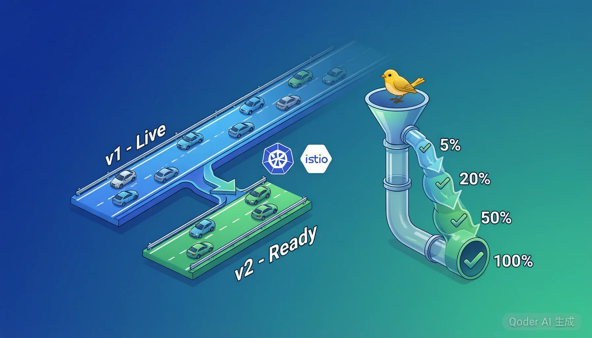

# 蓝绿部署与金丝雀发布



> **版本**: v2.0 | **难度**: 初学者友好 | **先修知识**: Kubernetes 基础、Docker 容器  
> 内容更新时间：2026-10-06 · 学习阶段：高级 · 预计用时：75 分钟

> **关键词**: 蓝绿部署、金丝雀发布、Istio、服务网格、零停机部署、自动化回滚

---

## 目录

1. [课程概述与学习目标](#1-课程概述与学习目标)
2. [部署策略演进：从滚动更新到金丝雀](#2-部署策略演进从滚动更新到金丝雀)
3. [蓝绿部署原理与生活类比](#3-蓝绿部署原理与生活类比)
4. [蓝绿部署实战：Kubernetes 实现](#4-蓝绿部署实战kubernetes-实现)
5. [金丝雀发布原理与生活类比](#5-金丝雀发布原理与生活类比)
6. [金丝雀发布实战：流量分割与渐进式 Rollout](#6-金丝雀发布实战流量分割与渐进式-rollout)
7. [Istio 服务网格实现金丝雀发布](#7-istio-服务网格实现金丝雀发布)
8. [自动化回滚策略](#8-自动化回滚策略)
9. [A/B 测试与特性开关](#9-ab-测试与特性开关)
10. [数据库迁移策略](#10-数据库迁移策略)
11. [综合实战：使用 Istio 实现完整金丝雀发布流程](#11-综合实战使用-istio-实现完整金丝雀发布流程)
12. [策略对比与选型指南](#12-策略对比与选型指南)
13. [复习清单与知识自测](#13-复习清单与知识自测)

---

## 1. 课程概述与学习目标

### 为什么需要部署策略？

想象你经营一家繁忙的餐厅，需要更换菜单上的招牌菜。你不可能在午餐高峰期把所有菜都撤掉换新菜——你需要一个**平稳过渡**的方案。软件部署也是同样的道理：用户正在使用你的服务，你不能说"停一下，我要更新"。

### 学习目标

完成本课程后，你将能够：

- 理解滚动更新、蓝绿部署、金丝雀发布三种策略的区别与适用场景
- 在 Kubernetes 上实现蓝绿部署（Service 切换方式）
- 使用 Istio 服务网格实现金丝雀发布（流量分割）
- 设计自动化回滚策略（基于健康检查与错误率指标）
- 处理部署中的数据库迁移问题
- 结合 A/B 测试与特性开关进行精细化发布

---

## 2. 部署策略演进：从滚动更新到金丝雀

### 2.1 滚动更新（Rolling Update）

**生活类比**：就像高速公路施工——一次封闭一条车道，其他车道继续通行。车辆（请求）会减速，但不会完全中断。

滚动更新是 Kubernetes 的默认部署策略。它逐步用新版本的 Pod 替换旧版本的 Pod：

```yaml
# kubernetes-rolling-update.yaml
apiVersion: apps/v1
kind: Deployment
metadata:
  name: my-app
  labels:
    app: my-app
spec:
  replicas: 6
  strategy:
    type: RollingUpdate
    rollingUpdate:
      maxSurge: 1          # 更新时最多多出 1 个 Pod
      maxUnavailable: 0    # 更新期间不允许有不可用的 Pod
  selector:
    matchLabels:
      app: my-app
  template:
    metadata:
      labels:
        app: my-app
    spec:
      containers:
        - name: my-app
          image: my-app:v2.0.0
          ports:
            - containerPort: 8080
          readinessProbe:
            httpGet:
              path: /health
              port: 8080
            initialDelaySeconds: 10
            periodSeconds: 5
```

**优点**：零停机、节省资源  
**缺点**：回滚慢（需要再滚动一次）、新旧版本共存期间可能存在兼容性问题

### 2.2 蓝绿部署（Blue-Green Deployment）

**生活类比**：就像**两条平行高速公路**——一条是"蓝色公路"（当前版本），一条是"绿色公路"（新版本）。你先把所有车辆引到绿色公路上测试，确认没问题后，一次性把入口路牌从蓝色切换到绿色。如果绿色公路出问题，立刻把路牌切回蓝色。

### 2.3 金丝雀发布（Canary Release）

**生活类比**：就像**矿井中的金丝雀**。过去矿工下井时会带一只金丝雀——金丝雀对有毒气体非常敏感，如果金丝雀出现异常，矿工就知道该立刻撤退。金丝雀发布也是同样的思路：先把少量流量（"金丝雀"）导入新版本，观察它是否"健康"，再逐步增加流量。

### 策略演进对比

| 维度 | 滚动更新 | 蓝绿部署 | 金丝雀发布 |
|------|---------|---------|-----------|
| 停机时间 | 零停机 | 零停机 | 零停机 |
| 资源成本 | 低 | 高（需要双倍环境） | 中 |
| 回滚速度 | 慢 | 极快（切换 Service） | 快（减少流量） |
| 风险控制 | 中 | 低（全量切换有风险） | 极低（渐进式） |
| 复杂度 | 低 | 中 | 高（需要服务网格） |

---

## 3. 蓝绿部署原理与生活类比

### 3.1 核心原理

蓝绿部署的核心思想是维护两套完全相同的生产环境：

- **蓝色环境（Blue）**：当前正在服务用户请求的版本（稳定版）
- **绿色环境（Green）**：部署了新版本的待切换环境

部署流程如下：

1. 在绿色环境部署新版本（v2）
2. 对绿色环境进行内部测试和验证
3. 将负载均衡器/Service 从蓝色切换到绿色
4. 监控绿色环境的运行状态
5. 如果出现问题，立即将流量切回蓝色（回滚）
6. 确认稳定后，蓝色环境成为新的"待更新"环境

### 3.2 DNS 切换 vs Service 切换

**DNS 切换方式**：通过修改 DNS 记录将流量从蓝色指向绿色。缺点是 DNS 缓存会导致切换不即时，可能有几分钟到几小时的延迟。

**Service 切换方式（推荐）**：在 Kubernetes 中，通过修改 Service 的 selector 标签来实现即时切换。这种方式几乎是瞬间完成的，没有 DNS 缓存问题。

---

## 4. 蓝绿部署实战：Kubernetes 实现

### 4.1 蓝色环境（当前版本 v1）

```yaml
# blue-deployment.yaml
apiVersion: apps/v1
kind: Deployment
metadata:
  name: my-app-blue
  labels:
    app: my-app
    version: blue
spec:
  replicas: 3
  selector:
    matchLabels:
      app: my-app
      version: blue
  template:
    metadata:
      labels:
        app: my-app
        version: blue
    spec:
      containers:
        - name: my-app
          image: my-app:v1.0.0
          ports:
            - containerPort: 8080
          resources:
            requests:
              cpu: "250m"
              memory: "256Mi"
            limits:
              cpu: "500m"
              memory: "512Mi"
          readinessProbe:
            httpGet:
              path: /health
              port: 8080
            initialDelaySeconds: 10
            periodSeconds: 5
          livenessProbe:
            httpGet:
              path: /health
              port: 8080
            initialDelaySeconds: 15
            periodSeconds: 10
```

### 4.2 绿色环境（新版本 v2）

```yaml
# green-deployment.yaml
apiVersion: apps/v1
kind: Deployment
metadata:
  name: my-app-green
  labels:
    app: my-app
    version: green
spec:
  replicas: 3
  selector:
    matchLabels:
      app: my-app
      version: green
  template:
    metadata:
      labels:
        app: my-app
        version: green
    spec:
      containers:
        - name: my-app
          image: my-app:v2.0.0
          ports:
            - containerPort: 8080
          resources:
            requests:
              cpu: "250m"
              memory: "256Mi"
            limits:
              cpu: "500m"
              memory: "512Mi"
          readinessProbe:
            httpGet:
              path: /health
              port: 8080
            initialDelaySeconds: 10
            periodSeconds: 5
```

### 4.3 Service 定义（流量切换的关键）

```yaml
# service.yaml
apiVersion: v1
kind: Service
metadata:
  name: my-app-service
spec:
  type: LoadBalancer
  selector:
    app: my-app
    version: blue    # 当前指向蓝色环境
  ports:
    - protocol: TCP
      port: 80
      targetPort: 8080
```

### 4.4 切换脚本

```bash
#!/bin/bash
# switch-to-green.sh — 蓝绿部署切换脚本

echo "=== 蓝绿部署：切换到绿色环境 ==="

# 第一步：部署绿色环境
echo "[1/4] 部署绿色环境 (v2.0.0)..."
kubectl apply -f green-deployment.yaml

# 第二步：等待绿色环境就绪
echo "[2/4] 等待绿色环境就绪..."
kubectl rollout status deployment/my-app-green --timeout=300s

# 第三步：切换 Service 到绿色环境
echo "[3/4] 将 Service 切换到绿色环境..."
kubectl patch service my-app-service -p '{"spec":{"selector":{"version":"green"}}}'

# 第四步：验证切换结果
echo "[4/4] 验证切换结果..."
kubectl get service my-app-service -o yaml | grep -A 3 "selector:"

echo "=== 切换完成！当前流量指向绿色环境 (v2.0.0) ==="
```

---

## 5. 金丝雀发布原理与生活类比

### 5.1 为什么叫"金丝雀"？

这个名称来源于一个真实的历史故事。20 世纪初，矿工们发现金丝雀对一氧化碳等有毒气体极为敏感。于是他们下井时会带上一只金丝雀——如果金丝雀突然停止歌唱或晕倒，就意味着矿井中有毒气体浓度超标，矿工必须立即撤离。

在软件部署中，**金丝雀版本就是那只"矿井中的金丝雀"**。我们先让少量真实用户流量进入新版本，观察它的"健康状况"（错误率、延迟、资源使用等），如果一切正常再逐步扩大流量。

### 5.2 金丝雀发布流程

1. **部署金丝雀实例**：运行少量新版本 Pod（例如 1 个）
2. **分流少量流量**：将 5%~10% 的用户请求路由到新版本
3. **监控与观察**：密切关注新版本的错误率、响应时间、CPU/内存使用
4. **逐步扩大**：如果指标正常，逐步增加流量比例（10% → 25% → 50% → 100%）
5. **全量发布**：确认新版本完全稳定后，将所有流量切换到新版本
6. **清理旧版本**：下线旧版本的实例

### 5.3 流量分割策略

金丝雀发布的核心是**流量分割**——将用户请求按一定比例分配到不同版本。常见的分割方式有：

- **按权重分割**：90% 流量到稳定版，10% 到金丝雀版
- **按 Header 分割**：带有特定 HTTP Header 的请求走新版本（适合内部测试）
- **按用户 ID 分割**：指定某些用户先体验新版本
- **按地域分割**：先在某个地区上线新版本

---

## 6. 金丝雀发布实战：流量分割与渐进式 Rollout

### 6.1 基础 Kubernetes 部署

```yaml
# canary-base-deployment.yaml — 稳定版本
apiVersion: apps/v1
kind: Deployment
metadata:
  name: my-app-stable
  labels:
    app: my-app
    track: stable
spec:
  replicas: 9                     # 稳定版 9 个副本
  selector:
    matchLabels:
      app: my-app
      track: stable
  template:
    metadata:
      labels:
        app: my-app
        track: stable
    spec:
      containers:
        - name: my-app
          image: my-app:v1.0.0
          ports:
            - containerPort: 8080
          readinessProbe:
            httpGet:
              path: /health
              port: 8080
---
# canary-new-deployment.yaml — 金丝雀版本
apiVersion: apps/v1
kind: Deployment
metadata:
  name: my-app-canary
  labels:
    app: my-app
    track: canary
spec:
  replicas: 1                     # 金丝雀版只有 1 个副本
  selector:
    matchLabels:
      app: my-app
      track: canary
  template:
    metadata:
      labels:
        app: my-app
        track: canary
    spec:
      containers:
        - name: my-app
          image: my-app:v2.0.0
          ports:
            - containerPort: 8080
          readinessProbe:
            httpGet:
              path: /health
              port: 8080
```

### 6.2 Service 定义（合并流量）

```yaml
# canary-service.yaml
apiVersion: v1
kind: Service
metadata:
  name: my-app-service
spec:
  selector:
    app: my-app           # 同时匹配 stable 和 canary
  ports:
    - protocol: TCP
      port: 80
      targetPort: 8080
```

> **注意**：由于 stable 有 9 个副本、canary 有 1 个副本，Kubernetes 会自然地将约 10% 的流量分配给 canary。这就是金丝雀发布的基本原理——通过副本数比例来控制流量分配。

---

## 7. Istio 服务网格实现金丝雀发布

### 7.1 为什么需要 Istio？

Kubernetes 原生的金丝雀发布依赖副本数比例来控制流量，这种方式不够精确。Istio 服务网格可以：

- **精确控制流量比例**：不依赖副本数，可以精确到 1%、5%、10%
- **基于请求内容路由**：按 Header、Cookie、用户 ID 等条件路由
- **内置可观测性**：自动收集延迟、错误率、流量分布等指标
- **流量镜像**：将流量同时发送到新旧版本进行对比，但不影响用户

### 7.2 安装 Istio

```bash
# 下载并安装 Istio
curl -L https://istio.io/downloadIstio | ISTIO_VERSION=1.20.0 sh -
cd istio-1.20.0
export PATH=$PWD/bin:$PATH

# 安装 Istio 到 Kubernetes 集群
istioctl install --set profile=default

# 验证安装
kubectl get pods -n istio-system
```

### 7.3 定义 Gateway（入口网关）

```yaml
# gateway.yaml
apiVersion: networking.istio.io/v1beta1
kind: Gateway
metadata:
  name: my-app-gateway
  namespace: production
spec:
  selector:
    istio: ingressgateway
  servers:
    - port:
        number: 80
        name: http
        protocol: HTTP
      hosts:
        - "my-app.example.com"
```

### 7.4 定义 DestinationRule（目标规则）

DestinationRule 定义了流量的"子集"（subset），每个子集对应一个版本：

```yaml
# destination-rule.yaml
apiVersion: networking.istio.io/v1beta1
kind: DestinationRule
metadata:
  name: my-app-destination
  namespace: production
spec:
  host: my-app-service
  subsets:
    - name: stable
      labels:
        version: v1
    - name: canary
      labels:
        version: v2
  trafficPolicy:
    connectionPool:
      http:
        h2UpgradePolicy: DEFAULT
      tcp:
        maxConnections: 100
    loadBalancer:
      simple: ROUND_ROBIN
```

### 7.5 定义 VirtualService（虚拟服务——流量分割的核心）

VirtualService 是 Istio 中最关键的资源，它定义了流量如何分配到不同的子集：

```yaml
# virtual-service.yaml — 初始状态：100% 流量到稳定版
apiVersion: networking.istio.io/v1beta1
kind: VirtualService
metadata:
  name: my-app-virtualservice
  namespace: production
spec:
  hosts:
    - my-app.example.com
  gateways:
    - my-app-gateway
  http:
    - match:
        - headers:
            x-canary:
              exact: "true"
      route:
        - destination:
            host: my-app-service
            subset: canary
          weight: 100
    - route:
        - destination:
            host: my-app-service
            subset: stable
          weight: 90           # 90% 流量到稳定版
        - destination:
            host: my-app-service
            subset: canary
          weight: 10           # 10% 流量到金丝雀版
```

### 7.6 渐进式增加金丝雀流量

```bash
#!/bin/bash
# canary-progression.sh — 金丝雀流量渐进脚本

# 阶段1: 5% 流量到金丝雀
echo "=== 阶段1: 5% 流量到金丝雀 ==="
kubectl patch virtualservice my-app-virtualservice -n production --type='json' -p='[
  {"op": "replace", "path": "/spec/http/1/route/0/weight", "value": 95},
  {"op": "replace", "path": "/spec/http/1/route/1/weight", "value": 5}
]'
sleep 300  # 观察 5 分钟

# 阶段2: 20% 流量到金丝雀
echo "=== 阶段2: 20% 流量到金丝雀 ==="
kubectl patch virtualservice my-app-virtualservice -n production --type='json' -p='[
  {"op": "replace", "path": "/spec/http/1/route/0/weight", "value": 80},
  {"op": "replace", "path": "/spec/http/1/route/1/weight", "value": 20}
]'
sleep 300  # 观察 5 分钟

# 阶段3: 50% 流量到金丝雀
echo "=== 阶段3: 50% 流量到金丝雀 ==="
kubectl patch virtualservice my-app-virtualservice -n production --type='json' -p='[
  {"op": "replace", "path": "/spec/http/1/route/0/weight", "value": 50},
  {"op": "replace", "path": "/spec/http/1/route/1/weight", "value": 50}
]'
sleep 300  # 观察 5 分钟

# 阶段4: 100% 流量到金丝雀（全量发布）
echo "=== 阶段4: 100% 流量到金丝雀 ==="
kubectl patch virtualservice my-app-virtualservice -n production --type='json' -p='[
  {"op": "replace", "path": "/spec/http/1/route/0/weight", "value": 0},
  {"op": "replace", "path": "/spec/http/1/route/1/weight", "value": 100}
]'

echo "=== 金丝雀发布完成！所有流量已切换到 v2 ==="
```

---

## 8. 自动化回滚策略

### 8.1 回滚触发条件

自动化回滚是部署安全的最后一道防线。常见的触发条件包括：

- **健康检查失败**：新版本连续多次未通过 readiness/liveness 探针
- **错误率超阈值**：HTTP 5xx 错误率超过设定阈值（如 > 1%）
- **延迟异常**：P99 延迟超过基线的 2 倍
- **资源使用异常**：CPU 或内存使用率超过 85%
- **业务指标异常**：订单量下降、转化率降低等

### 8.2 使用 Argo Rollouts 实现自动回滚

```yaml
# argo-rollout.yaml
apiVersion: argoproj.io/v1alpha1
kind: Rollout
metadata:
  name: my-app-rollout
spec:
  replicas: 10
  strategy:
    canary:
      steps:
        - setWeight: 5
        - pause: { duration: 60 }       # 暂停 60 秒观察
        - setWeight: 20
        - pause: { duration: 120 }      # 暂停 120 秒观察
        - setWeight: 50
        - pause: { duration: 180 }      # 暂停 180 秒观察
        - setWeight: 80
        - pause: { duration: 60 }
        - setWeight: 100
      canaryMetadata:
        labels:
          role: canary
      stableMetadata:
        labels:
          role: stable
      maxSurge: "25%"
      maxUnavailable: 0
      analysis:
        templates:
          - templateName: success-rate
        startingStep: 1
        args:
          - name: service-name
            value: my-app-service
  selector:
    matchLabels:
      app: my-app
  template:
    metadata:
      labels:
        app: my-app
    spec:
      containers:
        - name: my-app
          image: my-app:v2.0.0
          ports:
            - containerPort: 8080
```

### 8.3 分析模板（定义回滚条件）

```yaml
# analysis-template.yaml
apiVersion: argoproj.io/v1alpha1
kind: AnalysisTemplate
metadata:
  name: success-rate
spec:
  args:
    - name: service-name
  metrics:
    - name: success-rate
      interval: 30s
      successCondition: result[0] >= 0.95    # 成功率必须 >= 95%
      failureLimit: 3                         # 连续失败 3 次则回滚
      provider:
        prometheus:
          address: http://prometheus:9090
          query: |
            sum(rate(http_requests_total{service="{{args.service-name}}",status=~"2.."}[5m]))
            /
            sum(rate(http_requests_total{service="{{args.service-name}}"}[5m]))
    - name: latency-p99
      interval: 30s
      successCondition: result[0] <= 500      # P99 延迟必须 <= 500ms
      failureLimit: 3
      provider:
        prometheus:
          address: http://prometheus:9090
          query: |
            histogram_quantile(0.99,
              sum(rate(http_request_duration_seconds_bucket{service="{{args.service-name}}"}[5m])) by (le)
            )
```

---

## 9. A/B 测试与特性开关

### 9.1 A/B 测试

A/B 测试是金丝雀发布的"近亲"。区别在于：

- **金丝雀发布**：关注技术指标（错误率、延迟），目标是安全上线
- **A/B 测试**：关注业务指标（转化率、用户留存），目标是验证产品假设

```yaml
# ab-test-virtualservice.yaml
apiVersion: networking.istio.io/v1beta1
kind: VirtualService
metadata:
  name: ab-test-virtualservice
spec:
  hosts:
    - my-app.example.com
  http:
    - match:
        - headers:
            cookie:
              regex: ".*group=b.*"         # Cookie 中 group=b 的用户走新版本
      route:
        - destination:
            host: my-app-service
            subset: experiment-b
          weight: 100
    - match:
        - headers:
            cookie:
              regex: ".*group=a.*"         # Cookie 中 group=a 的用户走旧版本
      route:
        - destination:
            host: my-app-service
            subset: experiment-a
          weight: 100
    - route:                               # 默认按权重分配
        - destination:
            host: my-app-service
            subset: experiment-a
          weight: 50
        - destination:
            host: my-app-service
            subset: experiment-b
          weight: 50
```

### 9.2 特性开关（Feature Flag）

特性开关是一种在代码中控制功能启用/禁用的技术，与部署策略配合使用效果更佳：

```python
# feature_flag.py — 特性开关示例
from flask import request, jsonify
import os

# 从环境变量或配置中心读取特性开关
FEATURE_NEW_CHECKOUT = os.getenv("FEATURE_NEW_CHECKOUT", "false") == "true"
FEATURE_AI_RECOMMEND = os.getenv("FEATURE_AI_RECOMMEND", "false") == "true"

def get_feature_flags(user_id: str) -> dict:
    """根据用户 ID 返回特性开关状态"""
    # 内部测试用户始终开启所有新功能
    test_users = ["user_001", "user_002", "user_003"]
    
    flags = {
        "new_checkout": FEATURE_NEW_CHECKOUT,
        "ai_recommend": FEATURE_AI_RECOMMEND,
    }
    
    if user_id in test_users:
        flags["new_checkout"] = True
        flags["ai_recommend"] = True
    
    return flags

@app.route("/api/checkout", methods=["POST"])
def checkout():
    user_id = request.headers.get("X-User-ID")
    flags = get_feature_flags(user_id)
    
    if flags["new_checkout"]:
        # 新版结账流程
        result = new_checkout_flow(request.json)
    else:
        # 旧版结账流程
        result = legacy_checkout_flow(request.json)
    
    return jsonify(result)
```

---

## 10. 数据库迁移策略

### 10.1 为什么数据库迁移很棘手？

在蓝绿部署和金丝雀发布中，新旧版本可能**同时访问同一个数据库**。如果新版本修改了数据库 Schema（比如重命名了一个字段），旧版本可能因为找不到原字段而崩溃。

### 10.2 向后兼容迁移（Expand-Contract 模式）

**生活类比**：就像搬家——你不会把旧房子的家具全扔了再买新的，而是先在新房子里放两套家具（Expand），等大家都习惯了再慢慢撤掉旧的（Contract）。

```text
阶段1 - Expand（扩展）:
  旧表: users (name)
  新增: users (first_name, last_name)  ← 新字段先加上，旧字段不删
  
阶段2 - Migrate（迁移）:
  双写: 应用程序同时写入 name 和 first_name + last_name
  回填: 把历史数据从 name 拆分到 first_name + last_name
  
阶段3 - Contract（收缩）:
  确认所有读写都已切换到新字段
  删除旧字段 name
```

### 10.3 双写模式示例

```python
# database_migration.py — 双写模式示例
class UserRepository:
    """用户数据仓库 — 演示双写迁移"""
    
    def __init__(self, db_connection):
        self.db = db_connection
    
    def create_user(self, name: str, email: str) -> dict:
        """创建用户 — 同时写入新旧字段"""
        # 拆分 name 为 first_name 和 last_name
        parts = name.split(" ", 1)
        first_name = parts[0]
        last_name = parts[1] if len(parts) > 1 else ""
        
        # 双写：同时写入旧字段和新字段
        self.db.execute("""
            INSERT INTO users (name, first_name, last_name, email, created_at)
            VALUES (%s, %s, %s, %s, NOW())
        """, (name, first_name, last_name, email))
        
        return {"name": name, "email": email}
    
    def get_user(self, user_id: int) -> dict:
        """读取用户 — 优先使用新字段，回退到旧字段"""
        row = self.db.fetchone(
            "SELECT * FROM users WHERE id = %s", (user_id,)
        )
        
        # 如果新字段有值就用新字段，否则从旧字段拼接
        if row["first_name"]:
            display_name = f"{row['first_name']} {row['last_name']}".strip()
        else:
            display_name = row["name"]
        
        return {
            "id": row["id"],
            "name": display_name,
            "email": row["email"],
        }
```

### 10.4 迁移检查清单

- [ ] 新 Schema 是否向后兼容？（旧版本能否在新 Schema 上正常运行？）
- [ ] 是否需要双写过渡期？
- [ ] 历史数据回填是否完成？
- [ ] 回滚方案是否就绪？（能否安全地删除新字段？）
- [ ] 迁移脚本是否在测试环境验证过？

---

## 11. 综合实战：使用 Istio 实现完整金丝雀发布流程

### 11.1 架构总览

本次实战将部署一个完整的金丝雀发布流程：

```text
用户请求 → Ingress Gateway → VirtualService（流量分割）
                                    ├── 90% → Subset:stable  → Deployment v1 (3 副本)
                                    └── 10% → Subset:canary  → Deployment v2 (1 副本)
                                    
监控: Prometheus 收集指标 → Grafana 可视化
回滚: 错误率 > 1% → 自动将 canary 权重降为 0
```

### 11.2 创建命名空间并启用 Istio 自动注入

```bash
# 创建命名空间
kubectl create namespace production

# 启用 Istio sidecar 自动注入
kubectl label namespace production istio-injection=enabled
```

### 11.3 部署稳定版（v1）

```yaml
# stable-deployment.yaml
apiVersion: apps/v1
kind: Deployment
metadata:
  name: my-app-v1
  namespace: production
spec:
  replicas: 3
  selector:
    matchLabels:
      app: my-app
      version: v1
  template:
    metadata:
      labels:
        app: my-app
        version: v1
      annotations:
        sidecar.istio.io/inject: "true"
    spec:
      containers:
        - name: my-app
          image: my-app:v1.0.0
          ports:
            - containerPort: 8080
          env:
            - name: APP_VERSION
              value: "v1.0.0"
          resources:
            requests:
              cpu: "200m"
              memory: "256Mi"
            limits:
              cpu: "500m"
              memory: "512Mi"
          readinessProbe:
            httpGet:
              path: /health
              port: 8080
            initialDelaySeconds: 10
            periodSeconds: 5
          livenessProbe:
            httpGet:
              path: /health
              port: 8080
            initialDelaySeconds: 15
            periodSeconds: 10
```

### 11.4 部署金丝雀版（v2）

```yaml
# canary-deployment.yaml
apiVersion: apps/v1
kind: Deployment
metadata:
  name: my-app-v2
  namespace: production
spec:
  replicas: 1
  selector:
    matchLabels:
      app: my-app
      version: v2
  template:
    metadata:
      labels:
        app: my-app
        version: v2
      annotations:
        sidecar.istio.io/inject: "true"
    spec:
      containers:
        - name: my-app
          image: my-app:v2.0.0
          ports:
            - containerPort: 8080
          env:
            - name: APP_VERSION
              value: "v2.0.0"
          resources:
            requests:
              cpu: "200m"
              memory: "256Mi"
            limits:
              cpu: "500m"
              memory: "512Mi"
          readinessProbe:
            httpGet:
              path: /health
              port: 8080
            initialDelaySeconds: 10
            periodSeconds: 5
```

### 11.5 创建 Service

```yaml
# service.yaml
apiVersion: v1
kind: Service
metadata:
  name: my-app-service
  namespace: production
  labels:
    app: my-app
spec:
  selector:
    app: my-app
  ports:
    - name: http
      port: 80
      targetPort: 8080
  type: ClusterIP
```

### 11.6 创建 Istio 资源

```yaml
# istio-resources.yaml
---
apiVersion: networking.istio.io/v1beta1
kind: Gateway
metadata:
  name: my-app-gateway
  namespace: production
spec:
  selector:
    istio: ingressgateway
  servers:
    - port:
        number: 80
        name: http
        protocol: HTTP
      hosts:
        - "my-app.example.com"
---
apiVersion: networking.istio.io/v1beta1
kind: DestinationRule
metadata:
  name: my-app-destination
  namespace: production
spec:
  host: my-app-service
  subsets:
    - name: stable
      labels:
        version: v1
    - name: canary
      labels:
        version: v2
---
apiVersion: networking.istio.io/v1beta1
kind: VirtualService
metadata:
  name: my-app-virtualservice
  namespace: production
spec:
  hosts:
    - my-app.example.com
  gateways:
    - my-app-gateway
  http:
    - route:
        - destination:
            host: my-app-service
            subset: stable
          weight: 90
        - destination:
            host: my-app-service
            subset: canary
          weight: 10
      timeout: 10s
      retries:
        attempts: 3
        perTryTimeout: 3s
        retryOn: 5xx
```

### 11.7 执行部署与验证

```bash
#!/bin/bash
# deploy-canary.sh — 完整金丝雀发布部署脚本
set -euo pipefail

NAMESPACE="production"

echo "========================================="
echo "  金丝雀发布部署流程"
echo "========================================="

# 步骤1: 部署稳定版
echo "[步骤 1/6] 部署稳定版 (v1)..."
kubectl apply -f stable-deployment.yaml -n $NAMESPACE
kubectl rollout status deployment/my-app-v1 -n $NAMESPACE --timeout=120s

# 步骤2: 创建 Service
echo "[步骤 2/6] 创建 Service..."
kubectl apply -f service.yaml -n $NAMESPACE

# 步骤3: 部署金丝雀版
echo "[步骤 3/6] 部署金丝雀版 (v2)..."
kubectl apply -f canary-deployment.yaml -n $NAMESPACE
kubectl rollout status deployment/my-app-v2 -n $NAMESPACE --timeout=120s

# 步骤4: 创建 Istio 资源
echo "[步骤 4/6] 配置 Istio 流量规则 (90/10 分割)..."
kubectl apply -f istio-resources.yaml -n $NAMESPACE

# 步骤5: 验证部署
echo "[步骤 5/6] 验证部署状态..."
echo "--- Pods ---"
kubectl get pods -n $NAMESPACE -l app=my-app
echo "--- VirtualService ---"
kubectl get virtualservice -n $NAMESPACE

# 步骤6: 查看流量分布
echo "[步骤 6/6] 查看 Istio 流量分布..."

echo "========================================="
echo "  部署完成！当前流量分配: 90% stable / 10% canary"
echo "========================================="
```

### 11.8 监控与自动回滚

```bash
#!/bin/bash
# monitor-and-rollback.sh — 监控金丝雀并自动回滚
set -euo pipefail

NAMESPACE="production"
ERROR_THRESHOLD=1.0    # 错误率阈值（百分比）
CHECK_INTERVAL=30      # 检查间隔（秒）
MAX_CHECKS=10          # 最大检查次数

echo "开始监控金丝雀版本..."

for i in $(seq 1 $MAX_CHECKS); do
    echo "[$i/$MAX_CHECKS] 检查金丝雀指标..."
    
    # 从 Prometheus 查询金丝雀错误率
    ERROR_RATE=$(curl -s "http://prometheus:9090/api/v1/query" \
        --data-urlencode 'query=sum(rate(http_requests_total{namespace="production",version="v2",status=~"5.."}[5m])) / sum(rate(http_requests_total{namespace="production",version="v2"}[5m])) * 100' \
        | python3 -c "import sys,json; print(json.load(sys.stdin)['data']['result'][0]['value'][1])" 2>/dev/null || echo "0")
    
    echo "  当前错误率: ${ERROR_RATE}%"
    
    # 检查错误率是否超过阈值
    EXCEEDED=$(python3 -c "print('yes' if float('${ERROR_RATE}') > float('${ERROR_THRESHOLD}') else 'no')")
    
    if [ "$EXCEEDED" = "yes" ]; then
        echo "  错误率超过阈值！触发自动回滚..."
        
        # 将金丝雀流量降为 0
        kubectl patch virtualservice my-app-virtualservice -n $NAMESPACE --type='json' -p='[
            {"op": "replace", "path": "/spec/http/0/route/0/weight", "value": 100},
            {"op": "replace", "path": "/spec/http/0/route/1/weight", "value": 0}
        ]'
        
        echo "  回滚完成！所有流量已切回稳定版 (v1)"
        exit 1
    fi
    
    echo "  指标正常，继续观察..."
    sleep $CHECK_INTERVAL
done

echo "金丝雀观察期结束，指标正常。开始全量发布..."

# 全量切换到 v2
kubectl patch virtualservice my-app-virtualservice -n $NAMESPACE --type='json' -p='[
    {"op": "replace", "path": "/spec/http/0/route/0/weight", "value": 0},
    {"op": "replace", "path": "/spec/http/0/route/1/weight", "value": 100}
]'

echo "全量发布完成！v2 现在接收 100% 流量"
```

---

## 12. 策略对比与选型指南

### 何时选择哪种策略？

| 场景 | 推荐策略 | 理由 |
|------|---------|------|
| 内部工具、低风险更新 | 滚动更新 | 简单、资源效率高 |
| 关键业务系统、需要快速回滚 | 蓝绿部署 | 回滚速度最快，秒级切换 |
| 面向用户的产品、需要验证新特性 | 金丝雀发布 | 风险最小，可以逐步验证 |
| 需要 A/B 测试、验证业务假设 | 金丝雀 + 特性开关 | 精确控制用户体验 |
| 数据库 Schema 变更 | 任意策略 + Expand-Contract | 确保数据库向后兼容 |

### 决策流程图

```text
你的更新是否有数据库 Schema 变更？
├── 是 → 先执行 Expand-Contract 迁移，再选择部署策略
└── 否 → 更新的风险等级如何？
    ├── 高风险（核心业务逻辑） → 金丝雀发布
    │   └── 需要精确控制用户分组？ → 金丝雀 + A/B 测试
    ├── 中风险（重要但非核心） → 蓝绿部署
    └── 低风险（内部工具、配置变更） → 滚动更新
```

---

## 13. 复习清单与知识自测

### 核心概念复习清单

- [ ] **能用自己的话解释蓝绿部署**：说出"两条平行高速公路"的类比，描述 Service 切换的原理
- [ ] **能用自己的话解释金丝雀发布**：说出"矿井中的金丝雀"的类比，描述流量分割和渐进式 rollout 的过程
- [ ] **区分三种部署策略**：滚动更新 vs 蓝绿部署 vs 金丝雀发布，各自适用什么场景
- [ ] **Kubernetes 蓝绿部署实现**：能写出两套 Deployment + Service selector 切换的配置
- [ ] **Istio 核心资源**：Gateway、VirtualService、DestinationRule 各自的作用和关系
- [ ] **流量分割配置**：能修改 VirtualService 的 weight 值实现 90/10、50/50 等比例
- [ ] **自动回滚条件**：至少说出 3 种触发回滚的指标（错误率、延迟、健康检查）
- [ ] **数据库迁移策略**：解释 Expand-Contract 模式和双写的含义
- [ ] **A/B 测试 vs 金丝雀**：能区分两者的目标差异（业务指标 vs 技术指标）
- [ ] **特性开关**：理解 Feature Flag 如何与部署策略配合使用

### 知识自测题

1. **判断题**：蓝绿部署在切换期间会有短暂的服务中断。（答案：错误。Service 切换是即时的，不会中断）

2. **选择题**：以下哪种方式最适合在午餐高峰期更新电商网站的结账功能？
   - A) 滚动更新  B) 蓝绿部署  C) 金丝雀发布  D) 直接替换
   - 答案：C。结账功能是核心业务，金丝雀发布可以先让少量用户验证，风险最小。

3. **简答题**：为什么在金丝雀发布中，Istio 比原生 Kubernetes 的副本比例方式更好？
   - 参考答案：Istio 可以精确控制流量比例（不依赖副本数），支持基于 Header/Cookie 的路由，内置可观测性和自动回滚能力。

4. **实操题**：给定一个 VirtualService 配置，将流量从 95/5（stable/canary）调整为 70/30，需要修改哪些字段？
   - 参考答案：修改 `spec.http[0].route` 中两个 destination 的 `weight` 值，分别改为 70 和 30。

---

## 附录：常用命令速查

```bash
# 蓝绿部署 — 切换 Service
kubectl patch service my-app-service -p '{"spec":{"selector":{"version":"green"}}}'

# 金丝雀 — 调整流量比例
kubectl patch virtualservice my-app -n production --type='json' \
  -p='[{"op":"replace","path":"/spec/http/0/route/0/weight","value":80},
       {"op":"replace","path":"/spec/http/0/route/1/weight","value":20}]'

# 查看 Istio 流量分布
istioctl proxy-status

# 查看 Pod 日志
kubectl logs -f deployment/my-app-v2 -n production

# 回滚到上一版本
kubectl rollout undo deployment/my-app -n production

# 查看部署历史
kubectl rollout history deployment/my-app -n production
```

---

---

## 考点精讲

### 问题1

蓝绿部署（Blue-Green Deployment）的核心特点是什么？

A. 逐步替换旧版本的 Pod，每次只更新一小部分
B. 维护两套完全相同的生产环境，通过切换 Service selector 实现零停机部署和秒级回滚
C. 先将少量流量导入新版本，观察指标正常后再逐步扩大流量
D. 在代码层面通过特性开关控制新旧功能的启用

**正确答案：B**

**详细解释：** 蓝绿部署的核心是维护两套并行的生产环境——蓝色（当前版本）和绿色（新版本）。部署时先在绿色环境部署新版本并验证，然后通过修改 Kubernetes Service 的 selector 标签将流量从蓝色切换到绿色。切换几乎是瞬间完成的，如果出现问题可以立即切回蓝色实现秒级回滚。A 描述的是滚动更新，C 描述的是金丝雀发布。

---

### 问题2

与滚动更新相比，金丝雀发布（Canary Release）的最大优势是什么？

A. 部署速度更快  
B. 配置更简单，不需要服务网格  
C. 不需要额外的服务器资源  
D. 风险更低，可以先让少量用户流量进入新版本，观察指标正常后再逐步扩大流量  

**正确答案：D**

**详细解释：** 金丝雀发布的核心优势是渐进式、低风险的发布方式。它先将少量流量（如 5%-10%）路由到新版本，密切监控错误率、延迟等技术指标。如果一切正常再逐步增加流量比例（10% -> 25% -> 50% -> 100%）。如果发现问题，只需将流量切回稳定版即可。A 错误，金丝雀发布通常比滚动更新更慢。C 错误，需要额外资源运行金丝雀实例。D 错误，精确的流量分割通常需要 Istio 等服务网格。

---

### 问题3

在 Istio 服务网格中，哪个资源负责定义流量分割规则，精确控制不同版本之间的流量分配比例？

A. Gateway
B. DestinationRule
C. VirtualService
D. ServiceEntry

**正确答案：C**

**详细解释：** VirtualService 是 Istio 中最关键的流量管理资源，它定义了流量如何路由到不同的子集（subset）。通过配置 "route" 中各 destination 的 "weight" 值，可以精确控制流量分配比例，例如 90% 到 stable、10% 到 canary。Gateway 定义入口网关的端口和主机配置。DestinationRule 定义子集（subset）的标签和连接策略，但不负责流量分割比例。

---

### 问题4

自动化回滚策略中，以下哪个指标最适合作为回滚触发条件？

A. 请求量增加 10%
B. HTTP 5xx 错误率超过设定阈值（如 > 1%）
C. 新增用户注册数增加
D. CPU 使用率从 40% 上升到 50%

**正确答案：B**

**详细解释：** HTTP 5xx 错误率是衡量服务健康状态的核心指标。当新版本的 5xx 错误率超过设定阈值（如 1%），说明新版本存在严重问题，应立即触发回滚以保护用户体验。A 和 C 是正面的业务指标变化，不应触发回滚。D 的 CPU 使用率从 40% 到 50% 属于正常波动范围，不构成回滚条件。常见的回滚触发条件还包括：健康检查失败、P99 延迟超过基线 2 倍、资源使用率超过 85% 等。

---

### 问题5

数据库迁移中的 Expand-Contract 模式的核心思想是什么？

A. 直接删除旧字段，创建新字段，然后停机迁移数据
B. 先添加新字段同时保留旧字段（Expand），双写过渡并回填历史数据，最后确认无误后删除旧字段（Contract）
C. 在新旧版本之间随机选择使用哪个字段
D. 只在测试环境执行迁移，生产环境不做变更

**正确答案：B**

**详细解释：** Expand-Contract 模式解决的是蓝绿部署和金丝雀发布中新旧版本同时访问同一数据库时的兼容性问题。核心思想分三步：第一步 Expand——添加新字段但保留旧字段，确保新旧版本都能正常运行。第二步 Migrate——应用程序同时写入新旧字段（双写），并回填历史数据。第三步 Contract——确认所有读写都已切换到新字段后，安全地删除旧字段。这种方式确保了零停机、向后兼容的数据库迁移。

---

> **课程信息**  
> 版本：v2.0  
> 最后更新：2026-10-19  
> 适用平台：Kubernetes 1.28+、Istio 1.20+  
> 许可协议：MIT License

## 本节知识框架

**课程定位**：分类「devops」· 学习阶段 高级 · 建议用时 60 分钟。

本课主线：掌握蓝绿部署、金丝雀发布、A/B 测试与自动化回滚策略。

### 复习清单

- [ ] 能不看正文复述本课核心术语，并指出一个边界或反例。
- [ ] 能运行或推演本课示例，记录输入、输出与失败现象。
- [ ] 能完成一次自测，并把错题对照考点精讲定位原因。

## 核心概念定义

| 术语 | 一句话说明 |
| --- | --- |
| 蓝绿部署 | 掌握蓝绿部署、金丝雀发布、A/B 测试与自动化回滚策略。相关：正文给出可操作定义与适用边界。 |
| 金丝雀 | 掌握蓝绿部署、金丝雀发布、A/B 测试与自动化回滚策略。相关：正文给出可操作定义与适用边界。 |
| Istio | 掌握蓝绿部署、金丝雀发布、A/B 测试与自动化回滚策略。相关：正文给出可操作定义与适用边界。 |
| 流量分割 | 掌握蓝绿部署、金丝雀发布、A/B 测试与自动化回滚策略。相关：正文给出可操作定义与适用边界。 |
| 回滚 | 掌握蓝绿部署、金丝雀发布、A/B 测试与自动化回滚策略。相关：正文给出可操作定义与适用边界。 |

## 原理与运行机制

正文各章按「输入是什么 → 中间如何转换 → 输出到哪 → 失败时怎样表现」四问展开；复习时给每个机制补一句自己的复述，再回到对应章节核对。

## 典型应用场景

- 结合「蓝绿部署与金丝雀发布」的常见落地场景与选型边界，详见正文各章节的对比讨论。
- 迁移到新项目时，先明确输入规模、失败代价与可观测手段，再决定采用深度。

## 代码/协议/SQL 示例

正文首个完整示例如下，先运行确认环境，再按正文步骤改一个输入观察输出变化。

```yaml
# kubernetes-rolling-update.yaml
apiVersion: apps/v1
kind: Deployment
metadata:
  name: my-app
  labels:
    app: my-app
spec:
  replicas: 6
  strategy:
    type: RollingUpdate
    rollingUpdate:
      maxSurge: 1          # 更新时最多多出 1 个 Pod
      maxUnavailable: 0    # 更新期间不允许有不可用的 Pod
  selector:
    matchLabels:
      app: my-app
  template:
    metadata:
      labels:
        app: my-app
    spec:
      containers:
        - name: my-app
          image: my-app:v2.0.0
          ports:
            - containerPort: 8080
          readinessProbe:
            httpGet:
              path: /health
              port: 8080
            initialDelaySeconds: 10
            periodSeconds: 5
```

## 时间/空间复杂度或性能分析

- 用本课方案处理规模 n 时，先估计主循环与嵌套层数，再决定优化方向；小样本上的耗时读数不能外推。
- 性能结论要绑定输入分布：换数据规模、并发度或缓存命中情况后须重新测量。

## 常见误区与易错点

| 错误做法 | 典型现象 | 修复方向 |
| --- | --- | --- |
| 只验证正常输入 | 边界数据触发时才暴露问题 | 为每个结论补一个空值/极值/重复值用例 |
| 背结论不跑实验 | 换个输入就失效 | 按「预测—实测—差异归因」三步复盘 |
| 忽略环境与版本差异 | 本机可用线上报错 | 把版本、配置与依赖写入复现步骤 |

## 与其他知识点的关系

本课与分类「devops」内相邻课程互为补充，建议按清单顺序学完再做综合练习。

## 自测题与参考答案

以下题目与题库同源，作答后再看解析；错误项要能说出错在哪一步。

## 术语速查

| 术语 | 一句话说明 |
| --- | --- |
| 蓝绿部署 | 定位线索见正文小节；速查表只保留名称，避免脱离上下文使用。 |
| 金丝雀 | 定位线索见正文小节；速查表只保留名称，避免脱离上下文使用。 |
| Istio | 定位线索见正文小节；速查表只保留名称，避免脱离上下文使用。 |
| 流量分割 | 定位线索见正文小节；速查表只保留名称，避免脱离上下文使用。 |
| 回滚 | 定位线索见正文小节；速查表只保留名称，避免脱离上下文使用。 |

## 参考资料与复核

- [本课资料锚点 devops_deployment_strategies](https://zh.wikipedia.org/w/index.php?search=devops_deployment_strategies)

- 官方/权威资料：[OpenSSF 最佳实践](https://bestpractices.coreinfrastructure.org/)
- 主题延伸：[关于「金丝雀」的检索页](https://zh.wikipedia.org/w/index.php?search=%E9%87%91%E4%B8%9D%E9%9B%80)
- 本课索引词：[锚点 devops_deployment_strategies](https://bestpractices.coreinfrastructure.org/#%E8%93%9D%E7%BB%BF%E9%83%A8%E7%BD%B2)
- 最后复核：2026-10-04
- 下次复核：2027-02-07

## 内容元数据

- 内容更新时间：2026-10-06

- 内容版本：v2.0
- 课程标识：devops_deployment_strategies
- 所属分类：devops
- 学习阶段：高级
- 建议用时：60 分钟
