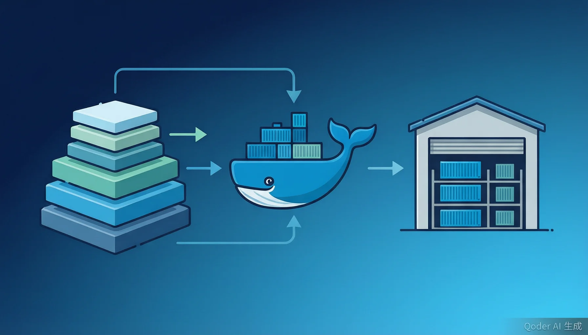

# 容器镜像构建与仓库管理

> 版本：v2.0 | 难度：初学者友好 | 预计学习时间：90 分钟



> 内容更新时间：2026-10-06 · 学习阶段：高级 · 预计用时：75 分钟

---

## 1. 课程介绍：容器镜像的世界

想象一下，你开了一家连锁奶茶店。每家分店都需要完全相同的配方、相同的原料、相同的操作流程，才能保证顾客在任何门店喝到一模一样的奶茶。Docker 容器镜像就是你的"标准配方手册"——它把应用程序和它需要的一切（代码、运行时、系统工具、配置文件）打包在一起，确保在任何机器上运行结果完全一致。而镜像仓库，就是存放这些配方手册的"中央厨房"。

本课程将带你从零开始，掌握 Docker 镜像构建与仓库管理的核心技能。

---

## 2. Docker 镜像分层原理

### 2.1 什么是镜像分层？

把 Docker 镜像想象成一个**千层蛋糕**。每一层都是一个独立的"变更快照"，层层叠加组成最终的镜像。Docker 使用 UnionFS（联合文件系统）将这些层合并，对外呈现为一个完整的文件系统。

### 2.2 分层的好处

| 好处 | 生活类比 | 说明 |
|------|----------|------|
| 共享资源 | 所有蛋糕都用同一款底胚 | 多个镜像可以共享相同的基础层 |
| 快速构建 | 只改顶层奶油，底胚不变 | 修改代码时只需重建变化的层 |
| 节省存储 | 冰箱里不用重复放底胚 | 相同层只在磁盘上存储一份 |
| 加速传输 | 快递只发变化的部分 | pull/push 时只传输差异层 |

### 2.3 查看镜像分层

```bash
# 查看镜像的构建历史（每一层做了什么）
docker history node:18-alpine
```

输出示例：

```text
IMAGE          CREATED       SIZE      COMMENT
a1b2c3d4e5f6   2 days ago    15.2MB    node_modules installed
b2c3d4e5f6a7   2 days ago    5.3MB     COPY package.json
c3d4e5f6a7b8   1 week ago    118MB     node binary installed
d4e5f6a7b8c9   1 week ago    5.8MB     alpine base image
```

### 2.4 层与缓存机制

Docker 构建镜像时，会逐条执行 Dockerfile 中的指令。每条指令生成一层。如果某一层的指令没有变化，且该层之前的所有层也都没变，Docker 就会直接使用**缓存**（Cache），跳过重复构建。

```bash
# 构建时强制不使用缓存
docker build --no-cache -t myapp:latest .
```

> 小贴士：理解分层原理是优化镜像大小和构建速度的基础。把不常变化的层放在前面（如系统依赖），频繁变化的层放在后面（如应用代码）。

---

## 3. Dockerfile 最佳实践

### 3.1 Dockerfile 是什么？

Dockerfile 就像一份**菜谱**——它告诉 Docker 如何一步步构建出你的镜像。每个指令（FROM、RUN、COPY 等）都是菜谱中的一个步骤。

### 3.2 基础 Dockerfile 示例

```dockerfile
# 指定基础镜像（选择你的"锅底"）
FROM node:18-alpine

# 设置工作目录（你的"厨房台面"）
WORKDIR /app

# 复制依赖文件（先放"主要食材"）
COPY package.json package-lock.json ./

# 安装依赖（"备菜"阶段）
RUN npm ci --only=production

# 复制应用代码（放入"调味料"）
COPY . .

# 暴露端口（告诉服务员哪桌可以上菜）
EXPOSE 3000

# 启动命令（"开火做菜"）
CMD ["node", "server.js"]
```

### 3.3 核心最佳实践

**实践一：使用 .dockerignore 文件**

就像寄快递前要清空包裹里的杂物，`.dockerignore` 告诉 Docker 哪些文件不需要打包进镜像。

```dockerignore
# .dockerignore 示例
node_modules
npm-debug.log*
.git
.gitignore
Dockerfile
docker-compose.yml
.env
.env.*
dist
coverage
.vscode
*.md
```

**实践二：合并 RUN 指令减少层数**

```dockerfile
# 不好的写法：产生 3 层
RUN apt-get update
RUN apt-get install -y curl
RUN apt-get clean

# 好的写法：只产生 1 层
RUN apt-get update && \
    apt-get install -y curl && \
    apt-get clean && \
    rm -rf /var/lib/apt/lists/*
```

**实践三：使用非 root 用户运行**

出于安全考虑，容器内不应使用 root 用户。就像餐厅厨房里干活的应该是厨师，而不是餐厅老板本人。

```dockerfile
# 创建专用用户
RUN addgroup -S appgroup && adduser -S appuser -G appgroup

# 切换到非 root 用户
USER appuser

# 之后所有指令都以 appuser 身份执行
CMD ["node", "server.js"]
```

**实践四：合理使用构建缓存**

把变化频率低的指令放在前面，变化频繁的放在后面：

```dockerfile
# 1. 基础镜像（几乎不变）
FROM node:18-alpine

# 2. 系统依赖（很少变）
RUN apk add --no-cache python3 make g++

# 3. 包描述文件（偶尔变）
WORKDIR /app
COPY package.json package-lock.json ./

# 4. 安装依赖（偶尔变）
RUN npm ci

# 5. 应用代码（经常变）
COPY . .
```

---

## 4. 多阶段构建

### 4.1 什么是多阶段构建？

想象你要做一道精致的蛋糕：你需要在"准备间"里称量、搅拌、烘焙，但最终送到"展示柜"里的只需要成品蛋糕，不需要那些碗、秤、搅拌器。多阶段构建就是这个思路——在一个 Dockerfile 中使用多个 FROM 指令，前面的阶段负责编译构建，最后的阶段只拷贝产物。

### 4.2 多阶段构建示例（Go 应用）

```dockerfile
# ===== 第一阶段：构建阶段 =====
FROM golang:1.21-alpine AS builder

WORKDIR /build

# 下载依赖
COPY go.mod go.sum ./
RUN go mod download

# 复制源码并编译
COPY . .
RUN CGO_ENABLED=0 GOOS=linux go build -ldflags="-s -w" -o /app/server ./cmd/server

# ===== 第二阶段：运行阶段 =====
FROM alpine:3.18

# 安装 CA 证书（HTTPS 请求需要）
RUN apk --no-cache add ca-certificates

# 创建非 root 用户
RUN adduser -D -u 1000 appuser
USER appuser

# 只从构建阶段拷贝二进制文件
COPY --from=builder /app/server /app/server

EXPOSE 8080

CMD ["/app/server"]
```

### 4.3 多阶段构建的优势

| 对比项 | 单阶段 | 多阶段 |
|--------|--------|--------|
| 镜像大小 | 可能 1GB+ | 通常 10-50MB |
| 安全性 | 包含编译工具链 | 只包含运行产物 |
| 攻击面 | 大（多余工具可被利用） | 小（最小化安装） |

### 4.4 多阶段构建示例（前端 React 应用）

```dockerfile
# 阶段一：构建前端资源
FROM node:18-alpine AS build
WORKDIR /app
COPY package.json package-lock.json ./
RUN npm ci
COPY . .
RUN npm run build

# 阶段二：用 Nginx 提供静态文件服务
FROM nginx:1.25-alpine
COPY --from=build /app/build /usr/share/nginx/html
COPY nginx.conf /etc/nginx/conf.d/default.conf
EXPOSE 80
CMD ["nginx", "-g", "daemon off;"]
```

---

## 5. 镜像瘦身策略

### 5.1 为什么要给镜像"减肥"？

一个臃肿的镜像就像一架超载的飞机：起飞慢（构建慢）、耗油多（传输慢）、还容易出问题（安全风险大）。镜像瘦身的目标是在保证功能完整的前提下，尽可能减小镜像体积。

### 5.2 策略一：选择 Alpine 基础镜像

Alpine Linux 是一个极度精简的 Linux 发行版，基础镜像只有约 5MB，而完整的 Ubuntu 约 77MB。

```dockerfile
# 对比：大 vs 小
FROM node:18          # 约 1GB
FROM node:18-slim     # 约 200MB
FROM node:18-alpine   # 约 120MB
```

> 注意：Alpine 使用 musl libc 而非 glibc，某些依赖 C 库的 npm 包可能需要额外处理。

### 5.3 策略二：清理构建缓存

```dockerfile
# 安装完依赖后清理缓存
RUN apk add --no-cache curl wget && \
    pip install --no-cache-dir -r requirements.txt && \
    rm -rf /tmp/* /var/tmp/*

# Node.js 项目清理 npm 缓存
RUN npm ci --only=production && \
    npm cache clean --force
```

### 5.4 策略三：善用 .dockerignore

```dockerignore
# 排除不需要进入镜像的文件
.git
.github
.vscode
node_modules
*.log
docker-compose*.yml
Dockerfile
.env*
tests/
docs/
```

### 5.5 策略四：使用 distroless 镜像

Google 提供的 distroless 镜像只包含应用运行时所需的最小依赖，连 shell 都没有：

```dockerfile
# 构建阶段
FROM golang:1.21 AS builder
WORKDIR /app
COPY . .
RUN CGO_ENABLED=0 go build -o /server .

# 运行阶段 - distroless 镜像
FROM gcr.io/distroless/static-debian12
COPY --from=builder /server /server
CMD ["/server"]
```

### 5.6 镜像大小对比

```bash
# 构建前后对比
docker images | grep myapp

# 优化前
myapp   latest    a1b2c3    2 minutes ago    1.2GB
# 优化后
myapp   latest    d4e5f6    1 minute ago     45MB
```

---

## 6. 镜像安全扫描

### 6.1 为什么需要安全扫描？

你的镜像可能包含已知漏洞的依赖包，就像你买的食材可能已经过期了一样。安全扫描工具能帮你自动检测这些问题。

### 6.2 使用 Trivy 扫描镜像

Trivy 是目前最流行的开源容器安全扫描工具，使用非常简单：

```bash
# 安装 Trivy
# macOS
brew install trivy

# Linux
curl -sfL https://raw.githubusercontent.com/aquasecurity/trivy/main/contrib/install.sh | sh -s -- -b /usr/local/bin

# 扫描镜像
trivy image myapp:latest

# 只报告高危和严重漏洞
trivy image --severity HIGH,CRITICAL myapp:latest

# 扫描结果输出为 JSON
trivy image --format json --output result.json myapp:latest
```

Trivy 输出示例：

```text
myapp:latest (alpine 3.18.3)

Total: 5 (UNKNOWN: 1, LOW: 2, MEDIUM: 1, HIGH: 1, CRITICAL: 0)

┌──────────────┬────────────────┬──────────┬───────────┬──────────────┐
│   Library    │ Vulnerability  │ Severity │ Installed │   Fixed      │
├──────────────┼────────────────┼──────────┼───────────┼──────────────┤
│ libcrypto    │ CVE-2023-1234  │ HIGH     │ 3.0.8     │ 3.0.12       │
│ zlib         │ CVE-2023-5678  │ MEDIUM   │ 1.2.11    │ 1.2.13       │
└──────────────┴────────────────┴──────────┴───────────┴──────────────┘
```

### 6.3 使用 Snyk Container

Snyk 提供了更深层的分析，包括开源漏洞、系统包漏洞和 Dockerfile 最佳实践检查：

```bash
# 登录 Snyk
snyk auth

# 扫描 Docker 镜像
snyk container test myapp:latest

# 在 CI 中使用（失败时中断流水线）
snyk container test myapp:latest --severity-threshold=high
```

### 6.4 在 CI 中集成安全扫描

```yaml
# .github/workflows/security.yml
name: Container Security Scan

on:
  push:
    branches: [main]
  pull_request:

jobs:
  trivy-scan:
    runs-on: ubuntu-latest
    steps:
      - name: Checkout code
        uses: actions/checkout@v4

      - name: Build Docker image
        run: docker build -t myapp:${{ github.sha }} .

      - name: Run Trivy vulnerability scanner
        uses: aquasecurity/trivy-action@master
        with:
          image-ref: myapp:${{ github.sha }}
          format: table
          exit-code: 1
          severity: CRITICAL,HIGH
```

---

## 7. Docker Hub 使用与限制

### 7.1 Docker Hub 是什么？

Docker Hub 就是容器的"应用商店"——官方镜像（如 nginx、node、python）都存放在这里，你也可以把自己构建的镜像推送到上面分享或备份。

### 7.2 基本操作

```bash
# 登录 Docker Hub
docker login -u yourusername

# 给镜像打标签（命名规范：用户名/仓库名:标签）
docker tag myapp:latest yourusername/myapp:v1.0.0

# 推送到 Docker Hub
docker push yourusername/myapp:v1.0.0

# 从 Docker Hub 拉取镜像
docker pull yourusername/myapp:v1.0.0

# 搜索镜像
docker search nginx
```

### 7.3 Docker Hub 的限制

| 账户类型 | 拉取限制 | 私有仓库数 | 并发拉取 |
|----------|----------|------------|----------|
| Free | 100 次/6h | 1 个 | 不限 |
| Pro | 不限 | 不限 | 不限 |
| Team | 不限 | 不限 | 不限 |

> 注意：自 2020 年 11 月起，Docker Hub 对匿名用户和免费账户实施了拉取频率限制。如果你的 CI/CD 频繁拉取镜像，可能会触发限流。

### 7.4 Docker Hub 镜像描述

在仓库的 README 中写好镜像说明，就像应用商店里的产品描述一样重要：

```markdown
# myapp

## 简介
一个高性能的 Node.js API 服务。

## 快速开始
docker run -p 3000:3000 yourusername/myapp:v1.0.0

## 环境变量
| 变量名 | 默认值 | 说明 |
|--------|--------|------|
| PORT | 3000 | 服务端口 |
| NODE_ENV | production | 运行环境 |

## 许可证
MIT
```

---

## 8. 私有仓库搭建

### 8.1 为什么需要私有仓库？

公共的 Docker Hub 就像公共停车场——方便但不安全。企业内部的应用镜像需要存放在私有仓库中，就像把贵重物品放在自家车库里一样。

### 8.2 Harbor：企业级镜像仓库

Harbor 是 VMware 开源的企业级镜像仓库，提供镜像签名、漏洞扫描、权限管理等企业级功能。

```yaml
# docker-compose.yml - Harbor 快速部署
version: '3.8'

services:
  harbor:
    image: goharbor/harbor:v2.9.0
    container_name: harbor
    ports:
      - "8443:8443"
    volumes:
      - harbor-data:/data
    environment:
      - HARBOR_ADMIN_PASSWORD=Harbor12345
    restart: always

volumes:
  harbor-data:
```

Harbor 核心功能：

- 基于角色的访问控制（RBAC）
- 镜像漏洞自动扫描
- 镜像签名与验证
- 镜像复制（跨数据中心同步）
- 垃圾回收与存储清理

### 8.3 Nexus Repository Manager

Nexus 不仅支持 Docker 镜像，还支持 Maven、npm、PyPI 等多种制品格式，适合作为统一的制品管理平台。

```bash
# 使用 Docker 运行 Nexus
docker run -d \
  --name nexus \
  -p 8081:8081 \
  -p 8082:8082 \
  -v nexus-data:/nexus-data \
  sonatype/nexus3:latest

# 8081: Web 管理界面
# 8082: Docker 镜像仓库端口
```

### 8.4 AWS ECR（Elastic Container Registry）

如果你在 AWS 上运行容器，ECR 是最方便的选择——它与 AWS IAM 深度集成，无需额外维护。

```bash
# 登录 ECR
aws ecr get-login-password --region us-east-1 | \
  docker login --username AWS --password-stdin 123456789012.dkr.ecr.us-east-1.amazonaws.com

# 创建仓库
aws ecr create-repository --repository-name myapp --region us-east-1

# 推送镜像
docker tag myapp:latest 123456789012.dkr.ecr.us-east-1.amazonaws.com/myapp:latest
docker push 123456789012.dkr.ecr.us-east-1.amazonaws.com/myapp:latest

# 拉取镜像
docker pull 123456789012.dkr.ecr.us-east-1.amazonaws.com/myapp:latest
```

### 8.5 私有仓库对比

| 特性 | Harbor | Nexus | AWS ECR |
|------|--------|-------|---------|
| 部署方式 | 自建 | 自建 | 托管服务 |
| 漏洞扫描 | 内置 | 需插件 | 内置 |
| 镜像签名 | 支持 | 支持 | 支持 |
| 权限管理 | RBAC | RBAC | IAM |
| 成本 | 免费 | 免费版可用 | 按量计费 |
| 适用场景 | 中大型企业 | 多制品管理 | AWS 生态 |

---

## 9. 镜像标签策略

### 9.1 标签就像版本号

给镜像打标签就像给文件命名——`report_final_v2_真的最终版.docx` 这种命名方式显然不靠谱。好的标签策略应该清晰、可追溯、有意义。

### 9.2 语义化版本（SemVer）

```text
格式：主版本号.次版本号.修订号

myapp:1.0.0
  │    │ │ │
  │    │ │ └── 修订号：Bug 修复，向后兼容
  │    │ └──── 次版本号：新功能，向后兼容
  │    └────── 主版本号：破坏性变更
  └─────────── 镜像名称
```

### 9.3 Git SHA 标签

使用 Git 提交哈希作为标签，可以精确追溯到每一行代码的变更：

```bash
# 使用 Git SHA 作为标签
GIT_SHA=$(git rev-parse --short HEAD)
docker build -t myapp:${GIT_SHA} .
docker push myregistry.com/myapp:${GIT_SHA}
```

### 9.4 关于 latest 标签的争议

```bash
# 不推荐：latest 标签含义模糊
docker push myapp:latest

# 推荐：同时使用具体版本和 latest
docker tag myapp:1.2.3 myregistry.com/myapp:1.2.3
docker tag myapp:1.2.3 myregistry.com/myapp:latest
docker push myregistry.com/myapp:1.2.3
docker push myregistry.com/myapp:latest
```

> 最佳实践：生产环境永远不要使用 `latest` 标签，而是使用明确的版本号。`latest` 标签仅用于开发环境或作为辅助标签。

### 9.5 推荐的标签策略

```bash
# 同时打多个标签
docker build -t myapp:1.2.3 -t myapp:1.2 -t myapp:latest .

# 这样用户可以选择精度：
# myapp:1.2.3  → 精确版本（生产环境）
# myapp:1.2    → 次版本兼容（自动获取补丁）
# myapp:latest → 最新版本（开发测试）
```

---

## 10. 实战：构建生产级 Node.js 应用镜像

### 10.1 项目结构

```text
my-node-app/
├── src/
│   └── server.js
├── package.json
├── package-lock.json
├── Dockerfile
├── .dockerignore
└── docker-compose.yml
```

### 10.2 应用代码

```javascript
// src/server.js
const http = require('http');

const PORT = process.env.PORT || 3000;

const server = http.createServer((req, res) => {
  if (req.url === '/health') {
    res.writeHead(200, { 'Content-Type': 'application/json' });
    res.end(JSON.stringify({ status: 'healthy', uptime: process.uptime() }));
    return;
  }

  res.writeHead(200, { 'Content-Type': 'application/json' });
  res.end(JSON.stringify({ message: 'Hello from containerized Node.js!' }));
});

server.listen(PORT, '0.0.0.0', () => {
  console.log(`Server running on port ${PORT}`);
});

// 优雅关闭
process.on('SIGTERM', () => {
  console.log('SIGTERM received, shutting down gracefully...');
  server.close(() => {
    console.log('Server closed');
    process.exit(0);
  });
});
```

### 10.3 生产级 Dockerfile

```dockerfile
# ===== 阶段一：安装依赖 =====
FROM node:18-alpine AS deps

WORKDIR /app

# 复制依赖描述文件
COPY package.json package-lock.json ./

# 安装所有依赖（包括 devDependencies 用于构建）
RUN npm ci

# ===== 阶段二：生产构建 =====
FROM node:18-alpine AS production

# 元数据标签（OCI 标准）
LABEL org.opencontainers.image.title="my-node-app" \
      org.opencontainers.image.description="Production Node.js API server" \
      org.opencontainers.image.version="1.0.0"

# 设置环境变量
ENV NODE_ENV=production \
    PORT=3000 \
    LOG_LEVEL=info

# 创建非 root 用户
RUN addgroup -g 1001 -S nodejs && \
    adduser -S nodejs -u 1001 -G nodejs

WORKDIR /app

# 只复制生产依赖文件
COPY package.json package-lock.json ./
RUN npm ci --only=production && npm cache clean --force

# 复制应用代码
COPY --from=deps /app/node_modules ./node_modules
COPY src/ ./src/

# 设置文件所有权
RUN chown -R nodejs:nodejs /app

# 切换到非 root 用户
USER nodejs

EXPOSE 3000

# 健康检查
HEALTHCHECK --interval=30s --timeout=3s --start-period=5s --retries=3 \
  CMD wget --no-verbose --tries=1 --spider http://localhost:3000/health || exit 1

# 启动命令
CMD ["node", "src/server.js"]
```

### 10.4 Docker Compose 配置

```yaml
# docker-compose.yml
version: '3.8'

services:
  app:
    build:
      context: .
      dockerfile: Dockerfile
    container_name: my-node-app
    ports:
      - "3000:3000"
    environment:
      - NODE_ENV=production
      - PORT=3000
      - LOG_LEVEL=info
    restart: unless-stopped
    healthcheck:
      test: ["CMD", "wget", "--no-verbose", "--tries=1", "--spider", "http://localhost:3000/health"]
      interval: 30s
      timeout: 3s
      retries: 3
      start_period: 10s
    deploy:
      resources:
        limits:
          cpus: '0.5'
          memory: 256M
        reservations:
          cpus: '0.25'
          memory: 128M
    networks:
      - app-network

networks:
  app-network:
    driver: bridge
```

### 10.5 构建与运行

```bash
# 构建镜像
docker build -t my-node-app:1.0.0 .

# 查看镜像大小
docker images my-node-app

# 运行容器
docker run -d \
  --name my-app \
  -p 3000:3000 \
  -e NODE_ENV=production \
  --restart unless-stopped \
  my-node-app:1.0.0

# 检查健康状态
docker ps

# 查看日志
docker logs -f my-app

# 测试健康检查端点
curl http://localhost:3000/health
```

---

## 11. CI/CD 中的镜像管理

### 11.1 自动化构建流水线

```yaml
# .github/workflows/docker-build.yml
name: Build and Push Docker Image

on:
  push:
    branches: [main]
    tags: ['v*']

env:
  REGISTRY: ghcr.io
  IMAGE_NAME: ${{ github.repository }}

jobs:
  build-and-push:
    runs-on: ubuntu-latest
    permissions:
      contents: read
      packages: write

    steps:
      - name: Checkout code
        uses: actions/checkout@v4

      - name: Set up Docker Buildx
        uses: docker/setup-buildx-action@v3

      - name: Log in to Container Registry
        uses: docker/login-action@v3
        with:
          registry: ${{ env.REGISTRY }}
          username: ${{ github.actor }}
          password: ${{ secrets.GITHUB_TOKEN }}

      - name: Extract metadata
        id: meta
        uses: docker/metadata-action@v5
        with:
          images: ${{ env.REGISTRY }}/${{ env.IMAGE_NAME }}
          tags: |
            type=semver,pattern={{version}}
            type=semver,pattern={{major}}.{{minor}}
            type=sha,prefix=,format=short

      - name: Build and push
        uses: docker/build-push-action@v5
        with:
          context: .
          push: true
          tags: ${{ steps.meta.outputs.tags }}
          labels: ${{ steps.meta.outputs.labels }}
          cache-from: type=gha
          cache-to: type=gha,mode=max
```

### 11.2 多平台构建

```bash
# 使用 Buildx 构建多平台镜像
docker buildx create --name mybuilder --use
docker buildx build \
  --platform linux/amd64,linux/arm64 \
  -t myapp:1.0.0 \
  --push .
```

---

## 12. 常见问题与排错

### 12.1 构建失败排查

```bash
# 问题：COPY 失败，找不到文件
# 原因：.dockerignore 排除了需要的文件，或上下文路径不对
# 解决：检查 .dockerignore 和 docker build 的 context 路径

# 问题：npm install 很慢
# 原因：在容器内使用了完整的 npm install
# 解决：使用 npm ci 替代，并配置 npm 镜像源

# 问题：镜像太大
# 原因：包含了 node_modules 中的 devDependencies
# 解决：使用多阶段构建，最终阶段只安装 production 依赖
```

### 12.2 推送失败排查

```bash
# 问题：denied: requested access to the resource is denied
# 原因：未登录或没有推送权限
# 解决：docker login 重新登录

# 问题：manifest unknown
# 原因：镜像标签不存在
# 解决：docker images 确认标签名称

# 问题：拉取超时
# 原因：网络问题或仓库限流
# 解决：配置镜像加速器（国内用户）
```

### 12.3 运行时问题排查

```bash
# 查看容器日志
docker logs --tail 100 my-container

# 进入容器调试（临时使用）
docker run -it --entrypoint /bin/sh myapp:latest

# 检查容器资源使用
docker stats my-container

# 查看容器详细信息
docker inspect my-container
```

---

### 12.4 关键概念速查表

| 概念 | 说明 | 类比 |
|------|------|------|
| Dockerfile | 构建镜像的配方 | 菜谱 |
| Image（镜像） | 只读的应用打包 | 冷冻预制菜 |
| Container（容器） | 镜像的运行实例 | 加热上桌的菜 |
| Registry（仓库） | 存放镜像的服务 | 应用商店 |
| Tag（标签） | 镜像的版本标识 | 文件版本号 |
| Layer（层） | 镜像的组成部分 | 千层蛋糕的每一层 |
| Base Image | 基础镜像 | 蛋糕底胚 |
| .dockerignore | 构建排除列表 | 快递不寄的物品清单 |

---

## 13. 课程总结与复习清单

### 核心要点回顾

本课程我们学习了：

1. Docker 镜像的分层原理和缓存机制
2. Dockerfile 的编写规范与最佳实践
3. 多阶段构建如何大幅减小镜像体积
4. 镜像瘦身的四种核心策略
5. 使用 Trivy 和 Snyk 进行安全扫描
6. Docker Hub 的使用方法和限制
7. Harbor、Nexus、AWS ECR 等私有仓库方案
8. 语义化版本和 Git SHA 标签策略
9. 从零构建一个生产级 Node.js 应用镜像
10. CI/CD 流水线中的自动化镜像管理

### 复习清单

- [ ] 能否解释 Docker 镜像分层的原理及其好处？
- [ ] 能否写出一个包含多阶段构建、非 root 用户、健康检查的生产级 Dockerfile？
- [ ] 能否列举至少三种镜像瘦身策略并说明原理？
- [ ] 能否使用 Trivy 对镜像进行安全扫描并解读结果？
- [ ] 能否说明 Docker Hub 的拉取限制及应对方案？
- [ ] 能否对比 Harbor、Nexus、AWS ECR 的适用场景？
- [ ] 能否解释为什么生产环境不应使用 latest 标签？
- [ ] 能否独立完成"构建 → 扫描 → 打标签 → 推送 → 部署"的完整流程？

### 下一步学习建议

- 深入学习 Kubernetes 中的镜像拉取与调度策略
- 探索 Buildpacks 和 Kaniko 等无 Docker daemon 构建方案
- 了解镜像签名（Cosign / Notary）与供应链安全
- 学习 OCI（Open Container Initiative）标准规范

---

---

## 考点精讲

### 考点 1

Docker 多阶段构建（Multi-stage Build）的主要目的是什么？

A. 让 Dockerfile 的代码更简洁易读  
B. 加快 Docker 镜像的推送速度  
C. 让镜像可以在多个平台上同时构建  
D. 在构建阶段使用包含编译工具的完整镜像，在最终运行阶段只拷贝编译产物，从而大幅减小镜像体积并提高安全性  

**正确答案：D**

**详细解释：** 多阶段构建使用多个 "FROM" 指令，前面的阶段（如 "builder"）负责编译和构建，包含完整的编译工具链。最终阶段只通过 "COPY --from=builder" 拷贝必要的运行产物（如二进制文件），不包含编译工具。这样可以将镜像从 1GB+ 缩小到 10-50MB，同时减少攻击面（不暴露编译工具），提高安全性。

---

### 考点 2

关于 Docker 镜像标签策略，以下哪个做法是生产环境的最佳实践？

A. 始终使用 "latest" 标签，方便部署最新版本  
B. 不需要标签，Docker 会自动分配唯一 ID  
C. 使用日期作为唯一标签（如 "2024-01-15"）  
D. 使用语义化版本号（如 "1.2.3"）或 Git SHA 作为标签，避免使用 "latest"  

**正确答案：D**

**详细解释：** 生产环境应使用明确的版本号标签（如语义化版本 "1.2.3"）或 Git 提交哈希（如 "abc1234"），这样可以精确追溯每个镜像对应的代码版本，确保部署的可重复性和可回滚性。"latest" 标签含义模糊，不同时间拉取可能得到不同版本，容易导致不可预期的问题。日期标签虽然可追溯但无法体现版本兼容性信息。

---

### 考点 3

".dockerignore" 文件的作用是什么？

A. 定义 Docker 容器运行时可以访问的文件  
B. 配置 Docker 容器的网络访问规则  
C. 列出 Docker 镜像的安全漏洞  
D. 告诉 Docker 在构建镜像时排除哪些文件不打包进镜像，类似于 ".gitignore"  

**正确答案：D**

**详细解释：** ".dockerignore" 文件的作用类似于 ".gitignore"，它告诉 Docker 在构建镜像时忽略指定的文件和目录。常见的排除项包括 "node_modules"、".git"、".env"、"coverage" 等。使用 ".dockerignore" 可以减小构建上下文（context）的体积，加速镜像构建，同时避免将不必要的文件（如敏感配置、开发工具）打包进镜像。

---

### 考点 4

以下哪个工具专门用于容器镜像的安全漏洞扫描？

A. Prometheus
B. Grafana
C. Trivy
D. Alertmanager

**正确答案：C**

**详细解释：** Trivy 是目前最流行的开源容器安全扫描工具，由 Aqua Security 开发。它可以扫描容器镜像中的操作系统包和应用依赖（如 npm、pip）的已知漏洞（CVE），并输出详细的漏洞报告，包括严重等级和修复版本。Prometheus 是监控系统，Grafana 是可视化工具，Alertmanager 是告警管理组件，它们都不用于镜像安全扫描。

---

### 考点 5

Docker Hub 免费账户的拉取限制是什么？这对 CI/CD 流水线有什么影响？

A. 无限制，但推送次数有限  
B. 只有中国地区的用户有限制  
C. 每天只能拉取 10 次  
D. 每 6 小时 100 次拉取限制，频繁拉取镜像的 CI/CD 流水线可能触发限流  

**正确答案：D**

**详细解释：** 自 2020 年 11 月起，Docker Hub 对匿名用户和免费账户实施每 6 小时 100 次拉取的频率限制。对于频繁构建的 CI/CD 流水线来说，这个限制很容易被触发，导致构建失败。应对方案包括：使用私有镜像仓库（如 Harbor、AWS ECR）、升级到 Docker Pro 账户、或在 CI 中配置镜像缓存代理。

---

> 版本：v2.0 | 最后更新：2026-10-19

## 本节知识框架

**课程定位**：分类「devops」· 学习阶段 高级 · 建议用时 50 分钟。

本课主线：学习 Dockerfile 最佳实践、镜像瘦身、安全扫描与私有仓库搭建。

### 复习清单

- [ ] 能不看正文复述本课核心术语，并指出一个边界或反例。
- [ ] 能运行或推演本课示例，记录输入、输出与失败现象。
- [ ] 能完成一次自测，并把错题对照考点精讲定位原因。

## 核心概念定义

| 术语 | 一句话说明 |
| --- | --- |
| Docker | 学习 Dockerfile 最佳实践、镜像瘦身、安全扫描与私有仓库搭建。相关：正文给出可操作定义与适用边界。 |
| 镜像 | 学习 Dockerfile 最佳实践、镜像瘦身、安全扫描与私有仓库搭建。相关：正文给出可操作定义与适用边界。 |
| Harbor | 学习 Dockerfile 最佳实践、镜像瘦身、安全扫描与私有仓库搭建。相关：正文给出可操作定义与适用边界。 |
| 安全扫描 | 学习 Dockerfile 最佳实践、镜像瘦身、安全扫描与私有仓库搭建。相关：正文给出可操作定义与适用边界。 |
| 仓库 | 学习 Dockerfile 最佳实践、镜像瘦身、安全扫描与私有仓库搭建。相关：正文给出可操作定义与适用边界。 |

## 原理与运行机制

《容器镜像构建与仓库管理》正文各章按「输入是什么 → 中间如何转换 → 输出到哪 → 失败时怎样表现」四问展开；复习时给每个机制补一句自己的复述，再回到对应章节核对。

## 典型应用场景

- 结合「容器镜像构建与仓库管理」的常见落地场景与选型边界，详见正文各章节的对比讨论。
- 迁移到新项目时，先明确输入规模、失败代价与可观测手段，再决定采用深度。

## 代码/协议/SQL 示例

《容器镜像构建与仓库管理》正文首个示例可作为最小验证起点（原样保留在上方章节）：先跑通，再改一个输入观察输出变化。

```bash
# 查看镜像的构建历史（每一层做了什么）
docker history node:18-alpine
```

## 时间/空间复杂度或性能分析

- 在《容器镜像构建与仓库管理》里处理规模 n 时，先估计主循环与嵌套层数，再决定优化方向；小样本上的耗时读数不能外推。
- 性能结论要绑定输入分布：换数据规模、并发度或缓存命中情况后须重新测量。

## 常见误区与易错点

| 错误做法 | 典型现象 | 修复方向 |
| --- | --- | --- |
| 只验证正常输入 | 边界数据触发时才暴露问题 | 为每个结论补一个空值/极值/重复值用例 |
| 背结论不跑实验 | 换个输入就失效 | 按「预测—实测—差异归因」三步复盘 |
| 忽略环境与版本差异 | 本机可用线上报错 | 把版本、配置与依赖写入复现步骤 |

## 与其他知识点的关系

本课与分类「devops」内相邻课程互为补充，建议按清单顺序学完再做综合练习。

## 自测题与参考答案

以下题目与题库同源，作答后再看解析；错误项要能说出错在哪一步。

## 术语速查

| 术语 | 一句话说明 |
| --- | --- |
| Docker | 容器化平台，靠UnionFS分层把应用连同运行时打包，任何机器上行为一致 |
| 镜像 | 只读的分层模板，每层是一个变更快照，容器是它加上可写层后的运行实例 |
| Harbor | 自部署的私有镜像仓库，提供项目权限、镜像签名、内置扫描与跨仓复制 |
| 安全扫描 | 用Trivy等工具检出镜像内依赖与系统包的CVE，可在CI里设阈值阻断推送 |
| 仓库 | 集中存放并分发镜像的Registry，按命名空间和标签完成push与pull |

## 参考资料与复核

- [本课资料锚点 devops_docker_registry](https://zh.wikipedia.org/w/index.php?search=devops_docker_registry)

- 官方/权威资料：[OpenSSF 最佳实践](https://bestpractices.coreinfrastructure.org/)
- 主题延伸：[关于「镜像」的检索页](https://zh.wikipedia.org/w/index.php?search=%E9%95%9C%E5%83%8F)
- 本课索引词：[锚点 devops_docker_registry](https://bestpractices.coreinfrastructure.org/#Docker)
- 最后复核：2026-10-04
- 下次复核：2027-02-02

## 内容元数据

- 内容更新时间：2026-10-06

- 内容版本：v2.0
- 课程标识：devops_docker_registry
- 所属分类：devops
- 学习阶段：高级
- 建议用时：50 分钟

