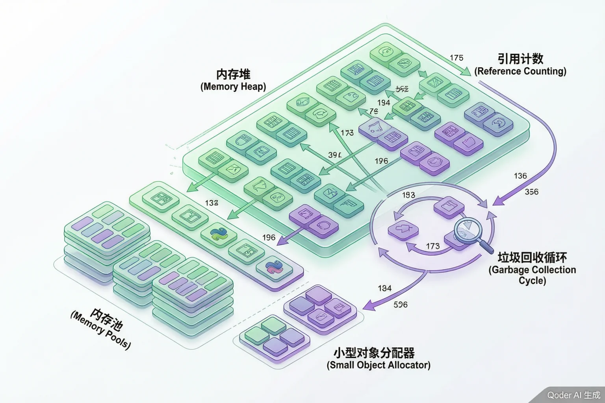

# GitHub Actions 自动化实战



> **版本**：v2.0
> **难度**：初学者友好
> **前置知识**：了解 Git 基本操作，有 GitHub 账号即可

> 内容更新时间：2026-10-06 · 学习阶段：高级 · 预计用时：180 分钟

---

## 目录

1. [课程介绍：认识你的"自动化机器人助手"](#1-课程介绍认识你的自动化机器人助手)
2. [核心概念：Workflow、Job、Step、Action](#2-核心概念workflowjobstepaction)
3. [事件触发机制：让自动化动起来](#3-事件触发机制让自动化动起来)
4. [常用 Action 使用指南](#4-常用-action-使用指南)
5. [实战一：构建 CI 持续集成流水线](#5-实战一构建-ci-持续集成流水线)
6. [实战二：PR 检查自动化](#6-实战二pr-检查自动化)
7. [实战三：定时任务与手动触发](#7-实战三定时任务与手动触发)
8. [矩阵策略：多版本多系统测试](#8-矩阵策略多版本多系统测试)
9. [环境变量与密钥管理](#9-环境变量与密钥管理)
10. [缓存优化：加速你的流水线](#10-缓存优化加速你的流水线)
11. [自定义 Composite Action](#11-自定义-composite-action)
12. [实战四：构建完整 CI/CD 流水线（部署到云服务）](#12-实战四构建完整-cicd-流水线部署到云服务)
13. [课程总结与复习清单](#13-课程总结与复习清单)

---

## 1. 课程介绍：认识你的"自动化机器人助手"

### 1.1 什么是 GitHub Actions？

想象一下，你有一个超级勤劳的**机器人助手**，它 24 小时待命，只要你一推送代码，它就自动帮你做各种事情：检查代码有没有 bug、运行测试、打包应用、甚至把应用部署到服务器上。这个机器人助手就是 **GitHub Actions**。

用更正式的话来说，GitHub Actions 是 GitHub 提供的 **CI/CD（持续集成/持续部署）** 平台。它让你能够在代码仓库中定义自动化的工作流程，从代码提交到应用上线，全程自动化。

### 1.2 为什么需要 GitHub Actions？

| 传统方式 | 使用 GitHub Actions |
|---------|-------------------|
| 手动运行测试，容易忘记 | 每次推送代码自动运行测试 |
| 手动打包、手动部署，耗时耗力 | 一条流水线自动完成所有步骤 |
| 不同环境配置不一致 | 统一的 YAML 配置，团队共享 |
| 需要自己搭建 CI 服务器 | GitHub 免费提供运行环境 |

### 1.3 生活类比

把 GitHub Actions 想象成一个**智能厨房机器人**：

- **Workflow（工作流）** = 一份完整的菜谱，从备菜到上菜的全流程
- **Job（任务）** = 菜谱中的大步骤，比如"备菜"、"烹饪"、"摆盘"
- **Step（步骤）** = 每个大步骤里的小动作，比如"洗菜"、"切菜"、"配菜"
- **Action（动作）** = 具体的工具，比如"菜刀"、"炒锅"、"烤箱"

机器人会严格按照菜谱执行，不会偷懒，也不会忘记任何步骤。

---

## 2. 核心概念：Workflow、Job、Step、Action

### 2.1 四大核心概念

```yaml
# 一个 workflow 文件的骨架
name: 我的第一个工作流           # Workflow：整个自动化流程的名称

on: [push]                      # 触发条件：什么时候启动这个流程

jobs:                           # Jobs：这个流程包含哪些任务
  build:                        # 任务名叫 "build"
    runs-on: ubuntu-latest      # 任务在哪台机器上运行
    steps:                      # Steps：任务里的每个步骤
      - name: 检出代码           # 步骤名称
        uses: actions/checkout@v4  # 使用一个现成的 Action
      - name: 安装依赖
        run: npm install         # 运行一条 shell 命令
      - name: 运行测试
        run: npm test            # 再运行一条命令
```

### 2.2 概念详解

**Workflow（工作流）**
- 定义在 `.github/workflows/` 目录下的 YAML 文件
- 一个仓库可以有多个 workflow 文件
- 每个 workflow 描述一个完整的自动化流程

**Job（任务）**
- 一个 workflow 可以包含多个 job
- 默认情况下，job 之间是**并行**执行的
- 也可以设置 job 之间的**依赖关系**（一个 job 完成后才执行下一个）

**Step（步骤）**
- 每个 job 包含多个 step
- step 按顺序依次执行
- 每个 step 可以是一个 `run` 命令或一个 `uses` 引用的 action

**Action（动作）**
- 可复用的最小单元
- 可以是 GitHub 官方提供的（如 `actions/checkout`）
- 也可以是社区开发的
- 甚至可以是你自己仓库里的自定义 action

### 2.3 Job 之间的依赖关系

```yaml
jobs:
  build:
    runs-on: ubuntu-latest
    steps:
      - uses: actions/checkout@v4
      - run: npm run build

  test:
    needs: build                # test 依赖 build，build 完成后才运行 test
    runs-on: ubuntu-latest
    steps:
      - uses: actions/checkout@v4
      - run: npm test

  deploy:
    needs: [build, test]        # deploy 依赖 build 和 test 两个任务
    runs-on: ubuntu-latest
    steps:
      - run: echo "部署到生产环境"
```

---

## 3. 事件触发机制：让自动化动起来

### 3.1 常见触发事件

GitHub Actions 支持多种触发方式，就像你家的智能闹钟可以设定多种闹钟模式一样：

```yaml
# 1. push 事件：代码推送时触发
on:
  push:
    branches: [main, develop]   # 只在推送到 main 或 develop 分支时触发

# 2. pull_request 事件：创建或更新 PR 时触发
on:
  pull_request:
    branches: [main]
    types: [opened, synchronize, reopened]

# 3. schedule 事件：定时触发（使用 cron 表达式）
on:
  schedule:
    - cron: '0 2 * * 1-5'      # 周一到周五，每天凌晨 2 点运行

# 4. workflow_dispatch 事件：手动触发
on:
  workflow_dispatch:
    inputs:
      environment:
        description: '部署到哪个环境'
        required: true
        default: 'staging'
        type: choice
        options:
          - staging
          - production
```

### 3.2 组合多种触发条件

```yaml
on:
  push:
    branches: [main]
  pull_request:
    branches: [main]
  workflow_dispatch:            # 同时支持手动触发
```

### 3.3 触发条件过滤

```yaml
on:
  push:
    branches: [main]
    paths:
      - 'src/**'               # 只有 src 目录下的文件变更才触发
      - 'package.json'
    paths-ignore:
      - 'docs/**'              # 忽略 docs 目录的变更
      - '**/*.md'              # 忽略所有 Markdown 文件
```

---

## 4. 常用 Action 使用指南

### 4.1 actions/checkout — 检出代码

这是最常用的 action，它把你的代码"下载"到运行环境中：

```yaml
steps:
  - name: 检出代码
    uses: actions/checkout@v4
    with:
      fetch-depth: 2            # 只获取最近 2 次提交（加速克隆）
```

### 4.2 actions/setup-node — 配置 Node.js 环境

```yaml
steps:
  - name: 安装 Node.js
    uses: actions/setup-node@v4
    with:
      node-version: '20'        # 指定 Node.js 版本
      cache: 'npm'              # 自动缓存 npm 依赖
```

### 4.3 actions/cache — 缓存依赖

缓存可以大幅加速你的流水线，就像把常用的工具放在手边，不用每次都去仓库取：

```yaml
steps:
  - name: 缓存 node_modules
    uses: actions/cache@v4
    with:
      path: node_modules
      key: ${{ runner.os }}-node-${{ hashFiles('package-lock.json') }}
      restore-keys: |
        ${{ runner.os }}-node-
```

### 4.4 actions/upload-artifact 与 download-artifact

在 job 之间传递构建产物：

```yaml
jobs:
  build:
    runs-on: ubuntu-latest
    steps:
      - uses: actions/checkout@v4
      - run: npm run build
      - name: 上传构建产物
        uses: actions/upload-artifact@v4
        with:
          name: build-output
          path: dist/

  deploy:
    needs: build
    runs-on: ubuntu-latest
    steps:
      - name: 下载构建产物
        uses: actions/download-artifact@v4
        with:
          name: build-output
          path: dist/
      - run: ls dist/
```

---

## 5. 实战一：构建 CI 持续集成流水线

### 5.1 Node.js 项目 CI 完整示例

下面是一个真实项目中常用的 CI 配置，每次推送代码都会自动运行：

```yaml
# .github/workflows/ci.yml
name: CI 持续集成

on:
  push:
    branches: [main, develop]
  pull_request:
    branches: [main]

jobs:
  lint:
    name: 代码检查
    runs-on: ubuntu-latest
    steps:
      - uses: actions/checkout@v4
      - uses: actions/setup-node@v4
        with:
          node-version: '20'
          cache: 'npm'
      - run: npm ci                 # 使用 ci 而非 install，更严格更快
      - run: npm run lint

  test:
    name: 运行测试
    runs-on: ubuntu-latest
    strategy:
      matrix:
        node-version: [18, 20, 22]  # 在多个 Node.js 版本上测试
    steps:
      - uses: actions/checkout@v4
      - name: 使用 Node.js ${{ matrix.node-version }}
        uses: actions/setup-node@v4
        with:
          node-version: ${{ matrix.node-version }}
          cache: 'npm'
      - run: npm ci
      - run: npm test -- --coverage
      - name: 上传覆盖率报告
        uses: actions/upload-artifact@v4
        with:
          name: coverage-report-node-${{ matrix.node-version }}
          path: coverage/

  build:
    name: 构建项目
    needs: [lint, test]             # 等检查和测试都通过才构建
    runs-on: ubuntu-latest
    steps:
      - uses: actions/checkout@v4
      - uses: actions/setup-node@v4
        with:
          node-version: '20'
          cache: 'npm'
      - run: npm ci
      - run: npm run build
      - name: 上传构建产物
        uses: actions/upload-artifact@v4
        with:
          name: production-build
          path: dist/
          retention-days: 7
```

### 5.2 Python 项目 CI 示例

```yaml
# .github/workflows/ci-python.yml
name: Python CI

on:
  push:
    branches: [main]
  pull_request:
    branches: [main]

jobs:
  test:
    runs-on: ubuntu-latest
    strategy:
      matrix:
        python-version: ['3.10', '3.11', '3.12']
    steps:
      - uses: actions/checkout@v4
      - name: 设置 Python ${{ matrix.python-version }}
        uses: actions/setup-python@v5
        with:
          python-version: ${{ matrix.python-version }}
      - name: 安装依赖
        run: |
          python -m pip install --upgrade pip
          pip install -r requirements.txt
          pip install pytest pytest-cov
      - name: 运行测试
        run: pytest --cov=src --cov-report=xml
      - name: 上传覆盖率
        uses: actions/upload-artifact@v4
        with:
          name: coverage-py-${{ matrix.python-version }}
          path: coverage.xml
```

---

## 6. 实战二：PR 检查自动化

### 6.1 PR 自动检查清单

每次有人提交 Pull Request，自动运行以下检查：

```yaml
# .github/workflows/pr-check.yml
name: PR 自动检查

on:
  pull_request:
    branches: [main]
    types: [opened, synchronize, reopened]

jobs:
  pr-validation:
    name: PR 验证
    runs-on: ubuntu-latest
    steps:
      - uses: actions/checkout@v4
        with:
          fetch-depth: 0            # 获取完整历史，用于对比

      - name: 检查提交信息格式
        run: |
          # 检查 PR 中的所有提交信息是否符合规范
          commits=$(git log --format=%s origin/main..HEAD)
          echo "检查提交信息..."
          echo "$commits" | while read -r msg; do
            if ! echo "$msg" | grep -qE '^(feat|fix|docs|style|refactor|test|chore)(\(.+\))?:'; then
              echo "::error::提交信息不符合规范: $msg"
              echo "请使用以下格式: type(scope): description"
              echo "type 可选: feat, fix, docs, style, refactor, test, chore"
              exit 1
            fi
          done
          echo "所有提交信息格式正确！"

      - name: 检查代码变更范围
        run: |
          # 统计变更的文件
          changed_files=$(git diff --name-only origin/main..HEAD)
          file_count=$(echo "$changed_files" | wc -l)
          echo "本次 PR 变更了 $file_count 个文件"
          if [ "$file_count" -gt 20 ]; then
            echo "::warning::PR 变更文件过多（$file_count 个），建议拆分为多个小 PR"
          fi

      - name: 运行代码格式化检查
        run: |
          npm ci
          npx prettier --check "src/**/*.{ts,tsx,js,jsx}"
          echo "代码格式化检查通过！"

      - name: 运行单元测试
        run: npm test

      - name: 运行构建
        run: npm run build
```

### 6.2 PR 自动标签与评论

```yaml
# .github/workflows/pr-labeler.yml
name: PR 自动标签

on:
  pull_request:
    types: [opened]

jobs:
  label:
    runs-on: ubuntu-latest
    permissions:
      pull-requests: write
      contents: read
    steps:
      - uses: actions/checkout@v4

      - name: 根据变更路径添加标签
        uses: actions/labeler@v5
        with:
          repo-token: "${{ secrets.GITHUB_TOKEN }}"

      - name: 欢迎评论
        uses: actions/github-script@v7
        with:
          script: |
            github.rest.issues.createComment({
              issue_number: context.issue.number,
              owner: context.repo.owner,
              repo: context.repo.repo,
              body: '## 欢迎提交 PR！\n\n请确保：\n- [ ] 代码通过所有检查\n- [ ] 添加了必要的测试\n- [ ] 更新了相关文档\n\n我们的机器人助手正在自动验证你的提交，请稍候。'
            })
```

---

## 7. 实战三：定时任务与手动触发

### 7.1 定时健康检查

```yaml
# .github/workflows/scheduled-health-check.yml
name: 定时健康检查

on:
  schedule:
    - cron: '0 */6 * * *'          # 每 6 小时运行一次
    - cron: '0 2 * * 1'            # 每周一凌晨 2 点运行深度检查
  workflow_dispatch:                # 也支持手动触发

jobs:
  health-check:
    name: API 健康检查
    runs-on: ubuntu-latest
    steps:
      - name: 检查 API 端点
        run: |
          endpoints=(
            "https://api.example.com/health"
            "https://api.example.com/status"
            "https://api.example.com/api/v1/ping"
          )
          for url in "${endpoints[@]}"; do
            status_code=$(curl -s -o /dev/null -w "%{http_code}" "$url")
            if [ "$status_code" -ne 200 ]; then
              echo "::error::端点 $url 返回状态码 $status_code"
              exit 1
            fi
            echo "端点 $url 正常 (状态码: $status_code)"
          done

      - name: 检查 SSL 证书过期时间
        run: |
          expiry=$(echo | openssl s_client -connect api.example.com:443 -servername api.example.com 2>/dev/null | openssl x509 -noout -enddate | cut -d= -f2)
          echo "SSL 证书过期时间: $expiry"
          expiry_epoch=$(date -d "$expiry" +%s)
          current_epoch=$(date +%s)
          days_left=$(( (expiry_epoch - current_epoch) / 86400 ))
          echo "距离过期还有 $days_left 天"
          if [ "$days_left" -lt 30 ]; then
            echo "::warning::SSL 证书将在 $days_left 天后过期，请尽快续期！"
          fi

  dependency-check:
    name: 依赖安全检查
    runs-on: ubuntu-latest
    steps:
      - uses: actions/checkout@v4
      - uses: actions/setup-node@v4
        with:
          node-version: '20'
      - run: npm audit --audit-level=high
        continue-on-error: true       # 即使有漏洞也不中断，只警告
```

### 7.2 手动触发部署

```yaml
# .github/workflows/manual-deploy.yml
name: 手动部署

on:
  workflow_dispatch:
    inputs:
      target_env:
        description: '目标部署环境'
        required: true
        type: choice
        options:
          - staging
          - production
      version:
        description: '部署版本号'
        required: true
        type: string
      dry_run:
        description: '是否为模拟运行（不实际部署）'
        required: true
        type: boolean
        default: true

jobs:
  deploy:
    name: 部署到 ${{ inputs.target_env }}
    runs-on: ubuntu-latest
    environment: ${{ inputs.target_env }}   # 使用 GitHub Environment
    steps:
      - uses: actions/checkout@v4
        with:
          ref: ${{ inputs.version }}

      - name: 模拟部署
        if: inputs.dry_run == true
        run: |
          echo "模拟部署版本 ${{ inputs.version }} 到 ${{ inputs.target_env }}"
          echo "以下步骤将被跳过..."

      - name: 实际部署
        if: inputs.dry_run == false
        run: |
          echo "正在部署版本 ${{ inputs.version }} 到 ${{ inputs.target_env }}..."
          # 这里放置实际的部署命令
          echo "部署完成！"

      - name: 通知结果
        if: always()
        run: |
          echo "部署任务已完成"
          echo "环境: ${{ inputs.target_env }}"
          echo "版本: ${{ inputs.version }}"
          echo "模拟运行: ${{ inputs.dry_run }}"
```

---

## 8. 矩阵策略：多版本多系统测试

### 8.1 什么是矩阵策略？

矩阵策略就像你开了一家连锁餐厅，需要在多个城市（操作系统）用不同的厨师团队（语言版本）来测试同一道菜谱（你的代码），确保它在任何地方都能做出同样的味道。

### 8.2 多版本测试

```yaml
# .github/workflows/matrix-test.yml
name: 矩阵测试

on: [push, pull_request]

jobs:
  test:
    runs-on: ${{ matrix.os }}
    strategy:
      fail-fast: false              # 某个版本失败不影响其他版本继续运行
      matrix:
        os: [ubuntu-latest, windows-latest, macos-latest]
        node-version: [18, 20, 22]
        include:
          - os: ubuntu-latest
            node-version: 20
            coverage: true          # 只在 ubuntu + node 20 上生成覆盖率
        exclude:
          - os: windows-latest
            node-version: 18        # 排除 windows + node 18 的组合

    name: Test on ${{ matrix.os }} / Node ${{ matrix.node-version }}
    steps:
      - uses: actions/checkout@v4
      - uses: actions/setup-node@v4
        with:
          node-version: ${{ matrix.node-version }}
          cache: 'npm'
      - run: npm ci
      - run: npm test
      - name: 生成覆盖率报告
        if: matrix.coverage == true
        run: npm run test:coverage
```

### 8.3 多语言多框架测试

```yaml
jobs:
  build:
    strategy:
      matrix:
        include:
          - language: go
            version: '1.22'
            build-cmd: go build ./...
            test-cmd: go test ./...
          - language: java
            version: '21'
            build-cmd: mvn compile
            test-cmd: mvn test
          - language: python
            version: '3.12'
            build-cmd: pip install -e .
            test-cmd: pytest
    runs-on: ubuntu-latest
    steps:
      - uses: actions/checkout@v4
      - name: 运行 ${{ matrix.language }} 测试
        run: |
          echo "语言: ${{ matrix.language }}"
          echo "版本: ${{ matrix.version }}"
          ${{ matrix.build-cmd }}
          ${{ matrix.test-cmd }}
```

---

## 9. 环境变量与密钥管理

### 9.1 环境变量的层级

GitHub Actions 中环境变量有三个层级，就像你家的门禁系统有不同级别的权限：

```yaml
# .github/workflows/env-demo.yml
name: 环境变量演示

on: [push]

# 层级 1：Workflow 级别（所有 job 共享）
env:
  GLOBAL_VAR: "我是全局变量"
  APP_NAME: "MyAwesomeApp"

jobs:
  demo:
    runs-on: ubuntu-latest
    # 层级 2：Job 级别
    env:
      JOB_VAR: "我是任务级变量"
    steps:
      # 层级 3：Step 级别
      - name: 使用环境变量
        env:
          STEP_VAR: "我是步骤级变量"
        run: |
          echo "全局变量: $GLOBAL_VAR"
          echo "任务变量: $JOB_VAR"
          echo "步骤变量: $STEP_VAR"
          echo "应用名称: $APP_NAME"
```

### 9.2 Secrets 密钥管理

密钥（Secrets）是敏感信息，如 API 密钥、数据库密码等。GitHub 会自动加密并隐藏它们：

```yaml
jobs:
  deploy:
    runs-on: ubuntu-latest
    environment: production         # 指定环境，可以使用环境级别的 secrets
    steps:
      - uses: actions/checkout@v4

      - name: 部署到生产环境
        env:
          AWS_ACCESS_KEY_ID: ${{ secrets.AWS_ACCESS_KEY_ID }}
          AWS_SECRET_ACCESS_KEY: ${{ secrets.AWS_SECRET_ACCESS_KEY }}
          DATABASE_URL: ${{ secrets.DATABASE_URL }}
          API_KEY: ${{ secrets.API_KEY }}
        run: |
          echo "使用密钥进行部署..."
          # 注意：secrets 的值在日志中会被自动替换为 ***
          echo "密钥已加载，开始部署"
```

### 9.3 GitHub Environments

```yaml
jobs:
  deploy-staging:
    runs-on: ubuntu-latest
    environment: staging            # 定义部署环境
    steps:
      - run: echo "部署到 staging 环境"

  deploy-production:
    needs: deploy-staging           # 生产部署依赖 staging 成功
    runs-on: ubuntu-latest
    environment:
      name: production              # 环境名称
      url: https://myapp.com        # 环境 URL，会显示在部署记录中
    steps:
      - run: echo "部署到 production 环境"
```

> **安全提示**：永远不要在 workflow 文件中硬编码密钥。始终使用 `${{ secrets.XXX }}` 引用，并在 GitHub 仓库的 Settings > Secrets and variables > Actions 中配置。

---

## 10. 缓存优化：加速你的流水线

### 10.1 为什么需要缓存？

想象你每天做饭都要去超市买食材（下载依赖），如果能把常用的食材提前放在冰箱里（缓存），做饭速度就会快很多。

### 10.2 npm 依赖缓存

```yaml
steps:
  - uses: actions/checkout@v4

  - name: 缓存 npm 依赖
    uses: actions/cache@v4
    with:
      path: ~/.npm
      key: ${{ runner.os }}-npm-${{ hashFiles('**/package-lock.json') }}
      restore-keys: |
        ${{ runner.os }}-npm-

  - run: npm ci
  - run: npm test
```

### 10.3 多语言缓存配置

```yaml
# Python 项目缓存
- name: 缓存 pip
  uses: actions/cache@v4
  with:
    path: ~/.cache/pip
    key: ${{ runner.os }}-pip-${{ hashFiles('**/requirements.txt') }}
    restore-keys: |
      ${{ runner.os }}-pip-

# Go 项目缓存
- name: 缓存 Go modules
  uses: actions/cache@v4
  with:
    path: ~/go/pkg/mod
    key: ${{ runner.os }}-go-${{ hashFiles('**/go.sum') }}
    restore-keys: |
      ${{ runner.os }}-go-

# Docker 层缓存
- name: 缓存 Docker 层
  uses: actions/cache@v4
  with:
    path: /tmp/.buildx-cache
    key: ${{ runner.os }}-buildx-${{ github.sha }}
    restore-keys: |
      ${{ runner.os }}-buildx-
```

### 10.4 使用 setup-* action 内置缓存

很多官方 setup action 自带缓存功能，无需手动配置：

```yaml
- uses: actions/setup-node@v4
  with:
    node-version: '20'
    cache: 'npm'                    # 自动缓存 npm 依赖

- uses: actions/setup-python@v5
  with:
    python-version: '3.12'
    cache: 'pip'                    # 自动缓存 pip 依赖

- uses: actions/setup-java@v4
  with:
    java-version: '21'
    distribution: 'temurin'
    cache: 'maven'                  # 自动缓存 Maven 依赖
```

---

## 11. 自定义 Composite Action

### 11.1 什么是 Composite Action？

当你发现多个 workflow 中有重复的步骤组合时，可以把它们打包成一个**自定义 Action**，就像把常用的工具组合成一个"工具箱"，需要时直接拿来用。

### 11.2 创建一个 Composite Action

目录结构：

```text
.github/
  actions/
    setup-project/
      action.yml                    # Action 定义文件
```

```yaml
# .github/actions/setup-project/action.yml
name: '项目环境设置'
description: '统一设置项目运行环境：安装 Node.js、缓存依赖、配置环境变量'

inputs:
  node-version:
    description: 'Node.js 版本'
    required: false
    default: '20'
  install-command:
    description: '依赖安装命令'
    required: false
    default: 'npm ci'
  cache-key:
    description: '缓存键前缀'
    required: false
    default: 'node-modules'

outputs:
  cache-hit:
    description: '是否命中缓存'
    value: ${{ steps.cache.outputs.cache-hit }}

runs:
  using: 'composite'
  steps:
    - name: 安装 Node.js
      uses: actions/setup-node@v4
      with:
        node-version: ${{ inputs.node-version }}

    - name: 缓存依赖
      id: cache
      uses: actions/cache@v4
      with:
        path: node_modules
        key: ${{ inputs.cache-key }}-${{ hashFiles('package-lock.json') }}

    - name: 安装依赖
      if: steps.cache.outputs.cache-hit != 'true'
      shell: bash
      run: ${{ inputs.install-command }}

    - name: 显示环境信息
      shell: bash
      run: |
        echo "Node.js 版本: $(node -v)"
        echo "npm 版本: $(npm -v)"
        echo "缓存命中: ${{ steps.cache.outputs.cache-hit }}"
```

### 11.3 在 Workflow 中使用

```yaml
# .github/workflows/ci.yml
name: CI

on: [push, pull_request]

jobs:
  test:
    runs-on: ubuntu-latest
    steps:
      - uses: actions/checkout@v4

      # 一行搞定环境设置！
      - name: 设置项目环境
        uses: ./.github/actions/setup-project
        with:
          node-version: '20'
          install-command: 'npm ci'

      - run: npm test

  build:
    runs-on: ubuntu-latest
    steps:
      - uses: actions/checkout@v4
      - uses: ./.github/actions/setup-project   # 同样的环境设置
        with:
          node-version: '18'                     # 但用不同版本
      - run: npm run build
```

---

## 12. 实战四：构建完整 CI/CD 流水线（部署到云服务）

### 12.1 完整流水线概览

这是本课程的终极实战，我们将构建一个完整的 CI/CD 流水线：

```text
代码推送 → 代码检查 → 自动测试 → 构建镜像 → 部署到 AWS/GCP
    │          │          │          │            │
    ▼          ▼          ▼          ▼            ▼
  触发器    Lint检查    单元测试   Docker构建   云端部署
```

### 12.2 完整 Workflow 配置

```yaml
# .github/workflows/full-cicd.yml
name: 完整 CI/CD 流水线

on:
  push:
    branches: [main]
  pull_request:
    branches: [main]

env:
  REGISTRY: ghcr.io
  IMAGE_NAME: ${{ github.repository }}

jobs:
  # ==================== 第一阶段：代码质量检查 ====================
  lint-and-test:
    name: 代码检查与测试
    runs-on: ubuntu-latest
    steps:
      - uses: actions/checkout@v4

      - uses: actions/setup-node@v4
        with:
          node-version: '20'
          cache: 'npm'

      - run: npm ci
      - run: npm run lint
      - run: npm test -- --coverage

      - name: 上传覆盖率到 Codecov
        uses: codecov/codecov-action@v4
        with:
          file: ./coverage/lcov.info
          fail_ci_if_error: false

  # ==================== 第二阶段：构建与推送镜像 ====================
  build:
    name: 构建 Docker 镜像
    needs: lint-and-test
    runs-on: ubuntu-latest
    if: github.event_name == 'push' && github.ref == 'refs/heads/main'
    permissions:
      contents: read
      packages: write
    outputs:
      image-tag: ${{ steps.meta.outputs.tags }}
    steps:
      - uses: actions/checkout@v4

      - name: 登录 GitHub Container Registry
        uses: docker/login-action@v3
        with:
          registry: ${{ env.REGISTRY }}
          username: ${{ github.actor }}
          password: ${{ secrets.GITHUB_TOKEN }}

      - name: 提取镜像元数据
        id: meta
        uses: docker/metadata-action@v5
        with:
          images: ${{ env.REGISTRY }}/${{ env.IMAGE_NAME }}
          tags: |
            type=sha,prefix=
            type=ref,event=branch
            type=semver,pattern={{version}}

      - name: 设置 Docker Buildx
        uses: docker/setup-buildx-action@v3

      - name: 构建并推送镜像
        uses: docker/build-push-action@v5
        with:
          context: .
          push: true
          tags: ${{ steps.meta.outputs.tags }}
          labels: ${{ steps.meta.outputs.labels }}
          cache-from: type=gha
          cache-to: type=gha,mode=max

  # ==================== 第三阶段：部署到 AWS ====================
  deploy-aws:
    name: 部署到 AWS ECS
    needs: build
    runs-on: ubuntu-latest
    environment:
      name: production
      url: https://myapp.example.com
    steps:
      - name: 配置 AWS 凭证
        uses: aws-actions/configure-aws-credentials@v4
        with:
          aws-access-key-id: ${{ secrets.AWS_ACCESS_KEY_ID }}
          aws-secret-access-key: ${{ secrets.AWS_SECRET_ACCESS_KEY }}
          aws-region: ${{ secrets.AWS_REGION }}

      - name: 登录 Amazon ECR
        id: login-ecr
        uses: aws-actions/amazon-ecr-login@v2

      - name: 部署到 ECS
        env:
          ECR_REGISTRY: ${{ steps.login-ecr.outputs.registry }}
          ECR_REPOSITORY: my-app
          IMAGE_TAG: ${{ github.sha }}
          ECS_CLUSTER: my-cluster
          ECS_SERVICE: my-service
        run: |
          # 更新 ECS 服务的任务定义
          aws ecs update-service \
            --cluster $ECS_CLUSTER \
            --service $ECS_SERVICE \
            --force-new-deployment

      - name: 等待部署稳定
        run: |
          aws ecs wait services-stable \
            --cluster my-cluster \
            --services my-service
          echo "部署成功完成！"

  # ==================== 第四阶段：部署到 GCP ====================
  deploy-gcp:
    name: 部署到 GCP Cloud Run
    needs: build
    runs-on: ubuntu-latest
    environment:
      name: production-gcp
      url: ${{ steps.deploy.outputs.url }}
    steps:
      - name: 认证 Google Cloud
        uses: google-github-actions/auth@v2
        with:
          credentials_json: ${{ secrets.GCP_SA_KEY }}

      - name: 设置 gcloud CLI
        uses: google-github-actions/setup-gcloud@v2

      - name: 部署到 Cloud Run
        id: deploy
        uses: google-github-actions/deploy-cloudrun@v2
        with:
          service: my-app
          image: ${{ env.REGISTRY }}/${{ env.IMAGE_NAME }}:${{ github.sha }}
          region: us-central1
          flags: '--allow-unauthenticated'

      - name: 验证部署
        run: |
          curl -s "${{ steps.deploy.outputs.url }}/health" | grep -q "ok"
          echo "GCP 部署健康检查通过！"
```

### 12.3 Dockerfile 示例

```dockerfile
# Dockerfile
FROM node:20-alpine AS builder
WORKDIR /app
COPY package*.json ./
RUN npm ci --only=production
COPY . .
RUN npm run build

FROM node:20-alpine AS production
WORKDIR /app
COPY --from=builder /app/dist ./dist
COPY --from=builder /app/node_modules ./node_modules
COPY --from=builder /app/package.json ./
EXPOSE 3000
HEALTHCHECK --interval=30s --timeout=3s CMD wget -qO- http://localhost:3000/health || exit 1
CMD ["node", "dist/main.js"]
```

### 12.4 部署通知

```yaml
  notify:
    name: 发送部署通知
    needs: [deploy-aws, deploy-gcp]
    if: always()
    runs-on: ubuntu-latest
    steps:
      - name: 通知 Slack
        uses: slackapi/slack-github-action@v1.26.0
        with:
          payload: |
            {
              "text": "部署通知",
              "blocks": [
                {
                  "type": "section",
                  "text": {
                    "type": "mrkdwn",
                    "text": "*部署结果*: ${{ needs.deploy-aws.result == 'success' && '成功' || '失败' }}\n*提交*: ${{ github.sha }}\n*分支*: ${{ github.ref_name }}\n*操作者*: ${{ github.actor }}"
                  }
                }
              ]
            }
        env:
          SLACK_WEBHOOK_URL: ${{ secrets.SLACK_WEBHOOK_URL }}
          SLACK_WEBHOOK_TYPE: INCOMING_WEBHOOK
```

---

## 13. 课程总结与复习清单

### 13.1 知识回顾

恭喜你完成了 GitHub Actions 自动化实战课程！让我们回顾一下学到的核心知识：

| 章节 | 核心知识点 | 关键词 |
|------|-----------|--------|
| 第 1 章 | GitHub Actions 是什么、为什么需要它 | 自动化机器人助手 |
| 第 2 章 | Workflow、Job、Step、Action 四大概念 | YAML 骨架 |
| 第 3 章 | push、pull_request、schedule、workflow_dispatch | 事件触发 |
| 第 4 章 | checkout、setup-node、cache、artifact | 常用 Action |
| 第 5 章 | CI 持续集成流水线搭建 | 自动测试 |
| 第 6 章 | PR 自动检查与标签 | 代码质量门禁 |
| 第 7 章 | 定时任务与手动触发部署 | cron、workflow_dispatch |
| 第 8 章 | 矩阵策略多版本多系统测试 | matrix |
| 第 9 章 | 环境变量与 Secrets 密钥管理 | 安全 |
| 第 10 章 | 依赖缓存与构建缓存优化 | 加速 |
| 第 11 章 | 自定义 Composite Action | 复用 |
| 第 12 章 | 完整 CI/CD 流水线（AWS/GCP 部署） | 端到端 |

### 13.2 复习清单

请确保你能够独立完成以下任务，作为课程学习成果的检验：

- [ ] **复习项 1**：从零创建一个 Node.js 项目的 CI workflow，包含 lint、test、build 三个 job，并设置 job 之间的依赖关系
- [ ] **复习项 2**：实现一个 PR 检查 workflow，当有人提交 PR 时自动运行代码格式检查、单元测试，并在 PR 下添加评论
- [ ] **复习项 3**：配置矩阵策略，让你的测试在 3 个操作系统（Ubuntu、Windows、macOS）和 3 个 Node.js 版本（18、20、22）上运行
- [ ] **复习项 4**：创建一个自定义 Composite Action，封装项目环境设置流程，并在至少两个不同的 workflow 中复用
- [ ] **复习项 5**：搭建完整的 CI/CD 流水线，包含 Docker 镜像构建、推送到容器仓库、部署到云服务（AWS ECS 或 GCP Cloud Run）
- [ ] **复习项 6**：正确配置 Secrets 和 Environments，确保敏感信息不泄露，并为生产环境设置部署审批流程
- [ ] **复习项 7**：实现缓存优化，对比优化前后 workflow 的运行时间，理解缓存键（key）的设计原则

### 13.3 进阶学习路线

完成本课程后，你可以继续探索以下方向：

1. **Reusable Workflows** — 跨仓库复用 workflow 定义
2. **GitHub Actions 安全** — OIDC、权限最小化、supply chain 安全
3. **Self-hosted Runners** — 使用自己的服务器运行 workflow
4. **Actions 开发（JavaScript/Docker）** — 发布到 GitHub Marketplace
5. **Terraform + GitHub Actions** — 基础设施即代码的自动化

### 13.4 常用资源

- [GitHub Actions 官方文档](https://docs.github.com/en/actions)
- [GitHub Actions Marketplace](https://github.com/marketplace?type=actions)
- [Awesome Actions 社区合集](https://github.com/sdras/awesome-actions)
- [Workflow 语法参考](https://docs.github.com/en/actions/reference/workflow-syntax-for-github-actions)

---

---

## 考点精讲

### 考点 1

在 GitHub Actions 中，以下哪个事件触发方式支持配置自定义输入参数（如选择部署环境）？

A. "push"
B. "pull_request"
C. "workflow_dispatch"
D. "schedule"

**正确答案：C**

**详细解释：** "workflow_dispatch" 是手动触发工作流的事件，它支持通过 "inputs" 配置自定义输入参数，用户可以在 GitHub UI 中手动填写。例如可以定义一个"环境选择"下拉框，让用户选择部署到 staging 还是 production。"push" 和 "pull_request" 是自动触发事件，不支持自定义输入。"schedule" 是定时触发，也不支持输入参数。

---

### 考点 2

GitHub Actions 中 "strategy.matrix" 的作用是什么？如果配置了 "node-version: [16, 18, 20]" 和 "os: [ubuntu-latest, windows-latest]"，会生成多少个 job 实例？

A. 按顺序依次运行每个版本；6 个  
B. 只运行最新的版本组合；2 个  
C. 随机选择一个组合运行；1 个  
D. 在所有指定组合上并行运行测试；6 个  

**正确答案：D**

**详细解释：** "strategy.matrix" 用于定义多维度并行测试策略。GitHub Actions 会自动生成所有维度组合的 job 实例并行运行。"node-version" 有 3 个值，"os" 有 2 个值，总共 3 x 2 = 6 个组合，即 6 个 job 实例并行执行。"fail-fast: false" 可以确保某个组合失败不影响其他组合继续运行。

---

### 考点 3

在 GitHub Actions 的缓存配置中，以下哪个缓存键（key）设计最合理？

A. "my-cache-v1"（固定字符串）
B. "${{ runner.os }}-node-${{ hashFiles('package-lock.json') }}"（基于操作系统和锁文件哈希）
C. "${{ github.sha }}"（基于提交哈希）
D. "cache-${{ github.actor }}"（基于提交者用户名）

**正确答案：B**

**详细解释：** 缓存键的设计原则是：当依赖内容变化时缓存应该失效。选项 B 使用操作系统和 "package-lock.json" 的哈希值作为键，当依赖文件发生变化时哈希值改变，缓存自动失效并重新构建。"restore-keys" 还提供了回退匹配机制。A 是固定字符串，永远不会失效但也永远不会更新。C 每次提交都不同，缓存命中率极低。D 与依赖内容无关。

---

### 考点 4

GitHub Actions 中自定义 Composite Action 的主要优势是什么？

A. 可以让外部用户直接修改你的 workflow 文件  
B. 可以自动修复失败的 job  
C. 可以绕过 GitHub 的权限检查  
D. 可以将多个步骤打包成一个可复用的单元，在多个 workflow 中共享  

**正确答案：D**

**详细解释：** Composite Action 允许你将一组重复出现的步骤封装成一个独立的、可复用的 Action。例如将"安装 Node.js + 缓存依赖 + 安装依赖"封装为 "setup-project" Action，然后在多个 workflow 中通过 "uses: ./.github/actions/setup-project" 调用。这提高了配置的可维护性和一致性，避免了在多个 workflow 中重复相同的步骤组合。

---

### 考点 5

在 GitHub Actions 中，关于环境变量和密钥（Secrets）的使用，以下哪个做法是正确的？

A. 使用 "${{ secrets.XXX }}" 引用密钥，密钥在日志中会自动被替换为 "***"  
B. 将数据库密码直接写在 workflow 文件的 "env" 字段中  
C. 在 workflow 的 "run" 命令中用 "echo" 打印密钥值以便调试  
D. 将密钥存储在 Git 仓库的配置文件中  

**正确答案：A**

**详细解释：** GitHub Secrets 是专门用于存储敏感信息的加密机制。通过 "${{ secrets.XXX }}" 引用，密钥值在日志中会自动被替换为 "***"，防止泄露。A 是密钥硬编码，极不安全。C 会将密钥明文输出到日志中，违反安全原则。D 将密钥提交到 Git 仓库会导致永久泄露风险。正确做法是在仓库的 Settings > Secrets 中配置，并在 workflow 中通过 "secrets" 上下文引用。

---

> **课程版本**：v2.0
> **最后更新**：2026 年 10 月
> **适用平台**：GitHub Actions（免费公共仓库，每月 2000 分钟免费额度用于私有仓库）

## 验证命令与预期输出

完成本课后，用下面三条命令核对交付质量：

```bash
# 1) 构建或启动
cd 项目根目录 && 按 README 的安装命令准备环境
# 2) 冒烟测试
运行课程里给出的最小示例，确认输出与「预期输出」一行一致
# 3) 回归检查
对照下方交付清单逐项打勾，缺失项先补齐再提交
```

预期输出：程序正常退出（退出码 0），关键结果与正文示例一致，无未捕获异常。

## 项目专属规格

- 运行环境与版本要求以正文「环境准备」为准，跨平台需分别验证。
- 数据规模、并发量与失败率阈值由验收用例定义，不得私自放宽。
- 接口契约、错误码与日志格式在交付前冻结，变更须走评审。

## 项目交付物

- [ ] 可运行的完整源码与构建脚本
- [ ] README：安装、运行、测试三步可复现
- [ ] 验收清单逐条勾选并附运行截图或日志

## 本节知识框架

**课程定位**：分类「devops」· 学习阶段 高级 · 建议用时 55 分钟。

本课主线：掌握工作流配置、矩阵策略、自定义 Action 与 CI/CD 集成。

### 复习清单

- [ ] 能不看正文复述本课核心术语，并指出一个边界或反例。
- [ ] 能运行或推演本课示例，记录输入、输出与失败现象。
- [ ] 能完成一次自测，并把错题对照考点精讲定位原因。

## 核心概念定义

| 术语 | 一句话说明 |
| --- | --- |
| GitHub Actions | 掌握工作流配置、矩阵策略、自定义 Action 与 CI/CD 集成。相关：正文给出可操作定义与适用边界。 |
| 工作流 | 掌握工作流配置、矩阵策略、自定义 Action 与 CI/CD 集成。相关：正文给出可操作定义与适用边界。 |
| 矩阵策略 | 掌握工作流配置、矩阵策略、自定义 Action 与 CI/CD 集成。相关：正文给出可操作定义与适用边界。 |
| Action | 掌握工作流配置、矩阵策略、自定义 Action 与 CI/CD 集成。相关：正文给出可操作定义与适用边界。 |

## 原理与运行机制

《GitHub Actions 自动化实战》正文各章按「输入是什么 → 中间如何转换 → 输出到哪 → 失败时怎样表现」四问展开；复习时给每个机制补一句自己的复述，再回到对应章节核对。

## 典型应用场景

- 结合「GitHub Actions 自动化实战」的常见落地场景与选型边界，详见正文各章节的对比讨论。
- 迁移到新项目时，先明确输入规模、失败代价与可观测手段，再决定采用深度。

## 代码/协议/SQL 示例

《GitHub Actions 自动化实战》正文首个示例可作为最小验证起点（原样保留在上方章节）：先跑通，再改一个输入观察输出变化。

```yaml
# 一个 workflow 文件的骨架
name: 我的第一个工作流           # Workflow：整个自动化流程的名称

on: [push]                      # 触发条件：什么时候启动这个流程

jobs:                           # Jobs：这个流程包含哪些任务
  build:                        # 任务名叫 "build"
    runs-on: ubuntu-latest      # 任务在哪台机器上运行
    steps:                      # Steps：任务里的每个步骤
      - name: 检出代码           # 步骤名称
        uses: actions/checkout@v4  # 使用一个现成的 Action
      - name: 安装依赖
        run: npm install         # 运行一条 shell 命令
      - name: 运行测试
        run: npm test            # 再运行一条命令
```

## 时间/空间复杂度或性能分析

- 在《GitHub Actions 自动化实战》里处理规模 n 时，先估计主循环与嵌套层数，再决定优化方向；小样本上的耗时读数不能外推。
- 性能结论要绑定输入分布：换数据规模、并发度或缓存命中情况后须重新测量。

## 常见误区与易错点

| 错误做法 | 典型现象 | 修复方向 |
| --- | --- | --- |
| 只验证正常输入 | 边界数据触发时才暴露问题 | 为每个结论补一个空值/极值/重复值用例 |
| 背结论不跑实验 | 换个输入就失效 | 按「预测—实测—差异归因」三步复盘 |
| 忽略环境与版本差异 | 本机可用线上报错 | 把版本、配置与依赖写入复现步骤 |

## 与其他知识点的关系

本课与分类「devops」内相邻课程互为补充，建议按清单顺序学完再做综合练习。

## 自测题与参考答案

以下题目与题库同源，作答后再看解析；错误项要能说出错在哪一步。

## 术语速查

| 术语 | 一句话说明 |
| --- | --- |
| GitHub Actions | GitHub内置的CI/CD平台，免费提供运行机按YAML流程自动构建测试部署 |
| 工作流 | 放在.github/workflows下、由on事件触发的完整自动化流程定义 |
| 矩阵策略 | 用一组维度取值展开成多个job，一次覆盖多系统与多语言版本，可设fail-fast |
| Action | 可复用的最小执行单元，来自官方、社区或自建，用uses引入或用run跑命令 |

## 参考资料与复核

- [本课资料锚点 devops_github_actions](https://zh.wikipedia.org/w/index.php?search=devops_github_actions)

- 官方/权威资料：[OpenSSF 最佳实践](https://bestpractices.coreinfrastructure.org/)
- 主题延伸：[关于「工作流」的检索页](https://zh.wikipedia.org/w/index.php?search=%E5%B7%A5%E4%BD%9C%E6%B5%81)
- 本课索引词：[锚点 devops_github_actions](https://bestpractices.coreinfrastructure.org/#GitHub%20Actions)
- 最后复核：2026-10-04
- 下次复核：2027-01-28

## 内容元数据

- 内容更新时间：2026-10-06

- 内容版本：v2.0
- 课程标识：devops_github_actions
- 所属分类：devops
- 学习阶段：高级
- 建议用时：55 分钟

