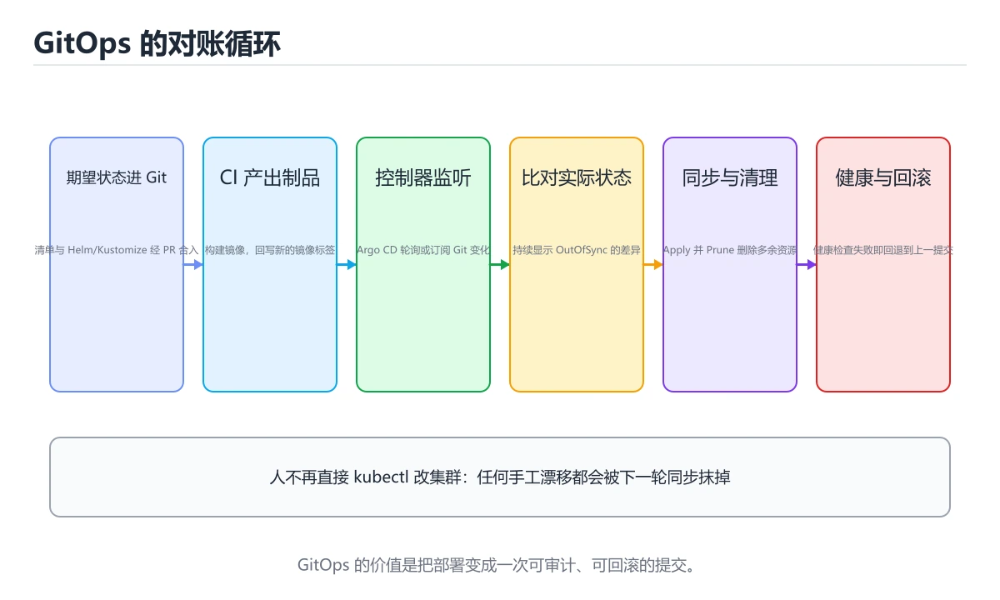

# GitOps 与 ArgoCD 实战



> **版本**：v2.0 | **难度**：初学者友好 | **前置知识**：Kubernetes 基础、Git 基本操作

> 内容更新时间：2026-10-06 · 学习阶段：高级 · 预计用时：180 分钟

---

---

## 本节知识框架

**课程定位**：分类「devops」· 学习阶段 高级 · 建议用时 65 分钟。

本课主线：理解 GitOps 理念，使用 ArgoCD 实现声明式部署与自动同步。

### 复习清单

- [ ] 能不看正文复述 GitOps，并指出 ArgoCD 的一个边界或反例。
- [ ] 能推演 GitOps 的示例：先写预期输出，再运行并记录差异与失败现象。
- [ ] 能完成一次自测，并把错题对照考点精讲定位原因。

### 第 1 讲·课程概览与学习目标
#### 你将学到什么

本课程将带你从零开始掌握 **GitOps** 理念与 **ArgoCD** 工具链的实战应用。学完本课程后，你将能够：

- 理解 GitOps 的核心原则，并能用生活类比解释其工作方式
- 搭建完整的 ArgoCD 持续部署流水线
- 使用 Helm 和 Kustomize 管理 Kubernetes 应用配置
- 实现多环境（dev / staging / prod）的 GitOps 部署策略
- 掌握密钥管理、自动同步、健康检查等生产级实践

#### 课程路线图

```text
GitOps 理念 → ArgoCD 架构 → Application CRD → 同步策略
    → Helm/Kustomize 集成 → 多环境管理 → 密钥管理 → 实战项目
```

---

### 第 13 讲·复习清单与最佳实践总结
#### 复习清单

完成本课程后，请对照以下清单检查自己的掌握程度：

- [ ] **GitOps 核心概念**：能否用自己的话解释 GitOps 的四大原则（声明式、版本化、自动拉取、持续协调）？能否说出 GitOps 与传统 CI/CD 的 Push 模式有什么本质区别？
- [ ] **ArgoCD 架构**：能否画出 ArgoCD 的核心组件（Server、Repository Server、Application Controller）以及它们之间的交互流程？能否解释“期望状态 vs 实际状态”的对比机制？
- [ ] **Application CRD**：能否独立编写一个 ArgoCD Application 资源？是否理解 `source`、`destination`、`syncPolicy` 各字段的含义？能否区分 Kustomize 和 Helm 两种 source 配置方式？
- [ ] **同步策略**：能否为不同环境（dev/staging/prod）配置合适的同步策略？是否理解 `prune`、`selfHeal`、同步窗口、重试策略的作用和配置方式？
- [ ] **Helm 集成**：能否创建一个基本的 Helm Chart？是否理解 `values.yaml`、`templates/`、`_helpers.tpl` 的作用？能否在 ArgoCD 中配置多环境 values 覆盖？
- [ ] **Kustomize 集成**：能否用 base + overlays 模式组织多环境配置？是否理解 `kustomization.yaml` 中 `resources`、`patches`、`namePrefix`、`configMapGenerator` 的用法？
- [ ] **密钥管理**：能否解释为什么密钥不能明文存储在 Git 中？是否掌握 Sealed Secrets 或 External Secrets 至少一种方案的使用方法？
- [ ] **多环境管理**：能否设计一套完整的 dev -> staging -> prod 环境晋升流程？是否理解 AppProject 的作用和配置方式？
- [ ] **排障能力**：能否处理常见的 ArgoCD 问题（OutOfSync、Degraded、同步卡住）？是否会使用 `argocd app diff`、`argocd app logs` 等命令进行诊断？

#### 最佳实践总结

1. **Git 是唯一的真相源**：永远不要手动修改集群中的资源，所有变更都通过 Git 提交
2. **环境隔离**：使用 AppProject 和 SyncWindows 对不同环境实施差异化管控
3. **渐进式自动化**：dev 环境全自动同步，staging 半自动，prod 需人工审批
4. **密钥安全第一**：使用 Sealed Secrets 或 External Secrets，绝不明文存储密钥
5. **监控与通知**：配置 Webhook 实现即时同步，配置通知让团队第一时间获知部署状态
6. **回滚策略**：保持 Git 历史清晰，确保任何时候都能通过 `git revert` 快速回滚
7. **资源限制**：为所有工作负载设置 `resources.requests` 和 `resources.limits`
8. **健康检查**：为所有服务配置 `livenessProbe` 和 `readinessProbe`

#### 推荐学习路径

```text
本课程完成后，建议继续学习：

1. Argo Workflows -- 在 Kubernetes 上编排复杂工作流
2. Argo Rollouts -- 实现金丝雀发布和蓝绿部署
3. Prometheus + Grafana -- 监控 GitOps 流水线和集群状态
4. HashiCorp Vault -- 企业级密钥管理
5. Crossplane -- 用 GitOps 方式管理云基础设施
```

---

---

## 核心概念定义

| 术语 | 一句话说明 |
| --- | --- |
| GitOps | 以 Git 仓库为唯一真相源的部署方式：改配置必须先提交，集群侧自动拉取并持续协调到期望状态。 |
| ArgoCD | 落地 GitOps 的控制器，由 Server、Repository Server 与 Application Controller 组成，用 Application CRD 描述期望状态。 |
| 声明式 | GitOps 四大原则之一：配置只写期望状态而不写执行步骤，由控制器自己算出差异并把集群修复过去。 |
| Kubernetes | 本课的部署目标集群：Git 里的 YAML、Helm 或 Kustomize 配置被同步成集群中实际运行的工作负载与探针配置。 |
| 自动同步 | `syncPolicy.automated` 让 Git 提交后由 ArgoCD 主动应用变更，`prune` 删掉 Git 里已移除的资源，`selfHeal` 把手工篡改改回来。 |

## 原理与运行机制

《GitOps 与 ArgoCD 实战》正文各章按「输入是什么 → 中间如何转换 → 输出到哪 → 失败时怎样表现」四问展开；复习时给每个机制补一句自己的复述，再回到对应章节核对。

### 第 2 讲·GitOps 核心理念：用“菜谱”理解声明式管理
#### 生活类比：Git 就是你的“菜谱”

想象你经营一家连锁餐厅。传统做法是：你亲自跑到每家分店，手把手教厨师做菜（命令式）。而 GitOps 的做法是：你维护一本**标准菜谱**（Git 仓库），每家分店的厨房会自动根据菜谱来制作菜品（Kubernetes 集群）。

如果有人想改菜品的口味，他不能直接跑到厨房改——他必须**先修改菜谱**，然后厨房自动同步更新。这就是 GitOps 的精髓：**Git 是唯一的真相源（Single Source of Truth）**。

#### GitOps 四大原则

| 原则 | 说明 | 类比 |
|------|------|------|
| **声明式** | 用配置文件描述“期望状态”，而非“执行步骤” | 菜谱写的是“成品应该是什么样” |
| **版本化 & 不可变** | 所有变更记录在 Git 中，可随时回滚 | 每道菜的历史版本都有记录 |
| **自动拉取** | 系统自动对比“期望状态”与“实际状态”，并修复差异 | 厨房自动检查菜品是否符合菜谱 |
| **持续协调** | 不断循环“检测差异 → 同步修复”的过程 | 质量监督员 24 小时巡检 |

#### GitOps vs 传统 CI/CD

```text
传统 CI/CD（Push 模式）：
  开发者 → CI 构建 → CI 推送到集群 → 集群被动接收

GitOps（Pull 模式）：
  开发者 → 修改 Git 仓库 → ArgoCD 检测到变化 → 从 Git 拉取并同步到集群
```

**关键区别**：在 GitOps 中，没有任何外部力量“推”东西进集群。ArgoCD 像一个尽职的厨师，不断查看菜谱（Git），确保厨房（集群）里的每道菜都和菜谱一致。

---

### 第 3 讲·Git 作为唯一真相源
#### 为什么选择 Git？

Git 不仅仅是一个代码版本管理工具，它还是一个天然的**审计日志系统**：

- **每次提交**都有时间戳、作者、变更说明
- **分支机制**让你可以安全地试验新配置
- **Pull Request** 提供了配置变更的审批流程
- **回滚操作**只需 `git revert`，简单可靠

#### 仓库结构设计

一个典型的 GitOps 仓库结构如下：

```text
gitops-repo/
├── apps/
│   ├── frontend/
│   │   ├── base/
│   │   │   ├── deployment.yaml
│   │   │   ├── service.yaml
│   │   │   └── kustomization.yaml
│   │   └── overlays/
│   │       ├── dev/
│   │       ├── staging/
│   │       └── prod/
│   └── backend/
│       ├── base/
│       └── overlays/
├── infra/
│   ├── namespace.yaml
│   ├── secrets/
│   └── configmaps/
└── argocd/
    └── applications/
        ├── frontend-app.yaml
        └── backend-app.yaml
```

#### 工作流规则

1. **禁止手动修改集群**：所有变更必须通过 Git 提交
2. **变更必须经过 Review**：通过 Pull Request 审批
3. **分支策略**：`main` 对应生产环境，`develop` 对应开发环境

---

### 第 4 讲·ArgoCD 架构与工作原理
#### ArgoCD 是什么？

ArgoCD 是一个为 Kubernetes 设计的**声明式 GitOps 持续交付工具**。它运行在集群内部，持续监控 Git 仓库，确保集群状态与 Git 中声明的期望状态一致。

#### 架构图解

```text
┌────────────────────────────────────────────────────────────────┐
│                      Git 仓库                            │
│  (Kubernetes manifests / Helm charts / Kustomize)       │
└────────────────────────────────┬──────────────────────────┘
                       │ ① 定期拉取 / Webhook 触发
                       ▼
┌────────────────────────────────────────────────────────────────┐
│                    ArgoCD Server                         │
│  ┌──────────┐  ┌──────────────┐  ┌───────────────────┐  │
│  │ API 服务  │  │  仓库控制器   │  │   应用控制器       │  │
│  └──────────┘  └──────────────┘  └───────────────────┘  │
└────────────────────────────────────────────────────────────────┘
                                             │ ② 对比差异
                                             ▼
                              ┌────────────────────────────────┐
                              │  期望状态 vs 实际状态     │
                              │  (Desired vs Live)       │
                              └────────────────────────────────┘
                                           │ ③ 同步（创建/更新/删除）
                                           ▼
                              ┌────────────────────────────────┐
                              │     Kubernetes 集群       │
                              │  Deployment / Service /  │
                              │  ConfigMap / Secret ...  │
                              └────────────────────────────────┘
```

#### 核心组件说明

- **ArgoCD Server**：提供 Web UI 和 API，处理用户请求
- **Repository Server**：与 Git 仓库交互，获取配置文件
- **Application Controller**：核心控制器，持续对比期望状态与实际状态，执行同步操作
- **Redis**：缓存 Git 仓库数据和会话信息

#### 安装 ArgoCD

```bash
# 创建 ArgoCD 命名空间
kubectl create namespace argocd

# 安装 ArgoCD（使用官方 manifest）
kubectl apply -n argocd -f https://raw.githubusercontent.com/argoproj/argo-cd/stable/manifests/install.yaml

# 查看安装状态
kubectl get pods -n argocd
```

#### 获取初始管理员密码

```bash
# 初始密码存储在 Secret 中
kubectl -n argocd get secret argocd-initial-admin-secret -o jsonpath="{.data.password}" | base64 -d
```

#### 访问 ArgoCD Web UI

```bash
# 端口转发到本地
kubectl port-forward svc/argocd-server -n argocd 8080:443

# 浏览器访问 https://localhost:8080
# 用户名：admin
# 密码：上一步获取的密码
```

---

### 第 6 讲·同步策略：自动/手动、同步窗口与健康检查
#### 同步模式对比

| 模式 | 适用场景 | 风险等级 |
|------|----------|----------|
| **自动同步** | 开发环境、测试环境 | 低（快速迭代） |
| **手动同步** | 生产环境 | 高（需要人工审批） |
| **半自动** | 预发布环境 | 中（自动检测，手动确认） |

#### 自动同步配置

```yaml
syncPolicy:
  automated:
    prune: true        # Git 中删除的资源，集群中也删除
    selfHeal: true     # 集群中被手动修改的资源，自动恢复为 Git 中的状态
```

#### 同步窗口（Sync Windows）

同步窗口限制了“什么时候可以自动同步”，常用于保护生产环境：

```yaml
apiVersion: argoproj.io/v1alpha1
kind: AppProject
metadata:
  name: production
  namespace: argocd
spec:
  description: 生产环境项目
  sourceRepos:
    - '*'
  destinations:
    - namespace: prod-*
      server: https://kubernetes.default.svc
  syncWindows:
    # 只允许在工作日 10:00-14:00 自动同步
    - kind: allow
      schedule: "0 10 * * 1-5"
      duration: 4h
      applications:
        - '*'
      namespaces:
        - prod-*
    # 禁止在周五下午同步（防止周末出问题无人处理）
    - kind: deny
      schedule: "0 14 * * 5"
      duration: 10h
      applications:
        - '*'
```

#### 健康检查（Health Checks）

ArgoCD 内置了对常见资源的健康检查：

- **Deployment**：检查所有 Pod 是否 Ready
- **Service**：检查是否存在
- **Ingress**：检查是否配置完成
- **StatefulSet**：检查副本是否就绪

自定义健康检查示例（针对 CronJob，在 argocd-cm ConfigMap 中配置）：

```lua
hs = {}
if obj.status ~= nil then
  if obj.status.lastScheduleTime ~= nil then
    hs.status = "Healthy"
    hs.message = "CronJob 上次调度时间: " .. obj.status.lastScheduleTime
  else
    hs.status = "Progressing"
    hs.message = "CronJob 尚未被调度"
  end
else
  hs.status = "Progressing"
  hs.message = "等待 CronJob 状态信息"
end
return hs
```

#### 重试策略

```yaml
syncPolicy:
  automated:
    prune: true
    selfHeal: true
  retry:
    limit: 5                  # 最多重试 5 次
    backoff:
      duration: 5s            # 初始等待 5 秒
      factor: 2               # 每次等待时间翻倍
      maxDuration: 3m         # 最长等待 3 分钟
```

---

### 第 9 讲·多环境管理：Dev / Staging / Prod
#### 环境隔离策略

在生产实践中，我们通常为每个环境创建独立的 Kubernetes 命名空间或独立集群：

```text
┌────────────────────────────────────────────────────────────────┐
│              Kubernetes 集群                 │
│                                             │
│  ┌───────────┐  ┌────────────┐  ┌──────────┐ │
│  │  dev 命名  │  │ staging   │  │  prod   │ │
│  │  空间     │  │ 命名空间   │  │ 命名空间 │ │
│  │           │  │           │  │         │ │
│  │ 前端 v2.1 │  │ 前端 v2.0 │  │前端 v1.9│ │
│  │ 后端 v3.0 │  │ 后端 v2.9 │  │后端 v2.8│ │
│  │ DB: dev   │  │ DB: stg   │  │DB: prod │ │
│  └───────────┘  └────────────┘  └──────────┘ │
└────────────────────────────────────────────────────────────┘
```

#### AppProject 定义

```yaml
# argocd/projects.yaml
apiVersion: argoproj.io/v1alpha1
kind: AppProject
metadata:
  name: dev-project
  namespace: argocd
spec:
  description: 开发环境项目
  sourceRepos:
    - https://github.com/example/gitops-repo.git
  destinations:
    - namespace: dev-*
      server: https://kubernetes.default.svc
  clusterResourceWhitelist:
    - group: '*'
      kind: '*'
---
apiVersion: argoproj.io/v1alpha1
kind: AppProject
metadata:
  name: staging-project
  namespace: argocd
spec:
  description: 预发布环境项目
  sourceRepos:
    - https://github.com/example/gitops-repo.git
  destinations:
    - namespace: staging-*
      server: https://kubernetes.default.svc
  clusterResourceWhitelist:
    - group: '*'
      kind: '*'
---
apiVersion: argoproj.io/v1alpha1
kind: AppProject
metadata:
  name: prod-project
  namespace: argocd
spec:
  description: 生产环境项目（严格管控）
  sourceRepos:
    - https://github.com/example/gitops-repo.git
  destinations:
    - namespace: prod-*
      server: https://kubernetes.default.svc
  clusterResourceWhitelist:
    - group: '*'
      kind: '*'
  syncWindows:
    - kind: allow
      schedule: "0 10 * * 1-5"
      duration: 4h
      applications:
        - '*'
```

#### 多环境 Application 定义

```yaml
# argocd/applications/frontend-dev.yaml
apiVersion: argoproj.io/v1alpha1
kind: Application
metadata:
  name: frontend-dev
  namespace: argocd
spec:
  project: dev-project
  source:
    repoURL: https://github.com/example/gitops-repo.git
    targetRevision: develop
    path: apps/frontend/overlays/dev
  destination:
    server: https://kubernetes.default.svc
    namespace: dev-frontend
  syncPolicy:
    automated:
      prune: true
      selfHeal: true
    syncOptions:
      - CreateNamespace=true
---
# argocd/applications/frontend-staging.yaml
apiVersion: argoproj.io/v1alpha1
kind: Application
metadata:
  name: frontend-staging
  namespace: argocd
spec:
  project: staging-project
  source:
    repoURL: https://github.com/example/gitops-repo.git
    targetRevision: main
    path: apps/frontend/overlays/staging
  destination:
    server: https://kubernetes.default.svc
    namespace: staging-frontend
  syncPolicy:
    automated:
      prune: true
      selfHeal: true
    syncOptions:
      - CreateNamespace=true
---
# argocd/applications/frontend-prod.yaml
apiVersion: argoproj.io/v1alpha1
kind: Application
metadata:
  name: frontend-prod
  namespace: argocd
spec:
  project: prod-project
  source:
    repoURL: https://github.com/example/gitops-repo.git
    targetRevision: main
    path: apps/frontend/overlays/prod
  destination:
    server: https://kubernetes.default.svc
    namespace: prod-frontend
  syncPolicy:
    automated:
      prune: false       # 生产环境关闭自动 prune
      selfHeal: false    # 生产环境关闭自动修复
    syncOptions:
      - CreateNamespace=true
```

#### 环境晋升流程

```text
开发者提交代码
    │
    ▼
develop 分支 → 自动同步到 dev 环境
    │
    ▼ 测试通过
创建 PR 到 main 分支 → 人工 Review
    │
    ▼ 合并到 main
staging 环境自动同步 → 集成测试
    │
    ▼ 验证通过
手动触发 prod 同步 → 生产部署
```

---

### 第 10 讲·密钥管理：Sealed Secrets 与 External Secrets
#### 问题：密钥不能明文存在 Git 中

GitOps 要求所有配置都在 Git 中，但密码、API Key 等敏感信息不能以明文存储。这就像菜谱可以公开，但保险箱密码不能写在菜谱上。

#### 方案一：Sealed Secrets

Sealed Secrets 由 Bitnami 开发，原理是用非对称加密对 Secret 进行加密，加密后的“密封密钥”可以安全地存储在 Git 中，只有集群内的 Sealed Secrets Controller 能解密。

```bash
# 安装 Sealed Secrets Controller
helm repo add sealed-secrets https://bitnami-labs.github.io/sealed-secrets
helm install sealed-secrets sealed-secrets/sealed-secrets \
  --namespace kube-system

# 安装 kubeseal CLI 工具
# macOS: brew install kubeseal
# Linux: 从 GitHub Releases 下载
```

创建加密密钥的流程：

```yaml
# 1. 先写一个普通的 Secret（不要提交到 Git！）
# secret-plain.yaml
apiVersion: v1
kind: Secret
metadata:
  name: db-credentials
  namespace: production
type: Opaque
stringData:
  username: admin
  password: super-secret-password-123
```

```bash
# 2. 用 kubeseal 加密
kubeseal --format yaml < secret-plain.yaml > sealed-secret.yaml

# 3. 将 sealed-secret.yaml 提交到 Git（这是安全的！）
git add sealed-secret.yaml
git commit -m "添加数据库密钥的加密版本"
```

加密后的 SealedSecret 资源：

```yaml
# sealed-secret.yaml（可以安全提交到 Git）
apiVersion: bitnami.com/v1alpha1
kind: SealedSecret
metadata:
  name: db-credentials
  namespace: production
spec:
  encryptedData:
    username: AgBy3i4OJSWK+PiTySYZZA9fO...（加密后的数据）
    password: AgBz7kN9XJ2m...（加密后的数据）
  template:
    metadata:
      name: db-credentials
      namespace: production
    type: Opaque
```

#### 方案二：External Secrets Operator

External Secrets 从外部密钥管理系统（如 AWS Secrets Manager、HashiCorp Vault、Azure Key Vault）中拉取密钥，并自动创建 Kubernetes Secret。

```bash
# 安装 External Secrets Operator
helm repo add external-secrets https://charts.external-secrets.io
helm install external-secrets external-secrets/external-secrets \
  --namespace external-secrets --create-namespace
```

配置 SecretStore（连接到密钥管理系统）：

```yaml
# secret-store.yaml
apiVersion: external-secrets.io/v1beta1
kind: SecretStore
metadata:
  name: vault-backend
  namespace: production
spec:
  provider:
    vault:
      server: "https://vault.example.com"
      path: "secret"
      version: "v2"
      auth:
        kubernetes:
          mountPath: "kubernetes"
          role: "argo-cd-role"
          serviceAccountRef:
            name: default
```

配置 ExternalSecret（定义要拉取的密钥）：

```yaml
# external-secret.yaml
apiVersion: external-secrets.io/v1beta1
kind: ExternalSecret
metadata:
  name: db-credentials
  namespace: production
spec:
  refreshInterval: 1h          # 每小时刷新一次
  secretStoreRef:
    name: vault-backend
    kind: SecretStore
  target:
    name: db-credentials       # 生成的 Kubernetes Secret 名称
    creationPolicy: Owner
  data:
    - secretKey: username      # Secret 中的 key
      remoteRef:
        key: secret/data/prod/db   # Vault 中的路径
        property: username
    - secretKey: password
      remoteRef:
        key: secret/data/prod/db
        property: password
```

#### 方案对比

| 特性 | Sealed Secrets | External Secrets |
|------|---------------|-----------------|
| 密钥存储位置 | Git 仓库内（加密） | 外部系统（Vault 等） |
| 安全性 | 依赖集群私钥 | 依赖外部系统安全 |
| 复杂度 | 低 | 中-高 |
| 密钥轮换 | 需重新加密 | 自动刷新 |
| 适用场景 | 小型项目、无外部依赖 | 企业级、已有密钥管理系统 |

---

### 第 12 讲·高级实践与排障指南
#### Webhook 自动触发

与其等待 ArgoCD 定期轮询 Git 仓库，不如配置 Webhook 让 Git 推送时立即触发同步：

```bash
# 在 ArgoCD 中获取 Webhook URL
argocd repo get https://github.com/your-org/gitops-repo.git \
  --output jsonpath='{.status.webhookUrl}'

# 在 GitHub 仓库的 Settings -> Webhooks 中添加此 URL
# Secret 填写 ArgoCD 的 webhook secret
# Content type 选择 application/json
# 触发事件选择 "Just the push event"
```

#### 应用资源排除

某些资源不应当被 ArgoCD 管理，可以在配置中排除：

```yaml
# argocd-cm ConfigMap 中添加排除规则
apiVersion: v1
kind: ConfigMap
metadata:
  name: argocd-cm
  namespace: argocd
data:
  resource.exclusions: |
    - apiGroups:
        - cilium.io
      kinds:
        - CiliumIdentity
      clusters:
        - "*"
```

#### 常见排障场景

**场景一：应用状态为 "OutOfSync"**

```bash
# 查看差异详情
argocd app diff microservice-demo

# 手动触发同步
argocd app sync microservice-demo

# 如果同步失败，查看事件日志
kubectl describe application microservice-demo -n argocd
```

**场景二：应用状态为 "Degraded"**

```bash
# 查看不健康的资源
argocd app get microservice-demo --health

# 检查 Pod 状态
kubectl get pods -n microservice-demo | grep -v Running

# 查看 Pod 事件
kubectl describe pod <pod-name> -n microservice-demo

# 查看 Pod 日志
kubectl logs <pod-name> -n microservice-demo
```

**场景三：同步卡住（Finalizer 阻塞）**

```bash
# 删除应用时可能被 finalizer 阻塞
# 先移除 finalizer 再删除
kubectl patch application microservice-demo -n argocd \
  --type json -p '[{"op": "remove", "path": "/metadata/finalizers"}]'
```

#### 通知配置

```yaml
# argocd-notifications-cm ConfigMap
apiVersion: v1
kind: ConfigMap
metadata:
  name: argocd-notifications-cm
  namespace: argocd
data:
  service.webhook.dingtalk: |
    url: https://oapi.dingtalk.com/robot/send?access_token=YOUR_TOKEN
    headers:
      - name: Content-Type
        value: application/json
  trigger.on-sync-succeeded: |
    - description: 应用同步成功
      send:
        - dingtalk-sync-succeeded
      when: app.status.operationState.phase in ['Succeeded']
  template.dingtalk-sync-succeeded: |
    webhook:
      dingtalk:
        method: POST
        body: |
          {
            "msgtype": "markdown",
            "markdown": {
              "title": "ArgoCD 同步成功",
              "text": "## 同步成功\n- 应用: {{.app.metadata.name}}\n- 状态: {{.app.status.sync.status}}\n- 仓库: {{.app.spec.source.repoURL}}"
            }
          }
```

---

## 典型应用场景

- 结合「GitOps 与 ArgoCD 实战」的常见落地场景与选型边界，详见正文各章节的对比讨论。
- 把 GitOps 迁移到新项目时，先明确输入规模、失败代价与可观测手段，再决定采用深度。

### 第 11 讲·实战：部署完整的微服务应用
#### 项目概述

在本章中，我们将部署一个完整的微服务应用，包含：

- **前端服务**（React SPA）
- **后端 API 服务**（Node.js）
- **Redis 缓存**
- **PostgreSQL 数据库**

#### 第一步：准备 Kubernetes Manifests

```yaml
# k8s/base/namespace.yaml
apiVersion: v1
kind: Namespace
metadata:
  name: microservice-demo
  labels:
    app.kubernetes.io/part-of: microservice-demo
```

```yaml
# k8s/base/redis-deployment.yaml
apiVersion: apps/v1
kind: Deployment
metadata:
  name: redis
  namespace: microservice-demo
spec:
  replicas: 1
  selector:
    matchLabels:
      app: redis
  template:
    metadata:
      labels:
        app: redis
    spec:
      containers:
        - name: redis
          image: redis:7-alpine
          ports:
            - containerPort: 6379
          resources:
            requests:
              cpu: 100m
              memory: 128Mi
            limits:
              cpu: 200m
              memory: 256Mi
          readinessProbe:
            tcpSocket:
              port: 6379
            initialDelaySeconds: 5
---
apiVersion: v1
kind: Service
metadata:
  name: redis
  namespace: microservice-demo
spec:
  selector:
    app: redis
  ports:
    - port: 6379
      targetPort: 6379
  type: ClusterIP
```

```yaml
# k8s/base/backend-deployment.yaml
apiVersion: apps/v1
kind: Deployment
metadata:
  name: backend-api
  namespace: microservice-demo
spec:
  replicas: 2
  selector:
    matchLabels:
      app: backend-api
  template:
    metadata:
      labels:
        app: backend-api
    spec:
      containers:
        - name: backend-api
          image: myregistry.example.com/backend-api:v1.0.0
          ports:
            - containerPort: 3000
          env:
            - name: REDIS_HOST
              value: redis
            - name: REDIS_PORT
              value: "6379"
            - name: DB_HOST
              valueFrom:
                secretKeyRef:
                  name: db-credentials
                  key: host
            - name: DB_PASSWORD
              valueFrom:
                secretKeyRef:
                  name: db-credentials
                  key: password
          livenessProbe:
            httpGet:
              path: /health
              port: 3000
            initialDelaySeconds: 10
            periodSeconds: 15
          readinessProbe:
            httpGet:
              path: /ready
              port: 3000
            initialDelaySeconds: 5
            periodSeconds: 10
          resources:
            requests:
              cpu: 200m
              memory: 256Mi
            limits:
              cpu: 500m
              memory: 512Mi
---
apiVersion: v1
kind: Service
metadata:
  name: backend-api
  namespace: microservice-demo
spec:
  selector:
    app: backend-api
  ports:
    - port: 3000
      targetPort: 3000
  type: ClusterIP
```

```yaml
# k8s/base/frontend-deployment.yaml
apiVersion: apps/v1
kind: Deployment
metadata:
  name: frontend
  namespace: microservice-demo
spec:
  replicas: 2
  selector:
    matchLabels:
      app: frontend
  template:
    metadata:
      labels:
        app: frontend
    spec:
      containers:
        - name: frontend
          image: myregistry.example.com/frontend:v1.0.0
          ports:
            - containerPort: 80
          env:
            - name: API_URL
              value: http://backend-api:3000
          livenessProbe:
            httpGet:
              path: /
              port: 80
            initialDelaySeconds: 5
          readinessProbe:
            httpGet:
              path: /
              port: 80
            initialDelaySeconds: 3
          resources:
            requests:
              cpu: 100m
              memory: 128Mi
            limits:
              cpu: 200m
              memory: 256Mi
---
apiVersion: v1
kind: Service
metadata:
  name: frontend
  namespace: microservice-demo
spec:
  selector:
    app: frontend
  ports:
    - port: 80
      targetPort: 80
  type: ClusterIP
```

```yaml
# k8s/base/ingress.yaml
apiVersion: networking.k8s.io/v1
kind: Ingress
metadata:
  name: microservice-demo
  namespace: microservice-demo
  annotations:
    nginx.ingress.kubernetes.io/rewrite-target: /
spec:
  ingressClassName: nginx
  rules:
    - host: demo.example.com
      http:
        paths:
          - path: /
            pathType: Prefix
            backend:
              service:
                name: frontend
                port:
                  number: 80
          - path: /api
            pathType: Prefix
            backend:
              service:
                name: backend-api
                port:
                  number: 3000
```

#### 第二步：创建 ArgoCD Application

```yaml
# argocd/microservice-demo.yaml
apiVersion: argoproj.io/v1alpha1
kind: Application
metadata:
  name: microservice-demo
  namespace: argocd
  finalizers:
    - resources-finalizer.argocd.argoproj.io
spec:
  project: default
  source:
    repoURL: https://github.com/your-org/gitops-repo.git
    targetRevision: main
    path: k8s/base
  destination:
    server: https://kubernetes.default.svc
    namespace: microservice-demo
  syncPolicy:
    automated:
      prune: true
      selfHeal: true
    syncOptions:
      - CreateNamespace=true
      - PrunePropagationPolicy=foreground
      - PruneLast=true
    retry:
      limit: 3
      backoff:
        duration: 5s
        factor: 2
        maxDuration: 3m
```

#### 第三步：使用 argocd CLI 操作

```bash
# 登录 ArgoCD
argocd login argocd.example.com --username admin --password <password>

# 注册 Git 仓库
argocd repo add https://github.com/your-org/gitops-repo.git \
  --username <git-username> \
  --password <git-token>

# 创建应用
argocd app create microservice-demo \
  --repo https://github.com/your-org/gitops-repo.git \
  --path k8s/base \
  --dest-server https://kubernetes.default.svc \
  --dest-namespace microservice-demo \
  --project default \
  --auto-prune \
  --self-heal

# 同步应用
argocd app sync microservice-demo

# 查看应用状态
argocd app get microservice-demo

# 查看应用日志
argocd app logs microservice-demo

# 回滚到上一个版本
argocd app rollback microservice-demo 1
```

#### 第四步：验证部署

```bash
# 检查所有 Pod 状态
kubectl get pods -n microservice-demo

# 预期输出：
# NAME                            READY   STATUS    RESTARTS   AGE
# backend-api-5d8f7b6c4d-abc12   1/1     Running   0          2m
# backend-api-5d8f7b6c4d-def34   1/1     Running   0          2m
# frontend-7c9d8e6f5b-ghi56      1/1     Running   0          2m
# frontend-7c9d8e6f5b-jkl78      1/1     Running   0          2m
# redis-6b5c4d3e2a-mno90         1/1     Running   0          2m

# 检查 Service
kubectl get svc -n microservice-demo

# 检查 Ingress
kubectl get ingress -n microservice-demo
```

---

## 代码/协议/SQL 示例

《GitOps 与 ArgoCD 实战》正文首个示例可作为最小验证起点（原样保留在上方章节）：先跑通，再改一个输入观察输出变化。

```text
GitOps 理念 → ArgoCD 架构 → Application CRD → 同步策略
    → Helm/Kustomize 集成 → 多环境管理 → 密钥管理 → 实战项目
```

### 第 5 讲·Application CRD 配置详解
#### 什么是 Application CRD？

ArgoCD 通过 Kubernetes 的自定义资源（CRD）来定义“应用”。每个 `Application` 资源描述了：

- **从哪里获取配置**（Git 仓库地址、路径、分支）
- **部署到哪里**（目标集群、命名空间）
- **使用什么工具**（原生 Kustomize、Helm、Kustomize + Helm）

#### 基础 Application 示例

```yaml
apiVersion: argoproj.io/v1alpha1
kind: Application
metadata:
  name: guestbook-app
  namespace: argocd
spec:
  # 目标集群与命名空间
  destination:
    server: https://kubernetes.default.svc
    namespace: guestbook
  # 源配置：Git 仓库信息
  source:
    repoURL: https://github.com/argoproj/argocd-example-apps.git
    targetRevision: HEAD
    path: guestbook
  # 项目归属
  project: default
  # 同步策略
  syncPolicy:
    automated:
      prune: true      # 自动删除 Git 中已移除的资源
      selfHeal: true   # 自动修复集群中的手动变更
    syncOptions:
      - CreateNamespace=true
```

#### 使用 Kustomize 的 Application

```yaml
apiVersion: argoproj.io/v1alpha1
kind: Application
metadata:
  name: frontend-kustomize
  namespace: argocd
spec:
  destination:
    server: https://kubernetes.default.svc
    namespace: frontend
  source:
    repoURL: https://github.com/example/gitops-repo.git
    targetRevision: main
    path: apps/frontend/overlays/dev
  project: default
  syncPolicy:
    automated:
      prune: true
      selfHeal: true
    syncOptions:
      - CreateNamespace=true
```

#### 使用 Helm 的 Application

```yaml
apiVersion: argoproj.io/v1alpha1
kind: Application
metadata:
  name: backend-helm
  namespace: argocd
spec:
  destination:
    server: https://kubernetes.default.svc
    namespace: backend
  source:
    repoURL: https://github.com/example/gitops-repo.git
    targetRevision: main
    path: charts/backend
    helm:
      releaseName: backend-service
      valueFiles:
        - values-dev.yaml
      parameters:
        - name: image.tag
          value: "v1.2.3"
        - name: replicaCount
          value: "3"
  project: default
  syncPolicy:
    automated:
      prune: true
      selfHeal: true
```

#### 使用 Helm Chart 仓库的 Application

```yaml
apiVersion: argoproj.io/v1alpha1
kind: Application
metadata:
  name: nginx-helm-repo
  namespace: argocd
spec:
  destination:
    server: https://kubernetes.default.svc
    namespace: web
  source:
    repoURL: https://charts.bitnami.com/bitnami
    chart: nginx
    targetRevision: 15.3.0
    helm:
      releaseName: my-nginx
      values: |
        replicaCount: 2
        service:
          type: ClusterIP
        resources:
          limits:
            cpu: 200m
            memory: 256Mi
  project: default
```

---

### 第 7 讲·Helm 集成：用模板管理复杂配置
#### 什么是 Helm？

Helm 是 Kubernetes 的“包管理器”，类似于 Ubuntu 的 `apt` 或 CentOS 的 `yum`。它用**模板**来生成 Kubernetes 资源清单，让你可以用变量和逻辑来复用配置。

#### 生活类比

如果 Kubernetes manifest 是一份固定的“打印表格”，那 Helm 就是一个“智能表单生成器”——你只需要填入变量（应用名、副本数、镜像版本），它就能自动生成完整的表格。

#### Helm Chart 目录结构

```text
charts/
└── myapp/
    ├── Chart.yaml          # Chart 元信息
    ├── values.yaml         # 默认配置值
    ├── templates/
    │   ├── deployment.yaml # Deployment 模板
    │   ├── service.yaml    # Service 模板
    │   ├── ingress.yaml    # Ingress 模板
    │   ├── hpa.yaml        # 水平自动伸缩模板
    │   └── _helpers.tpl    # 模板辅助函数
    └── charts/             # 依赖的子 Chart
```

#### Chart.yaml 示例

```yaml
apiVersion: v2
name: myapp
description: 一个示例微服务 Helm Chart
type: application
version: 0.1.0
appVersion: "1.0.0"
maintainers:
  - name: DevOps Team
    email: devops@example.com
```

#### values.yaml 示例

```yaml
# 全局配置
replicaCount: 2

image:
  repository: myregistry.example.com/myapp
  pullPolicy: IfNotPresent
  tag: "latest"

nameOverride: ""
fullnameOverride: ""

service:
  type: ClusterIP
  port: 80
  targetPort: 8080

ingress:
  enabled: true
  className: nginx
  annotations:
    cert-manager.io/cluster-issuer: letsencrypt-prod
  hosts:
    - host: myapp.example.com
      paths:
        - path: /
          pathType: Prefix
  tls:
    - secretName: myapp-tls
      hosts:
        - myapp.example.com

resources:
  limits:
    cpu: 500m
    memory: 512Mi
  requests:
    cpu: 200m
    memory: 256Mi

autoscaling:
  enabled: false
  minReplicas: 2
  maxReplicas: 10
  targetCPUUtilization: 80
  targetMemoryUtilization: 80

nodeSelector: {}
tolerations: []
affinity: {}
```

#### Deployment 模板

```yaml
apiVersion: apps/v1
kind: Deployment
metadata:
  name: {{ include "myapp.fullname" . }}
  labels:
    {{- include "myapp.labels" . | nindent 4 }}
spec:
  {{- if not .Values.autoscaling.enabled }}
  replicas: {{ .Values.replicaCount }}
  {{- end }}
  selector:
    matchLabels:
      {{- include "myapp.selectorLabels" . | nindent 6 }}
  template:
    metadata:
      labels:
        {{- include "myapp.selectorLabels" . | nindent 8 }}
    spec:
      containers:
        - name: {{ .Chart.Name }}
          image: "{{ .Values.image.repository }}:{{ .Values.image.tag | default .Chart.AppVersion }}"
          imagePullPolicy: {{ .Values.image.pullPolicy }}
          ports:
            - name: http
              containerPort: {{ .Values.service.targetPort }}
              protocol: TCP
          livenessProbe:
            httpGet:
              path: /healthz
              port: http
            initialDelaySeconds: 15
            periodSeconds: 20
          readinessProbe:
            httpGet:
              path: /ready
              port: http
            initialDelaySeconds: 5
            periodSeconds: 10
          resources:
            {{- toYaml .Values.resources | nindent 12 }}
      {{- with .Values.nodeSelector }}
      nodeSelector:
        {{- toYaml . | nindent 8 }}
      {{- end }}
      {{- with .Values.tolerations }}
      tolerations:
        {{- toYaml . | nindent 8 }}
      {{- end }}
      {{- with .Values.affinity }}
      affinity:
        {{- toYaml . | nindent 8 }}
      {{- end }}
```

#### _helpers.tpl 辅助函数

```gotemplate
{{/*
生成完整的资源名称
*/}}
{{- define "myapp.fullname" -}}
{{- if .Values.fullnameOverride }}
{{- .Values.fullnameOverride | trunc 63 | trimSuffix "-" }}
{{- else }}
{{- $name := default .Chart.Name .Values.nameOverride }}
{{- printf "%s-%s" .Release.Name $name | trunc 63 | trimSuffix "-" }}
{{- end }}
{{- end }}

{{/*
通用标签
*/}}
{{- define "myapp.labels" -}}
helm.sh/chart: {{ .Chart.Name }}-{{ .Chart.Version }}
{{ include "myapp.selectorLabels" . }}
app.kubernetes.io/version: {{ .Chart.AppVersion | quote }}
app.kubernetes.io/managed-by: {{ .Release.Service }}
{{- end }}

{{/*
选择器标签
*/}}
{{- define "myapp.selectorLabels" -}}
app.kubernetes.io/name: {{ .Chart.Name }}
app.kubernetes.io/instance: {{ .Release.Name }}
{{- end }}
```

#### 在 ArgoCD 中使用多环境 values

```yaml
# argocd/application-dev.yaml
apiVersion: argoproj.io/v1alpha1
kind: Application
metadata:
  name: myapp-dev
spec:
  source:
    repoURL: https://github.com/example/gitops-repo.git
    targetRevision: develop
    path: charts/myapp
    helm:
      valueFiles:
        - values.yaml
        - values-dev.yaml    # 开发环境覆盖值
---
# argocd/application-prod.yaml
apiVersion: argoproj.io/v1alpha1
kind: Application
metadata:
  name: myapp-prod
spec:
  source:
    repoURL: https://github.com/example/gitops-repo.git
    targetRevision: main
    path: charts/myapp
    helm:
      valueFiles:
        - values.yaml
        - values-prod.yaml   # 生产环境覆盖值
```

---

### 第 8 讲·Kustomize 集成：无模板的配置管理
#### 什么是 Kustomize？

Kustomize 是 Kubernetes 内置的配置定制工具。与 Helm 不同，Kustomize **不使用模板语法**，而是通过“基础 + 覆盖层”的方式组合配置。

#### 生活类比

Kustomize 就像“照片编辑”——你有一张原始照片（base），然后针对不同场景添加不同的滤镜和裁剪（overlays）。原始照片永远不变，每个场景的修改都是叠加上去的。

#### Kustomize 目录结构

```text
apps/
└── backend/
    ├── base/
    │   ├── deployment.yaml
    │   ├── service.yaml
    │   └── kustomization.yaml
    └── overlays/
        ├── dev/
        │   ├── kustomization.yaml
        │   └── replica-patch.yaml
        ├── staging/
        └── prod/
            ├── kustomization.yaml
            ├── replica-patch.yaml
            └── resource-patch.yaml
```

#### Base 配置

```yaml
# apps/backend/base/deployment.yaml
apiVersion: apps/v1
kind: Deployment
metadata:
  name: backend
  labels:
    app: backend
spec:
  replicas: 1
  selector:
    matchLabels:
      app: backend
  template:
    metadata:
      labels:
        app: backend
    spec:
      containers:
        - name: backend
          image: myregistry.example.com/backend:latest
          ports:
            - containerPort: 8080
          resources:
            requests:
              cpu: 100m
              memory: 128Mi
            limits:
              cpu: 200m
              memory: 256Mi
```

```yaml
# apps/backend/base/service.yaml
apiVersion: v1
kind: Service
metadata:
  name: backend
spec:
  selector:
    app: backend
  ports:
    - port: 80
      targetPort: 8080
  type: ClusterIP
```

```yaml
# apps/backend/base/kustomization.yaml
apiVersion: kustomize.config.k8s.io/v1beta1
kind: Kustomization
resources:
  - deployment.yaml
  - service.yaml
commonLabels:
  app.kubernetes.io/managed-by: kustomize
```

#### Dev 覆盖层

```yaml
# apps/backend/overlays/dev/kustomization.yaml
apiVersion: kustomize.config.k8s.io/v1beta1
kind: Kustomization
resources:
  - ../../base
namePrefix: dev-
namespace: dev
patches:
  - path: replica-patch.yaml
configMapGenerator:
  - name: backend-config
    literals:
      - LOG_LEVEL=debug
      - DATABASE_URL=postgresql://dev-db:5432/myapp
```

```yaml
# apps/backend/overlays/dev/replica-patch.yaml
apiVersion: apps/v1
kind: Deployment
metadata:
  name: backend
spec:
  replicas: 1
```

#### Prod 覆盖层

```yaml
# apps/backend/overlays/prod/kustomization.yaml
apiVersion: kustomize.config.k8s.io/v1beta1
kind: Kustomization
resources:
  - ../../base
namePrefix: prod-
namespace: production
patches:
  - path: replica-patch.yaml
  - path: resource-patch.yaml
configMapGenerator:
  - name: backend-config
    literals:
      - LOG_LEVEL=warn
      - DATABASE_URL=postgresql://prod-db:5432/myapp
```

```yaml
# apps/backend/overlays/prod/replica-patch.yaml
apiVersion: apps/v1
kind: Deployment
metadata:
  name: backend
spec:
  replicas: 5
```

```yaml
# apps/backend/overlays/prod/resource-patch.yaml
apiVersion: apps/v1
kind: Deployment
metadata:
  name: backend
spec:
  template:
    spec:
      containers:
        - name: backend
          resources:
            requests:
              cpu: 500m
              memory: 512Mi
            limits:
              cpu: "1"
              memory: 1Gi
```

---

## 时间/空间复杂度或性能分析

- 在《GitOps 与 ArgoCD 实战》里处理规模 n 时，先估计主循环与嵌套层数，再决定优化方向；小样本上的耗时读数不能外推。
- 关于 GitOps 的性能结论要写明输入分布，环境或规模一变就必须重测。

## 常见误区与易错点

| 错误做法 | 典型现象 | 修复方向 |
| --- | --- | --- |
| 只验证正常输入 | 边界数据触发时才暴露问题 | 为每个结论补一个空值/极值/重复值用例 |
| 背结论不跑实验 | 换个输入就失效 | 按「预测—实测—差异归因」三步复盘 |
| 忽略环境与版本差异 | 本机可用线上报错 | 把版本、配置与依赖写入复现步骤 |

## 与其他知识点的关系

本课与分类「devops」内相邻课程互为补充，建议按清单顺序学完再做综合练习。

## 自测题与参考答案

本课测验与题库同源，答题时先写 GitOps 与 ArgoCD 的判断依据，再对照解析修正。

## 考点精讲

### 考点 1

GitOps 的核心理念中，"Git 是唯一真相源（Single Source of Truth）"意味着什么？

A. Git 仓库只能存储 Kubernetes 配置文件，不能存储其他文件，镜像仍要推送到镜像仓库  
B. Git 仓库需要定期备份到外部存储  
C. 开发者可以直接修改集群中的资源，只要同步更新 Git 即可  
D. 所有基础设施和应用的期望状态都通过 Git 仓库管理，集群通过自动拉取 Git 中的配置来同步状态  

**正确答案：D**

**详细解释：** GitOps 的核心理念是将 Git 仓库作为系统期望状态的唯一来源。所有变更（包括应用配置、基础设施定义）都必须通过 Git 提交来发起，ArgoCD 等工具持续对比 Git 中的期望状态与集群中的实际状态，并自动修复差异。A 错误，Git 可以存储任何声明式配置。C 错误，GitOps 禁止直接手动修改集群。D 不是 GitOps 的核心含义。

---

### 考点 2

在 ArgoCD 中，"Application" CRD 的 "syncPolicy.automated" 配置中，"prune: true" 和 "selfHeal: true" 分别表示什么？

A. "prune" 自动创建新资源；"selfHeal" 自动修复网络问题  
B. "prune" 清理过期的部署历史；"selfHeal" 自动扩展副本数  
C. "prune" 自动更新镜像版本；"selfHeal" 自动重启失败的 Pod，均由 Application 控制器比对触发  
D. "prune" 自动删除 Git 中已移除的资源；"selfHeal" 自动修复集群中被手动修改的资源为 Git 中的状态  

**正确答案：D**

**详细解释：** "prune: true" 表示当 Git 仓库中删除了某个资源的定义时，ArgoCD 会自动在集群中也删除对应的资源。"selfHeal: true" 表示当有人手动修改了集群中的资源（例如通过 "kubectl edit"），ArgoCD 会自动将其恢复为 Git 中定义的状态。这两个配置确保了集群状态始终与 Git 保持一致，体现了 GitOps"禁止手动修改"的原则。

---

### 考点 3

ArgoCD 的同步窗口（Sync Windows）功能主要用于什么场景？

A. 加速 Git 仓库的拉取速度  
B. 压缩同步过程中的日志输出  
C. 自动合并多个 Pull Request，合并动作由仓库的合并队列串行执行，并在最新的主干基线上重新验证  
D. 限制自动同步的时间窗口，常用于保护生产环境（例如只允许工作日 10:00-14:00 自动同步，禁止周五下午同步）  

**正确答案：D**

**详细解释：** 同步窗口是 ArgoCD 中用于控制"什么时候可以自动同步"的功能。通过配置 "allow" 和 "deny" 类型的窗口，可以限制自动同步的时间段。典型用法是保护生产环境：只在工作日白天允许自动同步，禁止在周五下午或周末同步（防止出问题无人处理）。这为生产部署提供了额外的安全保护。

---

### 考点 4

关于 Helm 和 Kustomize 在 ArgoCD 中的使用，以下哪个说法是正确的？

A. Helm 使用模板语法生成 Kubernetes 资源，Kustomize 通过"基础 + 覆盖层"方式组合配置，不使用模板  
B. Helm 和 Kustomize 功能完全相同，只是语法不同，两者最终都会渲染成 YAML 清单再由 ArgoCD 应用  
C. Kustomize 必须依赖外部 Chart 仓库才能工作
D. Helm 不支持多环境配置，Kustomize 支持

**正确答案：A**

**详细解释：** Helm 是 Kubernetes 的包管理器，使用 Go 模板语法（如 "{{ .Values.replicaCount }}"）来生成资源清单，通过 "values.yaml" 文件传入变量。Kustomize 是 Kubernetes 内置的配置管理工具，不使用模板语法，而是通过 "base"（基础配置）加 "overlays"（覆盖层）的方式组合配置，通过 "patches" 修改特定字段。两者都可以在 ArgoCD 中使用，且各有适用场景。

---

### 考点 5

在 GitOps 密钥管理方案中，Sealed Secrets 的主要优势是什么？

A. 加密后的密钥可以安全地存储在 Git 仓库中，只有集群内的 Sealed Secrets Controller 能解密  
B. 密钥存储在外部 Vault 中，集群通过网络拉取  
C. 密钥以 Base64 编码存储在 Git 中，任何人都可以解码，因为 Base64 只是编码，解码不需要任何密钥  
D. 密钥通过环境变量手动注入到每个 Pod 中  

**正确答案：A**

**详细解释：** Sealed Secrets 使用非对称加密对 Kubernetes Secret 进行加密。加密后的"密封密钥"（SealedSecret 资源）可以安全地提交到 Git 仓库，因为只有集群内运行的 Sealed Secrets Controller 持有解密密钥。A 描述的是 External Secrets 方案。C 错误，Base64 不是加密，不安全。D 不是 Sealed Secrets 的工作方式。

---

> **课程版本**：v2.0
> **最后更新**：2026 年 10 月
> **适用 ArgoCD 版本**：v2.9+
> **适用 Kubernetes 版本**：v1.27+

---

### 考点 6

题目：在「GitOps 与 ArgoCD 实战」的术语表里，下列术语与解释的配对哪些是正确的？（多选）
A. 「声明式」：开源GitOps持续部署工具，用Application这个CRD描述源仓库与目标集群  
B. 「GitOps」：以Git仓库为唯一真相源的运维方式，控制器拉取配置差异并持续协调集群  
C. 「ArgoCD」：只写期望状态而不写执行步骤的配置风格，由系统自行收敛到目标  
D. 「Kubernetes」：容器编排平台，ArgoCD把Git里的YAML资源应用到集群并管理副本与探针  
正确答案：BD

**解析**：本题正确项是「GitOps」：以Git仓库为唯一真相源的运维方式，控制器拉取配置差异并持续协调集群，以及「Kubernetes」：容器编排平台，ArgoCD把Git里的YAML资源应用到集群并管理副本与探针，这两组配对与术语表一致。另外两组把术语和解释张冠李戴：「声明式」被安上了开源GitOps持续部署工具，用Application这个CRD描述源仓库与目标集群的解释，「ArgoCD」反而拿到了只写期望状态而不写执行步骤的配置风格，由系统自行收敛到目标的定义，所以两组都不能选。复习时回到「GitOps 与 ArgoCD 实战」的术语速查表逐条核对，配对题考的是定义里描述的对象和边界，而不是术语的字面长相。

---

## 术语速查

| 术语 | 一句话说明 |
| --- | --- |
| GitOps | 以Git仓库为唯一真相源的运维方式，控制器拉取配置差异并持续协调集群 |
| ArgoCD | 开源GitOps持续部署工具，用Application这个CRD描述源仓库与目标集群 |
| 声明式 | 只写期望状态而不写执行步骤的配置风格，由系统自行收敛到目标 |
| Kubernetes | 容器编排平台，ArgoCD把Git里的YAML资源应用到集群并管理副本与探针 |
| 自动同步 | syncPolicy让Git提交后自动应用到集群，selfHeal可纠正手工篡改 |

## 参考资料与复核

- 官方/权威资料：[OpenSSF 最佳实践](https://bestpractices.coreinfrastructure.org/)
- 主题延伸：[Argo CD 官方文档](https://argo-cd.readthedocs.io/en/stable/)
- 最后复核：2026-10-04
- 下次复核：2027-01-23

## 验证命令与预期输出

完成本课后，用下面三条命令核对交付质量：

```bash
# 1) 构建或启动
cd 项目根目录 && 按 README 的安装命令准备环境
# 2) 冒烟测试
运行课程里给出的最小示例，确认输出与「预期输出」一行一致
# 3) 回归检查
对照下方交付清单逐项打勾，缺失项先补齐再提交
```

预期输出：程序正常退出（退出码 0），关键结果与正文示例一致，无未捕获异常。

## 项目专属规格

- 运行环境与版本要求以正文「环境准备」为准，跨平台需分别验证。
- 数据规模、并发量与失败率阈值由验收用例定义，不得私自放宽。
- 接口契约、错误码与日志格式在交付前冻结，变更须走评审。

## 项目交付物

- [ ] 可运行的完整源码与构建脚本
- [ ] README：安装、运行、测试三步可复现
- [ ] 验收清单逐条勾选并附运行截图或日志

## 内容元数据

- 内容更新时间：2026-10-06

- 内容版本：v2.0
- 课程标识：devops_gitops_argocd
- 所属分类：devops
- 学习阶段：高级
- 建议用时：65 分钟
